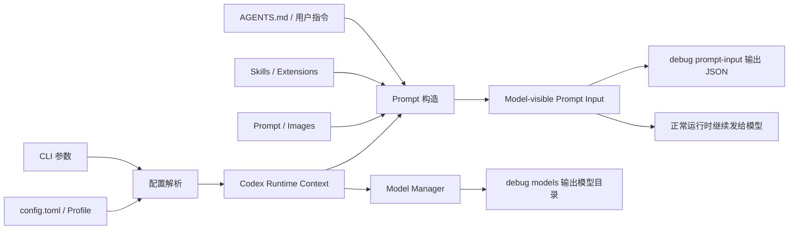
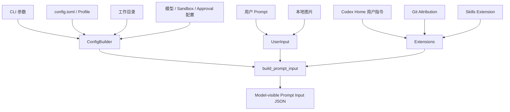
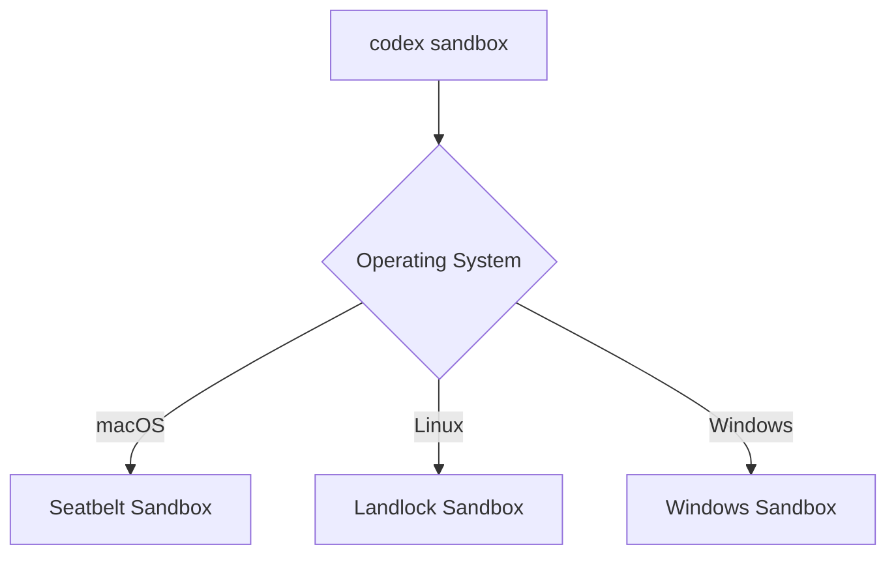
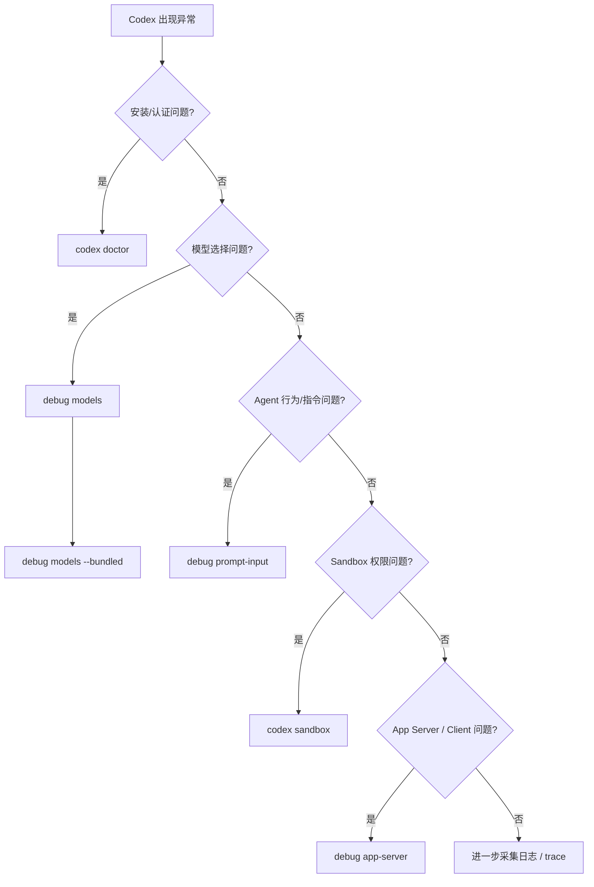

[toc]


## codex debug系列命令

> 当前介绍基于2026-9的版本,最新内容以官方文档问准.

### `codex debug` 是什么

`codex debug` 可以理解为 Codex CLI 的**诊断与内部观测工具集合**（debugging / introspection tools）。

它不是传统意义上的：

- `gdb`
- `lldb`
- Java Debugger
- IDE 断点调试器

它更接近：

> “让我看看 Codex 自己现在到底认为模型有哪些、准备给模型发送什么上下文、App Server 协议工作得怎么样，以及某些内部状态是什么。”

当前稳定版源码将 `debug` 定义为：

- `debug models`
- `debug prompt-input`
- `debug app-server`
- 隐藏的 `debug trace-reduce`
- 隐藏的 `debug clear-memories`

与此同时，沙箱调试已经变成独立的顶层：

- `codex sandbox`

而安装、配置、认证、运行时健康检查则有：

- `codex doctor`

这意味着现代 Codex CLI 已经把：

**健康检查、内部观测、沙箱测试**

拆成了三个不同的概念。

------

### 当前命令树

稳定版 0.153.4 可以概括为：

| 命令                                     | 可见性 | 主要作用                              | 典型使用者             |
| ---------------------------------------- | ------ | ------------------------------------- | ---------------------- |
| `codex debug models`                     | 公开   | 查看当前原始模型目录（model catalog） | 普通用户、运维、开发者 |
| `codex debug models --bundled`           | 公开   | 查看 CLI 二进制内置模型目录           | 模型/版本问题排查      |
| `codex debug prompt-input`               | 公开   | 查看“模型实际可见”的 Prompt 输入列表  | Agent/Prompt/配置调试  |
| `codex debug app-server send-message-v2` | 公开   | 测试 App Server V2 消息链路           | 集成开发者             |
| `codex debug trace-reduce`               | 隐藏   | 回放 trace bundle 并生成归约状态      | Codex 内部/高级调试    |
| `codex debug clear-memories`             | 隐藏   | 清理本地 Codex memory 状态            | 测试、内部诊断         |

源码中 `trace-reduce` 和 `clear-memories` 都显式设置了 `hide = true`，因此不能把它们当作长期稳定的公开 API。

查看自己安装版本的实际帮助信息，永远优先执行：

```bash
codex --version

codex debug --help

codex debug models --help

codex debug prompt-input --help

codex debug app-server --help
```

这是一个很重要的最佳实践：

> **CLI 帮助信息 + 当前安装版本，比网上一年前的文章更可信。**

------

### 理解 `debug` 的核心心智模型

可以把 Codex 的运行过程简化成：



最重要的是区分三个层次：

#### CLI 自己携带了什么

例如：

```bash
codex debug models --bundled
```

回答的是：

> “这个版本的 Codex 二进制本身带了什么模型信息？”

#### Codex 当前运行时看到什么

例如：

```bash
codex debug models
```

回答的是：

> “结合当前配置、认证和模型目录缓存，Codex Model Manager 当前看到什么？”

#### 模型真正会看到什么

例如：

```bash
codex debug prompt-input "检查这个项目"
```

回答的是：

> “经过 AGENTS.md、Skills、扩展、配置、用户输入等组装之后，准备暴露给模型的 Prompt 输入到底是什么？”

这三个问题不要混为一谈。

------

## `codex debug models` 详解

### 基本功能

最基本的命令：

```bash
codex debug models
```

官方源码给它的描述非常直接：

> Render the raw model catalog as JSON.

也就是：

**以 JSON 输出原始模型目录（raw model catalog）。**

它不是漂亮的模型选择 UI，也不是专门给人看的摘要，而是诊断数据。

因此非常适合配合：

- `jq`
- 重定向
- `diff`
- 自动化脚本

使用。

------

### `models` 与 `models --bundled` 的根本区别

这是 `codex debug` 最值得理解的地方之一。

| 命令                           | 数据来源           | 是否考虑当前配置/认证 | 是否可能访问在线目录 | 适合排查                |
| ------------------------------ | ------------------ | --------------------- | -------------------- | ----------------------- |
| `codex debug models --bundled` | CLI 二进制内置目录 | 否                    | 否                   | 当前 CLI “知道”哪些模型 |
| `codex debug models`           | Models Manager     | 是                    | 是，但不保证每次刷新 | 当前环境看到哪些模型    |

稳定版源码明确实现为：

- `--bundled`：直接调用 `bundled_models_response()`
- 默认模式：创建当前配置和 `AuthManager`
- 然后调用 `raw_model_catalog(...)`
- 刷新策略为 `OnlineIfUncached`


#### `OnlineIfUncached` 很重要

这意味着：

```bash
codex debug models
```

**不是：**

> 强制重新向服务端下载一次最新模型列表。

而更接近：

> 如果已有可用缓存，可以使用缓存；如果没有，则在线获取。

因此不要把它误解成：

```bash
codex debug models --force-refresh
```

当前命令并没有这样的语义。

------

### `--bundled` 到底代表什么

执行：

```bash
codex debug models --bundled
```

是在问：

> “这个 Codex CLI 版本发布的时候，打包进来的模型目录是什么？”

这对于定位**客户端版本问题**非常有价值。

例如：

```bash
codex --version
codex debug models --bundled
```

如果某个模型连 bundled catalog 都不存在，一个首先应该考虑的问题就是：

> Codex CLI 是否太旧？

而不是立即怀疑：

- ChatGPT 账户坏了
- 登录失败
- 服务端故障

------

### 默认 `debug models` 到底代表什么

执行：

```bash
codex debug models
```

源码会：

1. 读取 CLI config overrides；
2. 构造当前 `Config`；
3. 创建认证管理器（Auth Manager）；
4. 创建 Models Manager；
5. 读取 raw model catalog；
6. 必要时在线获取；
7. 输出 JSON。


因此它更接近：

> Codex 当前运行环境下的“有效模型目录”。

但这里还有一个重要边界：

#### 它不是跨产品统一的“账号权限证明”

不要因为：

```bash
codex debug models
```

中出现模型 A，就推断：

> “所以 ChatGPT Web、Desktop、API、所有 Codex Surface 都必须出现 A。”

不同产品 Surface 可能还有：

- UI 筛选
- rollout
- feature flag
- 认证类型
- provider
- 产品权限
- 客户端版本

等额外条件。

所以 `debug models` 是一个**诊断信号**，不是“所有产品统一 entitlement API”。

------

### 模型目录里通常能看到什么

当前 Codex 模型协议中的 `ModelInfo` 包含相当多诊断元数据，例如：

- `slug`
- `display_name`
- `description`
- `default_reasoning_level`
- `supported_reasoning_levels`
- `visibility`
- `supported_in_api`
- `priority`
- `supports_parallel_tool_calls`
- `context_window`
- `max_context_window`
- `auto_compact_token_limit`
- `effective_context_window_percent`
- `input_modalities`
- `supports_search_tool`
- `tool_mode`

等。

而响应本身是：

```json
{
  "models": [
    ...
  ]
}
```

当前协议源码将其定义为 `ModelsResponse { models: Vec<ModelInfo> }`。这些字段属于**原始模型元数据**，未来版本可以继续变化，因此脚本最好只依赖自己真正需要的字段。([GitHub](https://github.com/openai/codex/blob/main/codex-rs/protocol/src/openai_models.rs?utm_source=chatgpt.com))

------

### 最基本的查看方式

直接：

```bash
codex debug models
```

如果输出较长：

```bash
codex debug models | jq .
```

只列模型 slug：

```bash
codex debug models | jq -r '.models[].slug'
```

查看内置模型：

```bash
codex debug models --bundled | jq -r '.models[].slug'
```

------

### 查特定模型

例如：

```bash
codex debug models |
  jq '.models[] | select(.slug == "MODEL_SLUG")'
```

这里的 `MODEL_SLUG` 替换成实际模型名。

------

### 对比 bundled 与当前目录

这是非常实用的一组诊断命令：

```bash
codex debug models --bundled > bundled-models.json
codex debug models > runtime-models.json

diff -u bundled-models.json runtime-models.json
```

更适合模型名对比的做法：

```bash
codex debug models --bundled |
  jq -r '.models[].slug' |
  sort > bundled.txt

codex debug models |
  jq -r '.models[].slug' |
  sort > runtime.txt

diff -u bundled.txt runtime.txt
```

这个差异非常有解释力：

| 现象                     | 优先考虑                                   |
| ------------------------ | ------------------------------------------ |
| bundled 有，runtime 没有 | 当前目录、rollout、配置、认证、provider 等 |
| bundled 没有，runtime 有 | 服务端目录比二进制内置目录更新             |
| 两边都没有               | CLI 版本或模型名称是否正确                 |
| 两边都有，但 UI 不显示   | UI picker 的筛选/产品 Surface 差异         |
| 模型存在但运行失败       | 认证、权限、provider、API 调用层问题       |

这比简单地说“模型不见了”更有排障价值。

------

## `codex debug prompt-input` 详解

如果说 `debug models` 是查看：

> Codex “能用什么模型”

那么 `debug prompt-input` 是查看：

> Codex “准备让模型看到什么”。

这是当前 `debug` 中非常有价值的一条命令。

源码说明：

> Render the model-visible prompt input list as JSON.

也就是：

**把模型可见的 Prompt Input 列表渲染成 JSON。**

------

### 最简单的使用

```bash
codex debug prompt-input "请检查这个项目"
```

输出不是模型的回答。

它输出的是：

> Codex 构造出来的“模型输入上下文”。

这是一个非常重要的区别。

------

### `prompt-input` 不等于“问模型问题”

假设执行：

```bash
codex debug prompt-input "解释 main.rs"
```

它做的核心事情不是：

```text
Prompt
  -> OpenAI model
  -> Assistant answer
```

而是：

```text
Prompt
配置
项目上下文
用户指令
Skills
Extensions
Images
其他 Codex runtime context
  -> build_prompt_input()
  -> JSON
```

稳定版源码最后调用：

```rust
codex_core::build_prompt_input(...)
```

然后：

```rust
serde_json::to_string_pretty(&prompt_input)
```

直接打印。

因此它属于：

**Prompt Introspection**

而不是：

**Model Inference**

------

### 它为什么特别适合排查 Agent 行为

很多“模型为什么这么做”的问题，实际上并不是模型能力问题，而是：

> 模型收到了你没意识到的上下文。

例如：

- 某个 `AGENTS.md`
- 用户级 instructions
- 项目级 instructions
- Skill 说明
- Extension 注入
- feature flag
- 模型配置
- tool usage instructions
- 图片
- 当前工作目录带来的项目上下文

`debug prompt-input` 的核心价值就是：

> 把隐藏在“Agent 上下文装配过程”里的东西变得可观察。

------

### Prompt 构造的大致过程

根据稳定版实现，可以概括成：



这个图不是完整内部架构，而是理解 `debug prompt-input` 所需的简化模型。

------

### 它会读取哪些配置

稳定版源码会把大量正常 Codex 运行参数带入 Prompt 构造，包括：

- `model`
- approval policy
- sandbox mode
- `cwd`
- Codex 自身 executable 路径
- additional writable roots
- OSS 相关参数
- config overrides
- profile
- web search 配置
- feature 状态

等。

这点很重要，因为：

> `debug prompt-input` 不是在一个完全脱离真实 Codex 配置的假环境中生成 Prompt。

它尽量复用真正的运行时配置。

------

### 它使用 ephemeral 模式

实现中明确设置：

```rust
ephemeral: Some(true)
```

并且在 `build_prompt_input` 时使用：

```rust
state_db: None
```


可以把它理解成：

> 为了检查 Prompt 而构造一个临时环境，而不是建立一个正常可恢复的 Codex 会话。

所以非常适合做：

- Prompt 快照
- 配置回归测试
- Context 对比

------

### 支持图片输入

命令定义：

```bash
codex debug prompt-input -i FILE [PROMPT]
```

`-i` 即：

```text
--image
```

并且可以提供多个图片。源码会把文件转换成：

```rust
UserInput::LocalImage
```

再加入 Prompt 输入。

例如：

```bash
codex debug prompt-input \
  -i screenshot.png \
  "分析这张截图"
```

多个图片：

```bash
codex debug prompt-input \
  -i frontend.png \
  -i backend.png \
  "比较这两张图"
```

命令参数还支持逗号分隔的文件值；不过为了 Shell 可读性和跨平台稳定性，通常建议显式重复 `-i`。

------

### Prompt 参数是可选的

源码定义：

```text
[PROMPT]
```

而不是：

```text
<PROMPT>
```

因此可以直接：

```bash
codex debug prompt-input
```

这很有用。

因为有时候你根本不关心用户 Prompt，而只是想回答：

> “在这个 repository 中，Codex 启动时到底会自动注入哪些东西？”

------

### Prompt 换行会被规范化

这是一个很小但对自动化测试很实用的实现细节。

源码会把：

- CRLF
- CR

转换成：

- LF

也就是把 Windows/macOS 历史换行差异统一成 `\n`。

因此做 Prompt JSON 快照比较时，不容易仅仅因为行尾格式不同而产生无意义差异。

------

## 用 `prompt-input` 检查 AGENTS.md

这是一个非常典型的实际用途。

假设项目：

```text
my-project/
├── AGENTS.md
├── src/
│   └── ...
└── package.json
```

进入目录后：

```bash
cd my-project

codex debug prompt-input \
  "修改 src 中的错误处理"
```

然后搜索输出：

```bash
codex debug prompt-input "test" > prompt.json

grep -n "AGENTS" prompt.json
```

更通用地：

```bash
jq . prompt.json
```

你可以检查：

- 项目指令有没有进入上下文；
- 指令内容是不是预期版本；
- 是否还有其他层的 instruction 覆盖/补充；
- 工作目录是不是正确。

------

### 工作目录为什么重要

Prompt 构造依赖当前项目环境。

因此下面两个命令理论上可以得到不同结果：

```bash
cd repo-a
codex debug prompt-input "test"
```

和：

```bash
cd repo-b
codex debug prompt-input "test"
```

如果问题是：

> “为什么 Codex 在 repo A 遵守这个规则，但 repo B 不遵守？”

首先就值得比较两个 Prompt Input。

------

## 用 `prompt-input` 检查 Skill / Extension 注入

稳定版源码在构建 Prompt Input 时安装：

- Git attribution extension
- Skills extension

Skills extension 的配置还会考虑：

- 是否包含 Skill instructions
- Skill 上下文 token 上限
- bundled skills
- orchestrator skills
- Skill Search feature

等。

所以如果你怀疑：

> “是不是某个 Skill 改变了 Agent 的上下文？”

`debug prompt-input` 是比猜测更可靠的办法。

可以先：

```bash
codex debug prompt-input "test" > before.json
```

改变配置后：

```bash
codex debug prompt-input "test" > after.json
```

然后：

```bash
diff -u before.json after.json
```

这种做法特别适合：

- Skill 开发
- Plugin/Extension 开发
- Prompt token 优化
- Agent behavior regression
- CI 回归检查

------

## 与 Feature Flags 配合

当前 CLI 的 feature toggle 支持：

```bash
--enable FEATURE
--disable FEATURE
```

它们是全局参数，并且源码明确说明分别等价于：

```text
-c features.<name>=true
-c features.<name>=false
```


先查看当前版本有哪些 feature：

```bash
codex features list
```

然后可以做 A/B 对比：

```bash
codex debug prompt-input "test" > default.json

codex --disable FEATURE_NAME \
  debug prompt-input "test" > disabled.json

diff -u default.json disabled.json
```

这样你可以非常明确地回答：

> “这个 feature 到底改变了模型上下文的哪一部分？”

而不是只观察最终回答，然后猜。

------

## `prompt-input` 最适合排查什么

| 问题                     | 是否适合   |
| ------------------------ | ---------- |
| AGENTS.md 有没有生效     | 非常适合   |
| Skill 是否注入上下文     | 非常适合   |
| 配置切换是否改变 Prompt  | 非常适合   |
| 为什么 Prompt token 很大 | 很适合     |
| 图片有没有进入输入       | 很适合     |
| 模型回答是否正确         | 不直接适合 |
| 模型服务是否在线         | 不适合     |
| API latency              | 不适合     |
| Sandbox 为什么禁止某命令 | 不直接适合 |

记住：

> `prompt-input` 调试的是**模型输入**，而不是模型输出。

------

## `codex debug app-server` 详解

当前稳定版公开的 debug app-server 子命令只有：

```bash
codex debug app-server send-message-v2 <USER_MESSAGE>
```

源码的参数定义明确要求一个：

```text
USER_MESSAGE
```


例如：

```bash
codex debug app-server send-message-v2 \
  "Hello from the app-server debug client"
```

------

### App Server 是什么

Codex CLI 并不只是“终端聊天程序”。

现代 Codex 架构中存在 **App Server**，它承担 Codex 客户端与核心能力之间的协议/API 层角色。

这一类接口对于：

- Desktop app
- IDE integration
- 外部客户端
- Codex frontend
- 自动化测试

尤其重要。

顶层：

```bash
codex app-server
```

在当前 CLI 中仍被标记为：

> experimental


因此 `debug app-server` 更应该理解为：

> App Server 开发与协议测试工具。

而不是普通用户日常聊天命令。

------

### `send-message-v2` 实际做了什么

稳定版源码非常直接：

1. 获取当前 `codex` executable；
2. 使用 `codex_app_server_test_client`；
3. 调用 `send_message_v2(...)`；
4. 把给定的 `user_message` 发进测试流程。


因此它实际上是一个：

**App Server V2 test harness**

即测试工具壳。

------

### `V2` 不代表“模型 V2”

这是容易误解的一点。

这里：

```text
send-message-v2
```

中的 V2 指的是：

> App Server 消息/协议接口版本。

不是：

- GPT 模型第二版
- Codex 模型第二版
- Reasoning V2

------

### 哪些场景值得使用

例如你正在开发自己的 Codex 客户端。

出现：

```text
CLI 直接运行正常
Desktop/自研客户端消息异常
```

这时可以分层：

```text
Model/API
    ↑
Codex Core
    ↑
App Server
    ↑
Client
```

通过：

```bash
codex debug app-server send-message-v2 "hello"
```

测试中间的 App Server 通路。

如果测试 harness 本身也异常，问题更可能在：

- App Server
- protocol
- runtime
- auth/config

而不是你的 GUI rendering。

------

## 隐藏命令 `debug trace-reduce`

当前稳定版还存在：

```bash
codex debug trace-reduce <TRACE_BUNDLE>
```

但是源码明确：

```rust
#[clap(hide = true)]
```

所以：

> 这是内部/高级调试工具，不属于建议普通用户长期依赖的稳定 CLI 接口。


------

### Trace Bundle 是什么

命令要求一个目录，其中包含：

- `manifest.json`
- `trace.jsonl`

源码帮助说明就是：

> Trace bundle directory containing manifest.json and trace.jsonl.


可以把：

**trace（执行轨迹）**

理解为：

> Codex 运行过程中记录的一系列事件。

而：

**reduce（归约）**

意味着：

> 将事件流重新播放、整理成更容易分析的状态。

------

### 默认输出

执行：

```bash
codex debug trace-reduce ./trace-bundle
```

默认会生成：

```text
./trace-bundle/state.json
```

也可以：

```bash
codex debug trace-reduce \
  ./trace-bundle \
  -o ./reduced-state.json
```

源码实际上调用：

```rust
replay_bundle(...)
```

然后把归约后的 trace 状态序列化成 pretty JSON。

------

### 可以用来做什么

适合：

- trace 重放
- 会话状态恢复问题分析
- rollout debugging
- 事件顺序问题分析
- Codex 内部协议开发

不适合初学者拿来作为日常命令。

------

### Trace 的安全注意事项

Trace 很可能包含：

- Prompt
- 文件路径
- tool 参数
- workspace 信息
- 命令
- session metadata

因此：

> **不要未经检查就把 trace bundle 上传到公开 Issue。**

尤其要检查：

- API keys
- access tokens
- 私有仓库路径
- 源代码片段
- 个人信息
- 内部域名

------

## 隐藏命令 `debug clear-memories`

另一个隐藏命令是：

```bash
codex debug clear-memories
```

同样被标记为：

```rust
#[clap(hide = true)]
```


------

### 它做什么

稳定版实现会：

1. 构造当前 Codex config；
2. 找到 memories SQLite 数据位置；
3. 清理数据库中的 memory state；
4. 清理 Codex Home 下 memory 相关目录内容；
5. 输出清理结果。


所以它是一个**有副作用的清理命令**。

和：

```bash
codex debug models
```

这种只读诊断完全不是一个风险等级。

------

### 什么时候考虑它

主要用于：

- Codex memory feature 开发；
- 测试“全新 memory 状态”；
- memory 数据损坏诊断；
- 回归测试。

不建议碰到普通问题就执行：

```bash
codex debug clear-memories
```

因为这相当于：

> “先删状态看看会不会好。”

通常应该先观察、备份、定位问题。

------

### 它不是 ChatGPT 账户 Memory 清理命令

这一点尤其要区分。

它处理的是：

> 当前 Codex CLI 本地运行环境中的 memory state。

不是：

- ChatGPT Web Memory
- ChatGPT 账号 Personalization Memory
- 云端账户级 Memory 设置

两者不是一回事。

------

## 为什么网上还有 `codex debug seatbelt`

如果你搜索 Codex debug，很可能会遇到这样的旧命令：

```bash
codex debug seatbelt ...
```

或者：

```bash
codex debug landlock ...
```

这些来自较早的 Codex CLI 版本。

**现代稳定版已经不是这个结构。**

当前顶层明确存在：

```bash
codex sandbox
```

源码在不同操作系统上分别路由到：

- macOS：Seatbelt
- Linux：Landlock
- Windows：Windows sandbox


因此旧教程中：

```text
debug seatbelt
debug landlock
```

的思路，在今天应该优先迁移为：

```bash
codex sandbox --help
```

------

### 当前沙箱架构

可以概括成：



源码直接分别调用：

- `run_command_under_seatbelt`
- `run_command_under_landlock`
- `run_command_under_windows_sandbox`


------

### 为什么这个版本变化很重要

如果一篇教程说：

```bash
codex debug landlock ...
```

你直接复制到 Codex 0.153.4，很可能会得到：

```text
unrecognized subcommand
```

这并不代表：

> “你的 Codex 安装坏了。”

更可能只是：

> “教程针对的是旧版 CLI。”

因此读 Codex 资料一定要同时确认：

```bash
codex --version
```

------

## `debug`、`doctor`、`sandbox` 应该怎么选

这是现代 Codex CLI 很重要的一组边界。

| 问题                         | 优先命令                       |
| ---------------------------- | ------------------------------ |
| Codex 安装是不是正常         | `codex doctor`                 |
| config/auth/runtime 是否健康 | `codex doctor`                 |
| 有哪些模型                   | `codex debug models`           |
| CLI 内置哪些模型             | `codex debug models --bundled` |
| 模型实际会收到什么 Context   | `codex debug prompt-input`     |
| App Server 协议是否正常      | `codex debug app-server`       |
| 某命令在 sandbox 内是否运行  | `codex sandbox`                |
| trace 如何归约               | `codex debug trace-reduce`     |
| 重置本地 memory 测试状态     | `codex debug clear-memories`   |

源码现在甚至给 `doctor` 一个非常明确的描述：

> Diagnose local Codex installation, config, auth, and runtime health.

而 `debug` 只是：

> Debugging tools.


所以初学者更合理的排错顺序通常是：

```text
安装/认证问题
    -> codex doctor

模型问题
    -> codex debug models

Agent 指令/上下文问题
    -> codex debug prompt-input

沙箱权限问题
    -> codex sandbox

客户端协议问题
    -> codex debug app-server
```

------

## `debug` 与配置覆盖的关系

`debug` 并不一定忽略你的配置。

尤其：

```bash
codex debug models
```

和：

```bash
codex debug prompt-input
```

都会读取不同程度的当前配置。

例如 `debug models` 默认路径会：

```text
CLI overrides
    -> ConfigBuilder
    -> AuthManager
    -> ModelsManager
```


因此有时候很值得做：

```bash
codex debug models > normal.json
```

然后带某个 config override 再比较。

------

### Feature Toggle 是全局参数

例如：

```bash
codex --disable FEATURE debug prompt-input "test"
```

当前源码将：

```bash
--enable FEATURE
```

解释为：

```text
features.FEATURE=true
```

把：

```bash
--disable FEATURE
```

解释为：

```text
features.FEATURE=false
```

并且二者可以重复使用。

这使 `prompt-input` 很适合作为 Feature Flag 的**可观察性工具**。

------

## 一个非常实用的 Prompt A/B 调试方法

比如你改变了一个 Codex feature，却不知道它真正改变了什么。

先：

```bash
codex debug prompt-input \
  "Review this repository" > enabled.json
```

再：

```bash
codex --disable FEATURE \
  debug prompt-input \
  "Review this repository" > disabled.json
```

然后：

```bash
diff -u disabled.json enabled.json
```

这比仅仅比较两次模型回答可靠很多。

因为模型回答存在随机性，而：

> Prompt 输入差异更接近真正的因果变量。

------

## 常见问题的完整排查方法

### 模型在 Codex 中找不到

不要一开始就重装。

先：

```bash
codex --version
```

然后：

```bash
codex debug models --bundled > bundled.json
codex debug models > runtime.json
```

检查目标模型：

```bash
jq -r '.models[].slug' bundled.json
```

以及：

```bash
jq -r '.models[].slug' runtime.json
```

判断：

```text
bundled 中没有
    -> 优先检查 CLI 版本

bundled 有
runtime 没有
    -> 优先检查 runtime catalog / auth / rollout / provider

两边都有
picker 没有
    -> 优先检查 UI / picker filtering

picker 有
实际调用失败
    -> 转向 auth / API / provider / network
```

这是一种比“删配置重装”更专业的定位方式。

------

## AGENTS.md 看起来完全没生效

先不要立即修改 Prompt。

运行：

```bash
codex debug prompt-input \
  "遵循项目规则并检查代码" > prompt.json
```

然后检查：

```bash
jq . prompt.json
```

重点问：

- 正确的 AGENTS 指令出现了吗？
- 当前 cwd 对吗？
- 有没有其他 instruction？
- 有没有 Skill/Extension 额外注入？
- 是否测试了错误的 repository？

如果输入本身就不正确，继续调模型 Prompt 没有意义。

------

## Codex 突然消耗大量 Context

运行：

```bash
codex debug prompt-input "test" > prompt.json
```

重点寻找：

- 很长的项目 instructions；
- Skill instructions；
- extension context；
- 大量工具说明；
- 重复 instructions；
- 意外图片；
- 非预期项目上下文。

这实际上是在做：

**Prompt Context Budget Analysis**

即上下文预算分析。

------

## 修改配置后 Agent 行为变了

不要只对比两个回答。

保存两个 Prompt：

```bash
codex debug prompt-input \
  "perform task" > before.json
```

修改配置后：

```bash
codex debug prompt-input \
  "perform task" > after.json
```

然后：

```bash
diff -u before.json after.json
```

先证明：

> “配置到底改变了什么模型输入？”

再研究：

> “模型为什么改变行为？”

这是 Agent debugging 中非常重要的分层思想。

------

## IDE / Desktop 正常连接不上 Codex

如果普通 Codex CLI 基本正常，而你的 App Server client 有异常，可以测试：

```bash
codex debug app-server send-message-v2 \
  "protocol smoke test"
```

根据结果把问题大致划分到：

```text
自研 Client
App Server
Codex runtime
Model/API
```

不要直接把所有错误都归因于“大模型”。

------

## Sandbox 出错

现代版本不要首先去找：

```text
codex debug seatbelt
codex debug landlock
```

而应该：

```bash
codex sandbox --help
```

然后依据当前 OS 测试。

因为稳定版现在已经明确通过顶层 `sandbox` 路由到 macOS Seatbelt、Linux Landlock 或 Windows sandbox。

------

## `debug` 的几个关键术语

| 中文概念      | 英文术语              | 含义                                   |
| ------------- | --------------------- | -------------------------------------- |
| 调试          | Debugging             | 定位运行异常                           |
| 自省/内部观测 | Introspection         | 查看程序内部认为的状态                 |
| 模型目录      | Model Catalog         | Codex 当前掌握的模型元数据集合         |
| 内置模型目录  | Bundled Model Catalog | 随 CLI 二进制一起发布的模型元数据      |
| 原始模型目录  | Raw Model Catalog     | 未转换成 UI picker 摘要的模型响应      |
| Prompt 输入   | Prompt Input          | 提供给模型的上下文输入                 |
| 模型可见      | Model-visible         | 最终会暴露给模型的内容                 |
| 临时会话      | Ephemeral             | 不按普通持久化会话处理                 |
| 扩展          | Extension             | 向 Codex runtime 增加上下文/能力的组件 |
| 技能          | Skill                 | Codex 可发现和使用的一组专业指令/能力  |
| App Server    | App Server            | Codex 应用客户端使用的服务/协议层      |
| Trace         | Execution Trace       | 运行产生的事件轨迹                     |
| Trace Bundle  | Trace Bundle          | 打包保存的 trace 数据                  |
| Replay        | Replay                | 根据事件重新构建运行状态               |
| Reduce        | Reduction             | 将事件轨迹归约为状态                   |
| Sandbox       | Sandbox               | 限制进程文件、网络等权限的隔离环境     |
| Feature Flag  | Feature Flag          | 控制功能是否启用的开关                 |

------

## 容易误解的地方

### `debug models` 就是“我账号能用的所有模型”

不准确。

它是 Codex 的 raw model catalog 诊断数据。

实际产品 Surface 还可能有其他筛选逻辑。

------

### `debug models` 每次都访问最新服务器

不准确。

稳定版使用：

```text
OnlineIfUncached
```

因此已有缓存时不一定强制刷新。

------

### `models --bundled` 是服务端实时目录

正好相反。

它是：

> 随当前 CLI binary 打包的 model catalog。

源码在该路径直接调用 bundled response。

------

### `prompt-input` 会实际调用模型回答

不是。

它的核心工作是：

```text
build_prompt_input
    -> JSON
```

不是：

```text
inference
    -> assistant response
```


------

### `prompt-input` 只显示我输入的那句话

不是。

它的意义恰恰在于展示**组装后的模型上下文**。

它可能受：

- config
- cwd
- user instructions
- Skills
- Extensions
- images
- feature flags

等影响。

------

### `debug seatbelt` 仍然是当前标准命令

不是。

现代稳定版已经把 sandbox 提升成：

```bash
codex sandbox
```

并按操作系统选择 Seatbelt、Landlock 或 Windows sandbox。

------

### 隐藏命令也属于稳定 CLI API

不应该这样假设。

Clap 中显式：

```rust
#[clap(hide = true)]
```

通常意味着：

> 实现细节/内部开发工具，可能在未来版本调整甚至删除。

------

## 最佳实践

### 第一原则：先确定版本

任何 debug 前：

```bash
codex --version
```

尤其当：

- GitHub Issue
- 博客
- Stack Overflow
- Reddit
- 旧教程

中的命令与你本机不一致时。

Codex CLI 目前更新速度很快。

------

### 第二原则：尽量观察，而不是先破坏状态

推荐顺序：

```text
doctor
    -> models
    -> prompt-input
    -> 保存 JSON
    -> diff
    -> 最后才考虑清缓存/清状态
```

不推荐：

```text
问题出现
    -> 删除整个 ~/.codex
    -> 重装
```

后者会直接销毁很多有价值的诊断线索。

------

### 第三原则：保存机器可读输出

例如：

```bash
codex debug models > models.json

codex debug prompt-input "test" > prompt.json
```

优点：

- 可 diff
- 可归档
- 可复制最小复现
- 可使用 `jq`
- 可在升级前后比较

------

### 第四原则：建立升级前后的 baseline

升级 Codex 前：

```bash
codex --version > before-version.txt
codex debug models --bundled > before-models.json
codex debug prompt-input "baseline" > before-prompt.json
```

升级以后再生成一组。

如果行为改变：

```bash
diff -u before-models.json after-models.json
diff -u before-prompt.json after-prompt.json
```

这对于 Agent 平台尤其有效。

------

### 第五原则：不要依赖隐藏命令做生产自动化

尤其：

```text
debug trace-reduce
debug clear-memories
```

因为它们当前是 hidden/internal。

生产脚本长期绑定它们风险较高。

------

### 第六原则：Prompt Input 可能包含敏感信息

运行：

```bash
codex debug prompt-input > prompt.json
```

之后，不要想当然地认为这个 JSON 可以公开。

它可能包含：

- 内部项目说明
- repository 信息
- 本地文件路径
- 用户指令
- Skill instructions
- 工具定义
- 公司内部约束

提交 GitHub Issue 前先审查。

------

## 推荐的标准排障流程

如果以后遇到一个模糊的：

> “Codex 不正常。”

我更推荐按下面顺序。



这个顺序背后的原则是：

> **先确定故障层，再调试那一层。**

不要把：

- 模型目录问题
- Prompt 问题
- Sandbox 问题
- App Server 问题
- Authentication 问题

全部统称成“Codex 模型不工作”。

------

## 实用速查表

| 我要解决的问题               | 命令                                               |
| ---------------------------- | -------------------------------------------------- |
| 查看当前 debug 功能          | `codex debug --help`                               |
| 查看当前模型目录             | `codex debug models`                               |
| 查看 binary 内置模型目录     | `codex debug models --bundled`                     |
| 格式化模型 JSON              | `codex debug models | jq .`                        |
| 只看模型 slug                | `codex debug models | jq -r '.models[].slug'`      |
| 查看模型真正能看到的 Prompt  | `codex debug prompt-input "PROMPT"`                |
| 只检查自动注入上下文         | `codex debug prompt-input`                         |
| 带图片检查 Prompt            | `codex debug prompt-input -i image.png "PROMPT"`   |
| 测试 App Server V2           | `codex debug app-server send-message-v2 "MESSAGE"` |
| 查看 sandbox 当前语法        | `codex sandbox --help`                             |
| 检查安装/config/auth/runtime | `codex doctor`                                     |
| 查看 feature flags           | `codex features list`                              |
| Trace bundle 归约            | `codex debug trace-reduce BUNDLE`，隐藏接口        |
| 清理本地 memory 状态         | `codex debug clear-memories`，隐藏且有破坏性       |

这里为了 Markdown 表格不把 Shell 管道符误解析成列分隔符，表格中的 `|` 已转义。

------

### 最值得记住的结论

如果只保留几个知识点，可以记住这些：

- **`codex debug` 是内部状态观测工具，不是传统断点 Debugger。**
- **`debug models --bundled` 看的是 CLI 发布时内置的模型目录。**
- **`debug models` 看的是当前 Config/Auth/Models Manager 下的 raw model catalog。**
- **默认 `debug models` 使用 `OnlineIfUncached`，不是每次强制刷新服务器。**
- **`debug prompt-input` 是当前最有价值的 Agent Context 调试工具之一，它让你看到模型实际会收到什么。**
- **`prompt-input` 不生成模型回答，而是构造并输出 model-visible input JSON。**
- **`debug app-server send-message-v2` 是 App Server 协议测试 harness，而不是普通聊天方式。**
- **`trace-reduce` 与 `clear-memories` 是隐藏的内部命令，不应视作长期稳定 API。**
- **旧版 `debug seatbelt` / `debug landlock` 教程已经过时；现代版本应看 `codex sandbox`。**
- **安装、认证、config、runtime 健康问题优先使用 `codex doctor`，而不是乱用 debug 子命令。**

本文版本基线是 **Codex CLI 0.153.4**；GitHub 在 2026-09-04 将其标记为 Latest，而 0.154.0-alpha.6 是 2026-09-07 发布的预发布版。Codex CLI 更新较快，因此尤其是隐藏命令，今后最好再次以 `codex debug --help` 和对应版本源码为准。([GitHub](https://github.com/openai/codex/releases))