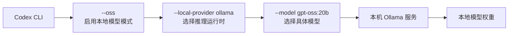
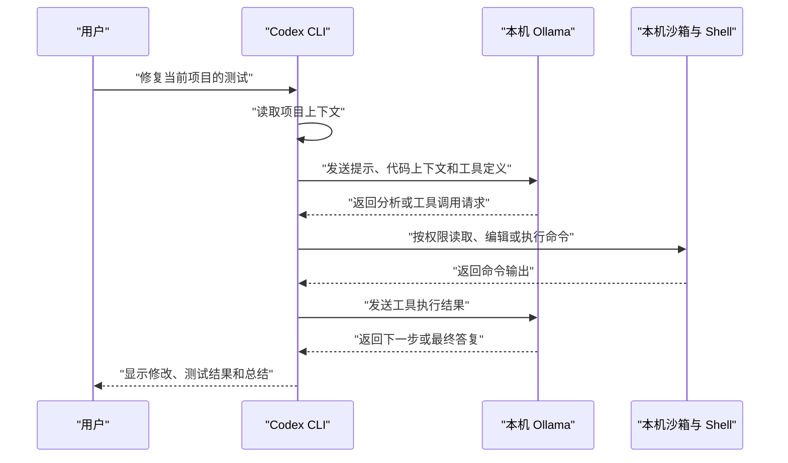

[toc]


## 这条命令究竟做了什么

```bash
codex --oss --local-provider ollama
```

它表示：

> 启动 Codex CLI 的交互式终端界面，并把模型推理请求发送给本机的 Ollama 服务，而不是默认的 OpenAI 云端模型供应商。

三个部分分别承担不同职责：

| 部分                      | 英文概念                  | 作用                                 |
| ------------------------- | ------------------------- | ------------------------------------ |
| `codex`                   | Codex CLI                 | 启动 Codex 交互式终端界面（TUI）     |
| `--oss`                   | Open-source software mode | 启用本地开放模型供应商模式           |
| `--local-provider ollama` | Local model provider      | 本次运行指定 Ollama 作为本地推理服务 |

`--local-provider` 当前支持 `ollama` 和 `lmstudio`。它只在 `--oss` 模式下有意义，并且会覆盖配置文件中的 `oss_provider`。如果交互式 Codex 没有获得本地供应商，它会提示选择；而 `codex exec` 在这种情况下会直接报错。([OpenAI Developers](https://developers.openai.com/codex/config-advanced))

## 最容易混淆的三个概念

### `--oss` 不等于 `gpt-oss`

虽然名称相近，但两者不是一回事：

- `--oss` 是 Codex CLI 的**运行模式参数**。
- `gpt-oss` 是一组具体的**开放权重模型**。
- Ollama 是负责加载和运行模型的**本地推理运行时**。

因此：

```bash
codex --oss --local-provider ollama
```

并不等价于：

```bash
codex --model gpt-oss:20b
```

前者只确定“去 Ollama 找模型”，并不总能确保选择了哪个具体模型。为了获得稳定、可重复的行为，推荐始终显式指定模型：

```bash
codex --oss \
  --local-provider ollama \
  --model gpt-oss:20b
```

可以将整个关系理解为：



### 本地模型不等于本地执行环境

Codex 包含两类工作：

- **模型推理**：分析代码、规划任务、决定调用哪些工具。
- **工具执行**：读取文件、修改代码、运行测试、执行 Shell 命令。

在 Ollama 模式下，模型推理发生在本地 Ollama 中；文件编辑和命令执行仍由 Codex CLI 在本机完成，并受到 Codex 沙箱（Sandbox）和审批策略（Approval Policy）的约束。



### `--oss` 不会替你安装或启动 Ollama

Codex 只负责连接 Ollama。你仍然需要：

- 安装 Ollama。
- 启动 Ollama 服务。
- 下载至少一个模型。
- 确保模型名称与 `--model` 参数一致。
- 确保硬件能够容纳并运行该模型。

## 推荐的完整入门流程

### 安装或更新 Codex CLI

macOS 和 Linux 可使用官方安装脚本：

```bash
curl -fsSL https://chatgpt.com/codex/install.sh | sh
```

检查版本：

```bash
codex --version
```

建议使用较新的 Codex 版本，因为本地供应商适配、工具调用和配置格式都可能随版本演进。

### 安装并启动 Ollama

安装完成后，先单独确认 Ollama 能正常运行。

下载较适合个人计算机的模型：

```bash
ollama pull gpt-oss:20b
```

高性能工作站可以考虑：

```bash
ollama pull gpt-oss:120b
```

OpenAI 的本地运行指南给出的参考资源需求如下。实际占用还会受到操作系统、上下文长度和 CPU 卸载等因素影响。([OpenAI Developers](https://developers.openai.com/cookbook/articles/gpt-oss/run-locally-ollama))

| 模型         | Ollama 标签    | 推荐显存或统一内存 | 典型设备                        |
| ------------ | -------------- | ------------------ | ------------------------------- |
| gpt-oss-20b  | `gpt-oss:20b`  | 至少约 16 GB       | 较高端消费级 GPU、Apple Silicon |
| gpt-oss-120b | `gpt-oss:120b` | 至少约 60 GB       | 多 GPU 或高端工作站             |

内存不足时可能进行 CPU 卸载，但速度通常会明显下降。([OpenAI Developers](https://developers.openai.com/cookbook/articles/gpt-oss/run-locally-ollama))

### 先单独测试模型

在接入 Codex 前，先验证 Ollama 和模型本身：

```bash
ollama run gpt-oss:20b
```

输入一个简单问题，例如：

```text
用一句话解释什么是单元测试。
```

如果这里都不能正常生成结果，就应先排查 Ollama、模型下载或硬件问题，而不是排查 Codex。OpenAI 的 Ollama 指南也使用 `ollama run gpt-oss:20b` 作为直接测试方式。([OpenAI Developers](https://developers.openai.com/cookbook/articles/gpt-oss/run-locally-ollama))

### 在项目目录启动 Codex

进入项目：

```bash
cd ~/projects/my-app
```

以显式模型方式启动：

```bash
codex \
  --oss \
  --local-provider ollama \
  --model gpt-oss:20b
```

首次测试建议增加较保守的权限：

```bash
codex \
  --oss \
  --local-provider ollama \
  --model gpt-oss:20b \
  --sandbox read-only
```

这时可以先提问：

```text
阅读这个项目，说明它的目录结构、主要入口和测试运行方式。不要修改文件。
```

确认模型能够：

- 理解项目结构。
- 正确引用文件。
- 调用文件读取工具。
- 返回稳定结果。

之后再允许工作区写入：

```bash
codex \
  --oss \
  --local-provider ollama \
  --model gpt-oss:20b \
  --sandbox workspace-write
```

## 进入 Codex 后建议先检查什么

Codex 的交互式界面支持检查和切换当前配置，例如：

```text
/status
/model
/permissions
```

| 命令           | 用途                               |
| -------------- | ---------------------------------- |
| `/status`      | 查看当前模型、目录、权限和会话状态 |
| `/model`       | 查看或切换模型及相关推理设置       |
| `/permissions` | 检查或调整审批与沙箱权限           |
| `/init`        | 为项目创建 `AGENTS.md` 指令文件    |
| `/review`      | 对当前代码变更执行专门的代码审查   |

Codex 官方 CLI 页面将这些命令作为交互式使用的核心入口。([ChatGPT Learn](https://learn.chatgpt.com/docs/codex/cli?utm_source=chatgpt.com))

启动后尤其应确认 `/status` 中显示的模型确实是：

```text
gpt-oss:20b
```

而不是用户配置中原来保存的 OpenAI 云端模型名称。

## 推荐的几种命令写法

### 交互式阅读代码

```bash
codex \
  --oss \
  --local-provider ollama \
  --model gpt-oss:20b \
  --sandbox read-only
```

适合：

- 理解陌生项目。
- 分析错误。
- 代码审查。
- 生成修改计划。
- 查找潜在风险。

### 交互式修改代码

```bash
codex \
  --oss \
  --local-provider ollama \
  --model gpt-oss:20b \
  --sandbox workspace-write
```

适合：

- 修复 Bug。
- 增加测试。
- 重构局部模块。
- 修改配置文件。
- 执行构建和测试。

### 启动时直接给任务

```bash
codex \
  --oss \
  --local-provider ollama \
  --model gpt-oss:20b \
  "分析当前项目中所有失败的测试，但暂时不要修改文件"
```

### 非交互执行

```bash
codex exec \
  --oss \
  --local-provider ollama \
  --model gpt-oss:20b \
  --sandbox read-only \
  "检查当前代码变更，输出按严重程度排序的问题"
```

`codex exec` 不会像交互式界面一样询问你选择 Ollama 还是 LM Studio。如果没有传递 `--local-provider`，也没有设置 `oss_provider`，它会退出并报告错误。因此自动化任务应显式指定供应商。([OpenAI Developers](https://developers.openai.com/codex/cli/reference))

### 一次性自动修改

```bash
codex exec \
  --oss \
  --local-provider ollama \
  --model gpt-oss:20b \
  --sandbox workspace-write \
  --ephemeral \
  "修复当前失败的单元测试，只修改必要文件，完成后运行测试"
```

`--ephemeral` 适合不希望保留此次会话状态的临时任务。

## 持久化配置

如果每天都使用 Ollama，不必每次都输入 `--local-provider ollama`。

在用户配置中设置：

```toml
# ~/.codex/config.toml

oss_provider = "ollama"
```

之后运行：

```bash
codex --oss --model gpt-oss:20b
```

`oss_provider` 的允许值是 `ollama` 或 `lmstudio`；如果未设置，交互式 CLI 会提示选择。([OpenAI Developers](https://developers.openai.com/codex/config-advanced))

### 同时保存默认模型

可以配置：

```toml
# ~/.codex/config.toml

oss_provider = "ollama"
model = "gpt-oss:20b"

approval_policy = "on-request"
sandbox_mode = "workspace-write"
```

启动：

```bash
codex --oss
```

不过这会影响用户的通用默认模型。若你还经常使用 OpenAI 云端模型，推荐使用独立 Profile。

## 推荐方法：建立 Ollama Profile

新版本 Codex 的 Profile 使用独立文件，而不是旧式 `[profiles.xxx]` 表。

创建：

```text
~/.codex/ollama.config.toml
```

内容：

```toml
model = "gpt-oss:20b"
oss_provider = "ollama"

approval_policy = "on-request"
sandbox_mode = "workspace-write"

web_search = "disabled"

[analytics]
enabled = false
```

使用：

```bash
codex --profile ollama --oss
```

非交互方式：

```bash
codex exec \
  --profile ollama \
  --oss \
  --ephemeral \
  "分析当前项目的构建失败原因"
```

当前 Profile 机制会先加载 `~/.codex/config.toml`，再覆盖加载 `~/.codex/<profile-name>.config.toml`。Codex 0.134.0 及以后不再使用旧式 `[profiles.profile-name]` 配置。([OpenAI Developers](https://developers.openai.com/codex/config-advanced))

这种方法的优点是：

- 云端模型和本地模型互不干扰。
- 可以为本地模型关闭网络功能。
- 可以单独设置上下文和权限。
- 切换模型时命令较短。
- 配置更容易排查。

## 更方便的方法：Shell 别名

POSIX Shell：

```bash
alias codex-ollama='codex --profile ollama --oss'
```

写入 `~/.zshrc` 或 `~/.bashrc` 后：

```bash
codex-ollama
```

也可以建立只读审查别名：

```bash
alias codex-local-review='codex --profile ollama --oss --sandbox read-only'
```

对于脚本和 CI，不建议依赖别名，仍应使用完整参数。

## 密钥和认证

### 本地 Ollama通常不需要 API Key

使用：

```bash
codex --oss --local-provider ollama
```

时，Codex 连接的是本地 Ollama 服务，一般不需要：

```text
OPENAI_API_KEY
CODEX_API_KEY
```

也不需要为 Ollama生成一个假的长期密钥。

OpenAI 的开放权重模型在用户控制的基础设施中运行，并不通过 OpenAI API 提供，因此不会产生 OpenAI API 调用费用或使用 OpenAI API 限额。([OpenAI Help Center](https://help.openai.com/zh-hans-cn/articles/11870455?utm_source=chatgpt.com))

### 不要配置 `[model_providers.ollama]`

`ollama` 是 Codex 保留的内置 Provider ID，不能被自定义供应商配置覆盖。`openai`、`ollama` 和 `lmstudio` 都属于保留标识。([OpenAI Developers](https://developers.openai.com/codex/config-reference))

不要写：

```toml
[model_providers.ollama]
base_url = "http://localhost:11434/v1"
```

对于标准本地 Ollama，直接使用：

```toml
oss_provider = "ollama"
```

以及：

```bash
codex --oss
```

即可。

如果确实需要配置非标准、远程或经过代理的 Ollama 兼容端点，应使用另一个自定义 ID，例如：

```toml
model = "gpt-oss:20b"
model_provider = "remote_ollama"

[model_providers.remote_ollama]
name = "Remote Ollama"
base_url = "http://ollama-server.example.internal:11434/v1"
wire_api = "responses"
```

但这已经属于**自定义 Provider 模式**，不是 `--oss --local-provider ollama` 的内置模式。并且自定义 Provider 当前要求端点兼容 Responses API；应先验证对应 Ollama 版本及代理层的兼容性。Codex 官方配置中给出了不同 ID 的 `local_ollama` 示例，同时明确自定义 Provider 不能复用保留 ID。([OpenAI Developers](https://developers.openai.com/codex/config-advanced))

## 本地推理不代表完全离线

这是本地模式中最容易被忽略的问题。

即使模型在 Ollama 中运行，Codex 仍可能启用：

- Web Search。
- 远程 MCP Server。
- 云端 Connector 或 Plugin。
- 通知和遥测。
- 软件更新检查。
- 由模型执行的联网 Shell 命令。

Codex 本地聊天的 Web Search 默认模式是 `cached`，它使用 OpenAI 维护的搜索索引。因此仅仅使用 `--oss`，不应理解为所有数据流都完全离线。([ChatGPT Learn](https://learn.chatgpt.com/docs/config-file/config-sample.md?utm_source=chatgpt.com))

### 接近完全离线的推荐配置

```toml
# ~/.codex/ollama.config.toml

model = "gpt-oss:20b"
oss_provider = "ollama"

web_search = "disabled"

approval_policy = "on-request"
sandbox_mode = "workspace-write"

[analytics]
enabled = false
```

同时：

- 不配置远程 MCP Server。
- 不启用云端 Connector。
- 不使用 `--search`。
- 不允许项目脚本任意联网。
- 检查 Codex 执行的命令。
- 通过防火墙限制不必要的外连。
- 避免在任务中要求模型访问互联网。

Codex 官方文档说明可以通过 `[analytics] enabled = false` 关闭机器上的指标收集；这与 OpenTelemetry 导出配置是不同的机制。([ChatGPT Learn](https://learn.chatgpt.com/docs/config-file/config-advanced?utm_source=chatgpt.com))

如果完全自托管 gpt-oss，且不主动使用 OpenAI 或托管合作方服务，OpenAI 不会接收或处理你发送给该本地模型的数据。([OpenAI Help Center](https://help.openai.com/zh-hans-cn/articles/11870455?utm_source=chatgpt.com))

## 模型选择建议

### gpt-oss:20b

推荐作为起点：

```bash
ollama pull gpt-oss:20b
codex --oss --local-provider ollama -m gpt-oss:20b
```

适合：

- 个人工作站。
- Apple Silicon Mac。
- 代码解释。
- 小范围修改。
- 单元测试生成。
- 常规代码审查。
- 本地隐私实验。

优点：

- 硬件门槛较低。
- 加载速度通常更快。
- 交互等待时间相对合理。
- 更适合日常迭代。

### gpt-oss:120b

```bash
ollama pull gpt-oss:120b
codex --oss --local-provider ollama -m gpt-oss:120b
```

适合：

- 大内存工作站。
- 多 GPU 环境。
- 更复杂的代码理解和规划。
- 对本地推理质量要求更高的场景。

但它对内存和带宽要求显著更高。OpenAI 给出的参考是至少约 60 GB VRAM 或统一内存。([OpenAI Developers](https://developers.openai.com/cookbook/articles/gpt-oss/run-locally-ollama))

### 其他 Ollama 模型

从参数机制上看，`--model` 接收一个模型名称，因此也可以尝试其他已安装的 Ollama 模型：

```bash
codex --oss \
  --local-provider ollama \
  --model <ollama-model-tag>
```

但模型能“聊天”不代表能良好运行 Codex。编码智能体通常还需要模型可靠完成：

- 多轮工具调用。
- 结构化参数生成。
- Shell 命令规划。
- 文件编辑规划。
- 长上下文理解。
- 工具结果回传后的连续推理。
- 明确区分分析、工具请求和最终答复。

因此应优先选择明确支持推理与工具调用的模型。OpenAI 的 gpt-oss Ollama 指南明确说明 gpt-oss 支持函数调用，并使用与其推理格式匹配的模板。([OpenAI Developers](https://developers.openai.com/cookbook/articles/gpt-oss/run-locally-ollama))

## 上下文长度与性能配置

Codex 提供以下高级配置：

```toml
model_context_window = 32768
model_auto_compact_token_limit = 24000
tool_output_token_limit = 8000
```

| 设置                             | 作用                                     |
| -------------------------------- | ---------------------------------------- |
| `model_context_window`           | 告诉 Codex 当前模型可用的上下文 Token 数 |
| `model_auto_compact_token_limit` | 接近该阈值时对会话进行压缩               |
| `tool_output_token_limit`        | 限制单次工具输出写入会话的 Token 数量    |

不要随意把 `model_context_window` 写得非常大。它必须与 Ollama 中模型实际支持的上下文能力相匹配。

配置过大可能造成：

- 请求被 Ollama 拒绝。
- 内存占用暴涨。
- 首 Token 延迟变长。
- 上下文截断。
- 模型输出质量下降。

配置过小可能造成：

- Codex 过早压缩会话。
- 大型文件无法完整纳入上下文。
- 长任务反复遗忘前文。

新手阶段推荐先不手动设置，让 Codex 和 Provider 使用默认模型元数据。只有遇到明显的上下文识别问题时再调整。

## 权限配置建议

本地模型并不会自动比云端模型更值得信任。模型仍可能：

- 生成错误的删除命令。
- 修改不相关文件。
- 安装不必要依赖。
- 覆盖本地配置。
- 运行高成本构建。
- 执行项目中的恶意脚本。

### 代码理解阶段

```toml
approval_policy = "on-request"
sandbox_mode = "read-only"
```

### 正常开发阶段

```toml
approval_policy = "on-request"
sandbox_mode = "workspace-write"
```

### 不建议作为默认值

```toml
approval_policy = "never"
sandbox_mode = "danger-full-access"
```

尤其不要因为模型在本地运行，就直接给予系统完全访问权限。模型所在地和工具权限是两个独立安全边界。

## 推荐的日常工作流

### 先分析

```bash
codex exec \
  --profile ollama \
  --oss \
  --sandbox read-only \
  "分析这个问题，列出根因和最小修改方案，不要修改文件"
```

### 再实施

```bash
codex \
  --profile ollama \
  --oss \
  --sandbox workspace-write \
  "按照刚才的方案实施修改，并运行相关测试"
```

### 最后审查

```bash
codex exec \
  --profile ollama \
  --oss \
  --sandbox read-only \
  "审查当前未提交变更，重点检查正确性、边界情况和安全问题"
```

这种“分析、实施、复核”分离的方式，比一开始就让较小的本地模型自由修改整个仓库更加可靠。

## 常见问题排查

| 现象                                 | 常见原因                            | 处理方法                                             |
| ------------------------------------ | ----------------------------------- | ---------------------------------------------------- |
| 无法连接 Ollama                      | Ollama 服务未启动                   | 先运行 `ollama run gpt-oss:20b` 验证                 |
| 报模型不存在                         | 未下载模型或标签写错                | 执行 `ollama pull gpt-oss:20b`                       |
| Codex 尝试使用 `gpt-5.x`             | 继承了原有默认模型                  | 显式传递 `--model gpt-oss:20b`                       |
| `codex exec --oss` 直接报错          | 未指定本地 Provider                 | 增加 `--local-provider ollama` 或设置 `oss_provider` |
| 回答正常但不调用工具                 | 模型工具调用能力不足                | 更换适合智能体的模型，优先测试 gpt-oss               |
| 工具调用参数反复出错                 | 模型模板或兼容性不足                | 更新 Ollama、Codex或更换模型                         |
| 生成速度极慢                         | 模型过大或大量 CPU 卸载             | 改用 `gpt-oss:20b`，减少上下文                       |
| 运行时内存溢出                       | 模型和上下文超过硬件容量            | 减小模型、上下文和并发                               |
| 本地模式仍出现外部网络访问           | Web Search、MCP 或 Shell 网络未关闭 | 设置 `web_search = "disabled"` 并检查工具配置        |
| 配置 `[model_providers.ollama]` 失败 | `ollama` 是保留 Provider ID         | 使用 `oss_provider = "ollama"`                       |
| 修改模型后行为未变化                 | Profile 或 CLI 参数覆盖配置         | 使用 `/status` 检查实际生效值                        |

## 推荐配置模板

```toml
# ~/.codex/ollama.config.toml

# Ollama 中已经下载的模型标签
model = "gpt-oss:20b"

# --oss 模式默认使用 Ollama
oss_provider = "ollama"

# 让用户在敏感操作前保持控制
approval_policy = "on-request"

# 允许修改当前工作区，但不授予整个系统写权限
sandbox_mode = "workspace-write"

# 本地模型场景下关闭外部搜索
web_search = "disabled"

# 避免项目命令继承不必要的敏感变量
[shell_environment_policy]
inherit = "core"
ignore_default_excludes = false

exclude = [
    "*_API_KEY",
    "*_TOKEN",
    "*_SECRET"
]

# 追求更严格的本地化时关闭匿名指标
[analytics]
enabled = false
```

启动命令：

```bash
codex --profile ollama --oss
```

首次在新项目中使用时：

```bash
codex \
  --profile ollama \
  --oss \
  --sandbox read-only \
  "先阅读项目并说明结构，不要修改文件"
```

确认效果后：

```bash
codex \
  --profile ollama \
  --oss \
  --sandbox workspace-write
```

## 实际推荐结论

| 场景         | 推荐方式                                                     |
| ------------ | ------------------------------------------------------------ |
| 第一次测试   | 显式传递 `--oss --local-provider ollama --model gpt-oss:20b` |
| 日常个人使用 | 建立 `ollama.config.toml` Profile                            |
| 自动化脚本   | 使用 `codex exec`，显式指定 Provider 和模型                  |
| 私密仓库     | 关闭 Web Search、远程 MCP 和 Analytics                       |
| 普通个人硬件 | 优先从 `gpt-oss:20b` 开始                                    |
| 高端工作站   | 再考虑 `gpt-oss:120b`                                        |
| 代码审查     | 使用 `read-only` 沙箱                                        |
| 自动修改     | 使用 `workspace-write` 和 `on-request` 审批                  |
| 追求稳定结果 | 不依赖隐式模型选择，始终明确 `--model`                       |

一句话概括：

```bash
codex --oss --local-provider ollama --model gpt-oss:20b
```

分别回答了三个问题：

```text
模型在哪里运行：本地
由谁运行：Ollama
运行哪个模型：gpt-oss:20b
```