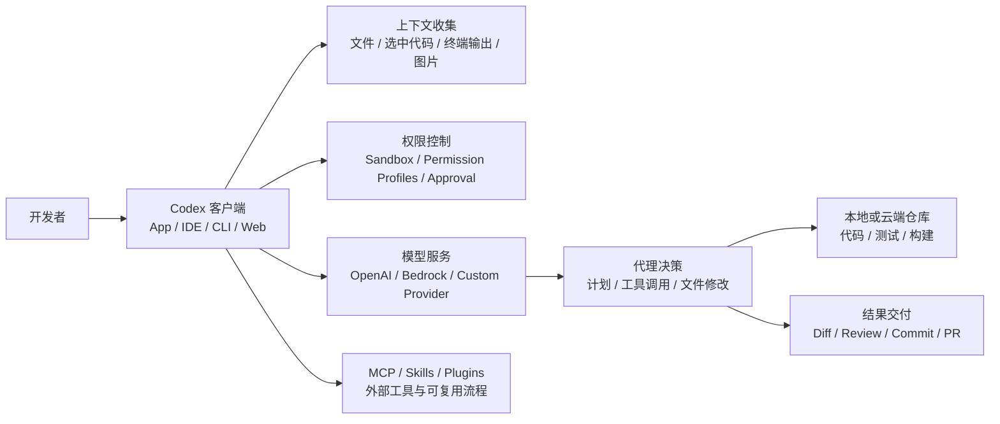
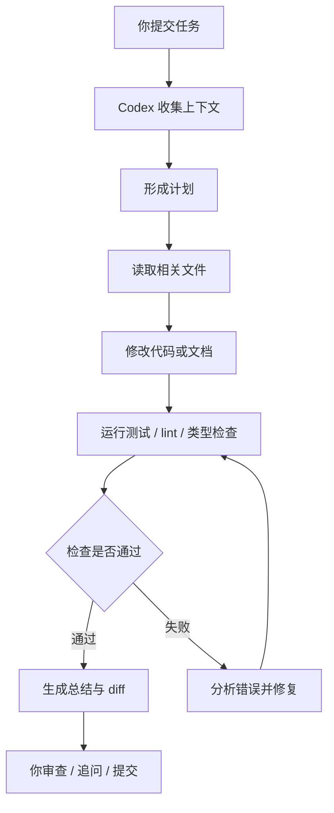
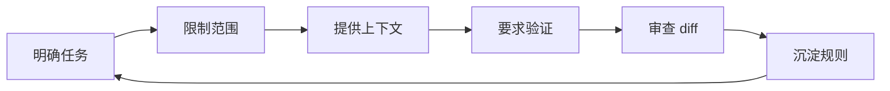

[toc]


## abstract

这里 **Codex** 指的是 OpenAI 现在的 **AI 编程代理（coding agent）**，不是早期单纯“根据提示补全代码”的旧 Codex 模型。

现代 Codex 的核心能力是：读取项目、理解上下文、修改文件、运行命令、检查测试、生成 diff、协助 code review，必要时还能把任务委托到云端环境并行执行。OpenAI 官方把它定义为“帮助你编写、审查并发布代码的 AI agent”，并且目前覆盖 Codex App、IDE 扩展、CLI 和 Web/Cloud 等形态。([OpenAI](https://openai.com/codex/))

相关教程

- [Codex 使用教程：安装下载、登录与第一次对话 | 古程](https://www.studynil.com/ai/ai-tools/codex/quickstart.html)

------

## 详细大纲

| 模块                | 学习目标                                            | 新手重点                                              |
| ------------------- | --------------------------------------------------- | ----------------------------------------------------- |
| Codex 基本概念      | 理解 Codex 与 ChatGPT、Copilot、传统 IDE 插件的区别 | Codex 是“能行动的代理”，不只是聊天或补全              |
| 使用形态            | 掌握 App、IDE、CLI、Web/Cloud 的适用场景            | 新手优先从 IDE 扩展或 App 开始                        |
| 工作机制            | 理解 prompt、context、thread、sandbox、diff、review | 学会把任务拆小、给出验证标准                          |
| 安装与初次使用      | 能在本地仓库中启动 Codex 并完成一个小任务           | 从“解释项目”“修一个小 bug”“补测试”开始                |
| 项目规范            | 使用 `AGENTS.md`、配置文件、测试命令约束 Codex      | 把重复规则沉淀成文件，不要每次手写                    |
| 权限与安全          | 理解 sandbox、permission profiles、approval modes   | 默认小权限，禁止读取 `.env`、密钥、生产凭据           |
| 模型选择            | 了解推荐模型与轻量模型的取舍                        | 复杂任务用强模型，简单任务用快模型                    |
| 第三方模型/API 接入 | 理解 OpenAI API key、custom provider、Bedrock、MCP  | 优先用 Responses API；谨慎使用 OpenAI-compatible 代理 |
| 最佳实践            | 形成可复用的开发工作流                              | 小步提交、强制测试、人工审查、最小权限                |

------

## Codex 的系统结构



把 Codex 理解成一个“带工具的工程师助手”会更准确：你给它目标，它会读取上下文、制定计划、调用工具、改代码、运行检查，然后把变更以 diff、提交或 PR 的形式交给你审查。官方文档描述 Codex 的 prompt 循环时，也明确提到它会调用模型并根据模型输出执行读文件、编辑文件、工具调用等动作，直到任务完成或被取消。([OpenAI开发者](https://developers.openai.com/codex/prompting))

------

## Codex 与相关工具的区别

| 对象                  | 核心定位                       | 是否能改文件               | 是否能运行命令           | 适合任务                     |
| --------------------- | ------------------------------ | -------------------------- | ------------------------ | ---------------------------- |
| ChatGPT               | 通用对话、解释、写作、代码问答 | 通常不能直接改你的本地项目 | 通常不能直接跑你本地命令 | 学习、方案设计、单段代码解释 |
| GitHub Copilot 类补全 | IDE 内代码补全与聊天           | 可辅助编辑                 | 依产品而定               | 单文件补全、局部重构         |
| Codex IDE Extension   | IDE 内代理式开发               | 能                         | 能                       | 日常开发、修 bug、补测试     |
| Codex CLI             | 终端中的本地代理               | 能                         | 能                       | 命令行工作流、脚本化、自动化 |
| Codex App             | 桌面“任务指挥中心”             | 能                         | 能                       | 多线程、多项目、并行代理工作 |
| Codex Web / Cloud     | 云端代理任务                   | 在云端环境中改仓库         | 在隔离云环境中运行       | 长任务、并行任务、PR 级开发  |

Codex CLI 是 OpenAI 开源的本地 coding agent，可以在你选择的目录中读取、修改并运行代码；Codex IDE 扩展则把这种代理能力放进 VS Code、Cursor、Windsurf、JetBrains 等开发环境；Codex App 是桌面端工作中心，强调多线程、worktree、自动化和 Git 功能。([OpenAI开发者](https://developers.openai.com/codex/cli))

------

## 关键术语

| 术语             | 英文                   | 解释                                                         |
| ---------------- | ---------------------- | ------------------------------------------------------------ |
| 代理             | Agent                  | 不只是回答问题，而是能根据目标使用工具、执行步骤、产出结果的 AI 系统 |
| 提示词           | Prompt                 | 你给 Codex 的任务描述，质量直接影响结果                      |
| 线程             | Thread                 | 一次任务会话，包含 prompt、模型输出、工具调用和后续追问      |
| 上下文           | Context                | Codex 看到的信息，包括文件、终端输出、图片、选中代码、历史步骤 |
| 上下文窗口       | Context window         | 模型一次能处理的信息上限，任务太长时需要压缩或拆分           |
| 沙箱             | Sandbox                | 限制 Codex 读写文件、访问网络、运行命令的隔离机制            |
| 权限配置         | Permission Profiles    | 用规则控制 Codex 能读写哪些路径、能访问哪些网络域名          |
| 审批模式         | Approval Mode          | 控制 Codex 运行命令或执行高风险操作前是否需要你确认          |
| 工作树           | Worktree               | Git worktree，用来让多个任务在隔离分支/目录中并行工作        |
| MCP              | Model Context Protocol | 让模型连接外部工具和上下文的协议                             |
| Skills           | Skills                 | 把可复用工作流打包成 `SKILL.md`、脚本和资料，供 Codex 调用   |
| 自定义模型提供商 | Custom Model Provider  | 让 Codex 连接非默认 OpenAI 端点或第三方兼容 API 的配置       |

------

## 安装与启动

### 推荐路径

| 使用者          | 推荐入口            | 原因                                  |
| --------------- | ------------------- | ------------------------------------- |
| 完全新手        | Codex IDE Extension | 在熟悉的编辑器里用，能看到文件和 diff |
| 偏 GUI 的开发者 | Codex App           | 适合管理多个任务、多个项目            |
| 命令行用户      | Codex CLI           | 灵活、可脚本化、适合自动化            |
| 团队/长任务     | Codex Cloud / Web   | 适合云端并行、PR 级任务、远程跟进     |

官方 Quickstart 显示，每个 ChatGPT plan 都包含 Codex，也可以通过 OpenAI API key 使用 API credits；但 API key 登录时部分功能可能不可用。([OpenAI开发者](https://developers.openai.com/codex/quickstart))

### CLI 安装示例

macOS / Linux：

```bash
curl -fsSL https://chatgpt.com/codex/install.sh | sh
codex
```

Windows：

```powershell
powershell -ExecutionPolicy ByPass -c "irm https://chatgpt.com/codex/install.ps1 | iex"
codex
```

也可以使用 npm：

```bash
npm install -g @openai/codex
codex
```

这些安装方式来自官方 Codex CLI / GitHub 文档；CLI 支持 macOS、Windows、Linux，Windows 下可原生 PowerShell 使用，也可在需要 Linux 原生环境时使用 WSL2。([GitHub](https://github.com/openai/codex))

------

## 第一次使用建议

新手不要一上来让 Codex “重构整个项目”。第一次任务应当小、清晰、可验证。

| 任务类型    | 好 prompt 示例                                               | 为什么适合新手            |
| ----------- | ------------------------------------------------------------ | ------------------------- |
| 理解项目    | `Explain the project structure and how to run tests. Do not modify files.` | 先让 Codex 只读，不改代码 |
| 小 bug 修复 | `Find why this test fails, propose a fix, then apply the smallest safe change.` | 目标明确，有测试验证      |
| 补测试      | `Add tests for the edge cases in this function. Run the relevant test file.` | 改动可控，反馈直接        |
| 文档更新    | `Update README with the current setup steps based on package.json and scripts.` | 风险低，容易 review       |
| 局部重构    | `Refactor this module without changing public behavior. Keep API compatible and run tests.` | 有边界，有验证标准        |

官方 prompting 指南也强调：Codex 在能够验证自己的工作时输出质量更高，例如你提供复现步骤、验证方式、lint 和 pre-commit 检查；复杂任务最好拆成更小、更聚焦的步骤。([OpenAI开发者](https://developers.openai.com/codex/prompting))

------

## 工作机制：从 prompt 到代码变更



实际使用时，你应该把 Codex 当作“需要 code review 的初级到中高级开发者”，而不是绝对可信的自动提交器。它可以很强，但仍可能误解需求、漏掉边界条件、引入隐藏回归、误删配置或过度重构。最佳实践是：让它说明计划，让它小步修改，让它运行验证，让你最终审查 diff。

------

## Prompt 编写规则

### 好 prompt 的结构

| 组成 | 说明                 | 示例                                           |
| ---- | -------------------- | ---------------------------------------------- |
| 背景 | 当前项目、模块、问题 | `This is a Next.js app using pnpm.`            |
| 目标 | 你希望完成什么       | `Fix the login redirect bug.`                  |
| 边界 | 不允许做什么         | `Do not change auth provider configuration.`   |
| 验证 | 如何证明完成         | `Run pnpm test auth and pnpm lint.`            |
| 输出 | 你想看到什么         | `Summarize changed files and remaining risks.` |

### 示例

```text
We have a failing test in the payment module.

Goal:
Find the root cause and apply the smallest safe fix.

Constraints:
Do not change public API names.
Do not modify database migrations.
Do not read or print any .env files.

Validation:
Run the focused payment test first.
Then run the module-level test command if the focused test passes.

Output:
Explain the cause, list changed files, and mention any risks.
```

### 常见错误

| 错误               | 后果                       | 更好的做法                    |
| ------------------ | -------------------------- | ----------------------------- |
| “帮我优化一下项目” | 范围太大，容易乱改         | 指定模块、性能指标、验证方式  |
| “修复所有问题”     | Codex 可能做大量不必要改动 | 先让它列问题，再选择一个处理  |
| 不给测试命令       | 它可能不知道如何验证       | 在 prompt 或 `AGENTS.md` 写明 |
| 不设边界           | 可能改配置、依赖、架构     | 明确禁止修改的文件和行为      |
| 不看 diff          | 风险进入主分支             | 人工审查每个变更              |

------

## 用 `AGENTS.md` 固化项目规则

`AGENTS.md` 可以理解为“给 AI agent 看的 README”。Codex 会在开始工作前读取这些文件，并可把全局规则、仓库规则、子目录规则合并成指令链；越靠近当前工作目录的文件优先级越高。([OpenAI开发者](https://developers.openai.com/codex/guides/agents-md))

一个实用的 `AGENTS.md` 应该短而准确，包含项目结构、运行方式、测试和 lint 命令、工程规范、PR 期望、禁止事项、完成定义等。官方最佳实践也建议用它沉淀可复用指导，而不是每次重复写 prompt。([OpenAI开发者](https://developers.openai.com/codex/learn/best-practices))

示例：

```markdown
# AGENTS.md

## Project overview

This repository is a TypeScript monorepo using pnpm workspaces.

## Setup

- Install dependencies with `pnpm install`.
- Start local dev server with `pnpm dev`.

## Verification

- Run `pnpm lint` after modifying TypeScript files.
- Run focused tests first, then broader tests.
- Do not claim success unless tests were run or clearly explain why they were not run.

## Code style

- Prefer small, focused changes.
- Do not rename public APIs unless explicitly asked.
- Preserve backward compatibility.

## Security

- Never read, print, or modify `.env`, `.env.*`, private keys, tokens, or credential files.
- Ask before adding new production dependencies.
```

------

## 权限、安全与沙箱

Codex 的强大之处在于它能执行动作；风险也来自这里。官方 permission profiles 支持把本地命令限制在最小权限边界内，例如只读、允许写工作区、或危险的 full access；并可配置文件系统规则和网络域名规则。官方明确建议用这些 profile 给当前任务足够权限，而不是给整台机器或整个网络开放权限。([OpenAI开发者](https://developers.openai.com/codex/permissions))

| 模式                  | 适合场景                   | 风险                   |
| --------------------- | -------------------------- | ---------------------- |
| `:read-only`          | 解释项目、查问题、审查代码 | 不能直接修复           |
| `:workspace`          | 日常开发、补测试、局部重构 | 仍需防止读取敏感文件   |
| `:danger-full-access` | 极少数受控场景             | 高风险，不建议新手使用 |

更安全的配置思路：

```toml
default_permissions = "project-edit"

[permissions.project-edit]
extends = ":workspace"

[permissions.project-edit.filesystem.":workspace_roots"]
"." = "write"
".devcontainer" = "read"
"**/*.env" = "deny"
"**/*.pem" = "deny"
"**/*secret*" = "deny"

[permissions.project-edit.network]
enabled = true

[permissions.project-edit.network.domains]
"api.openai.com" = "allow"
"*.github.com" = "allow"
"tracking.example.com" = "deny"
```

官方权限文档也说明，`deny` 可以覆盖更宽泛的读写授权，适合把 `.env`、密钥、生成的凭据文件从工作区权限里“挖掉”。([OpenAI开发者](https://developers.openai.com/codex/permissions))

------

## 模型选择

models:[OpenAI开发者](https://developers.openai.com/codex/models)

| 场景                           | 推荐策略                                              |
| ------------------------------ | ----------------------------------------------------- |
| 大型重构、复杂 bug、跨模块理解 | 用强模型，要求先出计划                                |
| 小函数、样式修复、简单测试     | 用 mini / fast 模型                                   |
| 多个子任务并行                 | 主任务用强模型，子任务可用轻量模型                    |
| 成本敏感                       | 先让 Codex 只读分析，再决定是否进入修改               |
| 质量敏感                       | 要求运行测试、使用 `/review` 或单独 code review agent |

需要注意：Codex 支持指向任何支持 **Responses API** 或 **Chat Completions API** 的模型和 provider，但官方文档同时说明 Chat Completions API 支持已被标记为 deprecated，未来 Codex 会移除这一路径。

新接入应优先选择 Responses API 兼容方案。([OpenAI开发者](https://developers.openai.com/codex/models))

------

## 第三方模型或 API 接入

### 接入方式总览

| 接入方式              | 典型用途                           | 优点                               | 注意事项                         |
| --------------------- | ---------------------------------- | ---------------------------------- | -------------------------------- |
| ChatGPT 登录          | 个人或团队直接使用 Codex           | 设置最简单，功能完整度通常最好     | 受 ChatGPT plan 和地区支持影响   |
| OpenAI API key        | 使用 API credits                   | 适合开发者、脚本、自动化           | 部分 Codex 功能可能不可用        |
| Custom Model Provider | 接第三方或代理端点                 | 灵活，可连 OpenAI-compatible API   | 兼容性、工具调用、响应格式要验证 |
| Amazon Bedrock        | 企业 AWS 治理、IAM、区域和配额管理 | 适合 AWS 企业环境                  | 不是所有 Codex cloud 功能都可用  |
| 本地 provider         | Ollama、LM Studio 等               | 数据不出本机，成本可控             | 模型能力、上下文、工具调用可能弱 |
| MCP                   | 连接外部工具和上下文               | 让 Codex 访问文档、Figma、浏览器等 | 不是模型替换，而是工具扩展       |

官方高级配置说明，model provider 定义了 Codex 如何连接模型，包括 `base_url`、wire API、认证和 HTTP headers；自定义 provider 不能复用内置 provider ID，例如 `openai`、`ollama`、`lmstudio`。([OpenAI开发者](https://developers.openai.com/codex/config-advanced))

### 自定义 provider 示例

```toml
model = "your-model-name"
model_provider = "proxy"

[model_providers.proxy]
name = "OpenAI-compatible proxy"
base_url = "https://proxy.example.com/v1"
env_key = "PROXY_API_KEY"
wire_api = "responses"
```

然后设置环境变量：

```bash
export PROXY_API_KEY="your_api_key_here"
codex
```

对于第三方 OpenAI-compatible API，重点不是“接口路径像 OpenAI”，而是它是否完整支持 Codex 所需的响应格式、tool calling、streaming、reasoning 参数、文件/图片输入、错误码、速率限制和上下文长度。很多兼容 API 只能跑普通聊天，不一定能稳定支撑 agentic coding。

### Amazon Bedrock

Codex 可以配置为使用 Amazon Bedrock 上可用的 OpenAI 模型。在这种模式下，Codex 本地运行，模型请求发送到 Bedrock，使用 AWS 原生认证、IAM、区域、配额、计费和访问控制；OpenAI-hosted Responses API 不在请求路径中。([OpenAI Help Center](https://help.openai.com/en/articles/20001252-use-codex-with-amazon-bedrock))

基础配置示例：

```toml
model_provider = "amazon-bedrock"
model = "<bedrock-model-id>"

[model_providers.amazon-bedrock.aws]
profile = "default"
region = "eu-central-1"
```

但 Bedrock 模式不应假设和 OpenAI API Platform 完全一致；官方帮助文档明确提到，一些依赖 OpenAI-hosted cloud services、hosted tools 或 cloud-managed tool discovery 的功能当前不可用，例如 Codex cloud agents、cloud plugin store、部分 MCP/tool discovery 能力等。([OpenAI Help Center](https://help.openai.com/en/articles/20001252-use-codex-with-amazon-bedrock))

------

## MCP、Skills 与 Plugins

### MCP：给 Codex 外部工具

**MCP（Model Context Protocol）** 用于把模型连接到外部工具和上下文。官方文档写明，Codex 可通过 MCP 访问第三方文档、浏览器、Figma 等开发工具，并支持 CLI 和 IDE extension 中的 MCP servers。([OpenAI开发者](https://developers.openai.com/codex/mcp))

适合接 MCP 的场景：

| 场景                | 示例                                       |
| ------------------- | ------------------------------------------ |
| 上下文不在代码仓库  | 产品文档、设计稿、API 文档、工单           |
| 数据变化频繁        | issue、Linear ticket、Slack 讨论、运行状态 |
| 希望 Codex 使用工具 | 浏览器调试、Figma 读取、数据库只读查询     |
| 团队复用            | 同一 MCP 配置给多个项目或成员使用          |

官方最佳实践也建议：不要一开始把所有工具都接上；先接入一两个能明显减少手动复制粘贴的工具，再逐步扩展。([OpenAI开发者](https://developers.openai.com/codex/learn/best-practices))

### Skills：把重复流程变成能力包

**Skills** 适合封装重复工作流。官方说明，一个 skill 通常是一个包含 `SKILL.md` 的目录，外加可选 scripts、references、assets；Codex 先看到 skill 的名称、描述和路径，只有决定使用时才加载完整说明，从而节省上下文。([OpenAI开发者](https://developers.openai.com/codex/skills))

适合做成 skill 的流程：

| 流程              | Skill 示例                  |
| ----------------- | --------------------------- |
| 新增 API endpoint | `api-endpoint-creator`      |
| 写迁移和回滚脚本  | `db-migration-safe-flow`    |
| 生成测试报告      | `test-report-writer`        |
| 安全审计          | `security-review-checklist` |
| 前端组件规范      | `design-system-component`   |

### Plugins：团队分发能力

可以把 app integrations、skills、MCP servers 和工作流打包成插件，让团队安装和复用。Codex 近年的方向已经不只是“写代码”，也在扩展到分析、设计、运营、报告和内部工具建设等知识工作场景。OpenAI 2026 年的产品介绍提到 Codex plugins 可以把角色、工具、skills 和工作流打包，帮助团队连接已有工具和上下文。([OpenAI](https://openai.com/index/codex-for-every-role-tool-workflow/))

------

## 中国用户需要特别注意

### 地区与账号风险

OpenAI 官方中文帮助中心明确说明：从不受支持的国家/地区访问或提供对 ChatGPT 或 OpenAI API 的访问权限，可能导致账户被封禁或暂停；如果付款方式不来自受支持国家/地区，也可能无法继续使用服务。([OpenAI Help Center](https://help.openai.com/zh-hans-cn/articles/9131992-chatgpt-and-api-services-in-unsupported-countries-and-territories))

OpenAI API 官方支持地区页面也写明：如果从列表之外的国家或地区访问或提供服务，可能导致账户被封禁或暂停。该页面是“支持地区列表”，不是“禁止地区列表”；不在支持列表中就应按不支持处理。([OpenAI开发者](https://developers.openai.com/api/docs/supported-countries))

实务建议：

| 问题                                  | 建议                                                         |
| ------------------------------------- | ------------------------------------------------------------ |
| 个人在中国大陆直接使用 OpenAI / Codex | 先核对官方支持地区，不要依赖转售号、共享号、来路不明代理     |
| 公司产品调用 OpenAI API 服务中国用户  | 不要把 OpenAI API key 暴露给不受支持地区流量；做地区准入、合规评估和服务边界 |
| 使用云函数、CDN、边缘计算             | 注意出口 IP 和实际请求来源，避免请求从不受支持地区发出       |
| 付款                                  | 使用官方支持地区发行的合法付款方式；不要购买代充、共享组织、黑卡服务 |
| 账号安全                              | 不要把 API key 写进前端、日志、`.env` 提交历史或 Codex 可读范围 |
| 替代方案                              | 可以考虑本地模型、Ollama/LM Studio、合规区域云服务或其他符合当地要求的模型供应商 |

### 数据与合规

对中国用户和中国公司，更关键的是不要把源码、客户数据、日志、密钥、个人信息、合同、财务数据直接丢给任何不清楚数据处理方式的模型服务。无论使用 OpenAI、第三方 API、国内模型还是本地模型，都应该先确认：

| 检查项   | 需要确认                            |
| -------- | ----------------------------------- |
| 数据位置 | 数据会发到哪里，是否跨境            |
| 日志保留 | prompt、代码、输出是否被服务商保存  |
| 训练使用 | 你的输入输出是否会被用于训练        |
| 访问控制 | 谁能看到组织内的对话、项目、API key |
| 审计     | 是否有调用日志、账单、异常请求记录  |
| 删除     | 数据是否能删除，删除周期是什么      |
| 敏感信息 | 是否有自动脱敏、密钥扫描、DLP 策略  |
| 合同     | 企业是否有 DPA、SLA、合规条款       |

对于企业，建议把 Codex 纳入现有软件供应链安全流程：源码分类、密钥管理、出站网络控制、供应商审查、日志审计、最小权限、PR 审批、CI 检查都不能省。

------

## 最佳实践清单

| 阶段   | 做法                                                    |
| ------ | ------------------------------------------------------- |
| 开始前 | 确认当前分支干净，创建 Git checkpoint                   |
| 给任务 | 写清背景、目标、边界、验证方式                          |
| 执行中 | 要求先出计划，再允许修改                                |
| 改代码 | 限制范围，小步修改，不要一次改太多模块                  |
| 验证   | 运行 focused test，再运行相关 lint/typecheck            |
| 安全   | 禁止读取 `.env`、私钥、token、生产配置                  |
| review | 看 diff，不只看总结                                     |
| 合并   | 走正常 PR、CI、code review 流程                         |
| 沉淀   | 把重复规则写入 `AGENTS.md` 或 skill                     |
| 团队化 | 用 MCP、permissions、managed config、plugins 做统一治理 |

官方最佳实践也强调，不要只要求 Codex 生成代码，还要让它创建/更新测试、运行检查、确认行为、审查 diff，并把“什么算完成”写在 prompt 或 `AGENTS.md` 里。([OpenAI开发者](https://developers.openai.com/codex/learn/best-practices))

------

## 经典用例

### 理解陌生项目

```text
Explain this repository to a new contributor.

Focus on:
- main architecture
- important directories
- how to run locally
- how tests are organized
- risky areas for changes

Do not modify files.
```

### 修复测试失败

```text
A test is failing.

Task:
Find the root cause and apply the smallest safe fix.

Rules:
- Do not change public APIs.
- Do not update snapshots unless you explain why.
- Do not modify unrelated files.

Validation:
Run the failing test first.
Then run the relevant test suite.

Output:
Summarize the cause, changed files, commands run, and remaining risks.
```

### 补充测试

```text
Add missing tests for the edge cases in src/utils/parseDate.ts.

Cover:
- invalid input
- timezone boundary
- empty string
- leap year

Do not change implementation unless a bug is discovered.
Run the focused test file after adding tests.
```

### 安全审查

```text
Review the uncommitted changes for security issues.

Focus on:
- authentication bypass
- authorization checks
- secret exposure
- injection risks
- unsafe dependency changes

Do not modify files yet.
Return findings grouped by severity with file references.
```

### 重构

```text
Refactor the payment validation module for readability.

Constraints:
- Preserve behavior.
- Do not change exported names.
- Keep changes inside the payment module unless absolutely necessary.
- Add or update tests if behavior is clarified.

Validation:
Run payment tests and typecheck.
```

------

## 学习路线

| 阶段   | 目标                    | 练习                                   |
| ------ | ----------------------- | -------------------------------------- |
| 入门   | 会启动、会问、会看 diff | 让 Codex 解释项目、找测试命令          |
| 初级   | 会让 Codex 做小改动     | 修一个 bug、补一个测试                 |
| 中级   | 会控制质量与安全        | 写 `AGENTS.md`、配置权限、禁止敏感文件 |
| 进阶   | 会使用外部上下文        | 接 MCP、接文档、接 issue 系统          |
| 团队化 | 会规范协作              | 统一配置、PR review、skills、plugins   |
| 自动化 | 会脚本化重复任务        | `codex exec`、GitHub Action、定期检查  |

------

## 新手最重要的心法

Codex 的正确使用方式不是“让 AI 随便改项目”，而是建立一个受控的软件工程循环：



真正提升效率的不是一次神奇 prompt，而是把项目知识、测试命令、代码规范、安全边界和 review 规则逐步沉淀下来。对新手来说，先学会“小任务、强约束、可验证、必审查”，比追求复杂自动化更重要。