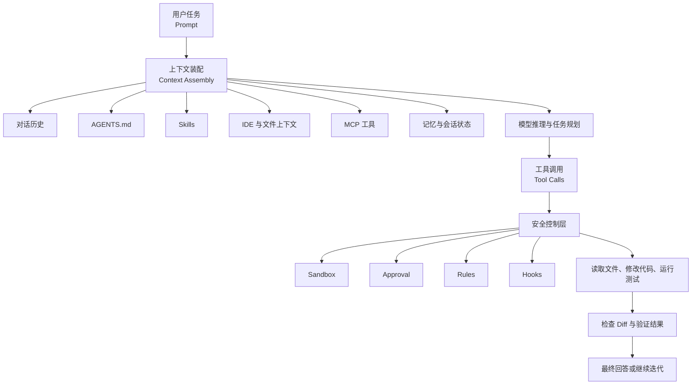
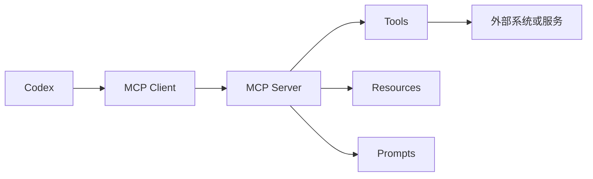

## 阅读说明

以下内容以 **2026 年 7 月的 OpenAI Codex 官方文档**为基础，主要介绍 Codex CLI 与 Codex 桌面应用中的指令体系。

- 交互式斜杠命令（Slash Commands）
- CLI 顶层命令（CLI Subcommands）
- 启动参数（Command-line Flags）
- 配置项（Configuration）
- 项目指令文件（AGENTS.md）
- 技能（Skills）
- 模型上下文协议（Model Context Protocol，MCP）
- 钩子（Hooks）
- 执行规则（Rules）
- 非交互自动化命令（Non-interactive Execution）
- ...

不同 Codex 客户端、版本、模型和实验功能可能显示不同的命令。最可靠的办法始终是在当前界面输入 `/`，或者运行 `codex --help` 查看实际可用项。([OpenAI Developers](https://developers.openai.com/codex/developer-commands))

------

## 内容大纲

本文按照以下学习路线展开：

- Codex 指令体系的整体结构
- 终端交互模式与斜杠命令
- Codex 桌面应用中的命令
- CLI 顶层子命令
- CLI 启动参数
- 模型、推理强度与上下文管理
- 会话、分支与任务管理
- 沙箱、审批与安全规则
- AGENTS.md 项目指令
- Skills 可复用技能
- MCP 外部工具集成
- Hooks 生命周期钩子
- `codex exec` 自动化与 CI
- 配置文件与 Profiles
- 高质量任务提示词
- 经典工作流
- 新手最佳实践
- 常见问题与速查表

------

## 先建立正确的心智模型

Codex 是一个能够**读取代码、修改文件、运行命令、调用工具并验证结果**的**编程代理**（Coding Agent）。

它的基本运行机制可以概括为：



因此，学习 Codex 指令时，可以将它们理解为五个层次：

| 层次         | 作用                     | 常见形式                        |
| ------------ | ------------------------ | ------------------------------- |
| 会话控制     | 管理当前聊天和任务状态   | `/new`、`/resume`、`/fork`      |
| 推理控制     | 控制模型、计划和目标     | `/model`、`/plan`、`/goal`      |
| 执行控制     | 控制文件、命令与代码修改 | `/permissions`、`--sandbox`     |
| 上下文控制   | 告诉 Codex 应该参考什么  | `AGENTS.md`、`/mention`、Skills |
| 扩展与自动化 | 接入外部工具或批量执行   | MCP、Hooks、`codex exec`        |

------

> 不同的环境配置/模型供应商/工作区上下文状态条件下,可见(可用)的指令,甚至可用的配置选项可能有所不同(即便都是相同的软件版本),例如`/model`指令可能不可用,但这不意味着无法调整模型.

## Codex 的主要使用界面

Codex 目前存在多个操作界面，它们的命令并不完全一致。

| 使用界面           | 启动方式      | 适合场景                     |
| ------------------ | ------------- | ---------------------------- |
| Codex CLI 交互界面 | `codex`       | 日常编码、终端操作、仓库修改 |
| Codex 非交互模式   | `codex exec`  | 脚本、CI/CD、批量检查        |
| Codex 桌面应用     | `codex app`   | 图形化项目管理、多任务查看   |
| IDE 集成           | 从编辑器启动  | 针对当前文件、选区或报错处理 |
| Codex Cloud        | `codex cloud` | 云端任务与远程执行           |
| ChatGPT 中的 Codex | ChatGPT 界面  | 云端代码任务和对话式操作     |

ChatGPT 网页端使用自己的输入菜单，并不会完整暴露 Codex CLI 或桌面应用中的所有斜杠命令。([OpenAI Developers](https://developers.openai.com/codex/developer-commands))

------

## 交互式斜杠命令

进入项目目录并运行：

```bash
codex
```

即可启动终端用户界面（Terminal User Interface，TUI）。

输入：

```text
/
```

会显示当前版本实际支持的斜杠命令。

### 会话管理命令

| 命令       | 作用                       | 使用建议                          |
| ---------- | -------------------------- | --------------------------------- |
| `/new`     | 创建新的会话               | 开始完全无关的新任务时使用        |
| `/clear`   | 清空当前上下文并开始新聊天 | 不只是清屏，会真正创建新对话      |
| `/rename`  | 重命名当前会话             | 建议使用任务名，如 `修复登录超时` |
| `/resume`  | 恢复历史会话               | 继续之前未完成的任务              |
| `/fork`    | 从当前会话创建分支         | 尝试另一套实现方案                |
| `/archive` | 归档会话并退出             | 保留记录，但从活动列表隐藏        |
| `/delete`  | 永久删除会话               | 会删除会话及其后代分支            |
| `/quit`    | 退出 Codex                 | 与 `/exit` 作用相近               |
| `/exit`    | 退出 Codex                 | 终止当前交互界面                  |

需要特别区分：

- `/clear`：创建一个没有旧对话上下文的新聊天。
- `Ctrl+L`：通常只清除终端显示，不删除对话上下文。
- `/archive`：保留会话记录。
- `/delete`：永久删除会话记录。([OpenAI Developers](https://developers.openai.com/codex/developer-commands))

### 模型与推理控制

| 命令           | 作用                 | 使用场景                        |
| -------------- | -------------------- | ------------------------------- |
| `/model`       | 查看或切换模型       | 更换 GPT 模型或推理档位         |
| `/fast`        | 开启或关闭快速推理档 | 快速修改、小问题定位            |
| `/plan`        | 开启或关闭计划模式   | 多文件修改、复杂重构            |
| `/goal`        | 设置持久任务目标     | 长时间、多轮任务                |
| `/personality` | 修改模型交互风格     | `friendly`、`pragmatic`、`none` |
| `/status`      | 查看当前会话状态     | 模型、审批、沙箱、上下文使用量  |
| `/usage`       | 查看用量和限制信息   | 排查配额与上下文问题            |
| `/compact`     | 压缩较早的对话历史   | 上下文变长时释放空间            |

`/fast` 是否出现，取决于当前模型目录是否提供快速推理层级；`/personality` 也只有支持该能力的模型才会显示。([OpenAI Developers](https://developers.openai.com/codex/developer-commands))

### `/plan` 与 `/goal` 的区别

这两个命令容易混淆。

| 功能             | `/plan`                    | `/goal`                                  |
| ---------------- | -------------------------- | ---------------------------------------- |
| 核心作用         | 要求模型先规划再执行       | 保存一个持续性的任务目标                 |
| 适用时间         | 当前任务开始前             | 多轮、长时间任务                         |
| 是否改变任务状态 | 改变当前工作模式           | 保存目标状态                             |
| 典型场景         | 架构重构、迁移、大范围修复 | “完成整个认证模块重构”                   |
| 常见操作         | `/plan`                    | `/goal edit`、`pause`、`resume`、`clear` |

例如：

```text
/plan
```

然后输入：

```text
审计整个支付模块。先分析调用链和测试覆盖，不要立即修改代码。
列出风险、受影响文件、实施顺序和验证方案。
```

对于长期任务，可以使用：

```text
/goal 完成支付模块的幂等性改造，并确保所有现有测试通过
```

`/goal` 还支持查看、编辑、暂停、恢复和清除目标；官方文档目前规定目标文本最长为 4000 个字符。([OpenAI Developers](https://developers.openai.com/codex/developer-commands))

------

## 代码、文件与上下文命令

| 命令        | 作用                            | 推荐用法                          |
| ----------- | ------------------------------- | --------------------------------- |
| `/ide`      | 引入当前 IDE 上下文             | 让 Codex 获取打开文件、选区等信息 |
| `/mention`  | 将文件或目录加入上下文          | 明确指定重点文件                  |
| `/init`     | 创建项目级 `AGENTS.md` 初始文件 | 新项目第一次使用 Codex            |
| `/diff`     | 查看 Codex 当前造成的代码差异   | 修改后必须检查                    |
| `/review`   | 对代码变更进行审查              | 提交前进行独立检查                |
| `/copy`     | 复制最近的模型输出              | 获取格式化回答                    |
| `/raw`      | 查看或复制原始输出              | 处理 Markdown 或原始文本          |
| `/import`   | 导入兼容的外部代理配置或会话    | 迁移部分 Claude Code 内容         |
| `/memories` | 查看或管理记忆                  | 管理长期偏好或项目记忆            |
| `/skills`   | 浏览和调用 Skills               | 执行标准化工作流                  |

`/import` 的具体可用性受到运行环境限制，例如任务执行期间、远程会话或某些 App Server 模式下可能不可用。([OpenAI Developers](https://developers.openai.com/codex/developer-commands))

### `/mention` 的正确用法

与其只说：

```text
帮我修复这里的问题
```

不如明确引用文件：

```text
/mention src/auth/session.ts
/mention tests/auth/session.test.ts
```

然后输入：

```text
分析 session.ts 中刷新令牌并发失效的问题。
先复现，再修改实现，最后运行 session.test.ts。
```

这样可以减少 Codex 在大型仓库中搜索无关文件的成本。

### `/diff` 与 `/review` 的区别

- `/diff`：展示发生了什么变化。
- `/review`：分析这些变化是否正确、安全、完整。

推荐顺序：

```text
完成修改
→ /diff
→ 运行测试
→ /review
→ 根据审查结果修正
```

`/review` 默认使用当前会话模型；也可以通过配置项 `review_model` 为代码审查单独指定模型。([OpenAI Developers](https://developers.openai.com/codex/developer-commands))

------

## 执行状态与多代理命令

| 命令         | 作用                       | 说明                     |
| ------------ | -------------------------- | ------------------------ |
| `/ps`        | 查看当前运行中的任务或进程 | 了解 Codex 正在执行什么  |
| `/stop`      | 停止当前运行               | 命令卡住或方向错误时使用 |
| `/agent`     | 切换当前代理线程           | 多代理场景使用           |
| `/subagents` | 查看或切换子代理           | 观察并行任务             |
| `/side`      | 开启旁路对话               | 不打断主任务地询问问题   |
| `/btw`       | `/side` 的别名或类似入口   | 适合临时追问             |
| `/app`       | 进入相应的 App 入口        | 是否出现取决于版本       |

旁路对话（Side Conversation）的价值在于：主代理仍在执行任务时，你可以询问解释性问题，而不必改变主任务方向。

例如主任务正在运行测试时，可以通过 `/side` 询问：

```text
解释一下刚才发现的竞态条件为什么只在高并发下出现。
```

------

## 权限、安全与扩展命令

| 命令            | 作用                           | 使用建议               |
| --------------- | ------------------------------ | ---------------------- |
| `/permissions`  | 设置无需确认即可执行的操作范围 | 新手优先选择 Workspace |
| `/approve`      | 处理或调整待批准操作           | 对敏感命令逐项确认     |
| `/mcp`          | 查看 MCP 服务器和工具          | 排查外部工具连接       |
| `/apps`         | 浏览可连接的应用或连接器       | 连接外部服务           |
| `/plugins`      | 查看或管理插件                 | 扩展 Codex 功能        |
| `/hooks`        | 查看和管理生命周期钩子         | 审查项目自带自动脚本   |
| `/experimental` | 查看实验性功能                 | 不建议生产环境随意开启 |
| `/debug-config` | 查看实际生效的配置             | 排查配置优先级         |
| `/feedback`     | 提交反馈                       | 报告功能问题           |
| `/logout`       | 注销当前账户                   | 切换认证身份           |

Windows 环境还可能出现：

| 命令                     | 作用                  |
| ------------------------ | --------------------- |
| `/setup-default-sandbox` | 配置默认 Windows 沙箱 |
| `/sandbox-add-read-dir`  | 向沙箱增加只读目录    |

斜杠命令会随着平台、模型和版本变化，因此“输入 `/` 查看当前列表”比记忆固定清单更可靠。([OpenAI Developers](https://developers.openai.com/codex/developer-commands))

------

## 界面与终端显示命令

| 命令              | 作用                 |
| ----------------- | -------------------- |
| `/theme`          | 修改终端主题         |
| `/title`          | 设置终端或会话标题   |
| `/statusline`     | 配置底部状态栏       |
| `/keymap`         | 修改 TUI 快捷键      |
| `/vim`            | 开启或关闭 Vim 键位  |
| `/pets` 或 `/pet` | 控制界面中的宠物功能 |
| `/feedback`       | 提交产品反馈         |

`/statusline` 可以显示模型、推理强度、上下文使用量、速率限制、Git 分支、当前目录、项目根目录、会话 ID 和 Codex 版本等信息，其配置会保存到 `tui.status_line`。([OpenAI Developers](https://developers.openai.com/codex/developer-commands))

推荐新手至少显示：

- 当前模型
- 推理强度
- 上下文剩余量
- Git 分支
- 当前工作目录
- 会话 ID

------

## Codex 桌面应用中的命令

桌面应用与 CLI 有一部分相同命令，但并非完全一致。

常见命令包括：

| 命令                 | 作用               |
| -------------------- | ------------------ |
| `/approve`           | 处理权限批准       |
| `/cloud`             | 切换或启动云端任务 |
| `/cloud-environment` | 选择云端执行环境   |
| `/compact`           | 压缩会话上下文     |
| `/fast`              | 切换快速模式       |
| `/fork`              | 从当前任务创建分支 |
| `/goal`              | 设置持续目标       |
| `/ide-context`       | 使用 IDE 上下文    |
| `/init`              | 初始化项目指令     |
| `/local`             | 切换本地执行       |
| `/mcp`               | 查看 MCP 工具      |
| `/model`             | 切换模型           |
| `/plan`              | 进入计划模式       |
| `/project`           | 切换项目           |
| `/reasoning`         | 调整推理强度       |
| `/review`            | 审查变更           |
| `/side`              | 开启旁路对话       |
| `/status`            | 查看状态           |
| `/worktree`          | 管理 Git Worktree  |
| `/task`              | 查看或管理任务     |

具体列表会随桌面应用版本和启用功能变化，应以应用内输入 `/` 后显示的命令为准。([OpenAI Developers](https://developers.openai.com/codex/developer-commands))

------

## CLI 顶层命令

斜杠命令是在 Codex 交互界面中输入的，而 CLI 子命令是在操作系统终端中运行的。

例如：

```bash
codex review --uncommitted
```

这里的 `review` 就是 CLI 子命令。

### 日常核心命令

| 命令               | 作用                    | 推荐程度 |
| ------------------ | ----------------------- | -------- |
| `codex`            | 启动交互式 TUI          | 必学     |
| `codex exec`       | 非交互执行任务          | 必学     |
| `codex review`     | 审查代码变更            | 必学     |
| `codex resume`     | 恢复历史会话            | 必学     |
| `codex fork`       | 分支历史会话            | 推荐     |
| `codex login`      | 登录 Codex              | 必学     |
| `codex logout`     | 退出登录                | 常用     |
| `codex doctor`     | 检查安装和环境问题      | 必学     |
| `codex update`     | 更新 Codex              | 推荐     |
| `codex completion` | 生成 Shell 自动补全脚本 | 推荐     |

### 会话管理命令

| 命令              | 作用                 |
| ----------------- | -------------------- |
| `codex resume`    | 恢复历史会话         |
| `codex fork`      | 从历史会话建立新分支 |
| `codex archive`   | 归档会话             |
| `codex unarchive` | 恢复已归档会话       |
| `codex delete`    | 永久删除会话         |

### 扩展与工具命令

| 命令                       | 作用                         |
| -------------------------- | ---------------------------- |
| `codex mcp`                | 管理 MCP 服务器              |
| `codex mcp-server`         | 将 Codex 作为 MCP 服务器运行 |
| `codex plugin`             | 管理插件                     |
| `codex plugin marketplace` | 管理插件市场                 |
| `codex features`           | 查看和切换功能开关           |
| `codex sandbox`            | 在 Codex 沙箱中执行命令      |
| `codex apply`              | 应用 Codex 生成的补丁        |
| `codex app`                | 启动桌面应用                 |

### 高级或实验性命令

| 命令                       | 状态   | 作用            |
| -------------------------- | ------ | --------------- |
| `codex app-server`         | 实验性 | 启动 App Server |
| `codex cloud`              | 实验性 | 管理云端任务    |
| `codex execpolicy`         | 实验性 | 调试执行策略    |
| `codex remote-control`     | 实验性 | 远程控制会话    |
| `codex debug models`       | 实验性 | 调试模型目录    |
| `codex debug prompt-input` | 实验性 | 调试提示词输入  |
| `codex debug app-server`   | 实验性 | 调试 App Server |

新手不需要一开始掌握实验性命令。优先学习 `codex`、`exec`、`review`、`resume`、`doctor` 和 `mcp`。([OpenAI Developers](https://developers.openai.com/codex/developer-commands))

------

## CLI 全局启动参数

CLI 参数一般放在 `codex` 与子命令后面。

```bash
codex --model <模型ID> --sandbox workspace-write
```

### 模型与配置参数

| 参数               | 简写 | 作用                     |
| ------------------ | ---- | ------------------------ |
| `--model`          | `-m` | 指定模型                 |
| `--profile`        | `-p` | 使用指定配置 Profile     |
| `--config`         | `-c` | 临时覆盖配置项           |
| `--enable`         | 无   | 开启某项功能             |
| `--disable`        | 无   | 关闭某项功能             |
| `--strict-config`  | 无   | 配置错误时直接失败       |
| `--oss`            | 无   | 使用本地开源模型提供商   |
| `--local-provider` | 无   | 指定 Ollama 或 LM Studio |

例如：

```bash
codex -m gpt-5.6-sol
```

模型名称应以 `/model` 或当前模型目录实际显示的 ID 为准。

临时覆盖配置：

```bash
codex -c model_reasoning_effort='"high"'
```

由于 TOML 值需要正确解析，字符串通常要保留引号。

### 工作目录与上下文参数

| 参数              | 简写 | 作用                |
| ----------------- | ---- | ------------------- |
| `--cd`            | `-C` | 指定 Codex 工作目录 |
| `--add-dir`       | 无   | 增加允许访问的目录  |
| `--image`         | `-i` | 添加图片输入        |
| `--search`        | 无   | 使用实时网页搜索    |
| `--no-alt-screen` | 无   | 不使用终端备用屏幕  |

例如：

```bash
codex -C D:/projects/my-app
```

附加参考图片：

```bash
codex -i screenshot.png "根据截图修复页面布局"
```

默认网页搜索可以使用缓存结果；添加 `--search` 后，Codex 会使用实时搜索。([OpenAI Developers](https://developers.openai.com/codex/developer-commands))

### 权限和沙箱参数

| 参数                                         | 简写     | 可选值                                               |
| -------------------------------------------- | -------- | ---------------------------------------------------- |
| `--sandbox`                                  | `-s`     | `read-only`、`workspace-write`、`danger-full-access` |
| `--ask-for-approval`                         | `-a`     | `untrusted`、`on-request`、`never`                   |
| `--dangerously-bypass-approvals-and-sandbox` | `--yolo` | 完全绕过沙箱与审批                                   |

日常推荐：

```bash
codex --sandbox workspace-write --ask-for-approval on-request
```

这是本地开发中较平衡的组合：

- 可以修改当前工作区。
- 对高风险或越界操作进行审批。
- 不直接给予整台电脑完全访问权。

官方明确将 `--dangerously-bypass-approvals-and-sandbox` 标记为危险选项。除非是在一次性、隔离、可销毁的容器或虚拟机中，否则不应使用。([OpenAI Developers](https://developers.openai.com/codex/developer-commands))

------

## 沙箱与审批不是一回事

这是 Codex 安全机制中最重要的概念之一。

### 沙箱（Sandbox）

沙箱决定 Codex **技术上可以访问什么**。

| 模式                 | 文件权限         | 典型用途             |
| -------------------- | ---------------- | -------------------- |
| `read-only`          | 只读             | 审计、分析、代码阅读 |
| `workspace-write`    | 可修改工作区     | 日常开发             |
| `danger-full-access` | 几乎完整系统访问 | 隔离容器中的特殊任务 |

### 审批策略（Approval Policy）

审批策略决定 Codex **什么时候需要向你询问**。

| 策略         | 行为                                               |
| ------------ | -------------------------------------------------- |
| `untrusted`  | 对未被信任的操作保持严格审批                       |
| `on-request` | Codex 在需要时请求授权                             |
| `never`      | 不请求授权，无法执行的操作直接失败或受当前沙箱限制 |

因此：

```bash
--sandbox read-only --ask-for-approval never
```

表示：

- 只能读取。
- 不会弹出批准请求。
- 需要写入时直接失败。

而：

```bash
--sandbox danger-full-access --ask-for-approval never
```

意味着：

- 权限极大。
- 不会询问。
- 风险极高。

### 推荐组合

| 场景                   | 沙箱              | 审批         |
| ---------------------- | ----------------- | ------------ |
| 阅读陌生仓库           | `read-only`       | `on-request` |
| 日常写代码             | `workspace-write` | `on-request` |
| 自动化静态审计         | `read-only`       | `never`      |
| 隔离 CI 容器中自动修复 | `workspace-write` | `never`      |
| 本机完全访问           | 不推荐            | 不推荐       |

------

## 执行规则 Rules

规则（Rules）用于根据命令参数前缀，预先决定某类命令应该：

- `allow`：允许
- `prompt`：询问
- `forbidden`：禁止

规则使用 `prefix_rule()` 表达命令前缀，并遵循“最严格决定优先”的原则：

```text
forbidden > prompt > allow
```

例如，可以设计类似策略：

- 允许 `git status`
- 允许 `git diff`
- 询问 `git push`
- 禁止 `git push --force`
- 禁止删除系统目录

规则本质上是对命令参数列表进行匹配，不应只按照人类看到的整段 Shell 字符串进行模糊理解。对禁止规则应写明理由，方便团队成员和未来维护者理解。([OpenAI Developers](https://developers.openai.com/codex/rules))

### 最佳实践

- 放行只读命令，如 `git status`、`git diff`。
- 对安装依赖、网络访问、发布操作使用 `prompt`。
- 对强制推送、删除生产数据等操作使用 `forbidden`。
- 不要设置过宽的前缀，例如直接允许所有 `bash`。
- 项目规则应进入版本控制并接受代码审查。

------

## 会话、恢复和分支

Codex 会保存会话，以便后续恢复。

### 恢复最近会话

```bash
codex resume --last
```

### 查看并选择会话

```bash
codex resume
```

### 恢复指定会话

```bash
codex resume <session-id>
```

### 显示更多会话

```bash
codex resume --all
```

### 包括非交互会话

```bash
codex resume --include-non-interactive
```

### 从会话创建分支

```bash
codex fork
```

或者：

```bash
codex fork <session-id>
```

选择原则：

| 需求                 | 应使用    |
| -------------------- | --------- |
| 继续原来的实现       | `resume`  |
| 尝试另一种方案       | `fork`    |
| 开始无关任务         | `/new`    |
| 清除错误方向的上下文 | `/clear`  |
| 暂时隐藏旧任务       | `archive` |

不要在同一个会话里连续处理许多完全无关的问题。会话主题越集中，Codex 越容易保持正确上下文。([OpenAI Developers](https://developers.openai.com/codex/developer-commands))

------

## 上下文管理

上下文（Context）是模型在当前推理中能够看到的信息总和，包括：

- 系统指令
- 用户消息
- Codex 回答
- 工具调用结果
- 文件内容
- 终端输出
- AGENTS.md
- Skills
- MCP 返回的数据
- 图片和其他输入
- 压缩后的历史摘要

### `/status`

使用：

```text
/status
```

可查看当前模型、审批策略、可写目录、Token 使用情况等状态。([OpenAI Developers](https://developers.openai.com/codex/developer-commands))

### `/compact`

当会话很长、终端输出很多时：

```text
/compact
```

Codex 会总结较早的对话，保留主要结论并释放上下文空间。([OpenAI Developers](https://developers.openai.com/codex/developer-commands))

适合使用 `/compact` 的信号：

- 已连续工作很多轮。
- 进行了大量代码搜索。
- 测试产生了很长输出。
- 模型开始忘记早期决策。
- `/status` 显示上下文占用较高。

不建议：

- 每完成一个小步骤就压缩。
- 在关键决策尚未总结时压缩。
- 把 `/compact` 当成修复错误方向的万能工具。

如果任务方向已经完全改变，应使用 `/new` 或 `/clear`，而不是继续压缩旧会话。

### 关于上下文窗口设置

对于你前面提到的 `gpt-5.6-sol`，日常使用一般不需要手动设置：

```toml
model_context_window
model_auto_compact_token_limit
```

保持模型目录和 Codex 自动管理通常更稳妥。上下文窗口大，不等于应该一次性把整个仓库全部塞入上下文。有效上下文的质量往往比单纯的 Token 数量更重要。

------

## AGENTS.md 项目指令

`AGENTS.md` 是 Codex 项目中最重要的持久化指令文件之一。

它可以告诉 Codex：

- 项目结构
- 编码规范
- 构建命令
- 测试命令
- 架构边界
- 禁止修改的区域
- 提交前必须完成的检查
- 项目的完成标准

运行：

```text
/init
```

可以生成一个初始 `AGENTS.md`。

### 加载层级

Codex 会从项目根目录到当前工作目录逐层寻找指令文件。

一般优先级为：

```text
全局 AGENTS.md
项目根目录 AGENTS.md
子目录 AGENTS.md
更深层目录 AGENTS.override.md
```

越靠近当前工作目录的规则越具体，后加载的规则可以覆盖上层规则。

全局目录中，Codex 会优先寻找：

```text
~/.codex/AGENTS.override.md
```

如果没有，再寻找：

```text
~/.codex/AGENTS.md
```

项目目录中，每一层通常至多加载一个对应指令文件。默认项目指令总预算为 32 KiB，可通过 `project_doc_max_bytes` 调整。([ChatGPT Learn](https://learn.chatgpt.com/docs/agent-configuration/agents-md))

### 推荐结构

```markdown
## Project overview

This repository contains a TypeScript web application.

## Architecture

- `src/domain` contains pure domain logic.
- `src/infrastructure` contains database and network adapters.
- Domain code must not import infrastructure code.

## Commands

- Install: `pnpm install`
- Type check: `pnpm typecheck`
- Unit tests: `pnpm test`
- Lint: `pnpm lint`

## Coding rules

- Use strict TypeScript.
- Do not use `any` unless explicitly justified.
- Keep public APIs backward compatible.
- Add tests for every bug fix.

## Definition of done

- Relevant tests pass.
- Type checking passes.
- No unrelated files are modified.
- The final response lists changed files and verification results.
```

### 最佳实践

- 写明确约束，不写空泛口号。
- 将真实可执行的构建和测试命令写进去。
- 对目录边界使用子目录级 `AGENTS.md`。
- 不要把整个设计文档复制进去。
- 不要包含密钥、Token、账号或内部凭据。
- 关键规则放在前面。
- 定期删除已经过时的指令。
- 项目中必须遵守的规则，不要只依赖临时聊天提示词。

------

## Skills 可复用技能

Skill 是一组可以重复调用的说明、脚本和参考材料。

一个 Skill 通常包含：

```text
my-skill/
├── SKILL.md
├── scripts/
├── references/
├── assets/
└── agents/
```

其中 `SKILL.md` 是核心文件。

Skills 采用渐进式披露（Progressive Disclosure）：

- 初始只向模型展示技能名称、描述和路径。
- 确定需要使用某个 Skill 时，再加载完整内容。
- 必要时进一步读取脚本、参考资料和资源。

这能减少无关技能占用上下文。官方当前限制初始技能列表一般最多占上下文的约 2%，在无法确定窗口时默认预算为 8000 字符。([ChatGPT Learn](https://learn.chatgpt.com/docs/build-skills))

### 调用方式

可以输入：

```text
/skills
```

然后选择技能。

也可以在提示词中使用技能名称：

```text
使用 $release-review 检查当前版本是否满足发布条件。
```

### Skill 描述为什么重要

Codex 会根据 Skill 的描述判断是否应该自动加载它。

较差的描述：

```text
Helps with coding.
```

较好的描述：

```text
Use when reviewing a TypeScript pull request for backward compatibility,
test coverage, unsafe type assertions, and API contract changes.
```

### 适合做成 Skill 的内容

- 发布检查
- 数据库迁移审计
- Pull Request 审查
- 安全审计
- API 兼容性检查
- 固定格式的测试生成
- 项目初始化
- 事故复盘
- 文档生成

官方现阶段更推荐使用 Skills 构建可复用工作流，而不是继续创建旧式自定义提示命令（Custom Prompts）。([ChatGPT Learn](https://learn.chatgpt.com/docs/custom-prompts?utm_source=chatgpt.com))

------

## MCP 外部工具集成

MCP 是模型上下文协议（Model Context Protocol）。

它让 Codex 能够连接外部工具或数据源，例如：

- 文档系统
- 数据库
- 浏览器
- GitHub
- Jira
- 内部 API
- 设计工具
- 日志平台
- 搜索服务

基本结构如下：



### 常用 MCP 命令

| 命令                                | 作用                      |
| ----------------------------------- | ------------------------- |
| `codex mcp list`                    | 列出 MCP 服务器           |
| `codex mcp get <name>`              | 查看指定服务器配置        |
| `codex mcp add <name> -- <command>` | 添加标准输入输出型服务器  |
| `codex mcp login <name>`            | 对支持 OAuth 的服务器登录 |
| `codex mcp logout <name>`           | 注销服务器                |
| `codex mcp remove <name>`           | 删除服务器                |

添加示例：

```bash
codex mcp add context7 -- npx -y @upstash/context7-mcp
```

查看：

```bash
codex mcp list
```

认证：

```bash
codex mcp login context7
```

MCP 服务器支持启动超时、工具超时、启用状态、必需状态和工具白名单等设置。官方当前默认启动超时为 10 秒，工具调用超时为 60 秒。([OpenAI Developers](https://developers.openai.com/codex/developer-commands))

### 最佳实践

- 只启用任务真正需要的 MCP 工具。
- 使用工具白名单，而不是默认开放全部工具。
- 通过环境变量传递密钥。
- 不把访问凭据写入仓库配置。
- 对写入数据库、发消息、创建工单等工具设置审批。
- 只有真正不可缺少的服务器才设置为 `required = true`。
- 给 MCP 工具写清楚用途和输入限制。
- 对不可信仓库，不要随意启动项目提供的外部服务器。

------

## Hooks 生命周期钩子

Hooks 是在 Codex 生命周期特定阶段自动运行的确定性脚本。

常见事件包括：

| 事件                | 触发时机       |
| ------------------- | -------------- |
| `SessionStart`      | 会话开始       |
| `UserPromptSubmit`  | 用户提交提示词 |
| `PreToolUse`        | 工具调用前     |
| `PermissionRequest` | 请求权限时     |
| `PostToolUse`       | 工具调用后     |
| `PreCompact`        | 上下文压缩前   |
| `PostCompact`       | 上下文压缩后   |
| `SubagentStart`     | 子代理启动     |
| `SubagentStop`      | 子代理结束     |
| `Stop`              | 主代理停止     |
| `SessionEnd`        | 会话结束       |

典型用途：

- 检查是否误提交密钥。
- 在修改后自动运行格式化。
- 记录工具调用审计日志。
- 拦截高风险命令。
- 对输出执行结构化验证。
- 会话结束时生成变更报告。

Hooks 可以配置在：

```text
~/.codex/hooks.json
~/.codex/config.toml
<repository>/.codex/hooks.json
<repository>/.codex/config.toml
```

同一个事件匹配多个 Hook 时，所有匹配项都会执行；多个命令型 Hook 可能并发执行。非托管 Hook 通常需要先审查和信任，可以通过 `/hooks` 管理。([ChatGPT Learn](https://learn.chatgpt.com/docs/hooks))

### Hooks 与 Skills 的区别

| 对比项           | Hooks                | Skills               |
| ---------------- | -------------------- | -------------------- |
| 是否自动触发     | 是                   | 按需调用             |
| 是否确定性执行   | 通常是               | 由模型理解和执行     |
| 适合内容         | 安全检查、日志、验证 | 复杂工作流和专业指导 |
| 是否依赖模型判断 | 较少                 | 较多                 |
| 失败影响         | 可能阻止任务         | 通常影响当前工作流   |

原则：

- 必须每次执行的硬性检查，使用 Hook。
- 需要模型理解和推理的流程，使用 Skill。
- 必须遵守的项目约束，写入 AGENTS.md 或 Rules。
- 一次性的任务要求，写在当前 Prompt。

------

## `codex exec` 非交互自动化

`codex exec` 用于脚本、批处理和 CI/CD。

### 基本使用

```bash
codex exec "检查项目中所有未处理的 Promise，并输出文件和行号"
```

其默认输出设计是：

- 进度信息写入标准错误（stderr）。
- 最终回答写入标准输出（stdout）。

因此，可以方便地保存最终结果：

```bash
codex exec "总结当前仓库架构" > architecture.txt
```

### 默认安全行为

`codex exec` 默认使用只读沙箱。

只进行审查时：

```bash
codex exec --sandbox read-only "审查当前仓库的身份认证实现"
```

允许修改工作区：

```bash
codex exec --sandbox workspace-write \
  "修复所有 ESLint 错误，并运行相关测试"
```

`danger-full-access` 只应在严格隔离的环境中使用。([OpenAI Developers](https://developers.openai.com/codex/non-interactive-mode))

### 不保存会话

```bash
codex exec --ephemeral "检查当前提交是否包含秘密信息"
```

`--ephemeral` 适合一次性 CI 任务，因为不会持久保存会话记录。

### JSONL 事件输出

```bash
codex exec --json "检查当前代码"
```

输出为 JSON Lines（JSONL），每行代表一个事件，便于程序解析。

### 将最终回答写入文件

```bash
codex exec \
  --output-last-message result.md \
  "生成当前仓库的代码审查报告"
```

### 约束最终输出结构

可以通过 JSON Schema 限制最终结果：

```bash
codex exec \
  --output-schema review-schema.json \
  "检查当前变更并输出结构化结果"
```

适合：

- CI 门禁
- 自动生成报告
- 风险等级分类
- 批量任务汇总
- 下游程序处理

### 恢复非交互任务

```bash
codex exec resume --last "继续上一次检查，并修复发现的问题"
```

也可以指定会话 ID。

### Git 仓库检查

`codex exec` 默认要求在 Git 仓库中运行。如果任务确实不需要 Git，可以使用：

```bash
codex exec --skip-git-repo-check "分析当前目录"
```

但通常不建议绕过，因为 Git 能帮助 Codex识别变更、检查 Diff 和恢复文件。([OpenAI Developers](https://developers.openai.com/codex/non-interactive-mode))

------

## `codex review` 代码审查

### 审查未提交修改

```bash
codex review --uncommitted
```

### 与主分支比较

```bash
codex review --base main
```

### 审查指定提交

```bash
codex review --commit abc1234
```

添加标题：

```bash
codex review \
  --commit abc1234 \
  --title "Review authentication refactor"
```

附加审查重点：

```bash
codex review --uncommitted \
  "重点检查并发安全、错误处理和向后兼容性"
```

一般应只选择一种审查目标：

- 未提交变更
- 相对某个基础分支的变更
- 某个具体提交

`codex review` 适合作为提交前检查，但不能替代单元测试、集成测试、类型检查和人工代码审查。([OpenAI Developers](https://developers.openai.com/codex/developer-commands))

------

## 配置文件

用户级配置文件位于：

```text
~/.codex/config.toml
```

项目级配置通常位于：

```text
<project>/.codex/config.toml
```

项目配置只有在项目被信任时才会加载；不可信项目的项目配置、Hooks 和 Rules 可能被跳过。([OpenAI Developers](https://developers.openai.com/codex/config-basic))

### 配置优先级

从高到低为：

| 优先级 | 来源                             |
| ------ | -------------------------------- |
| 最高   | CLI 参数和 `--config`            |
| 较高   | 从项目根目录到当前目录的项目配置 |
| 中等   | 指定 Profile 配置                |
| 较低   | 用户级 `~/.codex/config.toml`    |
| 更低   | 系统级 `/etc/codex/config.toml`  |
| 最低   | Codex 内置默认值                 |

距离当前目录更近的项目配置通常具有更高优先级。([OpenAI Developers](https://developers.openai.com/codex/config-basic))

### 推荐基础配置

```toml
model = "gpt-5.6-sol"
model_reasoning_effort = "medium"

approval_policy = "on-request"
sandbox_mode = "workspace-write"
```

其中模型 ID 应以 `/model` 中实际出现的名称为准。

对于日常开发：

- `medium`：速度、成本与质量平衡。
- `high`：架构设计、复杂调试、跨模块重构。
- 更高档位：用于极复杂审计，而非所有日常任务。

### Profiles

Profile 用于保存不同任务配置。

当前版本推荐使用独立文件，例如：

```text
~/.codex/profile-review.config.toml
~/.codex/profile-fast.config.toml
~/.codex/profile-safe.config.toml
```

运行：

```bash
codex --profile review
```

示例审查 Profile：

```toml
model_reasoning_effort = "high"
approval_policy = "never"
sandbox_mode = "read-only"
```

官方当前版本已经从旧的 `[profiles.<name>]` 内联写法转向独立 Profile 文件。([OpenAI Developers](https://developers.openai.com/codex/config-advanced))

### 推荐 Profile 设计

| Profile         | 推理     | 沙箱              | 审批         | 用途             |
| --------------- | -------- | ----------------- | ------------ | ---------------- |
| `daily`         | `medium` | `workspace-write` | `on-request` | 日常开发         |
| `review`        | `high`   | `read-only`       | `never`      | 代码审查         |
| `refactor`      | `high`   | `workspace-write` | `on-request` | 大型重构         |
| `ci-audit`      | `high`   | `read-only`       | `never`      | CI 审计          |
| `isolated-auto` | `medium` | `workspace-write` | `never`      | 隔离容器自动修复 |

------

## Shell 自动补全

Codex 可以为常见 Shell 生成补全脚本：

```bash
codex completion bash
codex completion zsh
codex completion fish
codex completion powershell
codex completion elvish
```

安装补全后，可以通过 Tab 自动补全子命令和参数，减少拼写错误。([OpenAI Developers](https://developers.openai.com/codex/developer-commands))

------

## 高质量任务提示词

Codex 能力很强，但不会自动知道你的真实目标、边界和验收标准。

一个完整的任务提示词应包含：

```text
目标
上下文
范围
约束
执行方式
验证方法
输出要求
```

### 通用模板

```markdown
目标：
修复用户刷新令牌并发失效的问题。

上下文：
问题位于认证模块。高并发时多个请求会同时刷新同一个令牌。

范围：
重点检查：
- src/auth/session.ts
- src/auth/token-store.ts
- tests/auth/

约束：
- 不修改公开 API。
- 不引入新的运行时依赖。
- 保持现有数据库结构不变。
- 不修改无关文件。

执行方式：
先定位根因并给出简短计划，再实施修改。

验证：
- 运行认证模块单元测试。
- 增加并发刷新回归测试。
- 运行类型检查。

输出：
列出根因、修改文件、测试结果和剩余风险。
```

官方提示词指南也强调：明确目标、相关代码、复现步骤、约束和验证方式，通常比单纯要求“修一下”效果更好。复杂任务适合先进入 `/plan`；在 IDE 中可以利用当前文件上下文，在 CLI 中则应明确提及文件路径。([ChatGPT Learn](https://learn.chatgpt.com/docs/prompting))

------

## 经典工作流

### 第一次在项目中使用 Codex

```bash
cd my-project
codex --sandbox workspace-write --ask-for-approval on-request
```

进入后：

```text
/status
/init
```

检查并完善 `AGENTS.md`，然后：

```text
/plan
```

输入：

```text
阅读项目结构、README、包管理配置和测试配置。
不要修改代码。
总结架构、主要入口、测试方式和潜在风险。
```

### 修复 Bug

```text
/plan
复现登录超时问题，定位根因，提出最小修改方案。
修改后运行相关测试，不要修改无关模块。
```

完成后：

```text
/diff
/review
```

### 大型重构

先设置目标：

```text
/goal 将订单模块迁移到新的领域服务结构，并保持 API 向后兼容
```

再开启规划：

```text
/plan
```

要求 Codex：

- 先建立依赖图。
- 列出迁移阶段。
- 明确每一阶段的回滚点。
- 每阶段运行测试。
- 避免一次性修改整个仓库。

### 尝试两套方案

完成第一套设计后：

```text
/fork
```

在分支会话中要求：

```text
不要沿用上一方案的事件总线设计。
尝试使用显式应用服务实现，并比较两种方案的复杂度和可测试性。
```

### 提交前审查

```bash
codex review --uncommitted \
  "检查正确性、安全性、测试覆盖、兼容性和无关修改"
```

### CI 中进行只读审计

```bash
codex exec \
  --ephemeral \
  --sandbox read-only \
  --ask-for-approval never \
  --json \
  "审查当前提交。发现高风险问题时输出文件、行号、原因和修复建议。"
```

------

## 新手最佳实践

### 一个会话聚焦一个目标

不要在“修复认证 Bug”的会话里突然要求设计数据库、翻译文档和写发布公告。

相关任务可以继续；不相关任务使用 `/new`。

### 复杂任务先计划

出现以下情况时，优先使用 `/plan`：

- 修改三个以上模块。
- 涉及数据库迁移。
- 涉及公共 API。
- 涉及并发或安全。
- 需要大范围重构。
- 需要多阶段验证。

### 每次修改都检查 Diff

不要只看 Codex 的自然语言总结。

使用：

```text
/diff
```

重点检查：

- 是否修改了无关文件。
- 是否删除了必要逻辑。
- 是否加入临时调试代码。
- 是否改变公共接口。
- 是否改变锁文件。
- 是否引入不必要依赖。

### 明确要求验证

不要只说：

```text
修复这个问题
```

应说：

```text
修复后运行对应单元测试、类型检查和 lint。
如果测试无法运行，说明具体原因，不要宣称已经通过。
```

### 默认使用 Workspace Write

日常推荐：

```text
sandbox = workspace-write
approval = on-request
```

不要把完全访问权限作为默认设置。

### 陌生仓库先只读审计

```bash
codex --sandbox read-only
```

先了解：

- 构建脚本
- 安装脚本
- Hooks
- MCP 配置
- 项目 Rules
- AGENTS.md
- 自动执行脚本

确认可信后再开放写入。

### 把长期规则写进 AGENTS.md

反复对 Codex说同一件事，说明它应该进入项目指令。

例如：

- “禁止修改生成文件。”
- “所有 Bug 修复都要添加回归测试。”
- “领域层不能引用基础设施层。”
- “使用 pnpm，不要使用 npm。”

### 把标准流程做成 Skill

当一个流程需要重复执行时，不要每次重新写长提示词。

例如：

- 发布审查
- PR 审查
- API 兼容性检测
- 数据库迁移检查
- 安全扫描

### 硬性规则使用 Rules 或 Hooks

自然语言提示词不是可靠的安全边界。

| 需求               | 最合适机制 |
| ------------------ | ---------- |
| 提醒模型遵守架构   | AGENTS.md  |
| 可复用专业流程     | Skill      |
| 禁止危险命令       | Rules      |
| 每次修改后自动检查 | Hook       |
| 接入外部工具       | MCP        |
| 当前一次性要求     | Prompt     |

### 对上下文进行主动维护

- 用 `/status` 观察上下文。
- 长任务阶段性总结。
- 输出过长时使用 `/compact`。
- 方向变化时使用 `/new`。
- 替代方案使用 `/fork`。
- 不要把数千行无关日志直接塞入会话。

### 不要盲目开启最高推理强度

更高推理强度通常意味着：

- 推理更充分。
- 响应更慢。
- Token 消耗更高。
- 不一定能改善机械性任务。

推荐：

| 任务               | 推理强度 |
| ------------------ | -------- |
| 简单改名、格式化   | 低或中   |
| 普通 Bug 修复      | 中       |
| 跨模块调试         | 高       |
| 架构设计           | 高       |
| 复杂并发、安全审计 | 高或更高 |
| 批量机械修改       | 中       |

------

## 常见问题排查

| 问题                | 可能原因                 | 解决办法                         |
| ------------------- | ------------------------ | -------------------------------- |
| 找不到某个 `/` 命令 | 客户端、模型或版本不支持 | 输入 `/` 查看实际列表            |
| Codex 无法修改文件  | 沙箱是 `read-only`       | 切换到 `workspace-write`         |
| 每条命令都要求确认  | 审批策略过严             | 检查 `/permissions`              |
| 项目配置没有生效    | 项目未被信任             | 检查信任状态和 `/debug-config`   |
| Codex 忘记早期要求  | 上下文过长或任务混杂     | `/compact` 或创建新会话          |
| 修改范围越来越大    | 提示词边界不明确         | 明确允许修改的目录和文件         |
| MCP 工具不可用      | 服务器未启动或认证失败   | `codex mcp list`、`get`、`login` |
| Hook 被阻止         | 尚未信任项目 Hook        | 使用 `/hooks` 审查               |
| 模型名称无效        | 模型 ID 写错或不可用     | 使用 `/model` 查看实际 ID        |
| CLI 行为异常        | 安装、配置或环境问题     | 运行 `codex doctor`              |
| 找不到参数          | 使用方式或版本不同       | `codex <command> --help`         |
| 会话恢复不到        | 默认筛选范围有限         | 使用 `codex resume --all`        |

------

## 常用帮助命令

```bash
codex --help
```

查看某个子命令：

```bash
codex exec --help
codex review --help
codex resume --help
codex mcp --help
codex sandbox --help
```

检查环境：

```bash
codex doctor
```

查看当前版本：

```bash
codex --version
```

查看可用功能：

```bash
codex features list
```

实验性功能可能变化，不应仅因为存在就全部开启。([OpenAI Developers](https://developers.openai.com/codex/developer-commands))

------

## 新手必记速查表

| 想做什么        | 使用什么                     |
| --------------- | ---------------------------- |
| 启动 Codex      | `codex`                      |
| 查看当前状态    | `/status`                    |
| 切换模型        | `/model`                     |
| 复杂任务先规划  | `/plan`                      |
| 设置长期目标    | `/goal`                      |
| 引入文件上下文  | `/mention`                   |
| 初始化项目规则  | `/init`                      |
| 查看代码变化    | `/diff`                      |
| 审查代码        | `/review`                    |
| 压缩上下文      | `/compact`                   |
| 开始新任务      | `/new`                       |
| 恢复旧任务      | `/resume`                    |
| 尝试另一方案    | `/fork`                      |
| 停止当前工作    | `/stop`                      |
| 调整权限        | `/permissions`               |
| 查看 MCP        | `/mcp`                       |
| 查看 Skills     | `/skills`                    |
| 管理 Hooks      | `/hooks`                     |
| 非交互执行      | `codex exec`                 |
| 审查未提交修改  | `codex review --uncommitted` |
| 检查 Codex 环境 | `codex doctor`               |
| 查看全部帮助    | `codex --help`               |

------

## 推荐学习顺序

初学阶段只需要先掌握：

```text
codex
/status
/model
/plan
/mention
/diff
/review
/new
/resume
/permissions
```

熟练后再学习：

```text
/goal
/fork
/compact
AGENTS.md
codex exec
Profiles
```

进入团队化和自动化阶段后，再学习：

```text
Skills
MCP
Rules
Hooks
Plugins
Subagents
CI 自动化
结构化输出
```

最重要的并不是背下所有命令，而是理解这套分工：

```text
Prompt 定义当前任务
AGENTS.md 定义项目规则
Skills 定义可复用流程
MCP 提供外部能力
Rules 限制危险命令
Hooks 执行确定性检查
Sandbox 限定系统访问范围
Approval 决定何时询问用户
```

