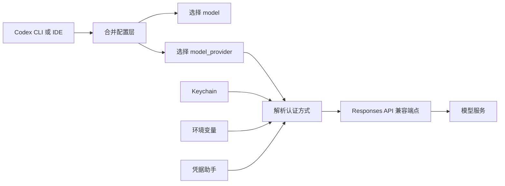
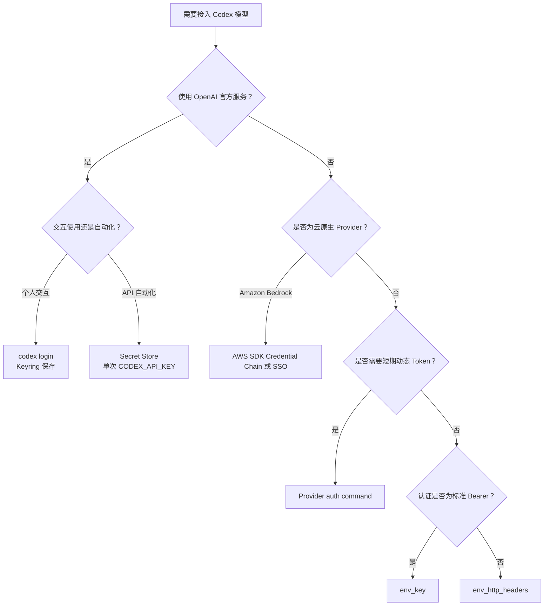

[toc]

## abstract

以下内容以 **Codex CLI 与 Codex IDE 扩展共用的配置体系**为主，重点讨论模型接入、自定义模型供应商（Model Provider）以及密钥与凭据管理;

> 最重要的版本结论：当前 Codex 自定义模型供应商使用的是 **Responses API 协议**。配置参考中的 `wire_api` 目前只支持 `responses`；旧教程常见的 `wire_api = "chat"`、仅兼容 Chat Completions 的代理端点，不应再作为新配置方案。([OpenAI Developers](https://developers.openai.com/codex/config-reference))

## 内容大纲

- Codex 模型接入的核心结构
- 配置文件、配置层级与优先级
- OpenAI 官方模型的认证方式
- 第三方供应商的通用接入方式
- Bearer Token、自定义 Header 和动态凭据的区别
- Azure OpenAI、Amazon Bedrock、本地模型等特殊场景
- 个人开发、团队协作和 CI/CD 的推荐方案
- 密钥保护与最小暴露原则
- 常见错误、旧配置陷阱与排查方法
- 一套可复用的推荐配置结构

## 先给出推荐结论

| 使用场景                         | 推荐认证方式                               | 推荐配置位置                    | 不推荐做法                            |
| -------------------------------- | ------------------------------------------ | ------------------------------- | ------------------------------------- |
| 个人使用 OpenAI 模型             | `codex login`，凭据存入系统 Keychain       | `~/.codex/config.toml`          | 将 Token 写进 TOML                    |
| 使用 OpenAI API Key              | `codex login --with-api-key`               | 系统 Keychain 或 Codex 凭据存储 | 每次在命令历史中明文输入              |
| 普通第三方 Bearer Key            | `env_key` 引用环境变量                     | 用户级或 Profile 配置           | 在 `experimental_bearer_token` 中写死 |
| 第三方要求 `x-api-key` 等 Header | `env_http_headers`                         | 用户级或 Profile 配置           | 把密钥写进 `http_headers`             |
| 企业短期 Token                   | `[model_providers.<id>.auth]` 调用凭据程序 | 用户级或系统级配置              | 使用长期静态共享密钥                  |
| GitHub Actions                   | 官方 Codex Action或步骤级 Secret           | CI Secret Store                 | Job 级公开整个密钥环境                |
| 其他 CI/CD                       | 单次调用作用域的 `CODEX_API_KEY`           | CI Secret Store                 | 将密钥设为整个流水线全局变量          |
| Amazon Bedrock                   | AWS SDK Credential Chain、SSO 或 IAM       | AWS 凭据系统                    | 长期硬编码 Access Key                 |
| Ollama / LM Studio               | `--oss` 和本地供应商                       | Profile 或用户配置              | 为本地无认证端点伪造密钥              |
| 团队统一网关                     | Profile + `env_key` 或动态认证命令         | 用户级、系统级或受管配置        | 在项目仓库提交供应商密钥              |

## 核心概念

| 术语       | 英文                 | 含义                                                         |
| ---------- | -------------------- | ------------------------------------------------------------ |
| 模型       | Model                | 实际执行推理的模型，例如某个 GPT 模型或供应商模型            |
| 模型供应商 | Model Provider       | Codex 用于访问模型的端点、认证方式、协议和重试规则的集合     |
| 基础地址   | Base URL             | API 服务根地址，例如企业网关或第三方兼容端点                 |
| 传输协议   | Wire API             | Codex 与模型端点通信所采用的 API 语义，目前自定义供应商使用 Responses API |
| 凭据       | Credential           | API Key、Bearer Token、短期访问令牌或云平台身份              |
| 配置档案   | Profile              | 一套可以通过 `--profile` 选择的独立 Codex 配置               |
| 密钥环     | Keyring / Keychain   | 操作系统提供的安全凭据存储                                   |
| 环境变量   | Environment Variable | 在进程启动时注入配置或密钥，而不将值写入配置文件             |
| 凭据助手   | Credential Helper    | 运行外部命令，动态获取短期 Token 的程序                      |

Codex 的整体工作方式可以概括为：



需要特别区分：

- `model` 决定请求哪个模型。
- `model_provider` 决定请求发送到哪里、如何认证。
- 密钥通常不应直接出现在配置文件中。
- “兼容 OpenAI API”不一定意味着兼容 Codex。供应商至少需要提供 Codex 当前所需的 **Responses API 兼容能力**，仅提供 `/chat/completions` 通常不够。([OpenAI Developers](https://developers.openai.com/codex/config-advanced))

## 配置文件与优先级

Codex 的主要用户配置文件是：

```text
~/.codex/config.toml
```

项目也可以包含：

```text
<项目根目录>/.codex/config.toml
```

当前配置优先级大致为：

| 优先级 | 来源                                | 常见用途                     |
| ------ | ----------------------------------- | ---------------------------- |
| 最高   | CLI 参数和 `--config` 覆盖          | 临时测试、自动化调用         |
| 较高   | 项目中的 `.codex/config.toml`       | 项目沙箱、审批策略、项目行为 |
| 较高   | `--profile` 选择的 Profile 文件     | 切换模型、供应商或工作模式   |
| 一般   | `~/.codex/config.toml`              | 用户默认配置                 |
| 较低   | `/etc/codex/config.toml` 等系统配置 | 机器或组织级默认值           |
| 最低   | Codex 内置默认值                    | 未显式配置的选项             |

Codex 会将这些**配置层合并**，并让高优先级值覆盖低优先级值。([OpenAI Developers](https://developers.openai.com/codex/config-basic))

### 项目级配置的一个重要的安全限制

**项目级** `.codex/config.toml` **不能用来重定向模型供应商或认证端点**。诸如以下内容在项目本地配置中会被忽略：

- `model_provider`
- `model_providers`
- `openai_base_url`
- 其他可能改变**认证或流量去向**的供应商设置

这是为了避免克隆一个仓库后，该仓库静默地把模型请求和凭据发送到恶意服务器。**供应商配置**应放在用户目录、Profile、系统配置或组织受管配置中。([OpenAI Developers](https://developers.openai.com/codex/config-advanced))

## Profile 的现代配置方式

Profile 适合区分：

- OpenAI 与第三方模型
- 开发、测试和生产环境
- 公司网关与个人账户
- 不同区域或不同计费账户

当前推荐使用独立文件，例如：

```text
~/.codex/config.toml
~/.codex/vendor.config.toml
~/.codex/azure.config.toml
~/.codex/local.config.toml
```

启动时选择：

```bash
codex --profile vendor
```

新版本中，旧式的：

```toml
[profiles.vendor]
```

以及顶层的：

```toml
profile = "vendor"
```

已经不再是推荐或受支持的 Profile 组织方式。Codex 0.134.0 及以后应使用独立的 `~/.codex/<profile-name>.config.toml` 文件。([OpenAI Developers](https://developers.openai.com/codex/config-advanced))

## OpenAI "官方模型"的认证方式

### 使用 ChatGPT 登录

适合：

- 个人交互式使用
- 使用 ChatGPT 订阅权限
- 希望使用 Codex 的账户级功能
- 不希望手动管理 API Key

执行：

```bash
codex login
```

然后按照浏览器中的登录流程完成认证。

推荐在用户配置中启用操作系统凭据存储：

```toml
cli_auth_credentials_store = "keyring"
```

可选值包括：

| 值        | 行为                                                         |
| --------- | ------------------------------------------------------------ |
| `keyring` | 强制使用操作系统 Keychain、Credential Manager 或 Secret Service |
| `auto`    | 优先使用 Keyring，不可用时回退到文件                         |
| `file`    | 将凭据写入 `$CODEX_HOME/auth.json`                           |

个人电脑上优先推荐 `keyring`；需要兼顾跨环境兼容性时可以使用 `auto`。`auth.json` 应被视为密码文件，不应提交、同步或共享。([ChatGPT Learn](https://learn.chatgpt.com/codex/auth))

完整示例：

```toml
# ~/.codex/config.toml

cli_auth_credentials_store = "keyring"

approval_policy = "on-request"
sandbox_mode = "workspace-write"
```

### 使用 OpenAI API Key 登录

适合：

- 按 API 用量计费
- 使用专门的项目 API Key
- 自动化之外的本地开发
- 不使用 ChatGPT 订阅身份

POSIX Shell：

```bash
export OPENAI_API_KEY="你的密钥"
printenv OPENAI_API_KEY | codex login --with-api-key
unset OPENAI_API_KEY
```

PowerShell：

```powershell
$env:OPENAI_API_KEY = "你的密钥"
$env:OPENAI_API_KEY | codex login --with-api-key
Remove-Item Env:OPENAI_API_KEY
```

这种登录方式会让 Codex 接收 API Key，并按照 `cli_auth_credentials_store` 的设置保存凭据。相较于把密钥直接写入 `config.toml`，这是更安全、也更符合官方认证模型的方式。([ChatGPT Learn](https://learn.chatgpt.com/codex/auth))

检查与退出：

```bash
codex login status
codex logout
```

### `OPENAI_API_KEY` 与 `CODEX_API_KEY` 的区别

| 变量                 | 典型用途                            | 是否面向长期登录   |
| -------------------- | ----------------------------------- | ------------------ |
| `OPENAI_API_KEY`     | 传给 `codex login --with-api-key`   | 是，通过登录后存储 |
| `CODEX_API_KEY`      | `codex exec` 的单次非交互调用       | 否                 |
| `CODEX_ACCESS_TOKEN` | 需要 ChatGPT 工作区身份的受信自动化 | 特殊场景           |

`CODEX_API_KEY` 主要面向 `codex exec`，尤其适合将密钥限制在单次命令的进程作用域，而不是暴露给整个 Job。([ChatGPT Learn](https://learn.chatgpt.com/codex/config-file/environment-variables))

## 第三方供应商的通用接入模型🎈

一个第三方供应商通常需要四部分：

```toml
model = "<模型标识>"
model_provider = "<供应商配置标识>"

[model_providers.<供应商配置标识>]
name = "<显示名称>"
base_url = "<Responses API 基础地址>"
wire_api = "responses"
```

然后根据供应商的**认证机制**，选择以下方式之一：

- `env_key`
- `env_http_headers`
- 动态 `[auth]` 命令
- 云供应商原生凭据链
- 无认证的本地端点

## 场景：第三方使用标准 Bearer Token

很多 OpenAI 兼容供应商接受：

```http
Authorization: Bearer <API_KEY>
```

此时使用 `env_key`。

```toml
# ~/.codex/vendor.config.toml

model = "vendor-model-id"
model_provider = "vendor"

[model_providers.vendor]
name = "Vendor Responses API"
base_url = "https://api.vendor.example/v1"
wire_api = "responses"
env_key = "VENDOR_API_KEY"
env_key_instructions = "请设置 VENDOR_API_KEY 环境变量"
```

设置密钥：

```bash
export VENDOR_API_KEY="实际密钥"
codex --profile vendor
```

PowerShell：

```powershell
$env:VENDOR_API_KEY = "实际密钥"
codex --profile vendor
```

这里的：

```toml
env_key = "VENDOR_API_KEY"
```

写的是**环境变量名称**，不是密钥值。Codex 从环境变量读取密钥值，并将其作为 Bearer Token 使用。([OpenAI Developers](https://developers.openai.com/codex/config-advanced))

### 推荐程度(env_key)

这是第三方静态 API Key 的首选方式，因为：

- 配置文件中没有秘密值。
- 同一 Profile 可以**在不同机器上复用**。
- CI、容器和 Secret Manager 都**容易注入**。
- 可以为**开发和生产**设置不同的环境变量值。

## 场景：第三方要求自定义 Header

某些供应商不使用标准 Bearer Token，而是要求：

```http
x-api-key: <KEY>
```

或：

```http
api-key: <KEY>
```

此时不要使用 `env_key`，而应使用 `env_http_headers`：

```toml
model = "vendor-model-id"
model_provider = "vendor-header-auth"

[model_providers.vendor-header-auth]
name = "Vendor Header Auth"
base_url = "https://api.vendor.example/v1"
wire_api = "responses"

env_http_headers = {
    "x-api-key" = "VENDOR_API_KEY"
}
```

环境变量：

```bash
export VENDOR_API_KEY="实际密钥"
```

映射关系是：

```text
HTTP Header 名称 = 环境变量名称
```

还有一个`http_headers`属性,用途不同:

```toml
http_headers = {
    "x-api-key" = "实际密钥"
}
```

`http_headers` 更适合保存非敏感的固定 Header，例如版本标记、租户标识或功能开关；敏感 Header 应使用 `env_http_headers`。([OpenAI Developers](https://developers.openai.com/codex/config-advanced))

也可以同时使用多个环境变量 Header：

```toml
env_http_headers = {
    "x-api-key" = "VENDOR_API_KEY",
    "x-tenant-id" = "VENDOR_TENANT_ID"
}
```

## 场景：企业网关使用短期 Token

企业环境中，Token 可能来自：

- OAuth 2.0
- OIDC（OpenID Connect）
- SSO
- Vault
- 云平台身份
- 公司内部凭据代理
- 临时 STS Token

这时不宜使用长期静态密钥，可以让 Codex 执行一个命令获取 Bearer Token：

```toml
model = "company-model"
model_provider = "company-gateway"

[model_providers.company-gateway]
name = "Company AI Gateway"
base_url = "https://ai-gateway.example.com/v1"
wire_api = "responses"

[model_providers.company-gateway.auth]
command = "/usr/local/bin/fetch-codex-token"
args = ["--audience", "codex"]
timeout_ms = 5000
refresh_interval_ms = 300000
```

凭据程序应：

- 不从标准输入读取数据。
- 将 Token 输出到标准输出。
- 只输出 Token，不附加日志。
- 返回非零退出码表示失败。
- 避免把 Token 写入临时文件。
- 自行使用系统身份、SSO 或 Secret Manager。

Codex 会去除输出两端的空白，并按 `refresh_interval_ms` 刷新凭据。`auth` 配置不应与 `env_key`、`experimental_bearer_token` 或 `requires_openai_auth` 混用。([OpenAI Developers](https://developers.openai.com/codex/config-advanced))

### 推荐程度

对于企业环境，这是最推荐的高级方案：

- Token 生命周期短。
- 可以集中撤销权限。
- 无需让开发者看到真实密钥。
- 可以基于用户身份实施审计。
- 可以按模型、项目或环境动态授权。

## 场景：通过企业代理访问 OpenAI

企业可能仍使用 OpenAI 模型，但要求流量经过内部代理：

```toml
model = "gpt-5.4"
model_provider = "company-proxy"

[model_providers.company-proxy]
name = "OpenAI through company proxy"
base_url = "https://ai-proxy.example.com/v1"
wire_api = "responses"
env_key = "COMPANY_AI_TOKEN"
```

这里应把代理看作一个独立 Provider，而不是简单修改项目配置。

如果只是改变内置 OpenAI Provider 的基础地址，Codex 还提供 `openai_base_url`；但不能通过重新定义 `[model_providers.openai]` 覆盖内置的保留 Provider。`openai`、`ollama`、`lmstudio` 等标识有保留语义。([OpenAI Developers](https://developers.openai.com/codex/config-advanced))

## 场景：Azure OpenAI

Azure OpenAI 通常需要：

- Azure 项目或资源端点
- API 版本查询参数
- Azure API Key
- 对应部署或模型标识
- Responses API 支持

参考结构：

```toml
model = "<azure-deployment-or-model-id>"
model_provider = "azure"

[model_providers.azure]
name = "Azure OpenAI"
base_url = "https://YOUR_PROJECT_NAME.openai.azure.com/openai"
wire_api = "responses"

env_key = "AZURE_OPENAI_API_KEY"

query_params = {
    api-version = "2025-04-01-preview"
}

request_max_retries = 4
stream_max_retries = 10
stream_idle_timeout_ms = 300000
```

环境变量：

```bash
export AZURE_OPENAI_API_KEY="实际密钥"
```

需要注意：

- `api-version` 应采用 Azure 当前支持 Responses API 的版本。
- `base_url` 应是文档要求的 API 根路径，不要盲目把完整 `/responses` 路径附在后面。
- Azure 中显示名称、部署名称和底层模型名称可能不同，应以实际部署标识为准。
- API 版本可能变化，应在升级前核对 Azure 与 Codex 当前文档。([OpenAI Developers](https://developers.openai.com/codex/config-advanced))

## 场景：Amazon Bedrock

Codex 内置 Amazon Bedrock Provider，可以直接调用 Bedrock Responses API，不需要 `OPENAI_API_KEY` 或 ChatGPT 登录。([ChatGPT Learn](https://learn.chatgpt.com/codex/amazon-bedrock))

基础配置：

```toml
model_provider = "amazon-bedrock"
model = "<bedrock-model-id>"

[model_providers.amazon-bedrock.aws]
profile = "default"
region = "us-west-2"
```

优先推荐使用 AWS 原生身份机制：

- AWS IAM Identity Center / SSO
- AWS CLI 登录态
- Shared Credentials File
- `credential_process`
- EC2、ECS 或其他工作负载角色
- AWS SDK Credential Provider Chain

在未显式设置 `profile` 时，Codex 会使用标准 AWS 凭据链。([OpenAI Developers](https://developers.openai.com/codex/config-advanced))

Bedrock 也支持专用 Bearer Token 形式：

```bash
export AWS_BEARER_TOKEN_BEDROCK="实际令牌"
export AWS_REGION="us-west-2"
```

但对于长期生产使用，优先选择：

```text
工作负载身份或 SSO
优于
短期静态 Token
优于
长期 Access Key
```

### IDE 与桌面进程的环境变量问题

从终端启动的 CLI 通常继承 Shell 环境变量，但桌面应用或 IDE 扩展不一定继承终端初始化文件。

Bedrock 官方接入文档特别说明，必要时可将相关值放入：

```text
~/.codex/.env
```

然后重启 IDE 或 Codex 应用。这个 `.env` 行为应按具体 Provider 文档使用，不宜假定所有第三方供应商都自动读取它。([ChatGPT Learn](https://learn.chatgpt.com/codex/amazon-bedrock))

## 场景：Ollama 和 LM Studio 本地模型

本地模型适合：

- 离线实验
- 不希望代码离开本机
- 无 API 费用的开发测试
- 验证工具调用或工作流
- 内网部署模型

可以直接启用 OSS 模式：

```bash
codex --oss --local-provider ollama
```

或：

```bash
codex --oss --local-provider lmstudio
```

也可以设置默认本地 Provider：

```toml
oss_provider = "ollama"
```

自定义**本地端点**示意：

```toml
model = "local-model-id"
model_provider = "local-ollama"

[model_providers.local-ollama]
name = "Local Ollama"
base_url = "http://localhost:11434/v1"
wire_api = "responses"
```

本地端点通常不需要密钥，因此不要为了满足配置格式而设置无意义的假 Key。

但本地服务仍必须实现 Codex 所依赖的 API 行为；仅支持传统 Chat Completions 的模型服务器可能无法完整工作。([OpenAI Developers](https://developers.openai.com/codex/config-advanced))

## 场景：个人电脑上的多供应商配置

推荐将通用安全设置放在主配置中：

```toml
# ~/.codex/config.toml

cli_auth_credentials_store = "keyring"

approval_policy = "on-request"
sandbox_mode = "workspace-write"

[shell_environment_policy]
inherit = "core"
ignore_default_excludes = false

exclude = [
    "*_API_KEY",
    "*_TOKEN",
    "AWS_SECRET_ACCESS_KEY"
]
```

然后为每个供应商建立独立 Profile：

```toml
# ~/.codex/vendor.config.toml

model = "vendor-model-id"
model_provider = "vendor"

[model_providers.vendor]
name = "Vendor API"
base_url = "https://api.vendor.example/v1"
wire_api = "responses"
env_key = "VENDOR_API_KEY"
```

运行：

```bash
VENDOR_API_KEY="实际密钥" codex --profile vendor
```

这里有两个不同的环境变量范围：

1. Codex 主进程读取 `VENDOR_API_KEY`，用于模型认证。
2. `shell_environment_policy` 控制 Codex 启动的 Shell 命令能够继承哪些变量。

因此，可以让 Codex 本身使用模型密钥，同时避免模型执行的构建脚本、测试脚本或仓库代码自动读取该密钥。Codex 默认也会过滤名称中带有 `KEY`、`SECRET`、`TOKEN` 等敏感模式的变量。([OpenAI Developers](https://developers.openai.com/codex/config-advanced))

## 场景：团队共享配置

团队通常需要共享：

- Provider 名称
- `base_url`
- 模型标识
- API 版本
- 重试与超时参数
- 安全策略
- Profile 命名规则

但不应共享：

- API Key
- Bearer Token
- `auth.json`
- AWS Secret Access Key
- 用户级访问令牌

推荐结构：

```text
仓库
├── .codex
│   └── config.toml          项目行为，不包含 Provider 重定向
└── docs
    └── codex-setup.md       配置说明和环境变量名称

用户目录
├── .codex
│   ├── config.toml
│   ├── company.config.toml
│   └── auth.json            不应共享
```

团队可以在内部文档或配置模板中分发：

```toml
env_key = "COMPANY_CODEX_TOKEN"
```

但由每位用户通过：

- 操作系统 Keychain
- 企业 Secret Manager
- SSO 凭据助手
- 受控 Shell 注入
- MDM 或组织设备管理

提供实际值。

更成熟的组织可以使用系统配置或组织受管配置，强制：

- 允许的认证方式
- 指定 ChatGPT Workspace
- 固定登录方法
- 沙箱和审批策略
- 允许或禁止的模型供应商

Codex 提供 `forced_login_method` 和工作区约束等受管认证选项，适合企业统一治理。([ChatGPT Learn](https://learn.chatgpt.com/codex/auth))

## 场景：CI/CD 与非交互执行

非交互任务使用：

```bash
codex exec "检查当前仓库并运行测试"
```

Codex 的自动化场景应遵循一个核心规则：

> 密钥的可见范围应尽量短，只覆盖真正需要访问模型的那个进程。

### OpenAI API 的单次调用

```bash
CODEX_API_KEY="${CI_CODEX_API_KEY}" \
codex exec --json --ephemeral "检查代码并输出 JSON 结果"
```

其中：

- `CODEX_API_KEY` 只供当前 `codex exec` 使用。
- `--ephemeral` 避免保留此次运行的 rollout 状态。
- 密钥来源应是 CI Secret Store。
- 不应把密钥硬编码到 Workflow 文件。

官方特别提醒，不应将 `OPENAI_API_KEY` 或 `CODEX_API_KEY` 设置成一个会执行不受信仓库代码的整个 Job 的全局环境变量，因为仓库脚本、第三方 Action 或构建工具可能读取它。([ChatGPT Learn](https://learn.chatgpt.com/codex/non-interactive-mode))

### GitHub Actions

在 GitHub Actions 中，官方 Codex Action 通常优于手写一组长期密钥暴露逻辑。其设计可以降低 API Key 直接暴露给仓库代码的风险。([ChatGPT Learn](https://learn.chatgpt.com/codex/non-interactive-mode))

若必须直接执行 CLI，应尽量限制到单个 Step：

```yaml
- name: Run Codex review
  env:
    CODEX_API_KEY: ${{ secrets.CODEX_API_KEY }}
  run: |
    codex exec --ephemeral --sandbox read-only \
      "审查变更并给出结构化问题列表"
```

不要把密钥放到顶层：

```yaml
env:
  CODEX_API_KEY: ${{ secrets.CODEX_API_KEY }}
```

因为这会使后续所有步骤都继承密钥。

### 第三方 Provider 的 CI 配置

假设配置使用：

```toml
env_key = "VENDOR_API_KEY"
```

CI 中可以：

```yaml
- name: Run Codex with vendor
  env:
    VENDOR_API_KEY: ${{ secrets.VENDOR_API_KEY }}
  run: |
    codex exec --profile vendor --ephemeral \
      "执行代码审查"
```

第三方密钥同样应遵守步骤级、进程级和最小权限原则。

### ChatGPT Workspace Access Token

`CODEX_ACCESS_TOKEN` 只适合确实需要 ChatGPT Business 或 Enterprise Workspace 身份的可信自动化流程。普通 API 自动化应优先使用 API Key。

访问令牌应：

- 保存在 Secret Manager。
- 只放在受信 Runner。
- 避免用于公开仓库和 Fork PR。
- 定期轮换。
- 明确设置责任人和用途。

([ChatGPT Learn](https://learn.chatgpt.com/codex/enterprise/access-tokens))

## 密钥保存方式的安全比较

| 方式                        | 安全性 | 便捷性   | 推荐用途               |
| --------------------------- | ------ | -------- | ---------------------- |
| 操作系统 Keyring            | 高     | 高       | 个人交互登录           |
| 动态凭据命令                | 很高   | 中       | 企业短期 Token         |
| CI Secret Store             | 高     | 高       | 自动化                 |
| 云平台身份链                | 很高   | 中       | Bedrock、云工作负载    |
| 临时环境变量                | 中到高 | 高       | 单次运行               |
| Shell 配置文件中的 `export` | 中     | 高       | 个人开发，但需保护文件 |
| `auth.json`                 | 中     | 高       | 无 Keyring 环境的回退  |
| TOML 中明文密钥             | 低     | 高       | 不推荐                 |
| 命令行参数中明文密钥        | 低     | 中       | 不推荐                 |
| 提交到 Git 仓库             | 极低   | 表面方便 | 严禁                   |

## 为什么环境变量也不是绝对安全

环境变量优于把密钥写入仓库，但仍可能被以下对象读取：

- 当前用户的其他进程
- 子进程
- 构建脚本
- 测试脚本
- 调试工具
- 错误日志
- CI 插件
- 恶意依赖

因此，推荐组合使用：

```text
Secret Manager
+
进程级注入
+
shell_environment_policy
+
最小权限密钥
+
短生命周期
```

而不是简单地认为“用了环境变量就安全”。

## `shell_environment_policy` 的作用

Codex 经常需要运行：

- `git`
- 编译器
- 测试工具
- 包管理器
- 项目脚本

这些子进程通常不需要模型 API Key。可以控制其继承的环境变量：

```toml
[shell_environment_policy]
inherit = "core"
ignore_default_excludes = false

exclude = [
    "OPENAI_API_KEY",
    "VENDOR_API_KEY",
    "AWS_SECRET_ACCESS_KEY",
    "*_TOKEN"
]
```

更严格的模式：

```toml
[shell_environment_policy]
inherit = "none"

set = {
    PATH = "/usr/local/bin:/usr/bin:/bin"
}

include_only = [
    "PATH",
    "HOME",
    "LANG"
]
```

这种方式可以显著缩小“模型让 Shell 执行了一段仓库代码，而仓库代码读取了模型密钥”的风险面。([OpenAI Developers](https://developers.openai.com/codex/config-advanced))

## 不推荐的密钥配置

### 在 `experimental_bearer_token` 中写死密钥

虽然配置项存在，但官方配置参考明确不鼓励把 Bearer Token 直接放入配置，应优先使用 `env_key`。([OpenAI Developers](https://developers.openai.com/codex/config-reference))

不推荐：

```toml
[model_providers.vendor]
experimental_bearer_token = "真实密钥"
```

推荐：

```toml
[model_providers.vendor]
env_key = "VENDOR_API_KEY"
```

### 在固定 Header 中写死密钥

不推荐：

```toml
http_headers = {
    "x-api-key" = "真实密钥"
}
```

推荐：

```toml
env_http_headers = {
    "x-api-key" = "VENDOR_API_KEY"
}
```

### 复制 `auth.json`

把 `auth.json` 从个人电脑复制到服务器只应作为少数无浏览器环境的回退方案。文件可能包含可直接使用的凭据，应像密码一样保护。

对于无界面服务器，优先考虑：

```bash
codex login --device-auth
```

而不是长期复制用户认证文件。([ChatGPT Learn](https://learn.chatgpt.com/codex/auth))

### 把密钥写在命令参数中

例如：

```bash
some-command --api-key "secret"
```

命令参数可能出现在：

- Shell 历史
- 进程列表
- CI 日志
- 审计记录
- 崩溃报告

Codex 的 API Key 登录采用标准输入，正是为了避免这种暴露方式。

## 第三方兼容性检查清单

接入一个供应商前，应确认：

| 检查项        | 要确认的内容                                        |
| ------------- | --------------------------------------------------- |
| Responses API | 是否真正支持 Responses，而非仅支持 Chat Completions |
| 流式输出      | 是否支持 Codex 使用的流式响应方式                   |
| 工具调用      | 是否支持工具或函数调用语义                          |
| 输入结构      | 是否接受 Codex 发送的 Responses 请求字段            |
| 模型名称      | 配置中的模型 ID 是否与供应商实际 ID 一致            |
| 认证方式      | Bearer、`x-api-key`、云身份还是 OAuth               |
| Base URL      | 是 API 根地址，而不是网页控制台地址                 |
| 重试行为      | 是否正确返回 429、5xx 等状态码                      |
| 超时行为      | 长时间推理是否会被代理提前断开                      |
| 上下文能力    | 是否有足够上下文长度处理代码仓库                    |
| 数据政策      | 代码是否会被存储、训练或跨境传输                    |
| 日志政策      | 网关是否记录 Prompt、代码和输出                     |

“OpenAI-compatible”是一个宽泛描述。对于 Codex，更准确的问题是：

> 该服务是否兼容 Codex 当前使用的 Responses API、流式响应和工具调用行为？

## Base URL 的常见规则

通常应把 `base_url` 配置为 API 根地址：

```toml
base_url = "https://api.vendor.example/v1"
```

而不是直接写完整操作路径：

```toml
base_url = "https://api.vendor.example/v1/responses"
```

Codex 会根据 Provider 协议构造具体请求路径。如果供应商要求特殊路径，则应以该供应商专门针对 Codex 或 Responses API 的说明为准。

常见错误包括：

- 填入控制台网页地址。
- 重复添加 `/v1`。
- 重复添加 `/responses`。
- 使用 `/chat/completions`。
- 企业代理在地址中额外添加租户路径，但未同步配置。
- Azure 端点缺少所需查询参数。

## 重试和超时配置

远程供应商或企业网关可能需要调整：

```toml
[model_providers.vendor]
request_max_retries = 4
stream_max_retries = 10
stream_idle_timeout_ms = 300000
```

这些选项分别控制：

| 配置                     | 含义                           |
| ------------------------ | ------------------------------ |
| `request_max_retries`    | 普通请求失败后的最大重试次数   |
| `stream_max_retries`     | 流式连接中断后的重试次数       |
| `stream_idle_timeout_ms` | 流式连接无数据时允许等待的时间 |

不要通过无限提高重试次数掩盖：

- 认证错误
- 模型名称错误
- API 不兼容
- 网关路径错误
- 配额耗尽

401、403 和大多数 400 错误通常应先检查配置，而不是重试。

## 常见错误与处理

| 现象                                  | 常见原因                          | 处理方式                                                 |
| ------------------------------------- | --------------------------------- | -------------------------------------------------------- |
| 配置 `wire_api = "chat"` 后失败       | 使用旧教程                        | 改用 `responses`，并确认服务支持 Responses API           |
| 项目中的 Provider 配置无效            | Provider 重定向在项目配置中被忽略 | 移到用户配置或 Profile                                   |
| `[profiles.vendor]` 不生效            | 新版不再加载旧式 Profile          | 创建 `~/.codex/vendor.config.toml`                       |
| 设置了 `OPENAI_API_KEY` 但仍要求登录  | 内置 OpenAI 登录未完成            | 执行 `codex login --with-api-key`                        |
| `CODEX_API_KEY` 在交互式 Codex 中无效 | 该变量面向 `codex exec`           | 使用登录流程或 Provider `env_key`                        |
| 第三方返回 401                        | 供应商要求自定义 Header           | 从 `env_key` 改用 `env_http_headers`                     |
| 第三方返回 404                        | Base URL 或 API 路径错误          | 使用 API 根地址，检查 Responses 路径                     |
| 能联网但工具调用失败                  | 只兼容基础文本接口                | 确认工具调用和 Responses 语义                            |
| CLI 可用但 IDE 不可用                 | IDE 未继承 Shell 环境             | 从已配置环境启动 IDE，或使用 Provider 支持的凭据加载方式 |
| 仓库脚本能读取密钥                    | 子进程继承了环境变量              | 配置 `shell_environment_policy`                          |
| 频繁断流                              | 网关或负载均衡超时过短            | 检查代理超时并调整流式空闲超时                           |
| Profile 似乎未生效                    | 被 CLI 或项目高优先级值覆盖       | 检查配置优先级和启动参数                                 |

## 安全排查命令

检查环境变量是否存在，但不打印实际值：

POSIX Shell：

```bash
if [ -n "${VENDOR_API_KEY:-}" ]; then
    echo "VENDOR_API_KEY is set"
else
    echo "VENDOR_API_KEY is missing"
fi
```

PowerShell：

```powershell
if ($env:VENDOR_API_KEY) {
    Write-Output "VENDOR_API_KEY is set"
} else {
    Write-Output "VENDOR_API_KEY is missing"
}
```

检查 OpenAI 登录状态：

```bash
codex login status
```

执行一个低权限测试：

```bash
codex exec \
  --profile vendor \
  --sandbox read-only \
  --ephemeral \
  "只回答当前工作目录的名称，不修改任何文件"
```

测试时优先使用：

- 只读沙箱
- 临时运行
- 小请求
- 无敏感仓库
- 测试专用密钥
- 较低额度限制

## 一套推荐的最终配置结构

### 用户主配置

```toml
# ~/.codex/config.toml

cli_auth_credentials_store = "keyring"

approval_policy = "on-request"
sandbox_mode = "workspace-write"

[shell_environment_policy]
inherit = "core"
ignore_default_excludes = false

exclude = [
    "OPENAI_API_KEY",
    "CODEX_API_KEY",
    "VENDOR_API_KEY",
    "AZURE_OPENAI_API_KEY",
    "AWS_SECRET_ACCESS_KEY",
    "*_TOKEN"
]
```

### 公司网关 Profile

```toml
# ~/.codex/company.config.toml

model = "company-code-model"
model_provider = "company"

[model_providers.company]
name = "Company AI Gateway"
base_url = "https://ai-gateway.example.com/v1"
wire_api = "responses"
env_key = "COMPANY_CODEX_API_KEY"

http_headers = {
    "x-client-name" = "codex"
}

env_http_headers = {
    "x-tenant-id" = "COMPANY_TENANT_ID"
}

request_max_retries = 4
stream_max_retries = 8
stream_idle_timeout_ms = 300000
```

启动：

```bash
COMPANY_CODEX_API_KEY="实际密钥" \
COMPANY_TENANT_ID="engineering" \
codex --profile company
```

### 动态认证 Profile

```toml
# ~/.codex/company-sso.config.toml

model = "company-code-model"
model_provider = "company-sso"

[model_providers.company-sso]
name = "Company Gateway with SSO"
base_url = "https://ai-gateway.example.com/v1"
wire_api = "responses"

[model_providers.company-sso.auth]
command = "/usr/local/bin/company-ai-token"
args = ["get", "--audience", "codex"]
timeout_ms = 5000
refresh_interval_ms = 240000
```

### 本地模型 Profile

```toml
# ~/.codex/local.config.toml

model = "local-code-model"
model_provider = "local"

[model_providers.local]
name = "Local Model"
base_url = "http://localhost:11434/v1"
wire_api = "responses"
```

## 最终选择原则

可以按下面的顺序决策：



实践上的优先顺序是：

1. **个人 OpenAI 交互使用**：ChatGPT 登录或 API Key 登录，并使用 `keyring`。
2. **普通第三方静态密钥**：Profile 中配置 `env_key`。
3. **自定义认证 Header**：使用 `env_http_headers`。
4. **企业生产环境**：短期 Token 加凭据助手。
5. **CI/CD**：Secret Store 加单步骤或单进程注入。
6. **云平台模型**：优先使用工作负载身份和原生凭据链。
7. **本地模型**：使用内置 OSS Provider，不配置无意义的密钥。
8. **所有场景**：使用 `shell_environment_policy` 阻止模型调用的子进程继承模型凭据。

最应避免的做法是：

- 在 TOML 中硬编码密钥。
- 把密钥提交到 Git。
- 使用旧的 `wire_api = "chat"` 配置。
- 将 Provider 重定向写进项目配置。
- 在整个 CI Job 中暴露模型密钥。
- 长期复制和共享 `auth.json`。
- 因为某服务声称“OpenAI compatible”，就默认它能完整支持 Codex。