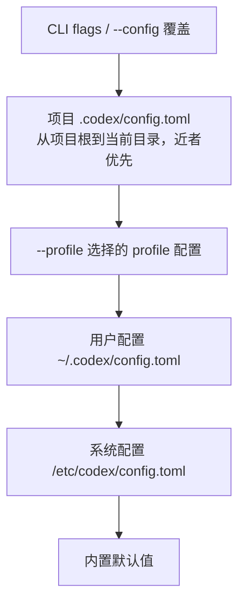

[toc]

## abstract

Codex 的配置体系可以分成三层来理解：

| 层次             | 主要文件/入口                                                | 作用                                                         |
| ---------------- | ------------------------------------------------------------ | ------------------------------------------------------------ |
| Codex 共享配置   | `~/.codex/config.toml`、项目内 `.codex/config.toml`          | 模型、权限、沙箱、MCP、provider、日志、web search、TUI 等核心行为 |
| 启动时覆盖       | CLI flags，例如 `--model`、`--sandbox`、`-c key=value`、`--profile` | 只影响当前这一次 Codex 会话或命令                            |
| VS Code 插件设置 | VS Code Settings 里的 `chatgpt.*`、`chat.*`                  | 主要控制 IDE 插件 UI、启动方式、字体、WSL 运行方式等         |

最重要的一点：**VS Code Codex 插件和 Codex CLI 使用同一个 Codex agent，并共享同一套 `~/.codex/config.toml` 配置层**。模型、approval、sandbox、MCP 等核心设置，不是在 VS Code settings 里单独配置，而是放在 Codex 的 `config.toml` 中。官方文档明确说明 CLI 和 IDE extension 共享配置层，并且 VS Code 插件内部也使用 Codex CLI。([OpenAI开发者](https://developers.openai.com/codex/config-basic))

------

## Codex 配置文件体系

### 配置文件位置

| 位置                                | 作用域           | 适合放什么                                             |
| ----------------------------------- | ---------------- | ------------------------------------------------------ |
| `~/.codex/config.toml`              | 当前用户全局     | 默认模型、默认权限、provider、MCP、日志、TUI、个人习惯 |
| `.codex/config.toml`                | 当前项目或子目录 | 项目特定权限、web search、MCP、规则、局部行为          |
| `$CODEX_HOME/<profile>.config.toml` | 命名 profile     | 不同工作模式，例如 `safe`、`fast`、`oss`、`review`     |
| `/etc/codex/config.toml`            | Unix 系统级      | 公司或机器级默认配置                                   |
| `requirements.toml`                 | 企业托管约束     | 限制用户可选模型、权限、沙箱、审批策略等               |

默认情况下，`CODEX_HOME` 是 `~/.codex`。如果你设置了 `CODEX_HOME` 环境变量，Codex 的配置、认证、日志、会话、skills 等状态都会放在这个目录下。([OpenAI开发者](https://developers.openai.com/codex/environment-variables))

------

## 配置优先级

Codex 解析配置时遵循“越靠近当前会话，优先级越高”的规则：



官方给出的顺序是：CLI flags 和 `--config` 最高，其次是可信项目内的 `.codex/config.toml`，再是 `--profile` 选中的 `$CODEX_HOME/<profile>.config.toml`，然后是用户配置、系统配置和内置默认值。([OpenAI开发者](https://developers.openai.com/codex/config-basic))

这意味着：

```bash
codex --model gpt-5.5 -c model_reasoning_effort="high"
```

会临时覆盖 `config.toml` 里的 `model` 和 `model_reasoning_effort`，但不会永久改配置文件。

------

## 项目配置的限制

项目内 `.codex/config.toml` 很有用，但不是所有字段都能放进去。官方文档说明，项目级配置不能覆盖一些“机器本地”或“安全敏感”的配置，例如：

| 不能可靠放在项目 `.codex/config.toml` 的配置 | 原因                                                   |
| -------------------------------------------- | ------------------------------------------------------ |
| `model_provider`、`model_providers`          | provider 通常涉及本机 API endpoint、认证方式、密钥来源 |
| `openai_base_url`、`chatgpt_base_url`        | 属于本机或组织级服务入口                               |
| `notify`                                     | 本地通知命令可能有安全风险                             |
| `profile`、`profiles`                        | profile 选择应由用户或机器控制                         |
| `otel`                                       | 遥测和日志出口属于组织/机器级配置                      |
| 部分 app/request metadata                    | 和宿主 App、认证、环境绑定                             |

这些 key 出现在项目 `.codex/config.toml` 时会被 Codex 忽略。provider、认证、通知、telemetry 这类配置应放在用户级 `~/.codex/config.toml` 或托管配置里。([OpenAI开发者](https://developers.openai.com/codex/config-reference))

------

## 最小可用配置示例

适合大多数个人开发者的基础配置：

```toml
# ~/.codex/config.toml

model = "gpt-5.5"
model_provider = "openai"

approval_policy = "on-request"
sandbox_mode = "workspace-write"

web_search = "cached"

[shell_environment_policy]
inherit = "core"
exclude = ["*KEY*", "*SECRET*", "*TOKEN*"]

[history]
persistence = "save-all"

[tui]
vim_mode_default = false
raw_output_mode = false
```

含义：

| 配置                               | 说明                                          |
| ---------------------------------- | --------------------------------------------- |
| `model = "gpt-5.5"`                | 默认模型                                      |
| `model_provider = "openai"`        | 默认使用 OpenAI provider                      |
| `approval_policy = "on-request"`   | 高风险或越权动作需要询问                      |
| `sandbox_mode = "workspace-write"` | 允许在工作区内写文件                          |
| `web_search = "cached"`            | 使用缓存 web search，不直接抓 live 页面       |
| `shell_environment_policy`         | 控制传给 Codex 子进程的环境变量，避免泄露密钥 |
| `history.persistence`              | 是否保存本地会话历史                          |
| `[tui]`                            | 仅影响 CLI 终端 UI                            |

------

## 常用核心选项

### 模型与 provider

| 配置项                           | 可选值/类型                             | 作用                                    |
| -------------------------------- | --------------------------------------- | --------------------------------------- |
| `model`                          | 字符串，例如 `"gpt-5.5"`                | 指定默认模型                            |
| `review_model`                   | 字符串                                  | 指定 `/review` 使用的模型               |
| `model_provider`                 | provider id，例如 `"openai"`、自定义 id | 指定模型服务商                          |
| `model_context_window`           | 数字                                    | 手动指定上下文窗口 token 数             |
| `model_auto_compact_token_limit` | 数字                                    | 到达阈值后自动压缩历史                  |
| `tool_output_token_limit`        | 数字                                    | 单次工具输出保留到上下文里的 token 上限 |
| `service_tier`                   | `"fast"`、`"flex"` 等                   | 指定服务层级                            |
| `oss_provider`                   | `"ollama"`、`"lmstudio"`                | 使用 `--oss` 时默认选择的本地 provider  |

官方配置参考中，`model` 用来指定当前模型，`model_provider` 默认是 `openai`，自定义 provider 通过 `[model_providers.<id>]` 定义；`oss_provider` 可用于指定本地开源模型 provider。([OpenAI开发者](https://developers.openai.com/codex/config-reference))

------

### 推理强度与输出风格

| 配置项                       | 可选值                                              | 说明                           |
| ---------------------------- | --------------------------------------------------- | ------------------------------ |
| `model_reasoning_effort`     | `minimal`、`low`、`medium`、`high`、`xhigh`         | 控制模型推理投入               |
| `plan_mode_reasoning_effort` | `none`、`minimal`、`low`、`medium`、`high`、`xhigh` | 单独控制 Plan mode 的推理强度  |
| `model_reasoning_summary`    | `auto`、`concise`、`detailed`、`none`               | 控制是否输出 reasoning summary |
| `model_verbosity`            | `low`、`medium`、`high`                             | 控制回答详细程度               |
| `personality`                | `none`、`friendly`、`pragmatic`                     | 默认沟通风格                   |

注意：`model_verbosity` 只对使用 **Responses API** 的 provider 生效；Chat Completions provider 会忽略它。官方高级配置文档明确提到这一点。([OpenAI开发者](https://developers.openai.com/codex/config-advanced))

推荐习惯：

| 场景                           | 推荐                                                 |
| ------------------------------ | ---------------------------------------------------- |
| 日常小修小改                   | `model_reasoning_effort = "medium"`                  |
| 架构设计、复杂 bug、跨模块重构 | 临时用 `high`                                        |
| 自动化脚本、CI、低成本任务     | 用较轻模型或较低 reasoning                           |
| 新手学习                       | `model_verbosity = "medium"` 或 `"high"`，方便看解释 |

------

## approval 与 sandbox

这是 Codex 最重要的安全配置。

### approval_policy

| 值              | 含义                           | 适合场景                         |
| --------------- | ------------------------------ | -------------------------------- |
| `untrusted`     | 更严格，更多动作需要确认       | 陌生项目、不可信仓库             |
| `on-request`    | 常规交互模式，有需要时请求批准 | 日常开发推荐                     |
| `never`         | 不弹审批，适合非交互任务       | CI、自动化，但要配合严格 sandbox |
| granular object | 对不同类型审批做细粒度控制     | 高级用户、企业安全策略           |

官方说明 `approval_policy` 控制 Codex 什么时候暂停并请求批准；`on-failure` 已弃用，交互场景应使用 `on-request`，非交互场景用 `never`。([OpenAI开发者](https://developers.openai.com/codex/config-reference))

示例：

```toml
approval_policy = "on-request"
```

更细粒度的写法：

```toml
approval_policy = { granular = {
  sandbox_approval = true,
  rules = true,
  mcp_elicitations = true,
  request_permissions = false,
  skill_approval = false
} }
```

### sandbox_mode

| 值                   | 文件权限       | 网络权限             | 适合场景                      |
| -------------------- | -------------- | -------------------- | ----------------------------- |
| `read-only`          | 只能读，不能写 | 默认受限             | 解释项目、审查代码、学习      |
| `workspace-write`    | 可写当前工作区 | 默认受限，可额外开启 | 日常开发推荐                  |
| `danger-full-access` | 基本不限制     | 高风险               | 只建议在独立容器/虚拟机中使用 |

配置示例：

```toml
sandbox_mode = "workspace-write"

[sandbox_workspace_write]
network_access = false
writable_roots = ["/Users/you/.cache/my-tool"]
exclude_slash_tmp = false
exclude_tmpdir_env_var = false
```

`sandbox_workspace_write.network_access = true` 可以允许 workspace-write sandbox 内的出站网络访问；`writable_roots` 可以额外添加可写目录。官方配置参考给出了这些 key 的含义。([OpenAI开发者](https://developers.openai.com/codex/config-reference))

------

## 新权限系统：permission profiles

除了旧的 `sandbox_mode`，Codex 还支持更细粒度的 **permission profiles**。它把文件系统规则和网络规则组合成一个命名策略。

官方明确提醒：**permission profiles 不要和旧的 `sandbox_mode` / `[sandbox_workspace_write]` 混用**。如果任何已加载配置里出现 `sandbox_mode`，Codex 会使用旧 sandbox 设置，而不是 `default_permissions`。([OpenAI开发者](https://developers.openai.com/codex/permissions))

### 内置 profile

| profile               | 说明                                    |
| --------------------- | --------------------------------------- |
| `:read-only`          | 本地命令只读                            |
| `:workspace`          | 可写当前 workspace roots 和系统临时目录 |
| `:danger-full-access` | 移除本地 sandbox 限制，高风险           |

### 推荐写法

```toml
# 不要同时写 sandbox_mode
default_permissions = "project-edit"

[permissions.project-edit]
description = "Allow edits in the workspace, but deny secrets and restrict network."
extends = ":workspace"

[permissions.project-edit.filesystem.":workspace_roots"]
"." = "write"
"**/*.env" = "deny"
"**/*.pem" = "deny"
"**/*secret*" = "deny"

[permissions.project-edit.network]
enabled = true
mode = "limited"

[permissions.project-edit.network.domains]
"api.openai.com" = "allow"
"*.github.com" = "allow"
"**.npmjs.org" = "allow"
"*" = "deny"
```

这里的思想是：允许 Codex 修改项目文件，但禁止读取 `.env`、私钥和包含 secret 的文件，同时只允许访问必要域名。permission profiles 支持对 workspace roots 做相对路径和 glob 规则，`deny` 可用于禁止读取匹配路径。([OpenAI开发者](https://developers.openai.com/codex/config-reference))

------

## web search 配置

Codex 支持 web search，本地任务默认是 cached 模式。cached 模式使用 OpenAI 维护的搜索索引，不直接抓取实时页面；如果使用 full access 这类高权限 sandbox，默认可能变成 live。官方说明 cached 模式能降低来自任意网页的 prompt injection 暴露，但 web 结果仍应被视为不可信。([OpenAI开发者](https://developers.openai.com/codex/config-basic))

| 配置                      | 含义                           |
| ------------------------- | ------------------------------ |
| `web_search = "disabled"` | 禁用 web search                |
| `web_search = "cached"`   | 使用缓存索引，默认推荐         |
| `web_search = "live"`     | 实时访问网页，适合需要最新信息 |
| `tools.web_search`        | 旧/兼容形式，也支持对象配置    |

示例：

```toml
web_search = "cached"

[tools]
web_search = { context_size = "medium", allowed_domains = ["docs.example.com", "github.com"] }
```

CLI 里也可以临时启用 live search：

```bash
codex --search "Check the latest API migration notes and update our wrapper"
```

`--search` 会把 `web_search` 设置为 `"live"`。([OpenAI开发者](https://developers.openai.com/codex/cli/reference))

------

## 环境变量策略

Codex 能运行命令，所以环境变量尤其敏感。推荐不要把完整 shell 环境无脑传给 Codex 子进程。

| 配置项                                             | 作用                                                     |
| -------------------------------------------------- | -------------------------------------------------------- |
| `shell_environment_policy.inherit`                 | 继承哪些环境变量，常见值有 `all`、`core`、`none`         |
| `shell_environment_policy.include_only`            | 只允许匹配这些模式的变量                                 |
| `shell_environment_policy.exclude`                 | 排除匹配变量                                             |
| `shell_environment_policy.set`                     | 给所有子进程注入固定环境变量                             |
| `shell_environment_policy.ignore_default_excludes` | 是否保留默认会排除的 KEY/SECRET/TOKEN 类变量，不建议开启 |

示例：

```toml
[shell_environment_policy]
inherit = "core"
include_only = ["PATH", "HOME", "SHELL", "LANG", "LC_*"]
exclude = ["*KEY*", "*SECRET*", "*TOKEN*", "*PASSWORD*"]

[shell_environment_policy.set]
NODE_ENV = "development"
```

官方配置参考说明，`include_only` 是白名单，`exclude` 是排除模式，`set` 会向每个子进程注入指定变量。([OpenAI开发者](https://developers.openai.com/codex/config-reference))

------

## MCP 配置

MCP（Model Context Protocol）用于给 Codex 接外部工具和上下文，例如文档、Figma、浏览器、内部系统等。官方文档说明，Codex CLI 和 IDE extension 都支持 MCP server，并共享 `config.toml` 中的 MCP 配置。([OpenAI开发者](https://developers.openai.com/codex/mcp))

### STDIO MCP server

```toml
[mcp_servers.context7]
command = "npx"
args = ["-y", "@upstash/context7-mcp"]
startup_timeout_sec = 10
tool_timeout_sec = 60
enabled = true
required = false
```

### HTTP MCP server

```toml
[mcp_servers.internal_docs]
url = "https://mcp.example.com/mcp"
bearer_token_env_var = "INTERNAL_DOCS_MCP_TOKEN"
startup_timeout_sec = 10
tool_timeout_sec = 60
enabled = true
required = true

[mcp_servers.internal_docs.env_http_headers]
"X-Team" = "CODEX_TEAM"
```

### 限制工具

```toml
[mcp_servers.internal_docs]
url = "https://mcp.example.com/mcp"
enabled_tools = ["search_docs", "read_doc"]
disabled_tools = ["delete_doc", "write_doc"]
```

MCP 常用选项包括 `command`、`args`、`env`、`env_vars`、`cwd`、`url`、`bearer_token_env_var`、`startup_timeout_sec`、`tool_timeout_sec`、`enabled`、`required`、`enabled_tools`、`disabled_tools` 等。([OpenAI开发者](https://developers.openai.com/codex/mcp))

------

## 第三方模型/API provider 配置

### OpenAI-compatible provider

```toml
model = "your-model-name"
model_provider = "my_provider"

[model_providers.my_provider]
name = "My OpenAI-compatible Provider"
base_url = "https://api.example.com/v1"
env_key = "MY_PROVIDER_API_KEY"
wire_api = "responses"
request_max_retries = 4
stream_max_retries = 5
stream_idle_timeout_ms = 300000
```

设置环境变量：

```bash
export MY_PROVIDER_API_KEY="..."
```

官方配置参考中，自定义 provider 支持 `base_url`、`env_key`、`http_headers`、`env_http_headers`、`query_params`、`request_max_retries`、`stream_max_retries`、`stream_idle_timeout_ms` 等；`wire_api` 当前支持 `responses`，且默认就是 `responses`。([OpenAI开发者](https://developers.openai.com/codex/config-reference))

### 不建议这样写

```toml
[model_providers.bad_example]
experimental_bearer_token = "sk-..."
```

官方文档把 `experimental_bearer_token` 标为 discouraged，建议使用 `env_key`，不要把密钥直接写进 `config.toml`。([OpenAI开发者](https://developers.openai.com/codex/config-reference))

### Amazon Bedrock

```toml
model_provider = "amazon-bedrock"
model = "<bedrock-model-id>"

[model_providers.amazon-bedrock.aws]
profile = "default"
region = "us-east-1"
```

Codex 有内置 `amazon-bedrock` provider 配置项，可设置 AWS profile 和 region。([OpenAI开发者](https://developers.openai.com/codex/config-reference))

------

## 日志、历史与调试

| 配置项                            | 作用                                               |
| --------------------------------- | -------------------------------------------------- |
| `log_dir`                         | 指定日志目录；显式设置后会启用 plaintext TUI log   |
| `history.persistence`             | 是否保存 session transcript                        |
| `history.max_bytes`               | 限制历史文件大小                                   |
| `hide_agent_reasoning`            | 在 TUI 和 `codex exec` 输出中隐藏 reasoning events |
| `show_raw_agent_reasoning`        | 如果模型发出原始 reasoning，是否展示               |
| `tool_output_token_limit`         | 控制工具输出进入上下文的长度                       |
| `background_terminal_max_timeout` | 后台终端空轮询最大窗口                             |

示例：

```toml
log_dir = "/Users/you/.codex-logs"

[history]
persistence = "save-all"
max_bytes = 104857600

hide_agent_reasoning = true
tool_output_token_limit = 12000
```

需要注意：显式设置 `log_dir` 会启用 opt-in plaintext TUI log，所以如果项目涉及敏感代码或客户数据，要谨慎配置日志路径和权限。([OpenAI开发者](https://developers.openai.com/codex/config-reference))

------

## TUI 相关配置

这些主要影响 **Codex CLI** 的终端界面，对 VS Code 插件不一定有意义。

| 配置项                    | 作用                            |
| ------------------------- | ------------------------------- |
| `tui.vim_mode_default`    | composer 默认使用 Vim 模式      |
| `tui.raw_output_mode`     | 更方便终端复制的 raw scrollback |
| `tui.theme`               | 语法高亮主题                    |
| `tui.notifications`       | 终端通知                        |
| `tui.notification_method` | 通知方式                        |
| `tui.status_line`         | 状态栏显示内容                  |
| `tui.terminal_title`      | 终端标题显示内容                |
| `tui.keymap.*`            | 自定义快捷键                    |

示例：

```toml
[tui]
vim_mode_default = true
raw_output_mode = true
theme = "github-dark"
notifications = true
notification_condition = "unfocused"
notification_method = "auto"
```

CLI slash command `/vim` 可以临时切换 Vim 模式；如果想让新会话默认开启，需要设置 `tui.vim_mode_default = true`。([OpenAI开发者](https://developers.openai.com/codex/cli/slash-commands))

------

## Windows 相关配置

如果在 Windows 原生运行 Codex，可以设置 native sandbox：

```toml
[windows]
sandbox = "elevated"
# sandbox = "unelevated"
```

官方基础配置建议原生 Windows 使用 `elevated`，只有没有管理员权限或 elevated 设置失败时才用 `unelevated`。([OpenAI开发者](https://developers.openai.com/codex/config-basic))

如果你用的是 VS Code 插件，并且项目与工具链在 WSL2 中，应该配置 VS Code 插件设置：

```json
{
  "chatgpt.runCodexInWindowsSubsystemForLinux": true
}
```

官方 IDE 设置说明：这个选项只在 Windows 上使用，适合仓库和工具链位于 WSL2、或需要 Linux 原生工具链的场景；修改后会重载 VS Code。([OpenAI开发者](https://developers.openai.com/codex/ide/settings))

------

## profiles：为不同工作模式准备配置

profile 文件放在：

```text
$CODEX_HOME/<profile-name>.config.toml
```

例如：

```text
~/.codex/safe.config.toml
~/.codex/fast.config.toml
~/.codex/review.config.toml
```

启动时：

```bash
codex --profile safe
codex --profile review
```

官方 CLI 文档说明，`--profile, -p` 会把 `$CODEX_HOME/profile-name.config.toml` 叠加到基础用户配置之上。([OpenAI开发者](https://developers.openai.com/codex/cli/reference))

### safe profile

```toml
# ~/.codex/safe.config.toml

model = "gpt-5.5"
approval_policy = "on-request"
sandbox_mode = "read-only"
web_search = "disabled"
```

适合陌生仓库、代码审计、只读分析。

### fast profile

```toml
# ~/.codex/fast.config.toml

model = "gpt-5.4-mini"
model_reasoning_effort = "low"
approval_policy = "on-request"
sandbox_mode = "workspace-write"
```

适合小修小改、文档调整、简单测试。

### review profile

```toml
# ~/.codex/review.config.toml

model = "gpt-5.5"
review_model = "gpt-5.5"
model_reasoning_effort = "high"
approval_policy = "on-request"
sandbox_mode = "read-only"
```

适合 code review、安全审查、变更分析。

------

## CLI 常用参数与配置文件的关系

Codex CLI 继承 `~/.codex/config.toml` 的大多数默认值，但 `-c key=value` 和各种 flags 会覆盖当前 invocation。([OpenAI开发者](https://developers.openai.com/codex/cli/reference))

| CLI 参数                 | 对应配置/作用              | 示例                                     |
| ------------------------ | -------------------------- | ---------------------------------------- |
| `--model, -m`            | 临时覆盖 `model`           | `codex -m gpt-5.5`                       |
| `--config, -c`           | 临时覆盖任意配置 key       | `codex -c model_reasoning_effort="high"` |
| `--profile, -p`          | 加载 profile 文件          | `codex -p safe`                          |
| `--sandbox, -s`          | 临时覆盖 `sandbox_mode`    | `codex -s read-only`                     |
| `--ask-for-approval, -a` | 临时覆盖 `approval_policy` | `codex -a on-request`                    |
| `--add-dir`              | 给额外目录写权限           | `codex --add-dir ../shared`              |
| `--search`               | 启用 live web search       | `codex --search`                         |
| `--oss`                  | 使用本地开源模型 provider  | `codex --oss`                            |
| `--image, -i`            | 初始 prompt 附加图片       | `codex -i screenshot.png`                |
| `--cd, -C`               | 指定工作目录               | `codex -C ~/repo`                        |
| `--strict-config`        | 未知配置项报错             | `codex --strict-config`                  |
| `--yolo`                 | 跳过审批和沙箱             | 高风险，不建议日常使用                   |

官方 CLI 文档特别建议：需要 unattended local work 时可以用 `--sandbox workspace-write`；需要额外目录时优先用 `--add-dir`，而不是直接开 `danger-full-access`；`--dangerously-bypass-approvals-and-sandbox` 只应在外部已加固的环境中使用。([OpenAI开发者](https://developers.openai.com/codex/cli/reference))

------

## VS Code Codex 插件与单独 Codex 程序的配置差异

这里的“单独 Codex 程序”主要指 **Codex CLI**，也可以包括 **Codex App 桌面端**。三者底层共享很多 agent 配置，但入口和额外设置不同。

### 总览对比

| 维度             | VS Code Codex 插件                          | Codex CLI                                   | Codex App 桌面端                             |
| ---------------- | ------------------------------------------- | ------------------------------------------- | -------------------------------------------- |
| 核心 agent       | 与 CLI 相同                                 | 原生终端 agent                              | 继承 IDE/CLI 同类 agent 配置                 |
| 核心配置文件     | 共享 `~/.codex/config.toml`                 | 共享 `~/.codex/config.toml`                 | 共享核心配置，也有 App settings              |
| 模型配置         | 主要在 `config.toml`，也可通过 UI 切换      | `config.toml` 或 `--model`                  | App UI 或 `config.toml`                      |
| approval/sandbox | 主要在 `config.toml`，插件 UI 可选择模式    | `config.toml` 或 CLI flags                  | App settings / `config.toml`                 |
| MCP              | 共享 `config.toml`                          | 共享 `config.toml`，也可 `codex mcp` 管理   | App 的 Integrations & MCP 也写入共享配置     |
| 上下文来源       | 打开的文件、选区、`@file`、IDE 状态         | 当前目录、命令输出、手动 `/mention`、图片等 | 项目、worktree、IDE sync、任务线程           |
| 适合场景         | 边写代码边让 Codex 帮忙                     | 终端工作流、自动化、CI、脚本                | 多线程任务、并行 worktree、GUI 管理          |
| 特有设置         | VS Code settings：字体、启动、WSL、CodeLens | TUI、keymap、shell、flags                   | 外观、通知、Git、文件打开方式、worktree 管理 |
| 临时覆盖         | 主要靠 UI 或打开配置文件改                  | CLI flags 最灵活                            | App UI 操作更方便                            |

------

## VS Code 插件的特殊设置

VS Code 插件不是把所有 Codex 配置塞进 VS Code settings。官方说明：默认模型、approvals、sandbox 等应放在共享 `~/.codex/config.toml`，不是编辑器 settings。VS Code 插件 settings 主要是 UI 和宿主集成。([OpenAI开发者](https://developers.openai.com/codex/ide/settings))

| VS Code setting                              | 作用                                                        |
| -------------------------------------------- | ----------------------------------------------------------- |
| `chat.fontSize`                              | 控制 Codex sidebar 对话和 composer 字体大小                 |
| `chat.editor.fontSize`                       | 控制代码片段、diff 等 code-rendered 内容字号                |
| `chatgpt.cliExecutable`                      | 开发用途：指定 Codex CLI 可执行文件路径；普通用户通常不需要 |
| `chatgpt.commentCodeLensEnabled`             | 在 TODO 注释上显示 CodeLens，让 Codex 处理 TODO             |
| `chatgpt.localeOverride`                     | Codex UI 语言                                               |
| `chatgpt.openOnStartup`                      | 插件启动后自动打开 Codex sidebar                            |
| `chatgpt.runCodexInWindowsSubsystemForLinux` | Windows 上让 Codex 在 WSL 中运行                            |

示例 VS Code `settings.json`：

```json
{
  "chat.fontSize": 14,
  "chat.editor.fontSize": 13,
  "chatgpt.commentCodeLensEnabled": true,
  "chatgpt.localeOverride": "zh-CN",
  "chatgpt.openOnStartup": false,
  "chatgpt.runCodexInWindowsSubsystemForLinux": true
}
```

------

## VS Code 插件的上下文优势

VS Code 插件的优势不是“配置更多”，而是“上下文更自然”。

| 能力             | 说明                                                    |
| ---------------- | ------------------------------------------------------- |
| 选区上下文       | 选中一段代码后让 Codex 解释、重构、补测试               |
| 打开文件上下文   | Codex 可利用当前打开文件和最近文件                      |
| `@file` 引用     | prompt 中直接引用文件，例如 `@example.tsx`              |
| 直接预览 diff    | 在 IDE 中更自然地审查变更                               |
| TODO CodeLens    | 针对 TODO 注释直接启动任务                              |
| local/cloud 切换 | 可在 IDE 内把大任务委托给 Codex Cloud                   |
| 模型/推理 UI     | 可以通过输入框附近的 switcher 切模型或 reasoning effort |

官方 IDE features 文档说明，插件会利用 open files 和 selected code 的上下文，因此你可以写更短的 prompt，并获得更相关的结果；也支持用 `@example.tsx` 这类方式引用编辑器中的文件。([OpenAI开发者](https://developers.openai.com/codex/ide/features))

------

## CLI 的特殊优势

CLI 的优势是“可脚本化、可精确控制、可一次性覆盖配置”。

### 临时跑一个高推理任务

```bash
codex \
  -m gpt-5.5 \
  -c model_reasoning_effort='"high"' \
  -s workspace-write \
  -a on-request \
  "Find the root cause of the failing payment tests and apply the smallest safe fix."
```

### 用只读模式审查陌生项目

```bash
codex \
  -s read-only \
  -a on-request \
  "Explain the architecture and identify risky areas. Do not modify files."
```

### 在 CI 或脚本中使用

```bash
codex exec \
  --json \
  --output-last-message result.md \
  -s workspace-write \
  -a never \
  "Run the focused test suite and summarize failures."
```

官方 CLI 建议在 CI 中组合 `--json` 和 `--output-last-message`，以便捕获机器可读进度和最后的自然语言总结。([OpenAI开发者](https://developers.openai.com/codex/cli/reference))

------

## Codex App 的特殊设置

Codex App 桌面端也继承 IDE 和 CLI 的 agent 配置。官方 App settings 文档说明，Codex App 中的 agents 继承与 IDE/CLI 相同的配置；常用设置可在 App 内控制，高级选项仍编辑 `config.toml`。([OpenAI开发者](https://developers.openai.com/codex/app/settings))

Codex App 更偏向任务管理和多线程工作流：

| App 设置区域        | 作用                                                        |
| ------------------- | ----------------------------------------------------------- |
| General             | 文件打开方式、命令输出展示、终端 tab 行为、多行 prompt 行为 |
| Notifications       | turn 完成通知                                               |
| Agent configuration | agent 相关常用设置                                          |
| Appearance          | 主题、颜色、字体、pets                                      |
| Git                 | 分支命名、是否允许 force push、commit/PR 描述 prompt        |
| Integrations & MCP  | 连接外部工具，MCP 配置仍写在 `config.toml`                  |

如果你同时装了 Codex App 和 VS Code 插件，二者在同一项目中还能同步；App composer 中可出现 IDE context 选项，开启 Auto context 后 App 能跟踪你在 IDE 里查看的文件。([OpenAI开发者](https://developers.openai.com/codex/app/features?utm_source=chatgpt.com))

------

## 推荐配置组合

### 新手安全配置

```toml
model = "gpt-5.5"
approval_policy = "on-request"
sandbox_mode = "workspace-write"
web_search = "cached"

[shell_environment_policy]
inherit = "core"
exclude = ["*KEY*", "*SECRET*", "*TOKEN*", "*PASSWORD*"]
```

适合：日常学习、小范围修改、VS Code 插件和 CLI 共用。

### 只读学习配置

```toml
model = "gpt-5.5"
approval_policy = "on-request"
sandbox_mode = "read-only"
web_search = "disabled"
```

适合：陌生代码库、审查第三方项目、让 Codex 解释但不改文件。

### 日常开发配置：permission profile 版

```toml
model = "gpt-5.5"
approval_policy = "on-request"
default_permissions = "daily-dev"
web_search = "cached"

[permissions.daily-dev]
description = "Daily development profile with workspace writes and restricted network."
extends = ":workspace"

[permissions.daily-dev.filesystem.":workspace_roots"]
"." = "write"
"**/*.env" = "deny"
"**/*.pem" = "deny"
"**/*secret*" = "deny"

[permissions.daily-dev.network]
enabled = true
mode = "limited"

[permissions.daily-dev.network.domains]
"*.github.com" = "allow"
"**.npmjs.org" = "allow"
"api.openai.com" = "allow"
"*" = "deny"

[shell_environment_policy]
inherit = "core"
exclude = ["*KEY*", "*SECRET*", "*TOKEN*", "*PASSWORD*"]
```

注意：这个版本不要再写 `sandbox_mode`。

### 第三方 provider 配置

```toml
model = "my-coding-model"
model_provider = "third_party"
approval_policy = "on-request"
sandbox_mode = "workspace-write"

[model_providers.third_party]
name = "Third Party Responses-Compatible API"
base_url = "https://api.example.com/v1"
env_key = "THIRD_PARTY_API_KEY"
wire_api = "responses"
request_max_retries = 4
stream_max_retries = 5
```

不要把密钥写进 TOML 文件；用环境变量。

------

## 常见误区

| 误区                                               | 正确理解                                                     |
| -------------------------------------------------- | ------------------------------------------------------------ |
| VS Code 插件有独立的模型配置文件                   | 核心模型配置仍在共享 `~/.codex/config.toml`                  |
| 项目 `.codex/config.toml` 可以覆盖 provider        | 不可以，provider/auth/base_url 等应放用户级配置              |
| `sandbox_mode` 和 `default_permissions` 可以一起用 | 不建议；官方说明二者不组合，出现 `sandbox_mode` 时会走旧 sandbox |
| `danger-full-access` 很方便，适合日常使用          | 高风险，只建议在容器、虚拟机或隔离环境中使用                 |
| `approval_policy = "never"` 就安全                 | 不安全；它只是不询问你，必须配合严格 sandbox                 |
| 第三方 OpenAI-compatible API 一定能跑 Codex        | 不一定；必须支持 Responses API、streaming、tool calling、长上下文等 |
| `.env` 不提交 Git 就安全                           | Codex 仍可能读取本地文件，应该在权限和环境变量策略中显式 deny/exclude |
| `--config` 会永久修改配置                          | 不会，只影响当前 CLI invocation                              |

------

## 实用决策建议

| 你的使用方式          | 推荐配置策略                                                 |
| --------------------- | ------------------------------------------------------------ |
| 主要用 VS Code 插件   | 把模型、权限、MCP 写进 `~/.codex/config.toml`；VS Code settings 只调 UI/WSL |
| 主要用 CLI            | 用 `config.toml` 放默认值，用 `--profile` 和 `-c` 做临时切换 |
| 同时用 VS Code 和 CLI | 保持一个共享基础配置，针对 CLI 准备 `safe/fast/review` profiles |
| 团队项目              | 项目内放 `.codex/config.toml` 和 `AGENTS.md`，但 provider/auth 放用户或企业托管配置 |
| 企业环境              | 用 managed config / requirements 限制危险 sandbox、provider、approval |
| Windows + WSL2        | VS Code 设置 `chatgpt.runCodexInWindowsSubsystemForLinux = true`，仓库也放在 WSL 文件系统中 |
| 中国用户或跨境团队    | 不要把 API key、客户数据、密钥或受监管数据放进 Codex 可读范围；第三方 provider 和网络出口要做合规评估 |

------

## 一个完整但不臃肿的推荐模板

```toml
# ~/.codex/config.toml
# 适合个人日常开发：安全优先、VS Code 插件和 CLI 共用

model = "gpt-5.5"
model_provider = "openai"
review_model = "gpt-5.5"

model_reasoning_effort = "medium"
model_verbosity = "medium"
model_reasoning_summary = "auto"

approval_policy = "on-request"
sandbox_mode = "workspace-write"

web_search = "cached"

# 不要把敏感环境变量传给 Codex 子进程
[shell_environment_policy]
inherit = "core"
exclude = ["*KEY*", "*SECRET*", "*TOKEN*", "*PASSWORD*", "*CREDENTIAL*"]

# workspace-write 旧 sandbox 的补充配置
[sandbox_workspace_write]
network_access = false
exclude_slash_tmp = false
exclude_tmpdir_env_var = false
writable_roots = []

# 历史与日志
[history]
persistence = "save-all"
max_bytes = 104857600

# CLI TUI 偏好
[tui]
vim_mode_default = false
raw_output_mode = false
notifications = true

# MCP 示例：按需启用
# [mcp_servers.context7]
# command = "npx"
# args = ["-y", "@upstash/context7-mcp"]
# startup_timeout_sec = 10
# tool_timeout_sec = 60
# enabled = true
```

如果你更重视安全和可控性，下一步可以把 `sandbox_mode` 替换为 `default_permissions` + `[permissions.<name>]`，用 permission profiles 显式 deny `.env`、私钥和敏感路径。