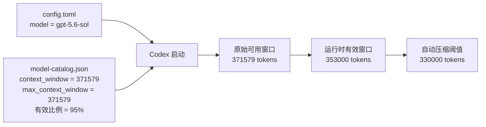
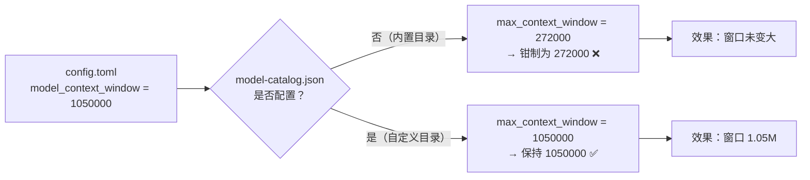
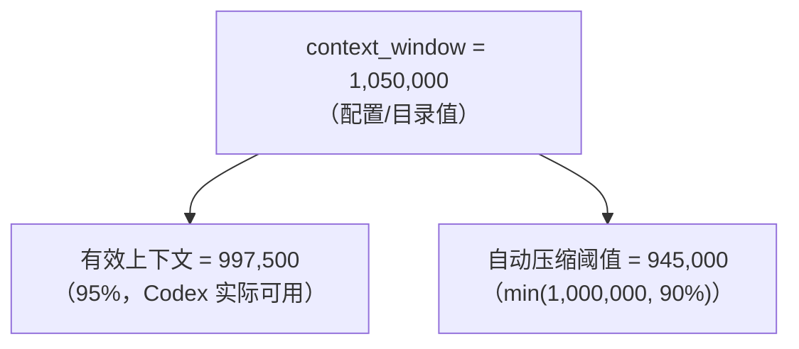

[toc]

## abstract


### 从258k改到353k 有效上下文窗口

模型目录的有效窗口比例为 95%，因此需要把原始窗口设为 371,579：

```text
371579 * 0.95 = 353000.05
```

`model_context_window` 不能单独突破模型目录中的上限。必须同时配置
`config.toml` 和 `model-catalog.json`。



### 最小有用配置

`config.toml` 中保留以下关键项：

```toml
model = "gpt-5.6-sol"
model_provider = "aidj"
model_reasoning_effort = "medium"

# 窗口配置:
model_catalog_json = "/home/opcxxu/.codex/model-catalog.json"
model_context_window = 371579
model_auto_compact_token_limit = 330000
```

`model-catalog.json` 中 `gpt-5.6-sol` 条目至少要保留以下字段：

```json
{
  "context_window": 371579,
  "max_context_window": 371579,
  "effective_context_window_percent": 95
}
```

`model_auto_compact_token_limit = 330000` 低于 353k，有约 23k tokens 的缓冲，
用于在达到硬上限前压缩历史记录。

> 实际的`model-catalog.json`在加载后可能会产生很多内容;
>
> 如果嫌麻烦,可以考虑让coding agent直接配置.在codex cli中可以更方便的自助验证.

## 验证是否生效

修改配置后，重启 Codex App Server 或 VS Code，并新建会话。检查最新会话记录：

```bash
latest=$(find sessions -type f -name '*.jsonl' -printf '%T@ %p\n' \
  | sort -nr | head -1 | cut -d' ' -f2-)
rg '"model_context_window"' "$latest" | tail -1
```

预期新会话记录中出现：

```text
model_context_window: 353000
```

也可以检查 CLI 是否加载了本地模型目录：

```bash
codex debug models | jq '.models[]
  | select(.slug == "gpt-5.6-sol")
  | {context_window, max_context_window, effective_context_window_percent}'
```

预期输出为：

```json
{
  "context_window": 371579,
  "max_context_window": 371579,
  "effective_context_window_percent": 95
}
```

## 常见现象

- 旧会话仍显示 `258400`：这是重启前的运行时记录，不代表新配置失败。
- 新会话仍显示 `258400`：通常是 App Server 未真正重启，或启动时没有读取当前
  `CODEX_HOME/config.toml`。
- 只修改 `model_context_window = 353000`：如果模型目录上限仍是 `272000`，
  运行时窗口仍会被限制为 `258400`（272000 × 95%）。

模型目录在 Codex 启动时加载，因此修改任一文件后都需要重启并新建会话。

## 官方参考

- [Codex 配置参考](https://developers.openai.com/codex/config-reference)

官方参考对以下配置项有说明：

- `model_context_window`：活动模型可使用的上下文 token 数。
- `model_auto_compact_token_limit`：触发自动历史压缩的 token 阈值。
- `model_catalog_json`：启动时加载的可选 JSON 模型目录路径。

## 模型本身上下文限制

如果你写：

```toml
model_context_window = 1000000
```

**并不会把一个 400k 模型“魔改”成 1M。**

例如 GPT-5.3-Codex 官方窗口是 **400,000**；给它写 `1000000` 不会突破模型本身能力。([OpenAI Developers](https://developers.openai.com/api/docs/models/gpt-5.3-codex?utm_source=chatgpt.com))

而目前：

- **GPT-5.6 Sol：1.05M**
- **GPT-5.6 Terra：1.05M**
- **GPT-5.6 Luna：1.05M** ([OpenAI Developers](https://developers.openai.com/api/docs/models))
- GPT-5.4 在 Codex 中也支持实验性的 1M context。([OpenAI](https://openai.com/index/introducing-gpt-5-4/))
- GPT-5.3-Codex：400k。([OpenAI Developers](https://developers.openai.com/api/docs/models/gpt-5.3-codex?utm_source=chatgpt.com))

所以如果目标就是**真正使用 1000k 上下文**，我现在会优先选：

```toml
model = "gpt-5.6"
model_context_window = 1050000
model_auto_compact_token_limit = 850000
```


**另外一个很关键的点：1M ≠ 效果一定更好。** OpenAI 自己公布的长上下文评测也显示，随着上下文从 128K、256K 增长到 512K～1M，信息检索/推理准确率会明显下降；所以真正有效的 Codex 配置应该是“**1M 容量 + 控制工具输出 + 精简 AGENTS.md/MCP + 850k 左右自动 compact**”，而不是简单追求把窗口塞满。([OpenAI](https://openai.com/index/introducing-gpt-5-4/))

如果你主要是做**超大型代码库 / 长时间 agent 连续开发**，我还可以直接给你一份针对 GPT-5.6 的 **Codex `config.toml` 完整高性能配置**，包括 1M context、compaction、reasoning、subagents、MCP 和 tool output 的推荐值。

## 353k上下文

353k 这个值其实很合理，而且比现在常见的 258k 好不少。

你见到的 `353k` 基本不是随机数字。Codex 官方仓库里的实际记录显示，曾经下发过这样的模型 catalog：

```text
context_window = 372000
effective_context_window_percent = 95
```

所以界面/运行时显示：`372000 × 0.95 = 353400`

也就是你看到的 **≈353k**。当时默认自动 compact 的位置大约是：

```text
372000 × 0.90 = 334800
```

即约 **335k 开始压缩**。([GitHub](https://github.com/openai/codex/issues/31860))

而现在经常见到的 `258k` 是另一套：

```text
272000 × 0.95 = 258400
```

2026 年 7 月的 Codex 仓库报告记录了 GPT-5.6 Sol 从 **372k raw / 353.4k effective** 被切换到 **272k raw / 258.4k effective** 的情况。([GitHub](https://github.com/openai/codex/issues/32806))

因此两者实际差异是：

```text
353400 - 258400 = 95000 tokens
```

也就是 **353k 比 258k 多约 36.8% 可用上下文**。对于 Codex 这种会不断塞入文件、diff、terminal 输出、tool call 和历史对话的 agent，这 95k 非常有感觉。

### 如果让我在 258k / 353k / 1M 之间选

我会这样看：

| 有效窗口 | 使用感受                         | 我的评价         |
| -------- | -------------------------------- | ---------------- |
| 258k     | 中型任务够用，长任务容易 compact | 偏小             |
| **353k** | 大型重构/调试明显舒服            | **很好的甜点位** |
| 500–700k | 超大型 repo / 长 agent session   | 很理想           |
| ~1M      | 极长任务、全 repo 分析           | 特殊场景价值大   |

尤其是从 **258 → 353k**，收益通常比从 **353 → 450k** 更明显，因为 Codex 很多长任务恰好会在 200–300k 区间开始变得拥挤。

### 如果你想手动配置出「353k」

这里有一个容易搞混的地方。

如果 Codex 对你的模型仍然应用 `95% effective` 规则，那么目标不是：

```toml
model_context_window = 353400
```

而更接近：

```toml
model_context_window = 372000
```

因为：

```text
372k raw
   ↓ × 95%
353.4k effective
```

配合 compact，我会倾向：

```toml
model = "gpt-5.6"

model_context_window = 372000
model_auto_compact_token_limit = 330000
```

或者干脆：

```toml
model = "gpt-5.6"
model_context_window = 372000
```

让 Codex 自己决定 compact threshold。官方配置文档确认 `model_context_window` 和 `model_auto_compact_token_limit` 都是有效配置项。([OpenAI Developers](https://developers.openai.com/codex/config-reference))

**但这里有一个非常重要的现实问题：服务器 catalog 可能覆盖/限制你的值。**

例如目前已有记录显示，GPT-5.6 Sol 的 server-delivered catalog 从：

```text
372000
↓
272000
```

导致：

```text
353400
↓
258400
```

而且报告中是在**没有本地 override** 的情况下发生的。([GitHub](https://github.com/openai/codex/issues/32806))

所以你写：

```toml
model_context_window = 372000
```

**不代表一定能得到 353k**。如果你当前账户/客户端拿到的 server catalog 把 `max_context_window` 限在 `272000`，本地配置可能仍然无法突破它。

### 一个关键判断

如果你的 Codex **现在自己显示 353k**：

**我反而建议不要动 `model_context_window`。**

因为这意味着你当前 session/catalog 很可能已经拿到了：

```text
raw       ≈ 372k
effective ≈ 353.4k
```

这套配置本身挺好。

如果它现在显示：

```text
258k
```

而你想恢复以前的：

```text
353k
```

那么可以尝试：

```toml
model = "gpt-5.6"
model_context_window = 372000
model_auto_compact_token_limit = 330000
```

但要检查 `/status` **实际显示多少**，不要只看 `config.toml`。

------

还有一点值得修正我上一条回答：**目前不能简单认为 Codex 中配置 `1050000` 就一定能获得 1M。** GPT-5.6 Sol 的公开 API 模型规格确实是 **1.05M context**，但 Codex 产品层的 server catalog 可以给出更小的窗口；近期公开的 Codex 仓库记录就出现过 353.4k 和 258.4k 两种有效窗口。([GitHub](https://github.com/openai/codex/issues/31860))

所以如果你的目标是“**尽可能大，但又不希望 Codex 不稳定**”，我的优先级其实是：

```text
353k   ← 非常值得用
500k   ← 如果 server 允许，很不错
700~850k ← 真正长任务的理想档
1M     ← 不必强求塞满
258k   ← 能用，但长 agent session 明显受限
```

**如果你能稳定拿到 353k，我会毫不犹豫选 353k 而不是 258k。**

如果你愿意，我下一条可以进一步讲一个很有意思的问题：**为什么 Codex 原本是 `400k` 模型，却偏偏出现 `258k`，以及 `272k + 128k = 400k` 这套计算到底意味着什么**。这能解释 Codex 上下文配置应该填 `272k`、`372k` 还是 `400k`。

## model_catlog_json

`config.toml`(或者`profile-name.config.toml`配置文件中的`model_catalog_json` 可以理解为 **Codex 的“模型元数据目录文件”**。

> 在使用非gpt系列模型时,为了提高使用体验,建议配置此字段(但关键在于对应路径的文件内容的编写. 内容格式是json,而且很长,官方有一个模板文件.

> 您可以在[此处](https://learn.chatgpt.com/docs/config-schema.json)找到 `config.toml` 的最新 JSON 模板文件(`config-schema.json`)。

可以考虑用agent来配置.

### 相关字段

| Key                                 | Type / Values   | Details                                                      |
| :---------------------------------- | :-------------- | :----------------------------------------------------------- |
| `model_catalog_json`                | `string (path)` | 启动时加载的 JSON 模型目录的可选路径。所选的 `$CODEX_HOME/profile-name.config.toml` 配置方案文件可以针对相应配置方案覆盖此设置。 |
| `model_providers.<id>.auth.command` | `string`        | Codex 需要 Bearer Token 时要运行的命令。该命令必须将 Token 输出到 stdout。 |

它不是上下文窗口本身，而是告诉 Codex：

> “有哪些模型，以及这些模型分别具有什么能力、上下文大小、reasoning 级别、工具能力、UI 展示信息等。”

官方配置定义是：`model_catalog_json = "路径"`，Codex 会在**启动时加载这个 JSON 模型目录**。

- [配置参考资料 | ChatGPT Learn](https://learn.chatgpt.com/zh-Hans/docs/config-file/config-reference)|[OpenAI Developers](https://developers.openai.com/codex/config-reference)

例如：

```toml
# ~/.codex/config.toml

model_catalog_json = "/Users/me/.codex/models.json"
```

然后 `models.json` 大致是这种性质：

```json
{
  "models": [
    {
      "slug": "my-model",
      "display_name": "My Model",
      "context_window": 1000000,
      "max_context_window": 1000000
    }
  ]
}
```

实际 schema 比这个复杂很多；我这里只是为了说明概念。

### 它和 `model_context_window` 的区别

这两个很容易混淆：

```toml
model_context_window = 1000000
```

表示：

> **当前选中的模型，Codex 应该按多大的 context window 来管理上下文。**

官方定义就是 “Context window tokens available to the active model”。([OpenAI Developers](https://developers.openai.com/codex/config-reference))

而：

```toml
model_catalog_json = "/path/models.json"
```

表示：

> **不要只依赖 Codex 自带/服务器提供的模型 metadata，而是加载我指定的一整份模型目录。** ([OpenAI Developers](https://developers.openai.com/codex/config-reference))

所以可以把它们理解为：

```text
model
   ↓
"我要用哪个模型"

model_catalog_json
   ↓
"Codex 对这些模型都知道些什么"

model_context_window
   ↓
"当前模型实际按多大的上下文窗口来运行/管理"

model_auto_compact_token_limit
   ↓
"上下文增长到多少时开始 compact"
```

### 为什么有人会修改 `model_catalog_json`

它主要适合下面这些场景：

1. **自定义模型 / 自定义 Provider**

比如：

```toml
model = "qwen3-coder"

model_provider = "my-provider"

model_catalog_json = "/Users/me/.codex/models.json"
```

Codex 原本不知道 `qwen3-coder` 的 metadata，通过 catalog 告诉它：

```text
context window 多大
支持哪些 reasoning level
是否支持图片
是否支持 tool calls
怎么截断工具输出
display name 是什么
……
```

1. **对模型 metadata 做实验性调整**

例如你知道自己的 endpoint 确实支持：

```json
"context_window": 1000000,
"max_context_window": 1000000
```

就可以给 Codex 提供对应 metadata。

1. **不同 Profile 使用不同模型目录**

Codex 官方甚至支持：

```toml
# ~/.codex/deep-review.config.toml

model = "gpt-5.5"
model_catalog_json = "/Users/me/.codex/model-catalogs/deep-review.json"
```

然后：

```bash
codex --profile deep-review
```

Profile 中的 `model_catalog_json` 可以覆盖基础配置。([OpenAI Developers](https://developers.openai.com/codex/config-advanced))

------

### 但如果你的目标只是“把 context 调到 1000k”

**一般没必要碰 `model_catalog_json`。**

优先使用：

```toml
model_context_window = 1000000
model_auto_compact_token_limit = 850000
```

因为 `model_catalog_json` 是更底层的东西。你一旦指定它，相当于开始自己维护模型 metadata，未来 Codex 更新模型能力字段时，你的本地 catalog 也可能需要跟着更新。

而且非常重要：

```json
"context_window": 1000000
```

**并不能让服务端只支持 272k/400k 的模型突然支持 1M。**

它主要是在告诉 **Codex 客户端**如何看待这个模型；真正能够提交多少 token，最终仍然受到后端模型/API 能力约束。

### 一个值得注意的细节

当前 Codex 配置把这几个东西明确分开：

```toml
model = "..."
model_catalog_json = "..."
model_context_window = ...
model_auto_compact_token_limit = ...
```

其中 auto compact 官方定义为达到指定 token 阈值后自动压缩历史。([OpenAI Developers](https://developers.openai.com/codex/config-reference))

所以针对你前一个问题，如果目标是 **Codex 长会话 1000k**，我的配置思路会是：

```toml
model = "你的实际支持长上下文的模型"

# 不碰 model_catalog_json，除非有特殊需要
model_context_window = 1000000

# 给输出 / reasoning / tools 留空间
model_auto_compact_token_limit = 800000
# 或 850000
```

而不是：

```toml
model_catalog_json = "自己魔改的 models.json"
```

**一句话总结：**

> `model_catalog_json` = Codex 的模型“档案库”；
> `model_context_window` = 当前模型的上下文预算配置；
> 想调 1000k，通常改后者，不需要改前者。

如果你愿意，我下一步可以直接把 **Codex 官方 `models.json` 里的 `context_window`、`max_context_window`、`auto_compact_token_limit` 三者关系**拆开讲一下——这个对搞清楚“为什么明明模型宣称 1M，Codex 有时只显示/使用 272k”非常关键。

---


## 一、案例背景

- 目标模型 `gpt-5.6-luna` 官方支持 **1,050,000** tokens 上下文窗口、**128,000** tokens 最大输出。
- 但 Codex CLI 0.147.0 的内置模型目录中，该模型记录的 `context_window` 和 `max_context_window` 均为 **272,000**。
- 用户希望把上下文窗口调大，让长会话/大代码库不必频繁压缩。

## 二、根因

Codex 在加载配置时，`model_context_window` 会被 **钳制(clamp)** 到模型元数据中的 `max_context_window`：

- 直接修改 `config.toml` 里的 `model_context_window = 1050000` 无效，最终仍会被钳回 272,000。
- 解决方案是提供自定义模型目录（`model-catalog.json`），把 luna 的 `max_context_window` 一并提升。
- 官方文档说明：`model-catalog.json` 配置后会**整体替换**内置目录，作为当前进程的权威目录。



## 三、改动清单

| 文件                                                           | 操作 | 说明                                      |
| -------------------------------------------------------------- | ---- | ----------------------------------------- |
| `C:\Users\Administrator\.codex\config.toml`                  | 修改 | 新增 3 行配置                             |
| `C:\Users\Administrator\.codex\model-catalog.json`           | 新增 | 自定义模型目录，luna 上下文提升到 1050000 |
| `C:\Users\Administrator\.codex\config.toml.bak-ctx-20260811` | 新增 | 修改前的配置备份                          |

### 3.1 config.toml 新增内容

```toml
model = "gpt-5.6-luna"
model_provider = "opencode_go"
+model_context_window = 1050000
+model_auto_compact_token_limit = 1000000
+model_catalog_json = "C:/Users/Administrator/.codex/model-catalog.json"
```

### 3.2 model-catalog.json 关键改动

基于内置目录（`codex debug models` 输出）复制生成，仅修改 luna 一条：

```json
{
  "slug": "gpt-5.6-luna",
  "context_window": 1050000,
  "max_context_window": 1050000,
  "effective_context_window_percent": 95
}
```

## 四、窗口数值关系



| 项目                          | 数值                    | 说明                               |
| ----------------------------- | ----------------------- | ---------------------------------- |
| 官方上下文窗口                | 1,050,000               | luna 模型上限                      |
| 配置 `model_context_window` | 1,050,000               | 被目录 `max_context_window` 放行 |
| 有效上下文（95%）             | 997,500                 | Codex 认为可安全使用的量           |
| 自动压缩阈值（90%）           | 945,000                 | 到达后自动压缩历史                 |
| 改动前                        | 272,000（有效 258,400） | 内置目录默认值                     |

## 五、验证结果

1. `codex doctor`：`config.toml` 解析正常，配置加载成功。
2. `codex debug models`：luna 显示 `context_window = 1050000 / max = 1050000`。
3. 端到端实测 `codex exec`：会话正常建立并返回结果。

## 六、注意事项

- **重启生效**：配置在下次启动 codex 时加载，当前已运行会话不受影响。
- **代理问题**：直连 opencode.ai 会返回 403（区域限制），需要设置代理后正常：
  ```powershell
  $env:HTTPS_PROXY = "http://localhost:7897"
  $env:HTTP_PROXY  = "http://localhost:7897"
  ```
- **其他 profile**：`oc-go.config.toml` 等独立 profile 若也使用 luna + opencode_go，需要同步这三行配置才能享受同样的大窗口。
- **供应商支持**：窗口上限还取决于中转供应商实际支持，若请求超限会收到上游错误，届时可回调 `model_context_window`。
