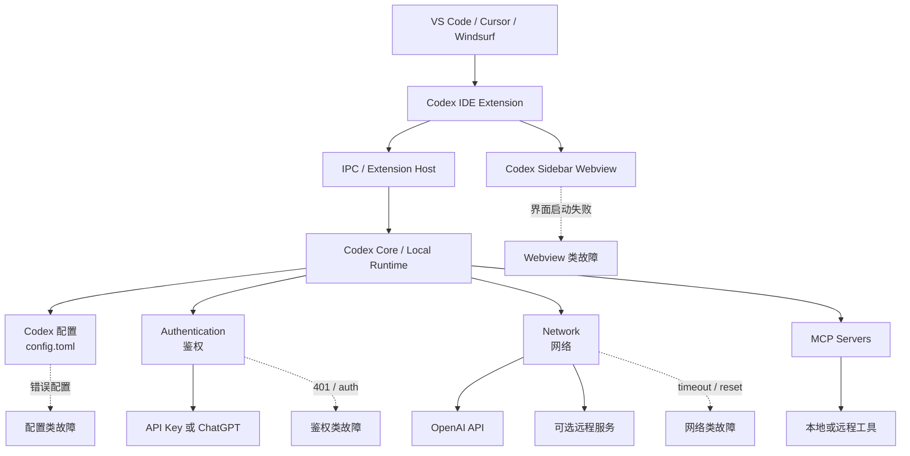
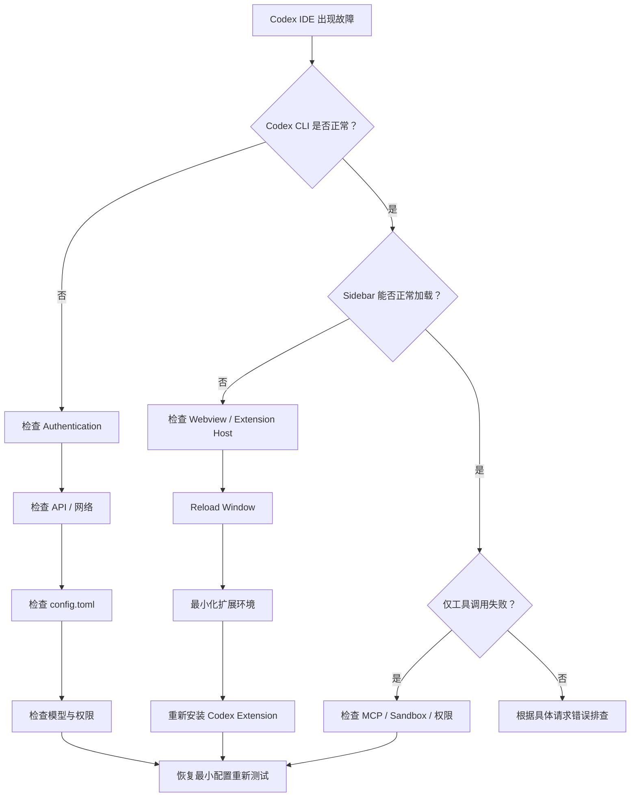

[toc]


## VS Code + Codex 插件故障排查指南

VS Code 中的 Codex 并不是一个简单的“网页聊天窗口”。它涉及编辑器扩展、Webview、Codex 本地运行时、配置、鉴权、网络、模型服务以及 MCP 等多个层次。

因此，排查故障最重要的原则不是看到一条红色日志就立即修改配置，而是：

**先确定故障发生在哪一层，再处理那一层。**

------

## 先理解 Codex 在 VS Code 中的工作结构

可以把整个系统近似理解为：



官方文档确认，Codex CLI 和 IDE Extension 会共享 Codex 的配置体系；用户级配置通常位于：

```text
~/.codex/config.toml
```

项目还可以拥有：

```text
<project>/.codex/config.toml
```

MCP（Model Context Protocol）配置也属于这一配置体系，Codex CLI 和 IDE Extension 可以共享 MCP 配置。

这也是为什么：

> CLI 是否正常，是排查 IDE Extension 问题时非常重要的“分界测试”。

### vscode中插件故障的日志查看

在 VS Code 中排查插件故障时，日志通常从以下几个入口查看。VS Code 的插件主要运行在 **Extension Host（扩展宿主进程）** 中，而插件自己的业务日志通常会输出到 **Output（输出）面板**。([Visual Studio Code](https://code.visualstudio.com/api/advanced-topics/extension-host?utm_source=chatgpt.com))

| 查看位置                | 打开方式                                                     | 主要用途                                      |
| ----------------------- | ------------------------------------------------------------ | --------------------------------------------- |
| **Output**              | `View → Output`，或命令面板执行 `Output: Show Output Channels` | 首选。查看某个插件自己的运行日志              |
| **Developer Tools**     | 命令面板执行 `Developer: Toggle Developer Tools`             | 查看 Webview、前端 JavaScript、网络及 UI 错误 |
| **Extension Host 日志** | 命令面板搜索 `Developer: Show Logs...`                       | 查看插件加载、崩溃、Extension Host 相关问题   |
| **MCP 日志**            | `MCP: List Servers` → 选择 Server → `Show Output`            | 排查 MCP Server 启动、连接和协议问题          |

### 最常用：Output 面板

按：

```text
Ctrl+Shift+P
```

执行：

```text
Output: Show Output Channels
```

然后在 **Output 面板右上角的下拉列表**中选择对应插件，例如：

```text
Codex
Git
Python
ESLint
```

这是排查插件故障时最应该先看的地方。VS Code 官方也将 Output Channel 作为扩展日志的标准输出机制。([Visual Studio Code](https://code.visualstudio.com/api/extension-capabilities/common-capabilities?utm_source=chatgpt.com))

对于 Codex，重点搜索：

```text
error
warning
failed
timeout
authentication
Webview
IPC
MCP
connection
```

不要只复制最后一行错误，最好保留**错误发生前后 20～50 行**。

### Webview / 插件界面打不开

如果插件 Sidebar、Panel 或其他界面无法加载，例如出现：

```text
Webview did not finish starting
```

执行：

```text
Ctrl+Shift+P
Developer: Toggle Developer Tools
```

然后打开：

```text
Console
```

Webview 的 JavaScript 异常和相关日志可以在 Developer Tools 中查看。([Visual Studio Code](https://code.visualstudio.com/api/extension-guides/webview?utm_source=chatgpt.com))

重点关注：

```text
Uncaught
TypeError
Failed to fetch
CSP
ERR_
WebSocket
Webview
```

### Extension Host 故障

如果现象是：

- 插件没有激活；
- 插件突然失效；
- 多个插件一起异常；
- 插件命令不存在；
- Extension Host 崩溃；

可以执行：

```text
Ctrl+Shift+P
Developer: Show Logs...
```

重点查看与：

```text
Extension Host
Window
Shared
```

有关的日志。

Extension Host 是 VS Code 专门用于运行和隔离扩展的进程，因此这一层异常可能同时影响多个插件。([Visual Studio Code](https://code.visualstudio.com/api/advanced-topics/extension-host?utm_source=chatgpt.com))

### MCP 故障

如果是 Codex 等 AI 插件中的 MCP 工具异常，可执行：

```text
Ctrl+Shift+P
MCP: List Servers
```

选择对应 MCP Server，然后：

```text
Show Output
```

可以查看 Server 启动、连接和协议日志；VS Code 当前也提供直接重启 MCP Server 的操作。([Visual Studio Code](https://code.visualstudio.com/docs/agents/agent-troubleshooting/troubleshooting?utm_source=chatgpt.com))

### 推荐的日志排查顺序

实际遇到插件故障时，可以简单按照：

```text
Output
→ Developer Tools Console
→ Extension Host Logs
→ MCP / 外部进程日志
```

逐层排查。

其中最重要的一条经验是：

> **先找到第一个真正相关的 Error，再观察它前面的 Warning 和 Timeout，而不是只看最后一条报错。**

如果需要把日志发给别人分析，建议同时提供 **VS Code 版本、插件版本、故障现象，以及错误前后约 20～50 行日志**；API Key、Token、Cookie、Authorization Header 等敏感信息应先删除。

------

## 核心排障思想

### 不要把所有 Warning 当成故障根因

日志通常有三个主要等级：

| 日志等级  | 含义                             | 排查优先级 |
| --------- | -------------------------------- | ---------- |
| `info`    | 正常生命周期或诊断信息           | 低         |
| `warning` | 某项功能异常，但程序可能继续运行 | 中         |
| `error`   | 某个关键操作已经失败             | 高         |

例如：

```text
[warning] Received broadcast but no handler is configured
```

通常只说明某个 IPC（Inter-Process Communication，进程间通信）事件没有对应处理器。

而：

```text
[error] [CodexWebviewProvider]
Webview did not finish starting
```

说明 Codex Sidebar 的界面初始化确实失败。

排查时应该优先回答：

- 第一个真正的 `error` 是什么？
- 在它之前有哪些连续的 `timeout`、`authentication failed`、`connection reset`？
- 某条 warning 是否只是可选功能失败？
- CLI 是否受到同样影响？

不要单纯根据日志颜色判断。

------

## 故障分类速查表

| 现象                                     | 常见日志关键词                           | 优先怀疑                           |
| ---------------------------------------- | ---------------------------------------- | ---------------------------------- |
| Codex 图标完全不存在                     | extension、activation                    | 扩展未安装、未启用、Extension Host |
| Sidebar 打不开                           | `Webview`、`did not finish starting`     | Webview、扩展初始化、依赖服务阻塞  |
| Sidebar 能打开但无法登录                 | `authentication`、`401`、`login`         | API Key、登录状态                  |
| CLI 和 IDE 都不能请求                    | `timeout`、`TLS`、`connection`           | 网络、代理、证书、DNS              |
| CLI 正常但 IDE 不正常                    | `Webview`、`IpcClient`、`Extension Host` | VS Code Extension 层               |
| 只能 API Key 时出现 ChatGPT auth warning | `chatgpt authentication required`        | 某项 ChatGPT 专属远程功能          |
| Codex 能聊天但 MCP 工具不能用            | `mcp`、`initialize`、`server`            | MCP 配置、进程、OAuth、网络        |
| 执行 Shell/写文件失败                    | `permission`、`sandbox`                  | 权限策略、Sandbox                  |
| 某个模型不能使用                         | `model does not exist`、`access`         | 模型权限、认证方式、版本           |
| Git/远程同步异常                         | `git fetch`、`early EOF`                 | GitHub 链路、代理、TLS             |
| 修改 config 后异常                       | TOML parse、config                       | TOML 语法、配置层覆盖              |

------

## 推荐的整体排查顺序

一个有效的排查过程应该从“最便宜、最确定”的测试开始，而不是一开始就卸载所有东西。

推荐顺序是：



其中最有价值的一条判断是：

> **CLI 正常 + IDE 异常 = 优先排查 IDE Extension/Webview。**

而：

> **CLI 和 IDE 同时异常 = 优先排查鉴权、配置和网络。**

------

## 先做五分钟快速诊断

正式修改环境之前，建议先记录：

- VS Code 版本
- Codex Extension 版本
- Codex CLI 版本
- 操作系统
- 是否使用 WSL
- 是否使用 VPN
- 是否使用 HTTP/HTTPS/SOCKS 代理
- 鉴权方式
- 当前 `config.toml`
- CLI 是否能够正常运行
- 第一个关键 Error

然后执行：

```bash
codex login status
```

官方提供这个命令用于确认 Codex 当前使用的 Authentication Method（鉴权方式）。

如果显示 API Key，继续测试：

```bash
codex
```

进入 Codex 后发送一个最简单的问题，例如：

```text
Reply only with OK.
```

这里不要一开始测试：

- MCP
- Git
- Web Search
- Cloud
- Plugin
- 文件修改
- Shell 命令

因为我们首先只想验证：

> **Codex Core + Authentication + OpenAI API 是否能够形成最小闭环。**

------

## 理解 API Key 与 ChatGPT 登录

这是 Codex 排障中非常容易混淆的一点。

官方目前明确支持两类 Authentication：

| 鉴权方式     | 英文                    | 主要用途                                       |
| ------------ | ----------------------- | ---------------------------------------------- |
| ChatGPT 登录 | Sign in with ChatGPT    | 使用 ChatGPT 订阅、Workspace 和部分 Cloud 能力 |
| API Key      | Sign in with an API key | 按 API 使用量计费的本地 Codex 工作流           |

Codex CLI 和 IDE Extension **都正式支持 API Key 登录**。API Key 模式下，本地 Codex 工作流可以正常使用，但部分依赖 ChatGPT Workspace 或 Cloud Service 的功能可能不可用。

因此：

> 无法使用 `chatgpt.com` 账号，并不意味着无法使用 VS Code Codex。

如果你的环境只能使用 API Key，那么应该明确采用 API Key 模式，而不是反复尝试修复 ChatGPT 登录。

------

## API Key 环境的推荐配置

官方配置项：

```toml
forced_login_method = "api"
```

可以限制 Codex 只使用 API 鉴权。`forced_login_method` 当前支持：

```text
chatgpt
api
```

这是正式配置项，而不是 undocumented hack。

对于明确不能使用 ChatGPT Account 的机器，可以考虑：

```toml
# ~/.codex/config.toml

forced_login_method = "api"
```

然后确认：

```bash
codex login status
```

如果需要重新进行 CLI API Key 登录，官方方式是通过 stdin 输入：

```bash
printenv OPENAI_API_KEY | codex login --with-api-key
```

Windows PowerShell 可以采用同样思想，通过标准输入传递 Key。官方不建议把 API Key 直接长期写入脚本或提交到 Git。API Key 模式采用 OpenAI Platform 的标准 API 计费。

------

## 为什么不应该只靠环境变量判断鉴权状态

例如你可能已经设置：

```text
OPENAI_API_KEY
```

但：

- Codex 可能存在缓存凭据；
- CLI 与某些非交互命令处理环境变量的方式可能不同；
- VS Code Extension Host 的环境变量可能与终端不同。

因此优先使用：

```bash
codex login status
```

判断 Codex **实际使用的鉴权方式**，不要仅根据：

```bash
echo $OPENAI_API_KEY
```

推断。

------

## 使用 CLI 将问题一分为二

这是整套排障方案中最实用的一步。

### CLI 和 IDE 都失败

说明问题很可能位于：

- Authentication
- API Key
- 网络
- DNS
- Proxy
- TLS
- `config.toml`
- 模型权限

此时暂时不要折腾 Webview。

### CLI 正常，IDE Sidebar 失败

说明：

- API Key 基本可用；
- Codex Core 基本能够工作；
- 基础 OpenAI API 通信大概率没有完全中断。

此时应该转向：

- Codex Extension
- Webview
- Extension Host
- IPC
- IDE 缓存
- Extension 冲突

这是非常重要的故障隔离方法。

------

## 配置系统为什么经常成为隐蔽故障源

Codex 并不只有一个配置文件。

官方当前配置优先级大致为：

| 优先级 | 配置来源                    |
| ------ | --------------------------- |
| 最高   | CLI 参数及 `--config` 覆盖  |
| 高     | 项目 `.codex/config.toml`   |
| 中高   | Profile                     |
| 中     | 用户 `~/.codex/config.toml` |
| 较低   | 系统配置                    |
| 最低   | Codex 默认值                |

也就是说：

> 你修改了 `~/.codex/config.toml`，不代表最终生效的一定是这里的值。

项目中的：

```text
.codex/config.toml
```

可能覆盖它。

官方同时说明，一些机器级 Provider、Authentication 等配置不能通过项目配置任意覆盖。

------

## 配置故障的正确排查方式

不要一开始删除：

```text
~/.codex
```

更推荐：

### 先备份

Linux/macOS：

```bash
cp ~/.codex/config.toml ~/.codex/config.toml.bak
```

PowerShell：

```powershell
Copy-Item "$HOME\.codex\config.toml" "$HOME\.codex\config.toml.bak"
```

### 建立最小配置

只能使用 API Key 的机器，可以暂时把配置精简到：

```toml
forced_login_method = "api"
```

暂时移除或注释：

- MCP Server
- Custom Model Provider
- Profile
- Hook
- 实验性配置
- 自定义网络参数

然后测试：

```bash
codex
```

如果 CLI 正常，再逐项恢复配置。

这种方法叫：

> **Minimal Reproduction / Minimal Configuration，最小复现或最小配置。**

其优势是可以准确发现“是哪一项配置导致系统异常”。

------

## 不建议盲目加入未知配置项

例如网上可能出现：

```toml
disable_plugins = true
```

或：

```toml
disable_remote_plugin_sync = true
```

如果官方 Configuration Reference 中没有这个配置项，就不要默认它有效。

原因包括：

- 可能已经废弃；
- 可能只是内部开发配置；
- 可能属于旧版本；
- Codex 可能直接忽略；
- 未来版本行为可能变化。

判断配置是否有效，应优先查当前官方 `Configuration Reference`。

------

## 网络问题应该怎样分层检查

看到：

```text
timeout
```

并不能立即推出“OpenAI 被墙了”。

Timeout 可能发生在很多地方：

- DNS
- TCP
- TLS
- Proxy
- OpenAI API
- GitHub
- MCP Server
- Plugin Catalog
- 企业 Firewall

因此应该根据日志中的目标服务判断。

### 基础 API 通信

首先测试你的基础网络是否能访问 OpenAI API：

```bash
curl -I https://api.openai.com
```

这里重点观察：

- 能否解析域名；
- 是否快速建立 TLS；
- 是否立即返回 HTTP Response。

即使返回 `401` 或其他 HTTP 状态，也说明：

> 网络/TLS 已经至少成功到达服务器。

真正值得关注的是：

```text
Could not resolve host
Connection timed out
Connection reset
SSL certificate problem
```

------

## 代理环境尤其容易出现“浏览器正常、Codex 异常”

常见结构是：

```text
Browser
  -> System Proxy
  -> Internet

VS Code Extension Host
  -> ?
  -> Internet

Git
  -> ?
  -> GitHub
```

浏览器能够访问互联网，不代表：

- VS Code Extension Host
- Codex CLI
- Git
- Node Runtime
- MCP Server

都会自动使用相同代理。

Linux/macOS 可以检查：

```bash
env | grep -i proxy
```

PowerShell：

```powershell
Get-ChildItem Env:*PROXY*
```

常见环境变量包括：

```text
HTTP_PROXY
HTTPS_PROXY
ALL_PROXY
NO_PROXY
```

排查时需要确认：

> Codex 实际运行的进程是否继承了正确的 Proxy Environment。

------

## `git fetch timed out` 和 `fatal: early EOF` 怎么理解

例如：

```text
git fetch ... timed out
fatal: early EOF
```

它通常说明 Git 网络通信没有完整完成。

可能原因包括：

- GitHub 链路不稳定；
- HTTPS Proxy 中断；
- 企业防火墙；
- TLS Inspection；
- VPN 抖动；
- 远程服务暂时不可用。

可以单独运行：

```bash
git ls-remote https://github.com/openai/codex.git
```

如果同样出现：

```text
early EOF
```

则说明问题至少不局限于 Codex Webview。

反之，如果 Git 命令完全正常，那么 Codex 日志中的 Git 同步失败可能只是一次瞬时失败。

------

## 重点理解 Webview

VS Code Extension 常通过 **Webview** 提供复杂 UI。

Codex Sidebar 本身就是这一层的重要组成部分。

例如：

```text
[CodexWebviewProvider]
Webview did not finish starting
```

它的含义是：

> Codex Sidebar 前端在规定初始化流程内没有成功完成启动。

但这个 Error 仍然只是**结果**，不一定是根因。

可能导致它的情况包括：

- Extension 内部启动异常；
- IPC 初始化失败；
- Codex Runtime 启动阻塞；
- 网络请求阻塞；
- Extension Host 异常；
- 本地缓存损坏；
- Extension 冲突。

因此需要查看它**前面的日志**。

------

## Webview 故障的标准处理顺序

### 重新加载 VS Code Window

Command Palette：

```text
Developer: Reload Window
```

这是最低成本操作。

### 完全退出 IDE

注意：

> Reload Window 和完全退出 VS Code 并不是一回事。

应确认 VS Code 相关进程真正退出，然后重新打开。

### 禁用其他扩展进行对照测试

临时只保留：

- Codex
- 必需的 VS Code 内置组件

如果 Codex 此时正常，说明可能存在：

- Extension Host 资源竞争；
- Webview 冲突；
- 环境变量修改；
- 网络 Hook；
- Proxy 插件干预。

### 更新 Codex Extension

Codex 仍在持续快速更新。官方 Changelog 也持续包含模型支持、可靠性及客户端修复，因此遇到无法解释的启动异常时，应首先确认是否正在使用近期版本。

### 必要时重新安装 Extension

顺序建议是：

1. 卸载 Codex Extension；
2. 完全关闭 VS Code；
3. 重新启动；
4. 安装最新版本；
5. 使用最小配置测试。

不要同时修改十几项系统设置，否则无法知道到底是哪一步解决了问题。

------

## IPC 警告应该如何看

IPC 是：

**Inter-Process Communication**

中文通常称：

**进程间通信**

例如：

```text
[IpcClient]
Received broadcast but no handler is configured
method=client-status-changed
```

它表达的是：

- 某个进程发送了 `client-status-changed`；
- 当前接收端没有对应 handler。

如果之后系统仍然正常，这种 warning 通常不需要处理。

只有出现：

```text
IPC disconnected
router failed
channel closed
```

并且 Codex 功能同步异常时，才应该重点检查 IPC。

排障时不要看到 `warning` 就直接认定它是根因。

------

## Authentication 日志应该怎样理解

下面是一类非常典型的日志：

```text
chatgpt authentication required
api key auth is not supported
```

关键是查看：

> **究竟是哪项功能提出了这个要求？**

如果完整日志是：

```text
remote installed plugin bundle sync failed
error=chatgpt authentication required for remote plugin catalog
```

那么它表达的是：

> **这个特定的 remote plugin catalog 请求要求 ChatGPT Authentication。**

它并不表示：

> 整个 Codex 不支持 API Key。

这是两件完全不同的事情。

官方明确支持 Codex CLI 与 IDE Extension 的 API Key Authentication。

------

## Plugin 与 MCP 不要混为一谈

这是目前 Codex 中一个比较容易混淆的概念。

### MCP

MCP 全称：

**Model Context Protocol**

它允许 Codex 连接：

- 本地工具；
- Documentation；
- Browser；
- Figma；
- 自定义服务；
- Streamable HTTP Server。

官方明确说明：

> ChatGPT desktop app、Codex CLI 和 IDE Extension 都支持 MCP Server，并可共享同一个 Codex Host 上的 MCP 配置。

### Plugin

Plugin 属于更高层的能力封装。

当前官方说明中，API Key 用户能够在 **Codex CLI 和 ChatGPT desktop app** 中使用受支持的 OpenAI-curated plugins，但某些 Plugin 因为需要不支持的 OAuth 流程而不可用。

所以日志中的：

```text
remote installed plugin bundle sync failed
```

与：

```text
MCP server failed
```

不是同一个故障。

排查时应该分开。

------

## API Key 用户看到 Plugin Sync Warning 怎么处理

如果：

- `codex` CLI 可以正常回答；
- VS Code Codex 基础聊天可以工作；
- 只有 plugin catalog 报 warning；

那么通常没有必要为了这条 warning 强行获取 ChatGPT 账号。

更合理的策略是：

> 把它标记为“当前认证方式不支持的附加远程能力”，继续观察它是否真正影响核心功能。

但是，如果 Plugin Sync Request：

- 连续 timeout；
- 阻塞 Extension 初始化；
- 最终伴随 Webview startup error；

就应该进一步检查：

- Extension 版本；
- 网络；
- 启动依赖；
- 是否存在客户端 Bug。

------

## MCP 故障应该单独验证

如果 Codex 正常聊天，但 MCP 工具不能使用，那么：

> 不要再排查 API Key 基础登录。

应检查 MCP Server 本身。

官方支持的 MCP Server 类型包括：

- STDIO Server
- Streamable HTTP Server

并支持包括 Bearer Token、OAuth 等不同认证能力。

可以按下面思路检查：

```text
Codex
  -> 是否加载 MCP config
  -> MCP Server 是否启动
  -> initialization 是否成功
  -> tools/list 是否成功
  -> tool call 是否成功
```

对于 STDIO MCP：

重点检查：

- command 路径；
- args；
- cwd；
- environment variables；
- executable 是否存在。

对于 HTTP MCP：

重点检查：

- URL；
- DNS；
- TLS；
- Bearer Token；
- OAuth；
- Firewall。

------

## 为什么 MCP 配置可能影响 CLI 和 IDE

因为官方的配置体系是共享的。

用户配置通常在：

```text
~/.codex/config.toml
```

MCP 也配置在这里，因此错误 MCP 配置可能同时影响：

- Codex CLI
- Codex IDE Extension

官方明确说明这些本地 Codex 客户端可以共享 MCP Configuration。

所以当启动异常时，建立最小配置是很重要的实验：

```toml
forced_login_method = "api"
```

确认正常后，再恢复：

```toml
[mcp_servers.xxx]
...
```

------

## 模型问题也需要与认证问题分开

典型错误：

```text
The model ... does not exist
```

或：

```text
you do not have access to it
```

这通常意味着：

- 当前 API Key 没有该模型权限；
- 该模型尚未开放到 API；
- 当前认证方式与模型可用范围不匹配；
- Extension 或 CLI 太旧，没有更新模型目录。

Codex 模型可用性会随版本、计划及 API rollout 变化，官方 Changelog 会持续更新这些状态，因此不建议长期把某个旧模型名称硬编码成“永远可用”。

最佳实践是：

> 排障期间先使用当前客户端明确列出的、当前认证方式能够使用的模型。

------

## Sandbox 与 Authentication 是两类完全不同的问题

如果 Codex 能回答：

```text
请解释这个文件
```

但无法：

```text
修改文件
```

或者：

```text
执行 npm test
```

问题通常不在 API Key。

这时应该检查：

- Permission Profile
- Sandbox
- Approval Policy
- Workspace writable roots

也就是说：

```text
能不能调用模型
```

和：

```text
模型能不能修改本地计算机
```

是两个不同的安全层。

不要因为 Shell Command 被拒绝就重新生成 API Key。

------

## Git Repository 也可能影响行为

Codex IDE 与代码仓库密切集成。

如果：

- Chat 正常；
- 文件读取正常；
- Review 或 Diff 不正常；

还应该检查：

```bash
git status
```

以及：

```bash
git rev-parse --show-toplevel
```

重点确认：

- VS Code 打开的目录是不是实际 Repo；
- 是否打开了 monorepo 的错误层级；
- `.codex` 是否位于预期项目根目录；
- 当前目录是否被 Codex 判定为 trusted project。

官方配置文档特别指出，项目级 `.codex/config.toml` 只会在受信任项目中加载。

------

## 针对典型日志逐条解释

假设出现：

```text
[IpcClient]
Received broadcast but no handler is configured
method=client-status-changed
```

优先级：

**低**

原因：

这是 IPC Warning，本身没有证明 Codex 启动失败。

------

出现：

```text
remote installed plugin bundle sync failed
error=chatgpt authentication required
api key auth is not supported
```

优先级：

**中**

解释：

当前某项 remote plugin catalog / installed plugin sync 请求需要 ChatGPT 身份。

如果用户明确只使用 API Key，应首先确认核心 Codex 是否正常，而不是立即把整套 API Authentication 判为无效。官方明确支持 API Key 本地 Codex 工作流。

------

出现：

```text
failed to warm featured plugin ids cache
route-aware request timed out
```

优先级：

**中到高**

说明：

远程 Plugin Catalog 请求出现 Timeout。

重点关注：

- 是否只是一次失败；
- 是否重复发生；
- 是否导致 Extension 初始化一直等待。

------

出现：

```text
git fetch curated plugins repo timed out
fatal: early EOF
```

优先级：

**中到高**

说明：

Git 同步链路异常。

应单独验证 GitHub 网络，而不是把问题归因于 API Key。

------

出现：

```text
[CodexWebviewProvider]
Webview did not finish starting
```

优先级：

**高**

说明：

这是当前最明确的用户可见故障。

但是它可能是：

> **上游初始化问题导致的最终错误，而不一定是第一原因。**

排查重点应该是它前面的几十行日志。

------

## 一份实用的判断矩阵

| CLI        | IDE Sidebar | MCP            | 最可能的问题区域            |
| ---------- | ----------- | -------------- | --------------------------- |
| 正常       | 正常        | 正常           | 系统基本健康                |
| 正常       | 失败        | 未知           | Webview / Extension         |
| 失败       | 失败        | 未知           | Auth / Network / Config     |
| 正常       | 正常        | 失败           | MCP                         |
| 正常       | 正常        | 部分失败       | 单个 MCP / OAuth / Plugin   |
| 可回答     | 可回答      | Shell 写入失败 | Sandbox / Permission        |
| 无模型权限 | 无模型权限  | 无关           | Model / API Access          |
| 正常       | 偶尔失败    | 正常           | Extension 稳定性 / 网络抖动 |

这张表可以作为以后排障的第一入口。

------

## 推荐的“黄金恢复流程”

遇到比较复杂的 Codex IDE 故障时，推荐按照下面流程处理。

### 保存现场

保存：

- 完整日志；
- Extension Version；
- CLI Version；
- VS Code Version；
- `config.toml`；
- `codex login status`。

注意：

> 分享日志前删除 API Key、Authorization Header、Token 和 Cookie。

------

### 验证认证

执行：

```bash
codex login status
```

只能使用 API Key 的环境，应确认结果确实是 API Key。

必要时：

```toml
forced_login_method = "api"
```

官方正式支持该配置。

------

### 验证 CLI

运行：

```bash
codex
```

如果 CLI 无法工作：

暂时不要继续排查 VS Code Webview。

先解决：

- Authentication；
- API；
- Network；
- Config；
- Model。

------

### 建立最小配置

备份：

```text
~/.codex/config.toml
```

临时仅保留：

```toml
forced_login_method = "api"
```

再次测试 CLI。

------

### 验证网络

测试基础 API 连通性：

```bash
curl -I https://api.openai.com
```

如果出现：

```text
timeout
DNS failure
TLS failure
connection reset
```

优先解决网络问题。

------

### 如果 CLI 正常，再回到 IDE

依次：

1. `Developer: Reload Window`
2. 完全关闭并重新打开 VS Code
3. 禁用无关 Extension
4. 更新 Codex Extension
5. 重新安装 Codex Extension
6. 使用空项目进行对照测试

官方支持通过 Command Palette 的：

```text
Codex: Open Codex Sidebar
```

重新打开 Codex Sidebar。

------

### 最后再恢复高级配置

确认基础 IDE 正常后，再恢复：

- MCP
- Profile
- Hook
- 自定义 Provider
- 特殊 Sandbox
- 其他实验性配置

每恢复一项，就测试一次。

这叫：

> **Incremental Reintroduction，逐项恢复。**

它比一次恢复全部配置更容易找到真正的故障源。

------

## 不推荐的排障方式

### 一上来删除整个 `.codex`

问题：

- 可能丢失 MCP；
- 可能丢失 Profile；
- 可能丢失历史配置；
- 无法复盘真正原因。

正确方式：

> Backup → Minimal Config → Test → Incremental Restore

------

### 看到 ChatGPT Authentication Error 就认为 API Key 失效

这是最常见误判之一。

应该先看：

```text
哪个 subsystem 报出的 auth error？
```

可能只是：

```text
plugin catalog
```

而不是：

```text
OpenAI model request
```

------

### 同时修改代理、DNS、配置、扩展版本

这样即使问题解决，也不知道哪个改动真正有效。

正确原则：

> **一次改变一个变量。**

这是故障诊断最基本的 Controlled Experiment（控制变量）思想。

------

### 只看最后一条 Error

例如：

```text
Webview did not finish starting
```

它可能只是：

```text
Network timeout
  -> Plugin init blocked
  -> Runtime init delayed
  -> Webview watchdog timeout
```

因此真正应该分析：

> Error 前 30～100 行日志。

------

### 把 Warning 全部消灭才算修好

这是不必要的。

现代大型客户端经常包含：

- Optional Feature
- Cache
- Telemetry
- Plugin Discovery
- Background Sync

某些 Warning 不影响核心功能。

最终判断标准应该是：

> **用户需要的功能是否正常。**

------

## 最佳实践

### 保持 CLI 作为独立诊断入口

即使日常主要使用 VS Code，也建议保留 Codex CLI。

因为：

```text
IDE 出问题
    |
CLI 正常？
```

是整个排障体系中最高价值的判断之一。

------

### API Key 用户明确锁定认证方式

对于确定不能使用 ChatGPT Authentication 的开发环境，可以考虑：

```toml
forced_login_method = "api"
```

减少认证模式切换带来的不确定性。

------

### 不要提交敏感配置

特别避免将：

- API Key
- Bearer Token
- OAuth Token
- Authorization Header

提交到：

```text
.git
```

共享项目配置适合描述行为，而不是存放 Secret。

------

### 用户级和项目级配置职责分离

推荐：

用户配置：

```text
~/.codex/config.toml
```

主要保存：

- Authentication preference
- 本机 Provider
- 通用设置
- 用户级 MCP

项目配置：

```text
project/.codex/config.toml
```

主要保存：

- Project-specific behavior
- Project MCP
- Team convention

Codex 官方也明确区分了用户配置和项目配置，并定义了优先级。

------

### 每次升级后不要立即修改旧 workaround

Codex 更新频率较高。

一个旧版本必须使用的：

```text
workaround
```

可能在新版本已经：

- 不需要；
- 被废弃；
- 产生副作用。

升级后如果问题消失，应该逐步清理临时 workaround。

官方 Changelog 是判断客户端和模型变化的重要参考。

------

## 日志收集的最佳格式

如果需要向别人求助，不要只发：

```text
Codex打不开，怎么办？
```

推荐提供：

```text
OS:
VS Code version:
Codex extension version:
Codex CLI version:

Authentication:
API Key / ChatGPT

codex login status:
...

CLI:
works / fails

IDE Sidebar:
works / fails

Proxy/VPN:
yes / no

WSL:
yes / no

config.toml:
<删除秘密信息后提供>

First relevant warning:
...

First relevant error:
...

20-50 lines before the error:
...
```

这样的信息通常比几百行无上下文日志更有价值。

------

## 日志分析时应重点搜索的关键词

可以优先搜索：

```text
error
failed
timeout
authentication
unauthorized
forbidden
connection
reset
TLS
Webview
IPC
MCP
model
permission
sandbox
git
```

但不要孤立读取。

应该分析：

```text
时间顺序
+
组件名称
+
错误类型
+
后续影响
```

例如：

```text
10:35:44 plugin authentication warning
10:35:53 plugin request timeout
10:36:15 Webview startup error
```

就比仅仅看到：

```text
Webview startup error
```

更有诊断价值。

------

## 针对“只能使用 API Key”的推荐基线

如果目标只是：

> 在 VS Code 中使用 Codex 进行本地代码理解、修改和开发，并且不能使用 ChatGPT 账号。

推荐基线如下：

```text
VS Code
+
最新稳定 Codex Extension
+
Codex CLI
+
API Key Authentication
+
forced_login_method = "api"
+
最小 config.toml
```

先确保：

```text
codex login status
```

正常。

再确保：

```text
codex
```

正常。

最后再确保：

```text
Codex Sidebar
```

正常。

之后才逐步加入：

```text
MCP
Hooks
Profiles
Custom Providers
```

这是维护成本最低、最容易诊断的一种环境。

------

## 最终排障原则

如果只记住几条，可以记住下面这些：

**先分层，不要猜。**

Codex IDE 故障可以大体分为：

```text
VS Code
Extension
Webview
Codex Core
Authentication
Network
Configuration
Model
MCP
Sandbox
```

------

**CLI 是最重要的隔离测试。**

```text
CLI 失败 + IDE 失败
```

优先检查：

```text
Auth / Network / Config
```

而：

```text
CLI 正常 + IDE 失败
```

优先检查：

```text
Extension / Webview
```

------

**API Key 是正式支持的 Codex Authentication。**

不能使用 ChatGPT Account 并不意味着不能使用 Codex IDE 的本地工作流。部分依赖 ChatGPT Workspace 或 Cloud 的能力可能受限，但 API Key 本身是官方支持路径。

------

**Plugin 与 MCP 要分开判断。**

某个：

```text
remote plugin catalog
```

要求 ChatGPT Authentication，不等于 MCP 或基本 Codex API Key 工作流不可用。

IDE Extension 当前正式支持 MCP Server，并与其他本地 Codex 客户端共享配置。

------

**不要把最后一个错误当成第一个原因。**

例如：

```text
Webview did not finish starting
```

往往需要结合它前面的：

```text
authentication
timeout
git
IPC
runtime
```

一起判断。

------

**排障遵循控制变量。**

推荐始终采用：

```text
保存现场
→ 最小配置
→ 验证 CLI
→ 验证网络
→ 验证 IDE
→ 逐项恢复配置
```

而不是：

```text
删除全部文件
+ 修改代理
+ 重装 VS Code
+ 换 API Key
+ 改配置
```

一次全部执行。

真正专业的故障排查，不是“尝试足够多的方法”，而是：

> **每执行一个测试，都能缩小故障范围。**