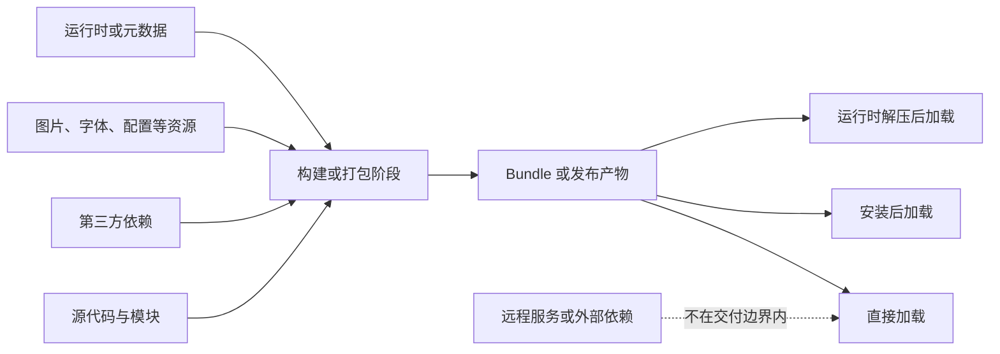
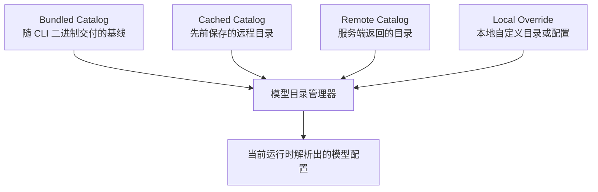

## 内容依据与知识日期

- **总体知识截止日期：2026 年 9 月 9 日**
- 本文已联网核对 OpenAI Codex 官方仓库、webpack、npm、Rust、Apple 和 Microsoft 的官方资料。
- `bundle` 是高度依赖语境的通用技术词，并不存在一套适用于所有技术栈的唯一严格定义。
- Codex 部分依据当前 OpenAI 官方仓库 `main` 分支；实验性命令可能变化，实际使用时应同时检查本机 `codex --version` 和 `codex debug models --help`。

---

## 一句话理解 bundled

在 IT 语境中，**bundled** 通常表示：

> 某个**组件、资源或数据**，作为另一个更大的软件产品、发布版本或分发产物的**一部分**，随其一起交付，而不是要求用户在使用时再单独获取。

可以将其理解为一种**交付关系（delivery relationship）**：

`X is bundled with/in Y`

表示 X 位于 Y 的交付边界之内。

但是，这句话本身没有说明：

- X 是嵌入一个二进制，还是放在旁边的目录中；
- X 是源代码、机器码、资源文件还是元数据；
- X 会被直接加载，还是启动时先解压；
- X 是否为最新版本；
- X 是否一定会被启用；
- X 是否拥有合法授权或用户访问权限。

所以，遇到 `bundled` 时最值得追问的是：

> **什么东西，被打包到了什么东西中，以什么形式，在什么时间更新？**

---

## 常见词形和表达

| 英文                 | 词性或结构       | 常见中文含义                       |
| -------------------- | ---------------- | ---------------------------------- |
| `bundle`             | 名词             | 包、软件包、资源包、打包产物、组合 |
| `bundle`             | 动词             | 打包、合并、捆绑、随附             |
| `bundled`            | 过去分词或形容词 | 已打包的、内置的、随附的           |
| `bundling`           | 名词或动名词     | 打包过程、组合过程                 |
| `bundler`            | 名词             | 打包器，例如 module bundler        |
| `unbundled`          | 形容词           | 未捆绑的、拆分交付的、外部提供的   |
| `unbundle`           | 动词             | 拆包、拆分、解除捆绑               |
| `rebundle`           | 动词             | 重新打包                           |
| `bundle size`        | 名词短语         | 打包产物大小                       |
| `bundle identifier`  | 名词短语         | 包标识符                           |
| `resource bundle`    | 名词短语         | 资源包                             |
| `support bundle`     | 名词短语         | 支持诊断包                         |
| `bundled dependency` | 名词短语         | 随包分发的依赖                     |
| `bundled version`    | 名词短语         | 随主产品附带的版本                 |

### 不同介词带来的细微差异

| 表达                 | 侧重点                 | 例子解释                           |
| -------------------- | ---------------------- | ---------------------------------- |
| `bundled with`       | 随某物一同提供         | 库随应用一起发布，但未说明放在哪里 |
| `bundled in`         | 包含在某个容器或产物中 | 资源位于安装包、应用包或二进制内部 |
| `bundled into`       | 强调打入或合并过程     | 把依赖打入最终可执行文件           |
| `bundled as`         | 以某种整体形式交付     | 多个文件被打成一个归档包           |
| `comes bundled with` | 产品默认附带           | 用户通常不需要另外下载             |
| `shipped with`       | 随某个版本发布         | 更强调发布和版本关系               |

`bundled with` 不一定等于“内嵌在内部”。例如，一个应用和一个 DLL 放在同一安装目录，也可以称为 bundled。

---

## bundled 描述的是“交付边界”

可以用下面的结构理解一般的 bundling 过程：



判断某个东西是否真的算 bundled，可以观察：

- 没有网络时，交付产物中是否仍然存在它；
- 用户是否需要运行另一个安装步骤；
- 删除外部缓存后，它是否依然可用；
- 主程序升级时，它是否随主程序一起改变；
- 安装包、归档包、二进制或应用目录中能否找到它。

---

## 前端领域：Module Bundling

这是开发者最经常遇到的 `bundle` 含义。

Webpack 一类模块打包器（module bundler）会从入口模块（entry point）出发，构建依赖图（dependency graph），递归查找应用所需的模块和资源，经过转换后输出一个或多个 bundle。**Bundle 不一定只有一个文件**；代码分割（code splitting）可能生成多个 bundle 或 chunk。

例如：

```javascript
import { formatDate } from "./date.js";
import lodash from "lodash";
import "./style.css";
```

打包器可能处理：

- 当前源文件；
- `date.js`；
- `lodash`；
- CSS；
- 字体和图片；
- 动态导入模块；
- 运行时代码。

最终生成：

```markdown
dist/
- main.abc123.js
- vendor.5fd901.js
- styles.2a7721.css
```

这些文件仍然可以统称为 bundles 或 bundled assets。

### Bundling 不等于其他构建步骤

| 操作         | 英文                  | 主要目的                           |
| ------------ | --------------------- | ---------------------------------- |
| 打包         | Bundling              | 沿依赖图收集和组合模块             |
| 转译         | Transpilation         | 将一种语法级别转换为另一种         |
| 压缩         | Minification          | 缩短变量、删除空白，降低体积       |
| 摇树优化     | Tree Shaking          | 删除可证明未被使用的代码           |
| 代码分割     | Code Splitting        | 将大 bundle 拆成按需加载的多个部分 |
| 压缩归档     | Archiving/Compression | 生成 ZIP、tar.gz 等容器            |
| 软件分发打包 | Packaging             | 准备安装、发布或部署所需的整体结构 |

这些步骤经常出现在同一条构建流水线中，但概念上不同。

例如：

> This JavaScript is bundled but not minified.

表示模块已经被打包，但代码仍可能保持可读格式。

---

## 包管理领域：Bundled Dependencies

**Bundled dependencies** 是随当前软件包本身一起分发的依赖，而不是仅在 manifest 中声明、等待安装器另外下载。

npm 的 `bundleDependencies` 字段就是一个典型例子。指定依赖后运行 `npm pack`，这些依赖会被放入生成的 tarball；`bundledDependencies` 是 npm 同样接受的别名。

```json
{
  "name": "example-package",
  "version": "1.0.0",
  "dependencies": {
    "example-runtime": "2.1.0"
  },
  "bundleDependencies": [
    "example-runtime"
  ]
}
```

这里应区分：

- `dependencies`：声明“我依赖什么”；
- `bundleDependencies`：声明“哪些依赖要随发布包一起带上”；
- lockfile：记录解析出的具体版本；
- bundled artifact：真正包含依赖内容的发布产物。

**依赖被声明，不代表依赖已被 bundled。**

### Bundled 与 vendored 的区别

**Vendoring** 通常是把第三方依赖的源代码或源码包复制到项目仓库中的本地目录；例如 Cargo 的 `cargo vendor` 会把远程依赖源复制到指定目录。

| 情况                                      | 是否 vendored | 是否 bundled |
| ----------------------------------------- | ------------: | -----------: |
| 源码放在仓库的 `vendor/` 中，但发布时排除 |            是 |           否 |
| 构建时从注册表下载依赖，然后打入产物      |            否 |           是 |
| 源码在 `vendor/` 中，并被打入发行包       |            是 |           是 |
| 运行时从 CDN 加载                         |            否 |           否 |

一句话区分：

- **Vendored** 关注依赖源码从哪里取得和保存；
- **Bundled** 关注依赖是否进入最终交付边界。

---

## 部署领域：Bundled Runtime 与 Single-file

部署文档中经常出现：

- runtime is bundled；
- dependencies are bundled；
- bundled executable；
- single-file bundle；
- self-contained bundle。

它们并不完全等价。

.NET 的 single-file deployment 可以把应用依赖文件组合进单个二进制，但部分内容可能在运行时解压。与此同时，single-file 可以是 framework-dependent，也可以是 self-contained；只有后者才表示连运行时也一起提供。

因此需要分开判断：

| 维度                 | 问题                                     |
| -------------------- | ---------------------------------------- |
| Bundled              | 依赖是否随应用交付？                     |
| Single-file          | 最终是否表现为一个文件？                 |
| Self-contained       | 是否连运行时也随应用交付？               |
| Statically linked    | 依赖代码是否在链接阶段合并进可执行代码？ |
| Embedded             | 数据是否物理存储在另一个文件内部？       |
| Extracted at runtime | 启动时是否要把内部文件释放出来？         |

可能出现以下组合：

- bundled，但不是 single-file；
- single-file，但仍依赖系统运行时；
- self-contained，但由许多文件组成；
- bundled library，但运行时仍通过动态链接加载；
- 单个可执行文件，启动时将原生库解压到临时目录。

所以：

> Bundled into a single executable

比：

> Bundled with the application

表达得更具体。

---

## Apple 平台中的 App Bundle

在 Apple 平台中，**bundle 还是一种具有特定结构的目录**。

macOS 或 iOS 的 application bundle 通常包含：

- 可执行代码；
- `Info.plist`；
- 图标；
- 本地化资源；
- Framework；
- 插件；
- 其他运行所需文件。

它在 Finder 中可能表现得像一个文件，但底层仍是具有标准目录结构的目录。Apple 还区分了 bundle 和 package：bundle 强调标准化的代码与资源结构；package 强调 Finder 将目录展示为单一文件的行为。

因此：

- **App bundle** 不表示单个二进制；
- **Bundle identifier** 是应用标识符，不是文件包；
- **Framework bundle** 是 Framework 的标准目录结构；
- **Resource bundle** 通常只放图片、语言文件等资源；
- `.app` 目录本身就是一种 bundle。

这也说明，不能把所有 `bundle` 都翻译成“单文件包”。

---

## 资源包、证书包和诊断包

`bundle` 还经常泛指“一组有共同用途、需要整体处理的数据”。

| 表达                                | 常见内容                       | 推荐翻译                |
| ----------------------------------- | ------------------------------ | ----------------------- |
| `resource bundle`                   | 图片、字体、语言文件、模板     | 资源包                  |
| `certificate bundle` 或 `CA bundle` | 一组 CA 根证书或证书链         | 证书包                  |
| `support bundle`                    | 日志、配置、系统信息、崩溃数据 | 支持诊断包              |
| `trace bundle`                      | Trace、manifest、事件记录      | 跟踪数据包              |
| `schema bundle`                     | 多个关联 Schema                | Schema 集合或 Schema 包 |
| `model bundle`                      | 可能包含权重、分词器和配置     | 模型包                  |
| `extension bundle`                  | 扩展代码、manifest 和资源      | 扩展程序包              |

例如，当前 Codex 官方源码中还存在 `trace bundle` 的用法，它指包含 `manifest.json` 和 `trace.jsonl` 的跟踪数据目录；这里的 bundle 显然不是前端 JavaScript bundle。

---

## Bundle、Package、Archive、Artifact 的区别

这些词经常混用，但侧重点不同。

| 术语             | 核心侧重点                       | 不一定表示             |
| ---------------- | -------------------------------- | ---------------------- |
| **Bundle**       | 多个相关组成部分作为整体交付     | 标准格式、压缩、可安装 |
| **Package**      | 可管理、安装或发布的软件单位     | 一定包含全部依赖       |
| **Archive**      | ZIP、tar 等文件容器              | 可执行、可安装         |
| **Artifact**     | 构建或流水线产生的任何产物       | 特定格式或用途         |
| **Installer**    | 执行安装过程的程序或包           | 程序运行时仍需要它     |
| **Image**        | 容器、磁盘或虚拟机的文件系统快照 | 单文件或压缩格式       |
| **Binary**       | 编译生成的机器可执行内容         | 包含资源和全部依赖     |
| **Distribution** | 向用户交付的整体发行形态         | 单一 artifact          |
| **Release**      | 某次带版本的软件发布             | 特定打包方式           |

一个 ZIP 可以同时是：

- archive；
- release artifact；
- distribution package；
- 包含多个 bundled dependencies 的 bundle。

这些词描述的是不同维度，而不是互斥分类。

---

## Bundled 与常见近义词的精确区别

| 词语                     | 与 bundled 的区别                                          |
| ------------------------ | ---------------------------------------------------------- |
| **Included**             | 含义最宽，可能只是功能、许可或文档被包含，不一定是物理文件 |
| **Built-in**             | 强调开箱即用或产品原生提供，不说明实现是否为独立组件       |
| **Embedded**             | 更强调某物物理存储在另一文件或对象内部                     |
| **Preinstalled**         | 表示已经安装在目标系统上，但可能不属于当前产品的交付物     |
| **Vendored**             | 强调依赖源码或源包被复制到本地代码库                       |
| **Statically linked**    | 强调链接器将代码合并进二进制                               |
| **Dynamically linked**   | 运行时装载独立共享库；共享库仍可能随应用 bundled           |
| **Cached**               | 表示此前下载后保存在本地，不代表最初随产品交付             |
| **Downloaded on demand** | 运行时按需下载，通常与 bundled 相反                        |
| **Self-contained**       | 强调运行所需环境也一起提供，比 bundled runtime 更明确      |
| **Packaged**             | 强调为发布或安装准备结构，不一定包含所有依赖               |
| **Shaded**               | Java 领域常指把依赖类重新打入并可能重定位到 JAR 中         |
| **Fat/Uber JAR**         | 包含应用及大量依赖的 JAR，是 bundled artifact 的具体形式   |

### 最容易误解的三个区别

**Bundled 不等于 built-in**

- `built-in formatter`：产品本身提供格式化能力；
- `bundled formatter`：产品附带了一个格式化组件；
- 内置能力可能由核心代码实现，也可能由 bundled 子组件实现。

**Bundled 不等于 statically linked**

应用目录中随附的动态库属于 bundled dependency，但它仍然是动态链接库。

**Bundled 不等于 cached**

缓存通常来自以前的下载；bundled 内容来自安装包、应用目录或二进制本身。

---

## bundled 没有隐含保证什么

看到 `bundled` 时，不要自动推断以下结论。

### 不保证只有一个文件

Webpack 可以生成多个 bundle；Apple app bundle 本身通常是一个目录；single-file deployment 才明确表示单文件。

### 不保证已压缩

Bundle 可以是未压缩目录、JAR、ZIP、二进制中的数据段或多文件发布目录。

### 不保证最新

Bundled 数据通常与主程序的发布版本绑定。主程序不升级，其中的 bundled 数据可能也不会更新。

### 不保证已经启用

插件、模型配置或功能模块即使随产品一起交付，也可能受 feature flag、权限、平台和配置控制。

### 不保证运行时完全离线

应用可能只 bundle 了客户端或元数据，真正的服务仍需要网络。

### 不保证包含运行时

应用可以 bundle 自己的代码和依赖，却依旧要求目标机器预装 JVM、.NET Runtime、Python 或其他系统组件。

### 不保证拥有使用权限

本地目录中出现某项产品元数据，不表示当前账号必然有权访问对应的远程服务。

### 不保证许可证允许任意再分发

技术上能 bundle 第三方库，不代表许可证允许无条件重新分发。发布者仍需处理许可证、归属声明和源代码提供义务。

---

## 回到 Codex：`codex debug models --bundled`

这是一个非常典型而且值得深入理解的用法。

当前 Codex CLI 官方源码对 `--bundled` 的说明是：

- 跳过刷新；
- 只输出随当前二进制交付的 bundled model catalog。

对应的 `bundled_models_response()` 使用 Rust 的 `include_str!("../models.json")` 读取目录。Rust 的 `include_str!` 会在编译时把文件内容作为静态字符串包含进程序。换句话说，这里的模型目录是与该 Codex 二进制版本一起构建和交付的。

### 这里究竟 bundle 了什么

Bundle 的是：

- **模型目录（model catalog）**
- 模型名称和标识；
- 模型相关元数据；
- 客户端需要了解的能力和行为配置；
- 与该 CLI 版本匹配的本地基线数据。

没有 bundle 的是：

- 模型权重；
- OpenAI 服务端推理程序；
- 你的账号权限；
- 模型算力；
- 当前服务端最新的模型可用性状态。

所以：

```bash
codex debug models --bundled
```

不能理解成：

> 显示本地已经下载、可离线运行的模型。

更准确的理解是：

> 显示这个 Codex 二进制在构建和发布时自带的模型目录快照。

### `--bundled` 中 bundled 的推荐翻译

原文：

> bundled catalog shipped with this binary

推荐译法：

- 随当前二进制一同交付的内置目录；
- 编译进当前 Codex CLI 版本的目录快照；
- 当前二进制自带的模型目录。

不太推荐只译成：

- 已捆绑目录；
- 本地模型；
- 可用模型。

后两种说法容易让人误以为模型本身在本地，或者账号一定有权使用。

---

## 为什么 Codex 需要 bundled catalog

Codex 模型管理器当前涉及 bundled 数据、缓存数据以及远程模型目录。Bundled catalog 可以作为与当前客户端版本匹配的本地基线；普通刷新路径则可能涉及缓存、认证、Provider 和远程目录。

它具有几个典型价值：

- CLI 启动时至少知道一些基础模型元数据；
- 网络不可用时仍有本地基线；
- 客户端代码和目录 Schema 可以随版本一起发布；
- 能够判断问题来自二进制自带数据还是远程刷新路径；
- 自定义 Provider 可以获得一套默认模型描述。

但它也意味着：

- 目录内容与 CLI 版本耦合；
- 旧 CLI 中的 bundled catalog 可能落后；
- bundled catalog 和远程目录可能不同；
- 本地目录能识别某个模型，不等于服务端接受它；
- 将最新版仓库中的目录文件直接塞给旧 CLI，可能产生 Schema 不兼容。

---

## 用 bundled 对比 Codex 的数据层

可以把模型目录问题简化为下面几层：



这张图主要表达一个原则：

> **Bundled 是输入来源之一，不一定是当前运行时最终采用的全部配置。**

### 实用对比命令

先记录版本：

```bash
codex --version
```

保存二进制自带目录：

```bash
codex debug models --bundled > bundled-models.json
```

保存普通模型目录路径的结果：

```bash
codex debug models > resolved-models.json
```

如果安装了 `jq`，可以规范化 JSON 后比较：

```bash
jq -S . bundled-models.json > bundled-models.sorted.json
jq -S . resolved-models.json > resolved-models.sorted.json
diff -u bundled-models.sorted.json resolved-models.sorted.json
```

### 如何解读结果

| 观察结果                           | 可能说明                                                     |
| ---------------------------------- | ------------------------------------------------------------ |
| `--bundled` 很快成功，普通命令失败 | 问题更可能位于缓存、认证、代理或远程刷新路径                 |
| 两份目录不同                       | 普通路径获得了不同于二进制基线的数据                         |
| 两份目录相同                       | 当前普通路径没有产生明显不同的目录结果                       |
| bundled 中存在模型，实际请求失败   | 目录识别不等于 Provider 或账号允许调用                       |
| bundled 中缺少自定义模型           | 当前二进制没有该模型的专用元数据，可能使用回退行为或需要本地目录覆盖 |
| 升级 CLI 后 bundled 内容变化       | 新二进制携带了新的目录快照                                   |
| 自定义目录只在旧版失败             | 需要检查 CLI 与目录 Schema 的版本匹配                        |

这些结果是排障线索，而不是单凭一项就能得出的最终证明。

---

## 从命名快速判断 bundled 的含义

以后在文档中看到它，可以使用以下快速判断法。

### `bundled catalog`

通常表示随程序发布的静态目录或元数据快照。

### `bundled dependencies`

通常表示依赖的实际内容随包分发，而不只是写在依赖清单中。

### `bundled JavaScript`

通常表示经过模块打包器处理的 JavaScript 产物。

### `bundled runtime`

表示应用随附了运行时，但还要确认是同目录部署、内嵌还是启动时解压。

### `application bundle`

通常表示应用代码和资源构成的结构化整体；在 Apple 平台尤其可能是标准目录。

### `support bundle`

通常表示为排障收集的日志、配置和环境信息。

### `bundled offer`

通常是商业语境中的组合销售或套餐，未必涉及技术打包。

### `bundled version`

表示随主产品附带的版本，通常跟随主产品的升级周期。

---

## 文档和配置中的最佳实践

如果你在编写技术文档，尽量不要只说 `bundled`，最好继续说明其物理和运行时语义。

不够明确：

> The runtime is bundled.

更明确：

> The runtime is included as separate files in the application directory.

或者：

> The runtime is embedded into the executable and extracted at startup.

或者：

> The model catalog is compiled into the CLI binary and used as a local fallback.

### 应当说明的内容

- bundle 的对象是什么；
- bundle 到哪个 artifact；
- 是单文件还是目录；
- 是否压缩；
- 是否会在运行时解压；
- 是否可以被远程版本覆盖；
- 是否随主程序一起更新；
- 如何查看 bundled component 的版本；
- 是否支持用户替换；
- 第三方组件的许可证和安全更新如何处理。

### 依赖管理建议

对于真正包含第三方依赖的产物：

- 记录具体依赖版本；
- 保留 lockfile；
- 生成软件物料清单（Software Bill of Materials，SBOM）；
- 对 bundled dependencies 做漏洞扫描；
- 保留许可证和归属声明；
- 明确更新策略；
- 不要因为依赖“不需要另行下载”，就忽略其安全补丁；
- 检查同一个依赖是否被多个组件重复 bundle。

Bundling 提高了部署便利性和可重复性，但也会让依赖更新更加依赖主产品的发布周期。

---

## 核心总结

理解 `bundled` 最重要的是记住下面几条：

- **Bundled 描述的是交付关系，不是单一文件格式。**
- 它通常表示某项内容随更大的产品、二进制或发布包一起提供。
- 它不必然意味着单文件、压缩、静态链接、启用、最新或可离线运行。
- `bundled with` 可能只是同目录附带；`bundled into` 更强调打入内部。
- 在前端领域，它常指模块打包产物。
- 在依赖管理领域，它常指依赖实际进入发布包。
- 在 Apple 平台，它可能指具有标准结构的目录。
- 在 Codex 的 `--bundled` 中，它特指**随当前 CLI 二进制交付的模型目录快照**，而不是本地模型权重。
- 排障时，应区分 **bundled、cached、remote、configured 和 runtime-effective** 这几层数据。

最实用的翻译原则是：

> 不要机械地把 bundled 全部译成“捆绑的”；应根据语境分别译为“随附的”“内置的”“经打包的”“编译进二进制的”“随包分发的”或“应用程序包中的”。