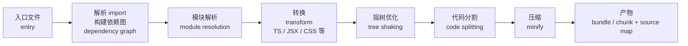

[toc]

## 资料依据与知识日期

- **知识依据**：本文的绝大部分内容（词义、各领域用法、平台机制）属于 IT 界长期稳定的通用知识，来自我的训练知识；“前端打包器生态现状”一节在 **2026-09-09** 联网核对了 Vite 官方博客及若干技术文章。
- **知识截止说明**：我的训练知识截止早于 2026 年；凡涉及“当前主流工具/版本”的判断，以本次检索结果为准，其余以通用知识为准。
- **与前文的关系**：上一轮中 `codex debug models --bundled` 里的 `--bundled` 正是本文要讲的“随二进制一起内置的”这一义项，文末会回到这个例子。

## 一个词，四层含义

`bundle` 的本义是“捆、束、包”（一捆柴、一束花）。它进入 IT 后沿着这个本义分化出了四个稍有不同的层次。理解这张“语义地图”，几乎就能看懂所有场景下的 bundled：

| 层次              | 英文常见形态                                                 | 核心含义                                           | 典型例子                                                     |
| ----------------- | ------------------------------------------------------------ | -------------------------------------------------- | ------------------------------------------------------------ |
| 分发层：随附/内置 | bundled with, ships bundled, bundled dependency, bundled runtime | 某个东西**随另一个东西一起交付**，用户不必单独获取 | Electron 应用自带 Chromium；Python 自带 pip；`rusqlite` 的 `bundled` feature |
| 构建层：合并打包  | bundler, bundling, bundle size, bundle splitting             | 把**多个源文件合并成少数产物**                     | webpack/Rolldown 产出的 `bundle.js`                          |
| 结构层：逻辑单元  | bundle（名词）, app bundle, bundle identifier                | 把一组文件**作为一个整体单元**来对待、命名和管理   | macOS `.app` bundle；Android `.aab`；OSGi bundle             |
| 商业层：捆绑销售  | bundling, unbundling, bundle deal                            | 把多个产品**打包成一个商品**出售                   | Office 套件；Humble Bundle；反垄断中的“捆绑”                 |

这四层并不互斥，很多场景是叠加的：比如一个 macOS 应用既是一个“bundle（结构层）”，其内部又“bundled（分发层）”了一个 JavaScript runtime，而那个 runtime 加载的 `main.js` 又是“bundler（构建层）”产出的。

## 词形变体速查

| 词形                  | 词性            | 含义               | 例句风格                                    |
| --------------------- | --------------- | ------------------ | ------------------------------------------- |
| bundle                | 名词            | 一个打包单元/产物  | the production bundle, an app bundle        |
| bundle                | 动词            | 把……打包在一起     | bundle the assets into one file             |
| bundled               | 形容词/过去分词 | 已随附的、已打包的 | bundled dependencies, the bundled SQLite    |
| bundling              | 名词/动名词     | 打包这个行为或策略 | JavaScript bundling, product bundling       |
| bundler               | 名词            | 执行打包的工具     | a Rust-based bundler                        |
| unbundle / unbundling | 动词/名词       | 拆分、解绑         | unbundle Teams from Office                  |
| rebundle              | 动词            | 重新打包           | rebundle after upgrading deps               |
| bundleware            | 名词（贬义）    | 捆绑安装的多余软件 | 常与 bloatware 并列                         |
| pre-bundling          | 名词            | 预先打包           | Vite 对第三方依赖的 dependency pre-bundling |

## 分发层：bundled 作为“随附的、内置的”

这是日常读文档时最常遇到的用法。“X comes bundled with Y” 意为“X 自带 Y”。它的对立面是“需要用户单独安装”或“依赖系统已有的版本”。

### 典型场景

| 场景                   | 被 bundle 的东西                                             | 为什么要 bundle                            |
| ---------------------- | ------------------------------------------------------------ | ------------------------------------------ |
| 桌面应用自带运行时     | Electron 内置 Chromium 与 Node.js；JetBrains IDE 内置 JBR（JetBrains Runtime） | 消除“用户机器上 Java/浏览器版本不对”的问题 |
| 语言工具链自带包管理器 | Python 自带 pip 与 venv；Node.js 自带 npm                    | 开箱即用                                   |
| 本地库源码随包编译     | Rust `rusqlite` 的 `bundled` feature 直接把 SQLite 的 C 源码编进 crate；`openssl` crate 的 `vendored` feature 类似 | 不依赖系统库版本，编译结果可复现           |
| Node 包内嵌依赖        | `package.json` 的 `bundledDependencies`（也写作 `bundleDependencies`）字段，让指定依赖随 `npm pack` 一起打进 tarball | 离线安装或锁死依赖                         |
| 单文件可执行           | .NET single-file publish、PyInstaller、Go 静态二进制         | 分发简单                                   |
| 沙盒化应用格式         | Flatpak/Snap/AppImage 把依赖库随应用打包                     | 跨发行版一致性                             |
| 操作系统预装软件       | 厂商在 Windows/Android 上预装的应用                          | 商业合作；用户视角常称 bloatware           |
| CLI 工具自带平台二进制 | 许多 npm 发布的 Rust/Go 工具，会把各平台的原生可执行文件作为可选依赖或直接随包附带 | 用户 `npm install` 一步到位                |

### bundled 与 system/vendored/built-in 的辨析

这几组词在文档里高频出现且容易混，值得单列一张表：

| 术语                             | 含义                                 | 与 bundled 的关系                                   |
| -------------------------------- | ------------------------------------ | --------------------------------------------------- |
| built-in                         | 内建于产品自身代码的功能             | 比 bundled 更“融为一体”；bundled 强调“随附但可区分” |
| ships with / comes with          | 随产品一起交付                       | 与 bundled with 基本同义，更口语化                  |
| vendored / vendoring             | 把第三方源码复制进自己的仓库进行管理 | 是实现 bundling 的一种方式，侧重“源码层面纳入”      |
| statically linked                | 编译期把库直接链进可执行文件         | 是二进制层面的 bundling                             |
| system library / system-provided | 依赖操作系统或发行版提供的版本       | bundled 的反面                                      |
| pre-installed                    | 预装                                 | 多用于操作系统/设备语境                             |
| standalone / portable            | 不依赖外部安装即可运行               | 通常靠 bundling 达成的结果                          |
| out of the box                   | 开箱即用                             | 描述效果而非手段                                    |

### 该不该 bundle 依赖：权衡

这是软件分发中的经典争论。Linux 发行版（例如 Fedora、Debian）长期倾向于“使用系统库、不鼓励 bundling”，而应用开发者往往倾向 bundling。双方各有道理：

| 维度            | Bundled 依赖                                                 | 系统/共享依赖            |
| --------------- | ------------------------------------------------------------ | ------------------------ |
| 行为一致性      | 高，开发者测过的版本就是用户跑的版本                         | 低，取决于用户环境       |
| 安全补丁        | 差，每个 bundle 副本都要各自更新（zlib、OpenSSL 类漏洞会让“内置副本”成为长尾隐患） | 好，系统一次更新全局受益 |
| 体积与重复      | 大，同一库多份副本                                           | 小                       |
| 离线/可复现构建 | 好                                                           | 依赖环境                 |
| 许可证影响      | 需要注意：随附 GPL 等库可能触发相应义务                      | 边界更清晰               |
| 供应链可见性    | 需要 SBOM（Software Bill of Materials）才能看清内部到底带了什么 | 系统包管理器天然可查     |

最佳实践：

- 面向终端用户的应用通常选择 bundling，但要**把 bundled 组件纳入漏洞扫描与 SBOM**。
- 面向服务器/发行版的软件尽量尊重系统库，或提供“使用系统库”的构建开关（例如 `--with-system-xxx`、`bundled` 与 `system` 两个 feature）。
- 在文档中明确写出“bundled 了哪些第三方组件及其版本”，而不是只写 “ships with everything you need”。

## 构建层：bundler 与前端打包

这是 `bundle` 在 IT 中最“专业化”的用法，几乎成了前端工程的代名词。

### 为什么需要打包器

浏览器原本一次只能加载一个脚本文件，历史上又不认识 CommonJS 等模块格式，也不认识 TypeScript、JSX、Sass。打包器的任务就是把开发者写的“很多模块、多种语言”变成浏览器能直接消费的“少数几个产物”。

### 核心概念

| 概念     | 英文                          | 含义                                                       |
| -------- | ----------------------------- | ---------------------------------------------------------- |
| 入口     | entry point                   | 打包从哪个文件开始追踪依赖                                 |
| 依赖图   | dependency graph              | 从入口递归收集的所有模块及其引用关系                       |
| 产物/包  | bundle                        | 最终输出的合并文件                                         |
| 分块     | chunk                         | 代码分割后的一个产物片段，按需加载                         |
| 代码分割 | code splitting                | 按路由/动态 import 把一个大 bundle 拆成多个 chunk          |
| 摇树     | tree shaking                  | 剔除未被引用的导出，依赖 ES Module 的静态结构              |
| 包体积   | bundle size                   | 常见性能指标，衡量首屏加载成本                             |
| 源码映射 | source map                    | 让压缩后的产物能映射回原始源码，便于调试                   |
| 预打包   | dependency pre-bundling       | 开发阶段把 `node_modules` 里的依赖提前合并，减少浏览器请求 |
| 热更新   | HMR（Hot Module Replacement） | 开发时只替换变更模块而不整页刷新                           |

### 当前的工具格局

打包器领域近两年经历了一次“Rust 化”浪潮。关键节点是 Vite 8：2026 年 3 月 12 日 Vite 8 稳定发布，以 Rolldown 作为唯一、统一的 Rust 打包器，构建速度提升 10-30 倍，同时保持插件兼容。此前 Vite 长期同时依赖两个打包器：开发时用 esbuild 追求速度，生产构建用 Rollup 追求优化；两套打包器意味着两套配置、两套怪癖，以及开发与生产之间可能微妙不同的输出。

关于 Rolldown 本身：它是用 Rust 编写的现代高性能 JavaScript 打包器，设计目标是作为 Rollup 的替代品，在保持生态兼容的同时显著提升性能；Rolldown 于 2026 年 5 月 7 日发布 1.0 稳定版，锁定 API 并提供向后兼容保证。底层转换工作由 Oxc 承担，这是同一团队的另一套 Rust 工具链（解析器、解析、转换器、压缩器）。

一个值得注意的治理变化：2026 年 6 月 Cloudflare 收购了 Vite、Vitest、Rolldown 和 Oxc 背后的公司 VoidZero，并承诺投入生态基金且一切保持开源。

综合以上和通用知识，现状可概括如下：

| 工具              | 实现语言        | 定位                   | 备注                                                         |
| ----------------- | --------------- | ---------------------- | ------------------------------------------------------------ |
| Vite 8 + Rolldown | Rust 核心       | 通用前端构建的主流选择 | 开发/生产统一引擎                                            |
| Rollup            | JavaScript      | 类库打包的传统标杆     | Rolldown 以其插件 API 为兼容目标                             |
| esbuild           | Go              | 极快的打包/转换原语    | 如果只需要一个小脚本 bundle，esbuild 通常仍然更简单          |
| webpack           | JavaScript      | 老牌、生态最广         | 大型遗留项目仍大量使用                                       |
| Rspack            | Rust            | webpack 兼容的高速替代 | 面向 webpack 迁移                                            |
| Turbopack         | Rust            | Next.js 内置默认打包器 | 是 Next.js 的默认 Rust 打包器，在 Next 之外基本不会单独采用  |
| Parcel            | JavaScript/Rust | 零配置                 | 中小项目                                                     |
| Bun               | Zig             | 运行时自带打包器       | 与 Vite 常配合而非替代                                       |
| swc / Oxc         | Rust            | 转换层（非完整打包器） | esbuild 和 swc 在转换层仍然重要；esbuild 是最快的原始转换器，swc 是常见的 Babel 替代 |

### 前端 bundling 的最佳实践

- 用 ES Module 写库，保证 tree shaking 能生效；避免有副作用的顶层代码，或正确声明 `sideEffects`。
- 按路由做 code splitting，配合 dynamic `import()`。
- 把 bundle size 纳入 CI 监控（size-limit、bundlesize 一类工具），防止“一次 npm install 让首屏膨胀 300 KB”。
- 生产构建始终生成 source map，但控制其上传范围（只传错误监控平台，不随产物公开）。
- 迁移到 Rust 打包器时，优先验证插件兼容性和产物一致性，而不是只看速度基准。

## 结构层：bundle 作为“逻辑单元”

这一层里 bundle 是个名词，指“一堆文件被当成一个整体”。不同平台各有自己的 bundle 定义。

### macOS / iOS：App Bundle

在 Apple 平台上，`.app`、`.framework`、`.bundle`、`.kext` 等本质上都是**目录**，只是被 Finder 显示成单个文件。一个典型 `.app` 内部有 `Contents/Info.plist`（元数据）、`Contents/MacOS/`（可执行文件）、`Contents/Resources/`（资源）等。

| 术语                          | 含义                                                         |
| ----------------------------- | ------------------------------------------------------------ |
| bundle identifier / Bundle ID | 形如 `com.company.app` 的反向域名唯一标识，写在 `Info.plist` 的 `CFBundleIdentifier`，用于签名、沙盒、推送、App Store 识别 |
| main bundle                   | 运行时通过 `Bundle.main` 访问的应用自身资源集合              |
| framework bundle              | 动态库加上头文件、资源的打包形式                             |
| bundle version                | `CFBundleVersion` / `CFBundleShortVersionString`             |

对排障用户的意义：macOS 上很多权限、沙盒（包括前文提到的 Seatbelt）和签名规则都以 bundle 为粒度生效，理解“应用是一个 bundle”有助于理解为什么“改了里面一个文件签名就失效”。

### Android：App Bundle（.aab）

Android App Bundle 是 Google Play 的**发布格式**（不是安装格式）。开发者上传 `.aab`，Play 根据设备的 ABI、屏幕密度、语言等生成并分发定制的 split APK。它体现的是“bundle = 包含全部变体的母包”，与 macOS 的“bundle = 目录即单元”侧重点不同。

### Java：OSGi Bundle 与 ResourceBundle

- **OSGi bundle**：一个带特殊 `MANIFEST.MF` 头（如 `Bundle-SymbolicName`、`Export-Package`）的 JAR，是 OSGi 模块系统的部署单元，支持热插拔。Eclipse 插件体系建立在此之上。
- **ResourceBundle**：`java.util.ResourceBundle`，用于国际化（i18n）的“同一组 key 的多语言资源集合”，例如 `messages_en.properties`、`messages_zh_CN.properties`。这里 bundle 的含义是“一组按语言分片的资源被视作一个逻辑单位”。

### Ruby：Bundler

Ruby 的依赖管理工具直接叫 **Bundler**。它通过 `Gemfile` 声明依赖，`Gemfile.lock` 锁定版本，`bundle install` 安装，`bundle exec <cmd>` 在锁定的依赖环境中运行命令。它的名字取“把项目所有 gem 捆成一致的一组”之意，属于分发层与结构层的交叉。

### 证书：CA Bundle

`ca-bundle.crt`、`ca-certificates.crt`、Let's Encrypt 的 `fullchain.pem` 等，都是**把多张 PEM 格式证书顺序拼接在一个文件里**。TLS 排障时常见的 `SSL certificate problem: unable to get local issuer certificate` 往往就是 CA bundle 缺失或过旧；企业代理环境要把内部根证书追加到 bundle 里。

### Git：git bundle

`git bundle create repo.bundle --all` 会把仓库的对象和引用打成单个文件，可通过 U 盘、邮件传输，再用 `git clone repo.bundle` 或 `git fetch repo.bundle` 导入。适用于离线或网络隔离环境。

### Kubernetes 生态

- **OLM bundle**（Operator Lifecycle Manager）：描述一个 Operator 版本的清单与元数据，打成 OCI 镜像分发。
- **Tekton bundles**：把 Task/Pipeline 定义打进 OCI 镜像。

共同点是“借用 OCI 镜像格式作为 bundle 容器”，这是近年云原生领域的通行做法。

### Windows：WiX Burn Bundle

WiX 工具集中，**Bundle** 指用 Burn 引导程序把多个 MSI/EXE 安装包串成一个安装器（例如先装 .NET 运行时再装应用）。这里 bundle 是“安装链”的意思。

### 其他常见变体

| 场景                                                         | 含义                                       |
| ------------------------------------------------------------ | ------------------------------------------ |
| Electron 的 `.asar`                                          | 应用源码归档，常被称作 app bundle 的一部分 |
| Terraform provider bundle                                    | 把多个 provider 二进制打包供离线安装       |
| Python wheel 中的 “bundled libs”（auditwheel/delocate 修复后） | 把 C 依赖库复制进 wheel 以脱离系统库       |
| Unity AssetBundle                                            | 运行时可按需加载的资源包                   |
| Steam/Humble Bundle                                          | 商业层，多款游戏合售                       |

## 商业层：bundling 与 unbundling

商业语境中的 bundling 是“把多个产品打包成一个价格出售”。IT 史上几个标志性事件都与它有关：

- 1990 年代末美国司法部诉微软案，核心指控之一是把 Internet Explorer 与 Windows 捆绑。
- 欧盟先后针对 Windows Media Player、浏览器选择，以及近年的 Teams 与 Office 套件的捆绑展开调查，微软最终在欧洲“解绑”（unbundle）了 Teams。
- 流媒体、有线电视的“捆绑套餐 vs 单点订阅”之争，是“unbundling”一词流行的推手。

网景前 CEO Jim Barksdale 有句常被引用的话，大意是“赚钱只有两种方式：捆绑与解绑（bundling and unbundling）”。在产品策略里，这句话被反复用来解释平台型产品的演化周期：先靠捆绑降低选择成本，再被更专注的单点产品解绑。

## Codex：`--bundled` 在说什么

 `codex debug models --bundled`：

- 这里的 bundled 属于**分发层**含义：随 Codex CLI 二进制**一起内置**的模型目录，而非从远端刷新得到的目录。
- 因此“带 `--bundled` 与不带的输出对比”本质上是在比较**内置副本 vs 远端最新**，这正是排查“模型为什么不在列表里”时的关键区分：本地缓存/内置目录过旧，还是账号侧不可见。
- 同样的思路适用于任何有 `--bundled`、`--vendored`、`--system` 之类开关的工具：它们几乎总是在让你选择“用我自带的”还是“用外面的”。

## 阅读文档时的快速判读法

遇到 bundle 及其变体时，可以用三个问题迅速定位它的含义：

| 问题                                                        | 若答“是”                                        | 大概率含义             |
| ----------------------------------------------------------- | ----------------------------------------------- | ---------------------- |
| 它后面跟着 `with`，或前面是产品名？                         | comes bundled with, ships bundled               | 分发层：随附/内置      |
| 上下文里有 entry、chunk、size、tree shaking、webpack/Vite？ | the bundle, bundle size, bundler                | 构建层：合并产物       |
| 它带扩展名或作为专有名词首字母大写？                        | `.app` bundle, App Bundle, OSGi Bundle, Bundler | 结构层：平台定义的单元 |
| 上下文是价格、套餐、反垄断？                                | bundling, unbundle                              | 商业层：捆绑销售       |

## 小结

`bundle` 是 IT 界少数几个能**横跨“分发、构建、结构、商业”四个层面**的常用词。

> 它的所有变体都围绕一个朴素的意象展开：**把原本"分散的东西"捆成一个整体来"交付、加载或出售"**。对开发者而言，最实用的收获有三点：

- 看到 “bundled” 首先要想到它的反面是什么：是“需要单独安装”，是“依赖系统版本”，还是“从远端获取”。这决定了排障时该去查哪一侧。
- 前端语境下 bundler 已经进入 Rust 时代，Vite 8 + Rolldown 是 2026 年的主流基线；理解 entry、chunk、tree shaking 这组概念比记住某个工具名更长久。
- 任何 bundling 都是在“便利与一致性”和“体积、安全补丁、许可证”之间做交换，成熟团队会用 SBOM 和漏洞扫描把 bundled 组件重新纳入可见范围，而不是让它们成为黑箱。