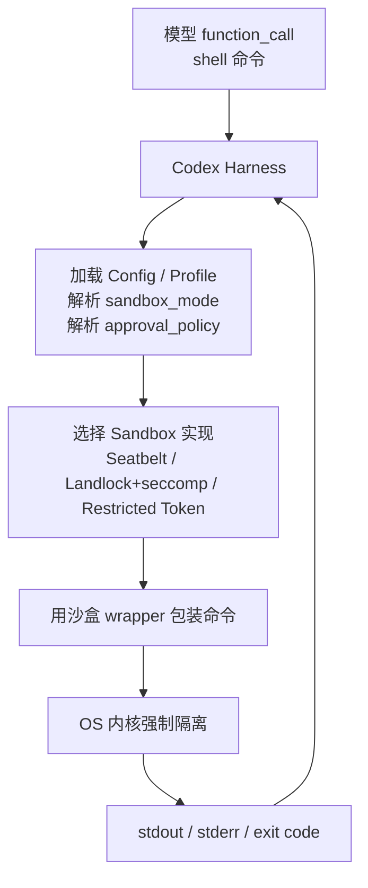
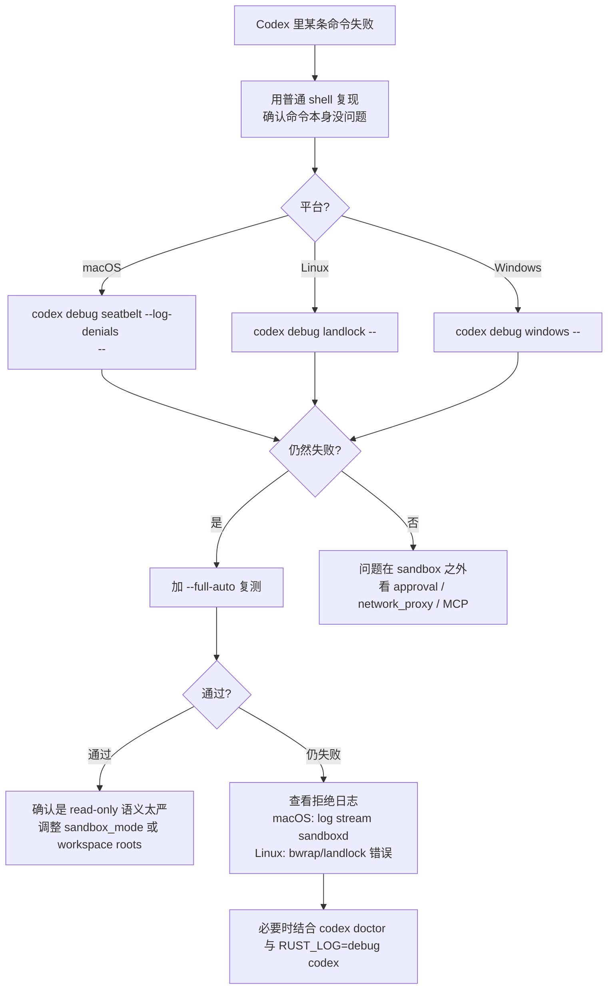

## 资料依据与知识日期

- 综合搜索日期：**2026-09-09**
- 主要来源：`openai/codex` GitHub 仓库源码（`codex-rs/cli/src/debug_sandbox.rs`、`codex-rs/core/src/landlock.rs`、`codex-rs/cli/src/doctor.rs`）、GitHub issue 讨论、OpenAI 帮助中心 Codex 页面、Codex CLI v0.131.0 发行说明相关报道，以及第三方技术博客对 Codex 内部机制的分析
- 我的模型训练知识截止早于 2026，因此本篇涉及具体子命令、参数、版本行为的部分**以本次联网检索到的资料为准**，我的先验知识用于组织框架和解释原理

## 为什么 `codex debug` 值得单独讲

Codex 平时最容易让新手困惑的两类问题都发生在“沙盒边界”上：

- 一条命令在普通终端里能跑，Codex 里却提示权限拒绝或联网失败。
- 你改了 `config.toml`、`AGENTS.md` 或 profile，但不确定它到底怎么落到实际执行环境。

`codex debug` 系列命令的价值就在于：**它把 Codex 平时在“agent loop 内部”隐式执行的沙盒包装、模型目录、app-server 协议等环节，暴露成可以被人手动触发的独立子命令**。理解它们等于理解了 Codex 的执行层是怎么装配起来的。第三方社区分析明确指出，如果 Codex 执行不了你以为应该能跑的命令，`codex debug seatbelt` 和 `codex debug landlock` 是首选的排障工具；很多"沙盒失败"其实是配置问题而不是 bug。

## `codex debug` 家族总览

按功能可以分成三类：

| 类别                     | 子命令                                                       | 定位                                                 | 备注                         |
| ------------------------ | ------------------------------------------------------------ | ---------------------------------------------------- | ---------------------------- |
| 沙盒探测（主力）         | `codex debug seatbelt`、`codex debug landlock`、`codex debug windows` | 在 Codex 的操作系统级沙盒下运行任意命令，观察其行为  | 平台相关，是本文重点         |
| 协议与内部状态（实验性） | `codex debug app-server send-message-v2`、`codex debug models` | 探测 app-server 的 JSON-RPC 协议、查看模型目录       | 集成开发或高级排障用         |
| 兼容名                   | `codex sandbox …`                                            | 与 `codex debug` 是同一批沙盒 helper 的别名/等价形态 | 早期文档常用 `codex sandbox` |

OpenAI 官方文档说明 为了测试命令在 Codex 提供的沙盒下会发生什么，Codex CLI 提供了 `codex debug seatbelt [--full-auto] [COMMAND]...`（macOS）和 `codex debug landlock [--full-auto] [COMMAND]...`（Linux）子命令；实现沙盒策略的机制依平台不同：macOS 12+ 使用 Apple Seatbelt，通过 `sandbox-exec` 加载与 `--sandbox` 对应的 profile；Linux 使用 Landlock/seccomp APIs 组合实施。第三方仓库分析补充：除 DangerFullAccess 之外，所有工具调用都通过平台特定的沙盒机制被限制（macOS 上是 Seatbelt，Linux 上是 bubblewrap+Landlock+seccomp，Windows 上是 restricted tokens）。

另有社区参考资料说明兼容命名：`codex sandbox` 用于在 Codex 的沙盒 helper 中运行命令；子命令按平台不同（macOS seatbelt、Linux/Windows 模式）而变化；官方文档提醒绕过沙盒应谨慎。

## `codex debug` 的核心思想：把 harness 拆开

要理解为什么这些命令有用，先看 Codex 平时是怎么执行一条 shell 命令的（简化视图）：



`codex debug seatbelt/landlock/windows` 做的事，就是**跳过“模型 function_call”这一层，让你亲自把一条命令灌进后面 P、S、W、E 这段管道，观察真实的 exit code 和拒绝原因**。这是它作为“教学工具+排障工具”双重价值的核心。

社区源码分析补充：Codex 暴露这些 debugger 用于测试沙盒；`codex debug seatbelt` 和 `codex debug landlock` 让你用沙盒测试任意命令，它们尊重和主 CLI 相同的 `--full-auto` 标志；OS 原生的执行避免了大量开销，同时提供不错的隔离。

## macOS：`codex debug seatbelt`

### 用法

```bash
codex debug seatbelt [--full-auto] [其他 flags] -- <要测试的命令>
```

一个最直观的例子（来自第三方演示）：read-only 模式下 `codex debug seatbelt touch hoge.txt` 会得到 `Operation not permitted` 权限错误；`codex debug seatbelt ls` 可以正常执行；加 `--full-auto` 后 `codex debug seatbelt --full-auto touch hoge.txt` 就能在当前工作区创建文件。

这说明两件事：

- Seatbelt 是**内核级 deny-by-default**，即使你在 shell 里有权限，被包装后仍会被拒绝。
- `--full-auto` 相当于切换到 workspace-write 语义的一种便捷开关。

### 底层机制

Codex 主进程本身不受沙盒限制，只有它为 AI 执行的 shell 命令被沙盒化；macOS 上 `sandbox-exec` 是主要沙盒；Seatbelt profile 是 deny-by-default，写权限通过参数化的 writable roots 精心构造。

源码级证据（`debug_sandbox.rs`）也显示这个命令在内部会传递一组结构化选项，包括 `permissions_profile`、`cwd`、`include_managed_config`、`allow_unix_sockets`、`log_denials`、`config_overrides`、`command` 等：`run_command_under_seatbelt` 会解构 `SeatbeltCommand` 的 `sandbox_state`、`permissions_profile`、`config_profile`、`cwd`、`include_managed_config`、`allow_unix_sockets`、`log_denials`、`config_overrides`、`command` 字段，并根据 permissions_profile 和 include_managed_config 计算 ManagedRequirementsMode。

值得单列的两个 flag：

| Flag                       | 作用                         | 使用场景                                     |
| -------------------------- | ---------------------------- | -------------------------------------------- |
| `--full-auto`              | 使用 workspace-write 语义    | 复现 Codex 日常执行时的沙盒行为              |
| `--log-denials`            | 记录 Seatbelt 拒绝事件       | 定位“为什么这条命令跑不起来”                 |
| `--allow-unix-sockets`     | 允许 Unix socket             | 需要访问 Docker socket、editor socket 等场景 |
| `--include-managed-config` | 把管理员托管的策略也叠加进来 | 复现企业受管设备的真实沙盒                   |

关于日志诊断：让失败命令带上 `--log-denials` 可以捕获 macOS Seatbelt 拒绝事件；`codex doctor` 的 Environment 段会报告 sandbox mode 和平台细节；macOS 上可以在另一个终端跑 `log stream --predicate 'process == "sandboxd"'` 实时看内核级拒绝。

### 已知“坑”：Seatbelt 与 config.toml 的边界

这是自定义配置用户必须理解的一个真相：**`codex debug seatbelt` 并不完全等于运行 Codex 时的沙盒**。有已确认的行为差异：

`codex debug seatbelt` 命令会忽略 `sandbox_mode`；源码里可以看到 `let sandbox_mode = create_sandbox_mode(full_auto);`，意味着测试你 `config.toml` 是否正确的唯一方式，是用 `--full-auto` 复现你 `config.toml` 中等价的设置（因为 `--sandbox workspace-write` 在这个子命令里也不被支持）。

另外还有一个更深的问题：Seatbelt profile 会在 OS 层面硬编码若干拒绝规则。macOS Seatbelt profile（`codex-rs/core/src/seatbelt_network_policy.sbpl`）无视 `config.toml` 在操作系统层强制阻断网络；仅在 `config.toml` 里设 `sandbox_mode = "danger-full-access"` 也不够，需要 CLI flag；理想情况下 Seatbelt profile 应像 Linux Landlock 沙盒那样尊重 `network_access = true`。

这带来的排障启示：

- macOS 上如果你怀疑“config 没生效”，先用 `--full-auto` 复现，而不是纠结于 `--sandbox` 参数。
- 如果 macOS 上命令联网失败，不要只改 `[sandbox_workspace_write] network_access = true`，还要考虑用 CLI flag 或升级到已修复该行为的版本。

## Linux：`codex debug landlock`

### 用法

```bash
codex debug landlock [--full-auto] [其他 flags] -- <要测试的命令>
```

用法上与 seatbelt 类似，但底层机制完全不同。

### 底层机制

Linux 沙盒实际由一个**外部 helper 可执行文件**实现（不是像 macOS 那样嵌入 profile 文本）。源码注释直接说明：与 macOS Seatbelt 直接嵌入 policy 文本不同，Linux helper 是一个独立可执行文件；`spawn_command_under_linux_sandbox` 把 legacy `SandboxPolicy` 加上拆分后的 filesystem/network policy 以 JSON 形式传给 helper；这样 helper 可以逐步迁移而不破坏旧调用方。

综合仓库分析：Linux 端组合使用 bubblewrap（`bwrap`）+ Landlock + seccomp。这意味着：

| 组件       | 提供的隔离                                                   |
| ---------- | ------------------------------------------------------------ |
| bubblewrap | Mount namespace、PID/User namespace 隔离，构造干净的根文件系统视图 |
| Landlock   | Linux 内核态文件系统访问控制                                 |
| seccomp    | 系统调用白名单/过滤                                          |

因此 `codex debug landlock` 排障时，可能失败的层不止一层：

- Docker/受限容器里可能缺少 unprivileged user namespace、setuid `bwrap` 或 seccomp 能力。
- Landlock 需要内核支持（较老内核可能不完整）。
- seccomp 规则可能挡掉某些较新的系统调用。

### 网络策略：Linux 与 macOS 的关键差异

Linux 端的网络策略与代理注入是可通过配置驱动的。源码显示：seatbelt 与 landlock 都在解析 config 后调用统一的 `run_command_under_sandbox` 通路；`landlock.rs` 中还有 `allow_network_for_proxy` 与 `create_linux_sandbox_command_args_for_permission_profile` 等函数。

结合前面提到的 Linux Landlock 沙盒会尊重 `network_access = true` 配置，我们可以得到一条实用推论：**`codex debug landlock` 在验证网络策略变更时比 `codex debug seatbelt` 更可靠**。如果你的团队在跨平台用 Codex，Linux 上的行为更接近“配置即所见”。

## Windows：`codex debug windows`

Windows 采用的是完全不同的机制。Windows 上沙盒通过 `codex-windows-sandbox` crate 使用 restricted process token。macOS 上使用 Apple Seatbelt，Linux 上使用 Landlock，Windows 上使用 restricted tokens。

对于 Windows 用户，重要事实：

- 官方推荐 IDE extension 在 WSL2 中运行，因为 WSL2 走 Linux sandbox 语义，行为更一致。
- 原生 Windows 沙盒是 restricted token，与 Linux/macOS 的模型差异较大，遇到问题时优先用 `codex debug windows` 逐条验证命令。
- 官方帮助文档提到：如果安装了多个 WSL 发行版，可以选择 Codex 使用的 Linux 发行版。

## 关键环境变量：Codex 沙盒内的“暗号”

`debug_sandbox.rs` 中还引用了两个重要环境变量：`CODEX_SANDBOX_ENV_VAR` 和 `CODEX_SANDBOX_NETWORK_DISABLED_ENV_VAR`。源码 import 中同时出现 `codex_core::spawn::CODEX_SANDBOX_ENV_VAR`（仅 macOS 生效）和 `codex_core::spawn::CODEX_SANDBOX_NETWORK_DISABLED_ENV_VAR`。

这两个变量的实际用途是：

| 环境变量                         | 含义                                                         |
| -------------------------------- | ------------------------------------------------------------ |
| `CODEX_SANDBOX`                  | Codex 沙盒 wrapper 在子进程环境里设置的“我正在沙盒里”标记，脚本可用它检测执行上下文 |
| `CODEX_SANDBOX_NETWORK_DISABLED` | 在网络受阻的沙盒里被置位；用于让脚本/工具知道“不要重试联网”  |

有社区 issue 展示了如何利用第二个变量绕过（不推荐日常使用）：`alias codex='CODEX_SANDBOX_NETWORK_DISABLED=0 codex --sandbox danger-full-access'`。这里给它值 `0` 只是一种**用户端的“告诉子进程别自我阻断”**信号，真正的网络许可仍来自 sandbox 类型和 CLI flag。

**排障用法**：在 `codex debug seatbelt/landlock` 里运行的脚本可以打印 `env | grep CODEX_SANDBOX`，快速确认自己确实身处沙盒里，以及网络位是否被置起。

## 实验性子命令🎈：`codex debug app-server` 与 `codex debug models`

这两条命令对普通用户不常见，但对做 IDE 集成、MCP 排障、模型可用性诊断非常有用。

存在两个实验性 debug 子命令：`codex debug app-server send-message-v2` 向 app-server 发送一个 JSON-RPC 消息，用于测试自定义集成的协议级行为；`codex debug models` 以 JSON 输出原始模型目录，`--bundled` 参数可跳过远端刷新只查看本地缓存目录；`/status` slash 命令则显示当前会话的活跃模型、审批策略、沙盒模式和累计 token 使用量。

第三方 cheatsheet 还提到 `codex debug app-server send-message-v2` 是实验性的、向 app-server 发送 V2 测试消息；此外可打印 Codex 看到的模型目录；也可创建本地诊断报告。

推荐使用姿势：

| 命令                                     | 何时用                                                       |
| ---------------------------------------- | ------------------------------------------------------------ |
| `codex debug models`                     | 抱怨"某个模型不在选择列表" / 想区分是账号可见性问题还是本地缓存问题 |
| `codex debug models --bundled`           | 想知道 CLI 内部“默认知道”哪些模型（不去联网）                |
| `codex debug app-server send-message-v2` | 开发 IDE plug-in、外部前端或代理，需要复现或调试 JSON-RPC 请求 |

## 沙盒探测的“黄金流程”

结合上文，给自定义配置用户的推荐排障流程：



## 与 `codex debug` 配套的其他诊断入口

`codex debug` 只覆盖“沙盒 + 部分内部协议”，另外几条命令与它高度互补，一起构成 Codex 的完整诊断面。

### `codex doctor`：环境体检

`codex doctor` 是 v0.131.0 引入的“开箱即用总体检”。Codex CLI v0.131.0 引入了 `codex doctor`——一条覆盖运行时、认证、终端能力、网络连通性、MCP 服务器健康和本地状态的综合诊断命令。

它做的事包括：

- 对 ChatGPT 会话执行 WebSocket 诊断，报告 HTTP 101 Switching Protocols 协商结果，并输出超时、DNS 解析和 provider 上下文；reachability 检查按 provider 感知：API-key 场景检 OpenAI API endpoint，ChatGPT 场景检 ChatGPT 路径，自定义/本地 provider 检各自配置的 HTTP endpoint；帮助定位企业代理、VPN 干扰和 DNS 解析失败，而不用另外用 curl 和 nslookup。
- 检查 app-server daemon 状态：是否运行、是否响应、版本是否符合预期。
- 支持结构化的、脱敏后的 JSON 输出，其中 `checks` 以 check id 为 key、`details` 为 key/value 对象，便于支持工具使用；与 feedback 上传集成，会附带 best-effort 的 `codex-doctor-report.json` 并加入衍生的 Sentry 标签；TUI feedback 同意界面也更新了措辞，说明会上传 doctor 报告。
- `codex doctor --json` 提供机器可读的诊断报告；同时引入了 `--strict-config`（当 `config.toml` 出现无法识别字段时报错）、`--profile-v2`（在基础 user config 之上叠加 `$CODEX_HOME/<name>.config.toml`）、`--dangerously-bypass-hook-trust`（仅供已审核的自动化跳过 hook 信任）等选项。

一句话：**`codex debug` 面向“某条命令为什么在沙盒里跑不起来”，`codex doctor` 面向“我这台机器上的 Codex 环境是否健康”**。两者搭配可以覆盖大多数“Codex 出问题”场景。

官方帮助中心也把 doctor 列为标准排障入口：在 Codex CLI 里运行 `codex doctor` 可获得覆盖启动、连通性和性能问题的诊断。

### `/status` 与 `/feedback`

不是 `codex debug` 但和排障流程强相关：

- `/status` 显示当前会话的活跃模型、审批策略、沙盒模式与累计 token 使用量。
- `/feedback` 会收集当前会话的诊断上下文，包括最近的日志条目、配置快照和 Sentry 标签元数据，并附一个请求 ID 供支持团队关联服务端遥测；建议在重启坏掉的会话前先跑 `/feedback`，因为关闭 TUI 后内存中的诊断上下文会丢失（虽然 JSONL transcript 仍在磁盘上）。

### `RUST_LOG` 与会话日志

Codex CLI 是 Rust 二进制，遵循 tracing 生态的约定。用 `RUST_LOG=debug codex` 可以打开全局 verbose 日志（适合认证或启动问题）；也可以按 crate 精细追踪，例如怀疑沙盒或 MCP 问题时。

Codex CLI 的诊断面是分层的：运行时日志文件、会话 transcript 归档、由环境变量驱动的 trace 级别、结构化的诊断命令、以及 OpenTelemetry 导出；多数开发者从没看过 TUI 错误提示之外的东西。

## 从 `codex debug` 学到的概念地图

如果你只是想把命令背下来，看到这就够了；但更值得带走的是这些“通过 debug 命令能看清楚的 Codex 内部概念”：

| 概念                                                         | 通过哪个命令能观察                                           | 你应该带走的理解                                |
| ------------------------------------------------------------ | ------------------------------------------------------------ | ----------------------------------------------- |
| Sandbox 是**执行时包装**，不是模型约束                       | `codex debug seatbelt/landlock/windows`                      | 无论模型说什么，命令都会被同一个 wrapper 包起来 |
| Sandbox 实现**因平台而异**                                   | 三个平台各一条 debug 子命令                                  | 跨平台团队要预期不一致行为                      |
| Sandbox 是 **deny-by-default**                               | `codex debug seatbelt touch` 直接被拒                        | 授权是"允许清单"式增量，而不是"禁止清单"式      |
| `--full-auto` 是 workspace-write 的**代名词**                | 加与不加 `--full-auto` 的行为差异                            | 平时理解 approval preset 更容易                 |
| 网络策略在 **Linux 上比 macOS 上更可配置**                   | Linux 端 `allow_network_for_proxy` 生效，macOS profile 硬编码 | 跨平台网络行为不要一刀切                        |
| `CODEX_SANDBOX` 环境变量存在                                 | 在 `codex debug` 内脚本 `env` 一下                           | 你自己写的脚本可以据此判断是否在沙盒            |
| App-server 是 **JSON-RPC 协议表面**                          | `codex debug app-server send-message-v2`                     | 理解 CLI、IDE、桌面客户端与内核逻辑的分层       |
| 模型目录有 **bundled vs remote** 两层                        | `codex debug models [--bundled]`                             | 排查“模型消失了”时先分清两层                    |
| `codex doctor` 是 **纵向体检**，`codex debug` 是 **横向探针** | 二者互补                                                     | 定位思路：先横向复现问题，再纵向排查环境        |

## 最佳实践清单

面向想深入使用或排查自定义配置故障的用户：

- 定期用 `codex doctor` 做体检；把 `codex doctor --json` 集成到团队的支持工单模板里。
- 遇到“Codex 执行某命令失败”时，先用 `codex debug seatbelt/landlock/windows` 复现，而不是先怀疑 prompt 或模型。
- macOS 上排障要意识到 `codex debug seatbelt` 有已知的**忽略 `sandbox_mode`** 的行为，用 `--full-auto` 复现更可靠。
- 网络问题在 macOS 上如果只改 config 无效，可能触及 Seatbelt profile 的硬编码规则，尝试 CLI flag 或跟进相关 GitHub issue 的修复版本。
- Linux 上 debug 沙盒时同时验证 `bwrap` 是否可用、内核是否支持 Landlock、容器是否放开必要 seccomp。
- 让脚本感知 `CODEX_SANDBOX` 和 `CODEX_SANDBOX_NETWORK_DISABLED`，避免在离线沙盒里死循环重试。
- 用 `codex debug models --bundled` 与不带 `--bundled` 的输出对比，快速判断模型不可见是本地缓存还是远端策略问题。
- 集成开发（IDE、Web 客户端、自定义前端）时把 `codex debug app-server send-message-v2` 当作协议测试台，不要直接对 TUI 逆向。
- 需要更深细节时叠加 `RUST_LOG`、`--log-denials` 和 `codex doctor`，用三条独立的证据链交叉验证结论。
- 切忌把 `codex --sandbox danger-full-access` 或 `CODEX_SANDBOX_NETWORK_DISABLED=0` 变成日常默认；这些应该只在**你已经完全理解 Codex 沙盒边界之后**的定向使用。

## 结语

`codex debug` 系列不是一组“边角命令”，而是 Codex 把自己的执行层显式暴露出来的地方。用好它有三重收益：

- **排障**：把“Codex 里跑不了”从一个玄学问题变成一个可复现、可观察、可归因的问题。
- **理解**：让 sandbox、approval、network policy、app-server 协议、模型目录这些平时藏在 harness 里的概念变得可见。
- **迁移**：跨 macOS/Linux/Windows 时，让你意识到 Codex 的行为不是完全一致的，从而做出更稳的团队配置决策。

如果 `codex doctor` 是 Codex 送给你的“年度体检报告”，那么 `codex debug` 就是一台随身携带的听诊器——听得越熟，越能在故障发生的第一秒就判断出问题在哪一层。