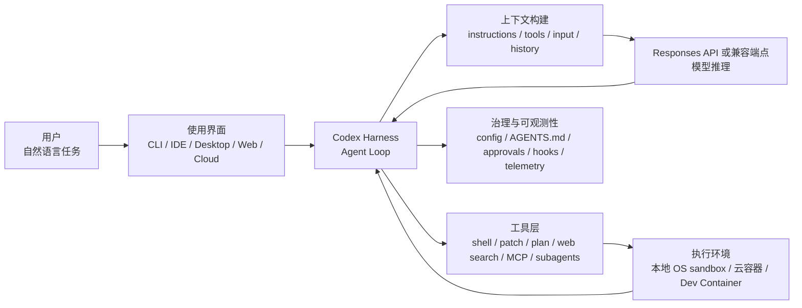
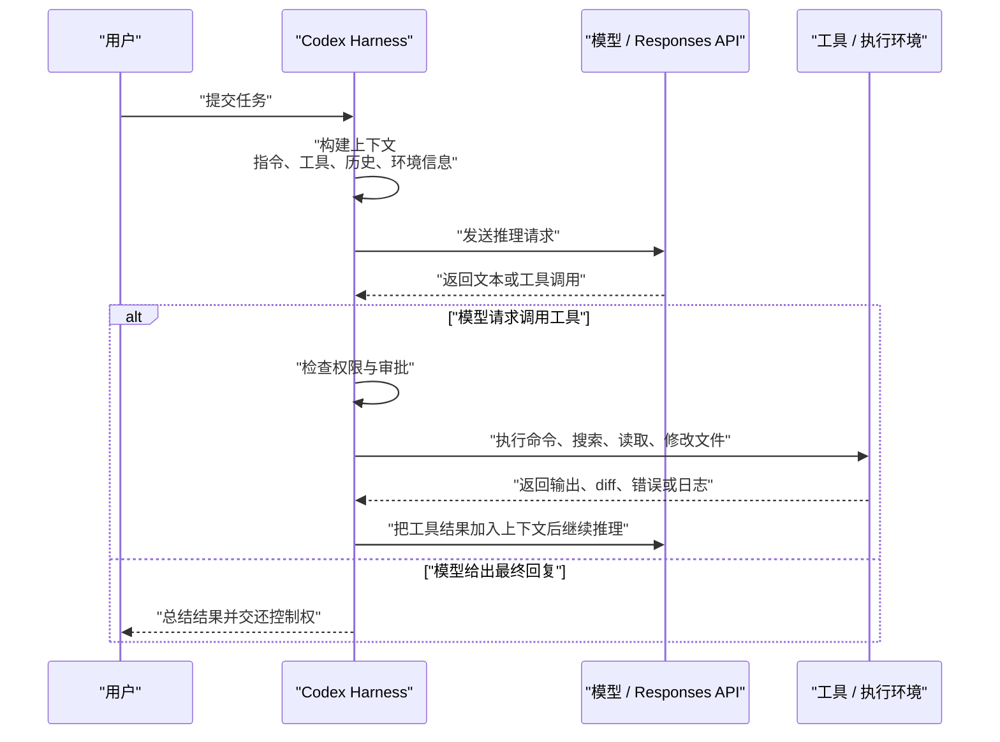

[toc]


我会先查阅 OpenAI 官方文档与仓库资料来校准“Codex”的当前形态、配置项和限制；随后按“架构、工作流、配置、故障排查、最佳实践”的顺序组织成一份适合初学者但也能支撑进阶排障的系统说明。

## 资料依据与知识日期

> 本文以 **2026-09-09** 查询到的 OpenAI 官方资料为依据，重点覆盖当前的 **OpenAI Codex coding agent**，也就是用于软件工程任务的智能体产品与本地/云端工具链。
>
> OpenAI 官方工程文章说明：当前“Codex”是一个软件智能体套件，包含 Codex CLI、Codex Cloud、VS Code extension 等形态；其核心是一个 agent harness，也就是负责组织用户、模型和工具交互的智能体运行框架。

为了避免读者混淆，本文中的 **Codex** 默认指当前的 **Codex coding agent**；若单独谈到模型，会明确写成 **model**、**Responses API**、**GPT-5.6** 等。

## 先给结论：Codex 到底是什么

Codex 可以理解为一个“面向软件工程的智能体运行系统”，而不是单纯的聊天机器人或代码补全模型。它把以下几件事组合在一起：

| 层次       | 英文术语                                   | 作用                                                         | 初学者应如何理解                   |
| ---------- | ------------------------------------------ | ------------------------------------------------------------ | ---------------------------------- |
| 模型       | Model                                      | 负责理解需求、规划、推理、生成代码或工具调用                 | “大脑”，但不直接操作你的机器       |
| 智能体框架 | Agent harness / Agent loop                 | 负责把用户请求、项目上下文、工具定义、历史记录组织成模型输入，并循环执行工具调用 | “调度器”和“工作流引擎”             |
| 工具       | Tools                                      | 包括 shell、文件修改、搜索、MCP 工具、浏览器或插件等         | “手脚”，模型通过它们观察和改变环境 |
| 执行环境   | Execution environment                      | 本地工作区、OS 沙盒、云端容器、Dev Container 等              | “施工现场”                         |
| 权限与审批 | Sandbox / Approval policy                  | 限制 Codex 能读写哪里、能否联网、何时必须询问用户            | “安全边界”                         |
| 配置系统   | Config layers                              | 由系统、用户、项目、profile、CLI 参数等多层配置共同决定行为  | “运行参数”                         |
| 项目指令   | AGENTS.md                                  | 给 Codex 的项目约定、测试命令、代码风格、审查规则            | “团队手册”                         |
| 扩展能力   | MCP / Skills / Hooks / Plugins / Subagents | 接外部工具、复用流程、自动化事件、并行分工                   | “插件生态和自动化系统”             |

OpenAI 官方 Codex CLI 文档把 Codex CLI 描述为可以在终端中检查代码、修改代码、运行命令和自动化重复工作的工具；它支持交互式使用，也支持 `codex exec` 这类面向脚本、CI、流水线的非交互模式。

## 建议阅读路线

如果你是初学者，建议按这个顺序理解：

| 阶段     | 你要掌握的问题                         | 对应核心内容                                   |
| -------- | -------------------------------------- | ---------------------------------------------- |
| 入门     | Codex 怎么把一句话变成代码修改？       | Agent loop、工具调用、上下文                   |
| 安全     | 为什么它有时要我批准？为什么不能联网？ | Sandbox、approval policy、network access       |
| 配置     | 为什么我改了配置没生效？               | 配置层级、profile、project trust、`CODEX_HOME` |
| 项目化   | 如何让 Codex 理解我的仓库？            | `AGENTS.md`、项目配置、测试和审查规则          |
| 扩展     | 如何接数据库、文档、浏览器、内部工具？ | MCP、plugins、skills、hooks                    |
| 进阶     | 如何排查“它为什么这样做”？             | `/status`、日志、OTel、最小复现、沙盒测试      |
| 团队使用 | 如何安全落地到真实工程流程？           | 分支、CI、权限最小化、审查、治理               |

## 整体架构图

下面是一个简化架构。真实实现会因 CLI、IDE、桌面应用、云端环境不同而有所差异，但核心思路类似：用户通过某个入口提交任务，Codex harness 构造模型请求，模型可能返回自然语言，也可能要求调用工具；工具结果再进入下一轮模型推理，直到任务结束。OpenAI 的工程文章把这一循环称为 **agent loop**，并说明它是 Codex CLI 中负责协调用户、模型和工具的核心逻辑。



## Codex 的主要运行形态

| 形态                           | 适合场景                                | 关键特点                                                     |
| ------------------------------ | --------------------------------------- | ------------------------------------------------------------ |
| Codex CLI                      | 终端开发、仓库修改、脚本化任务、CI 辅助 | 可运行本地命令、读写仓库、使用 `/status`、`/permissions`、`/model` 等命令 |
| Codex IDE extension            | 在 VS Code 等编辑器中使用               | 和编辑器上下文结合，CLI 与 IDE extension 共享配置层          |
| ChatGPT desktop app 中的 Codex | 本地项目、长任务、多项目管理            | 可在桌面应用中打开文件夹，让 Codex 读写选定目录              |
| Codex cloud                    | 云端执行任务、隔离环境、长任务          | 在 OpenAI 管理的隔离容器中运行，云环境有 setup phase 和 agent phase 的区别 |
| `codex exec`                   | 自动化、非交互、流水线                  | 更适合“完成后再报告”的任务，不适合频繁人工交互               |

OpenAI 的快速开始文档列出了 Codex 可用的主要表面，包括 ChatGPT desktop app、Remote、ChatGPT web、Codex CLI、Codex IDE extension 和 Codex cloud。

## Agent loop：Codex 是如何工作的

### 核心循环

Codex 的基本循环可以概括为：



OpenAI 官方解释中，模型推理的结果通常有两类：一种是直接给用户最终回答，另一种是请求工具调用；如果模型请求工具调用，agent 会执行工具，把工具输出附加到原始 prompt 中，再重新请求模型。这个过程会重复，直到模型不再发出工具调用，而是返回 assistant message。

### Prompt 不只是用户的一句话

很多故障排查都卡在一个误解上：用户以为 Codex 只看到了自己刚输入的一句话。实际上，Codex 发给模型的是一个结构化上下文，通常包含：

| 内容           | 英文术语                   | 例子                               | 谁提供                                 |
| -------------- | -------------------------- | ---------------------------------- | -------------------------------------- |
| 系统或基础指令 | System / base instructions | Codex 的默认行为规范、工具使用约定 | Codex 内置或 `model_instructions_file` |
| 开发者指令     | Developer instructions     | 沙盒说明、权限说明、项目约定       | Codex harness、配置、`AGENTS.md`       |
| 用户消息       | User input                 | “修复登录页报错”                   | 用户                                   |
| 工具定义       | Tool definitions           | shell、web search、MCP 工具        | Codex、Responses API、MCP server       |
| 历史消息       | Conversation history       | 之前的对话、工具调用、工具结果     | 会话状态                               |
| 环境上下文     | Environment context        | 当前目录、沙盒状态、网络状态       | Codex runtime                          |
| 压缩摘要       | Compaction                 | 长会话被压缩后的摘要和加密上下文   | Codex / Responses API                  |

OpenAI 的工程文章说明，Codex 使用 Responses API 驱动模型推理，请求中重点包含 `instructions`、`tools` 和 `input`：`instructions` 放模型指令，`tools` 放模型可调用工具列表，`input` 放文本、图片、文件等输入。

### 工具调用如何进入下一轮推理

当模型返回一个工具调用，例如读取文件、运行测试、搜索文档，Codex 并不是“盲目执行”。它会先经过权限策略和沙盒规则判断，然后执行工具，再把工具结果以 `function_call_output` 等形式加入后续请求。OpenAI 工程文章举例说明，后续请求会把之前的 reasoning、function call 和 function call output 一起纳入 `input`，让模型基于新信息继续工作。

### 每个 turn 都可能包含多次模型和工具往返

在 Codex 语境中，一次用户输入到一次最终回复之间的过程可以称为一个 **turn**，而 Codex 中的会话通常称为 **thread**。一个 turn 内部可能经历很多轮“模型推理、工具调用、工具结果、再推理”。OpenAI 文档指出，每当你在已有对话中发送新消息，历史消息和工具调用会作为新 prompt 的一部分继续参与后续推理，因此对话越长，prompt 也越长。

## Codex 的核心组成

### Model：推理与代码生成的大脑

模型负责：

- 理解任务目标。
- 阅读上下文。
- 规划步骤。
- 决定是否调用工具。
- 生成补丁、解释、测试策略和最终总结。
- 在需要时调用子代理或外部工具。

但要注意：**模型本身不会直接修改你的文件系统**。真正读写文件、运行命令、访问网络的是 Codex harness 暴露给模型的工具，且这些工具会受到沙盒和审批策略约束。

Codex CLI 的模型请求可以走不同 endpoint：使用 ChatGPT 登录时走 ChatGPT 后端的 Codex responses endpoint；使用 API key 和 OpenAI hosted models 时走 OpenAI Responses API；使用 `--oss` 和本地兼容环境时也可以指向本地 Responses API 兼容端点。

### Harness：真正的“智能体运行时”

**Agent harness** 是很多人最容易忽略、但最重要的部分。它负责：

| 职责        | 说明                                                         |
| ----------- | ------------------------------------------------------------ |
| 构造请求    | 把系统指令、用户消息、工具定义、环境信息、历史记录组合成模型请求 |
| 维护循环    | 模型要求工具调用时，执行工具并继续下一轮                     |
| 权限检查    | 根据 sandbox、approval、network policy 决定是否允许动作      |
| 状态管理    | 保存会话、历史、工具结果、压缩后的上下文                     |
| 上下文压缩  | 会话变长时触发 compaction，避免超过上下文窗口                |
| 工具注册    | 汇总内置工具、Responses API 工具、MCP 工具                   |
| UI 事件转发 | 把流式输出、工具调用、审批请求展示给 CLI 或 IDE              |
| 可观测性    | 记录日志、可选导出 OTel 事件                                 |

换句话说，Codex 的“聪明”不只来自模型，也来自 harness 对上下文、工具、权限和工程流程的组织。

### Tools：Codex 的手脚

常见工具包括：

| 工具类型     | 英文术语                     | 用途                                           | 风险点                                     |
| ------------ | ---------------------------- | ---------------------------------------------- | ------------------------------------------ |
| Shell 工具   | shell tool                   | 执行本地命令、运行测试、搜索文件               | 可能修改文件、读取敏感数据、联网           |
| 文件修改工具 | apply patch / file editing   | 修改代码、写文档                               | 可能误改无关文件                           |
| 计划工具     | plan tool / update_plan      | 展示和维护任务步骤                             | 计划不是强制约束，仍要审查结果             |
| Web search   | web search                   | 查询最新文档、外部信息                         | 可能受到 prompt injection 影响             |
| MCP 工具     | Model Context Protocol tools | 接外部服务、内部工具、文档、设计系统、数据库等 | MCP 工具不一定受 Codex 本地 shell 沙盒保护 |
| 子代理       | subagents                    | 并行探索、审查、测试、总结                     | 会消耗更多 token，写操作容易冲突           |
| 插件和技能   | plugins / skills             | 封装重复流程、连接团队工具                     | 需要治理来源和权限                         |

OpenAI 工程文章列出的 Codex 工具示例包括默认 shell 工具、内置 plan 工具、Responses API 提供的 web search 工具，以及通过用户 `~/.codex/config.toml` 配置的 MCP 工具。

### Execution environment：本地、云端与容器

| 环境           | 特点                               | 安全边界                                      |
| -------------- | ---------------------------------- | --------------------------------------------- |
| 本地 CLI / IDE | 使用你的本机文件、依赖、命令行工具 | OS-level sandbox 加 approval policy           |
| Codex cloud    | OpenAI 管理的隔离容器              | 云端容器隔离，setup phase 和 agent phase 分离 |
| Dev Container  | 由 Docker 或开发容器提供外层隔离   | 可让容器成为主要安全边界                      |
| WSL2           | Windows 上推荐的 Linux 语义环境    | 使用 Linux sandbox 语义                       |

OpenAI 安全文档说明：本地 Codex CLI 和 IDE extension 通过操作系统机制实施沙盒；默认通常关闭网络，写权限限制在 active workspace。Codex cloud 则运行在 OpenAI 管理的隔离容器中，setup 阶段可联网安装依赖，agent 阶段默认离线，且 cloud secrets 只在 setup 阶段可用，随后会在 agent 阶段前移除。

## Sandbox 与 Approval：最需要理解的安全模型

### 两个概念不要混淆

| 概念     | 英文术语        | 解决什么问题            | 例子                                               |
| -------- | --------------- | ----------------------- | -------------------------------------------------- |
| 沙盒     | Sandbox mode    | 技术上允许 Codex 做什么 | 是否能写文件、能写哪里、能否联网                   |
| 审批策略 | Approval policy | 什么时候需要问用户      | 写工作区外文件、联网、执行高风险命令时是否弹出确认 |

OpenAI 文档明确区分这两层：sandbox mode 决定 Codex 执行模型生成命令时技术上能做什么；approval policy 决定 Codex 何时必须暂停并请求批准，例如离开沙盒、使用网络或运行不在可信集合中的命令。

### 常用 sandbox 模式

| 模式       | 英文值               | 适合场景                                   | 行为理解                                                     |
| ---------- | -------------------- | ------------------------------------------ | ------------------------------------------------------------ |
| 只读       | `read-only`          | 阅读代码、解释项目、审查设计、不希望改文件 | 可以读文件和回答问题；修改、运行命令或联网通常需要批准       |
| 工作区写入 | `workspace-write`    | 日常开发、修 bug、写测试                   | 可在 workspace 内读写和运行命令；写 workspace 外或联网需要批准 |
| 完全访问   | `danger-full-access` | 仅限强隔离、可信环境                       | 没有 Codex 沙盒，风险高，不建议日常使用                      |

配置参考中，`sandbox_mode` 的取值包括 `read-only`、`workspace-write` 和 `danger-full-access`，它控制命令执行期间的文件系统和网络访问策略。

### 常用 approval 策略

| 策略       | 英文值       | 含义                                                         |
| ---------- | ------------ | ------------------------------------------------------------ |
| 保守审批   | `untrusted`  | 只自动运行已知安全的只读操作，可能改变状态或触发外部执行路径的命令需要批准 |
| 按请求审批 | `on-request` | 在需要越权、联网或执行特定风险动作时询问                     |
| 不询问     | `never`      | 不弹审批；动作若被沙盒禁止就失败，而不是询问                 |
| 细粒度策略 | `granular`   | 对 sandbox escalation、rules、MCP elicitation、request permissions、skill approval 等类别分别允许或自动拒绝 |

配置参考中，`approval_policy` 支持 `untrusted`、`on-request`、`never`，也支持 `granular` 对不同审批类别做细粒度控制。

### 常见组合

| 意图         | 配置或命令                                                   | 效果                                             |
| ------------ | ------------------------------------------------------------ | ------------------------------------------------ |
| 默认日常开发 | `sandbox_mode = "workspace-write"` 加 `approval_policy = "on-request"` | 能在仓库内工作，越界或联网时问你                 |
| 只读分析     | `sandbox_mode = "read-only"` 加 `approval_policy = "on-request"` | 适合让 Codex 解释项目、审查代码                  |
| 非交互只读   | `sandbox_mode = "read-only"` 加 `approval_policy = "never"`  | 适合 CI 中做只读分析                             |
| 自动审查审批 | `approval_policy = "on-request"` 加 `approvals_reviewer = "auto_review"` | 原本要问你的部分请求交给自动 reviewer agent 评估 |
| 高风险全自动 | `--dangerously-bypass-approvals-and-sandbox` 或 `--yolo`     | 无沙盒、无审批，不推荐                           |

OpenAI 文档的常见组合表说明：Auto preset 相当于 workspace-write 加 on-request；dangerous full access 代表无沙盒、无审批，并标记为不推荐。

### Auto-review 是什么

**Auto-review** 不是取消安全边界，而是把某些本来要问用户的审批请求交给一个 reviewer agent 自动评估。它只评估“已经需要审批”的动作，例如 sandbox escalation、被阻止的网络请求、`request_permissions` 请求、带副作用的 app 或 MCP 工具调用；仍在沙盒内的动作不会额外审查。OpenAI 文档还说明，auto-review 会检查数据外泄、凭证探测、持久性安全削弱和破坏性操作等风险，关键风险会被拒绝，失败时倾向 fail closed。

## 网络访问：为什么经常失败

### 默认网络通常是关的

在 ChatGPT desktop app、Codex CLI 或 IDE extension 中，默认 `workspace-write` 沙盒模式会关闭命令网络访问，除非你显式配置：

```toml
[sandbox_workspace_write]
network_access = true
```

OpenAI 安全文档明确说明，本地 `workspace-write` 默认关闭网络，需要通过 `[sandbox_workspace_write] network_access = true` 启用。

### `network_access` 和 `network_proxy` 是两回事

| 配置                                            | 作用                                    | 常见误解                                  |
| ----------------------------------------------- | --------------------------------------- | ----------------------------------------- |
| `sandbox_workspace_write.network_access = true` | 允许 workspace-write 中的命令有网络访问 | 只开 proxy 不会自动赋予网络               |
| `[features.network_proxy] enabled = true`       | 在已有网络访问基础上，用策略限制目的地  | 配了域名 allowlist 但没开网络，仍不能联网 |
| `features.network_proxy.domains`                | 配置允许或拒绝的域名                    | `deny` 优先于 `allow`                     |

OpenAI 文档说明：network proxy 改变“已启用网络访问时如何执行限制”，它本身并不授予网络访问；网络关闭加 proxy 开启时，网络仍然关闭；网络开启且 proxy 开启时，才会按配置的网络策略限制出站流量。

### Web search 不等于 shell 命令联网

这是排障高频点：Codex 的 **web search tool** 和 shell 命令的网络访问不是同一个东西。network proxy 过滤的是本地命令沙盒里运行的脚本、程序和子进程；它不直接过滤 web search、app/connector tool calls、MCP server 连接、browser、Computer Use、Codex cloud tasks，以及客户端自身的模型和认证请求。

因此：

- 你可以禁用 shell 联网，但仍允许 Codex 用 cached web search。
- 你可以允许 shell 联网，但 web search 仍可能按 `web_search` 配置走 cached、indexed、live 或 disabled。
- 你可以允许 MCP HTTP server，但这不代表模型生成的 shell 命令可以随意联网。

## 配置系统：为什么“我改了配置没生效”

### 配置文件位置

| 位置                             | 用途                                 |
| -------------------------------- | ------------------------------------ |
| `~/.codex/config.toml`           | 用户级默认配置                       |
| `.codex/config.toml`             | 项目或子目录级覆盖配置               |
| `~/.codex/<profile>.config.toml` | profile 文件，用 `--profile` 选择    |
| `/etc/codex/config.toml`         | Unix 上可能存在的系统级配置          |
| `requirements.toml`              | 组织或管理员强制约束，常见于受管设备 |

OpenAI 配置基础文档说明，Codex 会从多个位置读取配置：个人默认配置在 `~/.codex/config.toml`，项目级覆盖可以放在仓库的 `.codex/config.toml`；出于安全考虑，Codex 只会在你信任项目时加载项目 `.codex/` 层。

### 配置优先级

OpenAI 当前文档给出的优先级从高到低是：

| 优先级 | 来源                                                         |
| ------ | ------------------------------------------------------------ |
| 最高   | CLI flags 和 `--config` 覆盖                                 |
| 其次   | 项目配置 `.codex/config.toml`，从项目根到当前目录，越靠近当前目录优先级越高，仅限 trusted project |
| 其次   | 用 `--profile profile-name` 选择的 profile 文件              |
| 其次   | 用户配置 `~/.codex/config.toml`                              |
| 其次   | 系统配置 `/etc/codex/config.toml`                            |
| 最低   | 内置默认值                                                   |

OpenAI 配置文档明确列出了以上顺序，并说明如果项目被标记为 untrusted，Codex 会跳过项目范围的 `.codex/` 层，包括项目本地 config、hooks 和 rules。

### 项目配置不能覆盖所有东西

为了安全，项目本地 `.codex/config.toml` 不能覆盖一些“机器本地或宿主拥有”的敏感配置。例如 provider、auth、notification、profile selection、telemetry routing 等不应由仓库控制。配置参考说明，Codex 会忽略项目本地配置中的 `openai_base_url`、`chatgpt_base_url`、`model_provider`、`model_providers`、`notify`、`profile`、`profiles`、`experimental_realtime_ws_base_url`、`otel` 等键，这些应放在用户级配置中。

这意味着：如果你把 `model_provider` 或 OTel exporter 写进项目 `.codex/config.toml`，看起来 TOML 没错，但 Codex 仍可能忽略它。

## `AGENTS.md`：Codex 的项目说明书

### 它解决什么问题

`AGENTS.md` 用来告诉 Codex：

- 项目如何安装依赖。
- 如何运行测试和 lint。
- 代码风格和架构约定。
- 哪些目录不要碰。
- 修改后必须做哪些验证。
- PR 或 code review 应关注什么。

它是 **model-visible guidance**，也就是给模型看的软约束；它不等于沙盒，也不能替代安全策略。

### 发现与合并规则

Codex 启动时会构建一条 instruction chain。OpenAI 文档说明，Codex 会先读取全局范围，也就是 `CODEX_HOME`，默认 `~/.codex` 下的 `AGENTS.override.md` 或 `AGENTS.md`；然后从项目根目录一路走到当前工作目录，每层目录按 `AGENTS.override.md`、`AGENTS.md`、fallback filenames 的顺序最多取一个文件；最后从根到当前目录拼接，越靠近当前目录的指令出现在越后面，因此优先级更高。

| 文件                          | 作用                                                         |
| ----------------------------- | ------------------------------------------------------------ |
| `~/.codex/AGENTS.md`          | 全局个人习惯                                                 |
| `~/.codex/AGENTS.override.md` | 临时全局覆盖                                                 |
| `<repo>/AGENTS.md`            | 仓库级说明                                                   |
| `<repo>/subdir/AGENTS.md`     | 子目录级说明                                                 |
| `AGENTS.override.md`          | 在同一层优先于普通 `AGENTS.md`                               |
| fallback 文件名               | 可用 `project_doc_fallback_filenames` 指定，例如团队已有 `TEAM_GUIDE.md` |

Codex 会跳过空文件，并在合并后的指令达到 `project_doc_max_bytes` 限制时停止添加；默认限制是 32 KiB。

### 写好 `AGENTS.md` 的原则

推荐结构：

```markdown
## Project overview

简要说明项目用途、技术栈、关键目录。

## Setup

说明依赖安装和本地运行方式。

## Common commands

- 安装依赖：...
- 运行测试：...
- 运行 lint：...
- 类型检查：...

## Coding rules

列出最重要的架构约束和风格规则。

## Validation

说明修改不同类型文件后应运行哪些验证。

## Do not touch

说明禁止修改的目录、生成文件、密钥文件等。

## Code Review Rules

列出审查时应重点检查的业务或安全规则。
```

最佳实践：

- 保持短而准，不要把整本文档塞进去。
- 命令要可复制、可运行、少歧义。
- 把“必须执行”的验证写清楚，例如“修改后端 API 后运行某个测试套件”。
- 不要在 `AGENTS.md` 中放密钥、token、内部凭证。
- 不要把安全边界写成自然语言幻想，例如“不要访问网络”；真正的网络限制应靠 sandbox/network policy。
- 对大型仓库使用分层 `AGENTS.md`，而不是一个巨大根文件。
- 对 code review 规则，要写“要发现什么风险”和“安全替代路径”，不要只写抽象价值观。

## MCP：把 Codex 接到外部工具

### MCP 是什么

**MCP** 是 **Model Context Protocol**，可以把外部工具、数据源、服务能力暴露给 Codex。典型场景包括：

| 场景          | MCP 工具可能做什么                     |
| ------------- | -------------------------------------- |
| 文档查询      | 查询内部 API 文档、框架文档            |
| 设计系统      | 读取组件规范、设计 token               |
| 浏览器调试    | 获取 console、network、DOM、截图       |
| issue/PR 管理 | 查询 GitHub、Linear、Jira              |
| 数据分析      | 查询只读数据库或指标系统               |
| 内部平台      | 调用部署、日志、feature flag、实验平台 |

配置参考显示，MCP server 可以通过 `mcp_servers.<id>.command` 配置 stdio server 的启动命令，也可以通过 `mcp_servers.<id>.url` 配置 streamable HTTP server；还可以配置环境变量、HTTP headers、OAuth、启用/禁用工具、启动超时、单工具输出 token 限制等。

### MCP 排障重点

| 问题           | 常见原因                                                     | 排查方向                                          |
| -------------- | ------------------------------------------------------------ | ------------------------------------------------- |
| MCP 工具没出现 | server 启动失败、配置文件没加载、项目不 trusted、`enabled = false` | 先看 `/status` 和启动日志                         |
| 启动超时       | server 冷启动慢、依赖未安装                                  | 增大 `startup_timeout_sec`                        |
| 工具调用超时   | 工具本身慢                                                   | 增大 `tool_timeout_sec` 或拆分工具                |
| 权限弹窗太多   | MCP 工具声明有副作用，approval policy 要求确认               | 调整 per-tool approval mode，但不要绕过高风险工具 |
| 环境变量为空   | 没通过 `env` 或 `env_vars` 传给 stdio server                 | 检查变量来源和 shell 启动环境                     |
| HTTP 鉴权失败  | bearer token、headers、OAuth 配置不一致                      | 用环境变量注入，不要把 token 写进仓库             |

配置参考中，MCP 支持 `default_tools_approval_mode` 和每个工具的 `approval_mode`，取值包括 `auto`、`prompt`、`writes`、`approve`。

## Subagents：并行分工与上下文隔离

### 为什么需要子代理

复杂任务中，主线程很容易被大量搜索结果、测试日志、堆栈、探索笔记污染。OpenAI 的 subagents 文档把这类问题称为 **context pollution** 和 **context rot**：当主对话塞满不相关或低价值中间输出时，模型长期可靠性会下降。Subagent workflow 可以把探索、测试、日志分析等 noisy work 移出主线程，由子代理返回摘要给主代理。

适合子代理的任务：

- 大仓库初始探索。
- PR 多维度审查。
- 安全风险、测试缺口、可维护性分别检查。
- 并行阅读不同模块。
- UI 问题中分别让一个代理复现、一个代理读代码、一个代理写最小修复。
- 大文档拆分总结。

不太适合：

- 多个代理同时大范围写同一批文件。
- 需求尚未澄清就并行改代码。
- 强顺序依赖任务。
- 小任务，因为协调成本和 token 成本可能高于收益。

OpenAI 文档说明，当前本地 Codex releases 默认启用 subagent workflow；每个 subagent 会做自己的模型和工具工作，因此比单代理消耗更多 token。

### 子代理的权限继承

Subagents 通常继承当前 sandbox policy。交互式 CLI 中，即使你正在看主线程，来自非当前子代理线程的审批请求也可能弹出；非交互流程中，如果动作需要新的审批但无法弹出审批，该动作会失败，并把错误返回给父工作流。

### Custom agents

Codex 内置了 `default`、`worker`、`explorer` 等 agent。你可以在 `~/.codex/agents/` 放个人 custom agent，也可以在 `.codex/agents/` 放项目级 custom agent。每个 custom agent 文件至少要定义 `name`、`description` 和 `developer_instructions`；还可以包含 `model`、`model_reasoning_effort`、`sandbox_mode`、`mcp_servers`、`skills.config` 等配置。

一个适合初学者的思路是：

| Agent            | 权限                             | 用途                                           |
| ---------------- | -------------------------------- | ---------------------------------------------- |
| explorer         | read-only                        | 只读探索代码路径                               |
| reviewer         | read-only                        | 找 bug、安全风险、测试缺口                     |
| implementer      | workspace-write                  | 小范围修改代码                                 |
| docs researcher  | read-only 加文档 MCP             | 查证外部 API 或内部规范                        |
| browser debugger | workspace-write 或受限浏览器工具 | 复现 UI 问题、收集 console 和 network evidence |

## Hooks、Skills、Plugins：把流程变成可复用系统

### Skills

**Skills** 可以理解为可复用的操作说明和工作流包。适合封装：

- 固定 PR 审查流程。
- 发布说明生成流程。
- 前端视觉回归检查流程。
- 安全修复 checklist。
- 数据迁移 review checklist。

Codex CLI 文档提到，可以把重复指令打包成 skills，并通过 plugins 连接团队工具和数据。

### Hooks

**Hooks** 是生命周期事件上的自动化动作。配置参考中列出的事件包括 `PreToolUse`、`PermissionRequest`、`PostToolUse`、`PreCompact`、`PostCompact`、`SessionStart`、`SessionEnd`、`SubagentStart`、`SubagentStop`、`UserPromptSubmit`、`Stop`、`Interrupt` 等。

常见用途：

| Hook 事件           | 可能用途                   |
| ------------------- | -------------------------- |
| `SessionStart`      | 检查环境、提示分支状态     |
| `PreToolUse`        | 拦截危险命令、记录命令     |
| `PostToolUse`       | 收集测试结果、归档日志     |
| `PermissionRequest` | 记录审批请求，用于审计     |
| `PreCompact`        | 在上下文压缩前保存关键状态 |
| `SessionEnd`        | 输出总结、保存指标         |

注意：hooks 是强大的自动化入口，也可能引入额外风险。团队环境中要管理 hook 来源，避免项目仓库通过 hook 影响本机敏感行为。

## 上下文、缓存与压缩

### 为什么长会话会变慢或变差

Codex 会把越来越多的历史、工具调用和工具输出纳入后续请求。OpenAI 工程文章指出，对话增长会增加 prompt 长度，而每个模型都有 context window，包括输入和输出 token；agent 可能在一个 turn 中发出很多工具调用，从而消耗上下文窗口。

### Prompt caching 的关键是“前缀稳定”

OpenAI 工程文章说明，Codex 为了性能会利用 prompt caching；cache hit 依赖精确的 prefix match。因此静态内容，例如 instructions 和 examples，应该放在 prompt 前面；变量内容放后面。对 Codex 而言，中途改变 tools、model、sandbox configuration、approval mode 或 current working directory 都可能导致 cache miss。

实用建议：

- 不要在一个长会话中频繁切模型、切权限、切工具集。
- 任务差异很大时，新开 thread 比无限延长旧 thread 更可靠。
- MCP 工具列表要尽量稳定。
- 大量日志不要全部贴进主线程，优先让 Codex 读文件、总结，或用 subagent 处理。
- 对长任务使用阶段性总结和检查点。

### Compaction

当 token 超过阈值时，Codex 会进行 **compaction**，把原始长上下文替换成更小但能代表对话状态的 item list。OpenAI 工程文章说明，现在 Codex 会在超过 `auto_compact_limit` 时自动使用 `/responses/compact` endpoint 进行压缩，以释放上下文窗口。

Compaction 能提高续航，但不是万能的：细节可能被摘要化。如果任务涉及复杂代码修改，仍建议用 git checkpoint、测试结果、明确 TODO 文件等外部状态承载关键信息。

## 一个推荐的个人配置模板

下面是一个偏安全、适合日常开发的模板。模型名以你账户当前可用模型为准；官方文档中的示例模型可能会随版本变化。

```toml
# ~/.codex/config.toml

# 默认模型：以你的账户可用模型为准
model = "gpt-5.6"

# 大多数任务使用中等推理；复杂重构或审查可临时切 high
model_reasoning_effort = "medium"

# 日常开发：允许在工作区内读写和运行命令，越界或联网时询问
sandbox_mode = "workspace-write"
approval_policy = "on-request"

# 可选：把符合条件的审批请求交给自动 reviewer agent
# approvals_reviewer = "auto_review"

# 默认不建议开全局网络；需要时按项目或 profile 打开
[sandbox_workspace_write]
network_access = false

# Web search：默认 cached 更安全；需要最新信息时可临时用 --search
web_search = "cached"

# 可观测性：默认不导出
[otel]
exporter = "none"
log_user_prompt = false
```

如果某个项目确实需要联网安装依赖，可以用单独 profile，而不是把所有项目都设成可联网：

```toml
# ~/.codex/net-dev.config.toml

sandbox_mode = "workspace-write"
approval_policy = "on-request"

[sandbox_workspace_write]
network_access = true

[features.network_proxy]
enabled = true

[features.network_proxy.domains]
"registry.npmjs.org" = "allow"
"github.com" = "allow"
"api.github.com" = "allow"
```

运行时选择：

```bash
codex --profile net-dev
```

## 项目级配置建议

适合放进 `.codex/config.toml` 的内容：

```toml
# .codex/config.toml

# 项目希望的默认推理强度
model_reasoning_effort = "medium"

# 项目已有非标准说明文件时
project_doc_fallback_filenames = ["TEAM_GUIDE.md", "CONTRIBUTING.md"]
project_doc_max_bytes = 65536

# 项目内 custom agents 的并发上限
[agents]
max_concurrent_threads_per_session = 4
```

不建议放进项目配置的内容：

- 私人 API key。
- `model_provider`。
- `openai_base_url`。
- OTel exporter endpoint。
- 用户个人通知命令。
- 任何会让仓库影响你本机认证或网络出站的设置。

原因是官方配置参考已经明确：项目本地配置中的 provider、auth、notification、profile selection、telemetry routing 等宿主级配置会被忽略，应放在用户级配置。

## 进阶排障方法

### 先判断问题属于哪一层

| 现象                   | 更可能是哪层问题                                             |
| ---------------------- | ------------------------------------------------------------ |
| 模型答非所问           | prompt、`AGENTS.md`、上下文污染、模型选择                    |
| 配置没生效             | 配置层级、profile、`CODEX_HOME`、项目 trust                  |
| 一直要审批             | sandbox、approval policy、admin requirements                 |
| 无法联网               | `network_access`、network proxy、域名 allowlist、web search 与 shell 网络混淆 |
| MCP 工具不可用         | MCP server 配置、启动命令、环境变量、OAuth、timeout          |
| 文件写不了             | workspace root、protected path、read-only sandbox            |
| git commit 失败        | `.git` 在 workspace-write 下受保护，或命令需要审批           |
| Windows 行为异常       | WSL2/native sandbox 差异、权限、WSL1 不支持                  |
| Docker 内 sandbox 失败 | `bwrap`、namespace、seccomp 能力不足                         |
| 长会话变慢             | context 过长、cache miss、工具集变化、compaction             |

### 推荐排障流程

| 步骤                | 目标                        | 做法                                                       |
| ------------------- | --------------------------- | ---------------------------------------------------------- |
| 固定版本和环境      | 排除“版本变了”的影响        | 记录 Codex 版本、OS、shell、当前目录、登录方式             |
| 查看当前状态        | 确认 Codex 实际加载了什么   | 在 CLI 中用 `/status` 查看模型、权限、workspace            |
| 验证配置来源        | 确认是否编辑了正确文件      | 检查 `~/.codex/config.toml`、profile、`.codex/config.toml` |
| 排除 `CODEX_HOME`   | 防止改错 home               | 运行 `echo $CODEX_HOME`                                    |
| 排除项目 trust      | 确认项目配置是否会被加载    | 如果项目 untrusted，`.codex/` 层会被跳过                   |
| 最小复现            | 只保留最小配置              | 临时换空的 `CODEX_HOME` 或禁用 MCP/hooks                   |
| 逐层加回            | 找到导致故障的层            | 依次加 user config、profile、project config、MCP、hooks    |
| 看日志和 transcript | 找到实际加载和失败点        | 使用 log 设置或检查 session 记录                           |
| 单测沙盒            | 验证命令是否被 sandbox 拦截 | 使用 `codex sandbox macos/linux/windows` 辅助命令          |

OpenAI 安全文档说明，Codex CLI 提供 `codex sandbox macos`、`codex sandbox linux`、`codex sandbox windows` 等命令来测试命令在沙盒下的行为；`sandbox` 命令也可作为 `codex debug` 使用。

## 高频故障与解决表

| 问题                                    | 典型原因                                                  | 解决建议                                                     |
| --------------------------------------- | --------------------------------------------------------- | ------------------------------------------------------------ |
| `.codex/config.toml` 完全没生效         | 项目未 trusted                                            | 信任项目，或把必须生效的设置放到用户级配置                   |
| 改了 `AGENTS.md` 但 Codex 还按旧规则做  | 当前 session 已启动，instruction chain 未重建             | 重启 Codex 或新开命令；Codex 会在每次 run 或 TUI session 开始时重建 instruction chain |
| fallback 文件没被识别                   | 没写入 `project_doc_fallback_filenames`，或改完没重启     | 检查拼写，重启 Codex                                         |
| 指令被截断                              | `project_doc_max_bytes` 达到上限                          | 提高上限，或把指令拆到更靠近子目录的位置                     |
| 一直问能不能运行命令                    | `approval_policy` 太保守，或 `sandbox_mode = "read-only"` | 日常开发用 `workspace-write` 加 `on-request`；非交互用 `never` 但保留沙盒 |
| 设置 `approval_policy = "never"` 不生效 | 管理员 requirements 禁止                                  | 检查受管配置或组织策略                                       |
| 网络还是不通                            | 只配置了 `network_proxy`，没开 `network_access`           | 同时确认 `[sandbox_workspace_write] network_access = true`   |
| 配了 allowlist 但任意网络都能访问       | 开了 `network_access` 但没启用 `features.network_proxy`   | 启用 network proxy，并写明确 domain allowlist                |
| 本地服务访问失败                        | 默认阻止 loopback、link-local、private destinations       | 精确允许 `localhost` 或特定本地 IP；不要随便开宽泛 private access |
| MCP server 启动失败                     | command 路径、cwd、env、timeout 错                        | 用绝对路径、检查 env、增加 `startup_timeout_sec`             |
| 子代理改文件冲突                        | 并行 write-heavy workflow                                 | 让子代理读多写少，主代理统一实施修改                         |
| Docker 中 Codex sandbox 报错            | 容器缺少 namespace、setuid `bwrap` 或 seccomp 能力        | 用 Dev Container 提供外层隔离；必要时在容器内以 `danger-full-access` 运行，但只限可信仓库 |
| Windows 上行为和 Linux 不一致           | native Windows sandbox 与 WSL2 语义不同                   | 优先使用 WSL2；OpenAI 文档也建议 IDE extension 可配置在 WSL2 中运行 |
| 日志/OTel 没数据                        | OTel 默认关闭，或网络不允许导出                           | 配置 `[otel]`，并允许到 collector 的网络访问                 |

OpenAI 的 `AGENTS.md` 文档还给出了一组 discovery 排障建议：如果没有加载，检查仓库和 workspace root、文件是否为空；如果加载了错误指令，检查更高层的 `AGENTS.override.md`；如果 fallback 名称被忽略，检查配置拼写并重启；如果 profile 混乱，检查 `CODEX_HOME`。

## OS-level sandbox 的平台差异

| 平台           | 沙盒机制                                        | 注意事项                                                     |
| -------------- | ----------------------------------------------- | ------------------------------------------------------------ |
| macOS          | Seatbelt policies，通过 `sandbox-exec` 执行命令 | 可用 macOS sandbox helper 测试拒绝原因                       |
| Linux          | 默认使用 `bwrap` 加 `seccomp`                   | Docker、受限容器、企业环境可能缺少所需能力                   |
| Windows WSL2   | 使用 Linux sandbox 语义                         | 推荐在 IDE 中让 Codex 运行于 WSL2                            |
| Windows native | 使用 Windows sandbox implementation             | 可在 `[windows]` 中配置 `sandbox = "elevated"` 或 `unelevated` |

OpenAI 安全文档说明，macOS 使用 Seatbelt，Linux 默认使用 `bwrap` 和 `seccomp`；Windows 在 WSL2 中使用 Linux sandbox 实现，WSL1 从 Codex 0.115 开始不再支持，native Windows 使用 Windows sandbox implementation。

## 版本控制与工程流程最佳实践

### 让 Codex 在可回滚的状态下工作

OpenAI 安全文档建议，Codex 最适合配合版本控制工作流使用：在 feature branch 上工作，委托前保持 `git status` 干净；优先使用 patch-based workflow，频繁提交，方便小步回滚；把 Codex 的建议当作 PR 一样审查、验证并记录决策。

建议流程：

- 新建 feature branch。
- 保持 working tree 干净后再交给 Codex。
- 先让 Codex 解释计划，不急着改。
- 小步修改，小步测试。
- 查看 diff。
- 运行 targeted tests。
- 必要时让另一个 read-only reviewer agent 审查。
- 人类最终 review 后再合并。

### 不要把 `--yolo` 当默认模式

`--dangerously-bypass-approvals-and-sandbox` 或 `--yolo` 适合非常特殊的环境，例如你已经在强隔离容器里，容器内没有敏感凭证，仓库完全可信，并且你愿意承担内部全访问风险。OpenAI 文档把 dangerous full access 标为 no sandbox、no approvals、not recommended。

更好的日常默认值是：

```toml
sandbox_mode = "workspace-write"
approval_policy = "on-request"
```

如果你嫌审批太多，可以考虑：

```toml
approval_policy = "on-request"
approvals_reviewer = "auto_review"
```

而不是直接无沙盒运行。

## 给自定义配置用户的心智模型

排查 Codex 自定义配置时，建议记住下面这几个“硬规则”：

| 规则                                 | 解释                                                         |
| ------------------------------------ | ------------------------------------------------------------ |
| 配置比提示词硬                       | `config.toml`、sandbox、approval 是运行时策略，`AGENTS.md` 只是模型可见指令 |
| 安全边界不能靠自然语言               | “不要联网”应写进 network policy，而不是只写进 `AGENTS.md`    |
| 项目配置受 trust 控制                | untrusted project 会跳过项目 `.codex/` 层                    |
| 项目配置不能控制宿主敏感项           | provider、auth、telemetry routing 等应放用户级               |
| MCP 工具不是普通 shell               | MCP server 要自己做好权限、鉴权和副作用声明                  |
| web search 不等于 shell network      | 两者配置和安全边界不同                                       |
| 子代理会继承权限，但也会放大并发风险 | 读任务适合并行，写任务要谨慎                                 |
| 长会话不是越长越好                   | 上下文污染、cache miss 和 compaction 都会影响表现            |
| 组织策略可能覆盖个人偏好             | 受管设备上 requirements 可能禁止 `never` 或 `danger-full-access` |

## 一份实用的学习大纲

如果你要系统掌握 Codex，建议按下面大纲学习和实践。

### 基础概念

- 当前 Codex 与旧 Codex language model 的区别。
- Codex CLI、IDE extension、desktop、cloud 的区别。
- Agent、thread、turn、tool call、assistant message。
- Model、harness、tool、sandbox 的职责分离。

### Agent loop

- 用户输入如何变成 Responses API 请求。
- `instructions`、`tools`、`input` 的含义。
- 模型如何发出 function call。
- 工具结果如何进入下一轮推理。
- turn 结束条件是什么。
- 为什么每次新消息都会带上历史上下文。

### 工具系统

- shell tool。
- patch/file editing。
- plan tool。
- web search。
- MCP tools。
- plugins 和 skills。
- subagents。
- browser 或 computer use 相关能力。

### 安全模型

- `sandbox_mode`。
- `approval_policy`。
- `approvals_reviewer`。
- network access。
- network proxy。
- protected paths。
- cloud setup phase 与 agent phase。
- Dev Container 隔离。
- OS-level sandbox 差异。

### 配置系统

- 用户级、项目级、profile、系统级配置。
- 配置优先级。
- project trust。
- `CODEX_HOME`。
- `--config` 一次性覆盖。
- 哪些 key 不能放项目级。
- 受管配置和 requirements。

### 项目指令

- `AGENTS.md` discovery。
- `AGENTS.override.md`。
- fallback filenames。
- `project_doc_max_bytes`。
- code review rules。
- 指令分层策略。
- 如何验证 Codex 加载了哪些说明。

### 扩展与自动化

- MCP server 配置。
- MCP 鉴权和 tool approval。
- custom agents。
- subagent 并发上限。
- skills。
- hooks。
- non-interactive `codex exec`。
- GitHub Action 或 CI 场景。

### 可观测性与排障

- `/status`。
- logs。
- session transcript。
- OTel。
- sandbox helper。
- 最小复现。
- cache miss 分析。
- compaction。
- 网络策略验证。
- MCP server startup 诊断。

## 最后总结

Codex 的本质不是“会写代码的聊天框”，而是一个由 **模型、agent loop、工具、沙盒、审批、配置、项目指令和扩展生态**共同构成的软件工程智能体系统。初学者只要先掌握三条主线，就能少踩很多坑：

- **工作流主线**：用户任务进入 Codex，Codex 构造上下文，模型推理，模型调用工具，工具结果回到上下文，循环直到最终回复。
- **安全主线**：sandbox 决定能做什么，approval policy 决定何时问你，network policy 决定能访问哪里。
- **配置主线**：CLI 覆盖、项目配置、profile、用户配置、系统配置和管理员要求共同决定最终行为；`AGENTS.md` 是给模型看的项目说明，不是安全边界。

如果你要进阶，重点不要只学“怎么提示 Codex”，还要学“Codex harness 如何组织上下文、如何加载配置、如何执行工具、如何受沙盒约束”。理解这些之后，大多数自定义配置故障都会变成可定位、可复现、可修复的问题。