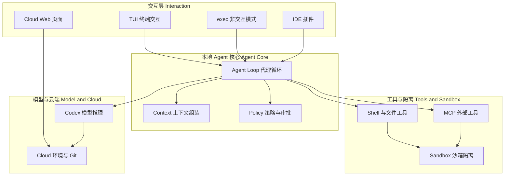
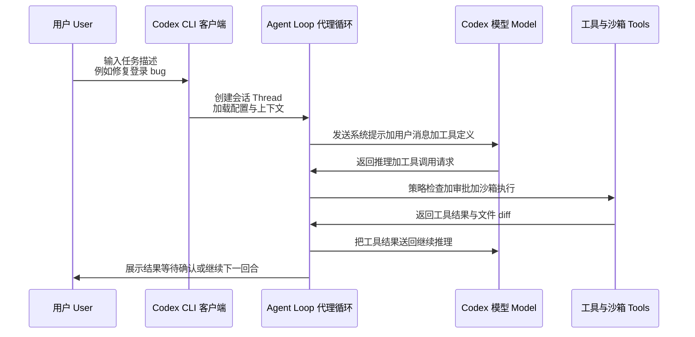

[toc]


## 阅读前说明：Codex 指的是什么，如何读这篇介绍

Codex 这个词现在有多重含义，初学者最容易在这里混乱，先统一语境：

- **Codex CLI (命令行工具)**：运行在你本机的开源客户端，是本文的重点，也是进阶和排障的主战场。
- **Codex IDE 扩展 (IDE Extension)**：VS Code / Fork 等编辑器插件，复用同一套 Agent 核心，只是交互层不同。
- **Codex Cloud / Web (云端任务)**：在 ChatGPT 侧边栏或 openai.com 的 `codex` 页面发起的异步任务，运行在云端环境 (Environment)，会自动同步 GitHub。
- **Codex 模型 (Model)**：如 `gpt-5.1-codex` 系列，为代理式编程优化的模型。后端一般走 Responses API (响应接口)。

一句话理解：**本机客户端负责交互、组装上下文、调度工具和守住安全，云端模型负责推理和决策，工具与沙箱负责真正改文件和跑命令。**

阅读路径建议：

- 初学者：重点看总览、交互入口、一次任务的生命周期、安全模型。
- 进阶用户：重点看上下文工程、工具系统、配置系统、会话与日志。
- 排障用户：直接看配置加载优先级、认证、日志位置和故障速查表，配合 `codex status` 和日志定位。

> Codex 迭代非常快，命令参数和配置文件键名会变。本文基于截至 2026 年初的公开实现整理，原理长期有效，细节请以 `openai/codex` 仓库和 `codex --help` 为准。关键术语会标注英文。

## 总览：Codex 由哪些部分组成

| 分层         | 英文                    | 职责                                             | 初学者需要记住什么                         |
| ------------ | ----------------------- | ------------------------------------------------ | ------------------------------------------ |
| 交互层       | Interaction Layer       | 终端界面 TUI、非交互 `exec`、IDE 插件、Cloud Web | 你在哪里下指令，历史和展示就跟哪里走       |
| Agent 核心   | Agent Core / Agent Loop | 回合循环、规划、调用工具、压缩历史               | 大脑的思考节拍，出错多半是上下文或策略问题 |
| 上下文层     | Context Layer           | AGENTS.md、Skills、记忆、对话历史、文件内容      | 给模型的全部背景资料，决定它懂不懂你的项目 |
| 工具与执行层 | Tools & Execution       | Shell、文件编辑、MCP 工具、网络搜索              | 模型的双手，能做什么取决于工具是否启用     |
| 安全与隔离层 | Sandbox & Approvals     | 沙箱、审批策略、网络策略                         | 防止误删和误执行，进阶必懂                 |
| 配置与状态层 | Config & State          | config.toml、认证、会话、日志                    | 自定义故障 80% 在这里                      |
| 模型与云端   | Model & Cloud Backend   | 推理模型、云端环境、Git 同步                     | 模型名会变，认证方式决定计费和权限         |

适合用示意图理解的系统结构如下：



理解要点：

- 本地 CLI 即使断网展示界面还在，但没有模型就无法继续推理。
- 工具调用一定经过策略检查，再经过沙箱，才真正执行。
- Cloud 任务可以看作把整套本地核心搬到了云端虚拟机，再加了 Git 同步。

## 交互入口与运行模式

很多人只用过终端问答，其实 Codex 有四种常用入口，适用场景完全不同：

| 入口       | 典型命令或位置            | 特点                                     | 适合场景                     |
| ---------- | ------------------------- | ---------------------------------------- | ---------------------------- |
| 交互式 TUI | `codex`                   | 全屏终端界面，可查看推理、diff、审批按钮 | 日常开发、逐步确认           |
| 非交互执行 | `codex exec "帮我修测试"` | 一次性执行，适合脚本和 CI                | 自动化、批量任务             |
| IDE 扩展   | 编辑器侧边栏              | 能直接读编辑器选中内容，diff 展示更好    | 重构、边看边改               |
| Cloud 任务 | 网页端 New Task           | 异步并行，可同时跑多个任务，自动提 PR    | 大任务、并行探索、不想占本机 |

常用运行参数模式：

- 日常稳妥：工作区可写沙箱 (workspace-write) + 需要时审批 (on-request)
- 只读探索：只读沙箱 (read-only) + 让它先看代码解释方案
- 无人值守脚本：严格限制目录 + 明确提示词 + 事后看 rollout 日志复核
- 危险模式：完全访问 (danger-full-access) 只在一次性容器或你完全信任时用

最佳实践：默认不要用完全访问。用只读先探索，用工作区写做修改，用 Git 做兜底。`git status` 干净再让 Agent 大改，是成本最低的后悔药。

## 核心工作流：一次任务的生命周期

以你在终端输入一句话为例，背后发生的事情可以分为七步：



分步解释：

- **会话创建 (Thread / Session)**：每次 `codex` 新开就是一个 Thread，包含多轮 Turn。历史会写入本地，方便恢复和审计。
- **上下文组装 (Context Assembly)**：把系统提示、AGENTS.md、Skills 说明、当前目录文件摘要、对话历史拼成一次模型请求。
- **推理与工具规划 (Reasoning & Planning)**：模型决定是直接回答，还是先查文件、跑命令、再改代码。
- **工具调用 (Tool Call)**：不是模型直接改文件，而是发出结构化调用请求，由本地执行器真正执行。
- **策略与执行 (Policy & Execution)**：每次调用都要过审批策略和沙箱，拒绝或放行。
- **结果回填 (Observation)**：工具输出作为新的消息回给模型，模型再决定下一步。
- **终止与交付 (Completion)**：模型认为完成则总结，等待你确认、继续追问或回滚。

核心原理记住一条：**Agent 不是一次生成答案，而是一个 ReAct 循环：推理、行动、观察、再推理，直到任务结束或你打断。**

## Agent 核心与推理机制

Agent 核心可以理解为一个不知疲倦但需要约束的初级工程师，工作节拍是 Turn (回合)。

主要概念：

- **Turn (回合)**：一次模型请求到工具结果返回的闭环。一个任务通常由几到几十个 Turn 组成。
- **Rollout (执行记录)**：每一 Turn 做了什么、调了什么工具、输出是什么的完整流水账，是排障第一手资料。
- **Compaction / Summarization (上下文压缩)**：对话太长放不下模型窗口时，自动把旧历史总结成摘要，保留关键结论，丢弃细节。长任务突然变笨，多半是压缩丢了信息。
- **隐藏与显式推理 (Hidden vs Shown Reasoning)**：为可读性，TUI 默认只展示摘要，完整推理可在配置中打开。排障时打开有助于看它为什么调错工具。
- **停止条件**：任务完成、工具连续失败、上下文超限、你手动中断、审批被拒绝。

进阶需要理解的权衡：

- 上下文给得越多，模型越懂项目，但越贵、越慢、越容易触发压缩。
- 步骤切得越小，成功率越高。让它一次性重构整个仓库，不如拆成先定位、再复现、再小步修复、再跑测试。
- 模型有温度和不确定性，同一提示多次运行结果不同。重要操作要求它先给出计划和 diff，确认后再执行。

## 工具系统与执行能力

工具是 Codex 的双手，没有工具它只能聊天，有了工具才能改代码。

内置三类能力：

- **文件工具**：读、写、打补丁、搜索、查看目录。写操作一般会生成可审查的 diff。
- **执行工具**：跑 Shell 命令、跑测试、跑构建。这是威力最大也最危险的一类，受沙箱管得最严。
- **增强工具**：网络搜索、图片读取、云端任务联动等，按需开启。

外挂能力靠两个机制扩展：

| 扩展机制       | 英文                        | 是什么                                                       | 例子                                                    |
| -------------- | --------------------------- | ------------------------------------------------------------ | ------------------------------------------------------- |
| 模型上下文协议 | Model Context Protocol, MCP | 给 Agent 加外部工具的标准接口，可接本地命令或远程服务        | 数据库查询、Figma 读取、线性任务管理、Playwright 浏览器 |
| 技能           | Skills                      | 一组目录加 `SKILL.md` 说明，告诉 Agent 什么时候用什么流程和脚本 | PDF 处理、品牌文案规范、团队发布流程                    |

选择指南：

- 需要调外部 API 或私有系统，用 MCP。
- 需要沉淀团队经验和固定流程，用 Skills。
- 两者可以叠加：Skill 里声明需要哪个 MCP 工具，Agent 到时自动组合。

实用建议：MCP 不要贪多。三到五个稳定可用的远胜十几个经常超时的。每个 MCP 都要明确命令、环境变量和超时，排障时先单独禁用一半，二分定位。

## 上下文工程：AGENTS.md、记忆与 Skills

上下文质量直接决定 Codex 是神队友还是捣乱者。优先级从高到低大致是：系统提示、开发者指令、AGENTS.md、Skills、会话历史、工具返回的文件内容。

重点讲三个文件：

**AGENTS.md (项目指令)**

- 放在仓库根目录，子目录可以再放一份覆盖或补充，内层更具体优先。
- 写给 Agent 看的项目说明书：怎么构建、怎么测试、代码风格、不要动哪些目录。
- 最佳实践是短而硬：只写经常被做错的五到十条，配具体命令，不要写空话。
- 例子思路：构建用 `npm run build` 而不是 `tsc`，提交前必须跑 `npm test`，不要修改 `migrations` 下已发布文件。

**记忆 (Memory)**

- 分为全局记忆和项目记忆，用于记住你的偏好，如注释用中文、提交信息格式。
- 不要把机密写进记忆，记忆会被拼进每次请求。

**Skills (技能)**

目录结构一般是：

- `~/.codex/skills/xxx/SKILL.md` 全局可用
- `.codex/skills/xxx/SKILL.md` 仅本项目可用

`SKILL.md` 包含名称、描述和使用条件。描述要写清楚触发词，例如当用户说处理 PDF 或合并发票时使用本技能。Agent 会按需加载详细说明，而不是每次全量加载，节省上下文。

上下文过载的信号：回答变慢、开始胡编文件路径、忘记你刚说的约束。这时应该新开会话、精简 AGENTS.md、减少启用的 MCP 和 Skills。

## 安全模型：沙箱与审批

这是进阶和排障必须吃透的一张表。沙箱管能碰哪里，审批管要不要问你。

沙箱模式 (Sandbox Mode) 常见三档：

| 模式       | 含义               | 写权限                         | 网络         | 适用             |
| ---------- | ------------------ | ------------------------------ | ------------ | ---------------- |
| 只读       | read-only          | 只能读，不能写和执行副作用命令 | 一般受限     | 先看代码、做方案 |
| 工作区可写 | workspace-write    | 可写当前工作区，工作区外只读   | 受限或按配置 | 日常开发默认     |
| 完全访问   | danger-full-access | 几乎不隔离                     | 放开         | 仅一次性容器     |

审批策略 (Approval Policy / Ask-for-approval) 常见四档：

| 策略       | 含义                 | 体感                         |
| ---------- | -------------------- | ---------------------------- |
| untrusted  | 只对不可信内容严格   | 相对宽松但保留底线           |
| on-failure | 失败时才问           | 自动化常用                   |
| on-request | 模型觉得有风险就问你 | 日常推荐，平衡效率和安全     |
| never      | 从不问，直接执行     | 只在沙箱 + 容器 + 可回滚时用 |

两者是正交的，可以组合。最常见的误解是开了工作区可写就以为万事大吉，其实删工作区外的文件、发网络请求、读 `~/.ssh` 这类行为还会被额外拦截。

底层实现差异：

- macOS 多用 Seatbelt，Linux 多用 Bubblewrap / 容器 / Docker，Windows 能力相对弱，行为会有差异，跨平台排障要先确认操作系统。
- Git 操作、网络访问、提升权限命令通常有单独开关，即使沙箱放开也可能被拒绝，这是正常的纵深防御。

最佳实践：

- 长期保持工作区干净，`git init` 的项目更容易做 diff 审查和回滚。
- 让 Agent 跑 `rm -rf`、`git push --force`、数据库迁移前必须人工确认。
- 给 CI 用的 `exec` 模式宁可多限制目录和网络，事后看日志也安心。

## 模型与后端服务

模型层可以简单理解为可以换的大脑，接口层是统一的翻译官。

- **模型选择 (Model)**：配置里如 `model = "gpt-5.1-codex"`，轻量任务可用 mini 系列省钱省时，复杂重构用完整版。名字会迭代，不要硬背，错了会报模型不存在，换回默认即可。
- **推理力度 (Reasoning Effort)**：有的版本允许调高推理深度，难题调高，简单任务调低省时间。
- **服务后端 (Provider)**：走 OpenAI 第一方还是兼容第三方，需要配置 base URL 和 key。地址配错最常见的报错就是 401 / 404 / 超时。
- ** Responses API**：新一代 Codex 多走这个接口，原生支持工具调用和推理管理，比老 Chat Completions 更适合 Agent。

省钱省时的技巧：先用小模型做定位和看代码，确认方案后再切大模型执行大改。长会话及时另起新会话，避免带着几万 Token 的历史做小事。

## 配置系统详解：进阶必读

这是自定义故障的重灾区。先记住一句话：**Codex 的行为等于默认值加配置文件加环境变量加命令行覆盖，谁离命令行越近谁赢。**

常见文件位置总览：

| 路径                                 | 用途                         | 备注                   |
| ------------------------------------ | ---------------------------- | ---------------------- |
| `~/.codex/config.toml`               | 主配置，全局生效             | 改错这里影响所有项目   |
| `.codex/config.toml` 或项目级覆盖    | 项目私有配置                 | 适合团队统一模型和 MCP |
| `~/.codex/auth.json`                 | 登录凭证                     | 不要手动改，不要分享   |
| `~/.codex/AGENTS.md`                 | 全局指令                     | 个人偏好放这里         |
| `./AGENTS.md`                        | 项目指令                     | 可多层嵌套             |
| `~/.codex/skills` 和 `.codex/skills` | 全局和项目技能               | 目录名即技能名         |
| `~/.codex/sessions`、`~/.codex/log`  | 会话和日志                   | 排障用，不建议手改     |
| `CODEX_HOME` 环境变量                | 改变上面 `~/.codex` 的根位置 | 多账号或隔离测试用     |

加载优先级从低到高一般是：

- 内置默认值
- 全局 `config.toml`
- 项目级配置
- 环境变量
- 命令行 `-c key=value` 和 `--profile`

也就是说，命令行能救急：配置文件写崩了，先用命令行覆盖跑起来，再慢慢修文件。

一个精简但现代的 `config.toml` 思路示例：

```toml
model = "gpt-5.1-codex"
approval_policy = "on-request"
sandbox_mode = "workspace-write"

[tui]
show_raw_agent_reasoning = false

[tools]
web_search = true

[mcp_servers.my-db]
command = "npx"
args = ["-y", "my-db-mcp"]
env = { "DB_URL" = "postgres://localhost/app" }
startup_timeout_sec = 15
tool_timeout_sec = 60
```

要点：

- TOML 对引号、等号、缩进敏感，改前先备份，改后用 `codex status` 验证。
- MCP 的 `command` 必须在 PATH 里，`npx`、`uvx`、`docker` 这类启动器最容易出找不到命令或首次下载卡住的问题。
- 超时要分开设：启动超时给拉包留时间，工具超时给慢查询留时间，但都不要设太大，否则卡住很久才报错。
- 团队共享配置只放非机密，key 和 token 一律走环境变量。

Profile (配置档) 是进阶利器：

- 在配置里定义 `[profiles.review]` 用只读加严格审批，`[profiles.ship]` 用工作区可写，平时用 `--profile review` 一键切换。
- 排障时用最小 profile 启动，能快速判断是主配置污染还是项目配置污染。

## 身份与认证

常见两种登录方式：

| 方式             | 英文        | 特点                                        | 故障信号                                    |
| ---------------- | ----------- | ------------------------------------------- | ------------------------------------------- |
| ChatGPT 订阅登录 | OAuth Login | 用 Plus / Pro / Team 订阅额度，适合交互开发 | 提示过期、订阅无 Codex 权限、需重新 `login` |
| API Key          | API Key     | 按量计费，适合 CI 和自动化                  | 401 无效 key、403 无模型权限、404 模型名错  |

排查顺序：先看 `codex login status` 或 `codex status`，再看 key 是否过期、环境变量是否被 shell 覆盖、代理是否劫持了请求。公司网络下优先怀疑代理和自签证书，家用网络下优先怀疑 key 和模型名。

不要把 `auth.json` 发给别人，不要把 key 写进 `config.toml` 明文提交到 Git。用 `OPENAI_API_KEY` 环境变量或系统钥匙串是更干净的做法。

## 本地状态、会话与可观测性

Codex 是可审计的，每一步都有迹可循，这是它比纯聊天可靠的原因。

- **会话文件 (Session Files)**：`sessions` 下按时间存的 JSONL，记录每轮输入输出，支持恢复继续。
- **Rollout 日志 (Rollout Log)**：比界面展示更全，包含工具参数和原始输出，复现 bug 靠它。
- **TUI 日志 (TUI Log)**：界面卡死、渲染异常、快捷键无效时看它，配合 `RUST_LOG=debug` 能看到更细的调度。
- **诊断命令**：`codex --version`、`codex status`、`codex mcp list` 是排障三件套，分别确认版本、配置生效情况、MCP 是否能启动。

建议开启的好习惯：重要任务结束后把会话 ID 记下来，提 issue 或复盘时直接贴对应 rollout 片段，比口头描述准得多。

## 云端任务与本地协同

Cloud 不是本地的替代，而是分工：

- 本地适合需要看本地文件、跑本地服务、快速迭代的任务。
- Cloud 适合耗时长、可并行、不依赖你本机环境的任务，如同时试三种方案、批量修 lint、自动提 PR。

典型 Cloud 流程：网页新建任务、选择仓库和分支、指定环境、Agent 在云端执行、你在线审查 diff、合并或推回本地继续调。

注意点：Cloud 环境的环境变量和密钥要单独配，不会继承你本机的。依赖私有包源或内网服务时，要先给 Cloud 环境配好网络和凭证，否则本地能跑云端跑不通是预期现象。

## 故障排查方法论与速查

推荐固定的五步法，比到处搜更快：

- 复现与隔离：新开空目录跑最小命令，能跑说明是项目配置问题，不能跑是全局或网络问题。
- 看生效配置：用 `status` 看真正生效的是哪个文件、哪个 profile、哪个模型。
- 看日志：先看 TUI 或 exec 输出，再看 rollout，最后开 debug 日志。
- 二分禁用：MCP、Skills、自定义 AGENTS.md 逐半禁用，定位污染源。
- 命令行覆盖：用 `-c` 临时覆盖可疑键，确认后再改文件。

常用故障速查：

| 现象                          | 大概率原因                                       | 先做什么                                              |
| ----------------------------- | ------------------------------------------------ | ----------------------------------------------------- |
| 改完 `config.toml` 启动就报错 | TOML 语法错、键名拼错、引号问题                  | 恢复备份，用 `status` 验证，逐段加回                  |
| MCP 一直启动中然后失败        | 命令不在 PATH、缺环境变量、首次下载慢、端口被占  | 命令行手动跑一遍该 MCP 命令，看是否能输出正常握手     |
| 文件明明存在却说没权限        | 沙箱是只读或工作区外、审批拒绝、系统隐私设置拦截 | 切到工作区可写重试，检查是否越目录操作                |
| 命令需要网络但超时            | 沙箱禁网、公司代理、自签证书                     | 先在沙箱外手动 `curl` 验证，再放开网络或配代理        |
| 401 / 403                     | key 错、过期、无模型权限、环境变量被覆盖         | 重新登录或换 key，检查 `env` 输出，确认 provider 地址 |
| 404 模型不存在                | 模型名写错或已下线                               | 换回默认模型名，以官方文档为准                        |
| 越跑越慢、开始胡说            | 上下文太长触发压缩、历史污染                     | 新开会话，精简 AGENTS.md，拆小任务                    |
| IDE 能用终端不能用            | 两边读的配置目录或环境变量不同                   | 对比 `CODEX_HOME`、`PATH` 和登录账号是否一致          |

两个经典用例：

- 用例一：加了一个数据库 MCP 后每次启动卡 30 秒。手动运行启动命令发现 `npx` 每次都去远端拉包，改成全局安装加固定版本并加大 `startup_timeout_sec`，问题消失。教训是启动器要本地化。
- 用例二：AGENTS.md 写了二十多条规范后 Agent 反而总违背。精简到构建、测试、禁区三条硬规则，其余移到 Skill 按需加载，遵守率明显回升。教训是常用放前面，非常用按需加载。

## 最佳实践与进阶路线

给初学者的最小可用流程：

- 先只读探索，再小步修改，每次只做一件事，做完跑测试。
- 每个任务前确认 Git 干净，每个大改后自己看一遍 diff。
- AGENTS.md 先写三行：怎么跑、怎么测、别碰哪，跑顺了再加。

给进阶用户的三条线：

- 上下文线：学会写 AGENTS.md、拆 Skills、用 profile 切换场景。
- 工具线：只接稳定 MCP，给每个外部工具写超时和失败预案，定期做 `mcp list` 健康检查。
- 安全线：默认工作区可写加按需审批，脚本用更严，容器里才考虑放开。

一句话总结进阶心法：**把重复的判断写成配置，把项目的经验写成文档，把外部的能力接成工具，把每次的执行留成日志。配置越显式，排障越轻松。**

## 常见误区与术语表

常见误区：

- 把 Codex 当搜索引擎，问完就信。要让它贴文件路径和测试结果，用可验证的输出代替口头保证。
- 配置越多越好。配置是负债，每多一个 MCP 和 Skill 都是多一个故障点。
- 一个会话干到底。长会话适合闲聊，不适合工程，拆会话就是拆复杂度。
- 在主分支上全自动跑。分支加 PR 加 CI 才是 Agent 时代的安全带。

核心术语速查：

| 术语           | 英文                        | 一句话                           |
| -------------- | --------------------------- | -------------------------------- |
| 代理循环       | Agent Loop                  | 推理加工具加观察的循环，直到完成 |
| 回合           | Turn                        | 一次完整的模型往返               |
| 会话           | Thread / Session            | 多轮回合的集合，可恢复           |
| 执行记录       | Rollout                     | 全量操作流水账                   |
| 上下文压缩     | Compaction                  | 历史太长时的自动摘要             |
| 项目指令       | AGENTS.md                   | 仓库给 Agent 的说明书            |
| 技能           | Skills                      | 可复用的流程和脚本包             |
| 模型上下文协议 | Model Context Protocol, MCP | 外接工具的标准                   |
| 沙箱           | Sandbox                     | 限制能读写哪里的隔离             |
| 审批策略       | Approval Policy             | 什么情况要问你的规则             |
| 配置档         | Profile                     | 一组可切换的配置组合             |
| 云端环境       | Cloud Environment           | 云上跑任务的虚拟机加仓库快照     |