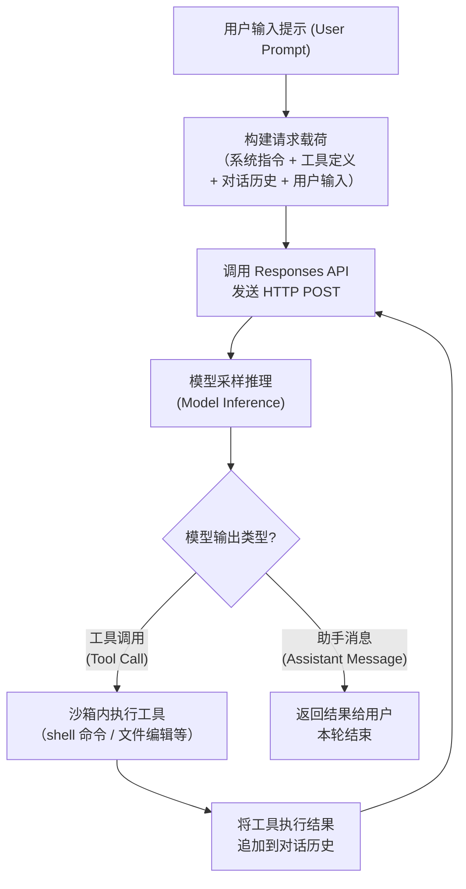
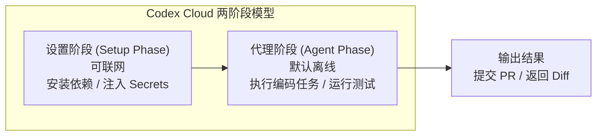
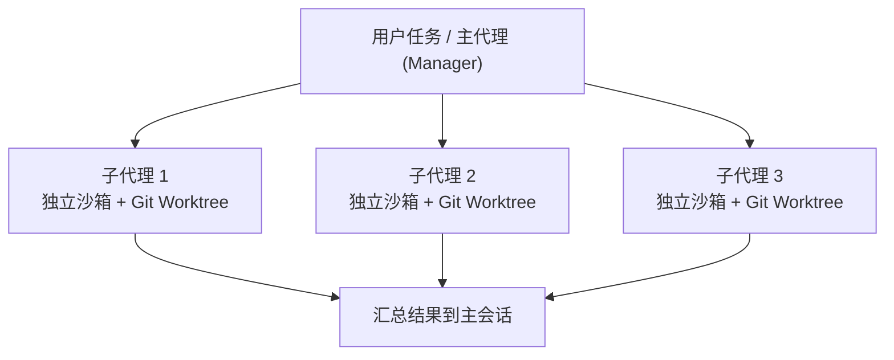
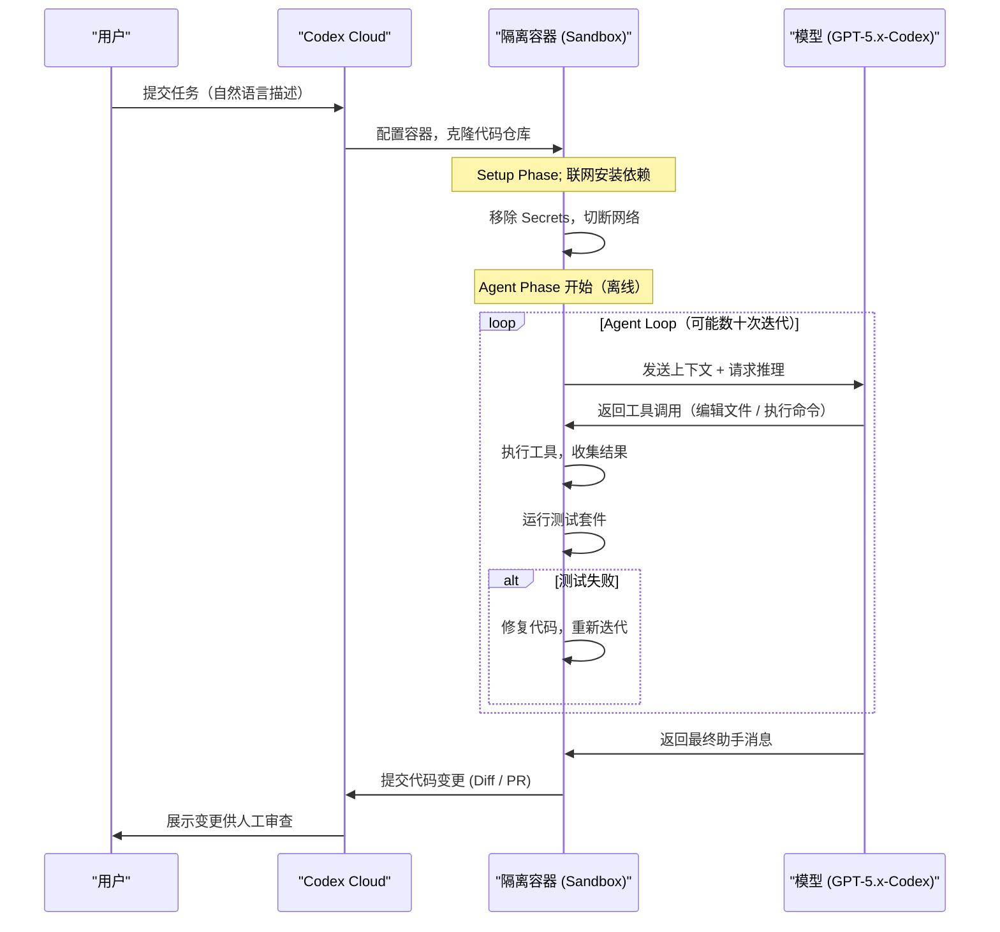

我来系统性地为你整理 Codex 的架构与设计介绍。首先让我搜索最新的相关资料，确保内容准确且现代化。好的，我已经收集到了充足的资料。下面开始系统整理。

---

## OpenAI Codex 的架构与设计介绍

> **内容依据:** OpenAI 官方文档、OpenAI 官方博客、ZenML 技术案例分析、Wikipedia 词条、多个社区深度分析文章。知识日期截至 **2026 年 9 月**。

---

### 什么是 Codex

Codex 是 OpenAI 开发的 AI 编程代理（AI Coding Agent），用于软件工程任务，如编写代码和修复 Bug，于 2025 年 4 月作为 Codex CLI 首次发布。

需要注意：当前的 Codex（2025—2026）与 2021 年发布的同名旧模型是完全不同的产品。旧版 Codex 只是在编辑器中预测下一个代码 Token，而 2025 版本则能够配置沙箱、执行测试套件，并发起 Pull Request。

Codex 的核心理念是将一个专门为编码优化的模型（coding-tuned model）与一个能够真正执行操作的代理框架（agent harness）配对。到 2026 年，Codex 已不是单一产品，而是一个包含多个界面（Surface）的"伞形"平台，它们共享同一个账户、同一个底层模型和同一个代理引擎。

---

### 产品形态全景

Codex 提供五种不同的界面（Surface），它们都由同一套 GPT-5.x-Codex 智能驱动：CLI、桌面应用、IDE 扩展、云端任务和浏览器扩展。每种界面针对不同的工作流模式进行了优化。

| 界面 (Surface)                     | 说明                                                         | 典型场景                           |
| ---------------------------------- | ------------------------------------------------------------ | ---------------------------------- |
| **Codex CLI**                      | 开源终端编码代理，在本地运行，连接 OpenAI 的语言模型与本地代码和命令行任务，能够编写和编辑代码、执行命令、通过轻量级界面与文件交互。 | 本地仓库的日常编码、调试、重构     |
| **Codex Cloud**                    | 云端软件工程代理，可并行处理多个任务。每个任务在各自的云端沙箱环境中运行，预加载你的代码仓库。 | 并行任务委派、长时间运行的编码任务 |
| **桌面应用 (Desktop App)**         | macOS/Windows 桌面应用，作为 AI 编码和软件开发的命令中心，支持多个代理、并行工作流和长时间运行任务。 | 管理多代理、监督跨项目工作         |
| **IDE 扩展 (IDE Extension)**       | 集成到 VS Code、Cursor、Windsurf 中，终端中运行的同一个代理也在编辑器中运行。 | 编辑器内交互式编码辅助             |
| **浏览器扩展 (Browser Extension)** | 适合以页面为"真实来源"的应用和网站工作，如管理控制台、内部仪表板、CMS、工单系统等。 | Web 管理界面操作、页面标注         |

---

### 底层模型的演进

Codex 的能力基石是底层的大语言模型（LLM）。模型在持续演进：

| 时间节点      | 模型                   | 要点                                                         |
| ------------- | ---------------------- | ------------------------------------------------------------ |
| 2025 年 5 月  | codex-1                | 基于 OpenAI o3 的推理模型，针对软件工程优化。使用强化学习（Reinforcement Learning）在真实编码任务上训练，生成与人类风格和 PR 偏好高度一致的代码。 |
| 2025 年 12 月 | GPT-5.2-Codex          | 引入了上下文压缩（context compaction）以支持长任务，增强了大规模代码变更（如重构和迁移）的表现，改进了 Windows 支持和网络安全能力。 |
| 2026 年 2 月  | GPT-5.3-Codex / Spark  | GPT-5.3-Codex 于 2 月 5 日发布，一周后紧跟低延迟版本 GPT-5.3-Codex-Spark。 |
| 2026 年+      | GPT-5.5 / GPT-5.6 系列 | 到 2026 年，模型家族已迁移到 GPT-5.5（OpenAI 的代理优先基座模型）。 GPT-5.6 系列（Sol、Terra、Luna）提供 272K 上下文窗口。 |

尽管模型版本在不断迭代，但核心架构保持稳定：一个前沿推理模型驱动沙箱中的"测试-修复"循环。

---

### 核心架构：代理循环 (Agent Loop)

这是理解 Codex 工作原理最关键的部分。

Codex CLI 的核心是一个单代理 ReAct 风格的循环，实现在 `AgentLoop.run()` 函数中。其设计模式为 **Think（思考）→ Tool Call（工具调用）→ Observe（观察）→ Repeat（重复）**，持续进行直到模型产生不需要额外工具调用的最终回答。

当模型请求工具调用时，代理执行该工具并将输出追加到提示中，然后用这个增强的上下文重新查询模型。这个循环不断重复，直到模型产生一条助手消息（assistant message）而不是更多的工具调用。整个系统协调用户、语言模型和工具之间的交互。

一个"轮次"（Turn）会根据需要运行该循环任意多次。一条用户消息可能触发 50 次工具调用后才出现最终的助手消息。

下面用一张简化的流程图来呈现 Agent Loop 的核心工作机制：



#### 请求构建与 API 调用

Codex CLI 使用 Responses API 进行模型推理，根据不同的认证方式向不同的端点发送 HTTP 请求。使用 ChatGPT 登录时，目标为 `chatgpt.com/backend-api/codex/responses`；使用 API Key 认证时为 `api.openai.com/v1/responses`；使用 `--oss` 标志运行本地模型（如 Ollama 或 LM Studio）时，默认为 `localhost:11434/v1/responses`。 系统还支持 Azure 托管的 Responses API 端点，展现多云灵活性。

Codex 构建完整的 JSON 载荷后，通过 HTTP POST 请求发送给 Responses API，Authorization 头部取决于 `~/.codex/config.toml` 中的端点配置。

Responses API 服务器收到请求后，用 JSON 构造模型的 Prompt。Prompt 中前三项的顺序由服务器决定而非客户端；其中只有系统消息（system message）的内容由服务器控制，而工具定义和指令内容都由客户端决定。之后再接上 JSON 载荷中的 input，组成完整的 Prompt 进行模型采样。

#### 工具系统 (Tools)

Agent 在循环中可以调用的核心工具包括：

- **Shell 命令执行** — 在沙箱内执行终端命令（如运行测试、安装依赖、查看文件内容）
- **文件读写** — 读取、创建、修改项目中的文件
- **代码补丁应用 (Apply Patch)** — 以结构化方式对文件进行精确编辑
- **Web 搜索** — 代理可使用内置的 Web Search Tool 来获取信息。Codex 默认使用缓存搜索结果。
- **子代理 (Subagent)** — Codex 可以将聚焦的工作委派给专门的子代理，然后将它们的结果汇总到主终端会话中。
- **MCP 工具** — 可添加本地或远程 MCP 服务器，按需认证，并在 Codex 使用前检视当前会话中可用的工具。

#### 上下文管理与压缩 (Context Management & Compaction)

当对话变长时，Token 消耗会快速增长。Codex 有完善的上下文管理策略：

除了缓存之外，另一个需要管理的关键资源是上下文窗口。Codex 的策略是在 Token 数量超过阈值时压缩对话，用一个更小的代表性列表替换输入，使代理能够在理解已发生事件的基础上继续工作。

早期实现需要手动调用 `/compact` 命令进行压缩，随后 Responses API 演进出专门的 `/responses/compact` 端点以更高效地执行压缩。

关键的技术成就包括：为零数据保留（Zero Data Retention）合规设计的无状态请求处理、通过战略性 Prompt 缓存优化实现线性而非二次方的性能、通过智能压缩实现自动上下文窗口管理，以及在数百次模型-工具迭代中保持对话连贯性。

---

### 沙箱与安全模型 (Sandbox & Security Model)

安全是 Codex 架构的核心设计原则。Codex 的安全性由两个独立的决策维度构建：**审批策略（Approval Policy）**——Codex 何时应该停下来请求批准？**沙箱模式（Sandbox Mode）**——生成的命令可以访问什么？将这两个维度作为独立控制是安全配置 Codex 的关键。

#### 沙箱模式 (Sandbox Mode)

沙箱的实现依据运行环境有所不同：

**Codex Cloud 沙箱：**

在 OpenAI 管理的隔离容器中运行，阻止访问宿主系统或无关数据。使用两阶段运行时模型（Two-Phase Runtime）：**设置阶段（Setup Phase）** 在代理阶段之前运行，可以访问网络来安装指定的依赖；**代理阶段（Agent Phase）** 默认离线运行，除非为该环境启用了互联网访问。为云环境配置的密钥（Secrets）仅在设置阶段可用，在代理阶段开始前被移除。



**Codex CLI / IDE 扩展沙箱：**

OS 级别的机制执行沙箱策略。默认设置包括无网络访问，写入权限仅限于活动工作区。

Codex 在内核级别（macOS 上用 Seatbelt，Linux 上用 Landlock + seccomp）强制执行文件系统和网络限制，而不是在容器内部执行。

Codex CLI 中沙箱模式的常见级别：

| 沙箱模式          | 说明                           | 适用场景               |
| ----------------- | ------------------------------ | ---------------------- |
| `read-only`       | 只能读取文件，不能写入任何内容 | 零风险探索             |
| `workspace-write` | 可读写工作区内的文件，禁止网络 | 信任工作流后的日常使用 |
| `full-access`     | 完全访问权限                   | 仅限受控环境           |

#### 审批策略 (Approval Policy)

在 Auto 预设下（例如 `--sandbox workspace-write --ask-for-approval on-request`），Codex 可以自动读取文件、编辑和在工作目录中执行命令。当需要编辑工作区外的文件或运行需要网络访问的命令时，Codex 会请求批准。

常见审批策略值：

| 策略值       | 含义                                               |
| ------------ | -------------------------------------------------- |
| `always`     | 每个操作前都请求批准                               |
| `on-request` | 仅在出界操作时请求                                 |
| `on-failure` | 自动运行，仅在卡住时才询问（适合自动修复测试循环） |
| `never`      | 从不请求批准（适用于 CI/CD）                       |

限制性沙箱即使在审批频率很低时也能限制损害。而频繁的审批本身并不能让不受限制的环境变得安全。

---

### 配置体系 (Configuration System)

Codex 使用 TOML 格式进行配置。理解优先级层次结构至关重要，因为它决定了配置冲突时哪个设置优先。

#### 配置优先级（从高到低）

配置优先级为：
1. **会话覆盖 (Session Overrides)** — 最高优先级，包括 CLI 标志（`--model`、`--sandbox`、`--ask-for-approval`、`--search`、`--profile` 等）和 `-c key=value` 覆盖
2. **项目配置 (Project Config)** — `.codex/config.toml`，从当前工作目录向上搜索到项目根目录，最近的目录优先
3. **用户配置 (User Config)** — `$CODEX_HOME/config.toml`，默认为 `~/.codex/config.toml`

#### config.toml 示例

以下是一个典型的用户级配置文件示例（基于多个文档综合整理）：

```toml
# ~/.codex/config.toml

model = "gpt-5.3-codex"
model_reasoning_effort = "high"
approval_policy = "on-request"
sandbox_mode = "workspace-write"
web_search = "cached"

[features]
multi_agent = true
shell_tool = true

# 命名配置档案 (Named Profiles)
[profiles.ci]
approval_policy = "never"
sandbox_mode = "workspace-write"

[profiles.careful]
approval_policy = "always"
sandbox_mode = "read-only"
```

命名配置档案（Named Profiles）允许你在不同项目或任务间切换配置，使用 `codex --profile ci` 加载。

管理员强制策略（`requirements.toml`）允许运维团队在组织层面约束审批策略、沙箱模式和 MCP 服务器白名单。

---

### 项目指令文件：AGENTS.md

AGENTS.md 是 OpenAI Codex 在接触你的代码之前读取的指令文件。正确编写该文件，Codex 从第一个 Prompt 开始就能以准确的上下文进行操作。写错或完全跳过它，你将花费大量会话时间纠正本可避免的错误。

AGENTS.md 是一个纯 Markdown 文件，告诉 AI 编码代理你的项目是如何运作的。该格式最初由 OpenAI 的 Codex CLI 推广，此后被 Agentic AI Foundation（Linux Foundation 下的定向基金）采纳为开放标准，现已被 Codex、Cursor、Gemini CLI、Windsurf、GitHub Copilot 等众多工具支持。

#### 发现层级 (Discovery Hierarchy)

AGENTS.md 的发现层级为：
1. `~/.codex/AGENTS.md`（全局，适用于所有项目）
2. 仓库根目录 `AGENTS.md`（项目级，覆盖全局）
3. 子目录 `AGENTS.md` 文件（限定在该目录范围）

项目级覆盖全局。这意味着你可以在全局设置通用偏好，然后在每个项目中覆盖它们。

#### AGENTS.md 内容建议

一个良好的 AGENTS.md 应该涵盖：

- **项目概述** — 项目用途、技术栈、主要依赖
- **目录结构说明** — 关键目录及其职责
- **构建与测试命令** — 如何构建、运行测试、Lint
- **代码风格约定** — 命名规范、导入排序、格式化工具
- **禁止事项** — 不应触碰的文件、不允许的模式
- **PR/提交规范** — Commit Message 格式、分支策略

2026 年 4 月以后的 Codex CLI 版本支持 `--print-instructions` 标志，可以转储当前会话加载的合并后 AGENTS.md 内容——调试时优先使用此方法。

---

### Skills 系统

AGENTS.md 提供的是始终加载的上下文（always-on context），而 SKILL.md 技能（Skills）仅在相关时才激活。例如：代码审查技能在你请求审查时加载；测试技能在你编写测试时加载。

Skills 存放位置：
- `~/.codex/skills/` — 个人全局 Skills
- `.codex/skills/` — 项目级 Skills

每个 Skill 是一个包含 `SKILL.md` 文件的文件夹。Skills 具备跨工具兼容性：为 Codex CLI 构建的 Skills 也可在 Claude Code、Cursor、OpenClaw 及其他支持 SKILL.md 的代理中使用。

---

### 多代理与子代理 (Multi-Agent & Subagents)

Codex 交付了一个正式可用的子代理模型（Subagent Model），配备一个管理器（Manager），可以协调多个并行工作的 Worker，每个 Worker 有自己的上下文。

设计目标是让多个代理同时工作而不互相干扰，同时让人类控制任何高风险操作。每个任务获得一个隔离的沙箱和自己的 git worktree，这样并行代理永远不会冲突。

Codex 支持并行扇出（parallel fan-out），默认最多 6 个线程。



---

### 技术引擎的演进：从 TypeScript 到 Rust

OpenAI 在 2025 年 4 月开源 Codex CLI 时，代码库使用 TypeScript on Node.js（为开发速度而选）。但不到一年后，随着子代理、插件和 app-server 协议的成熟，TypeScript 架构在为 IDE 扩展提供稳定的嵌入表面（embedding surface）方面表现吃力。

Codex 联合负责人 Fouad Matin 宣布了 Rust 原生的重写工作，目标是"零依赖安装、原生安全绑定、无 GC 暂停，以及一个让 TypeScript、Python 和其他语言扩展代理的线路协议（wire protocol）"。TypeScript CLI 仍然作为 `npm i -g @openai/codex` 安装的包装层和 TypeScript SDK 存在，但引擎核心已是 Rust。

---

### 目标模式 (Goal Mode)

Goal Mode 是 Codex 从"单轮对话"向"长期任务"转变的重要特性：

Token 预算（Token Budget）是主要的成本控制手段。它决定了 Codex 在目标被软停止之前可以消耗多少 Token。

预算耗尽被视为"软停止"（soft stop）而非中止（abort）。活动轮次会优雅地完成，而不是在操作中途被杀死——这防止了半应用的补丁或未提交的状态。

Goal Mode 关键操作：

- `/goal <描述>` — 设定一个持久目标
- `/goal pause` — 暂停当前目标
- `/goal resume` — 恢复当前目标
- `/goal clear` — 清除当前目标

---

### Codex Cloud 的工作流程（端到端）

以下是从用户提交任务到最终输出的完整工作流：



你在 ChatGPT 或云端仪表板上给 Codex 一个任务后，它做的第一件事是为自己搭建一个封闭的工作间。Codex 在云端配置一个隔离容器，将你的代码仓库及配置的依赖克隆进去。任务开始后，该容器没有互联网访问。

codex-1 是 OpenAI o3 推理模型的一个版本。OpenAI 使用强化学习在真实软件任务上对其进行了微调。微调教会 codex-1 像准备 Pull Request 的工程师那样编辑代码、运行测试，并修复自身的失败。

---

### Web Search 配置

如果你想使用实时搜索结果，可通过 `--search` 选项或在 `config.toml` 的 `web_search` 部分指定 `live`。指定 `disable` 则完全禁用 Web Search Tool。

```toml
# config.toml 中的 Web Search 配置
web_search = "cached"   # 默认：使用缓存结果
# web_search = "live"   # 使用实时搜索结果
# web_search = "disable" # 完全禁用
```

你可以通过在 `config.toml` 中设置 `sandbox_workspace_write.network_access = true` 来允许沙箱内网络访问，但从安全角度不推荐这样做。

---

### 安全注意事项

对于进阶用户，了解安全面非常重要：

随着 Codex 的普及，它也成为了攻击目标。2026 年的实践表明，代理的执行环境及其周边工具链是一个真实的攻击面。这不是避免使用 Codex 的理由——而是应当以与任何能执行代码和持有凭据的系统相同的严谨态度来部署它。

需要关注的安全面包括：

- **Prompt 注入 (Prompt Injection)** — 安全研究人员发现了一个已修补的漏洞，其中恶意 GitHub 分支名可以在任务设置时注入命令并获取 GitHub 认证令牌。
- **MCP 服务器风险** — Codex 曾自动加载项目本地配置中的 MCP 服务器条目并在打开时执行，无需批准也无需验证。一个恶意仓库可以危及每个打开它的开发者。
- **沙箱逃逸** — Codex 自身的输出曾能重定义其沙箱边界（CVE-2025-61260，CVSS 9.8），允许代理在本应被限制的工作区外写入。

**最佳实践:**

- 始终使用合理的沙箱模式，避免不必要的 `full-access`
- 定期更新 Codex CLI 到最新版本以获得安全补丁
- 绿色的测试套件是必要但不充分的，人类必须负责架构、安全或涉及资金的任何变更的审查。
- 只有在你的测试和审查能力足以发现自信且流畅的错误时，Codex 才能节省时间。薄弱的验证会把代理变成风险放大器。
- CI/CD 场景中使用权限受限的 API Key。

---

### 扩展生态：MCP、插件与 Hooks

Codex 已发展出丰富的扩展机制：

| 扩展类型                         | 说明                                                         |
| -------------------------------- | ------------------------------------------------------------ |
| **MCP (Model Context Protocol)** | Codex 可同时作为 MCP 客户端和服务器使用。                    |
| **Plugins（插件）**              | 可分发的 Skills + Apps + MCP 服务器的打包集合。              |
| **Hooks（钩子）**                | 用户自定义的 Shell 脚本，嵌入代理循环中（Beta）。            |
| **Subagents（子代理）**          | 通过 `.toml` 定义进行多代理编排。                            |
| **Slash Commands（斜杠命令）**   | 内置命令包括 `/plan`、`/skills`、`/fast`、`/fork`、`/review` 等。 |
| **非交互模式**                   | `codex exec` 用于 CI/CD 和脚本化场景。                       |

---

### 常用 CLI 操作速查

以下汇总日常开发中高频使用的 Codex CLI 操作：

```bash
# 启动交互式 TUI
codex

# 带初始提示启动
codex "fix the failing tests"

# 指定模型
codex -m gpt-5.5

# 指定沙箱和审批策略
codex --sandbox workspace-write --ask-for-approval on-request

# 使用配置档案
codex --profile ci

# 非交互模式（CI/CD 场景）
codex exec "write a CHANGELOG entry for commits since v2.4.0"

# 调试 AGENTS.md 加载情况
codex --print-instructions
```

会话内常用的斜杠命令：

- `/init` — 为当前项目创建 AGENTS.md
- `/status` — 显示当前会话配置
- `/compact` — 手动触发上下文压缩
- `/model` — 切换模型
- `/feedback` — 向 Codex 维护者发送日志用于调试
- `/usage` — 审计 Token 用量
- `/goal` — 设定/管理持久目标
- `/plan` — 让 Codex 先规划再执行

---

### 故障排查要点

当自定义配置出现问题时，以下是系统化排查的思路：

**配置不生效？** — 检查优先级层次：CLI 标志 > 项目 `.codex/config.toml` > 用户 `~/.codex/config.toml`。使用 `/status` 命令查看当前实际生效的配置。

**AGENTS.md 指令被忽略？** — 使用 `--print-instructions` 标志转储合并后的 AGENTS.md 内容，这比旧的"让 Codex 自己总结"方法干净得多。

**上下文窗口溢出？** — 状态栏中旧的上下文窗口计量器已被 context-percent 指示器替换，显示上下文窗口的填充百分比。 使用 `/compact` 命令主动压缩。

**沙箱限制过严导致任务失败？** — 检查 `sandbox_mode` 设置；需要网络的操作（如 `npm install`）在 `workspace-write` 模式下会失败。考虑在 Cloud 环境中利用 Setup Phase 安装依赖，或者在 CLI 中对特定操作进行审批放行。

**模型选择问题？** — 使用 `--model/-m` 切换模型或在 `config.toml` 中设定默认值。会话中可用 `/model` 切换，或用 Alt+逗号 / Alt+句号 来调高或降低推理努力级别。

**认证失败？** — 凭据存储可通过 `config.toml` 中的 `cli_auth_credentials_store` 配置。选项有：`file`（默认）、`keyring`（OS 钥匙链）或 `auto`（优先 keyring，否则 file）。

---

### 最佳实践总结

- **从保守开始，逐步放开** — 新项目先用 `read-only` + `always` 审批感受行为，再切到 `workspace-write` + `on-request`
- **投资 AGENTS.md** — 写好指令文件的回报远大于跳过它的"省时"
- 使用 `config.toml` 管理全局设置；使用项目级 `AGENTS.md` 管理项目专属指令；使用 Profiles 管理团队级配置；在组织层面强制执行沙箱模式
- **人工审查不可省** — OpenAI 认为 Codex 引入的异步多代理工作流将成为工程师生产高质量代码的标准方式，但人类始终是最后的守门人
- **利用子代理并行化** — 将大任务拆分为可独立执行的子任务，充分利用并行能力
- **关注安全更新** — 保持 CLI 版本更新，审计 MCP 服务器来源，对不受信任的仓库保持警惕

---

> **总结：** Codex 的架构可以概括为 **"推理模型 + 代理循环 + 沙箱执行 + 结构化配置"** 四大支柱。理解了 Agent Loop 的 ReAct 模式、沙箱的两维安全模型、TOML 配置的优先级体系和 AGENTS.md 的指令发现机制，你就掌握了对 Codex 进行高效使用和故障排查的核心知识。