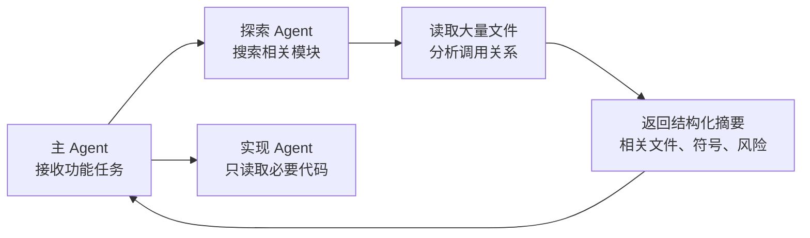
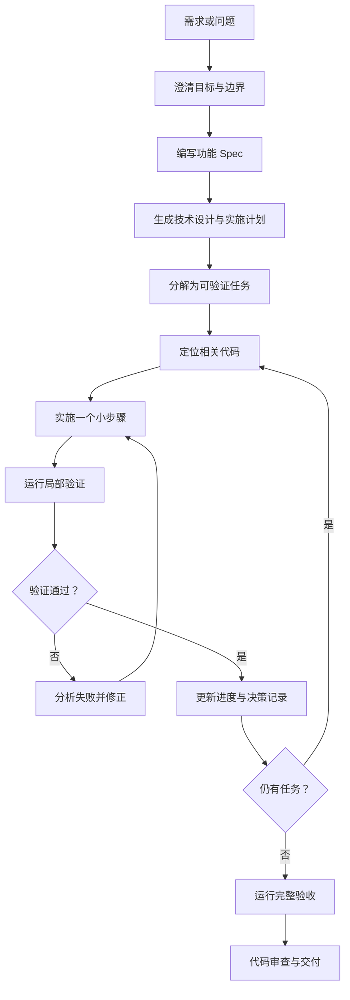
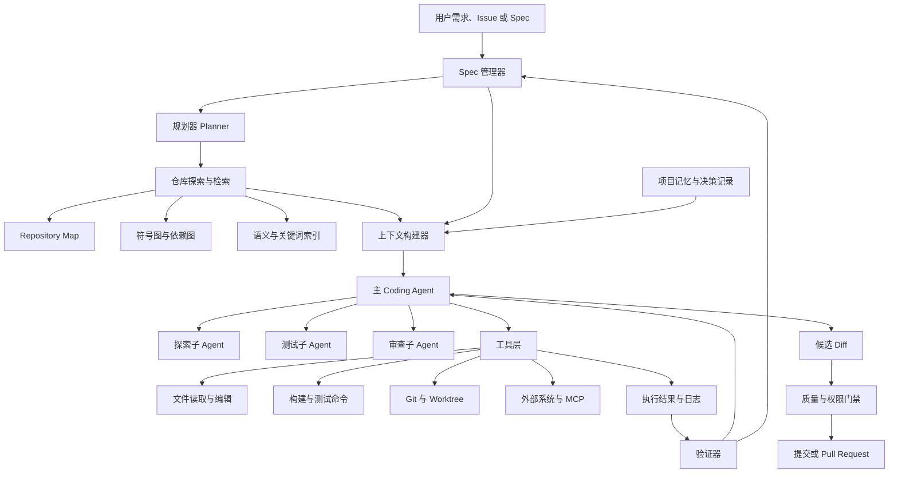

[toc]


## 核心结论

“渐进式披露（Progressive Disclosure）”与“**规格驱动开发**（Spec-Driven Development, SDD）”正在成为大型代码仓库中 Coding Agent 的核心设计思想。

二者解决的是不同问题：

| 设计思想       | 核心问题                   | 简单理解                                             |
| -------------- | -------------------------- | ---------------------------------------------------- |
| 渐进式披露     | Agent 此刻应该看到哪些信息 | 不把整个仓库一次性塞进上下文，而是按任务需要逐层展开 |
| Spec           | Agent 到底应该实现什么     | 把需求、约束、验收标准和实施边界固定下来             |
| 代码检索       | 相关代码在哪里             | 从成千上万个文件中定位真正有关的部分                 |
| 规划与任务分解 | 应该按什么顺序修改         | 将长任务拆成可执行、可验证的小步骤                   |
| 验证闭环       | 如何确认修改正确           | 通过测试、静态检查、运行结果和验收标准判断           |
| 外部记忆       | 如何跨会话保存知识         | 将稳定知识、决策和进度保存在仓库或记忆文件中         |
| 子 Agent       | 如何隔离探索产生的上下文   | 让专门 Agent 搜索、分析，再只返回结论                |
| 工具与权限设计 | Agent 可以做什么           | 控制读文件、改代码、执行命令、联网和部署等能力       |

目前公开的 Codex、Claude Code 和 GitHub Copilot 等工具已经分别采用了层级指令、按需加载 Skill、项目记忆、子 Agent、计划模式、Spec 工作流等机制。

Anthropic 明确将 Skill 设计为“正文只在使用时加载”，GitHub Copilot 也建议把普遍适用的简单规则放入自定义指令，把只在特定任务中需要的复杂流程放入 Skill；Codex 则采用按目录聚合 `AGENTS.md` 的层级指令结构。([Claude Platform Docs](https://docs.anthropic.com/en/docs/claude-code/skills))

------

## 内容大纲

本文将依次说明：

- 为什么大型代码仓库会给 Coding Agent 带来困难
- 渐进式披露在 Coding Agent 中具体是什么
- Spec 在 Agent 工作流中的作用
- 渐进式披露与 Spec 的关系
- 大型仓库中常见的上下文管理架构
- 代码检索、代码图谱、子 Agent 和外部记忆
- 长任务规划、执行计划与状态恢复
- 测试、验证、权限和安全设计
- 一套可落地的 Coding Agent 仓库结构
- 不同规模项目应采用多重的设计
- 常见误区和最佳实践

------

## 为什么大型代码仓库特别难处理

大仓库的问题不只是“代码太多，放不进上下文”。

更准确地说，它同时存在以下困难。

### 上下文容量有限

即使模型支持很长的上下文，也不适合把整个仓库直接输入模型。

原因包括：

- 输入成本高
- 推理速度下降
- 无关内容增加
- 重要规则可能被淹没
- 文件之间的关系难以显式表达
- 仓库状态随修改不断变化

因此，**长上下文不等于完整理解**。

### 信息分散

完成一个看似简单的功能，可能需要同时理解：

- Controller
- Service
- Repository
- 数据模型
- 配置文件
- 权限规则
- 数据库迁移
- 测试夹具
- 接口文档
- 构建脚本

有用信息往往散落在不同目录和文件中。RepoCoder 的研究正是针对这种“仓库级信息分散”问题，通过检索与生成的循环组合来补充局部代码上下文。([arXiv](https://arxiv.org/abs/2303.12570))

### 代码具有结构关系

代码不是普通文本集合，它具有：

- 导入关系
- 调用关系
- 继承关系
- 类型关系
- 数据流关系
- 配置依赖
- 构建依赖
- 测试覆盖关系

仅依赖关键词搜索，可能找到“字面相似”的代码，却找不到真正的调用链。

### 长任务会发生目标漂移

任务执行时间越长，Agent 越容易：

- 忘记原始目标
- 重复已经完成的工作
- 修改超出范围的模块
- 推翻先前的设计决策
- 忘记尚未完成的步骤
- 在修复一个测试时破坏另一个功能

因此，大型任务必须把状态从“模型脑内”迁移到可持久化的外部文档中。

### 验证成本快速增加

修改一个文件可能只需要几十秒，但确认它没有破坏系统可能需要：

- 单元测试
- 集成测试
- 类型检查
- Lint
- 构建
- 数据库迁移
- UI 验证
- 性能测试
- 安全检查
- 向后兼容检查

现代 Coding Agent 的性能往往不只取决于模型，也取决于它使用的工具接口。SWE-agent 的研究将这种接口称为 **Agent-Computer Interface，ACI**，并指出文件导航、编辑和测试工具的设计会显著影响 Agent 的行为与效果。([arXiv](https://arxiv.org/abs/2405.15793))

------

## 渐进式披露是什么

渐进式披露最初是用户界面设计中的概念：

> 先显示最重要的信息，只有在用户需要时才进一步展示细节。

放到 Coding Agent 中，可以定义为：

> Agent 首先只接收完成当前决策所需的最小信息；当任务逐渐明确时，再按相关性、依赖关系和风险逐层加载更多内容。

它不是简单地“少给信息”，而是建立一个**按需获取信息的层级结构**。

------

## 渐进式披露的典型层级

| 层级       | Agent 获得的信息               | 典型用途             |
| ---------- | ------------------------------ | -------------------- |
| 仓库元信息 | 语言、框架、构建命令、目录概览 | 判断项目类型         |
| 仓库地图   | 模块列表、职责、依赖关系       | 判断应该调查哪个模块 |
| 模块摘要   | 模块入口、公共 API、关键约束   | 缩小搜索范围         |
| 符号信息   | 类、函数、接口、调用方         | 定位相关实现         |
| 代码片段   | 相关函数及必要上下文           | 分析具体逻辑         |
| 完整文件   | 整个源文件                     | 准备修改             |
| 运行证据   | 测试失败、日志、堆栈、性能数据 | 验证假设             |
| 深层依赖   | 第三方源码、生成代码、历史提交 | 解决复杂或异常问题   |

核心原则是：

> 先看地图，再看区域；先看接口，再看实现；先看摘要，再看原文；先看失败摘要，再看完整日志。

GitHub Copilot 的 Skill 示例就体现了这种思路：先获取失败日志摘要，只有摘要不足时再加载完整日志，避免数千行日志直接填满上下文。([GitHub Docs](https://docs.github.com/en/copilot/how-tos/copilot-cli/customize-copilot/add-skills))

------

## Coding Agent 中的渐进式披露形式

### 指令渐进式披露

不是所有规则都应在每次任务中加载。

可以将指令分成三类：

| 指令类型   | 示例                         | 加载方式           |
| ---------- | ---------------------------- | ------------------ |
| 全局规则   | 不修改生成文件、必须运行测试 | 始终加载           |
| 目录规则   | 前端组件规范、数据库迁移规则 | 进入对应目录时加载 |
| 任务 Skill | 发布流程、安全审计、性能分析 | 任务匹配时加载     |

Codex 会从项目根目录到当前工作目录聚合 `AGENTS.md` 或覆盖文件，更具体目录中的规则出现在更靠后的位置；Claude Code 也支持不同目录层级的项目说明；GitHub Copilot 则区分了常驻自定义指令和按需注入的 Skills。([OpenAI](https://openai.com/index/unrolling-the-codex-agent-loop/))

典型结构如下：

```text
repository/
├── AGENTS.md
├── frontend/
│   ├── AGENTS.md
│   └── src/
├── backend/
│   ├── AGENTS.md
│   └── src/
└── database/
    ├── AGENTS.md
    └── migrations/
```

根目录文件只保存全项目都适用的规则。

子目录文件保存局部约束，例如：

- `frontend/AGENTS.md`：组件、状态管理和可访问性规范
- `backend/AGENTS.md`：事务、错误处理和 API 兼容规则
- `database/AGENTS.md`：迁移可逆性和索引规范

### Skill 渐进式披露

Skill 可以理解为：

> 一组只在特定任务出现时才加载的专业操作手册。

例如：

```text
.agents/skills/
├── database-migration/
│   ├── SKILL.md
│   └── migration-check.sh
├── security-review/
│   ├── SKILL.md
│   └── checklist.md
└── release/
    ├── SKILL.md
    └── scripts/
```

常驻上下文中只需要保留：

- Skill 名称
- Skill 描述
- 何时使用

当 Agent 判断任务相关时，再加载完整 `SKILL.md`、脚本和参考资料。

Anthropic 文档明确指出，Skill 正文只在被使用时加载，因此较长的参考材料不会在每个任务中持续消耗上下文；GitHub Copilot 同样会根据 Skill 描述决定是否把对应 `SKILL.md` 注入上下文。([Claude Platform Docs](https://docs.anthropic.com/en/docs/claude-code/skills))

### 记忆渐进式披露

长期记忆不应设计成一个无限增长的巨大文件。

更好的结构是“索引加专题文件”：

```text
memory/
├── MEMORY.md
├── architecture-decisions.md
├── debugging-patterns.md
├── build-and-test.md
└── api-conventions.md
```

其中：

- `MEMORY.md` 是短索引
- 专题文件保存详细内容
- 每次会话只加载索引
- 需要时再读取专题文件
- 过期信息需要删除或更新

Claude Code 的公开记忆设计采用了这种模式：`MEMORY.md` 作为精简索引在会话开始时加载，详细内容被移入独立主题文件，并在需要时读取。([Claude Platform Docs](https://docs.anthropic.com/en/docs/claude-code/memory))

### 子 Agent 渐进式披露

探索大型仓库时，主 Agent 不必亲自读取所有文件。

可以委派一个探索 Agent：



主 Agent 最终只获得：

- 相关文件列表
- 关键符号
- 调用链摘要
- 可能的修改点
- 未解决问题

Anthropic 将这种方式明确用于大型代码库探索：子 Agent 在独立上下文中读取文件，主会话只接收总结，从而避免探索过程污染主上下文。([Claude Platform Docs](https://docs.anthropic.com/en/docs/claude-code/common-workflows))

------

## Spec 是什么

在 Coding Agent 中，`spec` 通常是 **specification，规格说明** 的简称。

但它不应该只是一篇传统需求文档。

适合 Agent 的 Spec 应当是：

> 一份可执行、可检查、可持续更新的**任务契约**。

它至少要回答：

- 要解决什么问题
- 为什么要解决
- 哪些行为必须改变
- 哪些行为不能改变
- 修改范围是什么
- 不在范围内的内容是什么
- 有哪些技术约束
- 如何判断完成
- 出现歧义时如何处理
- 当前进度到哪里

------

## Spec 不应只有一种

大型任务最好采用分层规格体系。

| 层级      | 主要内容                     | 生命周期     |
| --------- | ---------------------------- | ------------ |
| 项目原则  | 架构原则、质量标准、安全底线 | 长期稳定     |
| 产品 Spec | 用户需求、场景、行为、边界   | 功能生命周期 |
| 技术设计  | 架构方案、数据结构、接口设计 | 实施阶段     |
| 执行计划  | 里程碑、文件、步骤、验证命令 | 任务执行期间 |
| 任务列表  | 可独立完成的小任务           | 短期         |
| 验收契约  | 测试、性能、兼容、安全要求   | 持续有效     |
| 决策日志  | 关键选择及原因               | 长期保存     |
| 进度日志  | 已完成、正在做、下一步       | 执行期间     |

GitHub Spec Kit 将工作流拆分为项目原则、功能规格、技术计划、任务分解和实现，并额外提供澄清、跨文档一致性分析和质量清单等步骤。([GitHub](https://github.com/github/spec-kit))

------

## Spec 驱动开发的典型流程



这里最重要的一点是：

**Spec 不是写完后放在一旁的静态文档。**

它应当随着调查、实现和验证持续更新。

OpenAI 的 ExecPlan 实践也将执行计划定义为自包含的“活文档”：它需要记录进度、发现、决策与下一步，并且应允许新的执行者只依赖当前代码和该计划恢复工作。([OpenAI Developers](https://developers.openai.com/cookbook/articles/codex_exec_plans))

------

## 一个适合 Coding Agent 的 Spec 模板

```markdown
# Feature: 用户会话撤销

## Goal

允许用户在账户设置页面撤销其他设备上的登录会话。

## Motivation

用户目前只能修改密码，无法主动终止已泄露设备上的会话。

## In Scope

- 查询当前用户的活动会话
- 撤销指定会话
- 不能撤销当前正在使用的会话
- 撤销操作需要写入安全审计日志

## Out of Scope

- 管理其他用户的会话
- 修改 Token 加密方式
- 重构整个认证模块

## Required Behavior

- 返回会话创建时间、最近活动时间和设备描述
- 撤销后对应刷新令牌立即失效
- 重复撤销同一会话应返回幂等结果
- 用户不能访问不属于自己的会话

## Constraints

- 保持现有 API 向后兼容
- 不在日志中输出原始 Token
- 数据库迁移必须可回滚
- 不新增外部依赖

## Acceptance Criteria

- 新增会话列表接口
- 新增会话撤销接口
- 越权访问返回 404
- 当前会话撤销返回 409
- 单元测试、集成测试和类型检查全部通过

## Verification

- `npm run test:auth`
- `npm run typecheck`
- `npm run lint`
- 手动验证两个浏览器会话之间的撤销行为

## Progress

- [ ] 定位会话存储模型
- [ ] 确认刷新令牌失效机制
- [ ] 实现查询接口
- [ ] 实现撤销接口
- [ ] 添加审计日志
- [ ] 添加测试
- [ ] 更新 API 文档

## Decisions

- 暂无

## Open Questions

- 会话设备名称是否来自 User-Agent 解析？
```

这个模板最重要的不是格式，而是明确区分：

- 目标
- 边界
- 约束
- 可观察行为
- 验收证据
- 当前状态

------

## 渐进式披露与 Spec 的关系

可以用一句话概括：

> 渐进式披露负责控制 Agent 看什么，Spec 负责控制 Agent做什么。

二者的关系如下：

| 系统元素               | 作用                       |
| ---------------------- | -------------------------- |
| Spec                   | 定义目标、边界与验收标准   |
| Planner                | 将 Spec 转换为执行步骤     |
| Retriever              | 根据当前步骤查找相关信息   |
| Progressive Disclosure | 控制信息逐层加载           |
| Tools                  | 执行读取、编辑、测试等动作 |
| Tests                  | 提供可执行证据             |
| Memory                 | 保存跨步骤和跨会话状态     |
| Reviewer               | 检查是否满足 Spec          |

可以把 Coding Agent 的效果近似理解为：

$$任务质量 \approx 意图清晰度 \times 上下文相关性 \times 工具可靠性 \times 验证强度$$

这不是严格数学公式，而是一种工程上的理解：

- Spec 提高意图清晰度
- 渐进式披露提高上下文相关性
- ACI 和工具提高执行可靠性
- 测试与验收提高验证强度

任何一项接近零，最终结果都可能失败。

------

## 大型仓库中常见的整体架构



------

## 除了渐进式披露和 Spec，还需要哪些设计

### Repository Map

Repository Map 是仓库的高层结构地图。

它可以记录：

- 目录职责
- 入口文件
- 公共 API
- 关键数据模型
- 服务之间的依赖
- 测试位置
- 构建方式
- 所有者或维护团队

示例：

```markdown
## auth/

负责认证、会话和令牌管理。

入口：
- src/auth/index.ts
- src/auth/auth-service.ts

公共接口：
- authenticate()
- refreshSession()
- revokeSession()

持久化：
- src/auth/session-repository.ts

测试：
- tests/auth/
```

Repository Map 不应该代替源码，它的作用是帮助 Agent 决定下一步读什么。

### 符号索引与代码图谱

仅按文件检索通常不够。

可以构建以下索引：

- 类和函数定义
- 引用位置
- 调用者与被调用者
- 类型实现
- 导入关系
- 路由与处理函数
- 数据库表与模型
- 测试与被测函数的关系

常见基础工具包括：

- Abstract Syntax Tree，AST
- Language Server Protocol，LSP
- Tree-sitter
- 静态调用图
- 依赖图
- 数据流分析

这些工具帮助 Agent 从“文本搜索”提升到“程序结构导航”。

### 混合检索

大型仓库最好不要只使用向量检索。

更实用的是混合方案：

| 检索方式   | 擅长内容                 |
| ---------- | ------------------------ |
| 文件名匹配 | 已知模块或文件           |
| 精确关键词 | 错误消息、函数名、配置项 |
| BM25       | 文本和代码标识符搜索     |
| 向量检索   | 语义相似功能             |
| AST 搜索   | 特定语法结构             |
| LSP 引用   | 符号调用与定义           |
| Git 历史   | 为什么这样设计           |
| 测试映射   | 哪些测试覆盖该功能       |
| 运行时追踪 | 实际执行路径             |

检索也应当是可选择的。Repoformer 的研究指出，并非每个代码补全场景都需要额外检索；无条件加入检索内容可能引入噪声，因此可以先判断“是否需要检索”，再决定加载哪些信息。([arXiv](https://arxiv.org/abs/2403.10059))

### 先定位，再修改

一个可靠的 Agent 不应该接到任务后立即搜索替换。

更稳妥的阶段是：

- Localization：定位相关文件、符号和测试
- Diagnosis：理解问题原因或需求影响
- Planning：生成修改计划
- Repair：实施修改
- Validation：验证补丁

Agentless 的研究表明，即使不使用复杂的自主工具循环，明确分离“定位、修复、补丁验证”三个阶段也能形成很强的基线。这说明复杂 Agent 架构并不天然优于清晰、可解释的阶段化流程。([arXiv](https://arxiv.org/abs/2407.01489))

### 工作区隔离

并行 Agent 不应直接在同一个工作目录中随意修改。

推荐使用：

- Git branch
- Git worktree
- 临时容器
- 沙箱目录
- 独立数据库实例

典型方式：

```text
main repository
├── worktree-feature-auth
├── worktree-test-generation
└── worktree-security-review
```

每个 Agent 只负责一个有限范围，最后由主 Agent 或人工合并结果。

### Checkpoint 与可恢复执行

长任务需要定期保存：

- 当前提交
- 已完成步骤
- 当前失败测试
- 新发现的约束
- 关键决策
- 下一步动作

一个好的恢复点应该使新的 Agent 能够回答：

- 当前目标是什么
- 已经修改了什么
- 为什么这样修改
- 哪些测试通过
- 哪些测试失败
- 下一步应做什么

### Diff Budget

可以为每个任务设定修改预算：

- 最多修改多少文件
- 是否允许新增依赖
- 是否允许修改公共接口
- 是否允许执行数据库迁移
- 是否允许跨模块重构
- 是否允许修改生成代码

例如：

```markdown
## Change Budget

- 最多修改 8 个源文件
- 最多新增 2 个测试文件
- 不允许新增运行时依赖
- 不允许修改公开 API
- 如需跨越 auth 模块边界，必须先更新计划
```

Diff Budget 能防止 Agent 因“顺手优化”而不断扩张任务范围。

### 测试作为可执行 Spec

自然语言 Spec 仍可能存在歧义。

测试可以将其转化为机器可检查的行为：

```text
需求：用户不能撤销当前会话

自然语言验收：
- 当前会话撤销操作必须被拒绝

可执行验收：
- revokeCurrentSession() 返回 409
- 当前刷新令牌仍然有效
- 审计日志记录失败原因
```

但不能认为“测试通过就一定正确”，还需要检查：

- 测试是否覆盖真实需求
- Agent 是否修改测试来迎合错误实现
- 是否遗漏安全和性能要求
- 是否破坏未覆盖的兼容行为

### Hooks 与质量门禁

Hooks 可以在 Agent 生命周期的关键位置自动执行规则，例如：

- 编辑后自动格式化
- 提交前运行 Lint
- 修改数据库后检查迁移
- 修改公共 API 后生成兼容性报告
- 读取密钥文件前阻止操作
- 执行危险命令前要求批准

Claude Code 的 Hooks 支持在生命周期事件中运行命令、HTTP 请求或模型检查，可用于格式化、命令阻断、通知和上下文注入等流程。([Claude Platform Docs](https://docs.anthropic.com/en/docs/claude-code/hooks?utm_source=chatgpt.com))

### 权限最小化

不同 Agent 应拥有不同权限。

| Agent      | 建议权限                   |
| ---------- | -------------------------- |
| 探索 Agent | 只读文件、搜索符号         |
| 规划 Agent | 只读文件、写计划文档       |
| 实现 Agent | 修改指定目录、运行局部测试 |
| 测试 Agent | 写测试、执行测试           |
| 审查 Agent | 只读 Diff、运行检查        |
| 发布 Agent | 受控构建和部署权限         |

特别应限制：

- `.env`
- 私钥
- 生产数据库
- 云平台凭据
- 任意网络访问
- 任意 Shell 命令
- 删除文件
- 强制推送
- 生产部署

GitHub 的 Skill 文档也提醒，预批准 Shell 工具可能使恶意 Skill 或提示注入执行任意命令，因此只有在脚本来源和内容都经过检查时才应放宽权限。([GitHub Docs](https://docs.github.com/en/copilot/how-tos/copilot-cli/customize-copilot/add-skills))

### 可观测性与评估

Agent 系统需要记录的不只是最终结果，还包括：

- 使用了哪些上下文
- 检索了哪些文件
- 为什么选择这些文件
- 调用了哪些工具
- 哪一步失败
- 消耗了多少 Token
- 修改了多少文件
- 运行了哪些测试
- 人工退回原因
- 最终补丁是否被接受

这些 Trace 可以用于发现：

- 检索召回率不足
- Agent 过早修改
- Spec 不够明确
- 工具返回信息过多
- 测试反馈不及时
- 子 Agent 总结失真

------

## 推荐的仓库组织方式🎈

```text
repository/
├── AGENTS.md
├── README.md
├── docs/
│   ├── architecture/
│   │   ├── overview.md
│   │   ├── modules.md
│   │   └── data-flow.md
│   ├── decisions/
│   │   ├── ADR-001-database.md
│   │   └── ADR-002-authentication.md
│   └── runbooks/
│       ├── local-development.md
│       └── deployment.md
├── specs/
│   ├── active/
│   │   └── session-revocation/
│   │       ├── spec.md
│   │       ├── plan.md
│   │       ├── tasks.md
│   │       └── progress.md
│   └── completed/
├── .agents/
│   ├── skills/
│   │   ├── database-migration/
│   │   │   └── SKILL.md
│   │   ├── security-review/
│   │   │   └── SKILL.md
│   │   └── release/
│   │       └── SKILL.md
│   └── memory/
│       ├── MEMORY.md
│       ├── debugging.md
│       └── conventions.md
├── src/
├── tests/
└── scripts/
    ├── verify-change.sh
    └── generate-repo-map.sh
```

各类文件的职责应严格区分：

| 文件          | 保存什么                   | 不应保存什么           |
| ------------- | -------------------------- | ---------------------- |
| `AGENTS.md`   | 长期、稳定、普遍适用规则   | 某个功能的详细实施步骤 |
| `spec.md`     | 功能目标、行为、边界       | 大量仓库常识           |
| `plan.md`     | 技术方案、里程碑、影响范围 | 无关背景材料           |
| `tasks.md`    | 可执行任务                 | 长篇架构论述           |
| `progress.md` | 当前状态与下一步           | 永久架构规则           |
| `SKILL.md`    | 特定工作流程               | 每项任务都适用的规则   |
| `MEMORY.md`   | 记忆索引                   | 大量详细记录           |
| ADR           | 架构决策及原因             | 临时执行进度           |

------

## 一个完整任务如何运行

假设任务是：

> 为电商系统增加“订单部分退款”功能。

### 接收任务

Agent 首先读取：

- 根目录 `AGENTS.md`
- 当前功能 Spec
- 仓库地图
- 构建与测试命令

此时不读取整个仓库。

### 澄清行为

Agent识别关键问题：

- 部分退款能否多次执行
- 退款总额能否超过支付金额
- 优惠券如何处理
- 运费是否可以部分退
- 是否需要修改库存
- 已结算订单如何处理

将结论写入 `spec.md`。

### 定位代码

探索 Agent 搜索：

- 订单模型
- 支付接口
- 全额退款实现
- 账务流水
- 库存回滚
- 退款测试

返回相关文件和调用链摘要。

### 形成计划

`plan.md` 可以包含：

- 扩展退款领域模型
- 增加退款金额校验
- 扩展支付供应商接口
- 增加幂等键
- 写入退款流水
- 更新订单状态计算
- 增加集成测试

### 小步实施

每完成一个步骤：

- 修改少量文件
- 运行局部测试
- 更新任务状态
- 保存关键发现
- 创建 Git checkpoint

### 完整验证

最终运行：

- 退款模块单元测试
- 支付集成测试
- 订单状态测试
- 数据库迁移测试
- 类型检查
- Lint
- 构建
- 安全检查

### 对照 Spec 审查

Reviewer Agent 不只看代码风格，而是逐项检查：

- 每条验收标准是否有实现
- 是否存在超出范围的修改
- 是否引入公共 API 破坏
- 是否出现未记录的设计决策
- 测试是否真正覆盖需求

------

## 不同规模任务应该采用多重的流程

| 任务规模       | 推荐设计                                                     |
| -------------- | ------------------------------------------------------------ |
| 单文件小修复   | 简短任务描述、验收标准、局部测试                             |
| 小型功能       | Spec、相关文件定位、实施计划、测试                           |
| 中型跨模块功能 | Spec、技术设计、任务列表、进度记录、混合检索                 |
| 大型重构       | 项目原则、ExecPlan、依赖图、Worktree、检查点、完整验证       |
| 多团队系统变更 | 版本化 Spec、ADR、接口契约、迁移计划、分 Agent 执行、人工门禁 |
| 长期自主维护   | 外部记忆、定期评估、漂移检测、自动质量任务、审查工作流       |

不是每个任务都需要十几份文档。

最佳原则是：

> 文档复杂度应与任务的不确定性、影响范围和执行时间成正比。

------

## 最佳实践

### 常驻指令要短而稳定

适合写入全局指令：

- 构建和测试命令
- 代码风格
- 禁止修改的目录
- 安全规则
- 架构底线
- 提交要求

不适合写入全局指令：

- 特定功能的实现细节
- 长篇教程
- 大量 API 文档
- 某次故障的全部日志
- 只适用于偶发任务的流程

### 程序性知识放入 Skill

当一段内容表现为“遇到某类任务时，请依次完成这些步骤”，它通常更适合 Skill，而不是全局指令。

例如：

- 数据库迁移
- 发布流程
- 安全审计
- 性能分析
- UI 回归测试
- 第三方依赖升级

### Spec 应描述结果，不要过早锁死实现

功能 Spec 应重点描述：

- 用户可观察行为
- 业务规则
- 边界情况
- 验收标准

技术方案应写入单独的 Plan。

否则容易把“需求”与“某个暂定实现”混为一谈。

### 验收标准必须可观察

较差：

> 提高系统稳定性。

较好：

> 当支付服务超时时，订单保持 `pending` 状态，最多重试三次；三次失败后写入告警队列，且不得重复扣款。

### 每个任务应有停止条件

Agent 需要知道何时停止，例如：

- 所有验收测试通过
- 没有超出 Diff Budget
- 没有新增高严重性静态检查问题
- Spec 中不存在未解决阻塞问题
- 计划中的任务全部完成
- 文档与实现一致

### 摘要不能代替原始证据

摘要适合导航和压缩上下文。

但在以下情况下应回到原始内容：

- 准备修改关键代码
- 分析安全问题
- 判断边界条件
- 处理并发和事务
- 阅读错误堆栈
- 检查法律或合规要求

渐进式披露的终点不是永远只看摘要，而是**在真正需要时加载原文**。

------

## 常见误区

### 误区：上下文窗口越长，就越不需要检索

长上下文降低了部分截断问题，但没有解决：

- 噪声
- 相关性排序
- 结构理解
- 信息更新
- 推理成本
- 中间状态漂移

所以仍然需要检索、分层摘要和任务分解。

### 误区：Spec 越详细越好

过度详细的 Spec 可能：

- 提前固化错误方案
- 包含大量重复信息
- 很快与实现不一致
- 限制 Agent 的合理探索
- 增加维护成本

好的 Spec 应当是**完整但不过度规定实现**。

### 误区：把所有信息写进一个 `AGENTS.md`

这会使每个任务都承担不必要的上下文成本。

更好的拆分是：

- 普遍规则放 `AGENTS.md`
- 详细流程放 Skill
- 功能需求放 Spec
- 技术方案放 Plan
- 当前状态放 Progress
- 长期决策放 ADR

### 误区：多 Agent 一定优于单 Agent

多 Agent 会引入：

- 重复探索
- 信息传递损失
- 修改冲突
- 合并成本
- 调度复杂度
- 更高 Token 消耗

适合委派的是边界清楚、结果可总结的任务，例如：

- 仓库探索
- 测试生成
- 安全审查
- 文档更新
- 独立模块实施

强耦合的代码修改不宜随意拆给多个 Agent。

### 误区：Agent 自己会记住一切

模型会话不是可靠的项目数据库。

关键内容必须落盘：

- 需求
- 约束
- 决策
- 进度
- 测试结果
- 未解决问题
- 下一步

### 误区：测试通过就可以自动合并

测试可能存在覆盖不足，Agent 也可能错误修改测试。

高风险改动仍然需要：

- Spec 对照审查
- Diff 审查
- 安全检查
- 权限控制
- 人工批准

------

## 一套适合新手采用的最小方案

刚开始不需要立即搭建复杂的多 Agent 平台。

可以先实现以下结构：

```text
repository/
├── AGENTS.md
├── docs/
│   └── architecture.md
├── specs/
│   └── feature-name/
│       ├── spec.md
│       ├── plan.md
│       └── progress.md
├── .agents/
│   └── skills/
│       ├── testing/
│       │   └── SKILL.md
│       └── database-migration/
│           └── SKILL.md
├── src/
└── tests/
```

并要求 Agent 遵守以下工作流：

- 先读取项目指令
- 先写或确认 Spec
- 先定位代码，不立即修改
- 列出计划和影响范围
- 一次只完成一个小步骤
- 每个步骤后运行局部测试
- 记录发现和决策
- 最后运行完整测试
- 按 Spec 逐项验收
- 输出修改摘要和剩余风险

这是一个相对简单，但已经能明显改善大型仓库处理效果的基础框架。

------

## 最终理解

大型仓库 Coding Agent 的关键，不是让模型“记住更多代码”，而是建立一套信息与执行控制系统：


可以将它概括为四个核心原则：

- **不要把整个仓库一次性提交给模型，而要让 Agent逐层探索。**
- **不要让目标只存在于对话中，而要用版本化 Spec 固定下来。**
- **不要让长任务只依赖会话记忆，而要维护可恢复的执行状态。**
- **不要只相信生成结果，而要通过工具、测试和门禁建立验证闭环。**

