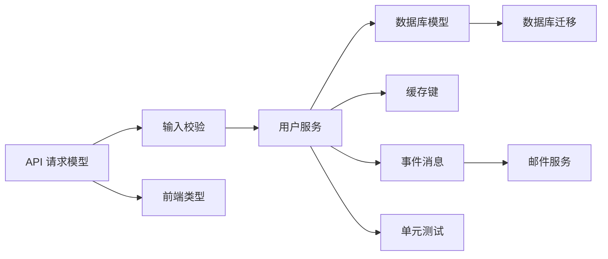
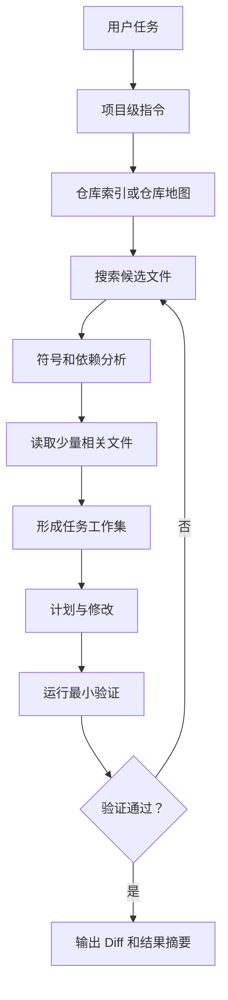
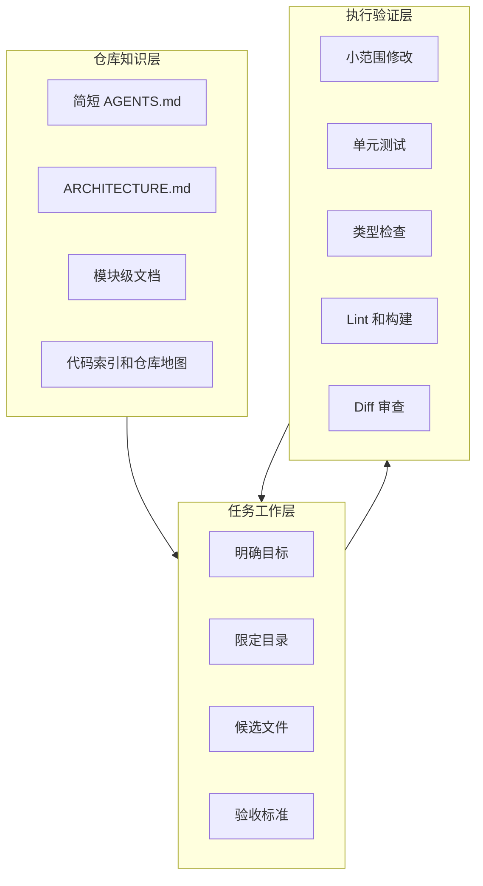

[toc]


## 结论先说

**代码仓库越大、依赖关系越复杂，coding agent 越容易产生较高的上下文消耗。**

但需要准确理解：

> **仓库总大小不等于模型每次实际读取的上下文大小。**

现代 coding agent 通常不会把整个仓库一次性塞进模型，而是通过**代码索引、语义搜索、符号检索、仓库地图和工具调用**，动态选择与当前任务相关的文件片段。因此，上下文消耗更接近下面这个关系：

```text
实际上下文消耗
≈ 固定指令
+ 当前任务描述
+ 已读取的相关代码
+ 搜索与终端输出
+ 对话历史
+ 测试结果和错误日志
+ Agent 自己生成的计划、解释与补丁
```

大仓库主要增加的是：

- 找到正确代码的难度；
- 需要读取的跨文件依赖数量；
- 检索到无关内容的概率；
- 工具输出和调查步骤；
- 长时间任务中的历史累积；
- Agent 忘记早期约束或被无关上下文干扰的风险。

当前 Claude Code 文档明确把上下文视为 coding agent 的主要约束：文件读取、对话、规则、工具描述和输出都会进入上下文；上下文变长后可能降低效果。([Claude](https://code.claude.com/docs/en/context-window))

OpenAI 在大规模 Codex 工程实践中也强调，应当给 Agent 一张“地图”，而不是把一整本说明书塞进上下文。

------

## 推荐学习大纲

本文围绕以下知识结构展开：

- coding agent 的上下文到底是什么
- 大仓库为什么更容易消耗上下文
- 仓库大小与上下文消耗是否线性相关
- 现代 coding agent 如何理解大型仓库
- 代码索引、仓库地图、RAG 和符号搜索的区别
- 为什么单纯扩大 Context Window 不能彻底解决问题
- 如何规划大型仓库中的 Agent 工作流
- 如何编写 `AGENTS.md`、`CLAUDE.md` 等项目指令
- 如何拆分任务、管理会话和控制日志输出
- 单体仓库与 Monorepo 的不同处理方式
- Codex、Claude Code、GitHub Copilot、Aider 的适用方案
- 常见失败模式和诊断方法
- 一套可直接落地的推荐配置

------

## 什么是上下文

上下文窗口（Context Window）可以理解为模型在一次推理中能够同时“看到”的工作资料。

对于 coding agent，它通常不只有聊天内容，还包括以下几类信息。

| 上下文组成     | 典型内容                                       | 是否容易膨胀 |
| -------------- | ---------------------------------------------- | ------------ |
| 系统与工具信息 | Agent 规则、工具说明、权限、MCP 工具描述       | 中等         |
| 项目持久指令   | `AGENTS.md`、`CLAUDE.md`、Copilot instructions | 中等         |
| 用户任务       | 需求、限制条件、验收标准                       | 较低         |
| 代码内容       | Agent 读取的文件、函数、类型定义               | 很高         |
| 检索结果       | 搜索命中、符号列表、调用位置                   | 高           |
| 终端输出       | 编译结果、测试日志、堆栈信息                   | 很高         |
| 变更内容       | Diff、补丁、修改后的完整文件                   | 高           |
| 对话历史       | 之前的提问、解释、决策和纠正                   | 很高         |
| Agent 计划     | 调研报告、执行计划、阶段总结                   | 中等         |

以 Claude Code 当前机制为例，在用户发出第一条消息前，项目记忆、MCP 工具名称和技能描述等内容就可能已经进入上下文；之后每次文件读取都会继续占用上下文。([Claude](https://code.claude.com/docs/en/context-window))

### 上下文窗口不等于仓库索引

这是最容易混淆的概念。

| 概念         | 英文                                | 作用                                       |
| ------------ | ----------------------------------- | ------------------------------------------ |
| 上下文窗口   | Context Window                      | 模型当前直接读取和推理的信息               |
| 仓库索引     | Repository Index                    | 存储代码位置、语义或符号信息，供检索使用   |
| 仓库地图     | Repository Map                      | 对目录、类、函数、签名、依赖关系的压缩概览 |
| 持久指令     | Persistent Instructions             | 长期存在的工程约束和项目规则               |
| Agent 记忆   | Agent Memory                        | 跨会话保存的经验、偏好或项目事实           |
| 检索增强生成 | Retrieval-Augmented Generation, RAG | 先检索相关材料，再交给模型推理             |

索引中可能包含几百万行代码，但模型一次只接收检索出来的一小部分。

因此：

```text
索引规模可以很大
但活动上下文应当尽可能小
```

------

## 大仓库为什么更容易消耗上下文

### 需要探索更多文件

小型项目中的一个功能可能只涉及：

- 一个入口文件；
- 一个业务函数；
- 一个测试文件。

大型项目中的同一个需求可能涉及：

- API 路由；
- 鉴权中间件；
- 领域服务；
- 数据访问层；
- 消息队列；
- 缓存；
- 配置；
- 数据库迁移；
- 前端调用；
- 集成测试。

Agent 为了判断应该修改哪里，需要搜索、读取并比较更多文件。

### 跨文件依赖更多

代码修改半径通常可以用“影响范围”（Blast Radius）描述。

例如修改用户邮箱字段，可能影响：



仓库越复杂，Agent 越需要理解这些关系。它可能不得不读取每个节点附近的代码，这会扩大活动上下文。

### 检索噪声更多

假设仓库中存在十几个名为 `UserService`、`config.ts` 或 `handler.go` 的文件。

用户只说：

> 修改用户创建逻辑。

Agent 可能检索到：

- 旧版用户模块；
- 新版用户模块；
- 测试夹具；
- 示例代码；
- 迁移脚本；
- 已废弃目录；
- 供应商代码；
- 生成代码。

如果检索系统没有正确排序，模型会收到很多“看似相关、实际无用”的内容。

无关代码不仅浪费 token，也可能让模型：

- 使用过时实现；
- 模仿错误模式；
- 修改错误模块；
- 混淆新旧接口；
- 忽略真正重要的代码。

Aider 的官方建议也是不要把大量文件直接加入聊天，因为过多无关代码会分散和混淆模型；其仓库地图用于提供全局结构，而完整内容只选择性加入。([Aider](https://aider.chat/docs/repomap.html))

### 调查过程本身会累积

Agent 常见的调查轨迹可能是：

```text
查看目录
搜索关键词
读取入口文件
搜索函数引用
读取调用方
读取类型定义
运行测试
分析错误
再次搜索
修改文件
重新运行测试
查看 Diff
```

即使每个步骤只输出少量内容，几十轮以后也会形成很大的会话历史。

### 工具输出可能比代码更占空间

最典型的是：

- 完整构建日志；
- 完整测试日志；
- 数千行堆栈；
- `git diff` 大型输出；
- 数据库 schema dump；
- 包管理器安装日志；
- 全仓库搜索结果；
- 静态分析告警列表。

很多情况下，不是代码本身耗尽上下文，而是日志和搜索结果耗尽了上下文。

------

## 仓库大小与上下文消耗不是线性关系

一个 200 万行但结构清晰的仓库，可能比一个 10 万行但高度耦合、缺少测试和文档的仓库更容易处理。

影响上下文消耗的主要变量如下。

| 因素               | 影响程度 | 说明                                   |
| ------------------ | -------- | -------------------------------------- |
| 当前任务涉及范围   | 极高     | 修改一个函数与重构整个鉴权系统完全不同 |
| 模块耦合程度       | 极高     | 跨模块调用越多，需要读取的代码越多     |
| 仓库结构清晰度     | 高       | 清晰目录和边界能显著缩小搜索范围       |
| 索引和检索能力     | 高       | 好的检索只返回最相关代码               |
| 项目文档质量       | 高       | 架构文档可以代替大量试探性代码阅读     |
| 会话持续时间       | 高       | 长会话不断积累历史和工具输出           |
| Agent 指令长度     | 中高     | 每次都加载的大型说明会挤占工作空间     |
| 日志详细程度       | 中高     | 无限制日志可能快速占满上下文           |
| 生成代码和依赖代码 | 中       | 如果未排除，会产生大量检索噪声         |
| 模型上下文容量     | 中       | 容量更大有帮助，但不是根本解决办法     |

因此，更准确的判断是：

> **大型仓库提高上下文压力，但任务工作集的大小才是直接决定因素。**

这里的工作集（Working Set）指当前任务真正需要理解的代码、文档、测试和配置集合。

------

## 为什么不能只使用超长上下文模型

最直接的想法是：

> 模型支持几十万甚至更多 token，我把所有代码都放进去不就行了？

这通常不是最佳方案。

### 更长不代表使用得更好

长上下文模型虽然能够接收大量文本，但不意味着可以同等准确地利用每个位置的信息。

经典的“Lost in the Middle”研究发现，当关键内容位于长上下文中间区域时，模型的检索和利用能力可能显著下降。后续研究也持续表明，单纯增加输入长度不能保证推理质量同步提高。([arXiv](https://arxiv.org/abs/2307.03172?utm_source=chatgpt.com))

### 信噪比下降

假设模型接收了：

- 2,000 行真正相关代码；
- 98,000 行无关代码。

理论上关键信息在上下文里，实际模型仍然需要从大量干扰项中找到它。

这类似让新员工解决一个函数的问题，却要求他先阅读整个公司全部项目。

### 成本和延迟增加

输入越长，通常意味着：

- 每轮处理的输入 token 更多；
- 延迟增加；
- 缓存失效时成本更高；
- 长会话中每条新消息都可能携带更多历史。

Claude Code 官方文档明确指出，token 消耗随上下文大小增长，并建议在不相关任务之间清理会话、压缩历史以及将高输出任务交给子 Agent。([Claude Platform Docs](https://docs.anthropic.com/en/docs/claude-code/costs))

### 错误信息也会被保留

超长会话中可能同时包含：

- Agent 早期的错误假设；
- 已经废弃的实现方案；
- 修改前的代码；
- 修改后的代码；
- 失败的测试结果；
- 用户后续纠正。

如果这些内容都留在上下文中，Agent 可能无法稳定判断哪个版本才是当前事实。

------

## 现代 coding agent 如何处理大型仓库

现代方案一般不是“全量读取”，而是分层上下文。



### 代码语义索引

代码语义索引（Semantic Code Indexing）会将文件或代码块转换为可搜索表示。

它适合回答：

- 哪里实现了用户登录？
- 哪些文件与支付回调有关？
- 有没有类似的数据校验逻辑？
- 项目中如何处理重试？

GitHub Copilot 当前支持仓库语义索引，并利用索引为聊天和 cloud agent 提供代码搜索。([GitHub Docs](https://docs.github.com/en/copilot/concepts/context/repository-indexing))

语义索引的优势：

- 不要求关键词完全一致；
- 可以按含义查找代码；
- 大仓库中定位速度较快。

局限：

- 可能召回“语义相似但实际无关”的代码；
- 对调用关系和类型关系的理解不一定充分；
- 新修改可能存在短暂索引延迟；
- 对生成代码、旧版本和重复代码容易产生噪声。

### 符号索引

符号索引（Symbol Index）关注：

- 类；
- 函数；
- 接口；
- 类型；
- 常量；
- 方法签名；
- 定义和引用位置。

它适合回答：

- 这个函数在哪里定义？
- 哪些地方调用了这个接口？
- 谁实现了这个抽象类？
- 某个字段被哪些模块引用？

典型底层技术包括：

- Language Server Protocol，LSP；
- Tree-sitter；
- Abstract Syntax Tree，AST；
- 编译器索引；
- `ctags`；
- 调用图（Call Graph）。

### 仓库地图

仓库地图（Repository Map）不是完整代码，而是压缩后的结构信息，例如：

```text
src/auth/service.ts
  class AuthService
    login(request: LoginRequest): Promise<Token>
    refresh(token: string): Promise<Token>

src/auth/repository.ts
  interface UserRepository
    findByEmail(email: string): Promise<User | null>

src/http/routes/auth.ts
  POST /login
  POST /refresh
```

Aider 当前会生成包含关键类、函数、类型和调用签名的仓库地图，用于让模型理解当前文件与仓库其他部分的关系。([Aider](https://aider.chat/docs/repomap.html))

仓库地图的优势是：

- token 消耗远小于完整源码；
- 可以提供全局结构；
- 有助于找到下一批需要读取的文件；
- 有利于跨文件修改。

### 分层指令

项目指令也不应全部放在一个巨大文件中。

推荐按作用范围拆分：

```text
仓库根目录
├── AGENTS.md
├── ARCHITECTURE.md
├── docs/
│   ├── testing.md
│   ├── security.md
│   └── deployment.md
├── frontend/
│   └── AGENTS.md
├── backend/
│   └── AGENTS.md
└── database/
    └── AGENTS.md
```

根目录指令只保留全局规则，子目录指令保存局部规则。

OpenAI 在大型 Codex 工程实践中将简短的 `AGENTS.md` 作为目录和导航，而将详细知识放入结构化 `docs/`；Claude Code 和 GitHub Copilot 也提供路径级规则或就近生效的指令机制。([OpenAI](https://openai.com/index/harness-engineering/))

### 上下文压缩

压缩（Compaction）会把较早的会话内容总结成较短的结构化摘要。

压缩通常保留：

- 当前目标；
- 已修改文件；
- 关键决策；
- 剩余任务；
- 测试状态；
- 已知风险。

但压缩可能损失：

- 某个边缘约束；
- 精确错误信息；
- 早期讨论中的细节；
- 路径特定规则；
- 代码版本变化过程。

因此压缩是缓解措施，不是完全无损的长期记忆。

### 子 Agent

子 Agent（Subagent）拥有独立上下文，可以承担高输出调查任务：

- 搜索调用链；
- 阅读大量日志；
- 分析数据库 schema；
- 检查测试失败；
- 调研某个模块；
- 审查安全问题。

主 Agent 最终只接收总结，例如：

```text
结论：
鉴权失败发生在 TokenValidator.validate()。

相关文件：
- src/auth/token-validator.ts
- src/middleware/auth.ts
- tests/auth/token-validator.test.ts

建议修改：
允许 30 秒时钟偏差，并新增过期边界测试。
```

Claude Code 当前的子 Agent 会在独立上下文中执行任务，只将摘要返回主会话，适合避免搜索结果、日志和大量文件内容污染主上下文。([Claude](https://code.claude.com/docs/en/sub-agents))

------

## 当前推荐的总体解决方案

没有单一功能可以完全解决大仓库上下文问题。最有效的是组合方案：

> **仓库索引 + 结构地图 + 分层指令 + 小任务拆分 + 独立调查上下文 + 自动验证**

可以将其设计为三层。



------

## 仓库级最佳实践

### 把 Agent 指令写成地图，不要写成百科全书

不推荐：

```text
AGENTS.md 共有 2,000 行，包含所有业务背景、数据库字段、
历史决策、前端规范、部署流程和全部 API 文档。
```

推荐：

```markdown
## Repository overview

- `apps/web`: React frontend
- `services/api`: Go HTTP API
- `packages/domain`: shared domain logic
- `infra`: deployment configuration

## Important documents

- Architecture: `docs/architecture.md`
- API conventions: `docs/api-conventions.md`
- Testing: `docs/testing.md`
- Security rules: `docs/security.md`

## Required checks

- Run unit tests for the modified package.
- Run type checking before completion.
- Do not modify generated files.
- Keep public APIs backward compatible unless explicitly requested.
```

OpenAI 的实践是将根指令作为“目录”，而不是全部知识载体；Claude Code 建议单个 `CLAUDE.md` 尽量控制在 200 行以内，更长的规则应拆为路径级规则或技能。([OpenAI](https://openai.com/index/harness-engineering/))

### 全局规则和局部规则分开

全局规则适合放：

- 项目目标；
- 顶层目录结构；
- 通用构建命令；
- 通用测试要求；
- 安全底线；
- 不允许修改的目录；
- 完成定义。

局部规则适合放：

- 前端组件约定；
- 数据库迁移规则；
- 某种语言的风格；
- 特定模块的测试命令；
- 某个服务的架构边界；
- 特定文件类型的生成规则。

GitHub Copilot 的路径特定指令可以仅在匹配文件或目录时加载，避免把只适用于局部模块的信息放进所有请求。([GitHub Docs](https://docs.github.com/en/copilot/how-tos/copilot-on-github/customize-copilot/add-custom-instructions/add-repository-instructions?ref=hackernoon.com&tool=eclipse&utm_source=chatgpt.com))

### 提供机器可执行的事实

与其写：

> 修改完成后认真检查代码。

不如写：

```text
完成前必须通过：

- npm run lint
- npm run typecheck
- npm test -- auth
```

机器可执行的验证比自然语言提醒可靠得多。

推荐建立统一命令：

```text
make check
make test-auth
make verify-changed
```

或者：

```text
./scripts/check-changed.sh
./scripts/test-module.sh auth
```

这样 Agent 不需要每次重新猜测如何验证。

### 排除噪声目录

以下目录通常不应进入代码检索或上下文：

| 目录类型   | 常见示例                     |
| ---------- | ---------------------------- |
| 依赖目录   | `node_modules/`、`vendor/`   |
| 构建结果   | `dist/`、`build/`、`target/` |
| 测试覆盖率 | `coverage/`                  |
| 缓存       | `.cache/`、`.next/cache/`    |
| 生成代码   | `generated/`、`gen/`         |
| 大型资源   | 二进制、图片、模型权重       |
| 历史备份   | `legacy-backup/`、`archive/` |
| 临时输出   | `tmp/`、`logs/`              |

生成代码并非永远不能读取，但一般应优先查找其源定义，例如 schema、模板或生成器。

### 保持架构边界明确

Agent 特别适合在边界稳定的仓库中工作。

例如：

```text
HTTP 层只能调用 Application 层
Application 层可以调用 Domain 层
Domain 层不能依赖数据库或 HTTP
Infrastructure 层实现 Domain 接口
```

如果这些规则可以通过静态检查强制执行，效果更好。

OpenAI 的 agent-first 工程实践强调严格且可验证的架构边界，并使用 lint 和结构测试机械地约束依赖方向。([OpenAI](https://openai.com/index/harness-engineering/))

------

## 任务级最佳实践

### 每个任务明确四个要素

当前 OpenAI Codex 最佳实践推荐在大型或复杂仓库的任务中给出四类信息：目标、相关上下文、约束和完成条件。([OpenAI Developers](https://developers.openai.com/codex/learn/best-practices))

可以使用下面的模板：

```markdown
## Goal

修复刷新令牌在服务器时间存在轻微偏差时被错误拒绝的问题。

## Relevant scope

优先检查：

- `services/auth/`
- `packages/token/`
- `tests/auth/`

不要修改：

- 登录协议
- 数据库 schema
- 前端代码

## Constraints

- 保持现有公共 API 不变。
- 允许的时钟偏差不得超过 30 秒。
- 不要降低签名或过期时间校验强度。

## Done when

- 已定位根因。
- 已增加失败复现测试。
- 修复后新旧测试均通过。
- 输出修改文件列表和风险说明。
```

这个模板比：

> 帮我修复 Token Bug。

更容易让 Agent 保持在正确范围内。

### 先定位，再计划，再修改

推荐三阶段流程。


定位阶段提示：

```text
先不要修改代码。

请追踪该请求从 HTTP 入口到数据库的完整调用链，
列出关键文件、数据校验点、状态变化和相关测试。
最后指出最可能需要修改的 3 至 6 个文件。
```

实施阶段提示：

```text
按照刚才的计划实施。

只修改计划中列出的文件。
发现必须扩大范围时，先说明原因。
每完成一个逻辑步骤就运行最小相关测试。
```

OpenAI 当前也建议在复杂任务中先使用 Plan mode，并在大型代码库中先映射请求流程、模块所有权和风险点，再开始编辑。([OpenAI Developers](https://developers.openai.com/codex/learn/best-practices))

### 不要一次要求重构整个系统

不推荐：

> 重构整个支付系统，使其更加现代化。

推荐拆分为：

- 建立当前支付请求流程图；
- 找出重复的支付状态转换；
- 为状态机增加行为测试；
- 提取统一的状态转换函数；
- 删除旧的兼容路径；
- 独立升级支付 SDK；
- 最后执行系统级回归。

大范围重构适合使用“小型、可审查的批次”，每次明确当前行为、结构改进和验证方式。([OpenAI Developers](https://developers.openai.com/codex/use-cases/refactor-your-codebase))

### 控制初始文件数量

初始阶段不要直接提供几十个完整文件。

更好的方式是：

- 指定一个功能区域；
- 提供一个入口文件；
- 提供一个错误信息；
- 要求 Agent 自己检索调用链；
- 让它说明下一步需要读取哪些文件。

经验性建议：

| 任务类型   | 初始上下文                           |
| ---------- | ------------------------------------ |
| 单函数 Bug | 入口文件、测试、错误信息             |
| 跨文件功能 | 入口目录、相关接口、验收标准         |
| 架构分析   | 顶层目录、架构文档、一个具体流程     |
| 大型重构   | 当前行为说明、边界、测试、分阶段计划 |
| 性能问题   | 慢请求、Profiling 结果、关键调用链   |
| 构建失败   | 第一处关键错误、构建配置、相关模块   |

### 要求 Agent 说明证据

不要只问：

> 问题在哪？

可以要求：

```text
请为结论提供以下证据：

- 函数定义位置
- 主要调用方
- 触发错误的条件
- 现有测试覆盖情况
- 最小复现步骤
```

这样可以减少 Agent 根据文件名或局部代码进行猜测。

------

## 会话级最佳实践

### 不相关任务使用新会话

不要在同一会话里连续进行：

- 修复登录 Bug；
- 修改首页样式；
- 升级数据库；
- 分析性能；
- 编写部署脚本。

即使都属于同一个仓库，这些任务的活动工作集不同。

建议：

```text
一个会话
≈ 一个明确目标
≈ 一个可审查的变更集
```

Claude Code 当前建议在无关任务之间使用 `/clear`，否则旧上下文会在后续消息中持续占用 token 并可能分散模型注意力。([Claude Platform Docs](https://docs.anthropic.com/en/docs/claude-code/costs))

### 在阶段边界压缩，而不是随意压缩

适合压缩的时间点：

- 调查完成，准备实施；
- 一个里程碑完成；
- 已经形成稳定计划；
- 测试全部通过；
- 即将切换到另一个子模块。

压缩前可以要求生成状态摘要：

```markdown
## Current goal

## Confirmed findings

## Files inspected

## Files modified

## Decisions made

## Tests passed

## Remaining work

## Risks and open questions
```

然后让 Agent 将该摘要写入文件，例如：

```text
docs/agent-progress/auth-token-fix.md
```

这样即使重新开会话，也能恢复工作状态。

### 大任务把计划写回仓库

对于跨小时、跨会话或跨 Agent 任务，不要只依赖聊天历史。

建议维护：

```text
docs/exec-plans/
├── active/
│   └── auth-migration.md
└── completed/
    └── payment-cleanup.md
```

计划文件至少包括：

- 目标；
- 非目标；
- 当前系统行为；
- 里程碑；
- 验收标准；
- 已完成工作；
- 决策记录；
- 测试状态；
- 未解决问题。

OpenAI 在长时间 Codex 任务中使用计划文件、运行手册和状态日志作为共享记忆，并在每个里程碑执行验证。([OpenAI Developers](https://developers.openai.com/blog/run-long-horizon-tasks-with-codex))

------

## 终端和日志管理

### 不要无条件输出全部日志

不推荐：

```bash
npm test
```

然后将几十万行输出全部送给模型。

可以优先使用：

```bash
npm test -- --runInBand --silent
```

或者只显示失败测试、错误摘要和最后一段日志。

对于流水线日志，可让 Agent：

- 先获取失败步骤名称；
- 再读取失败步骤附近；
- 最后按需要展开完整日志。

### 搜索结果要限制数量

不推荐让 Agent执行全仓库搜索后返回所有结果。

推荐要求：

```text
搜索 `validateToken` 的定义和调用位置。

先返回：
- 定义位置
- 最相关的 10 个调用方
- 测试中的引用

忽略生成代码和 vendor 目录。
```

### Diff 应按文件或阶段审查

大型 Diff 可以分批：

```text
先总结所有变更。
然后只展示 auth 模块的 Diff。
数据库和测试变更分别展示。
```

避免一次把数千行 Diff 塞回主上下文。

------

## MCP 和工具配置

MCP（Model Context Protocol）可以让 Agent 访问：

- GitHub；
- 数据库；
- 文档系统；
- Issue 系统；
- 浏览器；
- 日志平台；
- 内部 API。

但不要默认启用所有 MCP Server。

以 Claude Code 为例，MCP 工具名称和技能描述等内容可能在会话启动时进入上下文。工具越多，固定上下文成本越高。([Claude](https://code.claude.com/docs/en/context-window))

推荐：

| 做法                        | 建议   |
| --------------------------- | ------ |
| 全部 MCP 长期开启           | 不推荐 |
| 按项目启用相关 MCP          | 推荐   |
| 按任务启用数据库或日志工具  | 推荐   |
| 一个 MCP 暴露数百个低层工具 | 不推荐 |
| 用少数高层工具封装常见动作  | 推荐   |
| 返回完整原始响应            | 不推荐 |
| 返回摘要并支持分页展开      | 推荐   |

例如，与其提供几十个数据库工具，不如提供：

```text
describe_table
find_referencing_tables
run_readonly_query
explain_query
```

------

## Monorepo 的特殊处理

Monorepo 最容易出现“仓库很大，但当前任务只属于其中一个工作区”的情况。

推荐结构：

```text
repo/
├── AGENTS.md
├── apps/
│   ├── web/
│   │   └── AGENTS.md
│   └── admin/
│       └── AGENTS.md
├── services/
│   ├── auth/
│   │   └── AGENTS.md
│   └── billing/
│       └── AGENTS.md
└── packages/
    ├── ui/
    └── domain/
```

根目录文件只写：

- 工作区结构；
- 包管理方式；
- 全局依赖规则；
- 通用 CI 命令；
- 跨包修改要求。

服务级文件写：

- 服务职责；
- 本地测试命令；
- 关键入口；
- 数据存储；
- 不变量；
- 部署注意事项。

### 明确依赖方向

例如：

```text
apps 可以依赖 packages
services 可以依赖 packages
packages 不得依赖 apps 或 services
auth 不得直接依赖 billing
```

最好使用：

- Nx 边界规则；
- Bazel visibility；
- ESLint import rules；
- ArchUnit；
- Go package lint；
- 自定义依赖检查脚本。

Agent 更容易遵守可执行限制，而不是只存在于文档中的约定。

### 从子目录启动 Agent

如果工具支持，可以从目标服务目录启动：

```bash
cd services/auth
coding-agent
```

这样通常有利于：

- 缩小默认搜索范围；
- 优先加载局部指令；
- 减少其他工作区干扰；
- 使用正确的测试和构建命令。

但跨包变更时仍应显式说明允许访问的上级目录。

------

## 工具方案对比

截至 2026 年 7 月，常见工具可按下面方式使用。

| 工具           | 大仓库相关能力                                              | 推荐做法                                                     | 注意事项                                         |
| -------------- | ----------------------------------------------------------- | ------------------------------------------------------------ | ------------------------------------------------ |
| OpenAI Codex   | `AGENTS.md`、Plan mode、仓库探索、并行线程、长任务计划      | 根指令作为地图；复杂任务先 Plan；使用执行计划和里程碑验证    | 不要把所有文档都放进根 `AGENTS.md`               |
| Claude Code    | `CLAUDE.md`、路径规则、自动压缩、`/clear`、子 Agent、Skills | 控制根指令长度；高输出调查交给子 Agent；任务切换时清会话     | 压缩可能丢失局部细节；MCP 和技能也占上下文       |
| GitHub Copilot | 仓库语义索引、路径特定指令、Agent Skills                    | 使用索引定位代码；为不同目录创建局部指令；技能按需加载       | 不同 IDE 和 Copilot 功能对指令类型的支持可能不同 |
| Aider          | AST 和符号驱动的 Repository Map、手动控制加入文件           | 只加入待修改文件；使用 repo map 理解其他符号；按步骤 `/add` 和 `/drop` | 需要用户较明确地控制活动文件集                   |

相关能力依据各工具当前官方文档。([OpenAI Developers](https://developers.openai.com/codex/learn/best-practices))

### 简单选择建议

| 场景                 | 更重要的能力                       |
| -------------------- | ---------------------------------- |
| 初次理解陌生大型仓库 | 仓库索引、流程追踪、只读探索       |
| 精确修改少量文件     | 显式文件选择、局部上下文           |
| 大规模重构           | Plan、执行计划、里程碑验证         |
| 海量日志分析         | 独立子 Agent、日志摘要工具         |
| Monorepo             | 路径级指令、模块边界               |
| 团队统一规范         | `AGENTS.md`、Skills、CI 强制检查   |
| 长时间自主任务       | 状态文件、执行计划、持续验证       |
| 本地低成本模型       | 仓库地图、严格限制上下文、较小任务 |

------

## 常见失败表现与处理方法

| 表现                     | 可能原因               | 推荐处理                             |
| ------------------------ | ---------------------- | ------------------------------------ |
| Agent 反复搜索同一文件   | 没有稳定的任务地图     | 让它先输出相关文件和调用链           |
| 忘记早期约束             | 会话过长或压缩丢失     | 将约束写入任务文件或重新开会话       |
| 修改了无关模块           | 任务范围过大           | 明确允许和禁止修改的目录             |
| 同时使用新旧实现         | 检索到了历史代码       | 标记 deprecated 目录并从索引排除     |
| 每轮越来越慢             | 上下文和日志持续增长   | 清理会话、减少日志、分阶段执行       |
| 生成的代码风格不一致     | 指令过于泛化           | 创建路径级规则并加入格式检查         |
| 测试通过但行为错误       | 验收标准不明确         | 先编写失败复现测试和行为断言         |
| Agent 声称完成但没有证据 | 缺少完成定义           | 要求列出测试命令和结果摘要           |
| 一个 Bug 修改十几个文件  | 没有寻找最小修复面     | 要求先提出最小变更方案               |
| 根指令越来越大           | 所有知识都写进一个文件 | 根文件仅导航，详细内容按需加载       |
| 搜索结果充斥生成文件     | 缺少排除配置           | 排除 build、vendor、generated 等目录 |
| 子 Agent 成本反而更高    | 启动过多或范围重复     | 只为独立、高输出任务使用子 Agent     |

------

## 不推荐的做法

### 一次性把整个仓库加入上下文

问题：

- token 浪费；
- 信噪比降低；
- 相关信息难以定位；
- 修改范围容易失控；
- 成本和延迟上升。

### 把所有规则都写进根指令

问题：

- 每轮都重复加载；
- 局部规则干扰其他模块；
- 规则容易冲突；
- 文件很快过时；
- Agent 无法判断优先级。

### 一个会话处理多个无关问题

问题：

- 历史上下文互相污染；
- 旧错误信息持续存在；
- Agent 容易把不同任务的约束混合。

### 直接让 Agent 自主进行巨型重构

问题：

- 很难审查；
- 无法快速定位回归；
- 上下文容易在中途耗尽；
- 最后阶段可能忘记最初目标。

### 只依赖自然语言，不建立测试护栏

Agent 可以生成看起来合理的代码，但测试、类型检查、Lint、架构规则和运行验证才是可靠闭环。

------

## 一套适合新手的落地流程

### 首次接入仓库

先让 Agent 只读分析：

```text
不要修改任何文件。

请分析该仓库并输出：

- 项目用途
- 顶层目录职责
- 主要运行入口
- 核心模块
- 数据流
- 构建命令
- 测试命令
- 容易误改的目录
- 建议写入 AGENTS.md 的稳定规则

不要逐文件介绍，只提供结构地图。
```

### 建立最小项目指令

创建一个简短的 `AGENTS.md`：

```markdown
## Project map

- `apps/web`: frontend application
- `services/api`: backend API
- `packages/domain`: domain models and business rules
- `packages/shared`: shared utilities
- `docs`: architecture and operational documentation

## Commands

- Install: `pnpm install`
- Lint: `pnpm lint`
- Typecheck: `pnpm typecheck`
- Unit tests: `pnpm test`
- Changed-package checks: `pnpm check:changed`

## Engineering rules

- Do not edit generated files.
- Keep domain logic out of HTTP handlers.
- Preserve public APIs unless the task explicitly requires a breaking change.
- Add or update tests for behavior changes.
- Prefer the smallest reviewable change.

## Documentation

- Architecture: `docs/architecture.md`
- Testing: `docs/testing.md`
- Security: `docs/security.md`

## Completion requirements

Before declaring completion:

- Run relevant unit tests.
- Run type checking for changed packages.
- Review the final diff.
- Report files changed, tests run, and remaining risks.
```

### 执行具体任务

使用结构化提示：

```text
目标：
修复订单取消时库存没有恢复的问题。

范围：
优先分析 services/order 和 services/inventory。
不要修改支付模块和前端。

执行方式：
先追踪取消订单的完整调用链，不要立即修改。
列出状态变更、事务边界、事件发布和现有测试。
提出最小修复方案后再实施。

完成条件：
增加能够复现问题的测试。
修复后相关测试、类型检查和 Lint 通过。
最终说明根因、修改文件和潜在风险。
```

### 阶段完成后保存摘要

```markdown
## Goal

修复取消订单不恢复库存的问题。

## Root cause

取消订单事务提交后未发送 InventoryReleaseRequested 事件。

## Changed files

- `services/order/cancel.ts`
- `services/order/events.ts`
- `services/order/cancel.test.ts`

## Validation

- Order unit tests passed
- Inventory integration tests passed
- Typecheck passed

## Remaining risks

需要确认历史失败订单是否需要补偿任务。
```

------

## 最值得优先实施的改进

对于普通开发者或小团队，按下面顺序投入最划算。

| 优先级 | 改进                       | 原因                       |
| ------ | -------------------------- | -------------------------- |
| 最高   | 每个任务明确范围和完成条件 | 立即减少无效搜索和越界修改 |
| 最高   | 根指令保持简短             | 降低固定上下文开销         |
| 最高   | 建立统一测试和检查命令     | 提供可靠反馈闭环           |
| 高     | 建立 `ARCHITECTURE.md`     | 减少重复探索代码           |
| 高     | 使用仓库索引或 repo map    | 大仓库定位代码的基础       |
| 高     | 不相关任务新开会话         | 防止历史污染               |
| 高     | 复杂任务先计划             | 控制修改半径               |
| 中高   | 路径级指令                 | 特别适合 Monorepo          |
| 中高   | 限制日志和搜索输出         | 防止工具输出挤占上下文     |
| 中     | 子 Agent 分担调查          | 适合大日志和大范围只读分析 |
| 中     | ExecPlan 和状态文档        | 适合跨小时、跨会话任务     |
| 中     | Skills 和自动化            | 适合成熟、重复的团队流程   |

------

## 最终判断标准

判断一个仓库是否“适合 coding agent”，不要只看代码行数，可以检查以下问题：

- Agent 能否在几分钟内找到一个功能的入口？
- 是否有明确的模块和依赖边界？
- 是否有稳定的构建、测试和 Lint 命令？
- 是否能只测试被修改的模块？
- 是否有简短、准确的架构说明？
- 是否能排除依赖、构建和生成目录？
- 是否能将复杂任务拆成小型可审查变更？
- 是否有明确的完成标准？
- 是否能把长任务进度写回仓库？
- 是否能通过 CI 机械执行关键规则？

如果多数答案是否定的，那么最优先的问题可能不是购买更大上下文的模型，而是改善仓库的“Agent 可操作性”（Agent Operability）。

## 核心原则总结

可以记住下面几句话：

> **不要让模型记住整个仓库，让它知道去哪里寻找。**

> **不要用长上下文代替良好的代码结构和检索。**

> **把全局知识做成地图，把局部知识按需加载。**

> **一个会话服务一个目标，一个任务保持一个小型工作集。**

> **让测试、Lint、类型检查和架构规则负责纠错，而不是依赖 Agent 自觉。**

当前最推荐的实践组合是：

```text
简短的项目指令
+ 结构化架构文档
+ 仓库语义和符号索引
+ 按路径加载规则
+ 先调查和计划
+ 小批量修改
+ 最小相关测试
+ 阶段性状态文件
+ 必要时使用独立子 Agent
```

这比单纯追求“更大的上下文窗口”更稳定，也更适合持续增长的代码仓库。