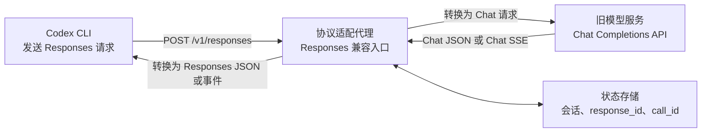
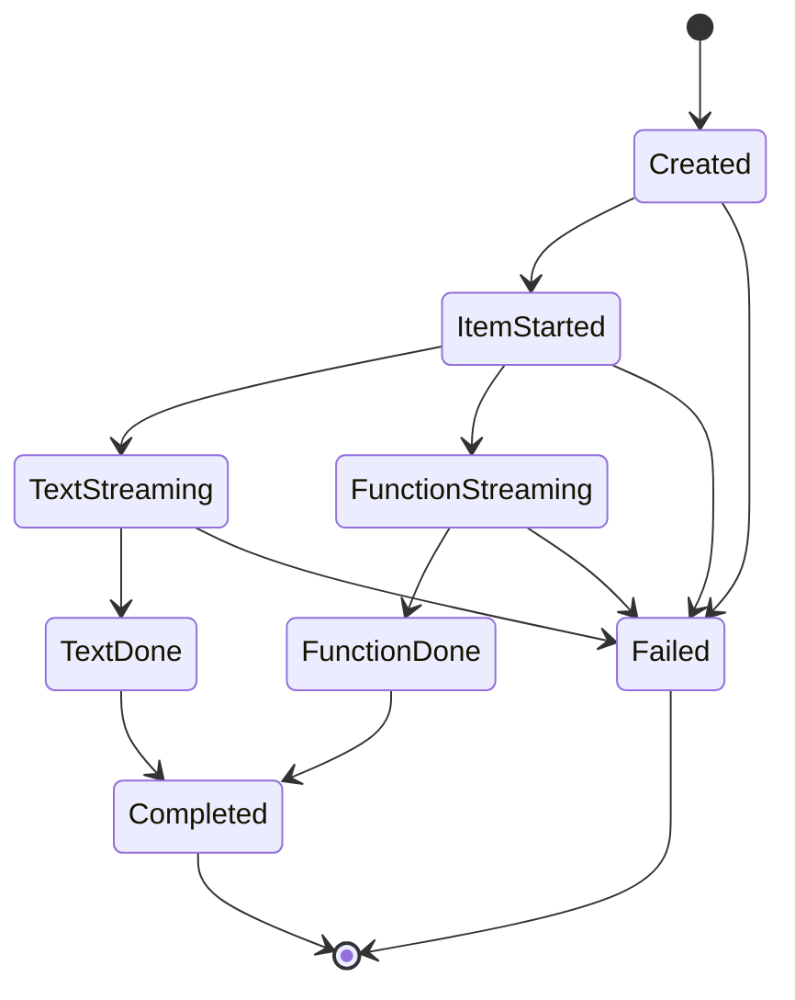
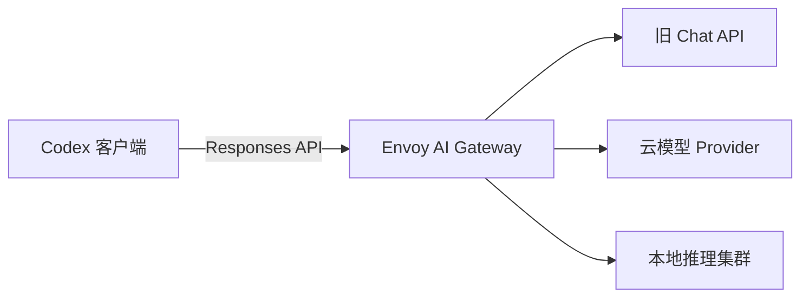

[toc]


下面按“**Codex 使用 Responses 协议，代理对接只支持 Chat Completions 的旧上游**”这一实际场景展开。重点区分请求与响应两个方向，避免把“chat → responses”误解成单向转换。

## Codex 通过代理兼容旧 Chat API：Responses 与 Chat Completions 协议转译指南

## 主题定位与核心结论

截至 2026 年 8 月，Codex 自定义模型提供方的 `wire_api` 只支持 `responses`，并且省略时也默认使用 Responses API。过去一些配置示例中的 `wire_api = "chat"` 已不适用于当前版本。([developers.openai.com](https://developers.openai.com/codex/config-reference))

因此，当旧模型服务只提供：

```text
POST /v1/chat/completions
```

而 Codex 要求：

```text
POST /v1/responses
```

就需要在两者之间部署一个**协议适配代理**（Protocol Translation Proxy）。

这里其实包含两个转换方向：

| 数据方向           | 转换内容                                   |
| ------------------ | ------------------------------------------ |
| Codex 请求到旧上游 | Responses 请求转换为 Chat Completions 请求 |
| 旧上游响应到 Codex | Chat Completions 响应转换为 Responses 响应 |

所以常说的“Chat 转 Responses”通常只描述了**响应方向**。一个真正可用的 Codex 兼容代理必须同时处理请求、响应、流式事件、工具调用和会话状态。

------

## 内容大纲

| 主题           | 核心问题                                 | 学习目标                  |
| -------------- | ---------------------------------------- | ------------------------- |
| 背景与协议演进 | 为什么 Codex 不再直接使用 Chat 协议      | 理解 Responses API 的定位 |
| 整体架构       | Codex、代理和旧 API 如何连接             | 建立完整数据流认知        |
| Codex 配置     | 如何指定自定义模型提供方                 | 正确编写 `config.toml`    |
| 请求转换       | Responses 字段如何映射到 Chat            | 掌握输入协议转换          |
| 响应转换       | Chat 响应如何包装为 Responses            | 掌握输出协议转换          |
| 流式转换       | 两套 SSE 事件为什么不能直接透传          | 构建稳定流式输出          |
| 工具调用       | `tool_calls` 和 `function_call` 如何关联 | 支持 Codex Agent 工作流   |
| 会话状态       | `previous_response_id` 如何兼容          | 避免多轮上下文丢失        |
| 能力降级       | 哪些 Responses 能力无法模拟              | 明确兼容边界              |
| 工程实践       | 安全、重试、日志和测试如何设计           | 达到生产可用水平          |
| 故障排查       | 常见错误如何定位                         | 提高部署效率              |

------

## 核心术语

| 术语                 | 英文                         | 含义                                                 |
| -------------------- | ---------------------------- | ---------------------------------------------------- |
| Codex CLI            | Codex Command-Line Interface | 在本地终端运行的编码智能体                           |
| 模型提供方           | Model Provider               | Codex 连接模型服务时使用的一组配置                   |
| 基础地址             | Base URL                     | API 请求路径的公共前缀                               |
| 线上协议             | Wire API                     | 客户端与模型服务实际交换的 HTTP 协议                 |
| 协议适配器           | Protocol Adapter             | 在不同 API 数据结构之间转换的组件                    |
| Chat Completions API | Chat Completions API         | 以 `messages` 和 `choices` 为核心的旧式聊天接口      |
| Responses API        | Responses API                | 以类型化 `input`、`output` 和 Item 为核心的新接口    |
| 条目                 | Item                         | Responses API 中消息、推理、函数调用等内容的基本单元 |
| 函数调用             | Function Calling             | 模型请求客户端执行某个外部函数的机制                 |
| 服务端事件           | Server-Sent Events, SSE      | 通过单向 HTTP 长连接传输增量事件                     |
| 调用关联标识         | Call ID                      | 关联函数调用和函数执行结果的标识                     |
| 有状态模式           | Stateful Mode                | 服务端保存会话链和响应状态                           |
| 无状态模式           | Stateless Mode               | 每次请求由客户端重新提供完整上下文                   |
| 关联标识             | Correlation ID               | 用于跨服务跟踪同一次请求的标识                       |

Responses API 使用类型化 `output` Item 表达消息、推理和函数调用，不再把所有内容都塞进一个 Chat Message；同时，Responses 不支持 Chat Completions 中通过 `n` 一次生成多个候选结果的模式。([OpenAI Developers](https://developers.openai.com/api/docs/guides/migrate-to-responses))

------

## 整体架构



代理对 Codex 表现为一个原生 Responses API 服务；对旧上游则表现为一个普通 Chat Completions 客户端。

这种设计也称为：

- **外观模式**（Facade Pattern）：向 Codex 暴露统一接口。
- **适配器模式**（Adapter Pattern）：转换两种不兼容的数据结构。
- **反向代理**（Reverse Proxy）：集中处理认证、路由和流量控制。
- **防腐层**（Anti-Corruption Layer）：避免旧系统的数据模型污染新接口。

------

## 为什么不能只配置 `wire_api = "chat"`

当前 Codex 配置中，`wire_api` 只接受 `responses`。自定义 Provider 可以设置基础地址、认证方式、请求头、查询参数、请求重试和流式重试，但不能通过配置恢复旧 Chat 协议。([developers.openai.com](https://developers.openai.com/codex/config-reference))

这意味着下面的旧配置思路已经不可取：

```toml
[model_providers.legacy]
wire_api = "chat"
```

正确思路是：

```toml
[model_providers.compat_proxy]
wire_api = "responses"
```

然后由 `compat_proxy` 提供 `/v1/responses`，在代理内部调用旧上游的 `/v1/chat/completions`。

------

## Codex 配置

Codex 用户级配置通常放在：

```text
~/.codex/config.toml
```

项目也可以使用 `.codex/config.toml`，但项目级配置只会在项目被信任后加载。Codex 的配置优先级从命令行覆盖、项目配置、Profile、用户配置、系统配置到内置默认值依次降低。([OpenAI Developers](https://developers.openai.com/codex/config-file/config-basic))

### 推荐配置

```toml
model = "legacy-coder"
model_provider = "compat_proxy"

[model_providers.compat_proxy]
name = "Legacy Chat through Responses adapter"
base_url = "http://127.0.0.1:8080/v1"
env_key = "CODEX_PROXY_API_KEY"
wire_api = "responses"

request_max_retries = 2
stream_max_retries = 1
stream_idle_timeout_ms = 300000
```

设置代理访问密钥：

```bash
export CODEX_PROXY_API_KEY="replace-with-a-local-proxy-token"
```

启动 Codex：

```bash
codex
```

或者执行一次非交互任务：

```bash
codex exec "检查当前项目中的错误处理，并给出修改建议"
```

Codex 官方配置支持为自定义 Provider 指定 `base_url`、环境变量密钥、静态请求头和环境变量请求头。也可以通过外部命令动态获取 Bearer Token。([OpenAI Developers](https://developers.openai.com/codex/config-file/config-advanced))

### 为什么建议让 `base_url` 以 `/v1` 结尾

采用下面的地址：

```toml
base_url = "http://127.0.0.1:8080/v1"
```

可以让代理提供标准化端点：

```text
POST /v1/responses
GET  /v1/models
GET  /health
```

不要把 `base_url` 配成具体的 `/v1/responses`，否则客户端追加接口路径时可能形成重复路径。

------

## 代理需要提供的接口

最低限度应提供：

| 接口                             | 是否必需 | 用途                      |
| -------------------------------- | -------- | ------------------------- |
| `POST /v1/responses`             | 是       | 接收 Codex 模型请求       |
| `GET /health`                    | 建议     | 健康检查                  |
| `GET /v1/models`                 | 建议     | 模型发现和诊断            |
| `GET /metrics`                   | 可选     | Prometheus 等监控系统采集 |
| `GET /v1/responses/{id}`         | 视情况   | 支持有状态响应查询        |
| `POST /v1/responses/{id}/cancel` | 视情况   | 支持后台或可取消任务      |

旧式上游通常只需要：

```text
POST /v1/chat/completions
```

如果只实现文本补全而不实现流式事件、工具调用和状态管理，可能通过简单测试，但通常无法稳定支持 Codex 的完整 Agent 工作流。

------

## 请求转换：Responses 转 Chat Completions

官方迁移规则中，Chat Completions 的 `messages` 对应 Responses 的 `input`；系统级指导可以放在顶层 `instructions`，消息、函数调用和函数结果则分别表示为不同的 Item。([OpenAI Developers](https://developers.openai.com/api/docs/guides/migrate-to-responses))

### 主要字段映射

| Responses 请求字段     | Chat Completions 字段   | 转换规则                     | 注意事项                                                     |
| ---------------------- | ----------------------- | ---------------------------- | ------------------------------------------------------------ |
| `model`                | `model`                 | 直接传递或经过模型别名表转换 | 不要让客户端任意访问所有上游模型                             |
| `instructions`         | `messages` 中的系统消息 | 插入消息数组开头             | 上游支持 `developer` 时可使用 `developer`，否则使用 `system` |
| 字符串 `input`         | `messages`              | 转为一条 `user` 消息         | 仅适用于简单文本                                             |
| 消息类型 `input` Item  | `messages`              | 按角色转换                   | 需要处理数组形式的内容块                                     |
| `max_output_tokens`    | `max_completion_tokens` | 优先映射到现代字段           | 更旧的上游可能只支持 `max_tokens`                            |
| `temperature`          | `temperature`           | 上游支持时透传               | 推理模型可能不接受                                           |
| `top_p`                | `top_p`                 | 上游支持时透传               | 不建议同时频繁调整温度和 `top_p`                             |
| `stream`               | `stream`                | 透传布尔值                   | 返回事件不能直接透传                                         |
| `tools`                | `tools`                 | 改写函数定义结构             | Responses 和 Chat 的函数包装层不同                           |
| `tool_choice`          | `tool_choice`           | 根据目标协议调整结构         | 必须验证函数名称                                             |
| `parallel_tool_calls`  | 同名字段                | 上游支持时传递               | 不支持时应显式禁用或拒绝                                     |
| `text.format`          | `response_format`       | 转换 JSON Schema 包装结构    | 不能简单改字段名                                             |
| `previous_response_id` | 无直接对应              | 从代理状态存储恢复历史消息   | 旧 Chat API 本身不管理响应链                                 |
| `store`                | 无直接对应              | 转换为代理自己的状态策略     | 不应直接传给旧上游                                           |
| `reasoning`            | 无通用对应              | 按上游能力转换或拒绝         | 不要静默假装支持                                             |
| `include`              | 无通用对应              | 按能力白名单处理             | 未实现的 Item 类型应返回明确错误                             |

### 简单文本转换示例

Codex 可能向代理发送：

```json
{
  "model": "legacy-coder",
  "instructions": "你是一名严谨的软件工程师。",
  "input": [
    {
      "role": "user",
      "content": [
        {
          "type": "input_text",
          "text": "分析当前项目的异常处理。"
        }
      ]
    }
  ],
  "stream": true
}
```

代理转换为：

```json
{
  "model": "legacy-coder",
  "messages": [
    {
      "role": "system",
      "content": "你是一名严谨的软件工程师。"
    },
    {
      "role": "user",
      "content": "分析当前项目的异常处理。"
    }
  ],
  "stream": true
}
```

### 消息内容不能一律拼接成字符串

对于以下多模态输入：

```json
{
  "role": "user",
  "content": [
    {
      "type": "input_text",
      "text": "解释这张图"
    },
    {
      "type": "input_image",
      "image_url": "..."
    }
  ]
}
```

代理应先检查旧上游是否支持 Chat 多模态内容块。

处理策略应为：

- 上游支持图片：转换成上游接受的图片内容格式。
- 上游不支持图片：返回明确的 `unsupported_feature` 错误。
- 不要悄悄丢弃图片后只发送文本，否则模型可能给出具有误导性的回答。

------

## 系统消息与 `instructions`

Responses API 可以把系统级指导放在顶层 `instructions`，而 Chat Completions 通常把它放在 `messages` 中。([OpenAI Developers](https://developers.openai.com/api/docs/guides/migrate-to-responses))

推荐合并顺序：

```text
代理强制策略
Codex 顶层 instructions
输入中的 developer 消息
输入中的 system 消息
普通会话内容
```

但不要简单把所有系统消息连接成一个巨大字符串。应保留明确的边界，例如：

```text
[Gateway Policy]
禁止泄露密钥。

[Client Instructions]
优先修改现有代码，不要无故重写。

[Conversation System Message]
使用中文回答。
```

对于敏感场景，代理的强制策略必须具有最高优先级，并且不能被客户端请求覆盖。

------

## 工具调用转换

Responses 中，函数调用和函数结果是两个独立 Item，通过 `call_id` 关联。([OpenAI Developers](https://developers.openai.com/api/docs/guides/migrate-to-responses))

### 工具定义转换

Responses 工具定义：

```json
{
  "type": "function",
  "name": "read_file",
  "description": "读取工作区中的文本文件",
  "parameters": {
    "type": "object",
    "properties": {
      "path": {
        "type": "string"
      }
    },
    "required": ["path"],
    "additionalProperties": false
  },
  "strict": true
}
```

Chat Completions 工具定义：

```json
{
  "type": "function",
  "function": {
    "name": "read_file",
    "description": "读取工作区中的文本文件",
    "parameters": {
      "type": "object",
      "properties": {
        "path": {
          "type": "string"
        }
      },
      "required": ["path"],
      "additionalProperties": false
    },
    "strict": true
  }
}
```

关键差异是：

- Responses 把 `name`、`description`、`parameters` 直接放在工具对象内。
- Chat Completions 将这些字段放在 `function` 对象内。
- 两套 API 对 `strict` 的默认行为可能不同，应显式设置，不要依赖默认值。([OpenAI Developers](https://developers.openai.com/api/docs/guides/migrate-to-responses))

### Chat 工具调用转换为 Responses Item

旧上游返回：

```json
{
  "role": "assistant",
  "content": null,
  "tool_calls": [
    {
      "id": "call_abc123",
      "type": "function",
      "function": {
        "name": "read_file",
        "arguments": "{\"path\":\"src/main.py\"}"
      }
    }
  ]
}
```

代理应生成 Responses 输出 Item：

```json
{
  "type": "function_call",
  "id": "fc_abc123",
  "call_id": "call_abc123",
  "name": "read_file",
  "arguments": "{\"path\":\"src/main.py\"}",
  "status": "completed"
}
```

必须保留：

- `call_id`
- 函数名称
- 原始参数 JSON 字符串
- 同一响应中的调用顺序

不要重新生成 `call_id` 后忘记保存映射，否则 Codex 返回函数结果时，代理无法找到对应调用。

### Responses 函数结果转换为 Chat Tool 消息

Codex 后续可能提交：

```json
{
  "type": "function_call_output",
  "call_id": "call_abc123",
  "output": "{\"content\":\"print('hello')\"}"
}
```

代理应转换为：

```json
{
  "role": "tool",
  "tool_call_id": "call_abc123",
  "content": "{\"content\":\"print('hello')\"}"
}
```

完整的 Chat 上下文通常需要包含：

```text
用户消息
助手的 tool_calls 消息
tool 结果消息
```

不能只把工具结果单独发给上游。

------

## 响应转换：Chat Completions 转 Responses

Chat Completions 返回 `choices[].message`，Responses 返回类型化 `output[]`。官方示例中的文本响应会被包装为一个 `message` Item，其中包含 `output_text` 内容块。([OpenAI Developers](https://developers.openai.com/api/docs/guides/migrate-to-responses))

### 主要字段映射

| Chat Completions 字段           | Responses 字段            | 转换规则                                     |
| ------------------------------- | ------------------------- | -------------------------------------------- |
| `id`                            | `id`                      | 建议生成新的 `resp_` 标识，并单独保存上游 ID |
| `created`                       | `created_at`              | 使用上游时间或代理接收时间                   |
| `model`                         | `model`                   | 返回客户端请求使用的逻辑模型名               |
| `choices[0].message.content`    | `output[].content[].text` | 包装为 `message` 和 `output_text`            |
| `choices[0].message.tool_calls` | `output[]`                | 每个工具调用转换为一个 `function_call` Item  |
| `finish_reason = stop`          | `status = completed`      | 正常结束                                     |
| `finish_reason = length`        | `status = incomplete`     | 同时填写不完整原因                           |
| `usage.prompt_tokens`           | `usage.input_tokens`      | 转换用量字段                                 |
| `usage.completion_tokens`       | `usage.output_tokens`     | 转换用量字段                                 |
| `usage.total_tokens`            | `usage.total_tokens`      | 直接传递或重新计算                           |
| `choices` 多项                  | 单一输出                  | 最好拒绝多候选或只允许 `n = 1`               |
| Chat 错误                       | Responses 风格错误        | 保留合理的 HTTP 状态和错误类型               |

### 非流式文本响应示例

旧上游返回：

```json
{
  "id": "chatcmpl-old123",
  "object": "chat.completion",
  "created": 1785900000,
  "model": "legacy-coder",
  "choices": [
    {
      "index": 0,
      "message": {
        "role": "assistant",
        "content": "项目中的异常被过度捕获，建议缩小 try 块范围。"
      },
      "finish_reason": "stop"
    }
  ],
  "usage": {
    "prompt_tokens": 120,
    "completion_tokens": 28,
    "total_tokens": 148
  }
}
```

代理返回：

```json
{
  "id": "resp_proxy_01",
  "object": "response",
  "created_at": 1785900000,
  "status": "completed",
  "model": "legacy-coder",
  "output": [
    {
      "id": "msg_proxy_01",
      "type": "message",
      "status": "completed",
      "role": "assistant",
      "content": [
        {
          "type": "output_text",
          "text": "项目中的异常被过度捕获，建议缩小 try 块范围。",
          "annotations": [],
          "logprobs": []
        }
      ]
    }
  ],
  "usage": {
    "input_tokens": 120,
    "output_tokens": 28,
    "total_tokens": 148
  }
}
```

### 不要伪造推理内容

如果旧上游没有返回推理 Item，代理不应自行生成虚假的：

```json
{
  "type": "reasoning"
}
```

可以不返回 reasoning Item，或者明确将该 Provider 标记为不支持推理摘要。

协议字段看起来相似，不代表底层模型真的具备 Responses 原生推理能力。

------

## 结构化输出转换

Responses 使用：

```json
{
  "text": {
    "format": {
      "type": "json_schema",
      "name": "result",
      "strict": true,
      "schema": {}
    }
  }
}
```

Chat Completions 使用：

```json
{
  "response_format": {
    "type": "json_schema",
    "json_schema": {
      "name": "result",
      "strict": true,
      "schema": {}
    }
  }
}
```

官方迁移说明明确指出，Structured Outputs 从 Chat 的 `response_format` 移到了 Responses 的 `text.format`，而且两层对象的包装结构不同。([OpenAI Developers](https://developers.openai.com/api/docs/guides/migrate-to-responses))

代理需要执行：

```text
text.format.type       -> response_format.type
text.format.name       -> response_format.json_schema.name
text.format.strict     -> response_format.json_schema.strict
text.format.schema     -> response_format.json_schema.schema
```

如果旧上游只支持 `json_object` 而不支持 JSON Schema：

- 可以在配置中声明降级模式。
- 默认应返回“不支持严格 JSON Schema”。
- 不建议静默降级，因为 Codex 可能依赖严格字段约束。

------

## 流式协议转换

Chat Completions 的流式输出以 `choices[].delta` 为核心；Responses 使用带明确 `type` 的 SSE 事件。两者不能只改 URL 后原样透传。([OpenAI Developers](https://developers.openai.com/api/docs/guides/migrate-to-responses))

### Chat 流的典型形式

```text
data: {"choices":[{"delta":{"role":"assistant"}}]}

data: {"choices":[{"delta":{"content":"项目"}}]}

data: {"choices":[{"delta":{"content":"存在"}}]}

data: {"choices":[{"delta":{},"finish_reason":"stop"}]}

data: [DONE]
```

### Responses 事件生命周期

常见的完整文本生命周期包括：

| 阶段          | Responses 事件                |
| ------------- | ----------------------------- |
| 创建响应      | `response.created`            |
| 响应处理中    | `response.in_progress`        |
| 添加输出 Item | `response.output_item.added`  |
| 添加内容块    | `response.content_part.added` |
| 文本增量      | `response.output_text.delta`  |
| 文本结束      | `response.output_text.done`   |
| 内容块结束    | `response.content_part.done`  |
| Item 结束     | `response.output_item.done`   |
| 响应完成      | `response.completed`          |
| 请求失败      | `error`                       |

官方迁移指南至少要求文本消费者处理 `response.created`、`response.output_text.delta`、`response.completed` 和 `error`；函数参数流还可能包含 `response.function_call_arguments.delta` 与 `response.function_call_arguments.done`。([OpenAI Developers](https://developers.openai.com/api/docs/guides/migrate-to-responses))

### 流转换状态机



代理不能只在每个 Chat 文本块前面加上：

```text
response.output_text.delta
```

还必须维护：

- `response_id`
- `item_id`
- `output_index`
- `content_index`
- 工具调用索引
- 已累计的文本
- 已累计的函数参数
- 响应状态
- 事件顺序

### 流式工具调用

旧 Chat 上游可能把函数参数拆成多个片段：

```json
{
  "tool_calls": [
    {
      "index": 0,
      "function": {
        "arguments": "{\"pa"
      }
    }
  ]
}
```

下一块可能是：

```json
{
  "tool_calls": [
    {
      "index": 0,
      "function": {
        "arguments": "th\":\"src/main.py\"}"
      }
    }
  ]
}
```

代理必须按工具调用的 `index` 累积，而不是把每个片段当成独立函数调用。

输出给 Codex 时，可逐步生成：

```text
response.function_call_arguments.delta
```

结束时生成：

```text
response.function_call_arguments.done
```

### SSE 代理注意事项

反向代理必须关闭响应缓冲，否则用户可能在模型完成后才一次性收到所有内容。

Nginx 示例：

```nginx
location /v1/ {
    proxy_pass http://adapter:8080;
    proxy_http_version 1.1;

    proxy_buffering off;
    proxy_cache off;
    gzip off;

    proxy_read_timeout 600s;
    proxy_send_timeout 600s;

    proxy_set_header Authorization $http_authorization;
    proxy_set_header X-Request-ID $request_id;
}
```

还应确保：

- 每个 SSE 事件以空行结束。
- 不修改 `Content-Type: text/event-stream`。
- 定期发送注释心跳，避免中间网络设备关闭空闲连接。
- 客户端断开后，及时取消上游请求。
- 首个字节发送后，不要自动重试整个请求。

------

## 多轮会话与 `previous_response_id`

Responses 提供三种常见状态管理方式：

- 使用 `previous_response_id` 连接前一次响应。
- 由客户端重新发送之前的 `output` Item。
- 使用持久化 Conversation 对象。([OpenAI Developers](https://developers.openai.com/api/docs/guides/migrate-to-responses))

旧 Chat Completions 没有 `previous_response_id` 概念，因此协议代理必须自行实现状态。

### 可选策略

| 策略                    | 实现方式                                 | 优点                   | 缺点                                       |
| ----------------------- | ---------------------------------------- | ---------------------- | ------------------------------------------ |
| 完全无状态              | 要求每次请求包含全部历史 Item            | 代理简单，容易水平扩展 | 不支持只提供 `previous_response_id` 的请求 |
| 代理维护状态            | 将响应 ID 映射到 Chat 消息历史           | 对 Codex 最透明        | 需要 Redis、数据库或其他共享存储           |
| 混合模式                | 短期状态放 Redis，客户端也可提交完整历史 | 灵活，容错能力较好     | 实现复杂                                   |
| 使用原生 Responses 上游 | 不再进行协议降级                         | 能力最完整             | 需要更换旧上游                             |

生产环境通常建议使用代理维护状态。

### 推荐状态记录

```json
{
  "response_id": "resp_proxy_01",
  "upstream_response_id": "chatcmpl-old123",
  "model": "legacy-coder",
  "created_at": 1785900000,
  "instructions": "你是一名严谨的软件工程师。",
  "messages": [],
  "output_items": [],
  "tool_call_map": {
    "call_abc123": {
      "name": "read_file",
      "status": "waiting_for_output"
    }
  }
}
```

Redis Key 可以设计为：

```text
responses:resp_proxy_01
```

并设置合理的 TTL，例如几小时或几天，具体取决于会话生命周期和隐私要求。

### 必须注意 `instructions` 的继承

官方说明指出，通过 `previous_response_id` 继续请求时，前一次响应顶层的 `instructions` 不会自动继承，因此稳定指令应在后续请求中重新发送。([OpenAI Developers](https://developers.openai.com/api/docs/guides/migrate-to-responses))

代理不要自行假设所有指令都永久有效。可以分别存储：

- 本次请求明确提供的指令。
- 网关强制策略。
- 会话默认策略。
- 项目级策略。

------

## Responses 能力降级边界

Responses API 不只是 Chat Completions 的字段改名版本。它提供状态、类型化 Item、原生工具和更完整的 Agent 能力。OpenAI 将其作为新项目的推荐接口。([OpenAI Developers](https://developers.openai.com/api/docs/guides/migrate-to-responses))

### 兼容能力矩阵

| 能力                   | 转换到旧 Chat 的可行性 | 建议                             |
| ---------------------- | ---------------------- | -------------------------------- |
| 普通文本输入输出       | 高                     | 优先实现                         |
| 文本 SSE 流            | 高                     | 必须使用事件状态机               |
| 自定义函数调用         | 中到高                 | 完整维护 `call_id`               |
| 并行函数调用           | 中                     | 取决于旧上游能力                 |
| 图片输入               | 中                     | 取决于上游多模态支持             |
| Structured Outputs     | 中                     | 验证上游 JSON Schema 能力        |
| `previous_response_id` | 中                     | 需要代理状态存储                 |
| 推理 Item              | 低                     | 不应伪造                         |
| 加密推理 Item          | 很低                   | 通常无法等价转换                 |
| 原生 Web Search        | 低                     | 需改造成自定义函数或明确不支持   |
| File Search            | 低                     | 需自行实现检索工具               |
| Code Interpreter       | 低                     | 不能仅靠协议转换获得             |
| Remote MCP             | 低                     | 需独立实现 MCP 编排              |
| Background Mode        | 低                     | 需要任务队列和状态接口           |
| Conversation API       | 中                     | 需要代理自行持久化               |
| Responses WebSocket    | 低                     | 不能由普通 Chat SSE 自动获得     |
| 多候选 `n`             | 不适用                 | Responses 本身只返回一个生成结果 |

最重要的原则是：

> 协议兼容不等于能力兼容。

即使 JSON 结构转换成功，如果旧模型不能稳定调用工具、理解长上下文或执行代码任务，Codex 的实际效果仍会明显下降。

## 方案对比

| 工具                   | 类型                  | 对“Codex Responses → 旧 Chat API”的匹配度 | 适合场景                                | 主要限制                                       |
| ---------------------- | --------------------- | ----------------------------------------- | --------------------------------------- | ---------------------------------------------- |
| **LiteLLM Proxy**      | 开源、自建            | **很高**                                  | 任意 OpenAI-compatible 旧接口、快速落地 | 高级 Responses 能力仍取决于上游                |
| **New API**            | 开源、自建、中文面板  | **较高**                                  | 需要渠道、令牌、额度、计费和管理后台    | Responses 转换仍在快速演进，需固定版本测试     |
| **Portkey AI Gateway** | 托管或网关产品        | **高**                                    | 多供应商、可观测性、容错、企业治理      | 适配模式不支持完整服务端状态能力               |
| **Bifrost**            | 开源、高性能网关      | **中到高**                                | Go 技术栈、多 Provider、高吞吐          | 对任意自定义旧端点的配置需单独验证             |
| **Envoy AI Gateway**   | 开源、Kubernetes 原生 | **中到高**                                | K8s、多租户、企业流量治理               | 部署复杂，对单机代理明显偏重                   |
| **OpenRouter**         | 托管模型聚合服务      | **间接可用**                              | 愿意更换上游，不再使用现有旧 API        | 不能简单挂接任意私有旧接口，Responses 为无状态 |
| **vLLM**               | 模型推理服务器        | **替代方案**                              | 旧接口是自己部署的本地模型              | 不是代理桥接，而是更换模型服务层               |

------

## 首选：LiteLLM Proxy

LiteLLM 是目前与你的需求**最直接对应**的工具。它明确提供：

```text
客户端 /v1/responses
        ↓
LiteLLM Responses Bridge
        ↓
旧上游 /v1/chat/completions
```

针对只有 Chat Completions 的 OpenAI-compatible 上游，LiteLLM 提供专门的：

```yaml
use_chat_completions_api: true
```

该选项会强制把收到的 Responses 请求桥接到旧上游的 Chat Completions 接口，而不是直接把 `/v1/responses` 转发过去。([LiteLLM](https://docs.litellm.ai/docs/response_api))

### 最小 LiteLLM 配置

```yaml
model_list:
  - model_name: legacy-coder
    litellm_params:
      model: openai/legacy-coder
      api_base: https://legacy-api.example.com/v1
      api_key: os.environ/LEGACY_API_KEY

      # 关键配置：
      # 强制 Responses 请求转为 Chat Completions 请求
      use_chat_completions_api: true

litellm_settings:
  master_key: sk-change-this-proxy-key
```

安装并运行：

```bash
uv tool install 'litellm[proxy]'

export LEGACY_API_KEY="旧上游的密钥"

litellm --config ./litellm_config.yaml
```

LiteLLM 默认监听：

```text
http://127.0.0.1:4000
```

官方文档同时给出了 Proxy 的 Responses API 调用方式和配置文件启动方式。([LiteLLM](https://docs.litellm.ai/?utm_source=chatgpt.com))

### Codex 配置

在 `~/.codex/config.toml` 中配置：

```toml
model = "legacy-coder"
model_provider = "litellm_bridge"

[model_providers.litellm_bridge]
name = "LiteLLM Responses Bridge"
base_url = "http://127.0.0.1:4000/v1"
env_key = "LITELLM_MASTER_KEY"
wire_api = "responses"

request_max_retries = 2
stream_max_retries = 1
stream_idle_timeout_ms = 300000
```

然后设置 Codex 到 LiteLLM 的访问密钥：

```bash
export LITELLM_MASTER_KEY="sk-change-this-proxy-key"
```

Codex 当前自定义 Provider 的 `wire_api` 只支持 `responses`，所以转换必须由 LiteLLM 这样的代理完成。Codex 支持通过 `base_url`、`env_key` 和自定义 Provider 接入代理。([OpenAI Developers](https://developers.openai.com/codex/config-file/config-advanced?utm_source=chatgpt.com))

### 可替代的模型写法

LiteLLM 还支持把路由模式直接编码到模型名中：

```yaml
model_list:
  - model_name: legacy-coder
    litellm_params:
      model: openai/chat_completions/legacy-coder
      api_base: https://legacy-api.example.com/v1
      api_key: os.environ/LEGACY_API_KEY
```

它与：

```yaml
use_chat_completions_api: true
```

表达的是同一个核心意图。为了让配置更直观，我更建议显式使用 `use_chat_completions_api`。([LiteLLM](https://docs.litellm.ai/docs/response_api))

------

## 中文管理面板方案：New API

New API 比较适合需要以下功能的场景：

- 中文 Web 管理后台
- 多个上游渠道
- 模型映射
- 用户令牌
- 额度和计费
- 调用日志
- 失败重试和渠道权重
- Docker 快速部署

它已经公开 `/v1/responses` 接口，API 文档列出了 `input`、`instructions`、`tools`、`reasoning`、`previous_response_id` 和流式请求等字段。最新变更日志还写明增加了 Responses API 与 Chat 格式的兼容转换。([New API](https://docs.newapi.pro/en/docs/api/ai-model/chat/openai/createresponse))

### 需要注意的文档差异

New API 当前不同文档之间存在一定版本差异：

- API 文档已经公开 `/v1/responses`。
- 更新日志称已增加 Responses 与 Chat 兼容。
- GitHub README 仍将 `OpenAI Compatible ⇄ OpenAI Responses` 标注为开发中。([GitHub](https://github.com/QuantumNous/new-api))

这通常说明功能正在快速迭代。用于 Codex 时应：

1. 固定 New API 镜像版本，不要直接长期使用漂移的 `latest`。
2. 实测 SSE 流式输出。
3. 实测函数调用和工具结果回传。
4. 实测 Codex 多轮 Agent 循环。
5. 升级前运行协议回归测试。

### 适用判断

| 需求                          | 建议                             |
| ----------------------------- | -------------------------------- |
| 只需要单个旧 API 转换         | LiteLLM 更简单                   |
| 需要中文后台和渠道管理        | New API 更合适                   |
| 需要用户额度和令牌分发        | New API 更方便                   |
| 极度重视 Codex 工具调用稳定性 | 先对具体版本做完整测试           |
| 需要自己修改转换代码          | New API 的 Go 代码更便于深度定制 |

------

## 企业网关方案：Portkey

Portkey 的 Responses API 明确区分两类上游：

- **Native Provider**：直接调用上游原生 Responses API。
- **Adapter Provider**：自动在 Responses API 和 Chat Completions 之间转换。

它的适配器会统一输出 Responses SSE 事件，包括 `response.created`、`response.output_text.delta` 和 `response.completed` 等事件，并支持文本、流式、工具调用、结构化输出、视觉输入和推理参数映射。([Portkey](https://portkey.ai/docs/product/ai-gateway/responses-api))

它更适合：

- 多供应商负载均衡
- 自动降级与重试
- 预算限制
- Guardrails
- 请求追踪
- 集中式日志和成本分析

### 重要限制

对于经过 Chat Adapter 转换的 Provider，Portkey 明确说明以下能力不是完整原生支持：

| 能力                     | Adapter Provider 行为              |
| ------------------------ | ---------------------------------- |
| `previous_response_id`   | 不支持服务端响应链，应重新发送历史 |
| `store`                  | 会被忽略，不持久化响应             |
| Retrieve/Delete Response | 不可用                             |
| `web_search`             | 原生 Provider 才能完整支持         |
| `file_search`            | 原生 Provider 才能完整支持         |
| `computer_use`           | 原生 Provider 才能完整支持         |

因此，它可以很好地完成“协议转换”，但不能凭空让旧 Chat 服务拥有完整的 Responses 服务端状态和托管工具能力。([Portkey](https://portkey.ai/docs/product/ai-gateway/responses-api))

------

## 高性能开源方案：Bifrost

Bifrost 是偏高性能的开源 AI Gateway，支持统一 OpenAI-compatible 接口、路由、失败转移、限流、成本管理、Prometheus、OpenTelemetry 和插件扩展。([Bifrost](https://docs.getbifrost.ai/overview))

其 Provider 文档显示，它可以把 Responses API 转换到不同供应商的底层协议，例如：

- Responses → Gemini Messages
- Responses → Anthropic Messages
- Responses → AWS Bedrock Converse

并处理工具调用和结构化输出等转换。([Bifrost](https://docs.getbifrost.ai/providers/supported-providers/gemini?utm_source=chatgpt.com))

它适合：

- 希望使用 Go 技术栈
- 对网关延迟和吞吐敏感
- 需要 Prometheus 和 OpenTelemetry
- 需要自定义 Go 或 WASM 插件
- 后续准备接入 MCP Gateway

不过，对“任意一个只有 `/v1/chat/completions` 的自定义旧地址”，仍应先确认其自定义 Provider 配置和 Responses Adapter 是否覆盖你的请求字段。

------

## Kubernetes 方案：Envoy AI Gateway

Envoy AI Gateway 已经支持 `/v1/responses`，包括：

- 流式与非流式
- Function Calling
- MCP 工具
- Reasoning
- 多轮会话
- 多模态输入
- Token 用量跟踪
- OpenInference 追踪

其 1.0 版本提供 16 个 Provider、跨 Provider 请求和响应转换、多租户路由、配额限流、模型虚拟化和集中凭据管理。([aigateway.envoyproxy.io](https://aigateway.envoyproxy.io/release-notes/v0.5/))

适合以下架构：



但如果只是：

```text
一台开发机
一个 Codex
一个旧 API
```

使用 Envoy AI Gateway 会明显复杂于 LiteLLM。

------

## 托管替代方案：OpenRouter

OpenRouter 提供 OpenAI-compatible `/api/v1/responses`，支持推理、工具调用和 Web Search。它适合“不再坚持使用现有旧上游，而是直接切换到托管多模型平台”的情况。([OpenRouter](https://openrouter.ai/docs/api_reference/responses/overview))

但它的 Responses API 是**无状态的**：

- 不保存响应状态。
- 要求每次请求携带完整历史。
- `store: true` 会被拒绝。
- 非空 `previous_response_id` 会被拒绝。([OpenRouter](https://openrouter.ai/docs/api_reference/responses/overview))

因此它不是“把你现有私有旧 API 包装起来”的首选，而是“替换旧上游”的托管方案。

------

## 本地模型替代方案：vLLM

如果旧 Chat API 是你自己运行的本地模型服务，可以考虑直接升级为 vLLM，而不是增加协议代理。

新版 vLLM 的 OpenAI-compatible Server 同时提供：

```text
/v1/chat/completions
/v1/responses
/v1/responses/{response_id}
/v1/responses/{response_id}/cancel
```

并有 Responses 工具调用示例。这样 Codex 可以直接连接 vLLM，不再经过 Chat 转 Responses 的中间转换。([vLLM](https://docs.vllm.ai/en/latest/serving/online_serving/openai_compatible_server/))

架构可以从：

```text
Codex → 转换代理 → 旧 Chat Server → 模型
```

简化为：

```text
Codex → vLLM Responses Server → 模型
```

前提是：

- 模型能够被 vLLM 加载。
- Chat Template 正确。
- 模型本身支持稳定的工具调用。
- vLLM 对该模型的 Tool Parser 配置正确。

------

## 选择建议

### 你的场景只有一个旧 OpenAI-compatible API

采用：

```text
Codex → LiteLLM Proxy → 旧 /v1/chat/completions
```

这是配置最少、转换意图最明确的方案。

### 需要中文后台、用户管理和额度

采用：

```text
Codex → New API → 多个旧 API 渠道
```

但需要固定版本并重点测试 Codex 工具调用。

### 需要商业级可观测性和多供应商容灾

采用：

```text
Codex → Portkey → 多个 Provider
```

接受 Adapter Provider 不支持完整服务端状态的限制。

### 已有 Kubernetes 平台

采用：

```text
Codex → Envoy AI Gateway → 多 Provider 或推理集群
```

### 旧服务是自己的本地推理服务

优先评估：

```text
直接升级为 vLLM Responses Server
```

而不是长期维护协议转换层。

## 最终推荐顺序

| 排名 | 方案                 | 推荐理由                                        |
| ---- | -------------------- | ----------------------------------------------- |
| 1    | **LiteLLM Proxy**    | 对任意旧 Chat-compatible API 有明确 Bridge 配置 |
| 2    | **New API**          | 中文后台、渠道和令牌管理完善                    |
| 3    | **Portkey**          | 跨 Provider 转换和企业治理能力强                |
| 4    | **Bifrost**          | 开源、高性能、插件扩展能力强                    |
| 5    | **vLLM**             | 自有模型服务时可从根本上取消转换                |
| 6    | **Envoy AI Gateway** | 适合 Kubernetes 和平台工程团队                  |
| 7    | **OpenRouter**       | 适合替换上游，不适合包装任意私有旧 API          |

对于当前提出的“**老 API 做兼容，供 Codex 使用**”，建议先用 **LiteLLM Proxy** 做最小验证。确认文本流、工具调用和 Codex Agent 循环全部正常后，再判断是否需要迁移到带管理后台的 New API 或更完整的企业网关。