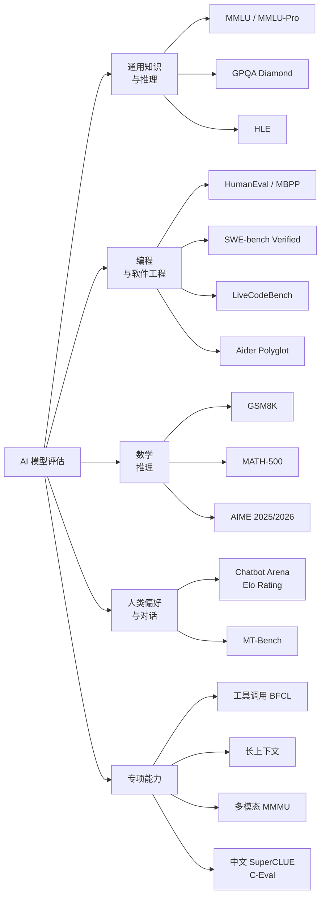
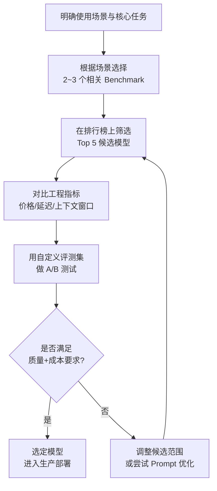

[toc]

## coding AI 大模型时可参考的指标与 Benchmark 

### 整体思路：从 Benchmark 到模型选型

Benchmark 的本质类似于医学检查中的不同检测项目——每个 Benchmark 回答一个特定问题，最终的"诊断"来自多个指标的组合模式，而非单一分数。

**LLM Benchmark 是模型选型的必要但不充分条件。** 没有单一 Benchmark 能预测生产环境的表现。最可靠的方法是：用公开 Benchmark 分数筛选候选模型，再用自定义评测数据集（基于你的真实业务负载）做最终决策。

下面按照「**能力维度**」系统梳理程序员最应关注的 Benchmark 和指标。

---

### Benchmark 全景分类

---

### 通用知识与推理类 Benchmark

#### MMLU / MMLU-Pro（Massive Multitask Language Understanding）

**MMLU** 是语言模型的"通识考试"基准。它包含数千道跨 60 个学科的多选题，涵盖医学、法律、数学、计算机科学等领域。

然而 **MMLU 在 2022 年是金标准，但如今已被前沿模型饱和。GPQA Diamond 取代了它的位置**。

可以把 **MMLU** 理解为广度标准化考试，**MMLU-Pro** 则是"荣誉版"（更难、抗干扰）。两者都适合做广度筛查，但都不应被视为生产就绪的证明。

| 指标         | MMLU                  | MMLU-Pro                 |
| ------------ | --------------------- | ------------------------ |
| **测试内容** | 60 个学科的多选题     | 更难的变体，抗对抗性格式 |
| **当前状态** | 前沿模型已饱和 (90%+) | 仍有区分度               |
| **适用场景** | 初步筛选模型通识能力  | 知识密集型应用           |
| **局限性**   | 训练集污染严重        | 仍是选择题，非开放生成   |

#### GPQA Diamond（Graduate-level Google-Proof QA）

**GPQA** 测试模型在硬科学问题上的推理能力。题目是由领域专家策划的研究生水平科学问题，测试物理、化学和生物学的高级推理。

**GPQA Diamond 和 SWE-bench Verified** 因为要求精确、可验证的输出，比 MMLU 或 HellaSwag 与企业级任务的生产表现有更强的相关性。

**为什么开发者要关注：** 如果你构建的产品涉及专业领域推理（如科研助手、技术文档生成），GPQA Diamond 分数是一个强信号。

#### HLE（Humanity's Last Exam）

HLE 是一项众包的、由极难问题组成的考试，覆盖几乎所有学术学科，被设计为"超人 AI 之前的最终考试"。

这是一个**区分度极高的前沿基准**，目前所有模型得分仍较低，适合评估模型在极限推理场景下的天花板。

---

### 编程与软件工程类 Benchmark（开发者核心关注）

这是程序员选模型时**最应重点关注**的维度。早期的 HumanEval 测试的是孤立函数生成，当前一代编程基准已经在**仓库级别**运作，并积极抵抗数据污染。

#### HumanEval / MBPP

**HumanEval** 是一组 164 道 Python 编程问题，每题约有 9.6 个测试用例来验证生成代码是否按预期工作。它已成为衡量代码生成 AI 模型性能的最流行基准之一。

HumanEval 衡量的是**函数级别代码生成的正确性**，通常使用可执行测试和 `pass@k` 指标。它干净、可复现，适合首轮评估代码质量。

**MBPP**（Mostly Basic Python Problems）包含约 1000 道众包的 Python 编程挑战，面向初学者水平，聚焦核心编程原理和标准库使用。

| 指标         | HumanEval                                   | MBPP               |
| ------------ | ------------------------------------------- | ------------------ |
| **题量**     | 164 题                                      | ~1000 题           |
| **难度**     | 中等（函数级）                              | 初学者级           |
| **语言**     | Python                                      | Python             |
| **核心指标** | `pass@1`, `pass@k`                          | `pass@1`, `pass@k` |
| **局限**     | 前沿模型已接近饱和 (93%+)；数据污染已被记录 | 题目较简单         |

**重要提示：** HumanEval 是模型发布论文中引用的标准编程基准，但前沿模型（如 GPT-5.3 Codex）已达 93%，且训练集污染有据可查。因此不应作为唯一的编程能力评估。

**`pass@k` 指标解释：**

- **`pass@1`**：模型只生成 1 次代码就通过所有测试用例的概率。这是最严格的指标，反映模型"一次搞定"的能力
- **`pass@k`**：模型生成 k 次代码中至少有一次通过所有测试用例的概率（k 通常取 10 或 100）

#### SWE-bench / SWE-bench Verified

**SWE-bench**（Software Engineering Benchmark）评估模型解决真实世界软件问题的能力，任务取自 GitHub 上的真实 Issue。它包含来自 12 个流行 Python 仓库的超过 2200 个 Issue 及其对应的 Pull Request。模型需要根据代码库和 Issue 描述生成能修复问题的代码补丁。

**SWE-bench Verified** 是一个经过验证的子集，包含 500 个真实 GitHub Issue，要求模型生成能通过单元测试验证的有效补丁。

截至 2026 年 3 月，Claude Opus 4.5 以 80.9% 领先 SWE-bench Verified，其后依次是 Claude Opus 4.6 (80.8%)、Gemini 3.1 Pro (80.6%)、MiniMax M2.5 (80.2%)、GPT-5.2 (80.0%)。最高分从 2025 年初的约 65% 跃升至 80.9%。

**数据污染是 SWE-bench 的一个活跃关注点。** OpenAI 的审计发现，每个被测的前沿模型都能对某些 SWE-bench Verified 任务逐字再现黄金补丁或问题描述细节。OpenAI 已停止报告 Verified 分数，并推荐改用 **SWE-bench Pro**。

**对开发者的意义：** SWE-bench 是目前最接近"真实软件工程工作"的基准。如果你需要 AI 辅助代码审查、Bug 修复、PR 生成，这个分数最具参考价值。

#### LiveCodeBench

**LiveCodeBench** 是追踪编程能力随时间变化的最佳选择，因为分数提升必须反映真正的改进而非记忆。Qwen3.5-plus 以 83.6% 的成绩领先 LiveCodeBench v6（2026 年 2 月数据）。

LiveCodeBench 使用 2023 年 5 月以来最新的竞赛题目，包含 880 道题目，来源于多个在线竞赛平台。

**为什么特别推荐：** 因为题目持续更新，模型无法通过训练集"背题"来刷分，是**抗污染能力最强的编程基准之一**。

#### Aider Polyglot Leaderboard

**Aider 的 Polyglot 排行榜**是一个 Agentic（智能体式）、多语言编程评测，实际编辑真实文件。它比聊天式编程评测更能预测生产环境中编程 Agent 的质量。

**适用人群：** 使用 Aider、Cursor 等 AI 编程工具的开发者。这个排行榜直接衡量模型在 IDE 辅助编程（多文件编辑、跨语言）场景下的表现。

#### 编程基准对比总表

| Benchmark              | 测试层次       | 核心特点          | 抗污染性           | 对开发者价值         |
| ---------------------- | -------------- | ----------------- | ------------------ | -------------------- |
| **HumanEval**          | 函数级         | 经典基线，简洁    | 低（已被广泛训练） | 初步筛选             |
| **MBPP**               | 函数级（简单） | 基础编程能力      | 低                 | 评估小模型           |
| **SWE-bench Verified** | 仓库级         | 真实 GitHub Issue | 中（有污染风险）   | 软件工程能力核心指标 |
| **SWE-bench Pro**      | 仓库级         | Verified 的升级版 | 较高               | 最新推荐             |
| **LiveCodeBench**      | 竞赛题         | 持续更新，抗污染  | **高**             | 跟踪模型进步         |
| **Aider Polyglot**     | 多文件/多语言  | Agentic 实际编辑  | 高                 | IDE 辅助编程场景     |
| **CursorBench**        | IDE 工作流     | Cursor 专有评测   | 中                 | Cursor 用户参考      |

---

### 数学推理类 Benchmark

数学推理是编程能力的一个重要延伸——涉及逻辑链条、符号推理和多步骤问题求解。

#### GSM8K

**GSM8K** 测试涵盖 8500 道小学数学应用题的数学推理。它是 2021~2023 年的标准数学基准。前沿模型现在已达 99%（如 GPT-5.3 Codex），使 GSM8K 对顶级模型的比较已无意义。但它仍适合评估小模型和量化微调与基础模型之间的差距。

#### MATH-500

**MATH-500** 测试竞赛级数学推理，题目来自 AMC、AIME 等竞赛，横跨 5 个难度级别。与 GSM8K 不同，MATH-500 的题目需要多步符号推理。

#### AIME 2025 / AIME 2026

对于更高难度的数学评估，**AIME 2025 和 AIME 2026** 现已成为前沿模型的标准数学基准。AIME 题目来自美国数学邀请赛（American Invitational Mathematics Examination），以其挑战性著称。

**实用类比：** GSM8K 是规范的"写出步骤"练习册，MATH 更接近奥赛挑战题。

| Benchmark          | 难度       | 题量     | 当前状态         | 适用场景       |
| ------------------ | ---------- | -------- | ---------------- | -------------- |
| **GSM8K**          | 小学应用题 | 8500     | 已饱和 (99%)     | 评估小模型     |
| **MATH-500**       | 竞赛级     | 500      | 仍有区分度 (96%) | 中高端模型对比 |
| **AIME 2025/2026** | 高中竞赛级 | ~30题/年 | **当前前沿标准** | 前沿模型对比   |
| **FrontierMath**   | 研究级数学 | 分层级   | 最高难度         | 极限推理评估   |

---

### 人类偏好与对话类 Benchmark

#### Chatbot Arena / LMArena（Elo Rating）

**LMArena**（前身为 LMSYS Chatbot Arena）于 2023 年中由 Berkeley SkyLab、UCSD、CMU 等学术团队发起。其核心理念是：停止用会被刷分和污染的静态学术基准来排名 LLM，改用真实用户在不知模型身份时的实际偏好来排名。原始网站将你的提示同时发送给两个匿名模型，由你投票选择更好的回复。投票后揭示模型身份。

LMSYS Chatbot Arena 是一个开源、众包的 LLM 评测平台。用户与两个匿名模型并排对话并投票。投票被转化为 **Elo 评分**，形成动态排行榜。Elo 评分从基线（通常 1000）开始，基于一对一对决增减。当模型击败更高评分的对手时，获得更多分数。

**三个关键优势：(1)** 它衡量的是人类偏好而非基准准确率，与下游实用性的相关性更强；**(2)** 采用盲评 A/B 对比，消除品牌偏见；**(3)** 众包投票量（数百万次）提供的统计置信度是任何单次基准无法匹敌的。

到 2026 年，平台已增加更多 Arena 分支（Vision、WebDev、Copilot、Search）和更好的排行榜工具。

**解读提示：** Elo 差异低于 10 在噪声范围内；差异超过 30 则在生产环境中可靠地有意义。

**当前 Arena 子排行榜一览（截至 2026 年中）：**

| Arena 子类       | 衡量内容         | 开发者相关性       |
| ---------------- | ---------------- | ------------------ |
| **Overall Text** | 综合文本对话质量 | 通用对话/助手场景  |
| **Coding Arena** | 编程相关对话     | **程序员核心参考** |
| **Vision Arena** | 多模态图像理解   | 多模态应用         |
| **WebDev Arena** | 前端/Web 开发    | 前端开发者         |
| **Search Arena** | 搜索增强生成     | RAG 应用           |

**已知局限：** 人类偏好虽然有用，但回复风格和熟悉度可能影响 Arena 投票结果。也就是说，"写得漂亮"可能比"答案正确"获得更多投票。

#### MT-Bench

**MT-Bench** 使用 LLM 评估者来评测模型在多轮对话中的偏见和冗余度。它是衡量**指令遵循能力**（Instruction Following）的标准基准，包含多轮对话的编程、推理、创意写作等类别。

---

### 工具调用与 Agent 能力

随着 AI Agent 成为 2025~2026 年的核心趋势，相关基准的重要性迅速上升。

#### BFCL（Berkeley Function Calling Leaderboard）

**BFCL v3** 评估模型在函数调用和 API 调用上的准确率。如果你正在构建依赖工具调用（Tool Use / Function Calling）的 AI Agent，这是关键参考。

#### τ-bench（Tau-bench）

τ-bench 是用于衡量 Agent 能力的新兴基准之一。

#### Artificial Analysis Coding Agent Index

Artificial Analysis 编程 Agent 基准衡量 Agent 在仓库、工具、多步工作流等场景的性能。评估维度包括性能和每任务成本的平衡——最高效的 Agent 位于图表左上方（更强的结果、更低的成本）。

**解读注意：** 更高的综合分并不意味着适合所有工作流。实际选择仍取决于你的工作流更像仓库级 Q&A、补丁生成还是终端执行，以及 IDE 集成、模型可用性和可靠性等实际约束。

---

### 中文场景专项基准（国内开发者必看）

对于面向中文用户或国内部署的场景，国际基准往往不够——需要关注中文专项评测。

#### SuperCLUE

**SuperCLUE** 是针对中文大模型的综合性评测基准，能全面评估模型在多个维度上的性能表现，通过多轮对话、客观题测试等方式，从语言理解与生成、知识应用、专业技能、环境适应与安全性等四大能力象限的 12 项基础能力进行评估。

**SuperCLUE 2026 年 7 月版**评测覆盖六大任务类别：数学推理、科学推理、Agentic 编程、精确指令遵循、幻觉控制和 Agentic 任务规划——前三项为推理能力，后三项为应用能力。共评测了 12 个国内外大模型。

**2025 年度报告核心结论：** 海外闭源模型仍居头部，但国产大模型从"跟跑"加速向"并跑"演进；开源领域国产模型主导，闭源领域海外领先，且国内模型性价比优势显著。

**中文场景下国内开源模型优势明显**，DeepSeek 系列和 Qwen 系列表现优异。

#### C-Eval

**C-Eval** 提供中文多学科的多选题，用于评估 LLM 在不同学术领域的能力。它是国内最早也最知名的中文评测基准之一。

#### 其他国内评测体系

| 评测基准        | 维度             | 特色                             |
| --------------- | ---------------- | -------------------------------- |
| **SuperCLUE**   | 综合（含 Agent） | 月度更新，独立第三方，含匿名对战 |
| **C-Eval**      | 学术知识         | 中文多学科多选题                 |
| **FlagEval**    | 综合 (600+ 维度) | 北京智源出品，含自建主观评测     |
| **OpenCompass** | 综合             | 上海 AI Lab 出品，覆盖面广       |

---

### 非 Benchmark 的实用选型指标

除了 Benchmark 分数，开发者在实际选型时还需要综合考虑以下"工程指标"：

**Benchmark 不测量的维度包括：速度**（GPQA Diamond 不关心模型是 1 秒还是 10 秒响应）和**成本**（一个 92% 准确率但 $15/百万 token 的模型与一个 89% 但 $1/百万 token 的模型，对于不同业务量是截然不同的选择）。

| 实用指标                               | 说明                               | 为什么重要               |
| -------------------------------------- | ---------------------------------- | ------------------------ |
| **API 价格**（输入/输出每百万 token）  | 不同模型定价差异巨大               | 高频调用场景下的成本控制 |
| **延迟 / TTFT**（Time to First Token） | 首 token 响应时间                  | 实时交互体验             |
| **吞吐量**（Tokens per Second, TPS）   | 每秒输出 token 数                  | 批量处理和代码生成效率   |
| **上下文窗口**（Context Window）       | 模型一次能处理的最大 token 数      | 长文件/大仓库分析        |
| **模型可用性**                         | 是否开源、能否私有部署             | 数据安全、合规、离线使用 |
| **API 稳定性与 SLA**                   | 可用率、限流策略                   | 生产环境可靠性           |
| **多语言支持**                         | 对中文等非英语语言的支持程度       | 国内开发者必须关注       |
| **许可证**                             | 开源协议（Apache 2.0、商用限制等） | 商业化合规               |
| **量化支持**                           | GGUF、AWQ、GPTQ 等格式             | 本地部署资源需求         |

---

### 按使用场景选择 Benchmark 组合

不同开发场景下，应关注的 Benchmark 组合不同：

**构建代码生成工具：** 关注 HumanEval 和 MBPP（算法能力）、SWE-bench（真实软件工程）、MT-Bench 编程类别（代码场景下的指令遵循）。

**构建研究助手：** 关注 GPQA 和 MATH（推理深度）、MMLU-Pro（广泛知识）、Arena 排名（综合回复质量）。

**构建数据分析管线：** 关注 GSM8K 和 MATH（定量推理）、HumanEval（Python 代码生成）。注意没有基准直接测试数据操作质量——需要构建自定义评测。

| 场景                    | 核心 Benchmark                  | 辅助 Benchmark          | 实用指标           |
| ----------------------- | ------------------------------- | ----------------------- | ------------------ |
| **AI 编程助手**         | SWE-bench, LiveCodeBench, Aider | HumanEval, Coding Arena | 延迟, 上下文窗口   |
| **代码审查 / Bug 修复** | SWE-bench Verified/Pro          | —                       | API 成本           |
| **竞赛/算法编程**       | LiveCodeBench, MATH-500         | AIME                    | 推理 token 消耗    |
| **通用 AI 助手**        | Arena Elo, MMLU-Pro             | GPQA, MT-Bench          | 延迟, 多语言       |
| **中文场景**            | SuperCLUE, C-Eval               | Arena 排名              | 中文支持质量       |
| **AI Agent / 工具调用** | BFCL, τ-bench                   | SWE-bench (agentic)     | 函数调用成功率     |
| **本地/端侧部署**       | 各 Benchmark 的小模型成绩       | —                       | 量化格式, 内存占用 |

---

### 权威排行榜与数据源推荐

开发者日常跟踪模型动态，推荐以下数据源：

| 平台                                  | 网址                                         | 特色                             | 更新频率 |
| ------------------------------------- | -------------------------------------------- | -------------------------------- | -------- |
| **LMArena (Chatbot Arena)**           | `lmarena.ai`                                 | 众包人类偏好 Elo 排名            | 持续更新 |
| **Artificial Analysis**               | `artificialanalysis.ai`                      | 性能 + 价格 + 速度综合对比       | 每周     |
| **LiveBench**                         | `livebench.ai`                               | 抗污染、自动更新                 | 定期     |
| **LLM Stats**                         | `llm-stats.com`                              | 多维排行榜 + 编程专项            | 持续     |
| **Vellum LLM Leaderboard**            | `vellum.ai/llm-leaderboard`                  | 排除饱和基准，只展示仍有区分度的 | 每周     |
| **SuperCLUE**                         | `superclueai.com`                            | 中文专项评测                     | 月度     |
| **OpenCompass**                       | `opencompass.org.cn`                         | 国内综合评测                     | 定期     |
| **Hugging Face Open LLM Leaderboard** | `huggingface.co/spaces/open-llm-leaderboard` | 开源模型排名                     | 持续     |
| **Scale AI Leaderboard**              | `labs.scale.com/leaderboard`                 | 专家驱动评测                     | 定期     |

> **国内网络提示：** 上述部分平台（如 Artificial Analysis、LMArena）需要代理访问。SuperCLUE 和 OpenCompass 可直接在国内访问。Hugging Face 可能需要镜像加速（如 `https://hf-mirror.com`）。

---

### Benchmark 的局限性与反刷分意识

AI 社区已开始使用 **"benchmaxxxing"** 一词来描述：通过评估选择、精选设置和训练策略来榨取每一分 Benchmark 得分，但并不一定改善模型。

**古德哈特定律（Goodhart's Law）在 AI 领域的体现：** 每个新模型都需要打败前任的 Benchmark 分数，否则就被宣布失败。于是每次发布都更针对现有 Benchmark 优化，使这些 Benchmark 越来越不具参考价值，进而推动创建更难的 Benchmark——然后这些也被针对优化。

**实用建议：**

1. **不要只看官方报告的分数**——优先参考第三方独立评测（LMArena、Artificial Analysis、LiveBench）
2. **关注多个 Benchmark 的组合模式**，而非单一分数
3. 在选择任何 Benchmark 之前，**先定义你的模型在生产环境中将执行的具体任务**。每种任务类型映射到一组不同的 Benchmark。
4. **构建自定义评测集**：从你的真实业务数据中抽样，创建 50~200 条带标注的测试用例。这是任何公开 Benchmark 都无法替代的

---

### 实操建议：开发者选模型的决策流程

**关键步骤说明：**

- **第一步**最重要——如果你是做 AI 辅助编程工具，关注 SWE-bench + LiveCodeBench + Coding Arena；如果是通用助手，关注 Arena Elo + GPQA。给代码助手跑 MMLU 几乎没有参考价值。
- **第四步的工程指标**往往是决定性的——一个分数略低但 API 价格低 10 倍、延迟快 3 倍的模型，在很多生产场景中是更好的选择
- **第五步的自定义评测**不可跳过——对于任何生产部署，**你自己的离线评测是不可妥协的**。

---

### 国内开发者特别关注

#### 国产模型在各 Benchmark 上的表现

**全球排名（SuperCLUE 2025 年度报告）：** Anthropic 的 Claude-Opus-4.5-Reasoning (68.25分)、Google 的 Gemini-3-Pro-Preview (65.59分)、OpenAI 的 GPT-5.2 (64.32分) 位列前三；国内开源最佳 Kimi-K2.5-Thinking (61.50分)、闭源最佳 Qwen3-Max-Thinking (60.61分) 分居第四和第六。

在 LMArena 上，2026 年 7 月 Moonshot 的开源模型 **Kimi K3** 在前端编程 Arena (Frontend Code Arena) 以 1679 Elo 夺得第一名——这是首个在编程排行榜上登顶的开源模型。

#### 推荐关注的国产模型系列

| 模型系列          | 出品方              | 特点                                  | 开源情况           |
| ----------------- | ------------------- | ------------------------------------- | ------------------ |
| **Qwen3 系列**    | 阿里（通义千问）    | 中英双语强，MoE 架构，生态最大        | 开源（Apache 2.0） |
| **DeepSeek 系列** | 深度求索            | 推理能力突出，性价比高                | 部分开源           |
| **Kimi K2/K3**    | 月之暗面 (Moonshot) | 编程能力强，Agentic 场景优秀          | 开源               |
| **GLM-4.5**       | 智谱 AI             | ARC（Agentic, Reasoning, Coding）定位 | 开源               |
| **MiniMax M2**    | MiniMax             | 综合表现好                            | 部分开放           |

---

### 总结：核心要点速览

如果你只看**加粗部分**，以下是全文精华：

- **Benchmark 是筛选工具，不是最终裁决**——组合使用，配合自定义评测
- **编程场景核心看三个：SWE-bench、LiveCodeBench、Coding Arena Elo**
- **HumanEval 已饱和**，仅作基线参考
- **GPQA Diamond** 替代 MMLU 成为推理能力的主要信号
- **Chatbot Arena（LMArena）** 是衡量人类偏好的最权威来源
- **LiveCodeBench** 抗污染性最强，推荐持续跟踪
- **中文场景看 SuperCLUE**，国产开源模型（Qwen、DeepSeek、Kimi）表现优异
- **工程指标（价格、延迟、上下文窗口）** 往往比 Benchmark 分数更影响实际选型
- **警惕 benchmaxxxing**——优先信任第三方独立评测和你自己的评测结果