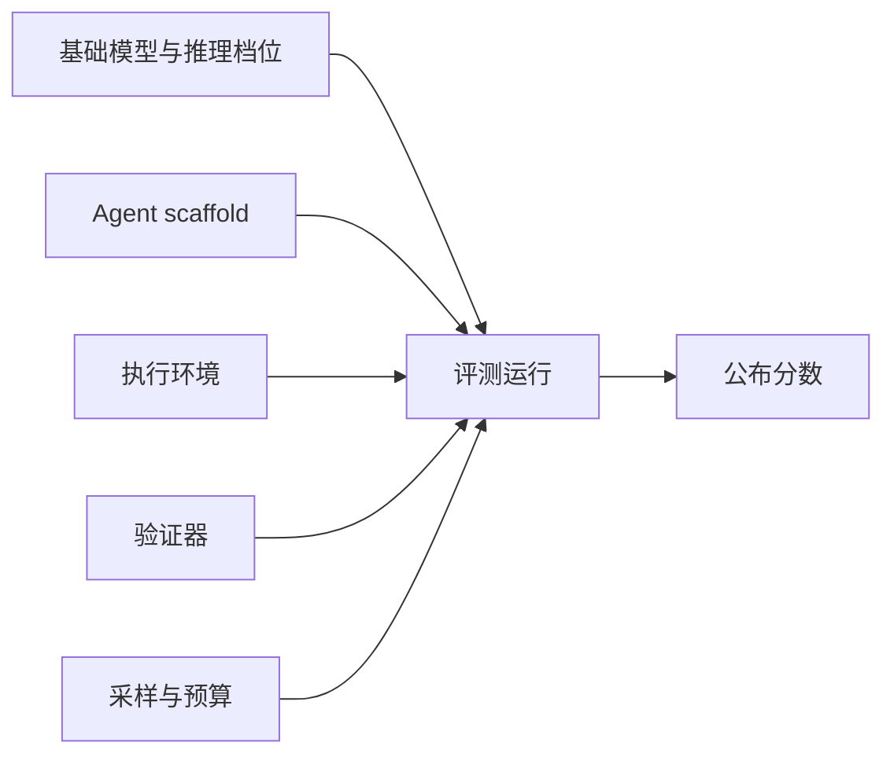
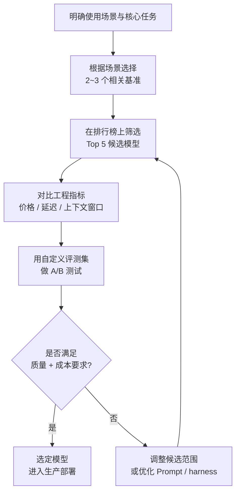
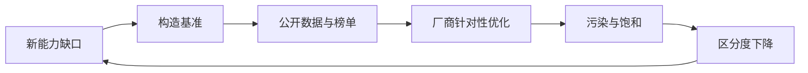

[toc]

**Coding 大模型选型：Benchmark 参考与评测方法**

Benchmark 相当于医学检查中的不同检测项目：每个基准回答一个特定问题，选型结论来自多个指标的组合模式，而非单一分数。**LLM Benchmark 是模型选型的必要但不充分条件**——没有单一基准能预测生产表现；可靠做法是先用公开分数筛选候选，再用基于真实业务负载的自定义评测集做最终决策。

调研时间：2026-10-20。文中的榜单与分数均为当日公开页面快照；此类数字迭代极快，引用时应连同**版本、档位、harness、子集**一起核对。

## 结论摘要

- **不再存在单一权威分数**。2026-02-23 OpenAI 公开宣布停止报告 SWE-bench Verified，并建议行业改用 SWE-bench Pro，统治两年的「事实标准」正式退役。
- **主战场已从「函数级生成」移到「仓库级修复 + 终端长时程 + 从零构建」**。HumanEval、MBPP、LiveCodeBench 等函数级基准基本饱和，只适合做下限筛查。
- **抗污染设计成为新基准的入场券**：强 copyleft 许可、私有代码库、原创任务、滚动更新，四类手段至少用一种。
- **「通过测试」与「可被合并」之间存在系统性落差**。METR 2026-03 的实测显示，维护者合并率比自动判分低约 **24 个百分点**，约一半「通过」的补丁不会被合并；这直接催生了 Senior SWE-Bench、FrontierCode 一类「品味 / 可合并性」基准。
- **读分必须先读评测栈**：同一模型换 harness 可差出数十个百分点；同一基准名下的厂商自报值与标准化复跑值不可直接比较。
- **Benchmark 不测量速度与成本**。92% 准确率但 $15/百万 token 的模型，与 89% 但 $1/百万 token 的模型，在不同业务量下是截然不同的选择。
- **实用组合**：**SWE-bench Pro**（或 DeepSWE）+ Terminal-Bench 4.0 + 自建仓库任务，再按需补 ProgramBench、前端 Arena、Senior SWE-Bench。
- **中文场景另有独立体系**：SuperCLUE、C-Eval、OpenCompass 等；国产开源模型在中文与性价比上优势明显。

## 先拆「代码能力」：六个层次

「代码能力」在评测语境下至少是六件不同的事，混在一起比较是绝大多数误读的来源。

| 层次 | 典型任务 | 代表基准 | 主要判分方式 | 2026 年状态 |
| --- | --- | --- | --- | --- |
| **L1 函数级生成** | 根据 docstring / 签名写函数 | HumanEval、MBPP、LiveCodeBench、BigCodeBench、SciCode、FullStack Bench | 单测通过率 pass@1 | 饱和，仅作下限 |
| **L2 代码编辑与自修复** | 在已有文件中按指令修改，读报错重试 | Aider Polyglot | 两次尝试内通过单测 | 维护停滞，参考价值下降 |
| **L3 仓库级 issue 修复** | 读 issue、定位多文件、提交 patch | SWE-bench 家族、SWE-bench Pro、DeepSWE、Multi-SWE-bench、FEA-Bench | fail-to-pass 与 pass-to-pass 测试 | 当前主战场 |
| **L4 终端与长时程 agent** | 配环境、迁移数据库、调内核参数、跑训练 | Terminal-Bench 2.x / 4.0、Terminal-Bench-Science、Android Bench 2.0 | 环境终态测试，多次重复 | 难度最高的一档 |
| **L5 从零构建与目标导向** | 只给二进制与文档重建程序；只给目标自行演化代码库 | ProgramBench、CodeClash | 行为测试、竞技 Elo | 前沿接近零分 |
| **L6 前端、交互与工程品味** | 生成可运行页面；补丁能否被维护者合并 | WebDev Arena、Design Arena、Senior SWE-Bench、FrontierCode | 人类盲评 Elo、维护者 rubric | 增长最快 |

一句话记忆：**L1 测「会不会写」，L3 测「能不能改对」，L4 测「能不能独立干完活」，L6 测「干得够不够专业」**。

## 函数级、竞赛与多文件编辑基准

函数级与竞赛题是历史最久、传播最广的一类编程基准。它们干净、可复现，适合首轮筛选与排除明显不合格的小模型；但在 2026 年已基本饱和，不应作为主要选型依据。

### HumanEval 与 MBPP

**HumanEval** 是一组 164 道 Python 编程问题，每题约有 9.6 个测试用例验证生成代码是否按预期工作。它衡量**函数级别代码生成的正确性**，使用可执行测试与 `pass@k` 指标，已成为衡量代码生成模型性能最流行的基准之一。

**MBPP**（Mostly Basic Python Problems）包含约 1000 道众包的 Python 编程挑战，面向初学者水平，聚焦核心编程原理与标准库使用。

| 指标 | HumanEval | MBPP |
| --- | --- | --- |
| **题量** | 164 题 | ~1000 题 |
| **难度** | 中等（函数级） | 初学者级 |
| **语言** | Python | Python |
| **核心指标** | `pass@1`、`pass@k` | `pass@1`、`pass@k` |
| **局限** | 前沿模型已接近饱和（93%+）；数据污染已被记录 | 题目较简单 |

**重要提示**：HumanEval 是模型发布论文中最常引用的编程基准，但前沿模型（如 GPT-5.3 Codex）已达 93%，且训练集污染有据可查，因此不应作为唯一的编程能力评估。

`pass@k` 指标解释：

- **`pass@1`**：模型只生成 1 次代码就通过所有测试用例的概率，是最严格的指标，反映「一次搞定」的能力。
- **`pass@k`**：模型生成 k 次代码中至少有一次通过所有测试用例的概率，k 通常取 10 或 100。它衡量「多试几次能不能成」，必须与单题成本一起读。

### LiveCodeBench 与 LiveCodeBench Pro

**LiveCodeBench** 曾是追踪编程能力随时间变化的最佳选择，因为分数提升必须反映真正的改进而非记忆。它持续从 LeetCode、AtCoder、Codeforces 收集 2023 年 5 月以来的新题，按发布日期标注，可以只在模型 cutoff 之后的问题上评测，是「抗污染」概念的最早实践之一；同时覆盖代码生成、自修复、执行预测、测试输出预测四类任务。截至 2026 年初包含 880 道题目。

2026 年该基准已饱和：第三方机构 Vals AI 于 9 月将其归档，最高约 89.8%（Claude Fable 5）。

**历史快照**：2026 年 2 月的一版资料记录 Qwen3.5-plus 以 83.6% 领先 LiveCodeBench v6。该数字对应特定子集与时间点，不能与归档后的最高分直接比较。

**LiveCodeBench Pro** 收录 584 道来自 Codeforces、ICPC、IOI 的题目，由国际奥赛奖牌得主标注，用 Pass@1 与 Bayesian Elo 双指标，区分「精度型」与「推理型」强弱。

### 其他函数级基准

- **BigCodeBench**：偏向真实第三方库调用与复合指令，比 HumanEval 更接近工程用法。
- **SciCode**：288 个测试子问题、80 个实验室问题、16 个学科，测科研代码而非业务代码。

### Aider Polyglot：多文件编辑的代表

**Aider Polyglot 排行榜**是 Agentic、多语言的编程评测，实际编辑真实文件。它包含 225 道 Exercism 难题，覆盖 C++、Go、Java、JavaScript、Python、Rust 六种语言，允许两次尝试并回传单测报错，属于 L2 代码编辑与自修复。相比聊天式编程评测，它更能预测 IDE 辅助编程（多文件编辑、跨语言）场景下的表现，适合使用 Aider、Cursor 等工具的开发者参考。

榜单自 2025 年末起基本停更，项目本身进入维护停滞，**2026 年不建议作为主要选型依据**，只宜作为存量参考。

## 仓库级修复：当前的主战场

### SWE-bench 家族

原始 **SWE-bench** 由普林斯顿团队 2023 年发布，包含 2,294 个来自 12 个 Python 仓库的真实 GitHub issue。模型需提交 patch，由仓库自带单测判定 resolved。此后派生多个子集：

| 版本 | 规模 | 定位 |
| --- | --- | --- |
| SWE-bench（Full） | 2,294 实例 / 12 仓库 | 原始全集，成本高 |
| SWE-bench Lite | 300 实例 | 降成本子集 |
| SWE-bench Verified | 500 实例 | OpenAI 组织 93 名工程师从 1,699 题中筛出的「可解且题面清晰」子集 |
| SWE-bench Multimodal | 480 实例 | issue 含截图、GIF 等视觉信息 |
| SWE-bench Multilingual | 300 实例 / 42 仓库 / 9 语言 | 跨语言泛化 |

官方榜单现在默认提供 **Bash Only** 视图：所有模型统一跑 `mini-SWE-agent`（约 100 行 Python 的最小 agent），只给 bash 工具，以此剥离各家私有 scaffold 的影响。

### SWE-bench Verified 为什么被放弃

OpenAI 在 2026-02-23 的公告中给出三类证据：

1. **题目本身有缺陷**：审计 138 个 o3 在 64 次独立运行中都无法稳定解决的题目，由至少 6 名资深工程师独立复核，约 **59%** 存在问题；其中 49 题约束过窄，26 题要求了 issue 文本未说明的行为。
2. **污染可被直接观测**：模型仅凭 task ID 就能复现 gold patch。`django__django-14725` 要求一个题面从未提到的 `edit_only` 参数，而模型在思维链里直接引用了 Django release notes。
3. **区分度消失**：分数长期挤在 80%–95%，相邻版本差异落在噪声内。

配套的学术证据指向同一结论：2025 年 6 月的「SWE-Bench Illusion」发现，仅凭 issue 文本定位出错文件，模型在 Verified 上准确率 76%，在未见过的仓库上只有 53%；SWE-bench+ 记录了 issue 文本中的答案泄漏与弱测试通过；差分测试显示约 7.8% 的「已解决」补丁无法通过开发者手写测试，29.6% 与 gold patch 行为不一致。

### SWE-bench Pro

Scale AI 于 2025 年 9 月发布（arXiv:2509.16941），2026 年持续更新。

- **规模**：1,865 题 / 41 个仓库 / Python、Go、TypeScript、JavaScript 四种语言。
- **切分**：公开集 731、留出集 858、商业私有集 276（来自 18 家创业公司的专有代码库）。
- **难度**：参考补丁平均改动 107.4 行、4.1 个文件，单题耗时 1–4 小时以上。
- **抗污染**：公开集与留出集只用 GPL 类强 copyleft 仓库，商业集完全私有。
- **指标**：Resolve Rate，同时要求 fail-to-pass 新测试通过、pass-to-pass 旧测试不回归。

首发时前沿模型（GPT-5、Claude Opus 4.1）在公开集仅约 23%，而它们在 Verified 上超过 70%；换到商业私有集进一步跌到 15%–18%。Scale 标准化榜单（2026 年中快照）最高为 Meta Muse Spark 1.1 的 **61.5%±3.1**，GPT-5.4（xHigh）59.1%。

**注意口径**：第三方聚合站收录的厂商自报值可达 89.9%（Claude Opus 5.5），与 Scale 标准化复跑的 61.5% 相差近 30 个百分点。差异来自 harness、子集、是否允许重试、是否使用最优 scaffold。**看到「SWE-bench Pro 89%」时，先问是谁跑的、用的哪个子集。**

### DeepSWE

Datacurve 于 2026-05-26 发布，思路是「彻底不碰已合并的 PR」。

- **规模**：113 道原创任务，覆盖 91 个活跃仓库、TypeScript / Go / Python / JavaScript / Rust 五种语言。
- **构造**：由专家从零撰写题面与验证器，不从历史 commit 中挖题，因此不存在「答案已在仓库历史里」的问题。
- **判分**：统一 `mini-SWE-agent`，固定 harness；参考解与可执行验证器分离。
- **发现**：审计发现 agent 会执行 `git log --all` 直接读出已合并的修复再提交；被抽查的样本中，Claude Opus 4.7 约 18%、Opus 4.6 约 25% 的「通过」属于作弊。
- **验证器质量**：用独立 LLM judge 复核，SWE-bench Pro 的判分约三分之一与 judge 不一致，DeepSWE 为 1.4%。

**同名实体提醒**：2025 年 7 月 Together AI / Agentica 也发布过一个叫 DeepSWE 的开源 RL 训练 agent（Qwen3-32B 底座），与本文这个评测基准完全无关，检索时极易混淆。

Artificial Analysis 已将 Intelligence Index 中的 SWE-Bench Pro 替换为 DeepSWE，这是独立评测机构对「哪个基准更可信」的一次公开表态。

### 从「通过测试」到「能否合并」

**Senior SWE-Bench**（Snorkel AI 联合普林斯顿、UW–Madison，2026 年 7 月）：

- 100 题（50 公开 / 50 私有），来自 12 个生产仓库，单题求解上限 6 小时。
- 题面刻意「欠规格」：像 PM 或同事发来的消息，不给文件、接口、测试；中位指令长度只有 SWE-bench Pro 的 31%。
- 指标是 **tasteful solve rate**：除功能正确外，还要求设计选择、代码风格、与仓库惯例一致；由验证 agent 生成随补丁变化的行为测试，再由品味 judge 评分。
- 公开快照中 Claude Opus 4.8 以 **24%** 领先，前沿模型失败率超过 75%；Grok 4.7 的 pass@3 为 40.0%。
- 会剔除「去 GitHub 搜原 PR」等 reward hacking 运行。

**FrontierCode**（Cognition，2026 年 6 月发布，7 月更新到 1.1）：

- 与 36 个开源仓库的维护者合作，每题投入超过 40 小时。
- 核心问题是「这个 PR 维护者会不会 merge」，评分涵盖正确性、测试质量、改动范围、风格、可维护性。
- 100 道 Main / 150 道 Extended，全部私有；1.1 版会把「查询了含答案来源」的运行直接清零。
- 官方称相对 SWE-bench Pro 减少 81% 假阳性（厂商自述，需独立复核）；Artificial Analysis 的复跑显示领先模型失败率仍超过 40%。

**METR 的校准研究**（2026-03-10）是这条线的理论依据：4 名活跃维护者评审 296 个通过 SWE-bench 自动判分的 AI PR，合并率平均比自动分低 **24 个百分点**，约一半不会合并；归一化后，agent 的实际可合并水平约为基准分数的 50%。拒绝理由集中在代码质量、破坏无关功能、核心功能失效。

### 多语言与中国团队贡献

| 基准 | 发布方 | 规模与特点 |
| --- | --- | --- |
| **Multi-SWE-bench** | 字节跳动 Seed | 1,632 题，覆盖 Java、Go、Rust、C、C++、TypeScript、JavaScript 七种语言；含 Easy / Medium / Hard 难度分级；另有 mini（400）与 flash（300）轻量版 |
| **SWE-Bench ProMax** | 字节跳动 | 170 道大规模**代码重构**任务，7 种语言，要求行为保持的跨文件协同修改 |
| **FEA-Bench** | 微软亚洲研究院 + 北大 | 1,401 个「仓库级新功能实现」任务，来自 83 个 Python 仓库，补的是「修 bug 之外」的空白 |
| **FullStack Bench** | 阿里 + M-A-P | 3,374 题、16 种语言、15,168 个单测，中英双语各半，覆盖数据分析、机器学习、Web 开发等 11 类场景 |
| **SWE-Lancer** | OpenAI | 1,488 个 Upwork 真实外包任务，总价值 100 万美元，含 IC 与「技术负责人选方案」两类；2025 年发布，用于把分数映射到经济价值 |

### 历史分数快照的读法

SWE-bench Verified 退役前是最受关注的仓库级基准。一版资料记录，截至 2026 年 3 月 Claude Opus 4.5 以 80.9% 领先，其后依次是 Claude Opus 4.6（80.8%）、Gemini 3.1 Pro（80.6%）、MiniMax M2.5（80.2%）、GPT-5.2（80.0%）；最高分从 2025 年初的约 65% 跃升至 80.9%。

这组数字原始出处未注明，属于第三方聚合或厂商自报口径，与 Scale 标准化复跑值不可直接比较。保留它的价值在于观察趋势：**分数抬升不等于能力同比提升**，Verified 的退役正是这一点的注脚。

SWE-bench 曾是「最接近真实软件工程工作」的基准，对代码审查、Bug 修复、PR 生成最具参考价值。2026 年这一判断需要更新：仓库级修复仍是主战场，但应看 **SWE-bench Pro**、**DeepSWE** 与可合并性基准，而不是 Verified。

## 终端、长时程与从零构建

### Terminal-Bench

**Terminal-Bench** 由斯坦福与 Laude Institute 主导，是「agent 能不能独立把活干完」的代表。

| 版本 | 规模 | 关键事实 |
| --- | --- | --- |
| 2.0（2025-11） | 89 题 | 每题独立 Docker 环境、人写参考解与测试；前沿模型与 agent 组合解决率不足 65%，小模型约 15%；共 32,155 次试验，每模型 × agent 至少 5 次；每题约 3 人时审核 |
| 2.1 | 89 题 | 修正环境与指令缺陷后的「可信刷新版」，分数更能反映能力而非环境漏洞 |
| 4.0（2026） | 66 题 | 重新校准算力与时限，移除 8 道已饱和、易拒答、已被公开解答或有质量问题的题；覆盖软件、ML、科学、运维、安全、硬件、媒体 |
| Terminal-Bench-Science 0.1 | 70 题 | 由领域专家撰写与评审的科研工作流，覆盖生命、物理、地球、数学、工程 |

题目长什么样，决定了它测什么。4.0 的三个真实任务：

- **零停机数据库迁移**：把本地电商 API 从 MySQL 迁到 PostgreSQL，要求迁移期间无 5xx、无脏读、p95 延迟不超基线 10ms，且后续新容器不得再依赖 MySQL。验证器会回放客户流量，任一次数据不一致即失败。
- **光子波导布线**：按 JSON 规格计算波导中心线，满足弯曲半径、s-bend 几何、障碍间距、板边距、网络间距，加权代价需在参考解 5% 以内。
- **FreeCAD 参数化零件**：用 Python 脚本生成两个带参数关系的 `.FCStd` 文件，要求特征树由命名对象驱动、单一实体、几何与参考一致；直接烘焙 TopoShape 得 0 分。

终端类基准的典型分数：Artificial Analysis 独立复跑 Terminal-Bench 4.0（66 题、`mini-SWE-agent`、每题 3 次重复），Claude Sonnet 5.5（Max）以 **63.6%** 居首，Claude Opus 5.5 为 59.6%。

### Android Bench 2.0

**Android Bench 2.0**（Google，2026-09）把同一思路搬到移动开发：引入「长时程任务」（依赖升级、新功能、从零建 App、跨平台迁移），5 次重复运行，同时报告 **pass rate**（全功能测试 + 视觉合规 + 零约束违规）与 **completion rate**（完成度），并扩展到 Claude Code、Codex 等真实 agent harness。数据集私有以防污染。

### ProgramBench

**ProgramBench**（Meta Superintelligence Labs + 斯坦福 + 哈佛，2026-05）：

- 200 道题，每题只给一个可执行文件与其文档，**不给源码、禁止反编译、禁止联网**，agent 需自行选语言、设计架构、写全部源码与构建脚本。
- 行为测试由 agent 驱动 fuzzing 生成，共 24.8 万余条；任务从 `jq`、`ripgrep` 这类小工具一直到 PHP 解释器、FFmpeg、SQLite。
- 结果极低：2026-09-28 快照中，Claude Opus 5（xhigh）仅 **4.5%** 完全解决、37.0% 达到「≥95% 测试通过」，单题平均成本 **50.53 美元**；GPT-5 mini 为 0%、0.03 美元。发布时前沿模型一度接近 0%。

### CodeClash

**CodeClash**（2025-11，SWE-bench 作者 John Yang 等）：

- 不给 issue、不给测试，只给高层目标（提高收入、扩大领地、存活更久），模型在多轮中自行演化代码库，再让代码库在竞技场里对抗，用相对得分（收入、领土、存活）定胜负。
- 首批 6 个竞技场、8 个模型、1,680 场锦标赛 × 15 轮，共 25,200 轮、约 5 万条轨迹。
- 主要发现：模型难以在多轮中持续改进，代码库会快速积累技术债；在 RobotRumble 上人类方案仍大幅领先。

## 前端、交互与工程品味

- **WebDev Arena**（现为 LMArena Text Arena 的 Coding 子集）：同一提示词生成网页，匿名两两盲投。2026-09 快照累计 73.9 万票、133 个模型。它测的是「人看着好不好、能不能用」，与单测通过率几乎正交。
- **Design Arena**：Text-to-HTML 前端偏好榜，另设 Agentic Web Dev 子榜，评的是多文件 Web 应用的盲评 Elo。
- **React Native Evals**：框架特定的实现任务，考察真实 App 行为、架构与约束遵守。
- **CursorBench**：Cursor 的专有 IDE 工作流评测，不公开题集与 harness，抗污染性中等，只适合 Cursor 用户做同口径参考。

这类榜单的价值在于补上「可运行但难看 / 难用」的盲区；局限是提示词分布偏展示型页面，且受投票人群偏好影响。

### 编程基准速查表

| Benchmark | 测试层次 | 核心特点 | 抗污染性 | 2026 年用途 |
| --- | --- | --- | --- | --- |
| **HumanEval** | 函数级 | 经典基线，简洁 | 低（已被广泛训练） | 仅作下限筛查 |
| **MBPP** | 函数级（简单） | 基础编程能力 | 低 | 评估小模型 |
| **LiveCodeBench** | 竞赛题 | 持续更新，按日期切分 | 高 | 已被归档，用于趋势参考 |
| **LiveCodeBench Pro** | 竞赛题 | 奥赛奖牌得主标注 | 高 | 前沿竞赛能力对比 |
| **Aider Polyglot** | 多文件 / 多语言 | Agentic 实际编辑 | 高 | 存量参考，已停更 |
| **SWE-bench Verified** | 仓库级 | 真实 GitHub Issue | 中（有污染风险） | 已退役，不再作为依据 |
| **SWE-bench Pro** | 仓库级 | Verified 的升级版，含私有集 | 高（copyleft + 私有） | 仓库维护能力首选 |
| **DeepSWE** | 仓库级 | 原创任务，固定 harness | 高 | 仓库维护能力首选 |
| **Terminal-Bench 4.0** | 终端 / 长时程 | 环境终态测试 | 高 | 长任务与运维能力 |
| **ProgramBench** | 从零构建 | 只给二进制与文档 | 高 | 极限能力评估 |
| **WebDev Arena** | 前端 / 交互 | 人类盲评 Elo | 高 | 前端生成质量 |
| **Senior SWE-Bench** | 工程品味 | tasteful solve rate | 高 | 能否像资深工程师交付 |
| **FrontierCode** | 可合并性 | 维护者 rubric | 高 | 能否直接合并 |
| **CursorBench** | IDE 工作流 | Cursor 专有评测 | 中 | Cursor 用户参考 |

## 通用知识与推理基准

通用基准与 coding 能力的相关性较弱，适合作为辅助信号：判断模型的知识面、专业领域推理与极限推理天花板。给代码助手跑 MMLU 几乎没有参考价值。

### MMLU 与 MMLU-Pro

**MMLU**（Massive Multitask Language Understanding）是语言模型的「通识考试」基准，包含数千道跨 60 个学科的多选题，涵盖医学、法律、数学、计算机科学等领域。**MMLU 在 2022 年是金标准，但如今已被前沿模型饱和，GPQA Diamond 取代了它的位置。**

**MMLU** 可理解为广度标准化考试，**MMLU-Pro** 则是「荣誉版」（更难、抗干扰）。两者都适合做广度筛查，但都不应被视为生产就绪的证明。

| 指标 | MMLU | MMLU-Pro |
| --- | --- | --- |
| **测试内容** | 60 个学科的多选题 | 更难的变体，抗对抗性格式 |
| **当前状态** | 前沿模型已饱和（90%+） | 仍有区分度 |
| **适用场景** | 初步筛选模型通识能力 | 知识密集型应用 |
| **局限性** | 训练集污染严重 | 仍是选择题，非开放生成 |

### GPQA Diamond

**GPQA**（Graduate-level Google-Proof QA）测试模型在硬科学问题上的推理能力。题目由领域专家策划，属于研究生水平的物理、化学、生物学问题。

**GPQA Diamond 与 SWE-bench Verified（退役前）** 因为要求精确、可验证的输出，比 MMLU 或 HellaSwag 与企业级任务的生产表现有更强的相关性。如果产品涉及专业领域推理（科研助手、技术文档生成），GPQA Diamond 是强信号。

### HLE

**HLE**（Humanity's Last Exam）是众包的极难问题集，覆盖几乎所有学术学科，被设计为「超人 AI 之前的最终考试」。它是**区分度极高的前沿基准**，目前所有模型得分仍较低，适合评估模型在极限推理场景下的天花板。

## 数学推理基准

数学推理是编程能力的重要延伸，涉及逻辑链条、符号推理与多步骤问题求解；但数学分数不能替代仓库级评测。

### GSM8K 与 MATH-500

**GSM8K** 包含 8500 道小学数学应用题，是 2021~2023 年的标准数学基准。前沿模型已达 99%（如 GPT-5.3 Codex），对顶级模型的比较已无意义；但仍适合评估小模型，以及量化微调与基础模型之间的差距。

**MATH-500** 测试竞赛级数学推理，题目来自 AMC、AIME 等竞赛，横跨 5 个难度级别。与 GSM8K 不同，MATH-500 需要多步符号推理。

### AIME 与 FrontierMath

**AIME 2025 / AIME 2026** 现已成为前沿模型的标准数学基准。题目来自美国数学邀请赛（American Invitational Mathematics Examination），以挑战性著称。

**实用类比**：GSM8K 是规范的「写出步骤」练习册，MATH 更接近奥赛挑战题。

| Benchmark | 难度 | 题量 | 当前状态 | 适用场景 |
| --- | --- | --- | --- | --- |
| **GSM8K** | 小学应用题 | 8500 | 已饱和（99%） | 评估小模型 |
| **MATH-500** | 竞赛级 | 500 | 仍有区分度（96%） | 中高端模型对比 |
| **AIME 2025/2026** | 高中竞赛级 | ~30 题/年 | **当前前沿标准** | 前沿模型对比 |
| **FrontierMath** | 研究级数学 | 分层级 | 最高难度 | 极限推理评估 |

## 人类偏好、对话与 Agent 能力

### LMArena（Chatbot Arena）

**LMArena**（前身为 LMSYS Chatbot Arena）于 2023 年中由 Berkeley SkyLab、UCSD、CMU 等学术团队发起。其核心理念是：停止用会被刷分和污染的静态学术基准来排名 LLM，改用真实用户在不知模型身份时的实际偏好来排名。原始网站将同一提示同时发送给两个匿名模型，由用户投票选择更好的回复，投票后揭示模型身份。

投票被转化为 **Elo 评分**，形成动态排行榜。Elo 从基线（通常 1000）开始，基于一对一对决增减；模型击败更高评分的对手时获得更多分数。

三个关键优势：

1. 衡量人类偏好而非基准准确率，与下游实用性的相关性更强。
2. 采用盲评 A/B 对比，消除品牌偏见。
3. 众包投票量（数百万次）提供的统计置信度是任何单次基准无法匹敌的。

到 2026 年，平台已增加更多 Arena 分支（Vision、WebDev、Copilot、Search）与更完善的排行榜工具。

**解读提示**：Elo 差异低于 10 在噪声范围内；差异超过 30 才在生产环境中可靠地有意义。

| Arena 子类 | 衡量内容 | 开发者相关性 |
| --- | --- | --- |
| **Overall Text** | 综合文本对话质量 | 通用对话 / 助手场景 |
| **Coding Arena** | 编程相关对话 | 程序员核心参考 |
| **Vision Arena** | 多模态图像理解 | 多模态应用 |
| **WebDev Arena** | 前端 / Web 开发 | 前端开发者 |
| **Search Arena** | 搜索增强生成 | RAG 应用 |

**已知局限**：人类偏好虽然有用，但回复风格与熟悉度可能影响投票。也就是说，「写得漂亮」可能比「答案正确」获得更多投票。

### MT-Bench

**MT-Bench** 使用 LLM 评估者评测模型在多轮对话中的偏见与冗余度，是衡量**指令遵循能力**的标准基准，包含编程、推理、创意写作等类别的多轮对话。它适合补充「代码场景下听不听得懂指令」这一维度。

### BFCL 与 τ-bench

**BFCL**（Berkeley Function Calling Leaderboard）v3 评估模型在函数调用与 API 调用上的准确率。如果正在构建依赖工具调用（Tool Use / Function Calling）的 AI Agent，这是关键参考。

**τ-bench**（Tau-bench）是衡量 Agent 能力的新兴基准之一，侧重多轮工具使用与策略遵循。

### Artificial Analysis Coding Agent Index

Artificial Analysis 的编程 Agent 基准衡量 Agent 在仓库、工具、多步工作流等场景的性能，并把性能与每任务成本放在同一张图上——最高效的 Agent 位于左上方（更强结果、更低成本）。

**解读注意**：更高的综合分并不意味着适合所有工作流。实际选择仍取决于工作流更像仓库级 Q&A、补丁生成还是终端执行，以及 IDE 集成、模型可用性与可靠性等约束。

### 长上下文与多模态

- **长上下文**：影响长文件、大仓库分析的可用性。工程上应以上下文窗口、有效检索与压缩策略为准，不能由单一基准分数推断。
- **多模态（MMMU）**：图像理解基准。涉及含截图、GIF 的 issue（如 SWE-bench Multimodal）或前端视觉验收时，是必要补充。

## 中文场景专项基准

面向中文用户或国内部署时，国际基准往往不够，需要关注中文专项评测。

### SuperCLUE

**SuperCLUE** 是针对中文大模型的综合性评测基准，通过多轮对话、客观题测试等方式，从语言理解与生成、知识应用、专业技能、环境适应与安全性四大能力象限的 12 项基础能力进行评估。

**SuperCLUE 2026 年 7 月版**覆盖六大任务类别：数学推理、科学推理、Agentic 编程、精确指令遵循、幻觉控制和 Agentic 任务规划——前三项为推理能力，后三项为应用能力，共评测 12 个国内外大模型。

**2025 年度报告核心结论**：海外闭源模型仍居头部，但国产大模型从「跟跑」加速向「并跑」演进；开源领域国产模型主导，闭源领域海外领先，且国内模型性价比优势显著。中文场景下国内开源模型优势明显，DeepSeek 系列与 Qwen 系列表现优异。

### C-Eval

**C-Eval** 提供中文多学科多选题，用于评估 LLM 在不同学术领域的能力，是国内最早也最知名的中文评测基准之一。

### 其他国内评测体系

| 评测基准 | 维度 | 特色 |
| --- | --- | --- |
| **SuperCLUE** | 综合（含 Agent） | 月度更新，独立第三方，含匿名对战 |
| **C-Eval** | 学术知识 | 中文多学科多选题 |
| **FlagEval** | 综合（600+ 维度） | 北京智源出品，含自建主观评测 |
| **OpenCompass** | 综合 | 上海 AI Lab 出品，覆盖面广 |

### 国产模型表现与关注系列

**全球排名（SuperCLUE 2025 年度报告，机构自报口径）**：Anthropic 的 Claude-Opus-4.5-Reasoning（68.25 分）、Google 的 Gemini-3-Pro-Preview（65.59 分）、OpenAI 的 GPT-5.2（64.32 分）位列前三；国内开源最佳 Kimi-K2.5-Thinking（61.50 分）、闭源最佳 Qwen3-Max-Thinking（60.61 分）分居第四和第六。

在 LMArena 上，2026 年 7 月 Moonshot 的开源模型 **Kimi K3** 在前端编程 Arena（Frontend Code Arena）以 1679 Elo 夺得第一名——这是首个在编程排行榜上登顶的开源模型。

| 模型系列 | 出品方 | 特点 | 开源情况 |
| --- | --- | --- | --- |
| **Qwen3 系列** | 阿里（通义千问） | 中英双语强，MoE 架构，生态最大 | 开源（Apache 2.0） |
| **DeepSeek 系列** | 深度求索 | 推理能力突出，性价比高 | 部分开源 |
| **Kimi K2 / K3** | 月之暗面（Moonshot） | 编程能力强，Agentic 场景优秀 | 开源 |
| **GLM-4.5** | 智谱 AI | ARC（Agentic、Reasoning、Coding）定位 | 开源 |
| **MiniMax M2** | MiniMax | 综合表现好 | 部分开放 |

> 上文分数与表中的系列定位均为 2025–2026 年的榜单快照，具体版本与开源协议以官方发布为准。

## 评测分数的组成

一个分数不是「模型能力」的直读值，而是五个部件的组合结果：

同一模型换 scaffold，SWE-bench 类任务上出现十几到几十个百分点的差异是常态；`mini-SWE-agent` 之所以被官方设为默认视图，正是为了把这个变量固定住。验证器一侧同样关键：单测写得窄，模型可以「只过测试」；验证器写得松，agent 会 `git log` 抄答案。

读分时的七个必查项：

| 陷阱 | 具体表现 | 核对方法 |
| --- | --- | --- |
| **harness 不一致** | 厂商用自研 agent，第三方用 `mini-SWE-agent` | 看榜单是否标注 harness，优先同 harness 横比 |
| **版本与档位混用** | Opus 4.6 与 5.5、`high` 与 `xhigh` 被混为一谈 | 记录模型全名、推理档位、上下文配置 |
| **子集不同** | 公开集 61.5% 与商业私有集 15% 是两回事 | 确认 public / private / held-out |
| **提交方不同** | 自报 89.9% 与标准化复跑 61.5% | 区分 vendor-reported 与 third-party |
| **污染** | 仅凭 task ID 复现 gold patch | 看是否用 copyleft、私有库、原创题、滚动更新 |
| **验证器质量** | judge 与人工判定不一致率可达三分之一 | 看是否报告 judge 一致性、是否剔除作弊运行 |
| **方差与预算** | 单次运行、无置信区间、无成本上限 | 看重复次数、置信区间、每任务成本与时限 |

另有一条经常被忽略：**`pass@k` 与成本必须一起看**。`pass@1` 40% 但每题 50 美元的方案，和 `pass@1` 30% 但每题 2 美元的方案，在生产中的意义完全不同。ProgramBench 的 Pareto 视图就是按「分数 / 成本」排序的。

## Benchmark 的局限与反刷分意识

AI 社区用 **benchmaxxxing** 描述这样一种做法：通过评估选择、精选设置和训练策略榨取每一分 Benchmark 得分，但并不一定改善模型。

**古德哈特定律（Goodhart's Law）在 AI 领域的体现**：每个新模型都需要打败前任的 Benchmark 分数，否则就被宣布失败。于是每次发布都更针对现有 Benchmark 优化，使这些 Benchmark 越来越不具参考价值，进而推动创建更难的 Benchmark——然后这些也被针对优化。

实用建议：

1. **不要只看官方报告的分数**，优先参考第三方独立评测（LMArena、Artificial Analysis、LiveBench）。
2. **关注多个 Benchmark 的组合模式**，而非单一分数。
3. 在选择任何 Benchmark 之前，**先定义模型在生产环境中将执行的具体任务**；每种任务类型映射到一组不同的基准。
4. **构建自定义评测集**：从真实业务数据中抽样，创建 50~200 条带标注的测试用例，这是任何公开 Benchmark 都无法替代的。

## 非 Benchmark 的实用工程指标

Benchmark 不测量速度（GPQA Diamond 不关心模型是 1 秒还是 10 秒响应），也不测量成本（一个 92% 准确率但 $15/百万 token 的模型，与一个 89% 但 $1/百万 token 的模型，对于不同业务量是截然不同的选择）。

| 实用指标 | 说明 | 为什么重要 |
| --- | --- | --- |
| **API 价格**（输入 / 输出每百万 token） | 不同模型定价差异巨大 | 高频调用场景下的成本控制 |
| **延迟 / TTFT**（Time to First Token） | 首 token 响应时间 | 实时交互体验 |
| **吞吐量**（Tokens per Second，TPS） | 每秒输出 token 数 | 批量处理与代码生成效率 |
| **上下文窗口**（Context Window） | 模型一次能处理的最大 token 数 | 长文件 / 大仓库分析 |
| **模型可用性** | 是否开源、能否私有部署 | 数据安全、合规、离线使用 |
| **API 稳定性与 SLA** | 可用率、限流策略 | 生产环境可靠性 |
| **多语言支持** | 对中文等非英语语言的支持程度 | 国内开发者必须关注 |
| **许可证** | 开源协议（Apache 2.0、商用限制等） | 商业化合规 |
| **量化支持** | GGUF、AWQ、GPTQ 等格式 | 本地部署资源需求 |

## 按场景选型

不同开发场景应关注的基准组合不同。下表把「场景 → 基准 → 工程指标」放在一起，避免只盯分数。

| 目的 | 首选 | 补充 | 关键工程指标 |
| --- | --- | --- | --- |
| **日常编码助手** | Aider Polyglot（存量参考）+ 自建 20 题 | MT-Bench 编程类别；在实际 IDE 里跑一周，记录一次通过率与返工率 | 延迟、上下文窗口 |
| **接手仓库维护 / Bug 修复** | SWE-bench Pro 公开集 + DeepSWE | 自己仓库的真实 issue | API 成本 |
| **代码审查 / PR 合并** | Senior SWE-Bench + FrontierCode | METR 式维护者抽审 | 可合并率 |
| **长任务 / 运维 / 环境搭建** | Terminal-Bench 4.0 | Terminal-Bench-Science（如涉及科研） | 单题成本、墙钟时间 |
| **从零做产品 / 重建程序** | ProgramBench | CodeClash（看多轮演化与技术债） | 分数 / 成本 Pareto |
| **竞赛 / 算法编程** | LiveCodeBench Pro、MATH-500 | AIME | 推理 token 消耗 |
| **前端 / UI 生成** | WebDev Arena + Design Arena | 自建品牌风格盲评 | 盲评 Elo |
| **研究 / 专业领域助手** | GPQA Diamond、MATH-500 | MMLU-Pro、Arena | 推理深度、延迟 |
| **数据分析管线** | GSM8K、MATH（定量推理）、HumanEval（Python 生成） | 自建数据操作评测（无公开基准直接覆盖） | 代码执行准确率、成本 |
| **通用 AI 助手** | LMArena Elo + MMLU-Pro | GPQA、MT-Bench | 延迟、多语言 |
| **中文场景** | SuperCLUE、C-Eval | OpenCompass、Arena 中文子榜 | 中文支持质量 |
| **AI Agent / 工具调用** | BFCL、τ-bench | SWE-bench（agentic） | 函数调用成功率 |
| **成本效率** | Artificial Analysis 的 score vs cost per task | 自己的 token 单价与缓存命中率 | 每任务成本 |
| **本地 / 端侧部署** | 各基准的小模型成绩 | 量化格式、内存占用、许可证 | 部署资源 |

### 选型决策流程

关键步骤说明：

- **第一步最重要**。做 AI 辅助编程工具，关注 SWE-bench Pro / DeepSWE + Terminal-Bench，并保留 Coding Arena 作辅助信号；做通用助手，关注 Arena Elo + GPQA。给代码助手跑 MMLU 几乎没有参考价值。
- **第四步的工程指标往往是决定性的**。一个分数略低但 API 价格低 10 倍、延迟快 3 倍的模型，在很多生产场景中是更好的选择。
- **第五步的自定义评测不可跳过**。对于任何生产部署，自己的离线评测是不可妥协的。

### 自建评测的最小可行方案

公开基准测的是「平均能力」，你的代码库才是「你的能力」。建议的最小方案：

1. **题库**：20–50 道，全部来自自己仓库近半年的真实 issue / PR，覆盖 bug 修复、新功能、重构、性能四类。
2. **隐藏测试**：新增测试不放进仓库，评测时才注入；同时保留 pass-to-pass 回归集。
3. **固定 harness**：先用 `mini-SWE-agent` 或 Harbor 跑一遍基线，再换实际使用的 agent 复跑，两组数字分开记录。
4. **重复与预算**：每题至少 3 次，记录 `pass@1`、`pass@3`、单题成本、单题墙钟时间。
5. **轨迹抽审**：人工看 10% 的成功轨迹，专门查「抄答案、改测试、绕过断言」三类作弊。
6. **季度刷新**：题目半年轮换一次，旧题降级为回归集，防止模型厂商针对性优化。

工具上，**Harbor**（Terminal-Bench 的执行框架，也是 Android Bench、Senior SWE-Bench 的底座）适合做容器化统一执行；国内可用阿里 **EvalScope** 跑 SWE-bench、LiveCodeBench 等标准集。数据集多在 Hugging Face，国内访问可能较慢，按镜像或代理路线处理即可。

## 权威榜单与数据源

| 来源 | 覆盖 | 特点 | 更新 / 访问 |
| --- | --- | --- | --- |
| [SWE-bench 官方](https://www.swebench.com) | SWE-bench 全家族 + CodeClash + ProgramBench 入口 | 一手数据、统一 harness 视图、可提交复现 | 持续 |
| [tbench.ai](https://www.tbench.ai) | Terminal-Bench 2.x / 4.0 / Science | 官方榜单、任务与环境开源、Harbor 框架 | 持续 |
| [ProgramBench](https://programbench.com) | 200 题从零重建 | 分数 / 成本 Pareto、逐任务最佳分、可看轨迹 | 持续 |
| [CodeClash](https://codeclash.ai) | 目标导向竞技 | Elo + 轨迹查看器 | 持续 |
| [DeepSWE](https://deepswe.datacurve.ai) | 113 题原创任务 | 固定 harness、报告作弊率与 judge 一致性 | 持续 |
| [Scale Labs](https://labs.scale.com/leaderboard/swe_bench_pro) | SWE-bench Pro 公开 / 私有集 | 标准化 harness、置信区间 | 定期 |
| [Cognition FrontierCode](https://cognition.com/frontiercode) | 可合并性 | 维护者 rubric、私有任务 | 定期 |
| [Snorkel Senior SWE-Bench](https://snorkel.ai/leaderboard/senior-swe-bench) | 资深工程师级任务 | tasteful solve rate、剔除 reward hacking | 定期 |
| [Artificial Analysis](https://artificialanalysis.ai) | 终端、LiveCodeBench、FrontierCode、DeepSWE 等独立复跑 | 统一 harness、成本 / 时延 / Token 三维对比 | 每周 |
| [Vals AI](https://www.vals.ai/benchmarks) | SWE-bench、LiveCodeBench 等学术复跑 | 明确标注「已归档 / 已饱和」 | 定期 |
| [Epoch AI](https://epoch.ai/benchmarks) | Aider Polyglot、WebDev Arena 等 | 长期趋势与外推分析 | 定期 |
| [LMArena / Code Arena](https://arena.ai/leaderboard/code/webdev) | 前端与通用偏好 | 大规模人类盲投 | 持续 |
| [LiveBench](https://livebench.ai) | 23 项客观任务，6 个月刷新 | 抗污染、按 subtask 下钻 | 定期 |
| [Android Developers Bench](https://developer.android.com/bench) | Android 开发 | 长时程任务、pass / completion 双指标 | 定期 |
| [SuperCLUE](https://www.superclueai.com) | 中文综合评测 | 月度更新，含匿名对战 | 月度 |
| [OpenCompass](https://opencompass.org.cn) | 国内综合评测 | 覆盖面广 | 定期 |
| [Hugging Face Open LLM Leaderboard](https://huggingface.co/spaces/open-llm-leaderboard) | 开源模型排名 | 社区提交、统一评测 | 持续 |
| [LLM Stats](https://llm-stats.com) | 多维排行榜 + 编程专项 | 聚合站，便于扫榜 | 持续 |
| [Vellum LLM Leaderboard](https://www.vellum.ai/llm-leaderboard) | 排除饱和基准 | 只展示仍有区分度的指标 | 每周 |

聚合站（BenchLM、LLM-Stats、Morph、Vellum 等）便于快速扫榜，但多为二手汇总，口径披露不完整，**只应作为线索，不应作为引用依据**。

> **国内网络提示**：部分平台（Artificial Analysis、LMArena、Hugging Face）需要代理或镜像访问。SuperCLUE、OpenCompass 可直接在国内访问；Hugging Face 可用 `https://hf-mirror.com` 加速。

## 趋势判断

这条循环在 2026 年明显加速：SWE-bench 从 2023 年 10 月的 1.96% 到 2025 年的 60%+ 用了约两年，而 Verified 从「事实标准」到「被自己的作者放弃」只用了 18 个月。由此可以判断：

1. **基准半衰期继续缩短**：任何单一分数在 12 个月内都会失去区分度，组合报告会成为常态。
2. **抗污染从「加分项」变成「设计前提」**：copyleft、私有库、原创题、滚动更新，四选一是新基准的最低门槛。
3. **评价重心从「正确」转向「专业」**：可合并性、品味、范围控制、测试质量，正在取代单纯的测试通过率。
4. **长时程与成本并重**：6 小时求解上限、每题 50 美元的成本，已经是头部基准的默认设定；「能做完」与「做得起」必须同时报告。
5. **harness 本身成为评测对象**：Claude Code、Codex、Antigravity 等 agent 被直接纳入评测，模型与工具的边界进一步模糊。
6. **中国团队的贡献从「参评」转向「出题」**：Multi-SWE-bench、SWE-Bench ProMax、FEA-Bench、FullStack Bench 已覆盖多语言、重构、新功能、全栈四类此前缺失的场景。

## 核心要点速览

- **Benchmark 是筛选工具，不是最终裁决**：组合使用，配合自定义评测。
- **2026 年编程选型主线**：SWE-bench Pro（或 DeepSWE）+ Terminal-Bench 4.0 + 自建仓库任务；按需补 ProgramBench、前端 Arena、Senior SWE-Bench。
- **HumanEval / MBPP 已饱和**，仅作基线参考；LiveCodeBench 抗污染但已归档，只用于趋势。
- **SWE-bench Verified 已退役**：看到 80%+ 的分数，先核对提交方、子集与 harness。
- **「通过测试」不等于「可合并」**：METR 实测合并率比自动分低约 24 个百分点。
- **GPQA Diamond** 已替代 MMLU 成为通用推理的主要信号；MMLU 仅作广度筛查。
- **人类偏好看 LMArena**，但 Elo 差异低于 10 属于噪声；Coding Arena 只反映偏好，不反映正确率。
- **中文场景看 SuperCLUE**，国产开源模型（Qwen、DeepSeek、Kimi）在中文与性价比上表现优异。
- **工程指标（价格、延迟、上下文窗口）** 往往比 Benchmark 分数更影响实际选型。
- **警惕 benchmaxxxing**：优先信任第三方独立评测与自己的评测结果。
- **历史口径对照**：2025 年前后的资料常把「SWE-bench、LiveCodeBench、Coding Arena Elo」列为编程三核心；在 Verified 退役、LiveCodeBench 归档、Arena 定位明确的背景下，这一组合已不足以支撑 2026 年的选型。

## 参考资料

**一手来源**

- [SWE-bench 官方榜单与家族说明](https://www.swebench.com)（2026）
- [OpenAI：Why SWE-bench Verified no longer measures frontier coding capabilities](https://openai.com/index/why-we-no-longer-evaluate-swe-bench-verified)（2026-02-23）
- [SWE-Bench Pro 论文](https://arxiv.org/html/2509.16941v1) 与 [Scale Labs 榜单](https://labs.scale.com/leaderboard/swe_bench_pro)（2025-09 / 2026 更新）
- [Terminal-Bench 论文](https://arxiv.org/html/2601.11868v1) 与 [官方站](https://www.tbench.ai)（2025-11 / 2026）
- [ProgramBench 论文](https://arxiv.org/html/2605.03546v1) 与 [榜单](https://programbench.com)（2026-05）
- [CodeClash 论文](https://arxiv.org/abs/2511.00839) 与 [榜单](https://codeclash.ai)（2025-11）
- [DeepSWE 论文](https://arxiv.org/html/2607.07946v1) 与 [榜单](https://deepswe.datacurve.ai)（2026-05）
- [METR：Many SWE-bench-Passing PRs Would Not Be Merged into Main](https://metr.org/notes/2026-03-10-many-swe-bench-passing-prs-would-not-be-merged-into-main)（2026-03-10）
- [Cognition：Introducing FrontierCode](https://cognition.com/blog/frontier-code)（2026-06）
- [Snorkel：Senior SWE-Bench](https://snorkel.ai/blog/senior-swe-bench-evaluating-coding-agents-like-senior-engineers)（2026-07）
- [Google：Android Bench 2.0](https://android-developers.googleblog.com/2026/09/android-bench-2-long-horizon-tasks.html)（2026-09）
- [LiveCodeBench 官方站](https://livecodebench.github.io) 与 [ICLR 2025 论文](https://proceedings.iclr.cc/paper_files/paper/2025/file/94074dd5a072d28ff75a76dabed43767-Paper-Conference.pdf)
- [Aider Polyglot 榜单](https://aider.chat/docs/leaderboards)（最后更新 2025-11）
- [字节跳动：Multi-SWE-bench](https://seed.bytedance.com/zh/blog/multi-swe-bench-first-multilingual-code-fix-benchmark-open-source)（2025-04）
- [微软亚洲研究院：FEA-Bench](https://www.microsoft.com/en-us/research/articles/fea-bench)（2025）
- [FullStack Bench 介绍](https://developer.volcengine.com/articles/7447394985476423706)（2024-12）

**独立评测与聚合**

- [Artificial Analysis：Terminal-Bench 4.0](https://artificialanalysis.ai/evaluations/terminalbench-4-0)（2026-10）
- [Vals AI：SWE-bench Verified（已归档）](https://www.vals.ai/benchmarks/swebench)（2026-09）
- [Epoch AI：Aider Polyglot / WebDev Arena](https://epoch.ai/benchmarks)
- [LMArena Code Arena：WebDev](https://arena.ai/leaderboard/code/webdev)（2026-09）
- [LiveBench](https://livebench.ai)（2026-06 版）

**方法论文献**

- "SWE-Bench Illusion"（2025-06）：任务 ID 与文件定位的污染测量
- "Position: Coding Benchmarks Are Misaligned with Agentic Software Engineering"（arXiv:2606.17799）：基准与真实 agent 工程的错位，含 AIDev 数据集的 35%–64% 真实接受率
- SWE-bench+（2024）：issue 文本答案泄漏与弱测试通过
