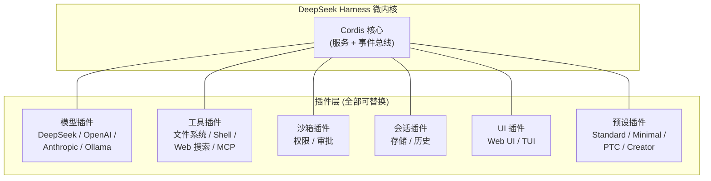
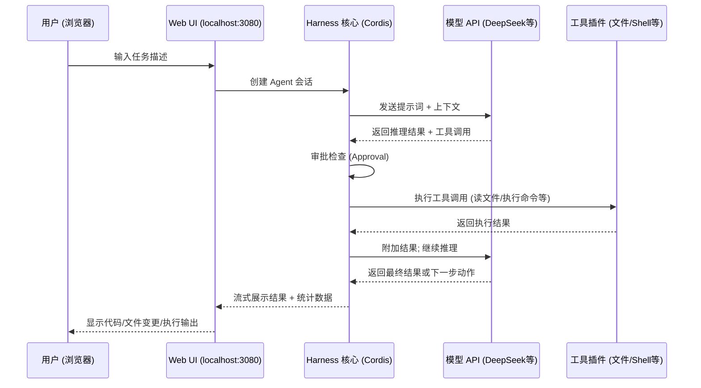

[toc]


## DeepSeek Harness (dsh) 

> 知识截止/内容依据：2026 年 9 月 12 日联网检索。项目当前处于 **Developer Preview** 阶段（npm 包 `@deepseek-ai/dsh` 最新为 `0.1.5-rc.1` 左右），API 和插件接口**仍在快速迭代，会有兼容性破坏性变更**。

---

### 什么是 DeepSeek Harness

**DeepSeek Harness**（简称 **dsh**）是 DeepSeek AI 开发的**开源 Agent Harness**（智能体运行时），基于 **"Everything is a Plugin"（一切皆插件）** 的架构，底层由 **[Cordis](https://github.com/cordiverse/cordis)** 元框架驱动，其设计思想源自论文 *A Programming Paradigm for Spatiotemporal Composability*。

项目以 **MIT 许可证**开源，于 2026 年 8 月 13 日发布 Developer Preview，用于构建**自主 AI 智能体（Autonomous AI Agents）**。

一个关键概念需要先厘清：**模型（Model）**与**Harness（运行时/驾驭层）**的区别。模型负责生成 token（预测下一个输出）；而 **Harness 决定这些 token 能做什么**——哪些工具可用、文件如何编辑、上下文如何管理、何时需要人工审批。

同一个模型在不同 harness 下表现**差异显著**，这也正是 DeepSeek 构建官方 harness 的原因。

---

### 核心设计理念与架构

#### 微内核 + 插件架构

dsh 采用**微内核架构（Micro-kernel Architecture）**，运行时组件作为**独立、可互换的插件**运行，而非单体模块。功能单元包括**模型适配器（Model Adapters）**、**工具注册表（Tool Registries）**、**沙箱环境（Sandboxing Environments）**、**会话状态处理器（Session State Handlers）**、**事件分发器（Event Dispatchers）**和**用户界面（UI）**，均作为独立扩展加载。

dsh 构建在 **Cordis 的插件系统**之上。插件提供每一项 Agent 能力，包括**模型、工具、技能（Skills）、会话（Sessions）、沙箱（Sandboxes）、存储（Storage）、循环（Loops）、调度（Scheduling）以及 UI**。Cordis 的**服务（Services）**和**事件（Events）**机制让插件协同工作。开发者可以在配置中**选择、替换或扩展任何能力，而无需修改 dsh 源码**。



#### 与竞品的定位差异

**Claude Code** 是 Anthropic 绑定自有模型的成熟商业产品；而 **dsh 是一个 MIT 许可的开放底盘，可运行任何模型，允许替换每个组件**。追求现成工具的团队倾向 Claude Code；追求可深度定制开放运行时的团队倾向 dsh。不过要注意，dsh 目前仍是 Developer Preview，稳定性方面尚不及成熟商业产品。

---

### 安装与启动

#### 前置依赖

| 依赖项               | 要求                     | 说明                                                         |
| -------------------- | ------------------------ | ------------------------------------------------------------ |
| **Node.js**          | **v20+**（推荐最新 LTS） | harness 要求当前版本的 Node.js，v20 或更新版本可解决大多数安装失败问题 |
| **npm / npx**        | 随 Node.js 捆绑          | 如果 `npx` 缺失，从 nodejs.org 重新安装 Node.js 即可获得     |
| **pnpm**             | 仅源码构建时需要         | 从仓库 clone 编译时使用                                      |
| **DeepSeek API Key** | **必须**                 | Web UI 首次启动时会提示输入，核心功能（含 Web 搜索）需要有效的 API Key 才能工作 |

> **国内网络提示**: `npx` 拉包依赖 npm registry，如果速度慢，可先配置国内镜像：
>
> ```bash
> npm config set registry https://registry.npmmirror.com
> ```
>
> 或者在执行 `npx` 时通过环境变量临时指定。如果需要访问 GitHub 仓库，可使用代理或镜像加速（如 `https://ghproxy.com`）。

#### 方式一：npx 或npm 一键启动（推荐）

**如果你只是偶尔尝试或临时使用**：继续用 `npx @deepseek-ai/dsh web` 就足够了。它避免了污染全局环境，用完即走,并且总是尝试最新版。

```bash
# 安装并启动 Web UI（默认 127.0.0.1:3080）
npx @deepseek-ai/dsh web
```

该命令会在 `http://127.0.0.1:3080` 启动 Web UI，并在本地启动时自动打开默认浏览器。

常用选项：

| 选项          | 说明                                                        |
| ------------- | ----------------------------------------------------------- |
| `--port 8080` | 自定义端口号，写法为 `npx @deepseek-ai/dsh web --port 8080` |
| `--no-open`   | 启动服务但不自动打开浏览器                                  |

> **注意**: 通过 `npx` 启动**不会**把 `dsh` 命令放到全局 `PATH`，每次启动都需要使用完整的 `npx @deepseek-ai/dsh web` 命令。

**如果你打算长期或频繁使用**：建议**全局安装**。这样只需在终端输入 `dsh web` 即可启动，无需每次都加一长串 `npx` 前缀，启动速度也更快、更稳定。全局安装的命令是：

```shell
npm install -g @deepseek-ai/dsh
# 启动dsh webui
dsh web

```

安装后，直接运行 `dsh web` 即可;

对于全局安装的 `@deepseek-ai/dsh`，更新非常简单，核心命令就是一行。

核心更新命令

```bash
npm update -g @deepseek-ai/dsh
```
执行这条命令，npm 就会将全局安装的 `dsh` 更新到 `latest` 标签指向的最新版本。


#### 方式二：从源码构建

```bash
git clone https://github.com/deepseek-ai/deepseek-harness.git
cd deepseek-harness
pnpm install
pnpm run build
pnpm dsh web
```

`pnpm run build` 准备构建产物，`pnpm dsh web` 使用已构建的产物启动，无需重新编译。

#### 方式三：桌面应用（deepseek-harness-desktop）

社区维护的 `deepseek-harness-desktop` 项目将 dsh 打包为**自包含桌面应用**，保留了上游 Harness 运行时、插件架构和 Web UI。基于 **Tauri** 封装，捆绑了生产级 dsh 部署和官方 Node.js 24 可执行文件，包含工作区、会话、设置、工具、技能、子代理和插件组合等完整的 Harness 体验。

适合不想折腾命令行的用户，但注意这是**非官方的独立项目**。

---

### 首次配置

启动 Web UI 后，需要完成几个关键步骤：

#### 配置 API Key

1. 打开 Web UI，进入 **Settings → Models** 页面
2. 在 DeepSeek 卡片中输入你的 API Key 并保存，更改会在下次请求时立即生效，无需重启服务器
3. Key 是**只写的**：保存后页面只显示脱敏描述，真实密钥存储在 `~/.dsh/.credentials.yaml` 中，配置中仅保留引用

#### 选择工作区（Workspace）

首次启动时，消息输入框（Composer）处于禁用状态——需要点击 **Choose workspace**，添加你的项目目录并选中它。

#### 选择预设（Preset）

dsh 提供了 **Standard**、**PTC**、**Minimal** 和 **Creator** 四种预设。Creator 模式允许你起草自定义 Agent 配置。

| 预设         | 说明                                                |
| ------------ | --------------------------------------------------- |
| **Standard** | 提供宽泛的工具和技能目录，但初始提示词较大          |
| **Minimal**  | 精简模式，工具较少，适合简单任务或低 token 消耗场景 |
| **PTC**      | 面向特定任务场景的预设                              |
| **Creator**  | 自定义模式，你可以自行组合工具和提示词              |

一个预设通常包含**系统提示词（Persona）**、**工具选择**和**特定模型参数**。预设被挂载到会话专属的 Cordis Fiber 中，允许单个应用实例承载多个拥有完全不同工具集或身份的 Agent。

---

### 数据与配置文件结构

所有数据存储在 `~/.dsh` 目录下，结构如下：

| 路径                       | 用途                                                |
| -------------------------- | --------------------------------------------------- |
| `~/.dsh/settings.yaml`     | **用户设置**（模型选择、插件配置等），Web UI 可编辑 |
| `~/.dsh/.credentials.yaml` | **凭据存储**（API Key 等敏感信息）                  |
| `~/.dsh/.env`              | 环境变量层                                          |
| `~/.dsh/profiles/`         | Profile 配置                                        |
| `~/.dsh/cordis.patch.yml`  | **用户自定义 Patch 层**（覆盖默认配置）             |

凭据文件 `.credentials.yaml` 由 dsh 以原子写入方式更新，文件权限设为 `0600`。其他高级字段（推理力度级别、图像输入、请求兼容开关、请求头、超时、重试策略）均在 `$DSH_HOME/settings.yaml` 中配置。

环境变量优先级：**进程环境变量 > 工作目录 `.env` > `~/.dsh/.env`**。

---

### 模型提供者（Provider）配置

dsh **不绑定 DeepSeek 一家**。虽然默认接入 DeepSeek 自有模型，但 harness 将模型提供者视为配置项：只需指向任何 **OpenAI 兼容端点**、提供凭据引用，Agent 会话就能运行在该 URL 背后的任何模型上。本地 Ollama 实例、公司网关、DashScope 的 Qwen，或 Anthropic、OpenAI 等大型提供者都可以接入同一个配置块。

#### 通过 Web UI 配置

在 Web UI 的 **Add provider** 中，内置了 **Anthropic、OpenAI、Bedrock、Azure、Vertex** 等目录。也可以通过 **Add a custom provider** 添加自定义网关或自托管端点：提供小写的 Provider ID、Base URL、协议、凭据和至少一个模型即可。

#### 通过 YAML 配置（适合自动化部署）

在 `~/.dsh/settings.yaml` 或 `cordis.yml` 中配置：

```yaml
# settings.yaml 示例
agent-default-model:
  provider: deepseek-official
  model: deepseek-v4-flash

llm-pi-ai:
  providers:
    # 自定义 OpenAI 兼容提供者
    my-gateway:
      apiKeyEnv: MY_GATEWAY_API_KEY
      api: openai-completions
      baseURL: http://my-gateway:8080/v1
      models:
        - id: my-model
          displayName: "My Custom Model"

    # 本地 Ollama
    ollama-local:
      baseURL: http://localhost:11434/v1
      models:
        - id: deepseek-r1:14b
          displayName: "DeepSeek-R1 14B (Local)"
```

两种提供者配置形态：**`llm-deepseek`** 为扁平顶层配置（官方 chat-completions）；**`llm-pi-ai`** 为 `providers` 字典形式（支持多个 OpenAI 兼容端点）。

API 协议（`api` 字段）支持三种：**`openai-completions`**（OpenAI Chat Completions）、**`openai-responses`**（OpenAI Responses API）以及对应的网关协议。

#### 模型推荐

早期用户体验偏向 **Flash 模型**优于 Pro 用于编码任务，认为其**性价比**更优，尽管 Pro 在能力上有显著提升。

当前默认选择 DeepSeek 自有 API 作为提供者，活跃模型支持**推理力度调节（Reasoning Effort）**——这是 V4 的 Pro 和 Flash 版本引入的功能。

---

### 关键特性详解

#### 兼容性桥接

dsh 包含 **MCP 客户端**（Model Context Protocol）、**ACP（Agent Client Protocol）**支持，并且能读取 **`AGENTS.md`** 和 **`CLAUDE.md`** 文件。这意味着：

- 如果你之前为 Claude Code 或 Codex 编写了 `AGENTS.md`，dsh 可以直接读取和使用
- MCP 服务器生态可以无缝接入

#### 工具与技能

dsh 中的**工具（Tools）**和**技能（Skills）**都是插件：

- **工具**：文件读写、Shell 执行、Web 搜索、Git 操作等基础能力
- **技能**：更高级的复合能力，可组合多个工具完成任务

Web UI 暴露了大多数 harness 隐藏的实时统计数据：**tokens/秒**、**缓存命中率**、**轮次计数**和**运行时间**，让开发者在任务运行时就能了解成本和性能。

#### 沙箱与审批

Web UI 暴露了未经认证的本地 RPC 接口，且插件是未签名的代码，没有权限清单。建议**保持审批（Approvals）开启，使用沙箱，不要将其暴露到网络**。

#### 插件生态

DeepSeek 目前**不接受外部 Pull Request**，但鼓励社区通过 **GitHub Discussions** 反馈、通过构建**插件**参与贡献。官方仓库中的包不被视为天然优于社区包。

可以为你的插件仓库添加 `dsh-plugin` 主题标签以提高可发现性。

---

### 长期使用的便捷方案

`npx` 每次都要拉包检查，对于频繁使用的场景不够方便。以下是几种让日常使用更顺畅的方案：

#### 方案一：全局安装（推荐日常使用）

```bash
# 全局安装
npm install -g @deepseek-ai/dsh

# 之后直接使用
dsh web
```

这样 `dsh` 命令就在全局 `PATH` 中了。升级时：

```bash
npm update -g @deepseek-ai/dsh
```

#### 方案二：版本锁定 + Shell 别名

如果你希望**锁定特定版本**避免意外升级破坏兼容性（鉴于项目处于 Developer Preview，这是明智做法）：

对于 **Bash/Zsh**（`~/.bashrc` 或 `~/.zshrc`）：

```bash
# DeepSeek Harness 快捷启动
# 锁定版本，避免 Developer Preview 期间的破坏性变更
export DSH_VERSION="0.1.5-rc.1"
alias dsh="npx @deepseek-ai/dsh@${DSH_VERSION}"
alias dsh-web="npx @deepseek-ai/dsh@${DSH_VERSION} web --no-open"
```

对于 **PowerShell**（`$PROFILE`）：

```powershell
# DeepSeek Harness 快捷启动
$env:DSH_VERSION = "0.1.5-rc.1"
function dsh { npx "@deepseek-ai/dsh@$($env:DSH_VERSION)" @args }
function dsh-web { npx "@deepseek-ai/dsh@$($env:DSH_VERSION)" web --no-open @args }
```

#### 方案三：环境变量集中管理

将 API Key 等配置写入 `~/.dsh/.env`，一次配置多处生效：

```bash
# ~/.dsh/.env
DEEPSEEK_API_KEY=sk-xxxxxxxxxxxxxxxx
# 如果你还用了其他提供者
OPENAI_API_KEY=sk-xxxxxxxxxxxxxxxx
ANTHROPIC_API_KEY=sk-ant-xxxxxxxxxxxxxxxx
```

#### 方案四：Patch 层持久化自定义配置

使用 `~/.dsh/cordis.patch.yml` 持久化你的自定义配置，这是**部署者编写的静态层**，不会被 Web UI 的运行时修改覆盖：

dsh 通过 `cordis.patch.yml` 文件实现独特的 **Patching 机制**。

```yaml
# ~/.dsh/cordis.patch.yml
# 你的持久化自定义配置
```

---

### 远程 Linux 服务器上使用

这是一个非常实际的场景——你想在远程 Linux 服务器上运行 dsh，在本地浏览器访问 Web UI。

#### 核心约束

dsh CLI **拒绝** `--host 0.0.0.0` 参数，会报使用错误；它被设计为**仅服务本地机器**。

直接绑定 `0.0.0.0` 被有意阻止，因为**远程认证尚未实现**。推荐使用 **SSH 隧道**：`ssh -L 3080:127.0.0.1:3080 user@server`。

Web 服务器不要求任何密码，所以如果将 3080 端口暴露到公网，任何发现它的人都能获得一个可以读取你文件、以你的 Linux 用户身份执行命令的 Agent。

#### 方案一：SSH 隧道（推荐，最安全最简单）

这是**官方推荐**的方式：

**服务器端**（启动 dsh）：

```bash
# 在远程服务器上启动（使用 tmux/screen 保持后台运行）
tmux new -s dsh
npx @deepseek-ai/dsh web --no-open
# Ctrl+B D 分离会话
```

**本地端**（建立 SSH 隧道）：

Linux / macOS:

```bash
# 将远程 3080 端口转发到本地 3080
ssh -L 3080:127.0.0.1:3080 user@your-server

# 后台运行（不开交互 shell）
ssh -fNL 3080:127.0.0.1:3080 user@your-server
```

Windows（PowerShell 或 CMD）：

```powershell
# Windows 自带 OpenSSH 客户端同样支持
ssh -L 3080:127.0.0.1:3080 user@your-server

# 或者使用 PuTTY 的端口转发功能
# Connection -> SSH -> Tunnels -> Source port: 3080, Destination: 127.0.0.1:3080
```

然后在本地浏览器打开 `http://localhost:3080` 即可。

通过 SSH 启动时，dsh 只打印主机 URL（因为 SSH 客户端或编辑器掌控本地转发地址）。

#### 方案二：SSH 隧道自动化（长期使用）

为了日常便捷，可以在 SSH 配置中永久设置隧道转发。

编辑 `~/.ssh/config`（本地机器上，Linux/macOS/Windows 均适用）：

```
Host dsh-server
    HostName your-server-ip-or-domain
    User your-username
    IdentityFile ~/.ssh/id_ed25519
    LocalForward 3080 127.0.0.1:3080
    # 保活，防止空闲断开
    ServerAliveInterval 60
    ServerAliveCountMax 3
```

之后只需：

```bash
ssh dsh-server
# 本地浏览器打开 http://localhost:3080 即可
```

#### 方案三：反向代理 + SSL + 认证（团队/长期部署）

如果需要更正式的远程访问，可以在前面放一个带 SSL 和认证的**反向代理**。**千万不要将 3080 端口直接暴露到公网**。

Nginx 反向代理示例配置思路：

```nginx
server {
    listen 443 ssl;
    server_name dsh.your-domain.com;

    ssl_certificate     /path/to/cert.pem;
    ssl_certificate_key /path/to/key.pem;

    # 基础认证
    auth_basic "DSH Access";
    auth_basic_user_file /etc/nginx/.htpasswd;

    location / {
        proxy_pass http://127.0.0.1:3080;
        proxy_http_version 1.1;
        proxy_set_header Upgrade $http_upgrade;
        proxy_set_header Connection "upgrade";
        proxy_set_header Host $host;
        proxy_set_header X-Real-IP $remote_addr;
    }
}
```

这种方案需要额外配置 SSL 证书（Let's Encrypt 等）和认证机制，**适合团队共享场景**。

#### 方案四：systemd 服务化（服务器长期运行）

在服务器上将 dsh 注册为 systemd 服务，实现开机自启和崩溃自动重启：

```ini
# /etc/systemd/system/dsh.service
[Unit]
Description=DeepSeek Harness Web UI
After=network.target

[Service]
Type=simple
User=your-username
WorkingDirectory=/home/your-username
Environment=PATH=/home/your-username/.nvm/versions/node/v22.x.x/bin:/usr/bin:/bin
Environment=DEEPSEEK_API_KEY=sk-xxxxxxxxxxxxxxxx
ExecStart=/home/your-username/.nvm/versions/node/v22.x.x/bin/npx @deepseek-ai/dsh web --no-open
Restart=on-failure
RestartSec=10

[Install]
WantedBy=multi-user.target
```

```bash
sudo systemctl daemon-reload
sudo systemctl enable --now dsh.service
sudo systemctl status dsh.service
```

> **注意**: `ExecStart` 中的 Node.js 路径需要根据实际安装位置调整。如果使用 nvm 管理 Node.js，需要写完整路径（systemd 不加载 `.bashrc`）。

---

### 远程服务器上操作代码：SSH 插件方案

除了"在远程服务器上跑 dsh"之外，还有一种场景：**dsh 在本地运行，但让 Agent 操作远程服务器上的代码和文件**。社区提供了专门的插件：

**`dsh-ssh`** 插件实现了远程文件系统和远程命令执行。harness **不需要安装在远程机器上**——`dsh-ssh` 为 harness 的两个能力接缝（`ctx.subprocess` 远程进程和 `ctx.fs` 远程文件）实现了远程提供者。

另一个插件 **`dsh-ssh-remote`** 提供了原生的 **Add Workspace** 工作流：选择一个 SSH 别名，浏览其目录，将其作为普通 Harness 工作区打开。读写和编辑等文件系统调用使用 SFTP，Shell 和终端进程使用系统 OpenSSH 客户端。

---

### 完整的部署脚本（远程 Linux 服务器）

以下是一个综合的一键部署脚本示例，适用于**全新的 Ubuntu/Debian 服务器**：

```bash
#!/usr/bin/env bash
# deploy-dsh.sh — DeepSeek Harness 一键部署脚本（远程 Linux 服务器）
# 用法: bash deploy-dsh.sh [--api-key <key>] [--port <port>] [--node-version <version>]
set -euo pipefail

# ========== 参数解析 ==========
DSH_PORT="${DSH_PORT:-3080}"
NODE_VERSION="${NODE_VERSION:-22}"
API_KEY=""

while [[ $# -gt 0 ]]; do
    case "$1" in
        --api-key)    API_KEY="$2";       shift 2 ;;
        --port)       DSH_PORT="$2";      shift 2 ;;
        --node-version) NODE_VERSION="$2"; shift 2 ;;
        *) echo "未知参数: $1"; exit 1 ;;
    esac
done

echo "==> 安装 Node.js v${NODE_VERSION} (via NodeSource)..."
if ! command -v node &>/dev/null || [[ "$(node -v | cut -d. -f1 | tr -d v)" -lt "$NODE_VERSION" ]]; then
    curl -fsSL "https://deb.nodesource.com/setup_${NODE_VERSION}.x" | sudo -E bash -
    sudo apt-get install -y nodejs
fi
echo "    Node.js $(node -v), npm $(npm -v)"

echo "==> 配置 npm 镜像 (npmmirror)..."
npm config set registry https://registry.npmmirror.com

echo "==> 创建 DSH 数据目录..."
mkdir -p ~/.dsh

# 配置 API Key（如果提供了）
if [[ -n "$API_KEY" ]]; then
    echo "==> 写入 API Key 到 ~/.dsh/.env ..."
    echo "DEEPSEEK_API_KEY=${API_KEY}" > ~/.dsh/.env
    chmod 600 ~/.dsh/.env
fi

echo "==> 预拉取 @deepseek-ai/dsh 包..."
npx --yes @deepseek-ai/dsh --help &>/dev/null || true

echo "==> 创建 systemd 用户服务..."
mkdir -p ~/.config/systemd/user/

cat > ~/.config/systemd/user/dsh.service <<EOF
[Unit]
Description=DeepSeek Harness Web UI
After=network.target

[Service]
Type=simple
WorkingDirectory=%h
ExecStart=$(command -v npx) @deepseek-ai/dsh web --no-open --port ${DSH_PORT}
Restart=on-failure
RestartSec=10
Environment=PATH=$(dirname "$(command -v node)"):%h/.local/bin:/usr/bin:/bin

[Install]
WantedBy=default.target
EOF

systemctl --user daemon-reload
systemctl --user enable --now dsh.service

echo ""
echo "========================================"
echo " DeepSeek Harness 部署完成!"
echo " 服务监听: 127.0.0.1:${DSH_PORT}"
echo ""
echo " 本地访问（SSH 隧道）:"
echo "   ssh -L ${DSH_PORT}:127.0.0.1:${DSH_PORT} $(whoami)@$(hostname -I | awk '{print $1}')"
echo "   然后浏览器打开: http://localhost:${DSH_PORT}"
echo ""
echo " 管理命令:"
echo "   systemctl --user status dsh"
echo "   systemctl --user restart dsh"
echo "   journalctl --user -u dsh -f"
echo "========================================"
```

> 使用 `systemctl --user` 服务避免了需要 root 权限，且绑定到用户登录会话。如果需要在无用户登录时也运行，可执行 `sudo loginctl enable-linger $(whoami)`。

---

### 使用流程概览



---

### 费用与成本意识

dsh 本身**免费**，可与任何提供者搭配使用。但 DeepSeek 在 Harness 发布同期（2026 年 8 月 16 日起）调整了 API 定价，引入了**峰时/谷时价格**。

在一次实际测试中（构建一个实时国际空间站追踪器），harness 在两轮对话、约 35 分钟内消耗了大约 **2000 万 token**，运行结束时缓存命中率达到 100%。

成本控制建议：

- **优先使用 Flash 模型**而非 Pro（编码任务性价比更优）
- 利用 dsh 的**实时统计面板**监控 token 消耗和缓存命中率
- 充分利用 DeepSeek 的**前缀缓存**机制（高缓存命中率可大幅降低成本）
- 考虑在非高峰期运行大任务（谷时定价更低）

---

### 常见问题与排错

| 问题                             | 原因与解决                                                   |
| -------------------------------- | ------------------------------------------------------------ |
| `dsh: command not found`         | `npx` 启动不会安装全局命令。使用完整命令 `npx @deepseek-ai/dsh web`，或全局安装 |
| Composer 输入框禁用              | 未选择工作区。点击 **Choose workspace** 添加项目目录         |
| Model picker 显示 "Select model" | 默认模型指向了已删除的提供者，需要重新选择一个模型           |
| API Key 错误                     | 在 **Settings → Models** 页面重新输入，或检查 `~/.dsh/.env` 中的环境变量 |
| SSH 远程访问无法打开页面         | SSH 启动后 `localhost` 指向的是你的笔记本，需要使用 SSH 端口转发到远程服务器 |
| Node.js 版本过低导致安装失败     | 升级到 v20+，推荐使用 v22 LTS                                |
| npm 拉包缓慢（国内）             | 配置 `npm config set registry https://registry.npmmirror.com` |

---

### 生态资源

| 资源              | 链接                                                | 说明                                                   |
| ----------------- | --------------------------------------------------- | ------------------------------------------------------ |
| **官方仓库**      | `github.com/deepseek-ai/deepseek-harness`           | 源码与文档                                             |
| **官方文档**      | `deepseek-harness.github.io/deepseek-harness/`      | 用户指南、插件目录                                     |
| **官方公告页**    | `deepseek.com/harness/en/`                          | Developer Preview 公告                                 |
| **Discord 社区**  | 见仓库 README                                       | 交流与反馈                                             |
| **Awesome 列表**  | `github.com/Dominic789654/awesome-deepseek-harness` | 精选插件、技能、MCP 服务器、Patch 层、编排器和 UI 汇总 |
| **GitHub Topics** | `github.com/topics/deepseek-harness`                | 社区项目发现                                           |
| **桌面版**        | `github.com/fendouai/deepseek-harness-desktop`      | Tauri 封装的桌面应用                                   |

---

### 总结与建议

**现阶段适合谁用**：

- 对 AI Agent / Coding Agent 感兴趣的**开发者和技术探索者**
- 希望深度定制 Agent 行为、替换模型提供者的**高级用户**
- 需要一个**开源、可自托管**的 Agent 运行时的团队

**现阶段注意事项**：

- 项目处于 **Developer Preview**，迭代迅速，**会有兼容性破坏性变更**
- 不建议直接用于生产关键场景
- 插件生态快速发展但尚未成熟，**第三方插件需审查源码后再安装**
- 远程使用务必通过 **SSH 隧道或反向代理 + 认证**，**不要直接暴露端口**

**快速开始的最少步骤**：

1. 安装 Node.js v20+
2. 运行 `npx @deepseek-ai/dsh web`
3. 在 Web UI 中输入 DeepSeek API Key
4. 选择工作区目录
5. 开始与 Agent 对话