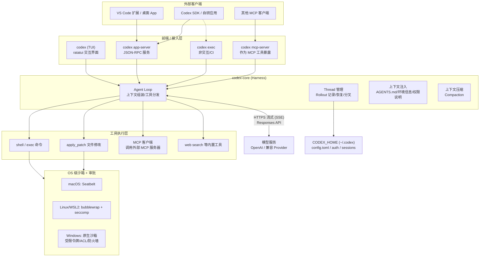
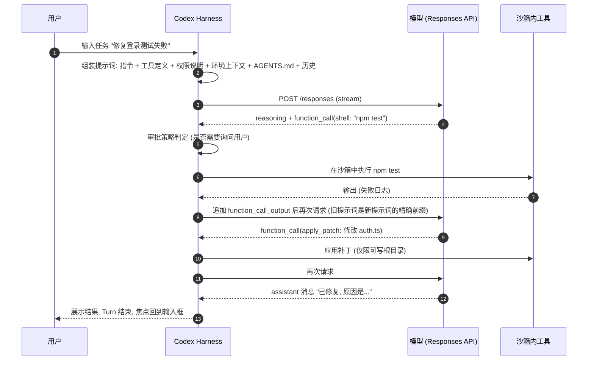
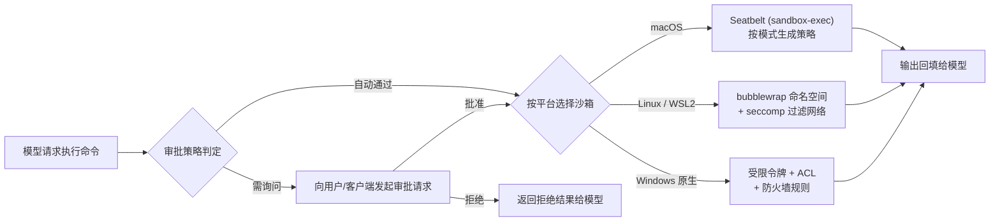
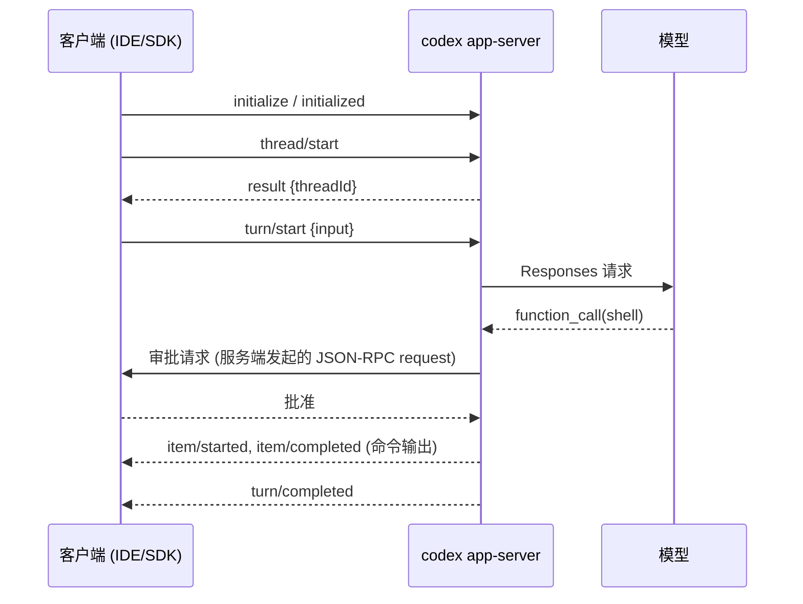
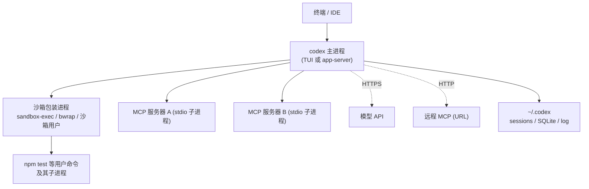

[toc]


## Codex是什么：先把"Codex"这个词拆开

> 本文调研时间2026/10/25

在OpenAI的语境里，"Codex"是一组软件代理（Software Agent）产品的统称。官方博客明确说过，它包括 **Codex CLI、Codex Cloud、Codex IDE扩展** 等形态，而它们共用同一个 **Harness（代理运行框架，可以理解为"智能体外壳"）**。这个Harness提供核心的代理循环（Agent Loop）和执行逻辑，并通过Codex CLI对外开放。

| 形态                           | 运行位置           | 典型用途           | 与CLI的关系                            |
| ------------------------------ | ------------------ | ------------------ | -------------------------------------- |
| **Codex CLI（TUI）**           | 本机终端           | 交互式编码         | Harness的"官方前端"                    |
| **`codex exec`**               | 本机或CI           | 非交互、脚本化任务 | 同一个二进制的子命令                   |
| **IDE扩展 / 桌面App**          | 本机               | 编辑器内对话       | 以子进程方式启动`codex app-server`     |
| **Codex Cloud（云端任务）**    | OpenAI云端隔离环境 | 后台并行任务、PR   | 云端微虚拟机（microVM）运行同类Harness |
| **Codex SDK / App Server集成** | 你的应用           | 把代理嵌入自有产品 | 通过协议驱动本地Codex进程              |

**要点**：**"CLI"既是一个终端产品，也是整个Codex本地能力的载体**。IDE插件、桌面App、SDK本质上都在复用同一个Rust二进制里的Harness。官方说得很直接：Harness负责管理会话状态、流式执行、调用工具、执行沙箱与审批策略、跨轮次延续工作，App Server再把这些能力通过一套文档化的客户端协议开放出去（[*Codex as a platform*](https://developers.openai.com/blog/codex-as-a-platform)）。

## 总体架构

Codex CLI最早用TypeScript实现，后来用Rust重写，代码在仓库 **`openai/codex`** 的 **`codex-rs/`** 目录下，是一个Cargo workspace，由多个crate组成。



这张图分四层来看：

- **接入层**：同一个`codex`二进制提供四种入口。**TUI**给人用；**`exec`**给脚本和CI用；**`app-server`**给富客户端（IDE、App、SDK）用；**`mcp-server`**把Codex自己包装成一个MCP工具，供别的代理调用。
- **核心层（`codex-core`）**：这是真正的Harness。它负责组装提示词、调用模型、解析工具调用、分发执行、记录会话（Rollout），并在上下文快满时做压缩。
- **工具执行层**：模型"想做的事"在这里变成真实动作，比如执行shell命令、打补丁改文件、调用MCP服务器上的外部工具。
- **沙箱层**：**由操作系统内核强制执行，不靠提示词约束**。模型就算"决定"写工作区以外的文件，也只会收到内核返回的错误。

## 组成部分：codex-rs关键crate

下表综合了[zread.ai源码导读](https://zread.ai/openai/codex)和我对仓库结构的了解。目录名会随重构变化，**以仓库当前状态为准**。

| Crate / 目录                            | 职责                                                         | 读者关注点                              |
| --------------------------------------- | ------------------------------------------------------------ | --------------------------------------- |
| **`codex-rs/cli`**                      | 命令行入口，用clap解析参数，分发到`login`、`exec`、`mcp`、`app-server`、`sandbox`等子命令 | 所有子命令都在同一个二进制里            |
| **`codex-rs/tui`**                      | 基于ratatui的终端界面，流式渲染Markdown                      | CJK字符宽度、终端兼容性问题多出在这一层 |
| **`codex-rs/core`**                     | **Agent Loop、Thread管理、工具分发、上下文组装、Rollout记录** | 理解Codex行为的核心                     |
| **`codex-rs/protocol`**                 | 事件、条目等共享类型定义                                     | 前后端解耦的契约                        |
| **`codex-rs/exec`**                     | 非交互模式（`codex exec`）                                   | 输出JSONL事件流                         |
| **`codex-rs/app-server`**（含协议定义） | JSON-RPC服务端，处理Thread、Turn、Item                       | IDE、App、SDK的统一后端                 |
| **`codex-rs/mcp-server`**               | 把Codex暴露成MCP服务器                                       | 让其他代理"调用Codex"                   |
| MCP客户端相关crate                      | 连接外部MCP服务器（stdio或可流式HTTP）                       | 扩展工具能力                            |
| **`linux-sandbox`** 等沙箱相关crate     | Linux沙箱辅助程序（bubblewrap、seccomp）                     | 容器内运行时常见故障点                  |
| **`apply-patch`**                       | 解析并应用模型生成的补丁格式                                 | 文件修改的标准路径                      |
| **`execpolicy`** 等策略相关crate        | 命令前缀规则（允许、提示、禁止）                             | 精细化审批                              |

## 核心概念：Thread、Turn、Item与Rollout

App Server协议把会话抽象成三层模型，CLI内部也是同样的语义（[zenn调研](https://zenn.dev/suwash/articles/codex-app-server_20260514?locale=en)、[App Server文档](https://developers.openai.com/codex/app-server)）：

| 概念        | 中文     | 含义                                                         | 类比                         |
| ----------- | -------- | ------------------------------------------------------------ | ---------------------------- |
| **Thread**  | 会话线程 | 一次完整对话，可以持久化、恢复（resume）、分叉（fork）、归档 | 一个聊天窗口                 |
| **Turn**    | 轮次     | 用户发一次输入，到代理给出"本轮结束"的最终回复之间的全过程，**中间可能包含多次模型推理和工具调用** | 你问一句，它忙一阵后回你一句 |
| **Item**    | 条目     | Turn里的最小事件单元：用户消息、代理消息、推理、命令执行、文件变更、MCP调用等 | 聊天记录里的每一条           |
| **Rollout** | 会话记录 | Thread的落盘形式（JSONL，配合SQLite索引），用于恢复和分叉    | 聊天记录文件                 |

**辨析**：**Turn不等于一次模型调用**。一个Turn可能包含十几次"推理 → 工具 → 推理"的循环，直到模型输出不带工具调用的assistant消息，这个Turn才结束。计费、上下文增长、延迟都主要发生在Turn内部的这些循环里。

## 工作方式：Agent Loop详解

### 循环的基本形态

下面这张时序图描述一个Turn的完整过程，依据官方博客整理：



各步骤说明：

- **步骤2 组装初始提示词**：官方博客说明，提示词里每一项都有角色，按优先级从高到低是`system`、`developer`、`user`、`assistant`。在第一条用户消息之前，Codex会注入**沙箱规则说明、环境上下文（如cwd、shell）和汇总后的项目指引（AGENTS.md）**，项目指引默认有约 **32 KiB** 的扫描上限。
- **步骤4~5 工具调用**：模型返回`function_call`（例如`shell`），Harness先按审批策略决定要不要问用户，再放进沙箱执行。
- **步骤7 追加并重发**：工具输出作为新条目追加进`input`，再请求一次模型。**旧提示词严格是新提示词的前缀**，这是性能设计的关键（下一节详述）。
- **步骤10 结束条件**：模型输出普通assistant消息后，Turn结束。用户再发消息时，assistant消息和新的用户消息一起追加进下一次请求。

### 三个关键设计决策

**无状态请求（Stateless）**：Responses API支持用`previous_response_id`让服务端保存上下文，但Codex**刻意不用它**，每次请求都带上完整历史。官方给的理由是保持请求完全无状态，并支持 **零数据保留（Zero Data Retention, ZDR）**。之前轮次的推理内容以`encrypted_content`的形式带回，服务端用客户密钥解密，所以ZDR客户也不会丢失推理连续性。

**提示词缓存（Prompt Caching）**：每轮都重发全量历史，看上去传输量会随对话长度**平方级增长**。但因为新请求总是"旧请求 + 追加内容"，缓存命中后实际计算量接近线性。这里有一个**直接影响使用方式的推论**：**会话中途切换模型、修改工具集（比如增删MCP服务器）、修改沙箱配置，都会破坏前缀，导致缓存失效**，成本和延迟会明显上升。

**上下文压缩（Compaction）**：token累积到阈值时，Codex调用`/responses/compact`端点，把完整历史替换成一个更短的条目列表，外加加密的延续状态。早期的`/compact`是手动做摘要，现在由服务端完成。代价是代理会失去对较早工具调用细节的精确访问。

**实践推论**：

- **推荐**：一个Thread专注一个任务；任务切换时开新会话（`/new`），而不是在一个超长会话里堆叠多个话题。
- **避免**：在长会话中途频繁换模型、开关MCP服务器。
- **推荐**：把稳定的规则放进`AGENTS.md`，因为它位于提示词前部，天然适合缓存，不要每轮在对话里重复粘贴。

### 上下文注入：AGENTS.md

`AGENTS.md`是给代理看的"README"。以下发现规则来自官方文档的长期约定，版本之间可能有细节差异：

- **全局层**：`~/.codex/AGENTS.md`（如果存在`AGENTS.override.md`则优先使用它），存放个人通用偏好。
- **项目层**：从仓库根目录一直到当前工作目录，沿路径逐级查找`AGENTS.md`（同样支持override文件），**越靠近cwd的越靠后拼接，所以优先级越高**。
- **大小上限**：合并后的项目指引默认约32 KiB（由`project_doc_max_bytes`控制），超出部分会被截断。

**必须**：AGENTS.md里写清楚**如何构建、如何测试、代码风格、禁止事项**。**避免**：写成冗长的设计文档，因为它占用每一轮的上下文。

## 安全模型：沙箱（Sandbox）与审批（Approval）

这是Codex最有辨识度的设计。它有两个**相互独立**的维度：

- **沙箱模式（`sandbox_mode`）**：**技术上能做什么**，由操作系统强制。
- **审批策略（`approval_policy`）**：**什么时候先问人**，是人机交互策略。

### 沙箱模式

| 模式                              | 读   | 写                             | 网络         | 适用场景                                     |
| --------------------------------- | ---- | ------------------------------ | ------------ | -------------------------------------------- |
| **`read-only`**                   | 可读 | 不可写                         | 需要审批     | 代码审查、调研、规划                         |
| **`workspace-write`**（常见默认） | 可读 | **仅工作区和`writable_roots`** | **默认关闭** | 日常开发                                     |
| **`danger-full-access`**          | 全部 | 全部                           | 不受限       | **只用于可随时丢弃的、外部已加固的容器或VM** |

在`workspace-write`模式下，**可写根目录里的`.git`、`.codex`、`.agents`仍然保持只读**，防止代理篡改仓库元数据和Codex自己的配置（[azukiazusa](https://azukiazusa.dev/en/blog/codex-sandbox-agent-authorization/)、[inventivehq](https://inventivehq.com/knowledge-base/openai/how-to-configure-sandbox-modes)）。但源码本身是可以改的，所以**真正的兜底手段仍然是版本控制**。

### 审批策略

| 值               | 含义                                                     |
| ---------------- | -------------------------------------------------------- |
| **`untrusted`**  | 只有可信的只读类命令自动执行，其余都要询问               |
| **`on-request`** | 模型认为需要越过沙箱（例如联网、写工作区以外）时主动申请 |
| **`never`**      | 从不询问。越界操作直接失败，并把失败结果反馈给模型       |

据社区资料，早期的`on-failure`在2026年已被移除（[continuumcode](https://continuumcode.ai/guides/codex-sandbox/)）。另外，官方命令参考里出现了 **`--approve-for-me`**：使用`on-request`审批，但由自动审核代替人工确认，同时固定使用`workspace-write`沙箱。与之相对的是 **`--dangerously-bypass-approvals-and-sandbox`（别名`--yolo`）**，它会同时关闭审批和沙箱，**只应在外部已加固的环境中使用**。

### 各平台的沙箱实现



| 平台            | 机制                                                         | 前置条件与注意事项                                           |
| --------------- | ------------------------------------------------------------ | ------------------------------------------------------------ |
| **macOS**       | Seatbelt（`sandbox-exec`），按模式生成策略文件               | 系统内置，开箱即用                                           |
| **Linux**       | **bubblewrap（bwrap）+ seccomp**：只读绑定根目录、可写绑定工作区、`--unshare-net`隔离网络 | **建议用包管理器安装bwrap**，自带辅助程序只是后备；**需要内核允许非特权用户命名空间** |
| **WSL2**        | 同Linux                                                      | 社区资料称从0.115起不再支持WSL1                              |
| **Windows原生** | 专用沙箱用户、受限令牌（Restricted Token）、ACL写授权、防火墙规则实现网络隔离 | 在PowerShell中配置，`/setup-default-sandbox`可以配置elevated模式；有社区资料称新版文档开始推荐MXC沙箱（`[features] prefer_mxc = true`），**属于较新变化，请用官方文档核实** |

**自检命令**：`codex sandbox macos <cmd>`或`codex sandbox linux <cmd>`，可以在不经过模型的情况下，直接用沙箱跑一条命令，验证策略是否符合预期。例如`codex sandbox linux touch /etc/x`应该失败，`codex sandbox linux touch ./x`应该成功。

## 配置体系

### CODEX_HOME目录结构

Codex的所有本地状态都放在 **`CODEX_HOME`**（默认`~/.codex`，Windows下是`%USERPROFILE%\.codex`），可以用环境变量改位置：

| 路径          | 内容                       | 注意                                       |
| ------------- | -------------------------- | ------------------------------------------ |
| `config.toml` | 用户级配置                 | 核心配置文件                               |
| `auth.json`   | 登录凭据（文件存储模式下） | **敏感文件，不要提交、不要同步到公共位置** |
| `AGENTS.md`   | 全局代理指引               | 个人偏好                                   |
| `sessions/`   | Rollout JSONL会话记录      | 会随使用持续增长，可能包含代码和输出片段   |
| `log/`        | 运行日志，例如TUI日志      | 排障时查看                                 |
| SQLite状态库  | Thread索引等               | 多实例共享，见后文进程注意事项             |

此外，**项目级`.codex/`配置只有在项目被标记为"可信"（trusted）后才会加载**。项目配置"没生效"，最常见的原因就是项目未受信任。

### config.toml示例与字段说明

下面的配置给出一个"默认安全、按场景切换"的写法。模型名请换成你账户可用的型号：

```toml
# ~/.codex/config.toml
model = "gpt-5-codex"                 # 示例值, 以 `codex` 中 /model 列出的为准
model_reasoning_effort = "medium"     # minimal | low | medium | high | xhigh (视模型而定)
approval_policy = "on-request"        # untrusted | on-request | never
sandbox_mode = "workspace-write"      # read-only | workspace-write | danger-full-access

[sandbox_workspace_write]
network_access = false                # 默认断网, 需要时再显式打开
writable_roots = ["/home/dev/.cache/pip"]   # 额外可写目录, 比全放开安全得多
# exclude_tmpdir_env_var = false
# exclude_slash_tmp = false

# 场景化配置: codex --profile review
[profiles.review]
sandbox_mode = "read-only"
approval_policy = "untrusted"
model_reasoning_effort = "high"

# 场景化配置: codex --profile ci (配合 exec 使用)
[profiles.ci]
sandbox_mode = "workspace-write"
approval_policy = "never"

# 外部 MCP 服务器 (stdio 方式, Codex 会以子进程拉起)
[mcp_servers.docs]
command = "npx"
args = ["-y", "@upstash/context7-mcp"]
startup_timeout_sec = 20
tool_timeout_sec = 60

# 远程 MCP 服务器 (可流式 HTTP)
[mcp_servers.internal_api]
url = "https://mcp.example.com/mcp"
```

| 字段                                           | 说明                                                         |
| ---------------------------------------------- | ------------------------------------------------------------ |
| `model` / `model_reasoning_effort`             | 默认模型和推理强度。推理强度越高越慢、越贵，也越稳           |
| `approval_policy` / `sandbox_mode`             | 见上一节，**两者独立设置**                                   |
| `[sandbox_workspace_write]`                    | 只在`workspace-write`下生效的子配置                          |
| `network_access`                               | 沙箱内命令能否联网。**`npm install`、`pip install`一直失败，多半就是因为这个默认值** |
| `writable_roots`                               | 工作区以外的额外可写目录。**推荐只开放一个具体目录，而不是切到全权限** |
| `exclude_slash_tmp` / `exclude_tmpdir_env_var` | 是否把`/tmp`和`$TMPDIR`排除在可写范围之外（默认允许写临时目录） |
| `[profiles.<name>]`                            | 命名配置集，用`--profile <name>`激活，覆盖顶层同名字段       |
| `[mcp_servers.<name>]`                         | 外部MCP服务器定义：`command`、`args`、`env`用于stdio方式，`url`用于HTTP方式 |
| `startup_timeout_sec` / `tool_timeout_sec`     | MCP服务器的启动超时和单次工具调用超时                        |

**配置优先级**（从高到低，基于官方文档的长期约定）：命令行参数（如`-c key=value`、`--sandbox`）、`--profile`选中的配置集、可信项目的`.codex/config.toml`、用户级`~/.codex/config.toml`、内置默认值。

## 运行模式与集成层选型

| 需求                                           | 推荐入口                        | 原因                                          |
| ---------------------------------------------- | ------------------------------- | --------------------------------------------- |
| 人在终端里交互编码                             | **`codex`（TUI）**              | 完整的审批交互和差异查看                      |
| CI、批处理、脚本一次性任务                     | **`codex exec`**                | 非交互；`--json`输出JSONL事件流；可以`resume` |
| 在自研产品里嵌入代理，需要多轮、流式、审批回调 | **`codex app-server`或官方SDK** | 官方定位就是"代理是产品本身的一部分"时用它    |
| 让另一个代理把Codex当工具调用                  | **`codex mcp-server`**          | 标准MCP接口                                   |
| 后台并行、不占用本机                           | **Codex Cloud**                 | 在云端隔离的microVM中克隆仓库执行             |

### codex exec的典型用法

```bash
# 只读审查, 结果写入文件 (适合 CI 评论 PR)
codex exec --sandbox read-only -o review.md \
  "审查当前分支相对 main 的改动, 列出潜在 bug 与安全问题"

# 机器可读事件流, 便于 jq 处理
codex exec --json --sandbox workspace-write "运行测试并修复失败用例" > events.jsonl

# 继续上一次 exec 会话
codex exec resume --last "再补充对应的单元测试"
```

| 参数                                   | 含义                                  |
| -------------------------------------- | ------------------------------------- |
| `--sandbox <mode>`                     | 本次运行的沙箱模式，覆盖配置文件      |
| `-o <file>`（`--output-last-message`） | 把最后一条代理消息写入文件            |
| `--json`                               | 以JSONL输出事件（thread、turn、item） |
| `resume --last`                        | 恢复最近一次会话继续执行              |

`exec`默认不会弹出审批（没有人可以回答），越界操作会直接失败。**CI中推荐用`read-only`或`workspace-write`，不要用`--yolo`，除非runner本身就是用完即弃的隔离环境。**

### App Server协议握手示例

App Server使用 **JSON-RPC 2.0**，线上传输时**省略`"jsonrpc":"2.0"`字段**。默认传输是**stdio上的JSONL**，另有实验性的WebSocket（`--listen ws://127.0.0.1:4500`）。流程是先发`initialize`请求，再发`initialized`通知，然后才能创建Thread和Turn。下面是一个最小会话，以客户端写入stdin为视角：

```json
{"id":1,"method":"initialize","params":{"clientInfo":{"name":"my_tool","title":"My Tool","version":"0.1.0"}}}
{"method":"initialized"}
{"id":2,"method":"thread/start","params":{"cwd":"/home/dev/repo"}}
{"id":3,"method":"turn/start","params":{"threadId":"thr_abc","input":[{"type":"text","text":"运行测试并总结失败原因"}]}}
```

服务端随后会推送`turn/started`、`item/started`、`item/completed`、`turn/completed`等通知。需要审批时，**由服务端主动向客户端发出JSON-RPC请求**（例如命令执行审批），客户端回复批准或拒绝后，Turn才继续。方法名属于协议细节，**请以`codex app-server`对应版本生成的schema为准**。官方命令参考里也提示，app-server子命令"可能不经通知而变更"。



## 进程与服务方面的注意事项

这部分是日常使用中最容易出问题的地方。下图先给出一个典型的本机进程树（TUI模式）：



### 生命周期与进程归属

- **Codex不是常驻守护进程**。TUI和`exec`都随命令启动、随会话结束退出，没有后台服务需要单独管理。
- **stdio模式的app-server是"单客户端"模式**：连接关闭（父进程退出或stdin关闭）后服务端就退出。**IDE扩展和桌面App各自以子进程方式拉起自己的app-server**，所以同时开VS Code和桌面App，就会有多个Codex进程。
- **MCP stdio服务器是Codex的子进程**，随会话启动。**MCP服务器很多、启动又慢时，会拖慢会话启动**，可以用`startup_timeout_sec`控制等待时间。**推荐**只启用当前任务需要的MCP服务器。这样也能减少工具定义占用的上下文，并避免会话中途开关导致提示词缓存失效。
- **代理启动的长时间运行进程**（例如`npm run dev`、`docker compose up`）：在沙箱中运行时受同样的限制。会话结束或命令超时后，这些进程可能被终止，也可能残留。**推荐**在AGENTS.md里明确约定"不要启动常驻服务，需要时由我在另一个终端启动"，或者要求使用带超时的命令。

### 多实例与共享状态

- 多个Codex实例**共享同一个`CODEX_HOME`**（会话记录、SQLite索引、凭据）。正常使用时可以并发，但**避免**多台机器通过网盘同步同一个`~/.codex`，SQLite和JSONL不适合跨机器同步写入。
- **需要隔离时**（例如CI并行任务、不同账号），给每个任务设置独立的`CODEX_HOME`：`CODEX_HOME=/tmp/codex-job-42 codex exec ...`
- `sessions/`会持续增长，而且**可能包含代码片段、命令输出甚至密钥**。**推荐**定期清理或归档，敏感项目要注意保留策略。

### 网络服务暴露：WebSocket与远程连接

- WebSocket传输**仍是实验性的**。**必须只绑定在`127.0.0.1`**，或放在受认证保护的隧道后面。**避免**绑定`0.0.0.0`后直接暴露到公网：拿到连接的人等于拿到了一个能在你机器上执行命令的代理。
- WebSocket模式使用有界队列。入口队列满时，服务端返回错误码 **`-32001`**（"Server overloaded; retry later."），**客户端必须实现带退避的重试**。
- 新版CLI支持 **`--remote ws://host:port`、`wss://`或`unix://PATH`**，用来连接远程app-server（官方命令参考列出的适用子命令包括`codex`、`resume`、`fork`等）。跨机器使用时，**推荐`wss://`或SSH隧道加`unix://`套接字**。

### 登录与端口

- ChatGPT账号登录时，`codex login`会在本机启动一个**临时HTTP回调服务**（据我所知默认端口是`localhost:1455`，属于未经本轮搜索核实的经验信息），浏览器授权后回调到这里。
- **在远程服务器或无图形界面的环境中**，有两种做法：一是使用设备码登录（`codex login --device-auth`），二是做SSH本地端口转发：`ssh -L 1455:localhost:1455 user@server`

| 字段             | 含义                                                        |
| ---------------- | ----------------------------------------------------------- |
| `-L`             | 本地端口转发                                                |
| 第一个`1455`     | 本机（有浏览器的那台）监听的端口                            |
| `localhost:1455` | 从**服务器视角**看的目标地址，也就是服务器上Codex的回调服务 |
| `user@server`    | SSH登录的用户和主机                                         |

- **CI中推荐使用API Key**（例如通过`codex login --with-api-key`从stdin读入，或使用环境变量），不要把个人ChatGPT的`auth.json`拷到共享runner上。

### 容器与CI中的沙箱

- **Docker里bubblewrap经常失败**：默认的seccomp和AppArmor配置会禁止非特权用户命名空间，常见表现是沙箱初始化报错。这种情况下有两种选择。**推荐**：容器本身就是隔离边界，在容器内使用`danger-full-access`，同时在容器层面做好约束（非root、只挂载必要目录、网络出口白名单）。**可以**：调整容器的安全配置以允许用户命名空间，但这会削弱容器自身的隔离。
- **避免**在宿主机或长期存活的开发机上使用`--yolo`。

### 排障

- 先看`~/.codex/log/`下的日志。可以通过`RUST_LOG`环境变量提高日志级别，例如`RUST_LOG=codex_core=debug`（具体target名以版本为准）。
- 沙箱问题先用`codex sandbox <平台> <命令>`单独复现，判断是策略问题还是模型行为问题。

## 国内网络环境与代理

Codex访问模型API需要连接OpenAI（或你配置的兼容服务商）。Rust的HTTP客户端通常遵循标准代理环境变量。

**Linux / macOS（以mihomo默认的7890端口为例）**：

```bash
export HTTPS_PROXY=http://127.0.0.1:7890
export HTTP_PROXY=http://127.0.0.1:7890
export NO_PROXY=localhost,127.0.0.1
codex
```

**Windows PowerShell**：

```powershell
$env:HTTPS_PROXY = "http://127.0.0.1:7890"
$env:HTTP_PROXY  = "http://127.0.0.1:7890"
$env:NO_PROXY    = "localhost,127.0.0.1"
codex
# 持久化到用户环境变量 (新开终端生效)
setx HTTPS_PROXY "http://127.0.0.1:7890"
```

注意事项：

- **`NO_PROXY`要包含`localhost`**，否则登录回调或本地app-server的连接可能被错误地转发给代理。
- **沙箱内命令的网络是另一回事**：即使Codex本身走代理连上了API，`workspace-write`默认`network_access = false`，沙箱里的`pip install`仍然会失败。需要的话，显式打开，或者在沙箱外自己预装依赖。
- **安装加速**：`npm i -g @openai/codex`可以配合国内npm镜像（`npm config set registry https://registry.npmmirror.com`）。新版npm包会额外下载平台相关的二进制，如果镜像同步滞后，就临时切回官方源或走代理。从GitHub Releases下载二进制时，可以用gh-proxy这类加速前缀，**使用前请自行核实镜像当前是否可用**。
- **中文显示**：TUI基于ratatui，中文宽字符在少数终端里可能出现对齐或光标错位。Windows上推荐使用 **Windows Terminal + UTF-8**（必要时先执行`chcp 65001`）；SSH远程时确保`LANG`或`LC_ALL`是UTF-8 locale。

## 综合示例：一个团队仓库的完整接入

**场景**：一个Node.js后端仓库。开发者在本机交互使用；CI对每个PR做只读审查；内部工具通过app-server嵌入"一键修复测试"功能。

**第一步：仓库内放`AGENTS.md`**

```markdown
# AGENTS.md
## 构建与测试
- 安装依赖: `pnpm install`(已预装, 不要在沙箱内重新安装)
- 测试: `pnpm test -- --run`
- 类型检查: `pnpm tsc --noEmit`
## 约束
- 不要启动常驻进程(dev server、docker compose); 需要时请告知我
- 修改数据库迁移前必须先说明方案
- 提交信息遵循 Conventional Commits
```

**第二步：个人配置使用两个profile**，沿用前文的`config.toml`。日常开发用默认的`workspace-write + on-request`，审查时用`codex --profile review`。

**第三步：CI中只读审查**（runner是临时VM，用独立`CODEX_HOME`和API Key）：

```bash
#!/usr/bin/env bash
set -euo pipefail
export CODEX_HOME="${RUNNER_TEMP:-/tmp}/codex-home"
mkdir -p "$CODEX_HOME"
printenv OPENAI_API_KEY | codex login --with-api-key
codex exec --sandbox read-only -o review.md \
  "审查本分支相对 origin/main 的改动, 按严重程度列出问题, 给出文件与行号"
cat review.md
```

**第四步：内部工具嵌入**。后端以子进程方式启动`codex app-server`（stdio），按前文握手流程创建Thread，发起"运行测试并修复"的Turn。审批请求转发到内部Web界面，由工程师点击批准。会话结束后关闭stdin，app-server随之退出，不会残留常驻服务。

这个例子串起了本文的主要知识点：**AGENTS.md进入提示词前部（利于缓存）、profile切换沙箱与审批、exec适合CI、CODEX_HOME隔离多任务、app-server的服务端审批请求和stdio生命周期。**

## 最佳实践清单

**必须**：
- **默认使用`workspace-write` + `on-request`**；交给代理执行大任务之前**先提交代码**，事后用`/diff`或git审查。
- **`--yolo`和`danger-full-access`只在可丢弃的隔离环境里使用。**
- **app-server的WebSocket只绑定回环地址**，或放在认证隧道后面。
- **保护`auth.json`和`sessions/`**，不要提交、不要放进公共同步盘。

**推荐**：
- **一个Thread只做一个任务**；长会话中途不切换模型和工具集。
- **用`writable_roots`精确放开某个目录**，不要整体放开权限；网络按需打开。
- CI用`exec` + 独立`CODEX_HOME` + API Key；要求输出机器可读时用`--json`。
- 只启用必要的MCP服务器，并设置超时。

**可以**：
- 用`codex sandbox`验证策略；用`--profile`组织场景配置；用`--remote`连接远端app-server。

**避免**：
- 在AGENTS.md中堆放大段文档，超过32 KiB会被截断，也浪费上下文。
- 让代理在沙箱内启动常驻服务。
- 在Docker里硬调bwrap，结果把容器隔离弄弱了。

