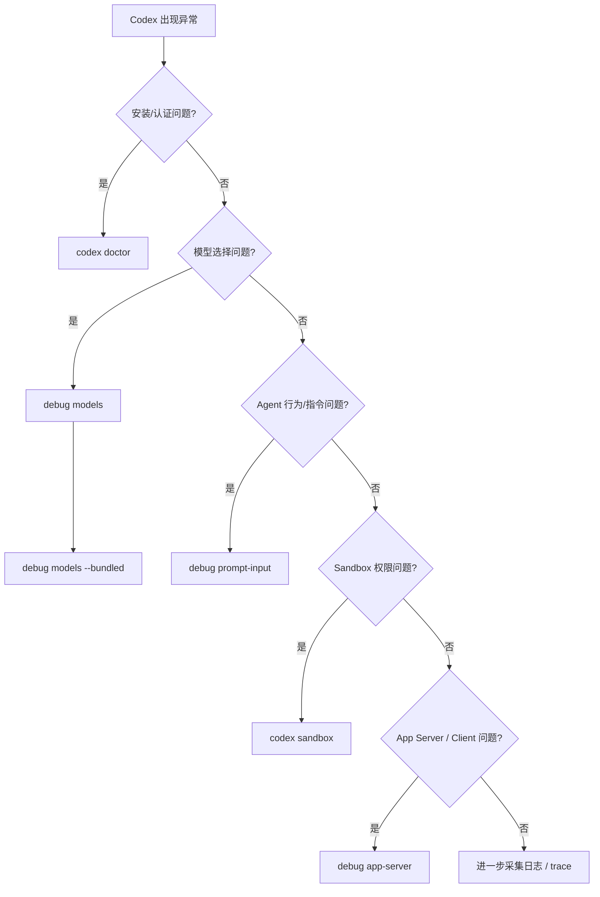
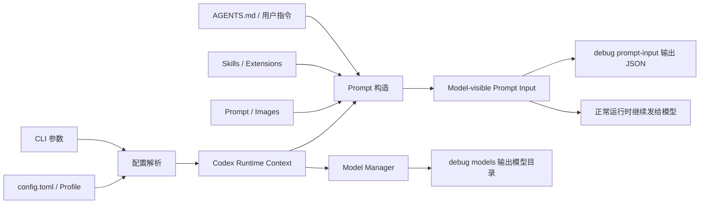
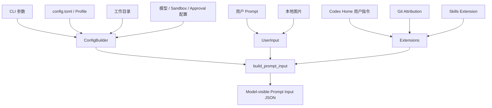
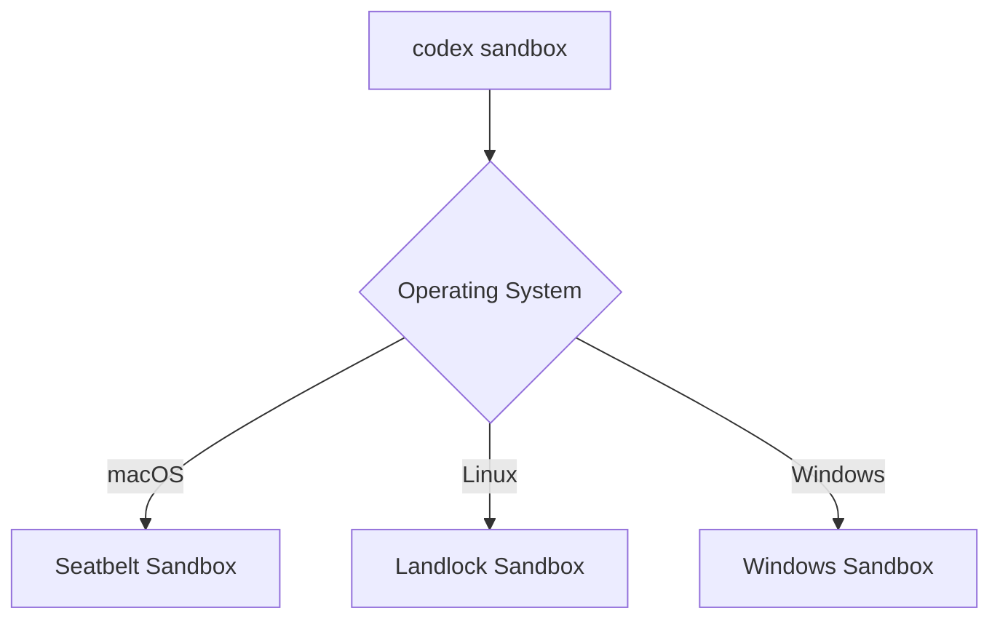
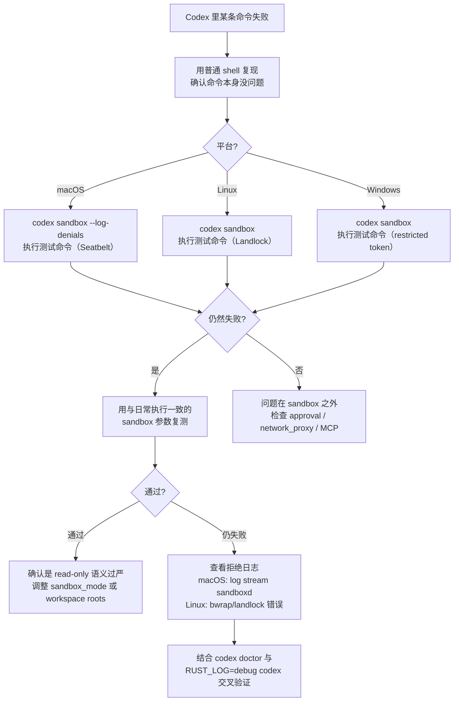
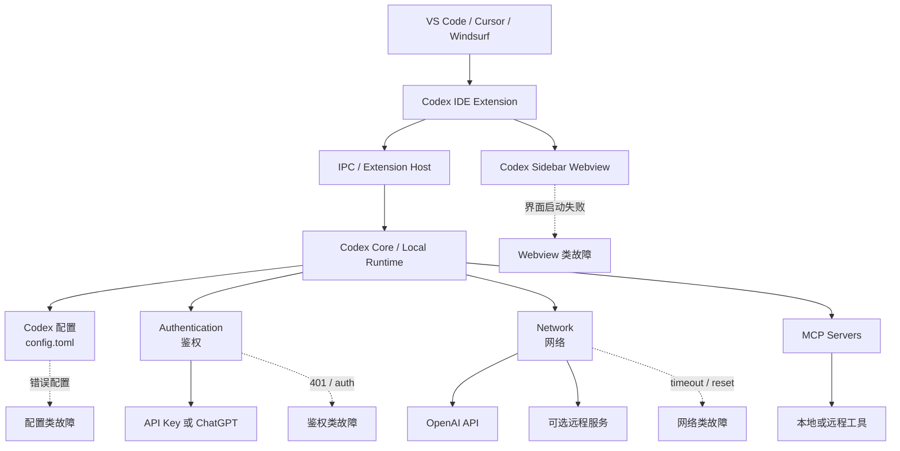
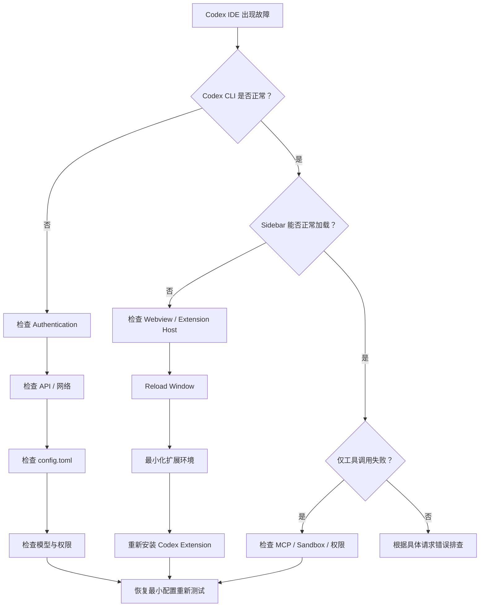
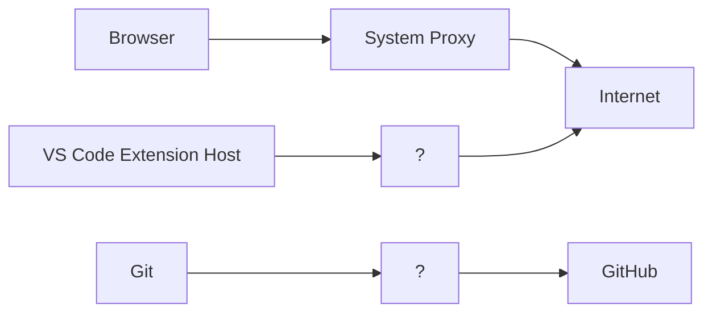

[toc]

## 资料依据与适用范围

本文由以下三份文档合并而成，合并时保留了各自独特细节，重合内容按更完整、更新的一版择优收录：

- *codex@debug系列命令解析@深入到codex工作方式*：`codex debug` 命令族主体，版本基线 **Codex CLI 0.153.4**（2026-09-04 标记为 Latest，0.154.0-alpha.6 为 2026-09-07 预发布版）。
- *codex debug系列命令和codex的工作方式和设计opus4.7*：三平台沙盒机制、沙盒环境变量、`codex doctor` 详情、`/status`、`/feedback`、`RUST_LOG` 等诊断入口；该文档基于旧版命令结构写成，其中沙盒相关命令名已按现行版本更新。
- *codex插件在vscode中的故障排查指南*：VS Code 插件环境的分层故障排查体系。

沙盒命令结构已对照 2026-10 的 openai/codex main 分支源码核验：现行版本的 `debug` 命名空间只包含 `models`、`prompt-input`、`app-server`、`trace-reduce`（隐藏）、`clear-memories`（隐藏），不再包含沙盒子命令；沙盒探测已提升为顶层命令 `codex sandbox`。

适用范围：排查 Codex CLI 自身的运行故障（模型目录、Prompt 上下文、App Server 协议、沙盒权限），以及 VS Code 插件环境的故障（Webview、鉴权、配置、网络、MCP）。Codex CLI 更新较快，凡涉及具体命令与配置项的内容，最终以 `codex --help`、`codex debug --help` 与当前版本文档为准。

## 排障总纲：先分层，再处理

排查 Codex 故障最重要的原则不是看到一条红色日志就立即修改配置，而是：

**先确定故障发生在哪一层，再处理那一层。**

Codex 故障可以大体分为以下几层：

- **安装与认证**（installation / authentication）
- **网络与代理**（network / proxy）
- **配置体系**（`config.toml`）
- **模型目录与模型权限**（model catalog / access）
- **Prompt 上下文装配**（prompt input、`AGENTS.md`、Skills）
- **沙盒与权限**（sandbox / permission）
- **App Server 协议**（IDE 与桌面客户端依赖的协议层）
- **VS Code 插件层**（Extension、Webview、IPC）
- **MCP 与 Plugin**

### CLI 是最重要的分界测试

即使日常主要使用 VS Code，也建议保留 Codex CLI 作为独立诊断入口，因为它是整个排障体系中价值最高的判断之一：

- **CLI 失败 + IDE 失败**：优先检查 authentication、network、config、DNS、proxy、TLS、模型权限，暂时不要折腾 Webview。
- **CLI 正常 + IDE 失败**：说明 API Key 基本可用、Codex Core 基本能工作、基础 OpenAI API 通信大概率没有完全中断，此时应转向 Extension、Webview、Extension Host、IPC、IDE 缓存、Extension 冲突等 IDE 层。

### 按症状选择命令

现代 Codex CLI 把健康检查、内部观测、沙箱测试拆成了三个不同的概念，选错入口会浪费大量时间：

| 问题                         | 优先命令                       |
| ---------------------------- | ------------------------------ |
| Codex 安装是不是正常         | `codex doctor`                 |
| config/auth/runtime 是否健康 | `codex doctor`                 |
| 有哪些模型                   | `codex debug models`           |
| CLI 内置哪些模型             | `codex debug models --bundled` |
| 模型实际会收到什么 Context   | `codex debug prompt-input`     |
| App Server 协议是否正常      | `codex debug app-server`       |
| 某命令在 sandbox 内是否运行  | `codex sandbox`                |
| trace 如何归约               | `codex debug trace-reduce`     |
| 重置本地 memory 测试状态     | `codex debug clear-memories`   |

源码给 `doctor` 的描述非常明确：

> Diagnose local Codex installation, config, auth, and runtime health.

而 `debug` 只是：

> Debugging tools.

初学者更合理的排错顺序通常是：

1. 安装/认证问题，用 `codex doctor`。
2. 模型问题，用 `codex debug models`。
3. Agent 指令/上下文问题，用 `codex debug prompt-input`。
4. 沙箱权限问题，用 `codex sandbox`。
5. 客户端协议问题，用 `codex debug app-server`。

### 推荐的标准排障流程

遇到一个模糊的"Codex 不正常"，推荐按下面的顺序定位故障层：



这个顺序背后的原则是：

> **先确定故障层，再调试那一层。**

不要把模型目录问题、Prompt 问题、Sandbox 问题、App Server 问题、Authentication 问题全部统称成"Codex 模型不工作"。

## codex debug 是什么

> 当前介绍基于 2026-9 的版本，最新内容以官方文档为准。

`codex debug` 可以理解为 Codex CLI 的**诊断与内部观测工具集合**（debugging / introspection tools）。

它不是传统意义上的：

- `gdb`
- `lldb`
- Java Debugger
- IDE 断点调试器

它更接近：

> "让我看看 Codex 自己现在到底认为模型有哪些、准备给模型发送什么上下文、App Server 协议工作得怎么样，以及某些内部状态是什么。"

当前稳定版源码将 `debug` 定义为：

- `debug models`
- `debug prompt-input`
- `debug app-server`
- 隐藏的 `debug trace-reduce`
- 隐藏的 `debug clear-memories`

与此同时，沙箱调试已经变成独立的顶层：

- `codex sandbox`

而安装、配置、认证、运行时健康检查则有：

- `codex doctor`

`codex debug` 系列命令的价值在于：**它把 Codex 平时在 agent loop 内部隐式执行的沙盒包装、模型目录、app-server 协议等环节，暴露成可以被人手动触发的独立子命令**。理解它们等于理解了 Codex 执行层是怎么装配起来的。

### 当前命令树

稳定版 0.153.4 可以概括为：

| 命令                                     | 可见性 | 主要作用                              | 典型使用者             |
| ---------------------------------------- | ------ | ------------------------------------- | ---------------------- |
| `codex debug models`                     | 公开   | 查看当前原始模型目录（model catalog） | 普通用户、运维、开发者 |
| `codex debug models --bundled`           | 公开   | 查看 CLI 二进制内置模型目录           | 模型/版本问题排查      |
| `codex debug prompt-input`               | 公开   | 查看"模型实际可见"的 Prompt 输入列表  | Agent/Prompt/配置调试  |
| `codex debug app-server send-message-v2` | 公开   | 测试 App Server V2 消息链路           | 集成开发者             |
| `codex debug trace-reduce`               | 隐藏   | 回放 trace bundle 并生成归约状态      | Codex 内部/高级调试    |
| `codex debug clear-memories`             | 隐藏   | 清理本地 Codex memory 状态            | 测试、内部诊断         |

源码中 `trace-reduce` 和 `clear-memories` 都显式设置了 `hide = true`，因此不能把它们当作长期稳定的公开 API。

查看自己安装版本的实际帮助信息，永远优先执行：

```bash
codex --version

codex debug --help

codex debug models --help

codex debug prompt-input --help

codex debug app-server --help
```

这是一个很重要的最佳实践：

> **CLI 帮助信息 + 当前安装版本，比网上一年前的文章更可信。**

### 理解 `debug` 的核心心智模型

可以把 Codex 的运行过程简化成：



最重要的是区分三个层次，三个问题不要混为一谈：

#### CLI 自己携带了什么

执行 `codex debug models --bundled`，回答的是：

> "这个版本的 Codex 二进制本身带了什么模型信息？"

#### Codex 当前运行时看到什么

执行 `codex debug models`，回答的是：

> "结合当前配置、认证和模型目录缓存，Codex Model Manager 当前看到什么？"

#### 模型真正会看到什么

执行 `codex debug prompt-input "检查这个项目"`，回答的是：

> "经过 AGENTS.md、Skills、扩展、配置、用户输入等组装之后，准备暴露给模型的 Prompt 输入到底是什么？"

## codex debug models 详解

### 基本功能

最基本的命令：

```bash
codex debug models
```

官方源码给它的描述非常直接：

> Render the raw model catalog as JSON.

也就是：**以 JSON 输出原始模型目录（raw model catalog）**。

它不是漂亮的模型选择 UI，也不是专门给人看的摘要，而是诊断数据。因此非常适合配合 `jq`、重定向、`diff`、自动化脚本使用。

### `models` 与 `models --bundled` 的根本区别

这是 `codex debug` 最值得理解的地方之一。

| 命令                           | 数据来源               | 是否考虑当前配置/认证 | 是否可能访问在线目录 | 适合排查                |
| ------------------------------ | ---------------------- | --------------------- | -------------------- | ----------------------- |
| `codex debug models --bundled` | CLI 二进制**内置**目录 | 否                    | 否                   | 当前 CLI "知道"哪些模型 |
| `codex debug models`           | Models Manager         | 是                    | 是，但不保证每次刷新 | 当前环境看到哪些模型    |

稳定版源码明确实现为：

- `--bundled`：直接调用 `bundled_models_response()`
- 默认模式：创建当前配置和 `AuthManager`，然后调用 `raw_model_catalog(...)`
- 刷新策略为 `OnlineIfUncached`

#### `OnlineIfUncached` 很重要

这意味着 `codex debug models` **不是**"强制重新向服务端下载一次最新模型列表"，而更接近：

> 如果已有可用缓存，可以使用缓存；如果没有，则在线获取。

因此不要把它误解成 `codex debug models --force-refresh`，当前命令并没有这样的语义。

#### `--bundled` 到底代表什么

执行 `codex debug models --bundled`，是在问：

> "这个 Codex CLI **版本发布的时候**，打包进来的模型目录是什么？"

这对定位**客户端版本问题**非常有价值：

```bash
codex --version
codex debug models --bundled
```

如果某个模型连 bundled catalog 都不存在，首先应该考虑的问题是"Codex CLI 是否太旧"，而不是立即怀疑 ChatGPT 账户坏了、登录失败、服务端故障。

#### 默认 `debug models` 到底代表什么

执行 `codex debug models` 时，源码会：

1. 读取 CLI config overrides；
2. 构造当前 `Config`；
3. 创建认证管理器（Auth Manager）；
4. 创建 Models Manager；
5. 读取 raw model catalog；
6. 必要时在线获取；
7. 输出 JSON。

因此它更接近：**Codex 当前运行环境下的"有效模型目录"**。

但这里有一个重要边界：**它不是跨产品统一的"账号权限证明"**。不要因为 `codex debug models` 输出中出现模型 A，就推断 ChatGPT Web、Desktop、API、所有 Codex Surface 都必须出现 A。不同产品 Surface 可能还有 UI 筛选、rollout、feature flag、认证类型、provider、产品权限、客户端版本等额外条件。所以 `debug models` 是一个**诊断信号**，不是"所有产品统一 entitlement API"。

### 模型目录里通常能看到什么

当前 Codex 模型协议中的 `ModelInfo` 包含相当多诊断元数据，例如：

- `slug`
- `display_name`
- `description`
- `default_reasoning_level`
- `supported_reasoning_levels`
- `visibility`
- `supported_in_api`
- `priority`
- `supports_parallel_tool_calls`
- `context_window`
- `max_context_window`
- `auto_compact_token_limit`
- `effective_context_window_percent`
- `input_modalities`
- `supports_search_tool`
- `tool_mode`

而响应本身是 `{"models": [...]}`，当前协议源码将其定义为 `ModelsResponse { models: Vec<ModelInfo> }`。这些字段属于**原始模型元数据**，未来版本可以继续变化，因此脚本最好只依赖自己真正需要的字段（[GitHub](https://github.com/openai/codex/blob/main/codex-rs/protocol/src/openai_models.rs?utm_source=chatgpt.com)）。

### 常用查看方式

直接输出：

```bash
codex debug models
```

格式化输出：

```bash
codex debug models | jq .
```

只列模型 slug：

```bash
codex debug models | jq -r '.models[].slug'
```

查看内置模型：

```bash
codex debug models --bundled | jq -r '.models[].slug'
```

查特定模型（把 `MODEL_SLUG` 替换成实际模型名）：

```bash
codex debug models |
  jq '.models[] | select(.slug == "MODEL_SLUG")'
```

### 对比 bundled 与当前目录

这是非常实用的一组诊断命令：

```bash
codex debug models --bundled > bundled-models.json
codex debug models > runtime-models.json

diff -u bundled-models.json runtime-models.json
```

更适合模型名对比的做法：

```bash
codex debug models --bundled |
  jq -r '.models[].slug' |
  sort > bundled.txt

codex debug models |
  jq -r '.models[].slug' |
  sort > runtime.txt

diff -u bundled.txt runtime.txt
```

这个差异非常有解释力：

| 现象                     | 优先考虑                                   |
| ------------------------ | ------------------------------------------ |
| bundled 有，runtime 没有 | 当前目录、rollout、配置、认证、provider 等 |
| bundled 没有，runtime 有 | 服务端目录比二进制内置目录更新             |
| 两边都没有               | CLI 版本或模型名称是否正确                 |
| 两边都有，但 UI 不显示   | UI picker 的筛选/产品 Surface 差异         |
| 模型存在但运行失败       | 认证、权限、provider、API 调用层问题       |

这比简单地说"模型不见了"更有排障价值。

## codex debug prompt-input 详解

如果说 `debug models` 是查看"Codex 能用什么模型"，那么 `debug prompt-input` 是查看"Codex 准备让模型看到什么"。这是当前 `debug` 中非常有价值的一条命令。

源码说明：

> Render the model-visible prompt input list as JSON.

也就是：**把模型可见的 Prompt Input 列表渲染成 JSON**。

### 最简单的使用

```bash
codex debug prompt-input "请检查这个项目"
```

输出不是模型的回答，而是 **Codex 构造出来的"模型输入上下文"**。这是一个非常重要的区别。

### `prompt-input` 不等于"问模型问题"

假设执行 `codex debug prompt-input "解释 main.rs"`，它做的核心事情不是把 Prompt 发给模型拿到 Assistant answer，而是把配置、项目上下文、用户指令、Skills、Extensions、Images 以及其他 Codex runtime context 组装起来，调用 `codex_core::build_prompt_input(...)`，再经 `serde_json::to_string_pretty(&prompt_input)` 直接打印 JSON。

因此它属于 **Prompt Introspection（Prompt 自省）**，而不是 **Model Inference（模型推理）**。

### 它为什么特别适合排查 Agent 行为

很多"模型为什么这么做"的问题，实际上并不是模型能力问题，而是：

> 模型收到了你没意识到的上下文。

这类上下文包括：

- 某个 `AGENTS.md`
- 用户级 instructions
- 项目级 instructions
- Skill 说明
- Extension 注入
- feature flag
- 模型配置
- tool usage instructions
- 图片
- 当前工作目录带来的项目上下文

`debug prompt-input` 的核心价值就是：

> 把隐藏在"Agent 上下文装配过程"里的东西变得可观察。

### Prompt 构造的大致过程

根据稳定版实现，可以概括成：



这个图不是完整内部架构，而是理解 `debug prompt-input` 所需的简化模型。

### 它会读取哪些配置

稳定版源码会把大量正常 Codex 运行参数带入 Prompt 构造，包括：

- `model`
- approval policy
- sandbox mode
- `cwd`
- Codex 自身 executable 路径
- additional writable roots
- OSS 相关参数
- config overrides
- profile
- web search 配置
- feature 状态

这点很重要，因为 `debug prompt-input` 不是在一个完全脱离真实 Codex 配置的假环境中生成 Prompt，它尽量复用真正的运行时配置。

### 它使用 ephemeral 模式

实现中明确设置：

```rust
ephemeral: Some(true)
```

并且在 `build_prompt_input` 时使用：

```rust
state_db: None
```

可以把它理解成：

> 为了检查 Prompt 而构造一个临时环境，而不是建立一个正常可恢复的 Codex 会话。

所以它非常适合做 Prompt 快照、配置回归测试、Context 对比。

### 支持图片输入

命令定义：

```bash
codex debug prompt-input -i FILE [PROMPT]
```

`-i` 即 `--image`，并且可以提供多个图片。源码会把文件转换成 `UserInput::LocalImage` 再加入 Prompt 输入。

单个图片：

```bash
codex debug prompt-input \
  -i screenshot.png \
  "分析这张截图"
```

多个图片：

```bash
codex debug prompt-input \
  -i frontend.png \
  -i backend.png \
  "比较这两张图"
```

命令参数还支持逗号分隔的文件值；不过为了 Shell 可读性和跨平台稳定性，通常建议显式重复 `-i`。

### Prompt 参数是可选的

源码定义中 Prompt 是 `[PROMPT]`（可选）而不是 `<PROMPT>`（必填），因此可以直接：

```bash
codex debug prompt-input
```

这很有用。因为有时候你根本不关心用户 Prompt，而只是想回答：

> "在这个 repository 中，Codex 启动时到底会自动注入哪些东西？"

### Prompt 换行会被规范化

这是一个很小但对自动化测试很实用的实现细节。源码会把 CRLF、CR 转换成 LF，也就是把 Windows/macOS 历史换行差异统一成 `\n`。因此做 Prompt JSON 快照比较时，不容易仅仅因为行尾格式不同而产生无意义差异。

## 用 prompt-input 做配置与行为排查

### 检查 AGENTS.md 是否生效

这是非常典型的实际用途。假设项目结构如下：

```
my-project/
├── AGENTS.md
├── src/
│   └── ...
└── package.json
```

进入目录后：

```bash
cd my-project

codex debug prompt-input \
  "修改 src 中的错误处理"
```

然后搜索输出：

```bash
codex debug prompt-input "test" > prompt.json

grep -n "AGENTS" prompt.json
```

更通用地：

```bash
jq . prompt.json
```

你可以检查：

- 项目指令有没有进入上下文；
- 指令内容是不是预期版本；
- 是否还有其他层的 instruction 覆盖/补充；
- 工作目录是不是正确。

### 工作目录为什么重要

Prompt 构造依赖当前项目环境。因此 `cd repo-a` 与 `cd repo-b` 之后分别执行 `codex debug prompt-input "test"`，理论上可以得到不同结果。

如果问题是"为什么 Codex 在 repo A 遵守这个规则，但 repo B 不遵守？"，首先就值得比较两个 Prompt Input。

### 检查 Skill 与 Extension 注入

稳定版源码在构建 Prompt Input 时安装：

- Git attribution extension
- Skills extension

Skills extension 的配置还会考虑是否包含 Skill instructions、Skill 上下文 token 上限、bundled skills、orchestrator skills、Skill Search feature 等。

所以如果你怀疑"是不是某个 Skill 改变了 Agent 的上下文？"，`debug prompt-input` 是比猜测更可靠的办法：

```bash
codex debug prompt-input "test" > before.json
# 改变配置后
codex debug prompt-input "test" > after.json

diff -u before.json after.json
```

这种做法特别适合：

- Skill 开发
- Plugin/Extension 开发
- Prompt token 优化
- Agent behavior regression
- CI 回归检查

### 与 Feature Flags 配合

当前 CLI 的 feature toggle 支持全局参数 `--enable FEATURE` 与 `--disable FEATURE`。源码明确说明它们分别等价于：

- `-c features.<name>=true`
- `-c features.<name>=false`

先查看当前版本有哪些 feature：

```bash
codex features list
```

然后可以做 A/B 对比：

```bash
codex debug prompt-input "test" > default.json

codex --disable FEATURE_NAME \
  debug prompt-input "test" > disabled.json

diff -u default.json disabled.json
```

这样你可以非常明确地回答"这个 feature 到底改变了模型上下文的哪一部分"，而不是只观察最终回答然后猜。

### 一个非常实用的 Prompt A/B 调试方法

比如你改变了一个 Codex feature，却不知道它真正改变了什么：

```bash
codex debug prompt-input \
  "Review this repository" > enabled.json

codex --disable FEATURE \
  debug prompt-input \
  "Review this repository" > disabled.json

diff -u disabled.json enabled.json
```

这比仅仅比较两次模型回答可靠很多。因为模型回答存在随机性，而：

> **Prompt 输入差异更接近真正的因果变量。**

`debug` 并不一定忽略你的配置：`debug models` 和 `debug prompt-input` 都会读取不同程度的当前配置。例如 `debug models` 默认路径会经过 CLI overrides → ConfigBuilder → AuthManager → ModelsManager。因此有时候很值得先执行 `codex debug models > normal.json`，再带上某个 config override 比较输出。

### prompt-input 最适合排查什么

| 问题                     | 是否适合   |
| ------------------------ | ---------- |
| AGENTS.md 有没有生效     | 非常适合   |
| Skill 是否注入上下文     | 非常适合   |
| 配置切换是否改变 Prompt  | 非常适合   |
| 为什么 Prompt token 很大 | 很适合     |
| 图片有没有进入输入       | 很适合     |
| 模型回答是否正确         | 不直接适合 |
| 模型服务是否在线         | 不适合     |
| API latency              | 不适合     |
| Sandbox 为什么禁止某命令 | 不直接适合 |

记住：

> `prompt-input` 调试的是**模型输入**，而不是模型输出。

## codex debug app-server 详解

当前稳定版公开的 debug app-server 子命令只有：

```bash
codex debug app-server send-message-v2 <USER_MESSAGE>
```

源码的参数定义明确要求一个 `USER_MESSAGE`，例如：

```bash
codex debug app-server send-message-v2 \
  "Hello from the app-server debug client"
```

### App Server 是什么

Codex CLI 并不只是"终端聊天程序"。现代 Codex 架构中存在 **App Server**，它承担 Codex 客户端与核心能力之间的协议/API 层角色。这一类接口对于 Desktop app、IDE integration、外部客户端、Codex frontend、自动化测试尤其重要。

顶层命令 `codex app-server` 在当前 CLI 中仍被标记为 experimental。因此 `debug app-server` 更应该理解为：

> App Server 开发与协议测试工具。

而不是普通用户日常聊天命令。

### `send-message-v2` 实际做了什么

稳定版源码非常直接：

1. 获取当前 `codex` executable；
2. 使用 `codex_app_server_test_client`；
3. 调用 `send_message_v2(...)`；
4. 把给定的 `user_message` 发进测试流程。

因此它实际上是一个 **App Server V2 test harness**，即测试工具壳。

### `V2` 不代表"模型 V2"

这是容易误解的一点。`send-message-v2` 中的 V2 指的是 **App Server 消息/协议接口版本**，不是 GPT 模型第二版、Codex 模型第二版或 Reasoning V2。

### 哪些场景值得使用

例如你正在开发自己的 Codex 客户端，出现"CLI 直接运行正常，Desktop/自研客户端消息异常"，这时可以分层：

- Model/API
- Codex Core
- App Server
- Client

通过 `codex debug app-server send-message-v2 "hello"` 测试中间的 App Server 通路。如果测试 harness 本身也异常，问题更可能在 App Server、protocol、runtime、auth/config，而不是你的 GUI rendering。

如果普通 Codex CLI 基本正常，而你的 App Server client 有异常，还可以根据测试结果把问题划分到自研 Client、App Server、Codex runtime、Model/API 四层。不要直接把所有错误都归因于"大模型"。

## 隐藏命令：trace-reduce 与 clear-memories

### `debug trace-reduce`

当前稳定版还存在：

```bash
codex debug trace-reduce <TRACE_BUNDLE>
```

但是源码明确标记为：

```rust
#[clap(hide = true)]
```

所以这是内部/高级调试工具，不属于建议普通用户长期依赖的稳定 CLI 接口。

#### Trace Bundle 是什么

命令要求一个目录，其中包含：

- `manifest.json`
- `trace.jsonl`

源码帮助说明就是：

> Trace bundle directory containing manifest.json and trace.jsonl.

可以把 **trace（执行轨迹）** 理解为 Codex 运行过程中记录的一系列事件；而 **reduce（归约）** 意味着将事件流重新播放、整理成更容易分析的状态。

#### 默认输出

执行 `codex debug trace-reduce ./trace-bundle` 默认会生成 `./trace-bundle/state.json`，也可以用 `-o` 指定输出路径：

```bash
codex debug trace-reduce \
  ./trace-bundle \
  -o ./reduced-state.json
```

源码实际上调用 `replay_bundle(...)`，然后把归约后的 trace 状态序列化成 pretty JSON。

#### 可以用来做什么

适合：

- trace 重放
- 会话状态恢复问题分析
- rollout debugging
- 事件顺序问题分析
- Codex 内部协议开发

不适合初学者拿来作为日常命令。

#### Trace 的安全注意事项

Trace 很可能包含 Prompt、文件路径、tool 参数、workspace 信息、命令、session metadata。因此：

> **不要未经检查就把 trace bundle 上传到公开 Issue。**

尤其要检查 API keys、access tokens、私有仓库路径、源代码片段、个人信息、内部域名。

### `debug clear-memories`

另一个隐藏命令是：

```bash
codex debug clear-memories
```

同样被标记为 `#[clap(hide = true)]`。

稳定版实现会：

1. 构造当前 Codex config；
2. 找到 memories SQLite 数据位置；
3. 清理数据库中的 memory state；
4. 清理 Codex Home 下 memory 相关目录内容；
5. 输出清理结果。

所以它是一个**有副作用的清理命令**，和 `codex debug models` 这种只读诊断完全不是一个风险等级。

主要用于：

- Codex memory feature 开发；
- 测试"全新 memory 状态"；
- memory 数据损坏诊断；
- 回归测试。

不建议碰到普通问题就执行 `codex debug clear-memories`，因为这相当于"先删状态看看会不会好"。通常应该先观察、备份、定位问题。

特别注意：**它不是 ChatGPT 账户 Memory 清理命令**。它处理的是当前 Codex CLI 本地运行环境中的 memory state，不是 ChatGPT Web Memory、ChatGPT 账号 Personalization Memory 或云端账户级 Memory 设置，两者不是一回事。

## CLI 场景的常见问题排查

### 模型在 Codex 中找不到

不要一开始就重装。先：

```bash
codex --version
```

然后：

```bash
codex debug models --bundled > bundled.json
codex debug models > runtime.json
```

检查目标模型在两份目录中是否存在：

```bash
jq -r '.models[].slug' bundled.json
jq -r '.models[].slug' runtime.json
```

按现象定位：

- **bundled 中没有**：优先检查 CLI 版本。
- **bundled 有、runtime 没有**：优先检查 runtime catalog / auth / rollout / provider。
- **两边都有、picker 没有**：优先检查 UI / picker filtering。
- **picker 有、实际调用失败**：转向 auth / API / provider / network。

这是一种比"删配置重装"更专业的定位方式。

### AGENTS.md 看起来完全没生效

先不要立即修改 Prompt：

```bash
codex debug prompt-input \
  "遵循项目规则并检查代码" > prompt.json

jq . prompt.json
```

重点问：

- 正确的 AGENTS 指令出现了吗？
- 当前 cwd 对吗？
- 有没有其他 instruction？
- 有没有 Skill/Extension 额外注入？
- 是否测试了错误的 repository？

如果输入本身就不正确，继续调模型 Prompt 没有意义。

### Codex 突然消耗大量 Context

运行 `codex debug prompt-input "test" > prompt.json`，重点寻找：

- 很长的项目 instructions；
- Skill instructions；
- extension context；
- 大量工具说明；
- 重复 instructions；
- 意外图片；
- 非预期项目上下文。

这实际上是在做 **Prompt Context Budget Analysis（上下文预算分析）**。

### 修改配置后 Agent 行为变了

不要只对比两个回答。先保存两个 Prompt：

```bash
codex debug prompt-input \
  "perform task" > before.json
# 修改配置后
codex debug prompt-input \
  "perform task" > after.json

diff -u before.json after.json
```

先证明"配置到底改变了什么模型输入"，再研究"模型为什么改变行为"。这是 Agent debugging 中非常重要的分层思想。

## 沙盒排障：codex sandbox

Codex 平时最容易让新手困惑的一类问题发生在**沙盒边界**上：一条命令在普通终端里能跑，Codex 里却提示权限拒绝或联网失败。第三方社区分析明确指出，如果 Codex 执行不了你以为应该能跑的命令，沙盒探测命令是首选的排障工具；很多"沙盒失败"其实是配置问题而不是 bug。

`codex debug` 的价值之一就是：**把 Codex 在 agent loop 内部隐式执行的沙盒包装，暴露成可以手动触发的独立命令**，让你亲自把一条命令灌进执行管线，观察真实的 exit code 和拒绝原因。

### 命令沿革：从 `debug seatbelt` 到 `codex sandbox`

如果你搜索 Codex debug，很可能会遇到这样的旧命令：

```bash
codex debug seatbelt ...
codex debug landlock ...
```

这些来自较早的 Codex CLI 版本。**现代稳定版已经不是这个结构。**当前顶层明确存在 `codex sandbox`，源码在不同操作系统上分别路由到：

- macOS：Seatbelt
- Linux：Landlock
- Windows：Windows sandbox

经 2026-10 对照 openai/codex main 分支源码核验：`codex sandbox` 在 macOS/Linux/Windows 上分别挂载 `SeatbeltCommand`、`LandlockCommand`、`WindowsCommand`，沙盒探测不再挂在 `debug` 下；旧教程中 `debug seatbelt` / `debug landlock` 的用法在今天应迁移为：

```bash
codex sandbox --help
```

如果一篇教程使用旧命令而你直接复制到新版 Codex，很可能会得到 unrecognized subcommand。这并不代表"你的 Codex 安装坏了"，更可能只是"教程针对的是旧版 CLI"。因此读 Codex 资料一定要同时确认 `codex --version`。

当前沙箱架构可以概括成：



源码直接分别调用 `run_command_under_seatbelt`、`run_command_under_landlock`、`run_command_under_windows_sandbox`。

### Harness 执行管线

要理解为什么沙盒探测命令有用，先看 Codex 平时是怎么执行一条 shell 命令的（简化视图）：

1. 模型发出 function_call，其中包含要执行的 shell 命令。
2. Codex Harness 加载 Config / Profile，解析 `sandbox_mode` 与 `approval_policy`。
3. 按平台选择 Sandbox 实现：Seatbelt / Landlock+seccomp / Restricted Token。
4. 用沙盒 wrapper 包装命令。
5. OS 内核强制隔离执行。
6. 收集 stdout / stderr / exit code 返回 Harness。

沙盒探测命令做的事，就是**跳过"模型 function_call"这一层，让你亲自把一条命令灌进后面的配置解析、沙盒选择、包装、内核隔离这段管线，观察真实的 exit code 和拒绝原因**。这是它作为"教学工具 + 排障工具"双重价值的核心。

社区源码分析补充：Codex 暴露这些 debugger 用于测试沙盒；它们尊重和主 CLI 相同的 `--full-auto` 标志（旧版行为）；OS 原生的执行避免了大量开销，同时提供不错的隔离。

### macOS：Seatbelt

#### 用法（旧版形式）

旧版命令形式为：

```bash
codex debug seatbelt [--full-auto] [其他 flags] -- <要测试的命令>
```

现行版本迁移为 `codex sandbox`（macOS 上即 Seatbelt 语义）。一个最直观的例子（来自第三方演示，旧版演示）：read-only 模式下 `codex debug seatbelt touch hoge.txt` 会得到 `Operation not permitted` 权限错误；`codex debug seatbelt ls` 可以正常执行；加 `--full-auto` 后 `codex debug seatbelt --full-auto touch hoge.txt` 就能在当前工作区创建文件。

这说明两件事：

- Seatbelt 是**内核级 deny-by-default**，即使你在 shell 里有权限，被包装后仍会被拒绝。
- `--full-auto` 相当于切换到 workspace-write 语义的一种便捷开关。

#### 底层机制

Codex 主进程本身不受沙盒限制，只有它为 AI 执行的 shell 命令被沙盒化；macOS 上 `sandbox-exec` 是主要沙盒；Seatbelt profile 是 deny-by-default，写权限通过参数化的 writable roots 精心构造。

源码级证据（`debug_sandbox.rs`）也显示这个命令在内部会传递一组结构化选项，包括 `permissions_profile`、`cwd`、`include_managed_config`、`allow_unix_sockets`、`log_denials`、`config_overrides`、`command` 等：`run_command_under_seatbelt` 会解构 `SeatbeltCommand` 的 `sandbox_state`、`permissions_profile`、`config_profile`、`cwd`、`include_managed_config`、`allow_unix_sockets`、`log_denials`、`config_overrides`、`command` 字段，并根据 permissions_profile 和 include_managed_config 计算 ManagedRequirementsMode。

值得单独了解的 flag（旧版核验；现行版本以 `codex sandbox --help` 输出为准）：

| Flag                       | 作用                         | 使用场景                                     |
| -------------------------- | ---------------------------- | -------------------------------------------- |
| `--full-auto`              | 使用 workspace-write 语义    | 复现 Codex 日常执行时的沙盒行为（旧版 flag） |
| `--log-denials`            | 记录 Seatbelt 拒绝事件       | 定位"为什么这条命令跑不起来"                 |
| `--allow-unix-socket`      | 允许 Unix socket             | 需要访问 Docker socket、editor socket 等场景 |
| `--include-managed-config` | 把管理员托管的策略也叠加进来 | 复现企业受管设备的真实沙盒                   |

关于日志诊断：让失败命令带上 `--log-denials` 可以捕获 macOS Seatbelt 拒绝事件；`codex doctor` 的 Environment 段会报告 sandbox mode 和平台细节；macOS 上可以在另一个终端跑 `log stream --predicate 'process == "sandboxd"'` 实时看内核级拒绝。

#### 已知"坑"：Seatbelt 与 config.toml 的边界

这是自定义配置用户必须理解的一个真相：**沙盒探测命令并不完全等于运行 Codex 时的沙盒**。有已确认的行为差异（早期版本核验）：

沙盒探测命令会忽略 `sandbox_mode`；源码里可以看到 `let sandbox_mode = create_sandbox_mode(full_auto);`，意味着测试你 `config.toml` 是否正确的唯一方式，是用与 `config.toml` 等价的参数复现（因为 `--sandbox workspace-write` 在这个子命令里也不被支持）。

另外还有一个更深的问题：Seatbelt profile 会在 OS 层面硬编码若干拒绝规则。macOS Seatbelt profile（`codex-rs/core/src/seatbelt_network_policy.sbpl`）无视 `config.toml` 在操作系统层强制阻断网络；仅在 `config.toml` 里设 `sandbox_mode = "danger-full-access"` 也不够，需要 CLI flag；理想情况下 Seatbelt profile 应像 Linux Landlock 沙盒那样尊重 `network_access = true`。

这带来的排障启示：

- macOS 上如果你怀疑"config 没生效"，先用等价参数复现，而不是纠结于 `--sandbox` 参数。
- 如果 macOS 上命令联网失败，不要只改 `[sandbox_workspace_write] network_access = true`，还要考虑用 CLI flag 或升级到已修复该行为的版本。

### Linux：Landlock

#### 用法（旧版形式）

```bash
codex debug landlock [--full-auto] [其他 flags] -- <要测试的命令>
```

用法上与 seatbelt 类似，但底层机制完全不同。

#### 底层机制

Linux 沙盒实际由一个**外部 helper 可执行文件**实现（不是像 macOS 那样嵌入 profile 文本）。源码注释直接说明：与 macOS Seatbelt 直接嵌入 policy 文本不同，Linux helper 是一个独立可执行文件；`spawn_command_under_linux_sandbox` 把 legacy `SandboxPolicy` 加上拆分后的 filesystem/network policy 以 JSON 形式传给 helper；这样 helper 可以逐步迁移而不破坏旧调用方。

综合仓库分析：Linux 端组合使用 bubblewrap（`bwrap`）+ Landlock + seccomp：

| 组件       | 提供的隔离                                                         |
| ---------- | ------------------------------------------------------------------ |
| bubblewrap | Mount namespace、PID/User namespace 隔离，构造干净的根文件系统视图 |
| Landlock   | Linux 内核态文件系统访问控制                                       |
| seccomp    | 系统调用白名单/过滤                                                |

因此 Linux 沙盒排障时，可能失败的层不止一层：

- Docker/受限容器里可能缺少 unprivileged user namespace、setuid `bwrap` 或 seccomp 能力。
- Landlock 需要内核支持（较老内核可能不完整）。
- seccomp 规则可能挡掉某些较新的系统调用。

#### 网络策略：Linux 与 macOS 的关键差异

Linux 端的网络策略与代理注入是可通过配置驱动的。源码显示：seatbelt 与 landlock 都在解析 config 后调用统一的 `run_command_under_sandbox` 通路；`landlock.rs` 中还有 `allow_network_for_proxy` 与 `create_linux_sandbox_command_args_for_permission_profile` 等函数。

结合前面提到的 Linux Landlock 沙盒会尊重 `network_access = true` 配置，可以得到一条实用推论：**Linux 沙盒在验证网络策略变更时比 macOS Seatbelt 更可靠**。如果你的团队在跨平台用 Codex，Linux 上的行为更接近"配置即所见"。

### Windows：restricted token

Windows 采用的是完全不同的机制：沙盒通过 `codex-windows-sandbox` crate 使用 restricted process token（受限进程令牌）。macOS 上使用 Apple Seatbelt，Linux 上使用 Landlock，Windows 上使用 restricted tokens。

对于 Windows 用户，重要事实：

- 官方推荐 IDE extension 在 WSL2 中运行，因为 WSL2 走 Linux sandbox 语义，行为更一致。
- 原生 Windows 沙盒是 restricted token，与 Linux/macOS 的模型差异较大，遇到问题时优先用 `codex sandbox` 逐条验证命令。
- 官方帮助文档提到：如果安装了多个 WSL 发行版，可以选择 Codex 使用的 Linux 发行版。

### 沙盒内的环境变量

`debug_sandbox.rs` 中还引用了两个重要环境变量：`CODEX_SANDBOX_ENV_VAR` 和 `CODEX_SANDBOX_NETWORK_DISABLED_ENV_VAR`。源码 import 中同时出现 `codex_core::spawn::CODEX_SANDBOX_ENV_VAR`（仅 macOS 生效）和 `codex_core::spawn::CODEX_SANDBOX_NETWORK_DISABLED_ENV_VAR`。

这两个变量的实际用途是：

| 环境变量                         | 含义                                                                              |
| -------------------------------- | --------------------------------------------------------------------------------- |
| `CODEX_SANDBOX`                  | Codex 沙盒 wrapper 在子进程环境里设置的"我正在沙盒里"标记，脚本可用它检测执行上下文 |
| `CODEX_SANDBOX_NETWORK_DISABLED` | 在网络受阻的沙盒里被置位；用于让脚本/工具知道"不要重试联网"                        |

有社区 issue 展示了如何利用第二个变量绕过（不推荐日常使用）：

```bash
alias codex='CODEX_SANDBOX_NETWORK_DISABLED=0 codex --sandbox danger-full-access'
```

这里给它值 `0` 只是一种**用户端的"告诉子进程别自我阻断"**信号，真正的网络许可仍来自 sandbox 类型和 CLI flag。

**排障用法**：在沙盒探测命令里运行的脚本可以打印 `env | grep CODEX_SANDBOX`，快速确认自己确实身处沙盒里，以及网络位是否被置起。

### 沙盒排障的"黄金流程"

结合上文，给自定义配置用户的推荐排障流程（图中命令按现行 `codex sandbox` 语法书写；旧版对应 `codex debug seatbelt/landlock/windows`）：



流程要点：

- 第一步永远是**用普通 shell 复现**，确认命令本身没问题，再怀疑沙盒。
- 复测时使用**与日常执行一致的 sandbox 参数**（旧版对应 `--full-auto`，现行版本以 `--permission-profile` 等参数为准，以 `codex sandbox --help` 输出为准）。
- 仍失败时查看拒绝日志，必要时叠加 `codex doctor` 与 `RUST_LOG`，用多条独立证据链交叉验证结论。

## codex doctor 与其他诊断入口

`codex sandbox`（沙盒探测）与 `codex debug`（内部观测）只覆盖一部分故障面，另外几条命令与它们高度互补，一起构成 Codex 的完整诊断面。

### codex doctor：环境体检

`codex doctor` 是 v0.131.0 引入的"开箱即用总体检"。Codex CLI v0.131.0 引入了 `codex doctor`——一条覆盖运行时、认证、终端能力、网络连通性、MCP 服务器健康和本地状态的综合诊断命令。

它做的事包括：

- 对 ChatGPT 会话执行 WebSocket 诊断，报告 HTTP 101 Switching Protocols 协商结果，并输出超时、DNS 解析和 provider 上下文；reachability 检查按 provider 感知：API-key 场景检 OpenAI API endpoint，ChatGPT 场景检 ChatGPT 路径，自定义/本地 provider 检各自配置的 HTTP endpoint；帮助定位企业代理、VPN 干扰和 DNS 解析失败，而不用另外用 curl 和 nslookup。
- 检查 app-server daemon 状态：是否运行、是否响应、版本是否符合预期。
- 支持结构化的、脱敏后的 JSON 输出，其中 `checks` 以 check id 为 key、`details` 为 key/value 对象，便于支持工具使用；与 feedback 上传集成，会附带 best-effort 的 `codex-doctor-report.json` 并加入衍生的 Sentry 标签；TUI feedback 同意界面也更新了措辞，说明会上传 doctor 报告。
- `codex doctor --json` 提供机器可读的诊断报告；同时引入了 `--strict-config`（当 `config.toml` 出现无法识别字段时报错）、`--profile-v2`（在基础 user config 之上叠加 `$CODEX_HOME/<name>.config.toml`）、`--dangerously-bypass-hook-trust`（仅供已审核的自动化跳过 hook 信任）等选项。

一句话总结两者的分工：

> **`codex debug` 面向"某条命令为什么在沙盒里跑不起来"这类横向探针问题，`codex doctor` 面向"我这台机器上的 Codex 环境是否健康"这类纵向体检问题。**

两者搭配可以覆盖大多数"Codex 出问题"场景。官方帮助中心也把 doctor 列为标准排障入口：在 Codex CLI 里运行 `codex doctor` 可获得覆盖启动、连通性和性能问题的诊断。

### /status 与 /feedback

不是 `codex debug` 但和排障流程强相关：

- `/status` 显示当前会话的活跃模型、审批策略、沙盒模式与累计 token 使用量。
- `/feedback` 会收集当前会话的诊断上下文，包括最近的日志条目、配置快照和 Sentry 标签元数据，并附一个请求 ID 供支持团队关联服务端遥测；建议在重启坏掉的会话前先跑 `/feedback`，因为关闭 TUI 后内存中的诊断上下文会丢失（虽然 JSONL transcript 仍在磁盘上）。

### RUST_LOG 与会话日志

Codex CLI 是 Rust 二进制，遵循 tracing 生态的约定。用 `RUST_LOG=debug codex` 可以打开全局 verbose 日志（适合认证或启动问题）；也可以按 crate 精细追踪，例如怀疑沙盒或 MCP 问题时。

Codex CLI 的诊断面是分层的：运行时日志文件、会话 transcript 归档、由环境变量驱动的 trace 级别、结构化的诊断命令、以及 OpenTelemetry 导出；多数开发者从没看过 TUI 错误提示之外的东西。

## VS Code 插件故障排查

VS Code 中的 Codex 并不是一个简单的"网页聊天窗口"。它涉及编辑器扩展、Webview、Codex 本地运行时、配置、鉴权、网络、模型服务以及 MCP 等多个层次。

因此，排查故障最重要的原则依然是：

**先确定故障发生在哪一层，再处理那一层。**

### 先理解 Codex 在 VS Code 中的工作结构

可以把整个系统近似理解为：



官方文档确认，Codex CLI 和 IDE Extension 会共享 Codex 的配置体系；用户级配置通常位于 `~/.codex/config.toml`，项目还可以拥有 `<project>/.codex/config.toml`。MCP（Model Context Protocol）配置也属于这一配置体系，Codex CLI 和 IDE Extension 可以共享 MCP 配置。

这也是为什么：

> **CLI 是否正常，是排查 IDE Extension 问题时非常重要的"分界测试"。**

### 日志查看入口

在 VS Code 中排查插件故障时，日志通常从以下几个入口查看。VS Code 的插件主要运行在 **Extension Host（扩展宿主进程）** 中，而插件自己的业务日志通常会输出到 **Output（输出）面板**（[Visual Studio Code](https://code.visualstudio.com/api/advanced-topics/extension-host?utm_source=chatgpt.com)）：

| 查看位置                | 打开方式                                                     | 主要用途                                      |
| ----------------------- | ------------------------------------------------------------ | --------------------------------------------- |
| **Output**              | `View → Output`，或命令面板执行 `Output: Show Output Channels` | 首选。查看某个插件自己的运行日志              |
| **Developer Tools**     | 命令面板执行 `Developer: Toggle Developer Tools`             | 查看 Webview、前端 JavaScript、网络及 UI 错误 |
| **Extension Host 日志** | 命令面板搜索 `Developer: Show Logs...`                       | 查看插件加载、崩溃、Extension Host 相关问题   |
| **MCP 日志**            | `MCP: List Servers` → 选择 Server → `Show Output`            | 排查 MCP Server 启动、连接和协议问题          |

#### 最常用：Output 面板

按 `Ctrl+Shift+P` 执行 `Output: Show Output Channels`，然后在 **Output 面板右上角的下拉列表**中选择对应插件（例如 Codex、Git、Python、ESLint）。这是排查插件故障时最应该先看的地方。VS Code 官方也将 Output Channel 作为扩展日志的标准输出机制（[Visual Studio Code](https://code.visualstudio.com/api/extension-capabilities/common-capabilities?utm_source=chatgpt.com)）。

对于 Codex，重点搜索：

- `error`
- `warning`
- `failed`
- `timeout`
- `authentication`
- `Webview`
- `IPC`
- `MCP`
- `connection`

不要只复制最后一行错误，最好保留**错误发生前后 20～50 行**。

#### Webview / 插件界面打不开

如果插件 Sidebar、Panel 或其他界面无法加载，例如出现 Webview did not finish starting，执行 `Ctrl+Shift+P` → `Developer: Toggle Developer Tools`，然后打开 Console。Webview 的 JavaScript 异常和相关日志可以在 Developer Tools 中查看（[Visual Studio Code](https://code.visualstudio.com/api/extension-guides/webview?utm_source=chatgpt.com)）。

重点关注：

- `Uncaught`
- `TypeError`
- `Failed to fetch`
- `CSP`
- `ERR_`
- `WebSocket`
- `Webview`

#### Extension Host 故障

如果现象是插件没有激活、插件突然失效、多个插件一起异常、插件命令不存在、Extension Host 崩溃，可以执行 `Ctrl+Shift+P` → `Developer: Show Logs...`，重点查看与 Extension Host、Window、Shared 有关的日志。

Extension Host 是 VS Code 专门用于运行和隔离扩展的进程，因此这一层异常可能同时影响多个插件（[Visual Studio Code](https://code.visualstudio.com/api/advanced-topics/extension-host?utm_source=chatgpt.com)）。

#### MCP 故障

如果是 Codex 等 AI 插件中的 MCP 工具异常，可执行 `Ctrl+Shift+P` → `MCP: List Servers`，选择对应 MCP Server，然后 `Show Output`。可以查看 Server 启动、连接和协议日志；VS Code 当前也提供直接重启 MCP Server 的操作（[Visual Studio Code](https://code.visualstudio.com/docs/agents/agent-troubleshooting/troubleshooting?utm_source=chatgpt.com)）。

#### 推荐的日志排查顺序

实际遇到插件故障时，可以按照下面的顺序逐层排查：

1. Output
2. Developer Tools Console
3. Extension Host Logs
4. MCP / 外部进程日志

其中最重要的一条经验是：

> **先找到第一个真正相关的 Error，再观察它前面的 Warning 和 Timeout，而不是只看最后一条报错。**

如果需要把日志发给别人分析，建议同时提供 **VS Code 版本、插件版本、故障现象，以及错误前后约 20～50 行日志**；API Key、Token、Cookie、Authorization Header 等敏感信息应先删除。

### 不要把所有 Warning 当成故障根因

日志通常有三个主要等级：

| 日志等级  | 含义                             | 排查优先级 |
| --------- | -------------------------------- | ---------- |
| `info`    | 正常生命周期或诊断信息           | 低         |
| `warning` | 某项功能异常，但程序可能继续运行 | 中         |
| `error`   | 某个关键操作已经失败             | 高         |

例如：

```
[warning] Received broadcast but no handler is configured
```

通常只说明某个 IPC（Inter-Process Communication，进程间通信）事件没有对应处理器。

而：

```
[error] [CodexWebviewProvider]
Webview did not finish starting
```

说明 Codex Sidebar 的界面初始化确实失败。

排查时应该优先回答：

- 第一个真正的 `error` 是什么？
- 在它之前有哪些连续的 `timeout`、`authentication failed`、`connection reset`？
- 某条 warning 是否只是可选功能失败？
- CLI 是否受到同样影响？

不要单纯根据日志颜色判断。

### 故障分类速查表

| 现象                                     | 常见日志关键词                           | 优先怀疑                           |
| ---------------------------------------- | ---------------------------------------- | ---------------------------------- |
| Codex 图标完全不存在                     | extension、activation                    | 扩展未安装、未启用、Extension Host |
| Sidebar 打不开                           | `Webview`、`did not finish starting`     | Webview、扩展初始化、依赖服务阻塞  |
| Sidebar 能打开但无法登录                 | `authentication`、`401`、`login`         | API Key、登录状态                  |
| CLI 和 IDE 都不能请求                    | `timeout`、`TLS`、`connection`           | 网络、代理、证书、DNS              |
| CLI 正常但 IDE 不正常                    | `Webview`、`IpcClient`、`Extension Host` | VS Code Extension 层               |
| 只能 API Key 时出现 ChatGPT auth warning | `chatgpt authentication required`        | 某项 ChatGPT 专属远程功能          |
| Codex 能聊天但 MCP 工具不能用            | `mcp`、`initialize`、`server`            | MCP 配置、进程、OAuth、网络        |
| 执行 Shell/写文件失败                    | `permission`、`sandbox`                  | 权限策略、Sandbox                  |
| 某个模型不能使用                         | `model does not exist`、`access`         | 模型权限、认证方式、版本           |
| Git/远程同步异常                         | `git fetch`、`early EOF`                 | GitHub 链路、代理、TLS             |
| 修改 config 后异常                       | TOML parse、config                       | TOML 语法、配置层覆盖              |

### 整体排查顺序

一个有效的排查过程应该从"最便宜、最确定"的测试开始，而不是一开始就卸载所有东西：



其中最有价值的一条判断是：

> **CLI 正常 + IDE 异常 = 优先排查 IDE Extension/Webview。**

而：

> **CLI 和 IDE 同时异常 = 优先排查鉴权、配置和网络。**

### 五分钟快速诊断

正式修改环境之前，建议先记录：

- VS Code 版本
- Codex Extension 版本
- Codex CLI 版本
- 操作系统
- 是否使用 WSL
- 是否使用 VPN
- 是否使用 HTTP/HTTPS/SOCKS 代理
- 鉴权方式
- 当前 `config.toml`
- CLI 是否能够正常运行
- 第一个关键 Error

然后执行：

```bash
codex login status
```

官方提供这个命令用于确认 Codex 当前使用的 Authentication Method（鉴权方式）。

如果显示 API Key，继续测试 `codex`：进入 Codex 后发送一个最简单的问题，例如 Reply only with OK.。

这里不要一开始测试 MCP、Git、Web Search、Cloud、Plugin、文件修改、Shell 命令，因为我们首先只想验证：

> **Codex Core + Authentication + OpenAI API 是否能够形成最小闭环。**

### 理解 API Key 与 ChatGPT 登录

这是 Codex 排障中非常容易混淆的一点。官方目前明确支持两类 Authentication：

| 鉴权方式     | 英文                    | 主要用途                                       |
| ------------ | ----------------------- | ---------------------------------------------- |
| ChatGPT 登录 | Sign in with ChatGPT    | 使用 ChatGPT 订阅、Workspace 和部分 Cloud 能力 |
| API Key      | Sign in with an API key | 按 API 使用量计费的本地 Codex 工作流           |

Codex CLI 和 IDE Extension **都正式支持 API Key 登录**。API Key 模式下，本地 Codex 工作流可以正常使用，但部分依赖 ChatGPT Workspace 或 Cloud Service 的功能可能不可用。

因此：

> 无法使用 `chatgpt.com` 账号，并不意味着无法使用 VS Code Codex。

如果你的环境只能使用 API Key，那么应该明确采用 API Key 模式，而不是反复尝试修复 ChatGPT 登录。

### API Key 环境的推荐配置

官方配置项：

```toml
forced_login_method = "api"
```

可以限制 Codex 只使用 API 鉴权。`forced_login_method` 当前支持 `chatgpt` 与 `api`。这是正式配置项，而不是 undocumented hack。

对于明确不能使用 ChatGPT Account 的机器，可以在 `~/.codex/config.toml` 中加入该配置，然后确认：

```bash
codex login status
```

如果需要重新进行 CLI API Key 登录，官方方式是通过 stdin 输入：

```bash
printenv OPENAI_API_KEY | codex login --with-api-key
```

Windows PowerShell 可以采用同样思想，通过标准输入传递 Key。官方不建议把 API Key 直接长期写入脚本或提交到 Git。API Key 模式采用 OpenAI Platform 的标准 API 计费。

### 为什么不应该只靠环境变量判断鉴权状态

例如你可能已经设置了 `OPENAI_API_KEY`，但是：

- Codex 可能存在缓存凭据；
- CLI 与某些非交互命令处理环境变量的方式可能不同；
- VS Code Extension Host 的环境变量可能与终端不同。

因此优先使用 `codex login status` 判断 Codex **实际使用的鉴权方式**，不要仅根据 `echo $OPENAI_API_KEY` 推断。

### 配置系统为什么经常成为隐蔽故障源

Codex 并不只有一个配置文件。官方当前配置优先级大致为：

| 优先级 | 配置来源                    |
| ------ | --------------------------- |
| 最高   | CLI 参数及 `--config` 覆盖  |
| 高     | 项目 `.codex/config.toml`   |
| 中高   | Profile                     |
| 中     | 用户 `~/.codex/config.toml` |
| 较低   | 系统配置                    |
| 最低   | Codex 默认值                |

也就是说：

> 你修改了 `~/.codex/config.toml`，不代表最终生效的一定是这里的值。项目中的 `.codex/config.toml` 可能覆盖它。

官方同时说明，一些机器级 Provider、Authentication 等配置不能通过项目配置任意覆盖。

### 配置故障的正确排查方式

不要一开始删除 `~/.codex`，更推荐按下面的顺序操作：

1. **先备份**。Linux/macOS：`cp ~/.codex/config.toml ~/.codex/config.toml.bak`；PowerShell：`Copy-Item "$HOME\.codex\config.toml" "$HOME\.codex\config.toml.bak"`。
2. **建立最小配置**。只能使用 API Key 的机器，可以暂时把配置精简到只剩 `forced_login_method = "api"`，暂时移除或注释 MCP Server、Custom Model Provider、Profile、Hook、实验性配置、自定义网络参数。
3. **测试 CLI**。执行 `codex`，如果正常，再逐项恢复配置。

这种方法叫 **Minimal Reproduction / Minimal Configuration（最小复现或最小配置）**，其优势是可以准确发现"是哪一项配置导致系统异常"。

### 不建议盲目加入未知配置项

例如网上可能出现 `disable_plugins = true` 或 `disable_remote_plugin_sync = true`。如果官方 Configuration Reference 中没有这个配置项，就不要默认它有效。原因包括：

- 可能已经废弃；
- 可能只是内部开发配置；
- 可能属于旧版本；
- Codex 可能直接忽略；
- 未来版本行为可能变化。

判断配置是否有效，应优先查当前官方 Configuration Reference。

### 网络问题应该怎样分层检查

看到 `timeout` 并不能立即推出"OpenAI 被墙了"。Timeout 可能发生在很多地方：

- DNS
- TCP
- TLS
- Proxy
- OpenAI API
- GitHub
- MCP Server
- Plugin Catalog
- 企业 Firewall

因此应该根据日志中的目标服务判断。

#### 基础 API 通信

首先测试你的基础网络是否能访问 OpenAI API：

```bash
curl -I https://api.openai.com
```

这里重点观察能否解析域名、是否快速建立 TLS、是否立即返回 HTTP Response。即使返回 `401` 或其他 HTTP 状态，也说明网络/TLS 已经至少成功到达服务器。真正值得关注的是：

- `Could not resolve host`
- `Connection timed out`
- `Connection reset`
- `SSL certificate problem`

#### 代理环境尤其容易出现"浏览器正常、Codex 异常"

常见结构是：



浏览器能够访问互联网，不代表 VS Code Extension Host、Codex CLI、Git、Node Runtime、MCP Server 都会自动使用相同代理。

Linux/macOS 可以检查：

```bash
env | grep -i proxy
```

PowerShell：

```powershell
Get-ChildItem Env:*PROXY*
```

常见环境变量包括 `HTTP_PROXY`、`HTTPS_PROXY`、`ALL_PROXY`、`NO_PROXY`。排查时需要确认：

> Codex 实际运行的进程是否继承了正确的 Proxy Environment。

#### `git fetch timed out` 和 `fatal: early EOF` 怎么理解

例如：

```
git fetch ... timed out
fatal: early EOF
```

它通常说明 Git 网络通信没有完整完成。可能原因包括 GitHub 链路不稳定、HTTPS Proxy 中断、企业防火墙、TLS Inspection、VPN 抖动、远程服务暂时不可用。

可以单独运行：

```bash
git ls-remote https://github.com/openai/codex.git
```

如果同样出现 early EOF，则说明问题至少不局限于 Codex Webview。反之，如果 Git 命令完全正常，那么 Codex 日志中的 Git 同步失败可能只是一次瞬时失败。

### 重点理解 Webview

VS Code Extension 常通过 **Webview** 提供复杂 UI，Codex Sidebar 本身就是这一层的重要组成部分。

例如：

```
[CodexWebviewProvider]
Webview did not finish starting
```

它的含义是：

> Codex Sidebar 前端在规定初始化流程内没有成功完成启动。

但这个 Error 仍然只是**结果**，不一定是根因。可能导致它的情况包括：

- Extension 内部启动异常；
- IPC 初始化失败；
- Codex Runtime 启动阻塞；
- 网络请求阻塞；
- Extension Host 异常；
- 本地缓存损坏；
- Extension 冲突。

因此需要查看它**前面的日志**。

#### Webview 故障的标准处理顺序

1. **重新加载 VS Code Window**：命令面板执行 `Developer: Reload Window`，这是最低成本操作。
2. **完全退出 IDE**。注意 Reload Window 和完全退出 VS Code 并不是一回事，应确认 VS Code 相关进程真正退出，然后重新打开。
3. **禁用其他扩展进行对照测试**。临时只保留 Codex 和必需的 VS Code 内置组件。如果 Codex 此时正常，说明可能存在 Extension Host 资源竞争、Webview 冲突、环境变量修改、网络 Hook、Proxy 插件干预。
4. **更新 Codex Extension**。Codex 仍在持续快速更新，官方 Changelog 也持续包含模型支持、可靠性及客户端修复，因此遇到无法解释的启动异常时，应首先确认是否正在使用近期版本。
5. **必要时重新安装 Extension**。顺序建议是：卸载 Codex Extension → 完全关闭 VS Code → 重新启动 → 安装最新版本 → 使用最小配置测试。

不要同时修改十几项系统设置，否则无法知道到底是哪一步解决了问题。

### IPC 警告应该如何看

IPC 是 **Inter-Process Communication（进程间通信）**。例如：

```
[IpcClient]
Received broadcast but no handler is configured
method=client-status-changed
```

它表达的是：

- 某个进程发送了 `client-status-changed`；
- 当前接收端没有对应 handler。

如果之后系统仍然正常，这种 warning 通常不需要处理。只有出现：

```
IPC disconnected
router failed
channel closed
```

并且 Codex 功能同步异常时，才应该重点检查 IPC。排障时不要看到 `warning` 就直接认定它是根因。

### Authentication 日志应该怎样理解

下面是一类非常典型的日志：

```
chatgpt authentication required
api key auth is not supported
```

关键是查看：

> **究竟是哪项功能提出了这个要求？**

如果完整日志是：

```
remote installed plugin bundle sync failed
error=chatgpt authentication required for remote plugin catalog
```

那么它表达的是：

> **这个特定的 remote plugin catalog 请求要求 ChatGPT Authentication。**

它并不表示整个 Codex 不支持 API Key。这是两件完全不同的事情。官方明确支持 Codex CLI 与 IDE Extension 的 API Key Authentication。

### Plugin 与 MCP 不要混为一谈

这是目前 Codex 中一个比较容易混淆的概念。

#### MCP

MCP 全称 **Model Context Protocol（模型上下文协议）**。它允许 Codex 连接本地工具、Documentation、Browser、Figma、自定义服务、Streamable HTTP Server。

官方明确说明：

> ChatGPT desktop app、Codex CLI 和 IDE Extension 都支持 MCP Server，并可共享同一个 Codex Host 上的 MCP 配置。

#### Plugin

Plugin 属于更高层的能力封装。当前官方说明中，API Key 用户能够在 **Codex CLI 和 ChatGPT desktop app** 中使用受支持的 OpenAI-curated plugins，但某些 Plugin 因为需要不支持的 OAuth 流程而不可用。

所以日志中的 remote installed plugin bundle sync failed 与 MCP server failed **不是同一个故障**，排查时应该分开。

#### API Key 用户看到 Plugin Sync Warning 怎么处理

如果 `codex` CLI 可以正常回答、VS Code Codex 基础聊天可以工作、只有 plugin catalog 报 warning，那么通常没有必要为了这条 warning 强行获取 ChatGPT 账号。更合理的策略是：

> 把它标记为"当前认证方式不支持的附加远程能力"，继续观察它是否真正影响核心功能。

但是，如果 Plugin Sync Request 连续 timeout、阻塞 Extension 初始化、最终伴随 Webview startup error，就应该进一步检查 Extension 版本、网络、启动依赖、是否存在客户端 Bug。

### MCP 故障应该单独验证

如果 Codex 正常聊天，但 MCP 工具不能使用，那么：

> 不要再排查 API Key 基础登录，应检查 MCP Server 本身。

官方支持的 MCP Server 类型包括 STDIO Server 与 Streamable HTTP Server，并支持包括 Bearer Token、OAuth 等不同认证能力。

可以按下面的链路检查：

1. Codex 是否加载 MCP config；
2. MCP Server 是否启动；
3. initialization 是否成功；
4. tools/list 是否成功；
5. tool call 是否成功。

对于 STDIO MCP，重点检查：command 路径、args、cwd、environment variables、executable 是否存在。

对于 HTTP MCP，重点检查：URL、DNS、TLS、Bearer Token、OAuth、Firewall。

#### 为什么 MCP 配置可能影响 CLI 和 IDE

因为官方的配置体系是共享的。MCP 也配置在 `~/.codex/config.toml`，因此错误 MCP 配置可能同时影响 Codex CLI 和 Codex IDE Extension。

所以当启动异常时，建立最小配置是很重要的实验：先只保留 `forced_login_method = "api"` 确认正常，再恢复 `[mcp_servers.xxx]` 配置。

### 模型问题也需要与认证问题分开

典型错误：

```
The model ... does not exist
```

或：

```
you do not have access to it
```

这通常意味着：

- 当前 API Key 没有该模型权限；
- 该模型尚未开放到 API；
- 当前认证方式与模型可用范围不匹配；
- Extension 或 CLI 太旧，没有更新模型目录。

Codex 模型可用性会随版本、计划及 API rollout 变化，官方 Changelog 会持续更新这些状态，因此不建议长期把某个旧模型名称硬编码成"永远可用"。

最佳实践是：

> 排障期间先使用当前客户端明确列出的、当前认证方式能够使用的模型。

### Sandbox 与 Authentication 是两类完全不同的问题

如果 Codex 能回答"请解释这个文件"，但无法修改文件或执行 `npm test`，问题通常不在 API Key。这时应该检查：

- Permission Profile
- Sandbox
- Approval Policy
- Workspace writable roots

也就是说，"能不能调用模型"和"模型能不能修改本地计算机"是两个不同的安全层。**不要因为 Shell Command 被拒绝就重新生成 API Key。**

### Git Repository 也可能影响行为

Codex IDE 与代码仓库密切集成。如果 Chat 正常、文件读取正常、但 Review 或 Diff 不正常，还应该检查：

```bash
git status
git rev-parse --show-toplevel
```

重点确认：

- VS Code 打开的目录是不是实际 Repo；
- 是否打开了 monorepo 的错误层级；
- `.codex` 是否位于预期项目根目录；
- 当前目录是否被 Codex 判定为 trusted project。

官方配置文档特别指出，项目级 `.codex/config.toml` 只会在受信任项目中加载。

### 针对典型日志逐条解释

#### IPC broadcast warning

```
[IpcClient]
Received broadcast but no handler is configured
method=client-status-changed
```

优先级：**低**。这是 IPC Warning，本身没有证明 Codex 启动失败。

#### Plugin sync auth error

```
remote installed plugin bundle sync failed
error=chatgpt authentication required
api key auth is not supported
```

优先级：**中**。当前某项 remote plugin catalog / installed plugin sync 请求需要 ChatGPT 身份。如果用户明确只使用 API Key，应首先确认核心 Codex 是否正常，而不是立即把整套 API Authentication 判为无效。官方明确支持 API Key 本地 Codex 工作流。

#### Plugin cache timeout

```
failed to warm featured plugin ids cache
route-aware request timed out
```

优先级：**中到高**。远程 Plugin Catalog 请求出现 Timeout。重点关注是否只是一次失败、是否重复发生、是否导致 Extension 初始化一直等待。

#### Git sync failure

```
git fetch curated plugins repo timed out
fatal: early EOF
```

优先级：**中到高**。Git 同步链路异常。应单独验证 GitHub 网络，而不是把问题归因于 API Key。

#### Webview startup error

```
[CodexWebviewProvider]
Webview did not finish starting
```

优先级：**高**。这是当前最明确的用户可见故障。但是它可能是**上游初始化问题导致的最终错误，而不一定是第一原因**。排查重点应该是它前面的几十行日志。

### 判断矩阵

| CLI        | IDE Sidebar | MCP            | 最可能的问题区域            |
| ---------- | ----------- | -------------- | --------------------------- |
| 正常       | 正常        | 正常           | 系统基本健康                |
| 正常       | 失败        | 未知           | Webview / Extension         |
| 失败       | 失败        | 未知           | Auth / Network / Config     |
| 正常       | 正常        | 失败           | MCP                         |
| 正常       | 正常        | 部分失败       | 单个 MCP / OAuth / Plugin   |
| 可回答     | 可回答      | Shell 写入失败 | Sandbox / Permission        |
| 无模型权限 | 无模型权限  | 无关           | Model / API Access          |
| 正常       | 偶尔失败    | 正常           | Extension 稳定性 / 网络抖动 |

这张表可以作为以后排障的第一入口。

### 黄金恢复流程

遇到比较复杂的 Codex IDE 故障时，推荐按照下面流程处理。

#### 保存现场

保存完整日志、Extension Version、CLI Version、VS Code Version、`config.toml`、`codex login status` 输出。

> 分享日志前删除 API Key、Authorization Header、Token 和 Cookie。

#### 验证认证

执行 `codex login status`。只能使用 API Key 的环境，应确认结果确实是 API Key，必要时在配置中设置 `forced_login_method = "api"`（官方正式支持该配置）。

#### 验证 CLI

运行 `codex`。如果 CLI 无法工作，暂时不要继续排查 VS Code Webview，先解决 Authentication、API、Network、Config、Model。

#### 建立最小配置

备份 `~/.codex/config.toml`，临时仅保留 `forced_login_method = "api"`，再次测试 CLI。

#### 验证网络

测试基础 API 连通性：

```bash
curl -I https://api.openai.com
```

如果出现 timeout、DNS failure、TLS failure、connection reset，优先解决网络问题。

#### 如果 CLI 正常，再回到 IDE

1. `Developer: Reload Window`
2. 完全关闭并重新打开 VS Code
3. 禁用无关 Extension
4. 更新 Codex Extension
5. 重新安装 Codex Extension
6. 使用空项目进行对照测试

官方支持通过 Command Palette 的 `Codex: Open Codex Sidebar` 重新打开 Codex Sidebar。

#### 最后再恢复高级配置

确认基础 IDE 正常后，再恢复 MCP、Profile、Hook、自定义 Provider、特殊 Sandbox、其他实验性配置。**每恢复一项，就测试一次。**

这叫 **Incremental Reintroduction（逐项恢复）**，它比一次恢复全部配置更容易找到真正的故障源。

### 不推荐的排障方式

#### 一上来删除整个 `.codex`

问题：可能丢失 MCP、Profile、历史配置，无法复盘真正原因。

正确方式：

> Backup → Minimal Config → Test → Incremental Restore

#### 看到 ChatGPT Authentication Error 就认为 API Key 失效

这是最常见误判之一。应该先看是哪个 subsystem 报出的 auth error，可能只是 plugin catalog 而不是 OpenAI model request。

#### 同时修改代理、DNS、配置、扩展版本

这样即使问题解决，也不知道哪个改动真正有效。正确原则：

> **一次改变一个变量。**

这是故障诊断最基本的 Controlled Experiment（控制变量）思想。

#### 只看最后一条 Error

例如 Webview did not finish starting，它可能只是如下链条的最终结果：

```
Network timeout
  -> Plugin init blocked
  -> Runtime init delayed
  -> Webview watchdog timeout
```

因此真正应该分析 Error 前 30～100 行日志。

#### 把 Warning 全部消灭才算修好

这是不必要的。现代大型客户端经常包含 Optional Feature、Cache、Telemetry、Plugin Discovery、Background Sync，某些 Warning 不影响核心功能。最终判断标准应该是：

> **用户需要的功能是否正常。**

### 日志收集的最佳格式

如果需要向别人求助，不要只发"Codex打不开，怎么办？"。推荐按下表提供信息：

| 字段                   | 填写内容                                 |
| ---------------------- | ---------------------------------------- |
| OS                     | 操作系统及版本                           |
| VS Code version        | 版本号                                   |
| Codex extension version | 版本号                                   |
| Codex CLI version      | 版本号                                   |
| Authentication         | API Key / ChatGPT                        |
| codex login status     | 命令输出                                 |
| CLI                    | works / fails                            |
| IDE Sidebar            | works / fails                            |
| Proxy/VPN              | yes / no                                 |
| WSL                    | yes / no                                 |
| config.toml            | 删除秘密信息后提供                       |
| First relevant warning | 第一条相关 warning 及其上下文            |
| First relevant error   | 第一条相关 error                         |
| 20-50 lines before the error | error 前约 20～50 行日志           |

这样的信息通常比几百行无上下文日志更有价值。

### 日志分析时应重点搜索的关键词

可以优先搜索：

- `error`
- `failed`
- `timeout`
- `authentication`
- `unauthorized`
- `forbidden`
- `connection`
- `reset`
- `TLS`
- `Webview`
- `IPC`
- `MCP`
- `model`
- `permission`
- `sandbox`
- `git`

但不要孤立读取。应该分析时间顺序 + 组件名称 + 错误类型 + 后续影响。例如：

```
10:35:44 plugin authentication warning
10:35:53 plugin request timeout
10:36:15 Webview startup error
```

就比仅仅看到 Webview startup error 更有诊断价值。

### 针对"只能使用 API Key"的推荐基线

如果目标只是"在 VS Code 中使用 Codex 进行本地代码理解、修改和开发，并且不能使用 ChatGPT 账号"，推荐基线如下：

1. VS Code + 最新稳定 Codex Extension + Codex CLI。
2. API Key Authentication + `forced_login_method = "api"` + 最小 `config.toml`。
3. 先确保 `codex login status` 正常。
4. 再确保 `codex` CLI 正常。
5. 最后再确保 Codex Sidebar 正常。
6. 之后才逐步加入 MCP、Hooks、Profiles、Custom Providers。

这是维护成本最低、最容易诊断的一种环境。

## 关键概念地图

如果不想记住全部命令细节，更值得带走的是下面这张"通过 debug 与沙盒命令能看清楚的 Codex 内部概念"对照表：

| 概念                                       | 通过哪个命令能观察                           | 你应该带走的理解                                  |
| ------------------------------------------ | -------------------------------------------- | ------------------------------------------------- |
| Sandbox 是**执行时包装**，不是模型约束     | `codex sandbox`                              | 无论模型说什么，命令都会被同一个 wrapper 包起来   |
| Sandbox 实现**因平台而异**                 | 三个平台各一套实现                           | 跨平台团队要预期不一致行为                        |
| Sandbox 是 **deny-by-default**             | macOS 上 `touch` 直接被拒                    | 授权是"允许清单"式增量，而不是"禁止清单"式        |
| `--full-auto` 是 workspace-write 的代名词（旧版） | 加与不加 `--full-auto` 的行为差异     | 平时理解 approval preset 更容易                   |
| 网络策略在 **Linux 上比 macOS 上更可配置** | Linux 端 `allow_network_for_proxy` 生效，macOS profile 硬编码 | 跨平台网络行为不要一刀切          |
| `CODEX_SANDBOX` 环境变量存在               | 在沙盒探测命令内用脚本打印 `env`             | 你自己写的脚本可以据此判断是否在沙盒              |
| App-server 是 **JSON-RPC 协议表面**        | `codex debug app-server send-message-v2`     | 理解 CLI、IDE、桌面客户端与内核逻辑的分层         |
| 模型目录有 **bundled vs remote** 两层      | `codex debug models [--bundled]`             | 排查"模型消失了"时先分清两层                      |
| `codex doctor` 是**纵向体检**，`codex debug` 是**横向探针** | 二者互补                     | 定位思路：先横向复现问题，再纵向排查环境          |

## 最佳实践汇总

### 通用原则

- **先确定版本**。任何 debug 前先执行 `codex --version`，尤其当 GitHub Issue、博客、Stack Overflow、Reddit、旧教程中的命令与你本机不一致时。Codex CLI 目前更新速度很快。
- **先观察，而不是先破坏状态**。推荐顺序：`doctor` → `models` → `prompt-input` → 保存 JSON → `diff` → 最后才考虑清缓存/清状态。不推荐"问题出现 → 删除整个 `~/.codex` → 重装"，后者会直接销毁很多有价值的诊断线索。IDE 侧同理：Backup → Minimal Config → Test → Incremental Restore。
- **一次改变一个变量**。同时修改代理、DNS、配置、扩展版本，即使问题解决也不知道哪个改动真正有效。
- **保存机器可读输出与现场**。`codex debug models > models.json`、`codex debug prompt-input "test" > prompt.json`，优点是可 diff、可归档、可复制最小复现、可使用 `jq`、可在升级前后比较。IDE 故障时保存完整日志、三方版本号与 `codex login status` 输出。
- **建立升级前后的 baseline**。升级 Codex 前：

  ```bash
  codex --version > before-version.txt
  codex debug models --bundled > before-models.json
  codex debug prompt-input "baseline" > before-prompt.json
  ```

  升级以后再生成一组，行为改变时用 `diff -u` 对比。这对 Agent 平台尤其有效。
- **不要依赖隐藏命令做生产自动化**。尤其 `debug trace-reduce` 与 `debug clear-memories`，它们当前是 hidden/internal，生产脚本长期绑定它们风险较高。
- **Prompt Input 与日志可能包含敏感信息**。`codex debug prompt-input` 的输出可能包含内部项目说明、repository 信息、本地文件路径、用户指令、Skill instructions、工具定义、公司内部约束；trace bundle 与插件日志同理。提交 GitHub Issue 或向外求助前先审查，删除 API Key、Authorization Header、Token 和 Cookie。
- **不要提交敏感配置**。特别避免将 API Key、Bearer Token、OAuth Token、Authorization Header 提交到 Git。共享项目配置适合描述行为，而不是存放 Secret。
- **用户级和项目级配置职责分离**。用户配置 `~/.codex/config.toml` 主要保存 Authentication preference、本机 Provider、通用设置、用户级 MCP；项目配置 `project/.codex/config.toml` 主要保存 Project-specific behavior、Project MCP、Team convention。
- **每次升级后重新评估旧 workaround**。一个旧版本必须使用的 workaround 可能在新版本已经不需要、被废弃或产生副作用。升级后如果问题消失，应该逐步清理临时 workaround。官方 Changelog 是判断客户端和模型变化的重要参考。
- **警惕绕过手段变成日常默认**。切忌把 `codex --sandbox danger-full-access` 或 `CODEX_SANDBOX_NETWORK_DISABLED=0` 变成日常默认；这些应该只在**你已经完全理解 Codex 沙盒边界之后**的定向使用。

### 沙盒与平台排障清单

- 定期用 `codex doctor` 做体检；把 `codex doctor --json` 集成到团队的支持工单模板里。
- 遇到"Codex 执行某命令失败"时，先用 `codex sandbox` 复现，而不是先怀疑 prompt 或模型。
- macOS 上排障要意识到沙盒探测命令有已知的**忽略 `sandbox_mode`** 的行为，用与 config 等价的参数复现更可靠。
- 网络问题在 macOS 上如果只改 config 无效，可能触及 Seatbelt profile 的硬编码规则，尝试 CLI flag 或跟进相关 GitHub issue 的修复版本。
- Linux 上排障时同时验证 `bwrap` 是否可用、内核是否支持 Landlock、容器是否放开必要 seccomp。
- 让脚本感知 `CODEX_SANDBOX` 和 `CODEX_SANDBOX_NETWORK_DISABLED`，避免在离线沙盒里死循环重试。
- 用 `codex debug models --bundled` 与不带 `--bundled` 的输出对比，快速判断模型不可见是本地缓存还是远端策略问题。
- 集成开发（IDE、Web 客户端、自定义前端）时把 `codex debug app-server send-message-v2` 当作协议测试台，不要直接对 TUI 逆向。
- 需要更深细节时叠加 `RUST_LOG`、`--log-denials` 和 `codex doctor`，用三条独立的证据链交叉验证结论。

### VS Code 插件排障清单

- **保持 CLI 作为独立诊断入口**。"IDE 出问题 → CLI 正常？"是整个排障体系中最高价值的判断之一。
- **API Key 用户明确锁定认证方式**。对于确定不能使用 ChatGPT Authentication 的开发环境，设置 `forced_login_method = "api"`，减少认证模式切换带来的不确定性。
- **Plugin 与 MCP 分开判断**。某个 remote plugin catalog 要求 ChatGPT Authentication，不等于 MCP 或基本 Codex API Key 工作流不可用。
- **不要把最后一个错误当成第一个原因**。Webview did not finish starting 往往需要结合它前面的 authentication、timeout、git、IPC、runtime 日志一起判断。
- **排障遵循控制变量**。推荐始终采用：保存现场 → 最小配置 → 验证 CLI → 验证网络 → 验证 IDE → 逐项恢复配置；而不是删除全部文件、修改代理、重装 VS Code、换 API Key、改配置一次全部执行。

## 常见误解澄清

### `debug models` 就是"我账号能用的所有模型"

不准确。它是 Codex 的 raw model catalog 诊断数据，实际产品 Surface 还可能有其他筛选逻辑。

### `debug models` 每次都访问最新服务器

不准确。稳定版使用 `OnlineIfUncached`，已有缓存时不一定强制刷新。

### `models --bundled` 是服务端实时目录

正好相反。它是随当前 CLI binary 打包的 model catalog，源码在该路径直接调用 bundled response。

### `prompt-input` 会实际调用模型回答

不是。它的核心工作是 `build_prompt_input` → JSON，不是 inference → assistant response。

### `prompt-input` 只显示我输入的那句话

不是。它的意义恰恰在于展示**组装后的模型上下文**，可能受 config、cwd、user instructions、Skills、Extensions、images、feature flags 等影响。

### `debug seatbelt` 仍然是当前标准命令

不是。现代稳定版已经把 sandbox 提升成顶层 `codex sandbox`，并按操作系统选择 Seatbelt、Landlock 或 Windows sandbox。

### 隐藏命令也属于稳定 CLI API

不应该这样假设。Clap 中显式 `#[clap(hide = true)]` 通常意味着实现细节/内部开发工具，可能在未来版本调整甚至删除。

## 实用速查表

| 我要解决的问题                    | 命令/入口                                            |
| --------------------------------- | ---------------------------------------------------- |
| 查看当前 debug 功能               | `codex debug --help`                                 |
| 查看当前模型目录                  | `codex debug models`                                 |
| 查看 binary 内置模型目录          | `codex debug models --bundled`                       |
| 格式化模型 JSON                   | `codex debug models \| jq .`                         |
| 只看模型 slug                     | `codex debug models \| jq -r '.models[].slug'`       |
| 查看模型真正能看到的 Prompt       | `codex debug prompt-input "PROMPT"`                  |
| 只检查自动注入上下文              | `codex debug prompt-input`                           |
| 带图片检查 Prompt                 | `codex debug prompt-input -i image.png "PROMPT"`     |
| 测试 App Server V2                | `codex debug app-server send-message-v2 "MESSAGE"`   |
| 查看 sandbox 当前语法             | `codex sandbox --help`                               |
| 沙盒内验证命令（macOS，记录拒绝） | `codex sandbox --log-denials -- <cmd>`               |
| 检查安装/config/auth/runtime      | `codex doctor`                                       |
| 机器可读诊断报告                  | `codex doctor --json`                                |
| 确认当前鉴权方式                  | `codex login status`                                 |
| 查看 feature flags                | `codex features list`                                |
| macOS 查看 Seatbelt 拒绝日志      | `log stream --predicate 'process == "sandboxd"'`     |
| 打开全局 verbose 日志             | `RUST_LOG=debug codex`                               |
| Trace bundle 归约                 | `codex debug trace-reduce BUNDLE`（隐藏接口）        |
| 清理本地 memory 状态              | `codex debug clear-memories`（隐藏且有破坏性）       |

表格单元格内的管道符已用 `\|` 转义，避免与表格语法冲突。

## 关键术语表

| 中文概念      | 英文术语                    | 含义                                   |
| ------------- | --------------------------- | -------------------------------------- |
| 调试          | Debugging                   | 定位运行异常                           |
| 自省/内部观测 | Introspection               | 查看程序内部认为的状态                 |
| 模型目录      | Model Catalog               | Codex 当前掌握的模型元数据集合         |
| 内置模型目录  | Bundled Model Catalog       | 随 CLI 二进制一起发布的模型元数据      |
| 原始模型目录  | Raw Model Catalog           | 未转换成 UI picker 摘要的模型响应      |
| Prompt 输入   | Prompt Input                | 提供给模型的上下文输入                 |
| 模型可见      | Model-visible               | 最终会暴露给模型的内容                 |
| 临时会话      | Ephemeral                   | 不按普通持久化会话处理                 |
| 扩展          | Extension                   | 向 Codex runtime 增加上下文/能力的组件 |
| 技能          | Skill                       | Codex 可发现和使用的一组专业指令/能力  |
| App Server    | App Server                  | Codex 应用客户端使用的服务/协议层      |
| Trace         | Execution Trace             | 运行产生的事件轨迹                     |
| Trace Bundle  | Trace Bundle                | 打包保存的 trace 数据                  |
| Replay        | Replay                      | 根据事件重新构建运行状态               |
| Reduce        | Reduction                   | 将事件轨迹归约为状态                   |
| Sandbox       | Sandbox                     | 限制进程文件、网络等权限的隔离环境     |
| Feature Flag  | Feature Flag                | 控制功能是否启用的开关                 |
| 进程间通信    | Inter-Process Communication | 简称 IPC，VS Code 插件层的通信机制     |
| 扩展宿主      | Extension Host              | VS Code 运行和隔离扩展的进程           |
| 网页视图      | Webview                     | VS Code 提供的嵌入式网页 UI 容器       |
| 模型上下文协议 | Model Context Protocol     | 简称 MCP，连接外部工具的标准协议       |
| 插件          | Plugin                      | 高于 MCP 的能力封装层                  |
| 受限令牌      | Restricted Token            | Windows 沙盒的底层机制                 |

## 最值得记住的结论

- **`codex debug` 是内部状态观测工具，不是传统断点 Debugger。**
- **`debug models --bundled` 看的是 CLI 发布时内置的模型目录。**
- **`debug models` 看的是当前 Config/Auth/Models Manager 下的 raw model catalog。**
- **默认 `debug models` 使用 `OnlineIfUncached`，不是每次强制刷新服务器。**
- **`debug prompt-input` 是当前最有价值的 Agent Context 调试工具之一，它让你看到模型实际会收到什么。**
- **`prompt-input` 不生成模型回答，而是构造并输出 model-visible input JSON。**
- **`debug app-server send-message-v2` 是 App Server 协议测试 harness，而不是普通聊天方式。**
- **`trace-reduce` 与 `clear-memories` 是隐藏的内部命令，不应视作长期稳定 API。**
- **旧版 `debug seatbelt` / `debug landlock` 教程已经过时；现代版本应看顶层 `codex sandbox`。**
- **安装、认证、config、runtime 健康问题优先使用 `codex doctor`，而不是乱用 debug 子命令。**
- **先分层，不要猜**：VS Code 与 CLI 的故障分布在 Extension、Webview、Codex Core、Authentication、Network、Configuration、Model、MCP、Sandbox 等层，先定位层再处理。
- **CLI 是最重要的隔离测试**：CLI 正常 + IDE 失败查 Extension/Webview；CLI 与 IDE 同时失败查 Auth/Network/Config。
- **API Key 是正式支持的 Codex Authentication**：不能使用 ChatGPT Account 并不意味着不能使用 Codex IDE 的本地工作流。
- **Plugin 与 MCP 要分开判断**：某个 remote plugin catalog 要求 ChatGPT Authentication，不等于 MCP 或基本 Codex API Key 工作流不可用。
- **不要把最后一个错误当成第一个原因**：Webview did not finish starting 往往是上游初始化问题的最终错误。
- **排障遵循控制变量**：每执行一个测试，都要能缩小故障范围。

如果 `codex doctor` 是 Codex 送给你的"年度体检报告"，那么 `codex debug` 与 `codex sandbox` 就是一台随身携带的听诊器——听得越熟，越能在故障发生的第一秒就判断出问题在哪一层。
