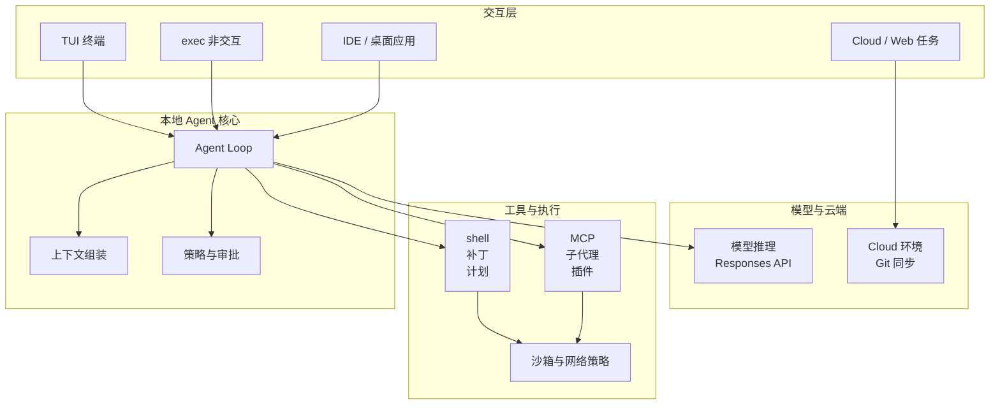
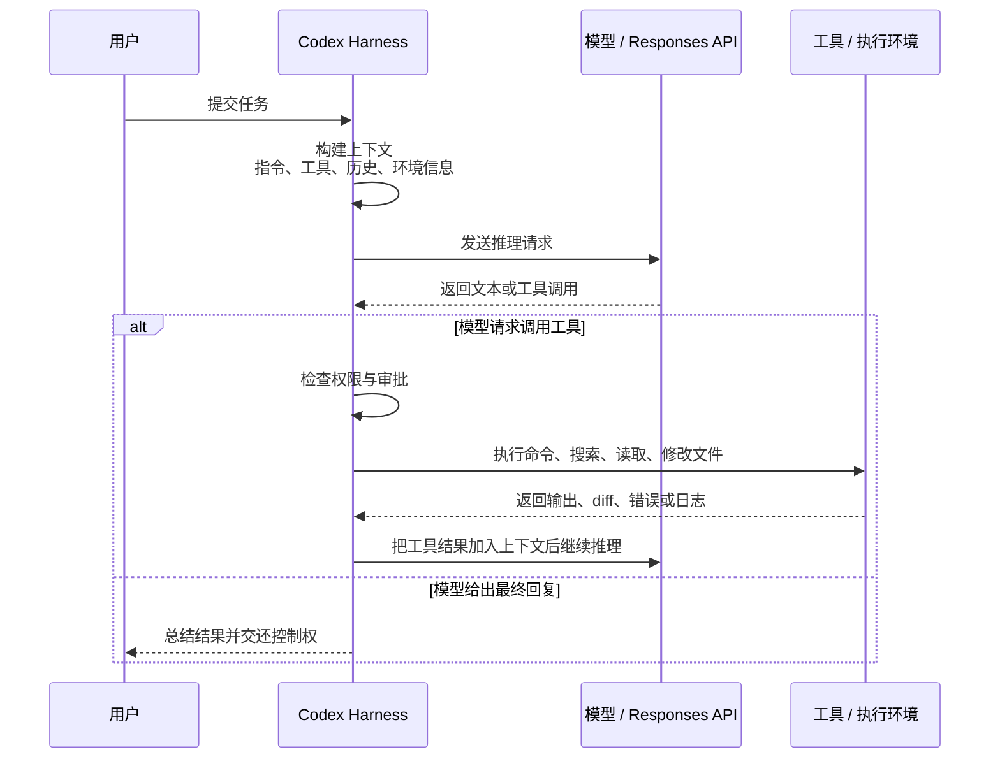
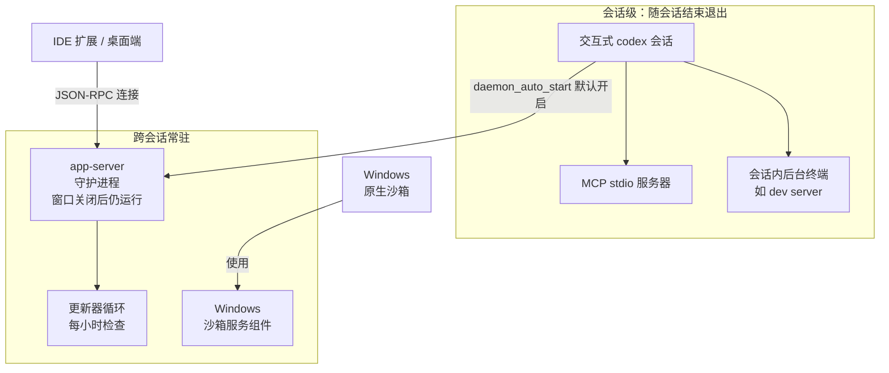
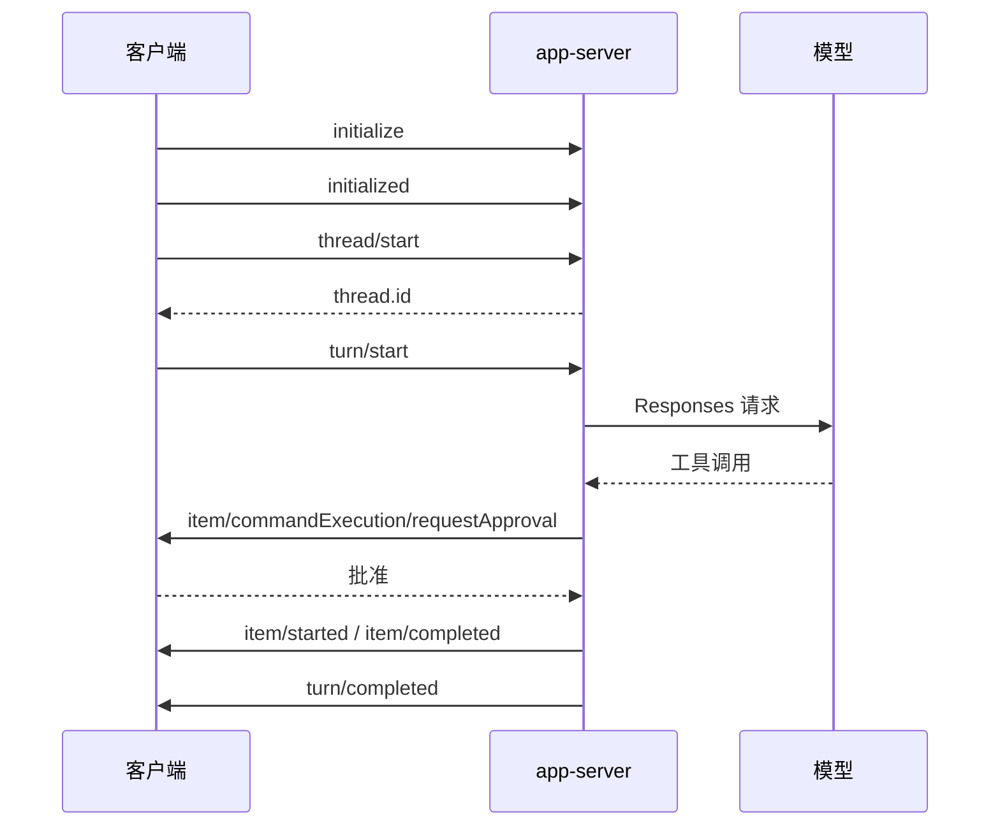
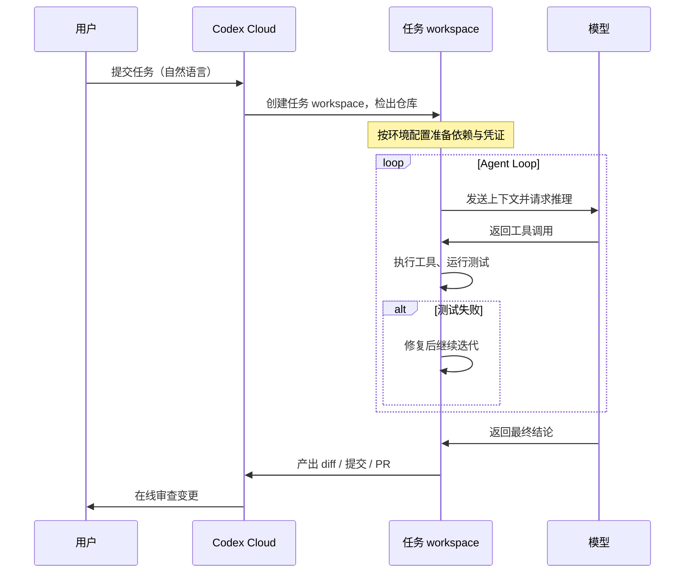

[toc]

## 资料依据与适用范围

> 本文以 **2026-10-25** 可核实的官方资料与本机 **Codex CLI 0.164.0** 的实际行为为依据，重点覆盖当前的 **OpenAI Codex coding agent**，即用于软件工程任务的智能体产品与本地/云端工具链。
>
> 主要来源：OpenAI 开发者文档的 Codex 站点（配置参考、沙盒与审批、AGENTS.md、MCP、Hooks、权限档案、Memories、Models、Cloud、斜杠命令参考，均于 2026-10-25 抓取）、`openai/codex` 仓库源码与文档、本机 `codex --help` / `codex debug models` / `codex features list` 输出，以及 Check Point、Linux Foundation 等第三方公开材料。逐条来源与未决问题见文末“资料依据与待确认事项”。
>
> Codex 迭代极快：模型名、命令参数与配置键都会变。本文的**原理与结构长期有效**，具体取值请以 `codex --help`、`codex features list` 和官方配置参考为准。
>
> 本文同时吸收了同目录两份补充稿中关于 Rust 实现、App Server 协议与容器化部署的内容，并按 0.164.0 的实际命令与 `codex app-server generate-json-schema` 输出校正过时说法；被替换的旧结论在正文中直接给出正确版本，不保留错误示例。

本文中的 **Codex** 默认指当前的 Codex coding agent；单独谈到模型时会写成 **模型**、**Responses API**、**GPT-6.1 Sol** 等。**Codex CLI** 指终端客户端，**Codex Cloud** 指云端任务，**Codex harness** 指把用户、模型与工具串起来的智能体运行框架。

## 先给结论：Codex 到底是什么

Codex 是“面向软件工程的智能体运行系统”，由若干职责清晰的层共同构成。把它当聊天机器人用会误判它的能力边界，把它当代码补全模型用会误判它的风险边界。

| 层次 | 英文术语 | 作用 | 初学者应如何理解 |
| --- | --- | --- | --- |
| 交互层 | Interaction / Surface | 终端 TUI、`codex exec`、IDE 扩展、桌面应用、Cloud 与 Web | 你在哪里下指令，历史和展示就跟哪里走 |
| 智能体框架 | Agent harness / Agent loop | 把用户请求、项目上下文、工具定义、历史记录组织成模型输入，并循环执行工具调用 | 调度器与工作流引擎 |
| 模型 | Model | 理解需求、规划、推理、生成代码或工具调用 | 大脑，但不直接操作你的机器 |
| 工具 | Tools | shell、文件补丁、计划、搜索、MCP、子代理、插件 | 手脚，能做什么取决于工具是否启用 |
| 执行环境 | Execution environment | 本地工作区、OS 沙箱、云端容器、Dev Container、WSL2 | 施工现场 |
| 实现层 | Implementation | Rust workspace `codex-rs`、crate 分工、单一二进制 | 代码怎么组织、为何用 Rust |
| 安全与隔离 | Sandbox / Approval / Network policy | 限制能读写哪里、能否联网、何时必须问你 | 安全边界 |
| 配置与状态 | Config & State | `config.toml`、认证、会话、日志、记忆 | 自定义故障的主要来源 |
| 项目指令与扩展 | AGENTS.md / Skills / Hooks / Plugins | 给模型的项目约定、可复用流程、生命周期自动化、能力打包 | 团队手册与插件生态 |

一句话概括：**模型负责推理，harness 负责组织上下文与调度，工具负责真正改文件和跑命令，沙箱与审批负责兜底，配置层决定这一切如何拼装。**

### 与 2021 年同名旧模型的区别

2021 年发布的 Codex 是一个代码补全模型，只在编辑器里预测下一个 Token。2025 年 4 月起的 Codex 是**能执行操作的智能体产品**：它可以配置沙箱、运行测试、发起 Pull Request。两者共用名称，架构上没有任何继承关系。今天说“Codex 架构”，指的都是后者。

### 整体结构

下图把本地 CLI 的组成关系画在一起。Cloud 任务可以理解为把同一套核心搬到远端容器，再加上仓库快照与 Git 同步。



读图要点有三条：**本地客户端即使断网，界面仍在，但没有模型就无法继续推理**；**工具调用一定先过策略与沙箱，才真正执行**；**Cloud 走的是另一条路径，由云端编排，本地只做提交与取回**。

## 运行形态：同一个内核，不同的入口

Codex 的多个入口共享同一套模型、配置层与 harness，差异主要在交互方式与执行环境。

| 形态 | 入口 | 关键特点 | 适合场景 |
| --- | --- | --- | --- |
| Codex CLI | `codex` | 全屏终端界面，可查看推理、diff、审批按钮；`/status`、`/permissions`、`/model` 等命令 | 本地仓库的日常编码、调试、重构 |
| 非交互执行 | `codex exec "..."` | 一次性执行，输出可进流水线；适合“跑完再报告” | 自动化、CI、批量任务 |
| 代码审查 | `codex review` | 对未提交改动、某个提交或基线分支做评审，不改工作区 | 提交前自查、PR 前置检查 |
| IDE 扩展 | 编辑器侧边栏 | 能读编辑器选中内容，diff 展示更好，与 CLI 共享配置层 | 重构、边看边改 |
| 桌面应用 | `codex app` | 打开文件夹、并行会话、worktree、定时任务、内置浏览器 | 多项目管理、长任务监督 |
| Codex Cloud | Web / 桌面 / 移动端 | 在 OpenAI 管理的隔离容器中运行，每个任务独立 workspace，可并行 | 长任务、并行探索、不想占用本机 |
| 浏览器与 Computer Use | 扩展或内置浏览器 | 以页面为“真实来源”，可点击、填写、截图 | 管理控制台、内部仪表板、CMS |

运行形态的选择与安全边界直接相关：本地形态由 OS 级沙箱兜底，Cloud 形态由容器隔离兜底，浏览器形态则受独立的站点策略约束。后文“执行环境”一节会展开这些差异。

### 实现层：Rust 内核与 crate 布局

Codex CLI 于 2025 年 4 月以 TypeScript / Node 开源，其后重写为 Rust；当前代码位于 `openai/codex` 仓库的 `codex-rs/`，是一个包含数十个 crate 的 Cargo workspace。迁移动机集中在三点：**长时间运行的会话不适合托管运行时的 GC 停顿**、**安全边界需要直接调用 Seatbelt / Landlock / bwrap / seccomp 这类 OS 原语**、**单一静态二进制便于分发**。

> 读旧教程时要留意：Node 版时代的 `~/.codex/config.json` 与 `--approval-mode` 已不适用；现行版本使用 `~/.codex/config.toml` 与 `--ask-for-approval` / `--sandbox`。

主要 crate 的分工如下（目录名随重构变化，以仓库当前状态为准）：

| Crate 或目录 | 职责 | 谁需要关心 |
| --- | --- | --- |
| `cli/` | 多命令入口与子命令分发：`exec`、`login`、`mcp`、`app-server`、`sandbox`、`debug` | 高 |
| `core/` | **Agent Loop、会话与配置解析、模型客户端、沙箱编排** | 极高 |
| `protocol/` | 共享线协议类型：`Op`、`Event`、`ResponseItem` | 做集成必读 |
| `tui/` | 基于 Ratatui 的终端界面，流式渲染 Markdown | 中；CJK 宽度问题多在这一层 |
| `exec/` | 无头执行，输出 JSONL 事件流 | 高 |
| `app-server/` | JSON-RPC 2.0 服务端，处理 Thread、Turn、Item | 做 IDE 或编排必读 |
| `app-server-protocol/` | app-server 协议类型，可导出 TypeScript 与 JSON Schema | 中 |
| `mcp-client/`、`mcp-types/` | 作为 MCP 客户端连接外部服务器 | 中 |
| `sandboxing/` | 统一沙箱接口与策略抽象 | 高 |
| `linux-sandbox/` | Linux 沙箱辅助程序（bubblewrap、seccomp；旧路径含 Landlock） | Linux 用户 |
| `windows-sandbox-rs/` | 受限令牌、ACL、Job Objects 与 MXC 相关实现 | Windows 用户 |
| `apply-patch/` | `apply_patch` 的补丁解析与落盘 | 中 |
| `execpolicy/` | 命令解析与“哪些命令看起来安全”的策略判定 | 中 |
| `login/` | ChatGPT OAuth、设备码与 API Key 认证 | 中 |
| `otel/` | OpenTelemetry 导出 | 企业可观测性 |
| `arg0/` | 通过 `argv[0]` 多重分发，让同一二进制充当沙箱 helper | 排查进程树时有用 |

`arg0` 值得单独说明：在 Linux 上，Codex 需要一个“先施加隔离、再 `exec` 目标命令”的 helper。与其分发两个二进制，不如让同一个 `codex` 根据 `argv[0]` 自我再执行。因此在 `ps` 里看到形如 `codex-linux-sandbox` 的进程时，它很可能就是 `codex` 自己，不是额外安装的程序（该细节来自第三方源码分析，排障时可结合进程树判断）。

协议层同样是对外接口：`codex app-server generate-ts --out <DIR>` 与 `codex app-server generate-json-schema --out <DIR>` 能导出**当前版本**的协议契约。这意味 app-server 不只是官方 IDE 的内部实现，而是可被第三方宿主复用的集成点；也意味着升级 CLI 后应重新生成 schema 再做兼容性检查。

## Agent Loop：一次任务如何变成代码修改

### 核心循环

Codex 的基本循环是 ReAct 风格：**推理 → 工具调用 → 观察 → 再推理**，直到模型给出不需要工具的最终回复。OpenAI 官方工程文章把这段协调逻辑称为 **agent loop**。



图里最关键的一点是**中间那条自环**：模型不是一次生成答案，而是在同一个 turn 内反复“调用工具、拿结果、再推理”。一次用户输入触发几十次工具调用属于正常现象。

### 一次本地任务的七个阶段

| 阶段 | 发生什么 | 排障含义 |
| --- | --- | --- |
| 会话创建 | 新开 `codex` 即一个 thread，包含多轮 turn，历史写入本地 | 会话可恢复、可审计 |
| 上下文组装 | 系统指令、开发者指令、AGENTS.md、Skills 说明、工具定义、历史、环境信息拼成一次请求 | 答非所问多在这一步 |
| 推理与规划 | 模型决定直接回答，还是先查文件、跑命令、再改代码 | 计划不是强制约束 |
| 工具调用 | 模型发出结构化调用请求，由本地执行器真正执行 | 模型不直接改文件系统 |
| 策略与执行 | 每次调用过审批策略与沙箱，放行或拒绝 | 被拦不是 bug，是设计 |
| 结果回填 | 工具输出作为新消息回到模型 | 输出过长会挤占上下文 |
| 终止与交付 | 模型总结，等待你确认、追问或回滚 | 交付质量取决于你的验证能力 |

### 会话模型：Thread、Turn、Item 与 Rollout

CLI 内部与 App Server 协议共享同一套会话语义，理解这四个词能少走很多弯路。

| 概念 | 中文 | 含义 | 类比 |
| --- | --- | --- | --- |
| Thread | 会话线程 | 一次完整对话；可持久化、恢复、分叉、归档 | 一个聊天窗口 |
| Turn | 回合 | 一次用户输入到代理给出“本轮结束”最终回复之间的全过程 | 你问一句，它忙一阵后回一句 |
| Item | 条目 | Turn 内的最小事件单元：用户消息、代理消息、推理、命令执行、文件变更、MCP 调用等 | 聊天记录里的每一条 |
| Rollout | 执行记录 | Thread 的落盘形式，JSONL 记录加 SQLite 状态索引，用于恢复与分叉 | 聊天记录文件加索引 |

**Turn 不等于一次模型调用**。一个 Turn 内可能有十几次“推理 → 工具 → 推理”的往返，直到模型输出不带工具调用的 assistant 消息才结束；计费、上下文增长与延迟主要发生在这些内部循环里。Rollout 会原样保存命令输出：如果代理 `cat` 过 `.env`，密钥就落到磁盘上了，因此 `~/.codex` 要按凭据级资产对待。SQLite 状态库的位置可用 `sqlite_home` 单独指定，便于把状态盘与工作盘分开。

### 内核契约：提交队列与事件队列

v1 协议把内核抽象成一对队列：UI 向 **SQ（Submission Queue，提交队列）** 提交 `Op`，内核向 **EQ（Event Queue，事件队列）** 推送 `Event`。这是**异步提交/事件模型**，不是同步请求-响应：提交之后，结果以事件流的形式陆续回来。

| 字段或概念 | 含义 | 易混淆点 |
| --- | --- | --- |
| `sub_id` | UI 生成的字符串提交标识 | 不是内核生成；后续事件用它回指同一次提交 |
| `Op` | 提交载荷枚举 | “一次用户发言”只是其中一种，还包括中断、审批回执、压缩 |
| `Event.id` | 与触发它的 `sub_id` 相同 | 客户端并发多个提交时靠它分流 |
| `EventMsg` | 事件载荷枚举 | 增量（`*Delta`）与终稿成对出现，渲染时不要重复叠加 |

代表性成员：`Op` 侧有 `UserInput` / `UserTurn`、`ExecApproval` / `PatchApproval`、`Interrupt`、`Compact`、`Shutdown`；`EventMsg` 侧有 `SessionConfigured`、`AgentMessageDelta` / `AgentMessage`、`ExecCommandBegin` / `OutputDelta` / `End`、`ExecApprovalRequest`、`TurnDiff`、`McpToolCallBegin` / `End`、`TokenCount`、`TaskComplete` / `Error`。v2 协议用 `thread` / `turn` / `item` 的对象模型包装了同一套内核语义：做集成读 v2，理解内核读 v1。无论读哪套，**都要对未知变体做向前兼容**，否则一次升级就可能打爆解析器。

### Prompt 不只是你输入的那句话

很多排障卡在一个误解上：用户以为 Codex 只看到了刚输入的那句话。实际发给模型的是结构化上下文。

| 内容 | 英文术语 | 例子 | 谁提供 |
| --- | --- | --- | --- |
| 系统或基础指令 | Base instructions | Codex 的默认行为规范、工具使用约定 | Codex 内置或 `model_instructions_file` |
| 开发者指令 | Developer instructions | 沙箱说明、权限说明、项目约定 | Harness、配置、AGENTS.md |
| 用户消息 | User input | “修复登录页报错” | 用户 |
| 工具定义 | Tool definitions | shell、apply patch、web search、MCP 工具 | Codex、Responses API、MCP server |
| 历史消息 | Conversation history | 之前的对话、工具调用与结果 | 会话状态 |
| 环境上下文 | Environment context | 当前目录、沙箱状态、网络状态 | Codex runtime |
| 压缩摘要 | Compaction | 长会话被压缩后的摘要 | Codex / Responses API |

请求里三个核心字段是 `instructions`（模型指令）、`tools`（可调用工具列表）、`input`（文本、图片、文件等输入）。要确认“模型到底看到了什么”，用 `codex debug prompt-input` 直接导出这份输入列表，比让 Codex 自己复述可靠得多，详见同目录《codex debug 系列命令解析》。

补充一个容易忽略的细节：不同模型可能使用不同的基础提示词变体（源码中集中在 `core/prompt.md` 及其模型相关分支）。所以**换模型时行为差异不只来自模型权重**，也可能来自配套提示词与工具描述的差异；排查“换了模型就不听话”时要连这条一起看。

### Harness 的八项职责

| 职责 | 说明 |
| --- | --- |
| 构造请求 | 把系统指令、用户消息、工具定义、环境信息、历史记录组合成模型请求 |
| 维护循环 | 模型要求工具调用时执行工具并继续下一轮 |
| 权限检查 | 根据沙箱、审批、网络策略决定是否允许动作 |
| 状态管理 | 保存会话、历史、工具结果、压缩后的上下文 |
| 上下文压缩 | 会话变长时触发 compaction，避免超过上下文窗口 |
| 工具注册 | 汇总内置工具、Responses API 工具、MCP 工具 |
| UI 事件转发 | 把流式输出、工具调用、审批请求展示给 CLI 或 IDE |
| 可观测性 | 记录日志，可选导出 OTel 事件 |

Codex 的“聪明”不只来自模型，也来自 harness 对上下文、工具、权限与工程流程的组织方式。这也解释了为什么同样的模型换个 harness 表现差异很大。

### 停止条件

一个 turn 会在以下任一条件下结束：任务完成、工具连续失败、上下文超限触发压缩或新窗口、用户手动中断、审批被拒绝。**审批被拒绝不是异常**，它只是把“不该做”这个结论交回模型重新规划。

## 模型层

### 当前可选模型

下表来自本机 `codex debug models`（2026-10-25，CLI 0.164.0）与官方 Models 页面，二者一致。

| 模型 ID | 定位 | 上下文窗口 |
| --- | --- | --- |
| `gpt-6-astra` | 最强能力，跨代码、应用与研究，含 computer use 与更强判断力 | 272K |
| `gpt-6.1-sol` | 接近 Astra 的性能、成本更低，**官方推荐默认** | 272K |
| `gpt-6-sol` | 上一代 Sol | 272K |
| `gpt-6-luna` | 最省，适合聚焦、高频任务（抽取、分类、结构化总结） | 272K |
| `gpt-5.6-sol` / `gpt-5.6-terra` / `gpt-5.6-luna` | 过渡期仍可用 | 272K |
| `gpt-5.5` | 已于 2026-10-14 对 ChatGPT 登录用户退役，API Key 会话不受影响 | 272K |
| `gpt-daybreak-blue-latest` / `gpt-daybreak-red-latest` | Daybreak 系列，后者窗口更大 | 272K / 372K |
| `codex-auto-review` | 自动审批审查专用的审查模型 | 272K |

选型建议：**复杂端到端任务用 Astra，重复的长任务用 GPT-6.1 Sol，明确且可重复的任务用 Luna**。切换模型用 `-m` 或在会话内用 `/model`。

### 推理强度与速度档

`model_reasoning_effort` 支持 `low`、`medium`、`high`、`xhigh`、`max`、`ultra`，具体可用档位取决于模型与客户端。界面上显示为 Light、Medium、High、Extra High、Max、Ultra。

- **Light / Low**：范围明确的小任务。
- **Medium**：需要少量规划的常规任务，多数场景的起点。
- **High / Extra High**：多步骤、多来源、需要权衡的难题。
- **Max**：给单个任务更多推理时间，深度优先于速度。
- **Ultra**：不只是单代理，而是用子代理并行推进，适合可切分的复杂任务。

速度档独立于推理强度：`fast` 与 `ultrafast` 由模型目录与账户套餐共同决定，会话内可用 `/fast` 切换。`model_reasoning_summary` 控制推理摘要的详略，主要影响 TUI 的可读性，不影响实际推理量。

### 端点、认证与供应商

| 场景 | 目标端点 | 说明 |
| --- | --- | --- |
| ChatGPT 登录 | ChatGPT 后端的 Codex responses 端点 | 用订阅额度，适合交互开发 |
| API Key | `api.openai.com/v1/responses` | 按量计费，适合 CI 与自动化 |
| 本地开源模型 | `--oss` + `--local-provider lmstudio\|ollama` | 指向本地 Responses 兼容端点 |
| 第三方网关 | 自定义 `model_providers` | 必须是 Responses 兼容端点 |

两类认证的故障信号不同：ChatGPT 登录常见“凭证过期、套餐无权限、需重新登录”；API Key 常见 `401`（Key 无效）、`403`（无该模型权限）、`404`（模型名错误）。

**当前版本不支持 `wire_api = "chat"` 或仅兼容 Chat Completions 的端点**，接入第三方网关时这是最常见的失败原因。

凭据存储方式由 `cli_auth_credentials_store` 控制：`file`（默认）、`keyring`（系统钥匙链）、`auto`。凭据文件是 `~/.codex/auth.json`，不要手动编辑，也不要分享。

### 自定义模型供应商

`[model_providers.<id>]` 让 Codex 接到自建网关、企业网关或本地模型：

| 字段 | 含义 | 说明 |
| --- | --- | --- |
| `name` | 展示名 | 仅用于界面 |
| `base_url` | API 基地址 | Responses 端点，通常写到 `/v1` 为止 |
| `env_key` | 存放密钥的环境变量名 | 推荐方式，避免密钥入库 |
| `wire_api` | 协议 | **当前只支持 `responses`**，也是省略时的默认值 |
| `http_headers` / `env_http_headers` | 静态请求头 / 从环境变量取值的请求头 | 后者适合网关鉴权 |
| `query_params` | URL 查询参数 | 例如 Azure 的 `api-version` |
| `request_max_retries` / `stream_max_retries` | 请求与流式重试次数 | 弱网或经代理时调大 |
| `stream_idle_timeout_ms` | 流空闲超时 | 长连接被中间设备掐断时调大 |

```toml
# ~/.codex/config.toml
[model_providers.corp-gateway]
name = "Corp Gateway"
base_url = "https://gateway.example.com/v1"
env_key = "CORP_CODEX_KEY"
wire_api = "responses"
```

```toml
# ~/.codex/gateway.config.toml —— 用 codex --profile gateway 选择
model = "gpt-6.1-sol"
model_provider = "corp-gateway"
```

只兼容 Chat Completions 的端点不能直接接，需要网关侧做 Responses 适配。所谓“换了国产模型后 Codex 变笨、不调用工具”，多数是协议能力差异（推理摘要、内建工具、流式项）而非模型本身。本地模型走 `--oss --local-provider ollama|lmstudio`，端点同样要暴露 Responses 兼容接口。

### 上下文窗口与压缩

每个模型都有上下文窗口，包含输入与输出 Token。Codex 在 Token 数超过阈值时进行 **compaction**，用更小但能代表对话状态的条目列表替换原始上下文，使代理能带着“已发生什么”的理解继续工作。

- 手动触发：`/compact`。
- 自动触发：超过模型默认阈值时走 `/responses/compact` 端点。
- 兜底路径：窗口耗尽时，模型先把检查点写入 `notes`，再开新窗口，通过只读的历史工具回读细节。

压缩能提高续航，但不是无损的。复杂改动建议把关键状态外置：Git 提交、测试结果、明确的 TODO 文件，都比“指望摘要记住”可靠。

### 请求是无状态的

Responses API 支持用 `previous_response_id` 让服务端保存上下文，但 Codex 刻意不用它，每次请求都带上完整历史。官方给出的理由是保持请求完全无状态，并支持**零数据保留（Zero Data Retention，ZDR）**；此前轮次的推理内容以 `encrypted_content` 形式带回，由服务端用客户密钥解密，所以 ZDR 客户也不会丢失推理连续性。

代价是传输量随会话增长，收益是**可复现与可审计**：同一份请求可以在任何机器上重放。配合 prompt caching，“旧请求是新请求的精确前缀”时实际计算量接近线性；反过来，中途换模型、增删 MCP 或改沙箱配置都会破坏前缀，具体见“上下文工程”一节的缓存说明。

## 工具系统

### 内置工具与风险点

| 工具类型 | 英文术语 | 用途 | 风险点 |
| --- | --- | --- | --- |
| Shell 工具 | shell tool | 执行本地命令、跑测试、搜索文件 | 可能修改文件、读敏感数据、联网 |
| 文件修改 | apply patch / file editing | 修改代码、写文档 | 可能误改无关文件 |
| 计划工具 | plan tool | 展示与维护任务步骤 | 计划不是强制约束，结果仍要审查 |
| Web 搜索 | web search | 查最新文档与外部信息 | 结果不可信，可能被注入 |
| MCP 工具 | Model Context Protocol tools | 接外部服务、数据库、文档、设计系统 | **不一定受本地 shell 沙箱保护** |
| 子代理 | subagents | 并行探索、审查、测试、总结 | 多耗 Token，写操作易冲突 |
| 插件与技能 | plugins / skills | 封装重复流程、连接团队工具 | 需要治理来源与权限 |
| 浏览器与 Computer Use | browser / computer use | 操作页面、收集 console 与截图 | 有独立的确认策略与站点策略 |
| 图像与视觉 | view image / image generation | 读截图、生成图像 | 输入可能含敏感信息 |

一个常被忽略的事实：**模型本身不直接改文件系统**。真正读写文件、跑命令、访问网络的是 harness 暴露的工具，而这些工具都受沙箱与审批约束。

### 为什么单独设计 `apply_patch`

模型完全可以自己拼一条 `cat > file` 或 heredoc 来改文件，但 Codex 仍然提供结构化的 `apply_patch`，理由有三条：

- **可审查**：补丁在落盘前能生成 diff 预览，审批看到的是“改了什么”，而不是一段需要人脑解析的 shell。
- **可移植**：避免 heredoc 在 bash、zsh、PowerShell、cmd 之间的转义差异。
- **可二次校验**：内核对“哪些路径可写”的检查独立于 shell，不依赖命令本身是否老实。

与之配套的还有 `execpolicy`：它按命令前缀判断“安全只读 / 需要提示 / 明确禁止”，与 OS 沙箱形成互补——一个管“这条命令像不像危险操作”，一个管“即使跑了也只能碰到哪里”。

### 扩展机制怎么选

| 需求 | 选择 | 原因 |
| --- | --- | --- |
| 调外部 API、私有系统、数据库 | MCP | 标准接口，可接本地命令或远程服务 |
| 沉淀团队流程与固定检查表 | Skills | 按需加载的说明与脚本包，不常驻上下文 |
| 打包分发“技能 + 应用 + MCP” | Plugins | 一组能力的可分发包 |
| 在生命周期节点自动做事 | Hooks | 会话、工具、压缩等事件上挂脚本 |
| 隔离噪声、并行探索 | Subagents | 把探索与日志分析移出主线程 |
| 临时一次性例外 | `rules` 与审批策略 | 比放宽沙箱更精确 |

实用建议：**MCP 不要贪多**，三到五个稳定可用的远胜十几个经常超时的。每个 MCP 都要明确命令、环境变量与超时；排障时先禁用一半，二分定位。

## 执行环境与后台进程

### 四种执行环境

| 环境 | 特点 | 安全边界 |
| --- | --- | --- |
| 本地 CLI / IDE | 使用本机文件、依赖与命令行工具 | OS 级沙箱加审批策略 |
| Codex Cloud | OpenAI 管理的隔离容器，每个任务独立 workspace | 容器隔离，网络与凭证在环境里配置 |
| Dev Container | 由 Docker 或开发容器提供外层隔离 | 可让容器成为主要安全边界 |
| WSL2 | Windows 上推荐的 Linux 语义环境 | 使用 Linux 沙箱实现 |

本地形态的默认值很保守：**默认无网络访问，写权限限于当前工作区**。Cloud 形态的默认值取决于环境配置，凭证由环境单独管理，不继承本机。

### 后台进程：终端关闭后还在运行什么

**0.157.0 起，Codex CLI 默认启动一个跨会话常驻的本地守护进程**；此外 Windows 原生沙箱在部分模式下依赖已安装的服务组件。各组件的拉起关系与生命周期如下。



读图要点：**app-server 守护进程与 Windows 沙箱服务是跨会话常驻的**；MCP 服务器与会话内后台终端随会话结束而退出；更新器循环依附于守护进程。

| 维度 | 说明 |
| --- | --- |
| 是什么 | `codex app-server` 的常驻实例，为 TUI、IDE 扩展、桌面端提供共享的 JSON-RPC 后端；`codex agents` 这类跨会话总览能力依赖它 |
| 开关 | 特性键 `daemon_auto_start`，在 `codex features list` 中标注为 stable 且默认启用 |
| 生命周期 | 交互式 `codex` 启动时按条件自动拉起；独立于终端运行，关闭全部窗口后不会自动退出，直到显式停止或重启机器 |
| 状态位置 | `~/.codex/app-server-daemon/`（含 pid、锁与设置文件）；平台包副本在 `~/.codex/packages/` 下 |
| 自动更新 | 启动 5 分钟后首次检查，此后默认每小时一次；重启前有宽限期，`update` 的帮助文本明示“可能打断进行中的任务” |
| 管理命令 | `codex app-server daemon start` / `restart` / `update` / `stop` / `version` / `bootstrap` |
| 检查状态 | `codex doctor`；`codex app-server daemon version` 比对 CLI 与运行中后端的版本 |

日常操作要点：

- **单次不使用**：`codex --no-daemon`。
- **停掉当前实例**：`codex app-server daemon stop`。
- **永久关闭自动启动**：`[features]` 段写入 `daemon_auto_start = false`，或执行 `codex features disable daemon_auto_start`。配置只影响之后的自动启动，不会停掉已运行的实例，两者要一起做。
- **长任务前先停**：自动更新在宽限期后重启后端，可能终止正在执行的 turn。
- **换代理后先停**：守护进程沿用首个启动它的会话的环境变量，更换代理设置后不重启就仍走旧出口。

容易被误判为“后台服务”的组件：MCP stdio 服务器（会话级子进程）、会话内后台终端（如 dev server，归属当前 thread）、OTel 导出（按配置发请求，无常驻进程）、模型与认证请求（纯出站 HTTP）、Cloud 任务（远端容器，本地无服务）。

该机制的公开依据与已知问题：`codex-rs/features` 源码中 `daemon_auto_start` 标注为 stable 且默认启用；官方 app-server 文档与 `codex app-server daemon --help` 给出命令集；社区 issue 记录了若干实际影响——#48043（Windows 下 error 5 与 stale socket）、#48195（请求把默认值改为 opt-in）、#53547（守护进程固定首个会话的环境变量）、#40969（自动更新打断进行中的任务）。这些属单一来源或社区报告，官方配置参考尚未完整收录相关键。

### Windows 沙箱的三档实现

| 实现 | 定位 | 机制与限制 |
| --- | --- | --- |
| `mxc` | **推荐**，兼容设备上的默认选择 | 原生进程隔离，无需管理员批准的额外账户或本地防火墙规则；要求 Windows 11 24H2（build 26100.9278）或 25H2（build 26200.9278）及以上 |
| `elevated` | 首选的传统回退 | 需管理员批准的一次性预配；使用低权限沙箱账户、文件系统边界与防火墙规则 |
| `unelevated` | 次级回退 | 受限令牌加 ACL 边界，网络隔离弱于 `elevated`，不支持拒绝读取路径 |

配置方式：`[features] prefer_mxc = true` 启用 MXC 自动选择，同时把 `[windows] sandbox = "elevated"` 作为回退保留。验证单条命令是否走 MXC：

```powershell
codex -c windows.sandbox=mxc sandbox --include-managed-config --permission-profile :workspace -- cmd.exe /d /c echo MXC_OK
```

MXC 的已知限制包括：子进程随前台命令退出而停止（依赖 detached dev server 的流程要先验证）、拒绝读取的 glob 在进程启动时快照。IT 可用 `codex sandbox setup --elevated --user 'DOMAIN\user' --codex-home 'C:\Users\user\.codex'` 在员工首次使用前完成预配。

### OS 级沙箱的平台差异

| 平台 | 机制 | 注意事项 |
| --- | --- | --- |
| macOS | Seatbelt，经 `sandbox-exec` 加载与 `--sandbox` 对应的 profile | 受限读权限时追加精选平台策略，以保持常见工具兼容 |
| Linux | 默认 `bwrap` 加 `seccomp` | Docker、受限容器与企业环境可能缺少所需能力 |
| Windows 原生 | MXC，`elevated` 与 `unelevated` 为传统回退 | 见上一节的版本要求与限制 |
| Windows WSL2 | 使用 Linux 沙箱实现 | IDE 扩展可直接在 WSL2 中运行代理 |
| Windows WSL1 | 0.114 及更早版本支持；0.115 起 Linux 沙箱改用 `bwrap`，不再支持 | 需要 Linux 语义时升级到 WSL2 |

在 Docker 等容器化环境中，若宿主或容器配置阻止 namespace、setuid `bwrap` 或 `seccomp` 操作，沙箱可能无法工作。此时有两种处置：让容器自身提供隔离边界，然后在容器内用 `--sandbox danger-full-access` 运行，避免套第二层沙箱；或者为容器授予所需能力，保留 Codex 的 Linux 沙箱。采用前者时要清楚：恶意项目可以外泄容器内一切可用资源，包括 Codex 凭据，因此只适用于可信仓库，并按高权限环境的方式监控活动。

## 安全模型：沙箱、审批与网络

### 两个正交的维度

| 概念 | 英文术语 | 解决什么问题 | 例子 |
| --- | --- | --- | --- |
| 沙箱 | Sandbox mode | 技术上允许 Codex 做什么 | 能否写文件、写哪里、能否联网 |
| 审批策略 | Approval policy | 什么时候必须问你 | 写工作区外文件、联网、跑高风险命令时是否弹确认 |

这两层必须分开理解：**限制性沙箱即使审批很宽松也能限制损害；频繁审批并不能让不受限的环境变安全**。

### 沙箱模式

| 模式 | 英文值 | 行为 | 适合场景 |
| --- | --- | --- | --- |
| 只读 | `read-only` | 可读文件、回答问题；修改、执行有副作用的命令或联网通常需要批准 | 阅读代码、解释项目、审查设计 |
| 工作区写入 | `workspace-write` | 可在工作区内读写与执行命令；写工作区外或联网需批准 | 日常开发、修 bug、写测试 |
| 完全访问 | `danger-full-access` | 无 Codex 沙箱 | 仅限强隔离、可信环境 |

`workspace-write` 下有若干**始终只读的受保护路径**，这是“为什么 `git commit` 失败”“为什么改不了 `.codex`”这类问题的根源：

- `<workspace>/.git`（无论是目录还是 `gitdir:` 指针文件，解析后的 Git 目录同样受保护）
- `<workspace>/.agents`、`<workspace>/.codex`、`<workspace>/.aws`（存在时递归只读）

### 审批策略

| 策略 | 英文值 | 含义 |
| --- | --- | --- |
| 按请求审批 | `on-request` | 沙箱内允许的动作直接执行；越界、联网或高风险动作时询问。默认值 |
| 不询问 | `never` | 从不弹审批；被沙箱禁止的动作直接失败，而不是询问 |
| 细粒度 | `granular` | 对 `sandbox_approval`、`rules`、`mcp_elicitations`、`request_permissions`、`skill_approval` 分别设为交互或自动拒绝 |

两点必须澄清，这也是旧资料最容易出错的地方：

- **`untrusted` 已退役**。Codex 与 ChatGPT Work 不再支持 `approval_policy = "untrusted"`，残留该设置可能导致客户端无法启动。需要更严格的逐条审批时，改用项目级 `trust_level = "untrusted"`。
- **`on-failure` 已弃用**。交互场景用 `on-request`，非交互场景用 `never`。

保留严格逐条审批的写法（放在用户级 `~/.codex/config.toml`）：

```toml
[projects."/path/to/project"]
trust_level = "untrusted"
```

这样命令默认需要批准，同时该项目会被视为不信任，项目级 `.codex/` 层不会被加载。

### 常见组合

| 意图 | 配置或命令 | 效果 |
| --- | --- | --- |
| 日常默认（Auto 预设） | `sandbox_mode = "workspace-write"` 加 `approval_policy = "on-request"` | 仓库内自由工作，越界或联网时询问 |
| 只读分析 | `sandbox_mode = "read-only"` 加 `approval_policy = "on-request"` | 解释项目、审查代码 |
| CI 只读 | `--sandbox read-only --ask-for-approval never` | 只读且从不询问 |
| 自动审查审批 | `approval_policy = "on-request"` 加 `approvals_reviewer = "auto_review"` | 符合条件的审批交给审查代理评估 |
| 高风险全自动 | `--dangerously-bypass-approvals-and-sandbox`（别名 `--yolo`） | 无沙箱、无审批，官方标注不推荐 |

启动时的默认推荐与仓库是否受版本控制有关：**受版本控制的目录默认 Auto（workspace-write 加 on-request），非版本控制目录默认 `read-only`**。这是有意设计：没有 Git 兜底时，先让你看清再动手。

### 自动审批审查

自动审查不是取消安全边界，而是把**本来就需要审批**的动作交给一个审查代理评估。它只处理沙箱升级、被阻止的网络请求、`request_permissions`、带副作用的 app 或 MCP 工具调用；仍在沙箱内的动作不会多一层审查。

- 策略检查数据外泄、凭证探测、持续削弱安全设置与破坏性操作；低风险与中风险在策略允许时放行，关键风险拒绝。
- 构造、审查会话或解析失败时**失败关闭**（fail closed）；超时单独提示，动作同样不执行。
- 企业可用 `guardian_policy_config` 替换策略中的租户段；本地可用 `[auto_review]` 的 `policy` / `extra_policy`，受管要求优先。
- 桌面端可用“Approve for me”，CLI 可用 `--approve-for-me` 开启同一路径。
- 被拒后可执行 `/approve`，从最近 10 条拒绝中选一条重试一次；该批准只对那一次动作生效。

### 网络访问：三个开关各管一件事

默认 `workspace-write` 关闭命令网络访问。要让命令联网，需要显式打开：

```toml
[sandbox_workspace_write]
network_access = true
```

`network_access` 与 `network_proxy` 是两回事，混用是最常见的“配了不生效”来源：

| 配置 | 作用 | 常见误解 |
| --- | --- | --- |
| `sandbox_workspace_write.network_access` | 决定命令**有没有**网络 | 只开 proxy 不会自动给网络 |
| `features.network_proxy` | 在已有网络的前提下，**按策略限制目的地** | 配了域名规则但没开网络，仍然不能联网 |

三种组合的行为是确定的：

- 网络关 + proxy 开：网络仍关，proxy 不起作用。
- 网络开 + proxy 关：网络开，出站不受限。
- 网络开 + proxy 开：网络开，出站受策略约束。

域名规则是允许列表优先：精确主机只匹配自身；`*.example.com` 匹配子域但不含裸域；`**.example.com` 同时匹配裸域与子域；全局 `*` 匹配任何未被拒绝的公网主机；**`deny` 永远优先于 `allow`**。

```toml
[features.network_proxy]
enabled = true
domains = { "api.openai.com" = "allow", "example.com" = "deny" }
```

本地与私网目标默认被拦（`allow_local_binding = false`）：需要访问本机服务时，添加精确的 `localhost` 或本地 IP 允许规则，而不是打开宽泛的私网访问。通配符不算“显式本地例外”，解析到私网 IP 的主机名即使命中允许列表也会被拦。放行前 Codex 还会做一次尽力而为的 DNS 与 IP 分类检查，失败或超时一律阻断，用于降低 DNS 重绑定风险。

两个危险开关只在受控环境使用：`dangerously_allow_non_loopback_proxy = true`（把代理监听暴露到回环之外）与 `dangerously_allow_all_unix_sockets = true`（绕过 Unix socket 允许列表）。

### Web 搜索不等于 shell 联网

这是排障高频点。`network_proxy` 过滤的是**本地命令沙箱内**运行的脚本、程序与子进程；它不过滤 web 搜索、app 与连接器工具调用、MCP 服务器连接、浏览器与 Computer Use、Cloud 任务，以及客户端自身的模型与认证请求。

`web_search` 的取值决定搜索行为：

| 取值 | 行为 |
| --- | --- |
| `cached`（默认） | 用 OpenAI 维护的索引返回结果，不实时抓取页面，降低被注入的暴露面 |
| `indexed` | 只有在搜索索引把关时才允许外部访问 |
| `live` | 实时检索，等同 `--search` |
| `disabled` | 移除该工具 |

由此可以推出三条实践结论：可以禁用 shell 联网但仍允许缓存搜索；可以允许 shell 联网而搜索仍走缓存；允许 MCP HTTP 服务器不代表模型生成的 shell 命令可以随意联网。

### 权限档案

除传统沙箱模式外，Codex 还支持命名权限档案，把文件系统规则与网络规则组合成可复用策略。内置档案为 `:read-only`、`:workspace`、`:danger-full-access`，自定义档案写在 `[permissions.<name>]` 下并由 `default_permissions` 选中。

```toml
default_permissions = "project-edit"

[permissions.project-edit]
extends = ":workspace"

[permissions.project-edit.filesystem.":workspace_roots"]
"**/.env" = "deny"

[permissions.project-edit.network]
enabled = true

[permissions.project-edit.network.domains]
"api.openai.com" = "allow"
```

使用权限档案时有三个硬约束：**不能与传统沙箱设置混用**（任一配置文件出现 `sandbox_mode`，或以 `--sandbox` 启动，都会回退到传统设置）；`network.enabled = true` 只给网络，不启用代理，域名规则要靠 `features.network_proxy = true` 才生效；`extends` 不能指向 `:danger-full-access`，也不允许继承环。

### 真实攻击面与教训

Codex 已经成为攻击目标，这不是避免使用的理由，而是应当以对待任何“能执行代码、持有凭据”的系统的严谨程度来部署它。

| 事件 | 事实 | 教训 |
| --- | --- | --- |
| CVE-2025-61260 | Codex CLI 0.23.0 及更早版本会自动加载仓库内的 `.env` 与 `.codex/config.toml`，恶意仓库可借此执行任意命令；CVSS 9.8，2025 年 8 月 20 日修复 | 项目级配置必须受信任控制；在不受信任的仓库里直接运行 `codex` 是高风险动作 |
| 沙箱逃逸研究（2026 年 8 月公开报道） | 研究者披露了针对 `node_repl` 共享堆与 `apply_patch` 路径处理的逃逸手法，官方在当月的修复窗口内处理 | 沙箱是纵深防御的一层，不是“绝对隔离”承诺；版本要跟上 |
| 自动审查拒绝 | 审查代理可能拒绝你本以为合理的动作 | 被拒不是故障，先看 `/approve` 与拒绝理由，再考虑调整策略 |
| 安全监测暂停 | GPT-6 Astra 在 Codex 与 ChatGPT Work 中带异步安全监测，可在检测到潜在不安全行为时暂停任务 | 暂停可能滞后于触发动作；监测不替代沙箱与人工审查 |

最佳实践：

- 始终使用合理的沙箱模式，避免不必要的 `danger-full-access`。
- 定期更新 CLI 以获取安全补丁；对使用 Nix、WinGet 等锁定版本的用户，注意守护进程自更新与包管理器语义的冲突。
- 审计 MCP 服务器与 hook 来源，项目仓库不应能影响本机敏感行为。
- 绿色的测试套件是必要但不充分的：架构、安全与涉及资金的变更必须由人负责审查。
- CI/CD 场景使用权限受限的 API Key，并把沙箱与审批写死在流水线参数里。

## 配置系统

### 文件与状态位置

| 路径 | 用途 | 备注 |
| --- | --- | --- |
| `~/.codex/config.toml` | 用户级主配置 | 改错会影响所有项目 |
| `.codex/config.toml` | 项目或子目录级覆盖 | 仅在项目受信任时加载 |
| `~/.codex/<name>.config.toml` | 配置档案文件 | 用 `--profile <name>` 选择 |
| `/etc/codex/config.toml` | Unix 上的系统级配置 | 可能存在，优先级低于用户配置 |
| `requirements.toml` | 组织强制约束 | 受管设备上可禁用 `never` 或 `danger-full-access` |
| `~/.codex/auth.json` | 登录凭据 | 不要手动改，不要分享 |
| `~/.codex/AGENTS.md` | 全局指令 | 个人偏好放这里 |
| `~/.codex/skills/`、`.codex/skills/` | 全局与项目技能 | 目录名即技能名 |
| `~/.codex/sessions/`、`~/.codex/log/` | 会话与日志 | 排障用，不建议手改 |
| `~/.codex/memories/` | 本地记忆文件 | 生成态数据，不要手工当配置用 |
| `~/.codex/app-server-daemon/` | 守护进程状态 | 见“后台进程”一节 |
| `CODEX_HOME` | 改变上述 `~/.codex` 根位置 | 多账号或隔离测试用 |

### 配置优先级

从高到低共七层：

1. CLI 参数与 `-c` / `--config` 覆盖
2. 项目配置 `.codex/config.toml`，从项目根到当前目录，越近越优先（仅受信任项目）
3. 用 `--profile <name>` 选中的档案文件
4. 用户配置 `~/.codex/config.toml`
5. 工作区下发的云端托管默认值（Cloud-managed）
6. 系统配置 `/etc/codex/config.toml`（Unix）
7. 内置默认值

记住一句话：**谁离命令行越近谁赢**。配置文件写崩了，先用 `-c` 覆盖跑起来，再慢慢修文件。

### 项目配置的能力边界

出于安全，项目级配置不能覆盖“机器本地或宿主拥有”的敏感项。Codex 会**忽略**项目 `.codex/config.toml` 中的这些键：

`openai_base_url`、`chatgpt_base_url`、`apps_mcp_product_sku`、`model_provider`、`model_providers`、`notify`、`profile`、`profiles`、`experimental_realtime_ws_base_url`、`otel`。

这意味着：把 `model_provider` 或 OTel 导出端点写进项目配置，TOML 语法没错，但不会生效。另外，**项目被标记为不信任时，整个项目级 `.codex/` 层都会被跳过**，包括项目配置、hooks 与 rules；用户级与系统级配置仍然加载。

### 个人配置模板

```toml
# ~/.codex/config.toml

# 默认模型：以账户实际可用为准
model = "gpt-6.1-sol"
model_reasoning_effort = "medium"

# 日常开发：工作区内读写，越界或联网时询问
sandbox_mode = "workspace-write"
approval_policy = "on-request"

# 可选：把符合条件的审批交给自动审查代理
# approvals_reviewer = "auto_review"

# 默认不开全局网络
[sandbox_workspace_write]
network_access = false

# 默认用缓存搜索结果；需要最新信息时临时加 --search
web_search = "cached"

# 可观测性默认关闭
[otel]
exporter = "none"
log_user_prompt = false

# 0.157.0 起默认自动启动常驻 app-server daemon；不需要共享后台服务时可关闭
# [features]
# daemon_auto_start = false
```

确实需要联网装依赖的项目，用单独档案而不是把所有项目都放开：

```toml
# ~/.codex/net-dev.config.toml
sandbox_mode = "workspace-write"
approval_policy = "on-request"

[sandbox_workspace_write]
network_access = true

[features.network_proxy]
enabled = true
domains = { "registry.npmjs.org" = "allow", "github.com" = "allow", "api.github.com" = "allow" }
```

运行 `codex --profile net-dev` 即可切换。

### 项目配置建议

适合放进 `.codex/config.toml` 的内容：项目希望的默认推理强度、非标准说明文件的 fallback 名、项目内自定义代理等。

```toml
# .codex/config.toml
model_reasoning_effort = "medium"
project_doc_fallback_filenames = ["TEAM_GUIDE.md", "CONTRIBUTING.md"]
project_doc_max_bytes = 65536
```

不建议放进项目配置：私人 API Key、`model_provider`、`openai_base_url`、OTel 端点、个人通知命令，以及任何能让仓库影响本机认证或出站网络的设置。

### 进阶键：可写根目录、环境变量与历史

**可写根目录**：`workspace-write` 下除工作区外，还可用 `[sandbox_workspace_write] writable_roots` 精确放开少数目录（如构建缓存），比切到完全访问安全得多。

```toml
[sandbox_workspace_write]
network_access = false
writable_roots = ["/home/dev/.cache/pip", "/home/dev/.cargo"]
# exclude_slash_tmp = false
# exclude_tmpdir_env_var = false
```

`exclude_slash_tmp` 与 `exclude_tmpdir_env_var` 决定是否把 `/tmp` 与 `$TMPDIR` 排除出可写范围；需要收紧时打开。

**环境变量继承**：`shell_environment_policy` 决定代理派生的子进程能看到哪些变量，这是最容易被低估的泄密通道。

```toml
[shell_environment_policy]
inherit = "core"
set = { HTTPS_PROXY = "http://127.0.0.1:7890", HTTP_PROXY = "http://127.0.0.1:7890", NO_PROXY = "localhost,127.0.0.1,::1" }
ignore_default_excludes = false

[shell_environment_policy.filters]
"AWS_*" = "exclude"
"AZURE_*" = "exclude"
```

| 键 | 作用 | 注意 |
| --- | --- | --- |
| `inherit` | `all` / `core` / `none` | `core` 只带 `PATH`、`HOME` 等基础集合，是常见默认 |
| `filters` | 大小写不敏感的通配过滤，支持 `*` 与 `?` | 出现任一 `include` 就变成白名单；不能恢复已被排除的值 |
| `set` | 在排除之后显式注入 | 可覆盖被排除项；随后仍可能被白名单移除 |
| `ignore_default_excludes` | 默认 `true` | 为 `true` 时**不会**自动剔除名字含 `KEY`、`SECRET`、`TOKEN` 的变量；要自动剔除需设为 `false` |
| `exclude` / `include_only` | 旧式数组 | 仍可用，但不要与 `filters` 同层混用，否则配置被拒 |

执行顺序是：自动剔除（若开启）→ 自定义 `exclude` → `set` → `include` 白名单。注意 `inherit = "core"` 通常**不包含** `HTTPS_PROXY`，这是“我在 shell 里配了代理，代理跑 `pip install` 还是超时”的常见原因；同时即使变量齐全，`network_access = false` 仍会在系统调用层阻断连接，两道门必须一起开。

**历史与状态**：`[history] persistence = "save-all" | "none"` 控制是否写入 `history.jsonl`；`sqlite_home` 可把 SQLite 状态库放到别的目录。CI 里常设 `persistence = "none"`，避免把任务内容留在 runner 上。

## 项目指令：AGENTS.md

### 它解决什么问题

AGENTS.md 是 Codex 动手前读取的指令文件，告诉它项目如何安装依赖、如何运行测试与 lint、代码风格与架构约定、哪些目录不要碰、修改后必须做哪些验证、代码评审应关注什么。

它是**给模型看的软约束**，不是安全边界。把“不要访问网络”写进 AGENTS.md 并不能限制网络，真正的限制要靠沙箱与网络策略。反过来，AGENTS.md 写得好，能省掉大量“纠正本可避免的错误”的会话时间。

它同时是一个**提示注入面**：在完全访问模式下，仓库里被注入的 AGENTS.md 内容会被当作指令执行；因此不要把不受信任仓库的 AGENTS.md 当无害文档，先在只读模式下看一眼再决定是否信任。

AGENTS.md 由 OpenAI 于 2025 年 8 月发布，现由 Linux Foundation 下的 Agentic AI Foundation（AAIF）与 MCP、goose 一并治理，已被数万个开源项目与多种编码代理采用。

### 发现与合并规则

Codex 每次运行（TUI 中通常是每次启动会话）构建一次指令链：

1. **全局层**：`CODEX_HOME`（默认 `~/.codex`）下，优先 `AGENTS.override.md`，否则 `AGENTS.md`；只取第一个非空文件。
2. **项目层**：从项目根（通常是 Git 根）逐层走到当前目录；每层按 `AGENTS.override.md`、`AGENTS.md`、`project_doc_fallback_filenames` 中的备选名的顺序，**每层最多取一个文件**。
3. **合并顺序**：从根到当前目录拼接，越靠近当前目录的指令越靠后，因而优先级更高。

| 文件 | 作用 |
| --- | --- |
| `~/.codex/AGENTS.md` | 全局个人习惯 |
| `~/.codex/AGENTS.override.md` | 临时全局覆盖 |
| `<repo>/AGENTS.md` | 仓库级说明 |
| `<repo>/subdir/AGENTS.md` | 子目录级说明 |
| `AGENTS.override.md` | 同一层优先于普通 `AGENTS.md` |
| fallback 文件名 | 由 `project_doc_fallback_filenames` 指定，如团队已有的 `TEAM_GUIDE.md` |

Codex 会跳过空文件，并在合并后的指令达到 `project_doc_max_bytes`（**默认 32 KiB**）时停止追加。大仓库应分层写，而不是堆一个巨大的根文件。

### 推荐结构与写法

```markdown
## Project overview

简要说明项目用途、技术栈、关键目录。

## Setup

依赖安装与本地运行方式。

## Common commands

- 安装依赖：...
- 运行测试：...
- 运行 lint：...
- 类型检查：...

## Coding rules

最重要的架构约束与风格规则。

## Validation

修改不同类型文件后应运行哪些验证。

## Do not touch

禁止修改的目录、生成文件、密钥文件。

## Code Review Rules

审查时应重点检查的业务或安全规则。
```

写法原则：

- **短而准**：只写经常被做错的五到十条，配可复制、可运行的命令。
- **必须执行的验证写清楚**：例如“改后端 API 后必须跑 `npm test -- api`”。
- **不放密钥**：token 与内部凭证一律不进 AGENTS.md。
- **不写安全幻想**：“不要访问网络”应落到 network policy。
- **评审规则写“发现什么风险、安全替代路径”**，不要只写抽象价值观。

`## Code Review Rules` 段会被 GitHub 侧的 Codex 评审读取，写在与所治理代码最近的 AGENTS.md 中：仓库级检查放根目录，服务级检查放子目录。

### 验证与排障

- 用 `/init` 生成脚手架，再按团队实际流程改写。
- 用 `codex debug prompt-input` 导出模型实际看到的输入列表，确认 AGENTS.md 是否被拼进去、拼在第几段。
- 需要看加载过程时，用 `codex -c log_dir=./.codex-log` 打开纯文本 TUI 日志，检查 `codex-tui.log`。
- 指令看似失效时，先重启 Codex：指令链每次运行重建，没有需要手动清理的缓存。

## 上下文工程：Skills、Memories 与缓存

### 三种上下文的取舍

| 机制 | 加载时机 | 适合放什么 | 不适合放什么 |
| --- | --- | --- | --- |
| AGENTS.md | 每次运行常驻 | 每次都必须遵守的项目约定与命令 | 低频流程、长篇说明 |
| Skills | 按需触发 | 可复用的流程、检查表、脚本 | 必须永远生效的硬规则 |
| Memories | 按需注入（默认关闭） | 个人偏好、跨会话的稳定结论 | 密钥、团队必须遵守的规则 |

**必须永远生效的规则放 AGENTS.md 或仓库文档**，记忆是“有用的回忆层”，不能作为唯一来源。

### Skills

每个 Skill 是一个含 `SKILL.md` 的目录，`SKILL.md` 写明名称、描述与使用条件。位置有两处：`~/.codex/skills/<name>/`（全局）与 `.codex/skills/<name>/`（项目级）。

要点：

- 描述里写清**触发条件与关键词**，Agent 才能判断何时加载。
- 启用后的 Skill 会出现在斜杠命令列表中，也可在输入框用 `$` 显式调用。
- Skill 可以声明依赖的 MCP 工具，`features.skill_mcp_dependency_install` 允许在缺失时提示安装。
- Skills 跨工具兼容：为 Codex 写的 Skill 同样可用于其他支持 `SKILL.md` 的代理。

### Memories

本地记忆默认**关闭**，需要显式开启：

```toml
[features]
memories = true
```

开启后，Codex 会把符合条件的既往会话提炼成本地记忆文件，存放在 `~/.codex/memories/`，并跳过活跃或短命会话、从生成字段中剔除密钥、在后台更新而不是会话结束立即写入。

常用控制键：`memories.generate_memories`（是否把新会话作为记忆来源）、`memories.use_memories`（是否把已有记忆注入新会话）、`memories.disable_on_external_context`（用过 MCP 或搜索的会话是否排除在生成之外）、`memories.min_rate_limit_remaining_percent`（额度剩余低于阈值时跳过生成）。

会话内用 `/memories` 控制当前会话是否读取或贡献记忆。**记忆会被拼进请求**，所以不要在其中保存机密。

### Prompt 缓存与“前缀稳定”

Codex 依赖 prompt caching 提速降本，而缓存命中依赖精确的前缀匹配。因此静态内容（指令、示例）应在前，变量内容在后。

对使用者而言，这意味着：**在一个长会话里频繁切模型、切权限、切工具集，都会导致缓存失效**。任务差异大时，新开 thread 比无限延长旧 thread 更可靠；MCP 工具列表也应尽量稳定。

### 上下文过载的信号

出现以下现象时，先怀疑上下文而不是模型变笨：回答变慢、开始编造文件路径、忘记刚说过的约束、反复读同一个文件。

处置顺序：新开会话 → 精简 AGENTS.md → 减少启用的 MCP 与 Skills → 把大段日志交给子代理或让 Codex 自己读文件，而不是整段贴进主线程。

## 扩展生态

### MCP

MCP（Model Context Protocol）把外部工具、数据源与服务能力暴露给 Codex。典型场景包括文档查询、设计系统读取、浏览器调试、issue 与 PR 管理、只读数据库查询、内部平台操作。

服务通过 `[mcp_servers.<name>]` 配置，支持 stdio 命令与 streamable HTTP 两种形态，并可配置环境变量、请求头、OAuth、工具启用与审批模式、超时。

| 键 | 说明 | 默认 |
| --- | --- | --- |
| `command` / `args` | stdio 服务器的启动命令 | — |
| `url` | HTTP 服务器地址 | — |
| `env` / `env_vars` | 传给 stdio 服务器的环境变量 | — |
| `bearer_token_env_var` | 存放 Bearer Token 的环境变量名 | — |
| `startup_timeout_sec` | 启动超时 | 10 秒 |
| `tool_timeout_sec` | 单次工具调用超时 | 60 秒 |
| `default_tools_approval_mode` | 该服务器工具的默认审批模式 | — |
| `tools.<tool>.approval_mode` | 单工具审批覆盖 | — |

审批模式取值为 `auto`、`prompt`、`writes`（对非只读工具询问）、`approve`。此外 `mcp_optional_startup_grace_ms` 控制构建初始工具目录时等待可选服务器的时间，默认 1000 毫秒。

管理命令：`codex mcp list`、`codex mcp get`、`codex mcp add`、`codex mcp remove`、`codex mcp login` / `logout`。OAuth 场景可传 `--oauth-client-id`、`--oauth-client-secret`（从环境变量读取，不要写进仓库）。

MCP 排障：

| 问题 | 常见原因 | 排查方向 |
| --- | --- | --- |
| 工具没出现 | 服务器启动失败、配置未加载、项目不受信任、`enabled = false` | 看 `/mcp` 状态与启动日志 |
| 启动超时 | 冷启动慢、依赖未装、启动器首次下载 | 手动跑一遍该命令；调大 `startup_timeout_sec` |
| 调用超时 | 工具本身慢 | 调大 `tool_timeout_sec` 或拆分工具 |
| 权限弹窗过多 | 工具声明有副作用 | 调整审批模式，但不要绕过高风险工具 |
| 环境变量为空 | 没通过 `env` / `env_vars` 传入 | 检查变量来源与 shell 启动环境 |
| HTTP 鉴权失败 | Token、请求头、OAuth 配置不一致 | 用环境变量注入，不要提交到仓库 |

**安全提醒**：MCP 工具不一定受本地 shell 沙箱与网络代理保护，服务器自身必须做好权限、鉴权与副作用声明。

### 子代理与自定义代理

子代理的核心价值是隔离噪声。复杂任务里，主线程很容易被搜索结果、测试日志、堆栈与探索笔记塞满，OpenAI 文档把这种现象称为 **context pollution** 与 **context rot**：主对话堆满低价值中间输出后，模型的长期可靠性会下降。

适合交给子代理：大仓库初始探索、PR 多维度审查、安全与测试缺口分别检查、并行阅读不同模块、大文档拆分总结。不适合：多个代理同时大范围写同一批文件、需求未澄清就并行改代码、强顺序依赖任务、协调成本高于收益的小任务。

| 角色示例 | 权限 | 用途 |
| --- | --- | --- |
| explorer | 只读 | 只读探索代码路径 |
| reviewer | 只读 | 找 bug、安全风险、测试缺口 |
| implementer | 工作区可写 | 小范围修改代码 |
| docs researcher | 只读加文档 MCP | 查证外部 API 或内部规范 |
| browser debugger | 工作区可写或受限浏览器工具 | 复现 UI 问题、收集 console 与网络证据 |

自定义代理放在 `~/.codex/agents/`（个人）或 `.codex/agents/`（项目），至少要定义名称、描述与开发者指令，还可指定模型、推理强度、沙箱与 MCP、技能配置；`[agents]` 表可设置子代理默认模型与默认推理强度。

子代理**继承当前沙箱策略**。交互式 CLI 中，非当前子代理线程的审批请求也可能弹到你面前；非交互流程中若动作需要新审批却无法弹出，该动作会失败并把错误返回父工作流。并行写任务容易冲突，稳妥做法是让子代理读多写少，由主代理统一实施修改。

### Hooks

Hooks 是挂在生命周期事件上的自动化脚本，可用 `hooks.json` 或内联 `[hooks]` 配置。`features.hooks` 默认开启。

| 事件 | matcher | 典型用途 |
| --- | --- | --- |
| `SessionStart` | `startup`、`resume`、`clear`、`compact`、`fork` | 检查环境、提示分支状态 |
| `UserPromptSubmit` | 不支持 matcher | 记录或预处理用户输入 |
| `PreToolUse` | 工具名 | 拦截危险命令、记录命令 |
| `PermissionRequest` | 工具名 | 记录审批请求用于审计 |
| `PostToolUse` | 工具名 | 收集测试结果、归档日志 |
| `PreCompact` / `PostCompact` | `manual` 或 `auto` | 压缩前保存关键状态 |
| `SubagentStart` / `SubagentStop` | 子代理类型 | 观测并行任务 |
| `Stop` / `Interrupt` | 不支持 matcher | 输出总结、保存指标 |
| `SessionEnd` | 目前仅 `other` | 收尾与清理 |

`PreToolUse` 返回阻止决策时，工具不会执行。Hooks 是强大的自动化入口，也引入新的风险：团队环境要治理 hook 来源，避免仓库通过 hook 影响本机敏感行为；`--dangerously-bypass-hook-trust` 只应在已经审核过来源的自动化中使用。

### 插件

插件是可分发的“Skills + 应用 + MCP 服务器”打包集合。`features.plugins` 与 `features.remote_plugin` 默认开启，插件市场与默认启用状态可由云端托管配置或系统配置设定。插件本身不被“调用”，实际生效的是它带来的技能、MCP 工具与应用工具。

## 集成与协议：把 Codex 嵌进别的系统

### 先选入口

| 需求 | 入口 | 关键点 |
| --- | --- | --- |
| 人在终端交互 | `codex` | 需要真 TTY；审批与 diff 体验完整 |
| CI、批处理、定时任务 | `codex exec` | 不需要 TTY；`--json`、`-o`、退出码 |
| 自研 GUI 或 IDE 插件 | `codex app-server` | JSON-RPC 双向请求，需要处理审批回调 |
| 远程环境中的独立执行服务 | `codex exec-server` | 实验性；`forward` 可注册已有远端环境 |
| 跨会话浏览本机代理 | `codex agents` | 依赖常驻 app-server daemon |
| 远程控制本机 daemon | `codex remote-control` | 实验性；先确认认证与暴露面 |

> 历史入口说明：老版本曾提供 `codex proto` 直接走裸 SQ/EQ 流、`codex mcp-server` 把 Codex 暴露成 MCP 工具供其他代理调用。0.164.0 的顶层帮助中两者都已不可见；做新集成请以 app-server 为准，旧概念主要用于理解协议演进。

### exec：把 Codex 放进流水线

| 参数 | 作用 |
| --- | --- |
| `--json` | 以 JSONL 输出 thread、turn、item 事件，便于上层编排与审计 |
| `-o, --output-last-message <FILE>` | 把最后一条代理消息写入文件，适合写进 PR 评论 |
| `--output-schema <FILE>` | 用 JSON Schema 约束最终回复结构 |
| `--skip-git-repo-check` | 允许在非 Git 目录运行 |
| `--ephemeral` | 不把会话文件落盘 |
| `--ignore-user-config` / `--ignore-rules` | 不加载用户配置或 execpolicy 规则，用于隔离复现 |
| `resume --last` / `fork` | 继续或分叉上一次无头会话 |
| `review` | 对当前仓库做非交互代码审查 |

```bash
# 只读审查，结果写入文件（适合 CI 评论 PR）
codex exec --sandbox read-only -o review.md \
  "审查当前分支相对 main 的改动，按严重程度列出问题并给出文件与行号"

# 机器可读事件流
codex exec --json --sandbox workspace-write "运行测试并修复失败用例" > events.jsonl

# 继续上一次无头会话
codex exec resume --last "再补充对应的单元测试"
```

`exec` 没有人可以回答审批，越界操作会直接失败并把错误交回模型。CI 中推荐 `read-only` 或 `workspace-write`，除非 runner 本身就是用完即弃的隔离环境。

提示词可以省略或写成 `-`，此时从 stdin 读取；如果既给了参数又从管道传入，管道内容会作为 `<stdin>` 块追加。退出码用于判定成败，流水线里要显式检查 `$?`。

### app-server：一次最小握手

App Server 使用 JSON-RPC 2.0，线格式是换行分隔的 JSON（JSONL），传输时**省略 `"jsonrpc":"2.0"` 字段**。默认传输是 stdio；先发 `initialize` 请求，再发 `initialized` 通知，之后才能创建 Thread 与 Turn。

```json
{"id":1,"method":"initialize","params":{"clientInfo":{"name":"my_tool","version":"0.1.0"}}}
{"method":"initialized"}
{"id":2,"method":"thread/start","params":{"cwd":"/home/dev/repo"}}
{"id":3,"method":"turn/start","params":{"threadId":"thr_...","input":[{"type":"text","text":"运行测试并总结失败原因"}]}}
```

`thread/start` 的结果里带 `thread` 对象，`threadId` 取自 `thread.id`；`turn/start` 的 `threadId` 与 `input` 是必填项。服务端随后推送 `turn/started`、`item/started`、`item/completed`、`turn/completed` 等通知。



需要审批时，**由服务端主动向客户端发 JSON-RPC 请求**，而不是客户端轮询。当前 schema 中的服务端请求包括：

| 服务端请求 | 用途 |
| --- | --- |
| `item/commandExecution/requestApproval` | 命令执行审批 |
| `item/fileChange/requestApproval` | 文件变更审批 |
| `item/permissions/requestApproval` | 权限升级审批 |
| `mcpServer/elicitation/request` | MCP 服务器向用户索取信息 |
| `item/tool/requestUserInput` | 工具请求用户输入 |

这是自研宿主最容易踩的坑：**只有内核知道某条命令何时触碰了沙箱边界**，所以审批必须由服务端反向发起。客户端若不实现反向请求处理，会在第一次越界写入或联网时永久挂起。常用通知方法包括 `thread/started`、`turn/started`、`item/agentMessage/delta`、`item/commandExecution/outputDelta`、`turn/diff/updated`、`thread/tokenUsage/updated`、`turn/completed`。

传输与暴露面：

| `--listen` 取值 | 行为 | 注意 |
| --- | --- | --- |
| `stdio://`（默认） | 单客户端，stdin 关闭即退出 | IDE 与桌面端各自拉起自己的实例 |
| `unix://` 或 `unix://PATH` | 本地套接字 | 适合本机多客户端或 SSH 隧道 |
| `ws://IP:PORT` | WebSocket | 仍是实验性传输，必须配置认证 |
| `off` | 不启动传输 | 由外层进程自行接管 |

WebSocket 认证由 `--ws-auth` 选择：`capability-token` 配合 `--ws-token-file` 或 `--ws-token-sha256`；`signed-bearer-token` 配合 `--ws-shared-secret-file`、`--ws-issuer`、`--ws-audience` 与 `--ws-max-clock-skew-seconds`。客户端侧用 `codex --remote ws://host:port`、`wss://` 或 `unix://PATH` 连接，令牌用 `--remote-auth-token-env` 指定环境变量。**只绑定回环地址，或放在受认证保护的隧道后面**；绑到 `0.0.0.0` 再暴露公网，等于把“能在这台机器上执行命令的代理”交出去。

协议本身在演进：`v1` 是 `Op` / `Event` 的提交队列与事件队列模型，`v2` 是 `thread` / `turn` / `item` 的对象模型，两套 schema 同时存在。做集成时**必须容忍未知字段与未知变体**（Rust 侧参考 `#[serde(other)]` 思路，TS 侧保留 `default` 分支），否则一次 CLI 升级就可能打爆解析器。方法名与字段以本机生成的 schema 为准：

```bash
codex app-server generate-json-schema --experimental --out ./codex-schema
codex app-server generate-ts --out ./codex-ts
```

## Codex Cloud：端到端流程

Cloud 不是本地的替代，而是分工：**本地适合需要本机文件、本机服务与快速迭代的任务；Cloud 适合耗时长、可并行、不依赖本机环境的任务**。



图的读法：**环境（environment）是复用的准备层，任务 workspace 是一次性的执行层**。多个任务可共用同一套已发布环境的仓库、依赖与工具，但各自的工作状态互不影响。任务在你本机休眠时仍可继续。

当前流程与旧版（Codex Cloud Legacy）的差别值得注意：Legacy 采用明确的两阶段运行时，**设置阶段可联网安装依赖并注入凭证，代理阶段默认离线且凭证在开始前移除**；当前 Codex Cloud 由环境设置统一管理网络与网络凭证。看到“两阶段”这类描述时，要先确认它指的是哪一版。

使用要点：

- 环境里要单独配置环境变量与凭证，**不会继承本机**。
- 依赖私有包源或内网服务时，先给环境配好网络与凭证，“本地能跑、云端跑不通”是预期现象。
- 桌面端、Web 与移动端之间切换不会获得另一台机器的访问权限。
- 终端里可用 `codex cloud` 浏览与提交云端任务，并把结果应用到本地仓库。

## 服务化部署：容器、systemd 与多实例

### 先把边界定清楚

| 部署形态 | 安全边界 | 适用场景 | 不要做什么 |
| --- | --- | --- | --- |
| 本机交互 | OS 沙箱加审批 | 日常开发、调试 | 不要长期 `approval_policy = "never"` |
| CI runner | 一次性 VM 或容器 | 每 PR 只读审查 | 不要把个人 `auth.json` 拷进共享 runner |
| 定时任务 | 一次性容器 | 依赖升级、周期性巡检 | 不要写成 `Type=simple` 的常驻服务 |
| 长期远程 app-server | 认证加网络隔离 | 团队共享执行环境 | 不要把 WebSocket 直接暴露到公网 |

“容器壁就是安全边界”这句话只在容器**真的是边界**时成立：不挂载 `~/.ssh`、`~/.aws` 与 Docker socket，容器内不放生产凭证，使用非 root 用户，限制出网到模型端点与包管理镜像，并且不使用 `--privileged`。满足这些条件时，容器内用 `danger-full-access` 加 `approval_policy = "never"` 是合理范式；不满足时，它只是把宿主暴露给了一个能执行任意命令的代理。

### systemd：oneshot 加 timer，而不是常驻服务

TUI 需要真 TTY，在 systemd 下跑 `codex`（无子命令）会立即异常或渲染错乱；`exec` 才是无头入口。因此定时任务应写成 **oneshot unit 加 timer**，由 systemd 拉起一次性容器，任务结束即退出。

```bash
#!/usr/bin/env bash
# /opt/codex/weekly-deps.sh —— 定时依赖升级任务（一次性容器）
set -euo pipefail

REPO_URL="${REPO_URL:-git@github.com:acme/monorepo.git}"
BASE_BRANCH="${BASE_BRANCH:-main}"
WORK_ROOT="${WORK_ROOT:-/var/lib/codex-runs}"
IMAGE="${IMAGE:-ghcr.io/acme/codex-runner:1.4.0}"   # 预装 codex 与工具链，锁定版本

STAMP="$(date -u +%Y%m%dT%H%M%SZ)"
RUN_DIR="${WORK_ROOT}/${STAMP}"
BRANCH="chore/deps-${STAMP}"
mkdir -p "${RUN_DIR}/repo" "${RUN_DIR}/codex-home" "${RUN_DIR}/out"

git clone --depth 50 --branch "${BASE_BRANCH}" "${REPO_URL}" "${RUN_DIR}/repo"
git -C "${RUN_DIR}/repo" switch -c "${BRANCH}"

install -m 600 /etc/codex/auth.json "${RUN_DIR}/codex-home/auth.json"
cat > "${RUN_DIR}/codex-home/config.toml" <<'TOML'
approval_policy = "never"
sandbox_mode = "danger-full-access"   # 容器壁即边界
[history]
persistence = "none"
[shell_environment_policy]
inherit = "core"
ignore_default_excludes = false
TOML

PROMPT='把依赖升级到最新的兼容小版本，先跑基线测试，升级后再跑；失败则逐个修复。
提交到当前分支，并在 /out/report.md 写升级清单、风险点与未修复项。
不要修改 db/migrations/ 与 .github/workflows/，不要推送。'

timeout --signal=TERM --kill-after=60s 3600 \
  docker run --rm --name "codex-deps-${STAMP}" \
    --network bridge --cpus 4 --memory 8g --pids-limit 2048 \
    -v "${RUN_DIR}/repo:/work" \
    -v "${RUN_DIR}/codex-home:/codex-home" \
    -v "${RUN_DIR}/out:/out" \
    -e CODEX_HOME=/codex-home -w /work \
    "${IMAGE}" \
    codex exec --json --output-last-message /out/last-message.md "${PROMPT}" \
  > "${RUN_DIR}/out/events.jsonl" 2> "${RUN_DIR}/out/stderr.log"

# 代理不推送；由宿主脚本只推分支，PR 与合并仍走人工闸门
git -C "${RUN_DIR}/repo" push origin "${BRANCH}"
```

```ini
# /etc/systemd/system/codex-weekly-deps.service
[Unit]
Description=Codex weekly dependency upgrade agent
After=network-online.target docker.service
Wants=network-online.target

[Service]
Type=oneshot
User=codexrunner
Environment=REPO_URL=git@github.com:acme/monorepo.git
Environment=IMAGE=ghcr.io/acme/codex-runner:1.4.0
ExecStart=/opt/codex/weekly-deps.sh
TimeoutStartSec=4200
# 超时时连同整个 cgroup 清理，避免 MCP 或命令子进程变孤儿
KillMode=control-group
StandardOutput=journal
StandardError=journal
```

```ini
# /etc/systemd/system/codex-weekly-deps.timer
[Unit]
Description=Run Codex dependency upgrade weekly

[Timer]
OnCalendar=Mon *-*-* 02:30:00
Persistent=true
RandomizedDelaySec=900

[Install]
WantedBy=timers.target
```

启用方式：`sudo systemctl daemon-reload && sudo systemctl enable --now codex-weekly-deps.timer`，用 `systemctl list-timers codex-weekly-deps.timer` 确认下一次触发时间。

这个例子里每个设计都对应一条原理：

| 设计 | 对应原理 |
| --- | --- |
| `Type=oneshot` 加 timer | Codex 的会话不是守护进程，不该长驻 |
| 独立 `CODEX_HOME` | 避免 `history.jsonl`、SQLite 与 `auth.json` 争用 |
| 容器内 `danger-full-access` 加 `never` | 容器壁作为边界，而不是关掉沙箱裸奔 |
| `KillMode=control-group` 加 `timeout --kill-after` | 防止 MCP 与命令子进程残留 |
| `shell_environment_policy` 收紧 | 防止密钥沿环境变量流入代理命令 |
| `--json` 加 `--output-last-message` | 结构化审计加人类可读摘要 |
| 只推分支、不建 PR、不碰 `main` | 代理产物必须经过人工闸门 |
| 镜像锁定 `1.4.0` | 避免 `latest` 带来的不可复现性 |

### 多实例与共享状态

| 场景 | 风险 | 对策 |
| --- | --- | --- |
| 同一仓库开两个 Codex | 互相覆盖编辑，Git 状态混乱 | 每个实例一个 `git worktree` 目录 |
| 多实例共享 `~/.codex` | `history.jsonl` 写入竞争、档案误用 | 用 `CODEX_HOME=/path/to/job-a` 完全隔离 |
| 多账号或多组织 | `auth.json` 只有一份 | 同上，独立 `CODEX_HOME` 是最干净的隔离手段 |
| CI 并行 job | 临时目录与缓存冲突 | 每个 job 独立 `CODEX_HOME` 与工作目录 |
| 跨机器同步 `~/.codex` | SQLite 与 JSONL 不适合双向同步，且可能含密钥 | 只同步配置模板，不同步状态与凭据 |

```bash
# 为代理开一个独立工作树，互不干扰
git worktree add ../proj-agent-a -b agent/refactor-auth
cd ../proj-agent-a
codex --profile dev "把 auth 模块从回调式改成 async/await，并补齐单测"
```

进程归属也要分清：shell 命令子进程只活在单次调用内；MCP stdio 服务器活在整个会话期；沙箱 helper 随命令进程退出；代理自己用 `&` 起的后台任务不受控，最容易在会话结束后残留。**避免让代理启动常驻服务**，需要时在 `AGENTS.md` 里明确要求由人在另一个终端启动，或要求写 PID 文件并在任务末尾清理。

## 会话、状态与可观测性

Codex 的每一步都留痕，这是它比纯聊天工具可靠的根本原因。

| 位置或命令 | 内容 | 用途 |
| --- | --- | --- |
| `~/.codex/sessions/` | 按时间存的会话 JSONL，记录每轮输入输出 | 恢复会话、复现问题 |
| `~/.codex/archived_sessions/` | 归档会话 | 长期留存 |
| `~/.codex/history.jsonl` | 命令与会话历史 | 回溯操作 |
| `~/.codex/log/`、`log_dir` | 日志；显式设置 `log_dir` 时会启用纯文本 `codex-tui.log` | 界面异常、快捷键失效、指令加载排查 |
| `codex doctor` | 安装、配置、认证与运行时健康检查 | 排障第一站 |
| `/status` | 当前会话的模型、权限、工作区、上下文用量与额度 | 确认实际生效的配置 |
| `/debug-config` | 当前生效配置 | 配置排查 |
| `codex resume` / `fork` / `archive` / `delete` | 恢复、分叉、归档、删除会话 | 会话管理 |
| `codex debug prompt-input` | 模型可见的输入列表 | 确认指令与工具是否注入 |
| `codex debug models` | 原始模型目录 | 确认可选模型与窗口 |
| `[otel]` | OpenTelemetry 导出 | 团队审计与指标 |

OTel 默认关闭。开启后可导出会话开始、API 请求、流事件、用户提示（默认脱敏）、工具审批决策与工具结果等事件，并附带 `service.name`、CLI 版本与环境标签。事件样例包括 `codex.conversation_starts`、`codex.api_request`、`codex.sse_event`、`codex.tool_decision`、`codex.tool_result`。`log_user_prompt` 保持 `false` 是默认的安全选择：提示里可能有源码与敏感数据。

`notify` 是另一条不依赖 OTel 的旁路：配置 `notify = ["python3", "/path/to/notify.py"]` 后，Codex 在回合完成时以单个 JSON 参数调用该脚本，字段包括 `type`（当前为 `agent-turn-complete`）、`thread-id`、`turn-id`、`cwd`、`input-messages` 与 `last-assistant-message`。它适合桌面通知、IM webhook 与 CI 状态更新；`tui.notifications` 则是 TUI 内置的通知开关，两者不要混淆。

需要临时提高日志级别时，用 `RUST_LOG`（例如 `RUST_LOG=codex_core=debug`）；具体 target 名随 crate 重构变化，先用 `RUST_LOG=debug` 拿到全量日志再缩小范围。

## 国内网络、代理与中文环境

### 安装与升级

| 方式 | 命令 | 备注 |
| --- | --- | --- |
| npm 镜像 | `npm i -g @openai/codex --registry=https://registry.npmmirror.com` | 最简单；新版会额外下载平台二进制，镜像滞后时临时切回官方源或走代理 |
| Homebrew | `brew install codex` | macOS / Linuxbrew |
| GitHub Releases | 下载对应平台二进制 | 直连困难时可用公共加速前缀，但镜像可用性波动大，使用前自行验证 |
| 源码构建 | `cargo build --release -p codex-cli` | 需完整 Rust 工具链，可配 `RUSTUP_DIST_SERVER` 与 crates.io 镜像 |

`codex update` 与包管理器（WinGet、Nix 等）的版本锁定语义可能冲突；同时 app-server daemon 会自行检查更新，两类升级路径要选一个作为准，否则容易出现“CLI 与后端版本不一致”。

### 代理：主进程与子进程是两条路

Codex 自身的模型请求与认证请求走标准代理环境变量：

```bash
# Linux / macOS
export HTTPS_PROXY="http://127.0.0.1:7890"
export HTTP_PROXY="http://127.0.0.1:7890"
export NO_PROXY="localhost,127.0.0.1,::1,.internal"
codex
```

```powershell
# Windows PowerShell：当前会话
$env:HTTPS_PROXY = "http://127.0.0.1:7890"
$env:HTTP_PROXY  = "http://127.0.0.1:7890"
$env:NO_PROXY    = "localhost,127.0.0.1,::1"
codex

# 持久化到用户环境变量，新开终端生效
[Environment]::SetEnvironmentVariable("HTTPS_PROXY", "http://127.0.0.1:7890", "User")
```

三点提醒：

- **`NO_PROXY` 要包含 `localhost`**，否则登录回调或本地 app-server 连接可能被错误转发给代理。
- **主进程能联网不等于沙箱内命令能联网**：后者还要过 `shell_environment_policy` 与 `network_access` 两道门。`inherit = "core"` 常常不带 `HTTPS_PROXY`，这是“代理在 shell 里明明能用，代理跑的 `pip install` 却超时”的典型原因。
- **换代理后重启常驻 daemon**：它沿用首个启动它的会话的环境变量，不重启就仍走旧出口。

企业自签 CA 可能不被 Rust 侧的根证书集合采纳；遇到 TLS 校验失败，可尝试用 `SSL_CERT_FILE` 指向企业 CA 包（是否生效随版本而异，需实测）。经代理时 SSE 长连接容易被中断，可调大 `model_providers.<id>.stream_idle_timeout_ms` 与 `stream_max_retries`。

### 中文与 Windows 终端

| 问题 | 表现 | 处置 |
| --- | --- | --- |
| 控制台代码页 | 旧终端默认 GBK（936），UTF-8 输出变乱码 | 用 Windows Terminal 加 PowerShell 7；必要时 `chcp 65001` 或设置 `[Console]::OutputEncoding = [Text.Encoding]::UTF8` |
| TUI 宽字符对齐 | 中文为全角，边框或光标错位 | 安装等宽 CJK 字体，如 Maple Mono NF CN、Sarasa Gothic（更纱黑体） |
| 换行风格 | 代理生成的脚本带 CRLF，在 WSL / Linux 报 `bad interpreter: /bin/bash^M` | 仓库放 `.gitattributes`，并在 `AGENTS.md` 要求新建脚本用 LF |
| 远程会话 | SSH 下中文显示异常 | 确保 `LANG` 或 `LC_ALL` 是 UTF-8 locale |

```gitattributes
* text=auto eol=lf
*.bat text eol=crlf
*.ps1 text eol=crlf
*.png binary
```

更高收益的做法是把确定性工具接进概率性生成：在 `AGENTS.md` 里要求“生成 shell 脚本后必须运行 `shellcheck` 与 `shfmt -d` 并修复所有告警”。

### 登录与无头机器

| 场景 | 做法 |
| --- | --- |
| 本机交互 | `codex login`，走浏览器授权 |
| CI / 自动化 | `printenv OPENAI_API_KEY \| codex login --with-api-key`，或用环境变量直接提供 |
| 企业自动化 | `codex login --with-access-token`，从 stdin 读访问令牌 |
| 无浏览器服务器 | `codex login --device-auth`；或在本机登录后把 `auth.json` 通过加密通道传过去并 `chmod 600` |
| 必须走浏览器回调 | 用 SSH 本地端口转发把回调端口映射回本机，端口号以登录时输出为准 |

不要把个人 ChatGPT 的 `auth.json` 复制到共享 runner；它含刷新令牌，等同凭据。CI 应使用权限受限的 API Key 或访问令牌。

## 排障方法论

### 先判断问题属于哪一层

| 现象 | 更可能是哪层问题 |
| --- | --- |
| 模型答非所问 | Prompt、AGENTS.md、上下文污染、模型选择 |
| 配置没生效 | 配置层级、profile、`CODEX_HOME`、项目信任状态 |
| 一直要审批 | 沙箱模式、审批策略、受管要求 |
| 无法联网 | `network_access`、`network_proxy`、域名规则、与 web search 混淆 |
| MCP 工具不可用 | 服务器配置、启动命令、环境变量、OAuth、超时 |
| 文件写不了 | 工作区根、受保护路径、只读沙箱、权限档案 |
| `git commit` 失败 | `.git` 在 `workspace-write` 下只读，或命令需要审批 |
| Windows 行为异常 | MXC 可用性、elevated 预配、WSL2 语义差异 |
| Docker 内沙箱失败 | 缺少 namespace、setuid `bwrap` 或 seccomp 能力 |
| 中文乱码或边框错位 | 控制台代码页、终端字体缺少 CJK 等宽字形 |
| 脚本在 WSL 报 `bad interpreter` | 文件是 CRLF 换行 |
| 子进程看不到代理变量 | `shell_environment_policy` 未放行 |
| 多个实例互相覆盖 | 同目录并发、共享 `CODEX_HOME` |
| 远程服务无浏览器登不上 | 未用设备码或端口转发 |
| 自研 app-server 客户端卡住 | 未处理服务端发起的审批请求 |
| 连不上远端 app-server | 传输地址、令牌环境变量、绑定地址 |
| 长会话变慢 | 上下文过长、缓存未命中、工具集变化、压缩 |
| 关闭终端后仍有进程 | 0.157.0 起默认常驻 app-server daemon |

### 五步法

| 步骤 | 目标 | 做法 |
| --- | --- | --- |
| 固定版本与环境 | 排除“版本变了”的干扰 | 记录 CLI 版本、OS、shell、当前目录、登录方式 |
| 看生效状态 | 确认实际加载了什么 | 会话内 `/status`，必要时 `/debug-config` |
| 验证配置来源 | 确认改的是对的文件 | 检查用户配置、profile 文件、项目配置与 `CODEX_HOME` |
| 最小复现 | 把变量降到最少 | 空目录跑最小命令；临时换空的 `CODEX_HOME`；禁用 MCP 与 hooks |
| 逐层加回 | 定位污染源 | 依次加回用户配置、profile、项目配置、MCP、hooks |

两条辅助手段：用 `-c` 临时覆盖可疑键验证判断；用 `codex sandbox` 单独跑一条命令验证沙箱行为（macOS / Linux 构建可带平台子命令，Windows 构建直接 `codex sandbox -- <命令>`）。注意 `-c` 的取值先按 TOML 解析，解析失败才退化为原始字符串，所以字符串值要写成 `-c model="gpt-6.1-sol"`。

### 高频故障与处置

| 问题 | 典型原因 | 处置 |
| --- | --- | --- |
| `.codex/config.toml` 完全没生效 | 项目未受信任 | 信任项目，或把必须生效的设置放用户级 |
| 改了 AGENTS.md 但行为没变 | 会话已启动，指令链未重建 | 重启 Codex 或新开命令 |
| fallback 文件没被识别 | 未写入 `project_doc_fallback_filenames`，或改完没重启 | 检查拼写并重启 |
| 指令被截断 | 达到 `project_doc_max_bytes` 上限 | 提高上限或拆分到更近的子目录 |
| 启动直接失败并提示审批策略 | 配置里残留 `approval_policy = "untrusted"` | 删除该设置；需要严格审批时用项目级 `trust_level = "untrusted"` |
| `approval_policy = "never"` 不生效 | 受管要求禁止 | 检查组织策略与 `requirements.toml` |
| 网络还是不通 | 只配了 `network_proxy`，没开 `network_access` | 同时确认 `[sandbox_workspace_write] network_access = true` |
| 配了域名规则但任意网络都能访问 | 开了网络但没启用 `features.network_proxy` | 启用 proxy 并写明确的域名规则 |
| 本地服务访问失败 | 默认阻止回环、链路本地与私网目标 | 精确允许 `localhost` 或特定本地 IP |
| MCP 启动失败 | 命令路径、工作目录、环境变量或超时错 | 用绝对路径、检查环境变量、加大启动超时 |
| 子代理改文件冲突 | 并行写任务过多 | 让子代理读多写少，主代理统一改 |
| Docker 中沙箱报错 | 缺少 namespace、`bwrap` 或 seccomp 能力 | 用 Dev Container 提供外层隔离；必要时容器内用完全访问，但仅限可信仓库 |
| Windows 行为与 Linux 不一致 | MXC 不可用、legacy 未预配、WSL 语义差异 | 优先 MXC，其次 `elevated`；需要 Linux 语义时用 WSL2 |
| 日志或 OTel 没数据 | OTel 默认关闭，或沙箱不允许导出 | 配置 `[otel]`，并允许到 collector 的网络 |
| 关闭终端后仍有 `codex` 进程 | 0.157.0 起默认常驻 daemon 与更新器 | 见“后台进程”一节 |
| 长任务中途被打断 | daemon 每小时自更新并重启后端 | 长任务前先 `codex app-server daemon stop` |
| 换代理后仍走旧出口 | daemon 固定了首个会话的环境变量 | 停止 daemon 后重新打开会话 |
| 代理命令连不上网但 `codex` 能连 | `shell_environment_policy` 没放行代理变量，或 `network_access = false` | 用 `set` 注入代理变量，并确认沙箱网络开关 |
| `pip install` / `npm install` 超时 | 沙箱默认无网络，或 `inherit = "core"` 丢了代理变量 | 同时检查 `network_access` 与子进程环境 |
| 中文乱码 | 控制台代码页不是 UTF-8 | `chcp 65001`，或改用 Windows Terminal |
| TUI 边框错位 | 字体缺少 CJK 等宽字形 | 换用等宽中文字体 |
| WSL 里脚本报 `bad interpreter` | CRLF 换行 | 配 `.gitattributes`，转成 LF |
| 同仓库两个会话互相覆盖 | 共用同一工作目录 | 每个实例用独立 `git worktree` |
| `~/.codex` 同步后状态错乱 | SQLite 与 JSONL 不适合跨机双向同步 | 只同步配置模板，不同步状态与凭据 |
| 自研客户端第一次审批就卡死 | 没有处理服务端发起的 JSON-RPC 请求 | 实现反向请求处理并回复批准或拒绝 |
| 远程登录回调打不开 | 服务器无浏览器，回调端口未映射 | 用 `--device-auth`，或 SSH 端口转发 |
| `401` / `403` | Key 错误、过期、无模型权限、环境变量被覆盖 | 重新登录或换 Key，检查 provider 地址 |
| `404` 模型不存在 | 模型名写错或已退役 | 用 `codex debug models` 核对可用模型 |

### 五个具体案例

**案例一：加了一个数据库 MCP 后每次启动卡 30 秒。**

手动运行该 MCP 的启动命令，发现 `npx` 每次都去远端拉包。改成全局安装并固定版本，同时把 `startup_timeout_sec` 调到合理值，问题消失。教训是**启动器要本地化**，网络抖动不该出现在会话启动路径上。

**案例二：AGENTS.md 写了二十多条规范后，Agent 反而总违背。**

精简到构建、测试、禁区三条硬规则，其余移到 Skill 按需加载，遵守率明显回升。教训是**常驻上下文要短，低频流程按需加载**。

**案例三：在新克隆的仓库里直接运行 `codex`，本机出现异常外连。**

这对应 CVE-2025-61260 的成因：旧版本会自动加载仓库内的 `.env` 与 `.codex/config.toml`。当前版本已修复并引入项目信任控制，但正确习惯不变：**在不受信任的仓库里，先只读、先看配置，再决定是否信任**。

**案例四：自研 IDE 插件接 app-server，第一次批准就整条链路卡死。**

客户端按文档发完 `initialize`、`thread/start`、`turn/start`，能收到流式文本，但模型第一次要执行命令后就再无响应。原因是**审批是服务端主动发起的 JSON-RPC 请求**（`item/commandExecution/requestApproval`），客户端只写了“发请求、收通知”，没有写“处理服务端发来的请求”。补上反向请求处理并回传批准或拒绝后，Turn 才继续。教训是**集成 app-server 时，客户端必须同时是服务端**。

**案例五：容器里用 `danger-full-access` 跑得很顺，直到挂载了 Docker socket。**

“容器壁即边界”成立的前提是容器里没有能跳出容器的资源。挂载 `docker.sock`、`~/.ssh` 或生产凭证后，代理在容器内执行一条命令就能控制宿主或外泄凭据。教训是**先检查挂载与出网，再决定是否关沙箱**，而不是反过来。

## 最佳实践

### 最小可用流程

- 先只读探索，再小步修改，每次只做一件事，做完跑测试。
- 每个任务前确认 Git 干净，每个大改后自己看一遍 diff。
- AGENTS.md 先写三行：怎么跑、怎么测、别碰哪，跑顺了再加。

### 版本控制工作流

Codex 最适合配合版本控制使用，官方安全文档给出的建议与工程直觉一致：

1. 新建 feature branch，委托前保持 `git status` 干净。
2. 先让 Codex 解释计划，不急着改。
3. 小步修改、小步测试，优先 patch 式工作流，频繁提交便于小步回滚。
4. 查看 diff，运行针对性测试。
5. 必要时让只读的 reviewer 子代理再查一遍。
6. 人类评审后再合并。

### 不要用 `--yolo` 当默认

`--dangerously-bypass-approvals-and-sandbox`（别名 `--yolo`）适合非常特殊的环境：已在强隔离容器内、容器内无敏感凭证、仓库完全可信、且愿意承担全访问风险。官方把它标注为“无沙箱、无审批、不推荐”。

更好的日常默认是 `sandbox_mode = "workspace-write"` 加 `approval_policy = "on-request"`；嫌审批太多，加 `approvals_reviewer = "auto_review"`，而不是关掉沙箱。

### 进阶四条线

- **上下文线**：写好 AGENTS.md、拆分 Skills、用 profile 切换场景、及时开新会话。
- **工具线**：只接稳定 MCP，为每个外部工具设超时与失败预案，定期做 `codex mcp list` 健康检查。
- **安全线**：默认工作区可写加按需审批，脚本更严，只有容器里才考虑放开。
- **部署线**：定时任务用 oneshot 加 timer，CI 用 `exec` 加独立 `CODEX_HOME`，不要为代理写常驻服务。

一句话总结进阶心法：**把重复的判断写成配置，把项目的经验写成文档，把外部能力接成工具，把每次执行留成日志。配置越显式，排障越轻松。**

## 常见误区

- **把 Codex 当搜索引擎**：问完就信。应要求它给出文件路径与测试结果，用可验证的输出替代口头保证。
- **以为配置越多越好**：配置是负债，每多一个 MCP、Skill 与 hook 都是多一个故障点。
- **一个会话干到底**：长会话带来上下文污染与缓存失效，拆会话就是拆复杂度。
- **在主分支上全自动跑**：分支加 PR 加 CI 才是代理时代的安全带。
- **把 AGENTS.md 当安全边界**：自然语言约束不等于强制策略，网络与文件边界要靠沙箱。
- **以为 `--yolo` 只是“少弹几个窗”**：它同时取消沙箱与审批。
- **以为 MCP 受 shell 沙箱保护**：MCP 连接、app 工具与浏览器活动都走各自的策略通道。
- **以为 `-c` 后面一定是字符串**：取值先按 TOML 解析，字符串要自己加引号，布尔与数字不要加。
- **以为容器一定安全**：挂了 `docker.sock`、`~/.ssh` 或生产凭证的容器，壁已经漏了。
- **以为 app-server 是个网络服务**：默认是 stdio 单客户端；开放 WebSocket 必须配认证并只绑回环。
- **以为 `~/.codex` 可以随意同步**：里面有 `auth.json`、SQLite 与全部命令输出，不能当普通配置备份。
- **以为在 shell 里 `export` 了代理就万事大吉**：子进程还要过 `shell_environment_policy` 与沙箱网络两道门。

## 心智模型：十二条硬规则

| 规则 | 解释 |
| --- | --- |
| 配置比提示词硬 | `config.toml`、沙箱、审批是运行时策略，AGENTS.md 只是模型可见指令 |
| 安全边界不能靠自然语言 | “不要联网”要写进 network policy |
| 项目配置受信任控制 | 不受信任的项目会跳过整个 `.codex/` 层 |
| 项目配置不能控制宿主敏感项 | provider、认证、通知、遥测路由应放用户级 |
| MCP 工具不是普通 shell | 服务器要自己做权限、鉴权与副作用声明 |
| web 搜索不等于 shell 联网 | 两者配置与安全边界不同 |
| 子代理继承权限也放大并发风险 | 读任务适合并行，写任务要收敛到主代理 |
| 长会话不是越长越好 | 上下文污染、缓存失效与压缩都会影响表现 |
| 组织策略可能覆盖个人偏好 | 受管设备上 `requirements.toml` 可禁用 `never` 或完全访问 |
| 状态目录是凭据级资产 | `~/.codex` 含 `auth.json`、SQLite 与全部命令输出，不跨机同步 |
| 集成必须实现反向请求 | 审批由服务端发起，客户端不处理就会永久挂起 |
| 环境变量也是泄密通道 | 子进程继承策略与沙箱网络是两道独立的门 |

## 术语表

| 术语 | 英文 | 一句话 |
| --- | --- | --- |
| 智能体框架 | Agent harness | 组织上下文、调度工具、维持循环的运行时 |
| 代理循环 | Agent loop | 推理、工具调用、观察、再推理的循环 |
| 回合 | Turn | 一次用户输入到一次最终回复之间的过程，内部可能有多轮工具往返 |
| 条目 | Item | 回合内的最小事件单元，如消息、推理、命令执行、文件变更 |
| 会话 | Thread / Session | 多轮回合的集合，可恢复、可分叉 |
| 执行记录 | Rollout | 全量操作流水账，排障第一手资料 |
| 提交队列与事件队列 | SQ / EQ | UI 与内核之间的异步提交、事件回传模型（v1 协议） |
| 应用服务端 | App Server | 以 JSON-RPC 暴露 Thread、Turn、Item 的集成后端 |
| 上下文压缩 | Compaction | 历史过长时用摘要替换原始上下文 |
| 项目指令 | AGENTS.md | 仓库给代理看的说明书，属软约束 |
| 技能 | Skills | 按需加载的流程与脚本包 |
| 插件 | Plugins | 技能、应用与 MCP 的组合分发单元 |
| 钩子 | Hooks | 生命周期事件上的自动化脚本 |
| 模型上下文协议 | MCP | 外接工具与数据源的标准接口 |
| 沙箱 | Sandbox | 限制能读写哪里的 OS 级隔离 |
| 审批策略 | Approval policy | 什么情况必须问你的规则 |
| 自动审批审查 | Auto-review | 把需要审批的动作交给审查代理评估 |
| 权限档案 | Permission profile | 命名化的文件系统与网络策略组合 |
| 配置档案 | Profile | 一组可切换的配置组合，文件为 `<name>.config.toml` |
| 表面 | Surface | CLI、IDE、桌面、Web、Cloud 等交互入口 |
| 守护进程 | app-server daemon | 0.157.0 起默认常驻的共享后端 |
| 云端环境 | Cloud environment | 云上跑任务的可复用准备层，含仓库、依赖与凭证 |

## 附录 A：命令速查

### CLI 常用命令

```bash
# 启动交互式 TUI
codex

# 带初始提示启动
codex "fix the failing tests"

# 指定模型与推理强度
codex -m gpt-6.1-sol -c model_reasoning_effort="high"

# 指定沙箱与审批策略
codex --sandbox workspace-write --ask-for-approval on-request

# 使用配置档案
codex --profile net-dev

# 非交互模式（CI）
codex exec "write a CHANGELOG entry for commits since v2.4.0"

# 代码审查
codex review

# 在隔离工作树中运行
codex --worktree

# 不启用共享后台服务
codex --no-daemon

# 诊断安装与运行时
codex doctor

# 列出 MCP 服务器
codex mcp list

# 查看模型目录与特征开关
codex debug models
codex features list

# 非交互：结构化事件流、最后消息、Schema 约束
codex exec --json "运行测试并修复失败用例" > events.jsonl
codex exec -o summary.md "总结本次改动"
codex exec --output-schema ./reply.schema.json "按 schema 输出审查结论"

# 非 Git 目录与不落盘
codex exec --skip-git-repo-check "整理这批日志"
codex exec --ephemeral "只回答，不保存会话"

# 集成：协议契约与本机 daemon
codex app-server
codex app-server generate-json-schema --experimental --out ./codex-schema
codex app-server generate-ts --out ./codex-ts
codex agents
codex --remote wss://codex.example.com --remote-auth-token-env CODEX_REMOTE_TOKEN

# 单独验证沙箱行为（Windows 直接传命令；macOS/Linux 可带平台子命令）
codex sandbox -- cmd.exe /d /c echo SANDBOX_OK
```

### 斜杠命令

会话内的斜杠命令随客户端与环境变化，以下是官方斜杠命令参考中与日常使用最相关的部分。

| 命令 | 作用 |
| --- | --- |
| `/init` | 为当前项目生成 AGENTS.md 脚手架 |
| `/status` | 查看会话 ID、上下文用量与额度 |
| `/permissions` | 调整沙箱与审批边界 |
| `/model` | 切换模型与推理强度 |
| `/reasoning` | 单独调整推理强度 |
| `/plan` | 切换计划模式，先规划再执行 |
| `/review` | 审查未提交改动或与基线分支比较 |
| `/compact` | 手动压缩上下文 |
| `/goal` | 设定持久目标，进入 Goal 模式 |
| `/mcp` | 查看 MCP 连接状态 |
| `/memories` | 控制当前会话是否使用或生成记忆 |
| `/approve` | 对最近一次自动审查拒绝重试一次 |
| `/fork` | 把当前会话复制到新会话或新工作树 |
| `/resume` | 恢复已保存会话 |
| `/worktree` | 在新 Git 工作树中运行 |
| `/feedback` | 提交反馈并可附带日志 |
| `/debug-config` | 查看当前生效配置 |

Goal 模式（`/goal`）值得单独说明：目标是一个持久目标，代理会一直推进直到完成、暂停或需要你补充信息；进度条上的按钮用于暂停、恢复、编辑与清除目标，你也可以在目标运行期间继续用普通消息纠偏。建议先用 `/plan` 把目标收敛，再用 `/goal` 设定。

## 附录 B：学习大纲

| 阶段 | 要掌握的问题 | 对应内容 |
| --- | --- | --- |
| 入门 | Codex 怎么把一句话变成代码修改 | Agent loop、工具调用、上下文构成 |
| 安全 | 为什么它有时要我批准、为什么不能联网 | 沙箱、审批策略、网络策略 |
| 配置 | 为什么改了配置没生效 | 配置层级、profile、项目信任、`CODEX_HOME` |
| 项目化 | 如何让 Codex 理解我的仓库 | AGENTS.md、项目配置、验证与评审规则 |
| 实现 | 它内部由哪些组件构成 | Rust workspace、crate 分工、Thread / Turn / Item |
| 集成 | 如何把代理嵌进 IDE、GUI 或流水线 | `codex exec`、app-server 握手、反向审批、schema |
| 扩展 | 如何接数据库、文档、浏览器、内部工具 | MCP、插件、Skills、Hooks |
| 进阶 | 如何排查“它为什么这样做” | `/status`、`debug prompt-input`、日志、OTel、最小复现 |
| 服务化 | 如何安全地定时跑、在容器里跑、并行跑 | oneshot 加 timer、容器边界、独立 `CODEX_HOME` |
| 团队 | 如何安全落地到真实工程流程 | 分支、CI、权限最小化、审查与治理 |

## 资料依据与待确认事项

### 资料依据

| 主题 | 来源 | 核实日期 |
| --- | --- | --- |
| 配置键、审批与沙箱取值 | OpenAI 开发者文档 Codex 配置参考 | 2026-10-25 |
| 沙箱、审批、网络、受保护路径、OTel、自动审查 | 同上站点“Agent approvals and security”页 | 2026-10-25 |
| 配置优先级与项目配置边界 | 同上站点“Config basics”页 | 2026-10-25 |
| AGENTS.md 发现链与 32 KiB 上限 | 同上站点“AGENTS.md”页 | 2026-10-25 |
| 权限档案 | 同上站点“Permissions”页 | 2026-10-25 |
| MCP 配置键与默认超时 | 同上站点“MCP”页 | 2026-10-25 |
| Windows 三档沙箱与 MXC 版本要求 | 同上站点“Windows sandbox”页 | 2026-10-25 |
| 模型阵容、上下文窗口、退役时间 | 同上站点“Models”页；本机 `codex debug models` | 2026-10-25 |
| 斜杠命令清单 | 同上站点“Slash commands”参考 | 2026-10-25 |
| 守护进程、daemon 命令与更新节奏 | `openai/codex` 仓库 `codex-rs` 源码与 README；本机 `codex app-server daemon --help` | 2026-10-25 |
| Rust 工作区与 crate 职责 | 仓库 `codex-rs/` 结构与第三方源码分析 | 2026-10-25 |
| app-server 方法名、请求与通知 | 本机 `codex app-server generate-json-schema --experimental` 输出 | 2026-10-25 |
| exec 参数、app-server 传输与认证参数 | 本机 `codex exec --help`、`codex app-server --help` | 2026-10-25 |
| 配置档案文件与 `shell_environment_policy` | 同上站点“Config advanced”页 | 2026-10-25 |
| `notify` 事件与字段 | 同上站点“Config advanced”页 | 2026-10-25 |
| 登录方式与无头登录 | 同上站点“Auth”页；本机 `codex login --help` | 2026-10-25 |
| CVE-2025-61260 成因与修复版本 | Check Point Research、NVD / GitHub Advisory | 2026-10-25 |
| AGENTS.md 的基金会治理现状 | Linux Foundation 与 AAIF 公告 | 2026-10-25 |

### 待确认事项

- **Daybreak 系列的定位与可用范围**：本机模型目录中存在 `gpt-daybreak-blue-latest` 与 `gpt-daybreak-red-latest`（后者窗口 372K），官方 Models 页面未展开说明其用途与套餐限制。
- **`codex status` 子命令的现状**：部分官方页面仍在示例中使用 `codex status`，但 0.164.0 的 `codex --help` 中没有该子命令，会话内应使用 `/status`，命令行侧用 `codex doctor`。
- **Goal 模式在 CLI 中的完整命令集**：官方描述以界面进度条按钮控制暂停与清除，`/goal` 之外的子命令形式未见文档确认。
- **旧版 `--print-instructions`**：该参数在早期版本中存在，当前版本已由 `codex debug prompt-input` 承担同类用途，其他版本的可用性未逐一验证。
- **沙箱逃逸研究的官方公告细节**：Heapjack 与 Overpatch 的修复范围与影响版本目前主要来自第三方研究机构报道，官方安全公告未逐条核对。
- **`agents` 表的并发相关键**：配置参考确认了子代理默认模型与推理强度键，并发上限类键名随版本变动，未在本文固定写法。
- **app-server 协议的版本化**：`v1`（`Op` / `Event`）与 `v2`（thread / turn / item）schema 同时存在，方法名与字段以 `codex app-server generate-json-schema --experimental` 输出为准；`--experimental` 会包含可能变动的实验方法。
- **WebSocket 传输的成熟度**：本机帮助已提供 `--ws-auth`、`--ws-token-*` 与 `--listen ws://`，但官方仍将其标注为实验能力；生产暴露前需单独评估认证、限流与版本升级策略。
- **登录回调端口**：官方文档只说明“浏览器把凭据交回 Codex”，未固定端口；以 `codex login` 实际输出为准，不要把某个端口号当常量。
- **旧入口的移除时间线**：`codex proto` 与 `codex mcp-server` 在 0.164.0 的顶层帮助中不可见，但具体从哪个版本移除未逐一核对；旧版本行为不代表当前行为。
- **systemd 与容器示例**：属于通用运维范式与社区实践，不是官方发布物；`IMAGE`、路径与用户需按实际环境替换。
