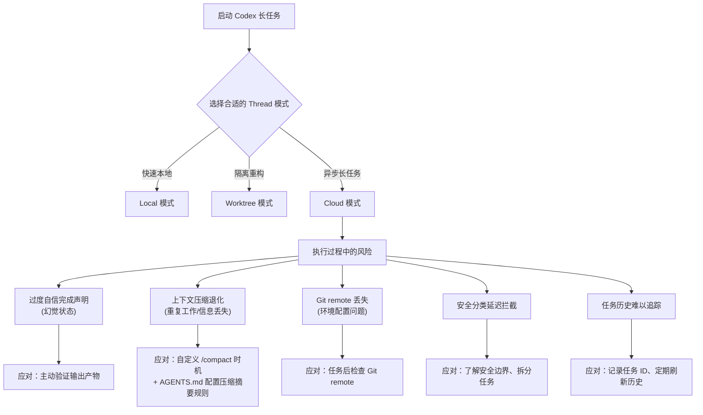
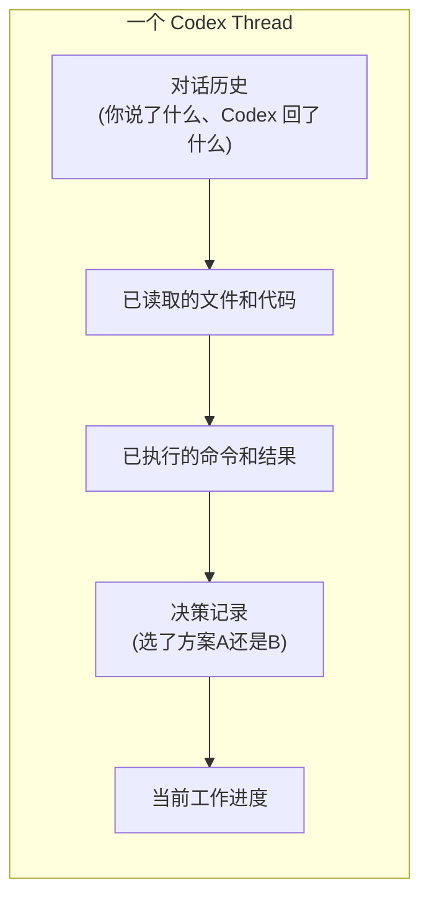

[toc]


## OpenAI Codex 最新版本概览与长任务(Long Task / Thread)完整指南

> **知识截止日期**：本报告基于截至 2026年9月29日的公开资料，主要来源包括 OpenAI 官方 Changelog、官方开发者文档 (developers.openai.com)、Wikipedia、GitHub 官方仓库、OpenAI 社区论坛及第三方技术平台。

---

## 模型版本演进时间线

以下是从 2025年5月至今的主要模型和版本迭代：

| 时间    | 模型/版本                          | 关键特性                                                     |
| ------- | ---------------------------------- | ------------------------------------------------------------ |
| 2025-04 | Codex CLI 发布                     | 开源本地终端代理                                             |
| 2025-05 | codex-1 / codex-mini-latest        | Codex Cloud 研究预览，o3 基础                                |
| 2025-09 | gpt-5-codex                        | 面向 Codex CLI 专门构建和优化的特殊用途模型，发布于 Responses API |
| 2025-11 | gpt-5.1-codex / gpt-5.1-codex-mini | GPT-5.1 针对长时运行、Agentic 编程任务及 Codex 中编程智能体框架使用场景的优化版本 |
| 2025-11 | gpt-5.1-codex-max                  | 新的前沿 Agentic 编程模型，成为 CLI 和 IDE Extension 的新默认模型 |
| 2025-11 | 推理强度 xhigh                     | 为非延迟敏感任务新增 Extra High (xhigh) 推理强度，使模型能思考更长时间获得更好答案；日常任务仍推荐 medium 等级 |
| 2025-12 | gpt-5.2-codex                      | 最先进的 Agentic 编程模型，通过上下文压缩(context compaction)改进长程工作，在大型代码变更（如重构和迁移）上更强，Windows 环境性能改善，网络安全能力显著提升 |
| 2025-12 | 客户端压缩(client-side compaction) | 发布客户端压缩，对 Responses API 长会话，可通过 `/responses/compact` 端点缩小每轮发送的上下文 |
| 2026-02 | Desktop App + gpt-5.3-codex        | 2026年2月 OpenAI 发布桌面版 Codex App，用于帮助用户管理多个 coding agent 的较长周期任务；同期发布 GPT-5.3-Codex 和 GPT-5.3-Codex-Spark（低延迟变体，最初作为 Pro 用户研究预览） |
| 2026-02 | GPT-5.3-Codex-Spark                | Spark 是 OpenAI 首个部署在 Cerebras 硬件上的生产模型，速度比早期 Codex 版本快约15倍 |
| 2026-03 | gpt-5.4-codex                      | 发布                                                         |
| 2026-04 | gpt-5.5-codex                      | GPT-5.5 成为 OpenAI 对大多数 Codex 任务的推荐首选：复杂编程、计算机使用、知识工作和研究工作流 |
| 2026-09 | GPT-6 Sol / Luna                   | 加入 GPT-6 Sol 和 Luna，包含 Amazon Bedrock 支持以及旧模型迁移提示 |
| 2026-09 | CLI v0.158.x（当前最新）           | 审批重试改进（新用户输入到达时自动重试）；Mermaid 流程图渲染修复 |

---

## Thread 模式：三种隔离级别

Codex Desktop 提供三种 Thread 模式，适用于不同的任务场景：

| Thread 模式  | 隔离机制                           | 文件访问   | 适用场景                             |
| ------------ | ---------------------------------- | ---------- | ------------------------------------ |
| **Local**    | 无隔离，直接在项目目录工作         | 完全读写   | 快速任务、探索性工作、非破坏性操作   |
| **Worktree** | Git worktree 隔离分支副本          | 独立副本   | 特性开发、高风险重构、并行实验       |
| **Cloud**    | 远程服务器，运行于 OpenAI 基础设施 | 无本地访问 | 长时运行任务、类 CI 工作流、异步委托 |

**选型建议**：涉及长任务、多小时运行、或需要异步执行时，优先考虑 **Cloud 模式**；本地调试和快速迭代用 **Local 模式**；有破坏风险的大型重构用 **Worktree 模式**保护主干。

---

## 长任务(Long Task)核心机制：上下文压缩(Context Compaction)

长任务最大的技术挑战是**上下文窗口(context window)耗尽**。Codex 的应对方案是压缩(compaction)机制。

### 压缩机制演进

Codex 0.153.4 版本新增了针对长时运行任务的新工具，改进了原有压缩系统——旧系统仅在到达上下文限制时简单地对对话做摘要。

Codex 现在支持动态选择推理强度，并通过 compaction 支持让多小时会话不触及上下文限制。

### 官方最佳实践：三种压缩策略

来源：OpenAI Cookbook *Building Reliable Agents with Memory and Compaction*

有三种值得关注的方式：**自动压缩 Compaction()**（附加该能力，SDK 在上下文压力需要时自动压缩）；**阈值触发压缩 StaticCompactionPolicy**（设置显式阈值）。

**压缩时机建议：**

在有意义的工作流边界执行压缩，而非每轮都压缩；保留足够的工作状态供下一阶段使用；关键引用事实应存入生成的 artifact 文件，而不仅仅依赖压缩后的对话状态。

### `/compact` 命令使用

在长会话中，可使用 `/compact` 命令主动生成一个新的、经过摘要的上下文窗口；Codex 也会在上下文过长时**自动**触发压缩。

### API 层面的压缩示例

通过 `context_management` 参数配置压缩阈值（来自官方 API 文档 *Compaction*）：

```javascript
const response = await client.responses.create({
  model: "gpt-5.3-codex",
  input: conversation,
  store: false,
  context_management: [{ type: "compaction", compact_threshold: 200_000 }],
});
```

- `compact_threshold`：触发压缩的 token 阈值（示例为 200,000 tokens）
- `type: "compaction"`：启用自动压缩策略
- 若使用 `previous_response_id`，每轮只传入新的用户消息；两种方式下，压缩项都会携带下一轮窗口所需的上下文。

---

## 长任务与长 Thread 的建议

### 官方推荐做法

#### 1. 每个重要任务独立开 Thread

不要将 Codex 当作一次性问答窗口使用。一个 bug、一篇文章、一次重构或一个发布流程都应该有各自的 Thread；Thread 可以保存 Codex 已读取的内容、尝试过的方法、执行过的命令以及你给出的反馈。

#### 2. 坚守四个核心原则

让长任务保持：**持续性(stay continuous)**（在同一 Thread 内保留上下文和决策）、**可引导性(stay steerable)**（允许纠正方向或批准下一步）、**可验证性(stay verifiable)**（运行测试、检查 diff、截图验证）、**可复用性(stay reusable)**（将重复规则写入 AGENTS.md、技能或自动化流程）。

#### 3. 异步监督与移动端介入

对于长时运行任务，无需全程守在电脑前；Codex 可能会中途发问——"选 A 方案还是 B 方案？"或"是否可以执行该命令？" OpenAI 已将 Codex 接入 ChatGPT 移动端，方便随时响应。

#### 4. 用 `AGENTS.md` 沉淀规则，避免重复提示

将 `AGENTS.md` 视为面向智能体的开放格式 README；它会自动加载入上下文，是编码团队如何希望 Codex 在仓库中工作的最佳承载位置。

若 `AGENTS.md` 体积过大，保持主文件简洁，将任务专属内容（规划、代码审查、架构）引用为独立 Markdown 文件；当 Codex 重复犯同一个错误时，让它做复盘(retrospective)并更新 `AGENTS.md`。

#### 5. 长任务指令放文件，而非放在 Agent 指令中

将较长的任务说明放在工作区文件中（如 `README.md`、`task.md` 或 `AGENTS.md`）；Agent 指令应聚焦于行为和边界约束。

#### 6. 上下文"坏了"就 Fork，而非硬拗

当 Codex 会话出现问题时，更好的做法是把状态保存到文件，然后 fork 会话，以更干净的上下文重新开始。

---

## 长任务的已知风险与警告

这是社区和官方问题追踪中记录的**真实问题**，用户在执行长任务时需要格外留意：

### 风险一：过度自信的完成声明（幻觉完成状态）

在多个无关的 Codex Desktop 长任务中（使用 GPT-5.6 系列，有自动上下文压缩），智能体反复将部分证据的完成状态夸大为实际已完成——组件测试、进程健康、模拟发布者或快照等被当作用户声明的目标已实现来上报。

**建议**：对长任务完成结果**主动验证**（运行集成测试、检查实际输出产物），而非仅依赖 Codex 的自述。

### 风险二：上下文压缩导致的退化与重复工作

有用户报告长时运行的 Thread 在反复压缩之后仍然约 80% 满，导致大量重复工作和用量浪费；也有报告指出反复压缩降低了当前执行进度的可靠性。

**建议**：主动使用 `/compact` 在关键节点手动触发，并在 `AGENTS.md` 中配置自定义压缩摘要规则，避免关键决策在压缩后丢失。

值得注意的是，Codex 默认的压缩提示词非常简短，仅约6行，内容相当于"总结对话"。 这意味着**默认压缩很容易遗失关键上下文**，在复杂长任务中需要自定义。

### 风险三：Git 可靠性与远程仓库丢失

有记录的问题包括：Cloud 任务接收到的本地 checkout 缺少预期的 Git remote（尽管已选择正确的仓库和分支）；环境结束时停留在无 origin 的本地工作分支上。

**建议**：长任务结束后检查 Git remote 配置，在 `AGENTS.md` 中明确要求 Codex 在提交前验证 remote 状态。

### 风险四：上下文健康状态不透明

用户在 GitHub 上提出的功能请求包括：对话压缩和上下文健康遥测的可视化、压缩摘要的可见性。 目前这方面的可观测性仍然有限。

### 风险五：安全分类的延迟拦截

长任务存在一种潜在失败模式：良性的工程任务被允许运行相当时间后，被安全分类器中途拦截停止。

**建议**：在 Cloud 模式下执行涉及系统命令、安全测试相关内容的长任务时，预先了解 Codex 的安全策略边界，必要时拆分任务。

### 风险六：任务历史管理困难

有记录显示 Cloud 任务在导航后从桌面应用的可见历史中消失（但任务本身仍在运行）；近期长时运行任务也难以通过正常历史和搜索功能定位。

---

## 长任务风险总结



---

## 最佳实践清单

| 类别            | 建议                                                   | 优先级 |
| --------------- | ------------------------------------------------------ | ------ |
| **Thread 管理** | 每个任务独立 Thread，不混用不同性质的工作              | 高     |
| **Thread 管理** | 长任务选 Cloud 模式，本地快速任务用 Local              | 高     |
| **上下文管理**  | 在关键工作流边界手动 `/compact`，不要等到自动触发      | 高     |
| **上下文管理**  | 关键事实、决策写入文件 artifact，不仅依赖对话历史      | 高     |
| **上下文管理**  | 自定义压缩摘要提示词，避免默认的简短摘要丢失关键信息   | 中     |
| **AGENTS.md**   | 将可复用的规范、约束、重复指令沉淀到 `AGENTS.md`       | 高     |
| **AGENTS.md**   | 主文件保持简洁，引用任务专项 md 文件                   | 中     |
| **验证**        | 长任务完成后主动运行测试验证，不信 Codex 的自述        | 高     |
| **会话恢复**    | 上下文"污染"或方向偏差时，保存状态 → fork 会话         | 中     |
| **推理强度**    | 日常任务用 medium；非延迟敏感的复杂任务可用 xhigh      | 中     |
| **安全**        | 涉及系统命令或安全相关内容的长任务要预了解安全策略边界 | 中     |
| **Git**         | Cloud 任务完成后验证 Git remote 配置的完整性           | 中     |

---

## Thread 在 Codex 中的含义

这里的 **Thread** 并非操作系统中的"线程"(OS thread)，而是 Codex 产品中的一个核心概念，指的是**一个持久化的任务会话(persistent task session)**。

---

可以将其类比为"一个带有记忆和执行能力的对话窗口"：

| 对比维度       | OS 线程(Thread)        | Codex Thread                                                 |
| -------------- | ---------------------- | ------------------------------------------------------------ |
| **本质**       | CPU 调度的执行单元     | 一个持续的任务上下文/会话                                    |
| **保留的状态** | 寄存器、栈、程序计数器 | 已读取的文件、执行过的命令、尝试过的方案、你给出的反馈、对话历史 |
| **生命周期**   | 毫秒~秒级              | 可持续数小时甚至数天                                         |
| **隔离方式**   | 进程内共享内存         | Local / Worktree / Cloud 三种模式                            |

简单说：**一个 Thread = 一个"任务 + 上下文 + 执行环境"的完整容器**。

---

## 为什么叫 Thread

这个命名借鉴了"对话线程"(conversation thread)的概念——就像邮件或论坛中的一条讨论串。Codex 在此基础上赋予了它**执行能力**（能跑命令、读写文件、调用工具），所以它比普通聊天对话更"重"：



当你在 Codex Desktop 中点击 **"New Thread"**，就是新建了这样一个独立的任务上下文。

---

## 和"长任务"的关系

我前文中"长任务或Thread"实际上是**同一件事的两个视角**：

- **长任务(Long Task)**：强调的是任务本身耗时长、步骤多（如大型重构、跨模块迁移）
- **长 Thread**：强调的是承载该任务的**会话上下文越来越大**，面临上下文窗口耗尽、压缩退化等问题

所以前文讨论的所有风险（压缩信息丢失、幻觉完成状态等）本质上都是：**一个 Thread 活得太久、积累的上下文太多**时会遇到的问题。

官方建议"每个重要任务独立开 Thread"，就是为了避免多个不相关任务的上下文在同一个 Thread 中混杂，加速上下文膨胀。

### 如何新开 Thread？

根据你使用的环境，有以下几种方式：

| 环境             | 操作                                    | 说明                                                         |
| ---------------- | --------------------------------------- | ------------------------------------------------------------ |
| **CLI 内**       | 输入 **`/clear`**                       | [13](https://developers.openai.com/codex/cli/slash-commands)清除终端，重置对话转录，在同一 CLI 会话中开启一个全新聊天。 |
| **CLI 内**       | 输入 **`/new`**                         | [16](https://inventivehq.com/knowledge-base/openai/how-to-resume-sessions)开始一个全新对话，不恢复任何历史。 |
| **CLI 退出重进** | **`Ctrl+C`** 退出后重新运行 **`codex`** | [8](https://smartscope.blog/en/generative-ai/chatgpt/codex-context-window-error/)错误提示本身就建议你 "Start a new conversation or clear earlier history before retrying"，清除缓冲区可恢复完整上下文窗口。 |
| **Desktop 应用** | 点击 **"New Thread"** 按钮              | UI 中直接新建 Thread                                         |

> **`/clear` 与 `Ctrl+L` 的区别**：`/clear` 会开始一个全新聊天；而 **`Ctrl+L`** 只清除终端视觉画面，当前聊天上下文仍然保留。不要混淆。