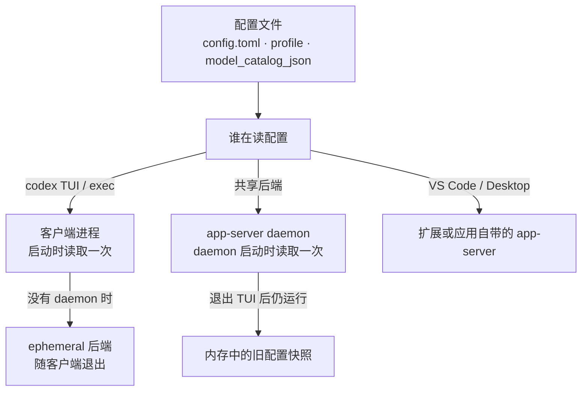

[toc]

## 结论先行

Codex 的配置是**启动期读取**的：改完 `config.toml`、profile 或 `model_catalog_json` 后，必须让真正读取它的进程重新启动，并新开一个会话。

三件事要分清：

1. **退出 TUI ≠ 重启后台**。0.157.0 起，交互式 `codex` 默认会自动拉起常驻 `app-server daemon`；关掉终端窗口后 daemon 仍在，继续使用旧配置。
2. **重开客户端 ≠ 新会话**。`resume` / `fork` 恢复的是旧 thread，旧 thread 保留启动时的模型目录、上下文窗口与工具装配。
3. **Windows 上管理员终端不能启动 daemon**。会报 `shared clients must not inherit administrator privileges`，此时 Codex 走 ephemeral 模式，重启策略随之不同。

最短路径（Windows，非管理员终端）：

```powershell
codex --strict-config doctor          # 1. 配置能解析
codex app-server daemon version       # 2. 有 JSON 输出说明 daemon 在跑
codex app-server daemon restart       # 3. 仅当第 2 步有输出时执行
codex                                 # 4. 重新进入 TUI
```

进入 TUI 后用 `/new` 开新会话，不要用 `resume` 验证新配置。

如果常驻模式怎么看都不生效，做一次 A/B 对照：

```powershell
codex --no-daemon
```

`--no-daemon` 完全不使用共享后端。它在同样的配置下生效、常驻模式不生效，问题就在 daemon 或客户端连接层，而不是配置文件本身。

---

## 为什么“重开一个窗口”经常不算重启

Codex 不是每轮对话都重新读一遍磁盘上的配置。模型目录合并、provider 解析、推理档位、工具清单、上下文窗口等，在进程启动阶段就固化成一份运行时视图；会话开始时又会把当时的视图写进 thread。



因此有三种不同的“重启”：

| 做法 | 重启了什么 | 典型结果 |
| --- | --- | --- |
| 关掉 TUI 再开 | 只换了客户端 | 共享 daemon 仍在，旧配置继续生效 |
| `codex app-server daemon restart` | 换了共享后端 | 下次连接会重新读配置 |
| 重启后 `resume` 旧会话 | 什么都没换 | 旧 thread 继续用旧快照 |

---

## 先判断配置由谁读

| 宿主 | 读取时机 | 正确动作 | 只做一半会怎样 |
| --- | --- | --- | --- |
| `codex` TUI | 客户端启动；连接共享 daemon 时 daemon 也有自己的启动快照 | 先 `daemon restart`，再退出 TUI 重开 | 只重开 TUI，daemon 仍用旧配置 |
| `codex exec` | 每次调用都是新进程 | 直接重跑命令 | 一般不需要额外重启 |
| 共享 app-server daemon | daemon 启动 | `codex app-server daemon restart`，或 `stop` 后等下次自动拉起 | 关终端不会停它 |
| VS Code 扩展 | 扩展自己的 app-server 启动 | `Developer: Reload Window`；不行再完全退出 VS Code | 关窗口不一定退出扩展宿主 |
| Desktop App | 应用内 app-server 启动 | 菜单退出（含托盘）再启动 | 点窗口关闭按钮通常只是收进托盘 |
| 远程 app-server | 远端服务启动 | 在远端重启 app-server（daemon 管理时用 `daemon restart`），客户端重连 | 重启本地 TUI 对远端无效 |

判断当前有没有 daemon，最直接的入口是 `codex doctor` 的 `Background Server` 段：

```text
Background Server
  ○ app-server   not running (ephemeral mode)
```

也可以用：

```powershell
codex app-server daemon version
```

- 有 JSON 输出：daemon 在跑。关注 `status`、`cliVersion`、`appServerVersion`、`socketPath`。
- 报连接失败（如 Windows 的 `os error 10050`）：通常是没有 daemon；如果你确信它应该在跑，按“残留 socket”处理。
- `codex doctor` 显示 `not running (ephemeral mode)`：没有常驻后端，重开 TUI 就够了。

以下情况本来就不会有常驻 daemon，不要误判成启动失败：`[features] daemon_auto_start = false`、本次启动带了 `--no-daemon`、当前是 Windows 提权终端。

还要注意：`codex doctor` 的 `Background Server` 段只反映**共享 daemon**。VS Code 扩展会自己拉起 `codex.exe ... app-server`，不同扩展版本可能各有一份；扩展层是否换了进程，要单独看进程列表和扩展的 Output 面板。

---

## 标准操作：一次干净的重启

### 第 0 步：先确认配置能解析

```powershell
codex --strict-config doctor --summary
```

看 `Configuration` 段的 `config loaded`、`config.toml parse ok`。手改过 TOML 时，`--strict-config` 会把当前版本不认识的键直接报错，避免把“配置写错”误判成“重启没生效”。

注意：`doctor` 和 `debug models` **不接受 `--profile`**。要验证 profile 里的目录，用 `-c` 显式传入路径：

```powershell
codex -c "model_catalog_json='C:/Users/Administrator/.codex/yjwd-grok-models.json'" debug models
```

Windows 路径在 TOML 基本字符串里会被反斜杠转义，推荐用正斜杠，或改用 TOML 单引号字面量。

### 第 1 步：看 daemon 是否还活着

```powershell
codex app-server daemon version
codex doctor --summary
```

改配置前跑一次，改完再跑一次。对比 `appServerVersion`；版本没变时，再用进程列表里的 PID 和启动时间确认是否真的换了进程。

### 第 2 步：重启 daemon

```powershell
codex app-server daemon restart
codex app-server daemon version
```

- `restart` 会停掉旧实例并按当前环境重新拉起。
- `stop` 也可以：下次交互式 `codex` 启动时会自动拉起新实例（`daemon_auto_start` 默认开启）。
- daemon 沿用**首次启动它的会话或进程**的环境变量。换代理、换 API Key 环境变量、换 `CODEX_HOME` 时，先在同一个终端里设置好，再执行 `restart`。
- 不要在有 turn 正在执行时重启。daemon 启动 5 分钟后会首次检查更新，此后默认每小时检查一次，更新可能在宽限期后重启后端并打断任务；长任务前可先 `codex app-server daemon stop`。

### 第 3 步：完全退出客户端

| 客户端 | 动作 |
| --- | --- |
| TUI | 在会话里执行 `/quit`（或 `/exit`），确认回到 shell |
| VS Code | 命令面板执行 `Developer: Reload Window`；仍不生效就完全退出 VS Code，确认相关进程退出后重开 |
| Desktop App | 从菜单或托盘选择退出，不要只点窗口右上角的关闭按钮 |
| 远程连接 | 在远端主机重启 app-server；本地 TUI 只负责重新连接 |

### 第 4 步：新开一个会话

```text
/new
```

TUI 里也可以用 `/clear` 开一个干净会话。`resume` / `fork` 是恢复或复制旧 thread，不是验证新配置的手段。

### 第 5 步：验证

见下一节。不要只看“命令没报错”，要看到值真的变了。

---

## 怎么证明新配置真的生效

按由软到硬的顺序取证：

### 1. 配置解析层

```powershell
codex --strict-config doctor --summary
```

- `config.toml parse ok` 只证明语法没问题。
- 还要看 `model`、`model provider`、`config.toml` 路径是否符合预期，避免改错文件或 `CODEX_HOME` 指错。

### 2. 目录加载层

```powershell
codex debug models
codex debug models --bundled
```

- 两者模型集合一致：读的是内置目录，自定义 `model_catalog_json` 没生效。
- 改一个显眼字段（如 `display_name`、`context_window`、`use_responses_lite`）后重跑，输出跟着变，才算真的读到了。
- 验证 profile 的目录时必须用 `-c` 显式传路径，原因见上一节。

### 3. 真实请求层

```powershell
codex --profile <name> exec --skip-git-repo-check -s read-only -c approval_policy="never" "Reply with exactly: OK"
```

目录可读不代表网关接受。返回 `unsupported_feature` 或 `tool type '...' is not supported`，按具体工具类型排查，不要继续怀疑“没重启”。

### 4. 会话层

- TUI 里 `/status` 或 `/debug-config` 看当前会话实际拿到的模型与配置。
- 新会话的 rollout JSONL 里，`model_context_window` 等字段应变成新值；具体查法见[上下文窗口调整记录](codex上下文窗口调整记录.md)。
- 旧会话仍显示旧值，是正常现象，不是重启失败。

---

## 常见“假重启”与修法

| 现象 | 实际原因 | 处理 |
| --- | --- | --- |
| 退出 TUI 重开，模型或窗口仍是旧值 | 共享 daemon 还活着 | `daemon version` 确认，`daemon restart` 后新会话 |
| 换代理后 Codex 仍走旧出口 | daemon 固定了启动时的环境变量 | 在同一终端设好代理变量，再 `daemon restart` |
| VS Code `Reload Window` 后仍旧 | 扩展宿主或它自带的 app-server 没真正退出 | 完全退出 VS Code，确认扩展的 app-server 进程退出；共享 daemon 也在用时再 `daemon restart` |
| Desktop 关窗口后仍旧 | 应用还在托盘运行 | 菜单退出，确认进程 |
| `resume --last` 后仍旧 | 恢复的是旧 thread | `/new` 新会话 |
| 改了 `<profile>.config.toml` 但没带 `--profile` | 读的是默认配置 | 启动时带 `--profile <name>` |
| `debug models` 看不到新目录 | `debug models` 不读 profile | 用 `-c model_catalog_json=...` 显式传 |
| `daemon start` 报 non-elevated terminal | 当前终端是管理员权限 | 换普通终端启动 daemon，或改用 `codex --no-daemon` 单次运行 |
| `daemon version` 报 `os error 10050` / `error 5` | 没有 daemon，或残留 socket | 先 `daemon restart`；仍不行按 PID 处理那一个 `codex.exe` |
| 长任务中途被打断 | daemon 自动更新重启了后端 | 长任务前 `daemon stop`，需要时再 `start` |
| `-c` 改了但下一条命令没带上 | `-c` 只影响当前调用 | 写进 TOML，或每次命令都带 |

### Windows 的 daemon 权限约束

Codex 在 Windows 上明确拒绝从提权终端启动共享 daemon：

```text
Error: start the Windows daemon from a non-elevated terminal; shared clients must not inherit administrator privileges
```

这不是配置错误。两种处理：

- 用普通（非管理员）终端运行 `codex app-server daemon start` / `restart`，让 daemon 以普通权限常驻。
- 就在当前终端单次运行 `codex --no-daemon`，完全绕开共享后端。

### 残留 socket

`daemon version` 或 `daemon start` 报错时，先判断是“没有 daemon”还是“socket 残留”：

1. 先跑 `codex app-server daemon restart`。
2. 仍失败时，在任务管理器或下面的命令里找到那个 `codex.exe` 的 PID，只结束该进程，不要批量杀所有 `codex.exe`：

```powershell
Get-CimInstance Win32_Process -Filter "Name='codex.exe'" |
  Select-Object ProcessId, ParentProcessId, CreationDate, CommandLine |
  Format-List
```

3. 相关状态通常在：

```text
~/.codex/app-server-daemon/                        # pid、锁、settings
~/.codex/app-server-control/app-server-control.sock # 控制 socket
```

`codex doctor` 的 `Background Server` 段会直接打印本机的实际路径，以它为准。

---

## 哪些改动需要动哪一层

| 改动 | 建议动作 |
| --- | --- |
| `config.toml` 里的 model、provider、sandbox、features | 重启 daemon + 重开客户端 + 新会话 |
| `<name>.config.toml`（profile） | 带 `--profile` 重开客户端；daemon 常驻时一并重启 |
| `model_catalog_json` 指向的 JSON | 重启读取目录的进程，客户端与 daemon 都算 |
| `CODEX_HOME`、代理、API Key 环境变量 | 在正确环境里重启 daemon，再重开客户端 |
| `AGENTS.md`、skills、plugins | 新会话；不生效时再重启客户端 |
| `-c`、`--profile`、`-m`、`--search`（TUI 会话） | 只影响当前调用，不需要“重启”，但下次要重新带上 |
| `/model`、`/reasoning` 切换 | 运行时生效，不属于启动期配置 |

---

## 最小检查清单

```text
[ ] 改的是当前 CODEX_HOME 下的文件
[ ] codex --strict-config doctor 通过
[ ] 知道当前有没有 daemon（doctor 的 Background Server 段）
[ ] 有 daemon 时已 restart，且版本或 PID 变了
[ ] 客户端完全退出过，不是只关了窗口
[ ] 新开了会话，没有 resume 旧 thread
[ ] debug models 里能看到改动的字段
[ ] 真实请求返回 OK
[ ] 旧会话仍显示旧值（这是正常的）
```

---

## 依据与验证边界

- 版本基线：Codex CLI **0.164.0**，Windows 11（26200），验证日期 2026-10-25。
- 已在本机核对：`codex doctor` 的 `Background Server` 段、`codex app-server daemon --help`、`codex features list` 中 `daemon_auto_start` 为 stable 且默认启用、提权终端启动 daemon 的报错原文、`codex --no-daemon exec` 的真实请求。
- 未在本机完成：从非提权终端成功启动 daemon 后的 `daemon version` JSON 实测（当前会话是管理员权限）；VS Code 与 Desktop 的具体退出行为按官方客户端与现有文档归纳。
- 命令与选项会随版本变化，最终以 `codex --help`、`codex app-server daemon --help`、`codex doctor` 的实际输出为准。
