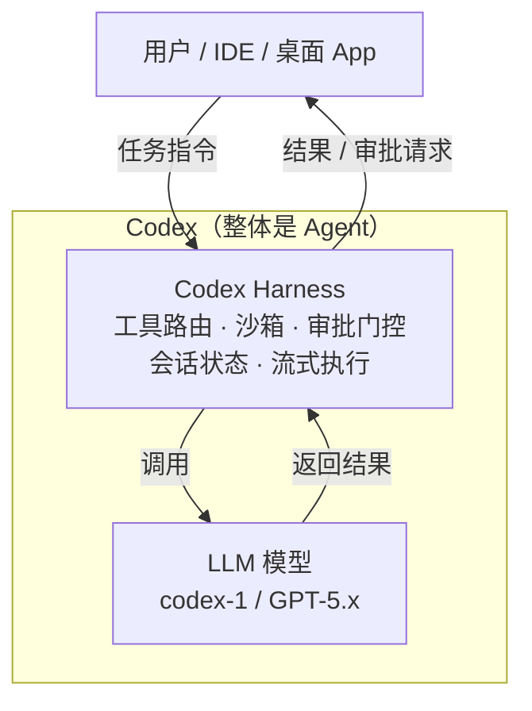
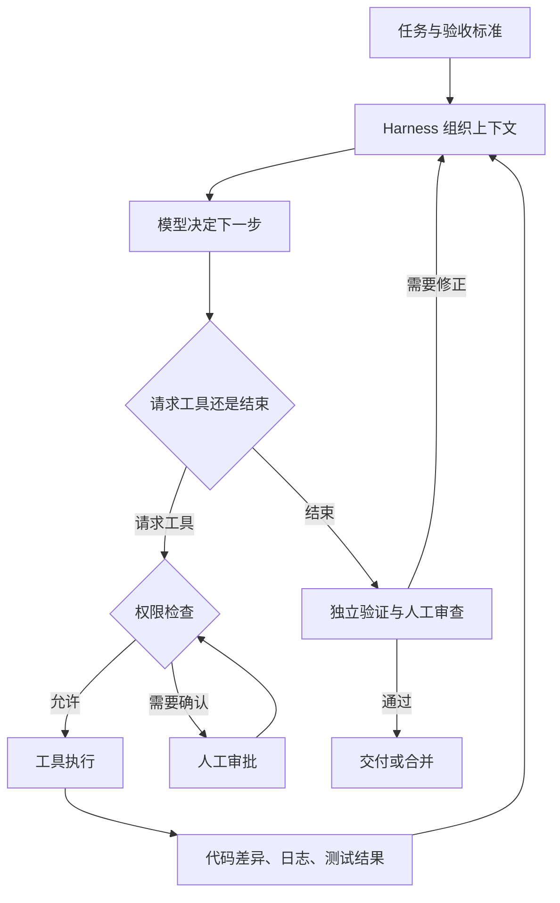
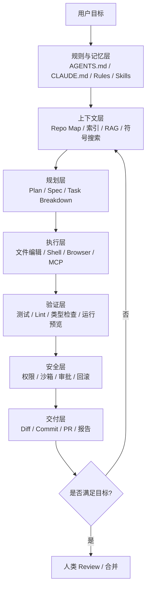

[toc]

## abstract

下面会保留必要的安装入口、仓库规则模板和跨平台注意事项；推荐依据是官方能力与适用边界，**不是我在本环境完成的性能横评**。**先给结论：选 coding agent，不应只问“哪个模型最强”，而应比较“模型 + harness + 开发环境 + 验证流程”。** 对多数开发者，我建议先选一个主力工具，把测试、权限和任务拆分做好，再考虑多智能体和复杂插件。

现在的 Coding Agent 市场已经分成几条路线：

| 路线                   | 代表产品                                                     | 本质                                                    |
| ---------------------- | ------------------------------------------------------------ | ------------------------------------------------------- |
| **AI 原生 IDE**        | Cursor、TraeCode、Qoder、Windsurf、Kiro、CodeBuddy IDE、Comate AI IDE | 把编辑器、任务面板、终端、预览、Agent 统一在一个 IDE 里 |
| **终端 CLI Agent**     | Claude Code、Codex CLI、Qwen Code、Kimi Code、Aider、OpenCode、Gemini CLI、CodeBuddy Code | 面向专业工程师，适合 shell、远程服务器、CI、自动化      |
| **IDE 插件型 Agent**   | GitHub Copilot、Cline、Continue、CodeGeeX、iFlyCode、Comate、CodeBuddy 插件 | 不强制换 IDE，适合渐进式接入                            |
| **云端异步 Agent**     | Devin、Jules、Factory Droid、Cursor Background Agent、Qoder Cloud Agents、OpenHands Enterprise | 类似“派活给 AI 工程师”，让它开 PR 或后台跑任务          |
| **Agent Harness/框架** | OpenHands、DeepSeek Harness、CodeFuse-Agent、Trae Agent、Qwen Code、OpenCode | 更偏“智能体运行时/编排层”，适合二次开发、私有化、研究   |

**真正影响体验的不只是模型，而是 Harness（智能体运行框架）**：它负责**上下文检索、文件编辑、命令执行、权限控制、子代理、记忆、规则、沙箱、回滚、成本控制**。同一个模型，放进不同 Harness，效果可以差很多。

学术讨论也开始明确指出，现实中的 **coding agent** 是**模型、harness、上下文、环境、反馈信号**的复合系统，而不是单个大模型。

**阅读大纲**

- 先按使用场景选工具。
- 理解 **coding agent、harness、模型、SDK** 的区别。
- 比较主流候选，以及 Pi、OpenHands 等不同设计路线。
- 配置仓库规则、验收标准和安全权限。
- 建立可自动化的工作流，处理国内网络与跨平台问题。
- 用自己的真实任务验证选型，而不是照搬排行榜。

## 按场景给出的推荐

下表是**选型建议，不是编码能力排名**。

| 你的主要诉求                              | 我建议优先试用                                               | 选择依据与边界                                               |
| ----------------------------------------- | ------------------------------------------------------------ | ------------------------------------------------------------ |
| **日常终端开发，尽量少折腾适配**          | **Claude Code / Codex CLI**                                  | 都提供完整的读代码、修改、运行命令工作流。优先利用你已有、且符合使用条件的账号和模型服务；不要在没有跑过自己仓库的情况下认定谁全面更强。 |
| **希望在 IDE 中查看代码、差异和执行过程** | **Cursor**；不想换编辑器则先试 **GitHub Copilot**            | Cursor 将 agent 工作流与编辑器结合；Copilot 提供 IDE、CLI 和云端入口，但各入口不是同一种执行环境。 |
| **自行选择模型、接不同供应商或本地模型**  | **OpenCode**；偏编辑器交互则试 **Cline**                     | 两者都支持自行配置模型接入。代价是你需要负责模型兼容性、权限和成本配置。 |
| **先低成本体验终端 agent**                | **Gemini CLI**                                               | 官方提供个人免费使用入口，并集成搜索、文件和终端工具；具体资格、地区与额度以当前规则为准。 |
| **研究 harness，或深度定制自己的工作流**  | **Pi**                                                       | 核心精简，强调扩展能力；并不把复杂审批、计划和子智能体全部内置。更适合愿意自己承担集成与安全工作的开发者。 |
| **做公司内部编码机器人、批量维护平台**    | **OpenHands Software Agent SDK**                             | 面向软件工程任务，提供 agent、工具、工作区和远程执行等组件；平台团队仍须承担基础设施与治理工作。 |
| **把明确任务交出去，稍后审查 PR**         | **Copilot cloud agent、Cursor Cloud Agents、Codex 云端入口** | 重点考察远程环境准备、测试能力、凭证隔离及 PR 审查，而不只是聊天体验。 |

**最实用的起步策略：一个主力 agent，一个备用选择，一套可靠的验证流程。** 不建议初学者同时装十几个工具，然后花大量时间维护重复的规则和插件。

## 先把概念分清楚

### 模型、agent 和 harness 不是同一层

这里把 **harness** 理解为“让模型持续、受控地执行任务的**运行与控制层**”。不同项目使用这个词时范围有所不同，**它不是一个边界完全统一的产品分类**。

| 概念                                  | 负责什么                                             | 可以怎样理解               |
| ------------------------------------- | ---------------------------------------------------- | -------------------------- |
| **模型（Model / LLM）**               | 理解输入、生成代码或工具调用请求                     | 提出下一步行动的推理组件   |
| **编码智能体（Coding agent）**        | 使用模型和工具，持续处理编程任务                     | 实际工作的系统             |
| **运行支架（Agent harness）**         | 组织上下文、执行工具、管理状态、权限、重试及停止条件 | 让模型能持续工作的控制程序 |
| **交互入口（CLI / TUI / IDE / Web）** | 展示对话、差异、审批和任务状态                       | 你操作 agent 的界面        |
| **SDK（Software Development Kit）**   | 让其他程序调用或嵌入这些能力                         | 用于搭建自动化和自定义产品 |

OpenAI 对 Codex 的说明明确区分了产品入口与底层 harness；OpenHands 的架构文档也将推理循环、会话状态、工具及工作区分开。**终端界面只是入口，不是 harness 的全部。**

另一个容易混淆的概念是 **评测支架（Evaluation harness）**：例如 SWE-bench 的评测程序，主要负责准备环境、应用补丁、运行测试并计算结果，**不等于负责生成补丁的 coding agent**。

好的，我已经搜集到了充足的资料。下面开始整理输出。

---

**自报家门:** 我是 Claude（由 Anthropic 开发），不确定具体模型版本号。我具备**联网搜索**能力，可以获取最新资料来回答你的问题。

### 核心公式

**Agent = Model + Harness**

这是理解三个概念关系的关键等式，由 Mitchell Hashimoto（HashiCorp 联合创始人、Terraform 作者）于 2026 年初推广。

### 概念对照

| 概念                        | 定义                                                         | 关键特征                                     |
| --------------------------- | ------------------------------------------------------------ | -------------------------------------------- |
| **AI Agent**                | 能自主感知环境、做出决策、调用工具完成任务的 AI 系统         | 自主性、工具调用、多步推理                   |
| **Coding Agent**            | 专注于软件工程任务（写代码、修 bug、重构）的 AI Agent        | Agent 在编码领域的垂直应用                   |
| **Harness**（代理执行框架） | 包裹在模型外围的一切基础设施：沙箱、工具路由、审批门控、状态管理、反馈回路等 | 不是模型本身，而是让模型**可靠运行**的"缰绳" |

### 什么是 Harness

**Harness Engineering** 是设计 AI Agent 执行环境的学科——它定义了 Agent 能调用哪些工具、从哪里获取信息、如何验证自身决策、以及何时该停下来。

Mitchell Hashimoto 于 2026 年 2 月在个人博客中首次系统阐述：每当 Agent 犯了一个错误，就把修复工程化到 Agent 的环境里，使该错误在结构上不可能再发生。

**Harness 的核心组件**（综合 Anthropic、OpenAI、LangChain 等文献）：

| 组件                                        | 说明                                                   |
| ------------------------------------------- | ------------------------------------------------------ |
| **Human-in-the-loop 控制**                  | Agent 在关键决策处暂停，Harness 要求人类审批           |
| **文件系统访问管理**                        | 定义可访问目录、允许的操作和冲突解决策略               |
| **工具调用编排（Tool Orchestration）**      | 正确的工具、正确的时机、正确的顺序、恰当的错误处理     |
| **子 Agent 协调（Sub-agent Coordination）** | 管理多 Agent 的通信、输出合并与冲突解决                |
| **生命周期钩子（Lifecycle Hooks）**         | 初始化上下文、执行任务、保存状态、故障处理、重试、日志 |

### 为什么 Harness 比 Model 更重要

LangChain 仅通过改变 Harness（不换模型），就把 Coding Agent 在 Terminal Bench 上的得分从 52.8% 提高到 66.5%。Princeton 的 CORE-Bench 记录了同一个模型在不同 Harness 下得分从 42% 到 78% 的巨大差异。

Agent 失败时，原因几乎从来不是"模型不够聪明"，而是循环了 40 分钟、忘了昨天的上下文、预算超支、消息丢失、进程崩溃——这些全是 Harness 问题。

### 工程范式演进

**Phase 1**（~2023）—— Prompt Engineering：AI 主要做智能自动补全，需要持续人工引导。
**Phase 2**（2024–2025）—— Context Engineering：瓶颈转向信息管理，借助 MCP、RAG 等使模型能针对特定代码库推理。
**Phase 3**（2026）—— Harness Engineering：挑战变为自主性、准确性与控制，Harness 而非模型决定了 Agent 在生产中的表现。

### Codex：既是 Agent，也是 Harness

这是你问题的关键——**Codex 不是非此即彼，而是两者兼具**。

Codex 是 OpenAI 开发的 **AI Coding Agent**，用于写代码、修 bug 等软件工程任务，2025 年 4 月以 Codex CLI 形式发布。

大多数开发者通过桌面 App、终端或 IDE 插件使用 Codex，看起来像三个产品；但底层共享同一个系统——**Codex Harness**：会话状态、流式执行、工具路由、沙箱策略和审批门控。

2026 年 8 月 19 日，OpenAI 将 Codex 定位为平台，强调其中最有价值的可复用资产不是聊天界面，而是 **Harness**——位于模型与任务之间的执行系统，负责上下文收集、工具调用、沙箱与审批边界执行、执行进度流式推送以及跨会话状态传递。

用一张图表示：



**简言之：**

- 当你说"我用 Codex 写代码"——它是一个 **Coding Agent**
- 当你说"我要基于 Codex 的开源运行时构建自己的 Agent"——它提供的是一个 **Harness**
- OpenAI 在 2026 年 8 月将公开叙事从"你启动的编码助手"转变为"你嵌入的开放 Agent 运行时"

### 实操建议（入门 Harness Engineering）

从项目根目录创建 `CLAUDE.md` 或 `AGENTS.md`，写入项目结构、构建命令和编码规则。从简单开始，每当 Agent 在同一处反复失败时，追加对应规则——这就是 Harness Engineering 的最小可行实践。


### 它怎样完成一次任务

简化后的工作过程如下。图中的“独立验证与审查”是我建议在工程流程中补上的环节，而不是假定每个产品都自动做好了。



**模型提出调用工具的请求，harness 才真正执行工具，并把结果交回模型。** 因此，文件编辑方式、错误信息质量、上下文管理和权限机制，都可能影响最终结果。

必须牢记：

> **“agent 说完成了”是会话状态，不是质量证明。**

让它能运行测试、构建或截图检查，并要求它提供证据，比只让它“认真检查一下”更可靠。

## 主流候选怎么比较

### 日常开发的主要候选

| 工具               | 主要定位                                  | 值得关注的设计                                               | 选型时的边界                                                 |
| ------------------ | ----------------------------------------- | ------------------------------------------------------------ | ------------------------------------------------------------ |
| **Claude Code**    | 终端为核心，也提供 IDE、桌面和 Web 等入口 | 项目指令、计划、工具执行及可扩展工作流                       | **以 Claude 生态为主要路线**。适合希望少处理模型适配的人；不要默认任何兼容接口都能无损替换。 |
| **Codex CLI**      | 本地编码 agent，可与其他 Codex 入口配合   | 显式沙箱和审批配置、非交互执行、SDK；CLI 仓库采用 Apache-2.0 许可 | 主要面向 OpenAI 模型体验，但也有兼容端点和本地模型接入路径；**兼容性需要验证**，不能只看供应商是否写着“OpenAI-compatible”。 |
| **OpenCode**       | 终端优先、多模型接入                      | 可配置供应商、本地模型、插件和工具                           | 适合控制模型与接入方式；**V1/V2 配置存在差异**，升级不能只换可执行文件。 |
| **Cline**          | 编辑器和 CLI 中的 agent                   | 文件修改、终端、浏览器及自行配置模型的工作流                 | 编辑器与 CLI 的默认行为必须分别核对，**不能默认每个入口都会逐项询问批准**。 |
| **Cursor**         | 编辑器与 agent 结合，也有 CLI、云端入口   | 模型适配、代码检索、编辑、终端和浏览器工具                   | 适合偏重交互体验的人；“平台提供多个模型”与“完全自由替换整个后端”不是一回事。 |
| **GitHub Copilot** | IDE、终端和 GitHub 工作流                 | 本地交互开发与远程任务分派两类路径                           | **IDE agent mode、Copilot CLI、cloud agent 要分开评估**，不能把其中一项的能力或权限直接套到另一项。 |
| **Gemini CLI**     | Gemini 生态的终端 agent                   | Google Search grounding、文件和终端工具、MCP、可配置沙箱     | 适合 Gemini 用户及试用场景；免费额度、账号要求和沙箱实际配置都应单独核对。 |

### Claude Code 与 Codex CLI：我会怎样选

我的建议不是先猜谁的“智商”更高，而是依次判断：

- **已经有可用额度**：先用对应官方 agent，减少额外订阅和接入适配。
- **希望阅读源码、研究实现或集成自动化**：Codex CLI 的公开代码、非交互入口和 SDK 值得重点考察。
- **希望围绕 Claude 建立完整工作流**：Claude Code 及 Claude Agent SDK 是自然的起点。
- **决定长期付费**：用同一个仓库中的真实任务比较，而不是靠一次演示决定。

这里还有一个重要的兼容性细节：**Codex 的模型调用使用 Responses API 路线。仅支持 Chat Completions 的接口，不应被当成天然等价的替代品。** 接口地址能改，不代表工具调用、流式事件和上下文语义都能正确工作。

### OpenCode、Cline 与 Pi：区别不只是界面

可以按你想掌握多少控制权来选择：

- **OpenCode：想自行选模型，但仍希望得到较完整的终端产品。**
- **Cline：想围绕编辑器操作、差异展示和工具审批工作。**
- **Pi：想自行塑造 agent 的工作方式，而不只是调整参数。**

Pi 默认提供的核心工具包括 `read`、`write`、`edit` 和 `bash`，通过扩展增加能力；其设计明确不把 MCP、子智能体、计划模式、逐项权限弹窗全部内置。**这是一种精简设计取向，不是“功能缺失所以一定更差”，也不是“简洁所以天然更安全”。**

**给初学者的建议：先使用完整产品，遇到明确限制后，再考虑 Pi 这样的深度定制路线。**

### Cursor 与 Copilot：先看工作流迁移成本

我的判断方式：

- **愿意采用专门的 agent 开发环境**：先试 Cursor。
- **现有 IDE 和 GitHub 工作流已经稳定**：先试 Copilot，避免仅为 agent 重建整套开发习惯。
- **主要是给 issue 分派任务并审查 PR**：比较云端 agent，不要只比较 IDE 聊天面板。

GitHub 官方明确说明：**Copilot cloud agent 在 GitHub Actions 支持的环境中工作；IDE agent mode 则修改本地开发环境。** 这是部署与信任边界的区别，不只是按钮位置不同。

## 不应忽略的其他路线

| 候选                          | 什么时候值得看                                       | 我的建议                                                     |
| ----------------------------- | ---------------------------------------------------- | ------------------------------------------------------------ |
| **Pi**                        | 学习 agent 循环、定制工具、会话和扩展                | **适合研究与高级定制**；不要省略外部隔离和权限设计。         |
| **Aider**                     | 喜欢终端结对编程、小步修改和 Git 工作流              | 仓库地图与 Git 集成是特色。我更建议把它作为**人在回路的小步开发工具**来评估，而不是默认当成无人值守平台。 |
| **OpenHands**                 | 自建编码服务、批量维护、远程工作区                   | **平台建设重点候选**。SDK、CLI、GUI、Cloud 是不同层次；SDK 的开源许可不能直接推导为所有商业组件都相同。 |
| **Qwen Code / Kimi Code CLI** | 希望评估 Qwen、Kimi 相关开发体验，尤其是国内试验环境 | **值得纳入国内场景的试用清单**。Qwen Code 已发展为多协议路线，不能简单理解为只给 Gemini CLI 换了模型。实际服务端点、账号和数据流仍要验证。 |
| **Goose**                     | 希望兼顾编码和其他工具工作流                         | 提供桌面、CLI、API、多供应商及 MCP 扩展路线；适合“编码之外也要操作其他系统”的需求。 |
| **Kilo**                      | 希望考察多模式、编辑器及 CLI 工作流                  | 可以作为 Cline 之外的备选，但应按自己的扩展和模型配置验证，不要仅凭功能数量选择。 |
| **Devin / Jules**             | 更偏任务分派和托管执行                               | 可以考察“任务交出去、稍后验收”的体验；本轮不对其成功率、速度或成本做没有实测依据的排序。 |

### 一个必须更新的旧榜单结论

**Roo Code 不再适合作为新项目的常规首选。** 官方仓库已于 **2026 年 5 月 15 日归档**，README 也公告了扩展停止运营。社区分支与其他替代项目需要作为独立项目重新评估，不能自动继承原项目的维护承诺。

这也是为什么我建议：**维护状态、升级路径和安全响应，应与模型表现一起纳入选型。**

## 真正影响体验的比较维度

下面是我建议用来审查候选工具的清单。

| 维度           | 应该问的问题                                               | 实践重点                   |
| -------------- | ---------------------------------------------------------- | -------------------------- |
| **上下文获取** | 能否找到正确实现、调用方、测试和配置，而不是只读当前文件？ | 用跨文件缺陷验证           |
| **代码修改**   | 能否产生小而准确的差异？失败时能否恢复？                   | 检查无关修改、格式化噪声   |
| **执行与反馈** | 能否运行真实构建、测试，并正确理解失败？                   | 给可执行验收标准           |
| **权限和隔离** | 是只弹确认框，还是确实限制文件、网络和进程权限？           | 核对执行边界               |
| **模型接入**   | 是否支持你的供应商、协议、认证和本地模型？                 | 测试工具调用，不只测试聊天 |
| **可观察性**   | 能否看到工具参数、错误、测试结果和成本？                   | 保留可审查日志             |
| **自动化**     | 是否有非交互模式、结构化输出、SDK、恢复和取消能力？        | 用一个小型批处理验证       |
| **治理和维护** | 是否能集中配置、固定版本、回滚和限制凭证？                 | 团队试点时实际演练         |

### 上下文工程比“塞更多文件”更重要

我建议把上下文分成三层：

- **长期规则**：项目约束、命令和约定。
- **任务资料**：需求、相关代码、错误日志、验收条件。
- **执行记录**：已尝试的方案、测试结果、当前阻塞。

**不要把全部文档和历史讨论永久塞进每一次请求。** Claude Code 官方最佳实践强调了上下文管理；其记忆文档也将项目指令与其他记忆机制分开。

对长任务，我更推荐：

- 将目标和验收标准写入任务文档。
- 每个阶段形成小而完整的改动。
- 留下“完成了什么、验证了什么、下一步是什么”的交接记录。
- 新会话从这些记录恢复，而不是期待无限长聊天永不丢失重点。

这种通过持久化状态、增量工作和明确交接支持长任务的方法，也与 Anthropic 的长运行 harness 设计经验一致。

## Rules、Skills、MCP、Hooks 和 ACP 怎么用

这些词经常一起出现，但解决的是不同问题。

| 机制                                 | 主要用途                             | 适合放什么                           | 不应误认为                                 |
| ------------------------------------ | ------------------------------------ | ------------------------------------ | ------------------------------------------ |
| **项目指令（Rules / Instructions）** | 告诉 agent 项目长期约定              | 测试命令、架构边界、禁止的无关改动   | 操作系统权限控制。                         |
| **技能（Agent Skills）**             | 封装可复用、按需使用的任务知识和流程 | 某类迁移、审查或发布的操作说明及脚本 | 给模型重新训练权重，或自动赋予权限。       |
| **MCP（Model Context Protocol）**    | 连接外部工具和数据源                 | 代码托管、设计资料、内部服务         | 自动让模型更聪明，或自动保证工具安全。     |
| **钩子（Hooks）**                    | 在特定生命周期事件执行程序           | 格式检查、审计记录、策略检查         | 能覆盖所有执行路径的万能安全边界。         |
| **子智能体（Subagents）**            | 将部分工作委派到独立上下文           | 大量代码调查、专项检查               | 必然并行、必然更准确，或天然拥有独立机器。 |
| **ACP（Agent Client Protocol）**     | 标准化编辑器与编码 agent 的连接      | 在支持 ACP 的编辑器中接入 agent      | MCP 的替代品；二者连接的对象不同。         |

**我的启用顺序：项目规则、测试命令、必要的工具连接，最后才是复杂 Skills 和多智能体编排。**

例如，仅为了读取 GitHub issue，不一定需要先安装一个庞大的 MCP 工具集；已有 CLI 能可靠完成的事情，可以先沿用现有工具。Claude Code 官方也建议利用成熟的 CLI 工具。

同时，**第三方 Skills、Hooks 和插件都应按“可能执行代码的依赖”审查**。不要因为文件是 Markdown，就把里面引用的脚本和操作视为可信。Pi 的文档也明确提醒其扩展包可能拥有完整系统访问能力。

## 最小、可靠的上手方案

这一部分是我建议直接采用的实践流程。

### 先准备一个可回退的工作区

**不要让第一次试用从主分支、脏工作区或生产目录开始。**

先检查当前状态，再从明确的提交创建独立工作区，例如：

```bash
git status --short
git worktree add -b agent/fix-pagination ../repo-agent-fix HEAD
```

这两条 Git 命令也可以在 PowerShell 中执行。开始之前，应先保存或妥善处理自己的未提交工作；新 worktree 从指定提交创建，不会替你复制当前所有未提交修改。

但必须区分：

> **Git worktree 隔开工作目录，不隔离系统权限。**

不同 worktree 仍属于同一个仓库体系。它适合减少代码修改相互干扰，**不能代替容器、虚拟机或操作系统沙箱**。

### 给仓库一个简洁的操作说明

**优先维护一份共同的 `AGENTS.md`，再按工具需要做适配。** 不要复制出五份内容相同、后来又互相矛盾的长文档。

但文件加载规则并不完全通用：

| 工具            | 需要知道的规则入口                                           |
| --------------- | ------------------------------------------------------------ |
| **Codex**       | 使用 `AGENTS.md`，并有自己的目录查找、覆盖和大小限制规则。   |
| **Claude Code** | 读取 `CLAUDE.md`，不会因为仓库有 `AGENTS.md` 就自动等价加载。可以在 `CLAUDE.md` 中写入 `@AGENTS.md` 来导入。 |
| **OpenCode**    | 有 `AGENTS.md` 项目指令路线；跨版本还应核对迁移文档。        |
| **Cursor**      | 支持 `AGENTS.md`；更细的项目规则使用 `.cursor/rules/` 下的 `.mdc` 文件。 |
| **其他工具**    | 以具体客户端的加载规则为准，不能假设支持同名文件就拥有相同优先级和作用范围。 |

下面是一份**我设计的起步模板**。示例假定仓库采用 TypeScript，并且已经有对应 npm 脚本，`test` 使用 Vitest；使用时应替换成真实命令。

```markdown
## 项目与验证

- 以 package.json、锁文件和现有 CI 配置为准。
- 依赖安装：npm ci，仅在已审核且允许联网的环境中执行。
- 静态检查：npm run lint；npm run typecheck。
- 测试：npm test -- --run。
- 构建：npm run build。
- 如果命令不存在或环境不满足要求，报告阻塞，不得声称已通过。

## 修改约束

- 先定位现有实现、调用方和测试，再做最小必要改动。
- 不进行无关重构，不全仓库格式化。
- 新增依赖、修改公开接口或数据库迁移前，先说明理由并确认。
- 修复缺陷时，优先增加能复现问题的测试。
- 未经批准，不修改 CI、安全策略和权限配置。
- 不读取、打印、提交密钥，不连接生产系统。

## 交付要求

- 列出修改的文件和行为变化。
- 列出实际执行的验证命令与结果。
- 清楚区分：已通过、未执行、执行失败。
- 不得通过删除测试、弱化断言或隐藏错误来制造“通过”。
- 说明尚未解决的问题。
```

**这是一份行为说明，不是安全策略。** 真正不可越过的限制还应落到工具权限、文件访问控制、沙箱和独立 CI 中。

对于 Claude Code，`CLAUDE.md` 可以先只包含一行 `@AGENTS.md`，需要时再追加 Claude 专用内容。这个方式也比依赖符号链接更便于跨 Windows 和 *nix 使用。

### 把任务写成“可验收的委托”

相比“帮我优化这个项目”，下面这样的请求更适合作为第一项任务。

**示例任务，不对应你的实际仓库：**

```markdown
目标：
修复列表接口对非法页码的处理。
需求规定 page < 1 时返回 400，而不是 500；合法页码行为保持不变。

工作方式：
- 先定位相关路由、参数校验和测试，给出文件路径。
- 说明最小修改计划，暂不做无关重构。
- 优先新增能够复现缺陷的测试，再修复实现。

约束：
- 不升级依赖。
- 不修改数据库结构、鉴权逻辑和 CI。
- 不读取密钥，不访问生产环境。
- 如果发现需求与现有接口契约冲突，先提问。

验证：
- 运行相关测试、类型检查及现有必要检查。
- 环境不允许执行的检查，明确列为“未执行”。

交付：
- 修改摘要。
- 实际执行的命令和结果。
- 剩余风险与人工需要检查的地方。
```

**核心不是提示词写得很长，而是明确：目标、范围、约束、验收、交付。**

小改动无需强制生成长计划；涉及多个模块或方案不确定时，再先调查和规划。Claude Code 官方也明确区分了这两类任务。

### 用小闭环，而不是一次委托整个项目

我建议采用：

1. **确认目标和修改范围。**
2. **定位实现与已有测试。**
3. **修复缺陷时，先复现失败。**
4. **做最小必要修改。**
5. **运行针对性检查，再运行必要的完整检查。**
6. **审查 diff，人工确认后提交或合并。**

验收时重点看：

- 有没有改变不应该改变的行为。
- 测试是否真正覆盖问题，而不是只跟着实现写。
- 有没有新增不必要的依赖。
- 有没有修改 CI、权限或安全相关文件。
- 是否把“没有运行”包装成“没有问题”。

## 安装入口与版本管理

这里仅列常用入口，不建议全部安装。

| 工具                     | 安装方式示例                                       | 注意                                                   |
| ------------------------ | -------------------------------------------------- | ------------------------------------------------------ |
| **Claude Code：macOS**   | `brew install --cask claude-code`                  | 官方支持的 Homebrew 路线。                             |
| **Claude Code：Windows** | `winget install --id Anthropic.ClaudeCode --exact` | 原生 Windows 与 WSL 的功能边界不同，尤其是沙箱。       |
| **Codex CLI**            | `npm install -g @openai/codex`                     | 官方也提供独立安装器和二进制分发。                     |
| **Gemini CLI**           | `npm install -g @google/gemini-cli`                | 先满足其当前运行时要求，再完成账号认证。               |
| **OpenCode V1**          | `npm install -g opencode-ai`                       | **不要与 V2 教程混用。**                               |
| **OpenCode V2**          | `npm install -g @opencode/cli`                     | 与 V1 都使用 `opencode` 命令，安装与迁移应有明确计划。 |

Claude Code 在 Linux 上可使用官方原生安装器。若希望避免直接执行下载流，可以先下载到文件：`curl -fsSL https://claude.ai/install.sh -o claude-install.sh`，审阅并确认来源后，再单独执行 `bash ./claude-install.sh stable`。

**团队部署建议：**

- 记录工具版本、模型配置和权限配置。
- 在自动化部署中固定已验证版本或制品摘要。
- 不把生产构建依赖于一个不断漂移的 `latest`。
- 升级先跑回归任务；固定版本不等于长期不打安全补丁。
- API key、登录令牌与机器相关配置，不放进公共仓库。

### OpenCode 的版本差异需要单独强调

官方 V2 文档明确指出：

| 项目         | V1           | V2            |
| ------------ | ------------ | ------------- |
| 权限配置字段 | `permission` | `permissions` |
| Shell 动作名 | `bash`       | `shell`       |
| 子任务动作名 | `task`       | `subagent`    |

**不要只看配置文件“没有报错”，就认为权限策略已经按预期生效。** 应按对应版本验证实际审批行为。

## 权限、安全与隐私：比装插件更优先

### 先核对这些实际行为

| 工具或场景                | 初学者建议                                                   |
| ------------------------- | ------------------------------------------------------------ |
| **Codex：先阅读仓库**     | 可显式使用 `codex --sandbox read-only --ask-for-approval on-request`。越界操作仍可能请求审批，不能不看内容就批准。 |
| **Codex：允许工作区修改** | 使用 `codex --sandbox workspace-write --ask-for-approval on-request`，不要一开始就绕过沙箱与审批。 |
| **Claude Code：先规划**   | 可使用 `claude --permission-mode plan`；真正执行前，检查权限模式及当前平台的沙箱能力。 |
| **Cline CLI**             | 当前 CLI 文档列出的自动批准默认值是 `true`。初用时可显式使用 `cline --auto-approve false`；这并不等于建立了 OS 沙箱。 |
| **OpenCode V1**           | 官方文档列出的多数权限默认是允许，不要默认它会事事询问。V2 应按新规则重新核对。 |
| **Pi**                    | 不内置逐项工具权限弹窗；建议放在你能控制权限和凭证的隔离环境中使用。项目可信检查也不能代替工具级隔离。 |

### 五组必须分开的概念

**本地运行，不等于数据不出网。**

本地 CLI 可以在本机执行命令，同时把读取到的相关代码、对话和工具结果发送给远程模型。完全本地推理是另一种配置；即使使用本地模型，搜索、MCP、更新检查等也可能产生外部请求。

**审批，不等于沙箱。**

审批决定“是否同意这次动作”，沙箱则限制“动作获准后实际能碰到什么”。Cursor 也明确将其部分运行模式控制描述为尽力而为的防护，而不是硬安全边界。

**允许执行测试，不等于执行的是无害程序。**

测试、构建脚本和依赖安装脚本都可能运行仓库中的代码。自动化中尤其不要把高权限密钥放进能被这些脚本读取的共同环境。Codex 官方非交互文档也专门提示了这种凭证暴露风险。

**忽略文件，不等于完整的数据防泄漏。**

选型时必须检查不同工具入口的读取范围。不要把某个检索忽略规则，直接推导成终端、MCP 和外部进程都无法访问相同文件；这些执行边界可能不同。

**沙箱降低风险，也不等于绝对安全。**

需要明确它保护哪些工具、如何限制网络、是否允许扩大权限，以及外部 MCP 服务是否拥有独立权限。Anthropic 的沙箱文档明确列出了其安全和范围限制。

### 我建议的安全基线

对于普通开发：

- **使用普通用户，不以 root 或管理员身份运行日常 agent。**
- **只给任务所需的目录、凭证和网络访问。**
- **不把生产数据库、生产云账号交给第一次试用的 agent。**
- **不默认挂载整个家目录、SSH 私钥或 Docker socket。**
- **把陌生仓库、issue、网页和工具返回视为不可信输入。**
- **保留独立的人审和合并控制。**

对于无人值守执行，还应增加：

- 短生命周期工作区。
- 受控外网出口。
- 任务超时与费用上限。
- 扩展和依赖版本固定。
- 审计日志。
- 独立于 agent 可修改范围的质量检查。

这些建议是为了同时控制误操作、提示注入和凭证暴露，而不是只防止 agent 删除文件。

## 自动化：先用 CLI，再决定是否上 SDK

### 什么时候用哪一层

| 需求                             | 建议选择                                          |
| -------------------------------- | ------------------------------------------------- |
| 每天运行一次仓库检查、生成报告   | **非交互 CLI**                                    |
| 把任务结果接入流水线             | **结构化输出 + 外部编排**                         |
| 在应用中控制会话、事件和工具     | **对应 coding agent SDK**                         |
| 管理大量远程任务和工作区         | **编码 agent 平台 / OpenHands 等组件**            |
| 开发并非主要面向代码的通用智能体 | 再考虑通用 agent SDK，不必强行使用 coding harness |

**Claude Agent SDK、Codex SDK 和 OpenAI Agents SDK 不能按名字当成同一种东西。** 前两者用于调用或复用相应编码 agent 能力；OpenAI Agents SDK 提供更通用的 agent 构建原语。应查看实际附带了什么执行能力，而不是只看 SDK 名称。

### 一个可脚本化的起点

以 Codex 为例，在已准备好的 Git 工作区中，可以生成结构化的审查事件：

```bash
codex exec --sandbox read-only --json \
  "审查本次代码改动，报告潜在缺陷、文件位置和验证建议；不要修改源代码。" \
  > review.events.jsonl
```

`--json` 输出的是 **JSON Lines / JSONL** 事件流，而不是单个 JSON 对象。官方也提供最终结果输出与 JSON Schema 相关机制，可按流水线需要选择。**新脚本应使用显式的沙箱参数，不继续依赖已经弃用的 `--full-auto` 兼容写法。**

注意：

- 上述命令会由外层 shell 写出报告文件。
- 只读沙箱不等于拒绝向模型服务发送上下文。
- 仍需检查启用的外部工具和现有配置。
- **agent 进程退出成功，不代表代码测试通过。**

我建议流水线分别记录：

- agent 是否完成。
- 是否产生有效补丁。
- 构建和测试是否通过。
- 是否触发策略违规。
- 是否需要人工继续处理。

### 多智能体并行，不宜作为默认起点

我建议只并行那些边界比较明确的任务，例如：

- 一路调查调用关系，另一路调查测试覆盖。
- 不同模块分别生成候选改动。
- 在独立上下文中做一次复核。

对于修改工作：

**一个任务一个工作区，一个变更一个明确负责人，最终统一集成验证。**

不要让多个 agent 在同一工作目录里同时修改相同文件。子智能体的独立上下文也不自动等于独立文件系统；工作区隔离需要另外设计。

## 国内网络：先分清四条访问链路

针对你给出的“国内试验、海外生产”背景，我建议把网络问题拆开诊断。

| 链路           | 常见涉及内容                               | 排查方向                             |
| -------------- | ------------------------------------------ | ------------------------------------ |
| **安装和升级** | 官方安装器、GitHub Releases、npm、容器仓库 | 制品下载、完整性和版本               |
| **模型请求**   | 供应商 API、登录认证、流式连接             | 账号资格、端点、代理、超时           |
| **项目依赖**   | npm、PyPI、系统软件源、私有仓库            | 锁文件、源配置、凭证                 |
| **agent 工具** | Git、网页、MCP、浏览器及内部服务           | 子进程是否继承配置、沙箱是否允许访问 |

**能下载 agent，不代表能使用模型；能聊天，也不代表能装依赖或运行测试。**

### HTTP 代理配置示例

以下适用于读取这些环境变量的程序。**`7890` 只是示例，应替换为本地代理实际提供的 HTTP 或 mixed 端口。**

macOS、Linux、WSL 中的 Bash / Zsh：

```bash
export HTTPS_PROXY="http://127.0.0.1:7890"
export HTTP_PROXY="$HTTPS_PROXY"
export NO_PROXY="localhost,127.0.0.1,::1"
```

Windows PowerShell：

```powershell
$env:HTTPS_PROXY = "http://127.0.0.1:7890"
$env:HTTP_PROXY = $env:HTTPS_PROXY
$env:NO_PROXY = "localhost,127.0.0.1,::1"
```

**不是所有客户端、运行时和子进程都使用同一套代理配置。** 某些程序还需要小写变量或独立设置。Claude Code 官方支持 HTTP 代理配置，并明确说明不支持 SOCKS 代理，因此不能直接把 SOCKS 端口当 HTTP 端口使用。

还要注意：

- **WSL 中的 `127.0.0.1` 不应一律当成 Windows 主机。** NAT 与镜像网络模式的访问方式不同，需要按实际模式配置。
- **海外服务器的 `127.0.0.1` 指海外服务器自己**，不是你本机的代理。
- TLS 问题应正确配置受信任证书，不要靠关闭证书验证掩盖问题。
- 在开户和采购之前，分别确认所选服务的支持地区、账号条件和实际使用规则；不要把“网络连通”作为唯一依据。

### 无代理时怎样处理下载

我的建议优先级：

- 官方可用的包分发渠道。
- 公司或自己维护的可信制品缓存。
- 最后才评估第三方公共文件加速服务。

你给出的镜像收集页面可以作为线索，**但本文没有实际测试这些服务，也不为其可用性或安全性背书**。

使用第三方下载代理时，我建议坚持：

- 仅用于公开静态制品。
- 不提交私有仓库令牌、OAuth token 或 API key。
- 从可信官方渠道核对版本和摘要。
- 不把“GitHub 下载加速地址”混用为“模型 API 中转地址”。

**文件下载镜像和模型中转是两种不同的信任关系。**

## Windows、WSL、换行与中文显示

### 不要继续使用“所有终端 agent 都必须 WSL”的旧结论

当前边界应按产品判断：

| 情况                                         | 建议                                                         |
| -------------------------------------------- | ------------------------------------------------------------ |
| **Windows 原生工具链项目**                   | 优先评估原生运行，不必为了 agent 强行搬到 Linux              |
| **Linux 部署、Bash 工具链和 Linux 构建依赖** | WSL2 往往更容易保持开发与生产一致                            |
| **Claude Code 需要其 Bash 沙箱能力**         | 官方当前文档列明原生 Windows 不支持该沙箱，WSL2 支持。       |
| **Codex 在 Windows 使用**                    | 已有原生 Windows 沙箱；官方建议默认使用原生沙箱，需要 Linux 工具时再选 WSL。 |

如果主要使用 WSL 的 Linux 工具，通常应把项目放在 Linux 文件系统中，例如 `~/src/project`，而不是长期让所有 Linux 工具跨文件系统访问 Windows 目录；Microsoft 的文档也建议按所用工具选择存储位置。

### 用仓库配置管理换行

一个起点是提交 `.gitattributes`：

```gitattributes
* text=auto
*.sh text eol=lf
*.py text eol=lf
*.md text eol=lf
*.ps1 text eol=lf
*.cmd text eol=crlf
*.bat text eol=crlf
```

**`.gitattributes` 管理的是 Git 的文本和换行行为，不是自动修复所有字符编码问题。** 已有仓库应用换行规范时，应单独审查规范化产生的 diff，避免与业务修改混在一起。

中文和非 ASCII 内容建议：

- **统一 UTF-8，并明确脚本运行时。**
- Windows 优先使用 PowerShell 7；旧 Windows PowerShell 对无 BOM UTF-8 等情况存在不同处理，不能仅凭文件看起来正常就认定运行无误。
- 区分“字体没有字形”“终端编码错误”和“程序计算显示宽度错误”。
- 遇到问题时，用简单路径和最小示例定位；不要把“仓库全面禁止中文”作为第一反应。
- 同一套自动化脚本应在实际目标系统上测试，不能把 Bash 命令直接当成 PowerShell 命令。

如果 agent 生成 Bash 脚本，我建议在 CI 中增加：

- `shellcheck script.sh`
- `shfmt -d script.sh`

它们分别用于静态检查和格式检查，不能代替执行测试。**本文环境没有运行过这两项检查。**

## 如何验证“哪个最适合我”

**不要只拿模型榜单代替工具评测，也不要只拿一次任务成功当成长期能力。**

SWE-bench 等基准有特定环境、测试与结果计算方式，适合回答特定研究问题；你的真实开发工作还包含需求理解、环境准备、交互和审查成本。

下面是我建议的轻量选型实验。

### 准备一组真实任务

| 任务                         | 主要观察什么                       |
| ---------------------------- | ---------------------------------- |
| **解释一个陌生模块**         | 能否给出准确文件路径与调用关系     |
| **修复一个有复现条件的缺陷** | 是否先复现、是否修到根因           |
| **增加一个小功能**           | 是否沿用现有结构、控制修改范围     |
| **跨文件重构**               | 是否遗漏调用方、类型和测试         |
| **补充测试**                 | 是否覆盖真实风险，而不是只增加行数 |
| **环境缺失或网络失败**       | 是否如实报告阻塞，而不是虚构成功   |
| **包含中文路径和跨平台脚本** | 是否暴露你的真实兼容性问题         |

### 尽量控制比较条件

我建议：

- 从同一个 Git 提交出发。
- 给相同的任务说明和验收标准。
- 使用等价的依赖与测试环境。
- 记录工具版本、模型标识、推理设置、权限和预算。
- 对关键任务重复运行，而不只比较一次结果。
- 若想比较 harness，尽量保持模型一致；**若模型不能一致，就承认比较的是整套产品组合**。

### 看“有效任务成本”，不只看 token 价格

我建议记录：

- 正确完成的比例。
- 首次可用结果所需时间。
- 人工干预次数。
- 审查和返工时间。
- 无关修改数量。
- 实际费用与计算资源消耗。
- 权限违规或危险操作请求。

**更便宜的 token，不一定带来更低的任务成本。** 这是成本核算原则，不是对某个产品的性能断言。

此外，**客户端显示的估算成本未必等于实际账单**。例如 Claude Code 官方说明，部分显示按 token 和价目表估算，订阅用户的实际扣费或额度计算不能直接照这个数字理解。

对于订阅、SDK 和第三方登录：

**只使用当前明确支持的认证与计费路径，不要自行把订阅额度等同于任意 API 调用额度。** 这一领域规则变化较快；Anthropic 关于 SDK 使用的帮助页面就保留了已暂停执行的历史方案，阅读时必须先看页首更新，而不是只看旧正文。

## 针对你的背景，我会怎样落地

考虑你强调的**国内试验、海外生产、跨平台、可自动化和可维护性**，我建议：

### 个人开发

- **模型接入自由度优先：从 OpenCode 开始。**
- **希望减少适配工作：在服务和账号符合使用条件的前提下，先试 Claude Code 或 Codex CLI。**
- **偏好编辑器交互：Cursor；不换现有编辑器则先试 Copilot 或 Cline。**
- **国内试验：把 Qwen Code、Kimi Code CLI 纳入候选，不预先排除。**

这些选择分别对应多供应商、官方模型配套和不同交互入口，不是在宣称它们有统一的质量排序。

### 团队与生产自动化

我的推荐方案是：

**一个固定版本的主力 harness + 可复现开发环境 + 简洁项目规则 + 独立 CI + 人工合并控制。**

先用非交互 CLI 验证价值；确实需要多租户、任务队列、远程工作区与统一审计时，再引入 SDK 或 OpenHands 等平台组件。

### 学习底层

**先读 agent loop，再研究 Pi 或 OpenHands 的实现。** 这样更容易判断自己缺的是模型能力、工具反馈、上下文管理，还是权限与执行环境，而不是把所有问题都归因于“提示词不够好”。

**最后只记住四句话：**

- **选工具看工作流，不只看模型名。**
- **给 agent 可执行的验收标准，不只给愿望。**
- **规则、审批、沙箱和 CI 各司其职，不能互相替代。**
- **先把单 agent 的小闭环做好，再增加插件、并行和自主性。**

---

## 国产和中文优先 Coding Agent 总览

下面是你指出上一版缺失的重点：**国产或中文生态中的编码 Agent/助手**。

| 工具                          | 厂商/背景                     | 形态                                                    | Agent 能力成熟度 | 主要优势                                                     | 适合人群                              | 注意点                                         |
| ----------------------------- | ----------------------------- | ------------------------------------------------------- | ---------------- | ------------------------------------------------------------ | ------------------------------------- | ---------------------------------------------- |
| **Qoder CN**                  | 阿里云，原**通义灵码 Lingma** | AI IDE、JetBrains 插件、CLI、云端 Agent                 | **高**           | **国产部署、国产模型、Quest、Agent、Experts 多智能体、Spec 驱动、CLI、Cloud Agents** | 国内个人、政企、阿里云生态团队        | 产品线较多，需区分 Qoder 国际版与 Qoder CN     |
| **Qwen Code**                 | 阿里 Qwen 团队                | **开源终端 Agent**                                      | **高/新兴**      | **开源、终端原生、Auto-Memory、Auto-Skills、SubAgents、MCP、多协议、多模型** | 喜欢 CLI、BYOK、本地/私有模型的人     | 对初学者不如 IDE 友好                          |
| **Kimi Code**                 | 月之暗面 Kimi                 | CLI、VS Code 扩展、兼容第三方 Agent                     | **中高/新兴**    | **面向开发者的 Kimi 编程服务，支持 CLI、VS Code、多文件编辑、命令执行、兼容 OpenAI/Anthropic 协议** | 国内想用 Kimi 编码模型、终端开发者    | 会员/配额/可用模型需看最新权益                 |
| **TraeCode / Trae SOLO**      | 字节跳动                      | AI IDE、SOLO 模式、开源 `trae-agent`                    | **高**           | **SOLO 以 AI 为主导，自动规划、编码、测试、预览；Trae Agent 开源，适合研究和扩展** | 前端、全栈、原型开发、学生/个人       | 企业使用需额外审查隐私、遥测和合规策略         |
| **CodeBuddy**                 | 腾讯云                        | IDE、插件、CLI、Subagents、SDK                          | **高**           | **全流程、子代理、MCP、Skills、插件、Checkpoint、CodeBuddy Code CLI** | 腾讯云/微信生态、企业研发、云原生团队 | 生态绑定较强，价格和额度需看腾讯云最新计费     |
| **文心快码 Baidu Comate**     | 百度                          | AI IDE、VS Code/JetBrains/Visual Studio/Xcode 插件、CLI | **中高**         | **Zulu 智能体、Agent/Plan/Ask、Max 模式、多模态输入、SaaS/混合云/私有化** | 企业、百度云客户、中文需求较多团队    | 部分高级 Agent 能力偏企业化                    |
| **豆包 MarsCode / Trae 插件** | 字节                          | 云 IDE、插件，逐步并入 Trae 品牌                        | **中**           | **代码补全、解释、Debug、云端 IDE、插件开发部署；MarsCode 扩展已改名 Trae Plugin** | 轻量使用、云端 IDE、教学/个人         | 新选型建议优先看 TraeCode 而非旧 MarsCode 品牌 |
| **CodeGeeX**                  | 智谱 AI/清华系背景            | VS Code、JetBrains 等插件，企业版                       | **中**           | **免费插件、补全、生成、翻译、注释、问答、单测、审查、企业私有化/信创方案** | 免费替代 Copilot、教学、信创环境      | 更偏编程助手，不是最强自主 Agent               |
| **iFlyCode / 星火飞码**       | 科大讯飞                      | VS Code/IDE 插件、企业方案                              | **中**           | **基于讯飞星火，代码生成、补齐、解释、问答、代码资产检索、企业案例** | 教育、政企、金融、国产化环境          | Agent 自主多文件重构能力需实测                 |
| **代码小浣熊 Raccoon**        | 商汤科技                      | IDE 插件/编程助手                                       | **中**           | **代码生成、解释、纠错、单测、需求/技术文档，个人免费和企业私有化** | 中文开发、学习、轻量补全/问答         | 当前更像助手/副驾，非一线 Agent Harness        |
| **CodeArts Snap**             | 华为云                        | 华为云 CodeArts/IDE 智能开发助手                        | **中**           | **基于盘古研发大模型，面向华为云和信创软件研发流程**         | 华为云、央国企、信创项目              | 生态内使用价值更高                             |
| **CodeFuse-Agent**            | 蚂蚁 CodeFuse                 | 开源 Agent 框架                                         | **研究/框架型**  | **轻量、开源、面向 SWE-bench/研究实验，可复现 Agent 方案**   | 研究者、Agent 工程师                  | 不是开箱即用的日常 IDE 产品                    |
| **DeepSeek Harness**          | DeepSeek                      | 开源 Harness/运行时，开发者预览                         | **新兴/框架型**  | **本地优先、Everything is a plugin、面向 Agent Harness 开发者** | 想研究/构建 Agent 运行时的人          | 仍属开发者预览，不建议初学者作为主力           |

Qoder CN 官方文档明确说明其是阿里云推出的 AI 智能体产品系列，覆盖 **Qoder CN IDE、JetBrains 插件、Qoder CN CLI、Qoder Cloud Agents** 等形态，并注明原“通义灵码”已于 **2026-05-20** 更名为 Qoder CN；它还强调底层支持 **GLM、DeepSeek、Kimi、MiniMax** 等国内模型并在国内云上部署。

Qwen Code 官方 GitHub 将其描述为**开源、终端原生 AI coding agent**，并列出 **Auto-Memory、Auto-Skills、SubAgents、Agent Teams、MCP、多协议、多模型、本地模型支持**等能力。

Kimi Code 官方资料称其是面向终端与 IDE 的 AI Code Agent，提供 **CLI、VS Code 扩展、代码阅读、文件编辑、命令执行**等能力，并支持以 OpenAI API 和 Anthropic 协议兼容方式接入第三方工具。

TraeCode 的 SOLO 模式官方文档描述为**以 AI 为主导，自动规划并执行从需求理解、代码生成、测试到成果预览的全流程**；同时字节开源的 `trae-agent` 是面向通用软件工程任务的 LLM Agent CLI 框架，采用 MIT 协议。

腾讯 CodeBuddy 官方文档显示，它同时具备 **CodeBuddy IDE、CodeBuddy Code CLI、Subagents、MCP、Skills、插件、Checkpoint、记忆、规则**等能力；其子代理支持 `agentic` 和 `manual` 两种模式，并可配置独立上下文、工具、模型和 MCP 服务。

文心快码 Baidu Comate 官方文档显示，它提供 **Agent、Ask、Plan** 三种模式，支持多文件读取修改、端到端需求到代码生成、单元测试、代码评审、问题修复，并提供 SaaS、混合云和私有化部署形态。

---

## 国产重点工具详解与推荐

### Qoder CN：当前最值得重点观察的国产全栈 Agent 平台

**Qoder CN 是目前国产工具里最接近“Claude Code + Cursor + 云端 Agent 平台”组合形态的产品**。它不是单一插件，而是一个产品族：**AI IDE、JetBrains 插件、CLI、云端 Agent、办公 Agent、数字员工**。这点非常重要，因为它说明 Qoder 的战略不是“写代码补全”，而是“研发任务委托”。

核心能力：

- **Quest 工作区**：围绕任务而不是文件组织开发。
- **Agent 模式**：端到端执行需求澄清、规划、编码、验证。
- **Experts 模式**：多智能体协作，Team Lead 拆任务，前端、后端、QA、Code Review 等专家并行工作。
- **Spec 驱动**：复杂任务先生成结构化 Spec，再进入实现。
- **国内模型和国内部署**：对国内访问、合规、政企采购更友好。
- **CLI 与 Cloud Agents**：既能本地终端用，也能后台委托。

Qoder 文档中对 Quest 的描述非常典型：**“Define the goal. Review the result.”** 这代表 Coding Agent 正从“我问你答”走向“我定义目标，你交付结果”。

**推荐场景**：

- 国内团队希望找 **Cursor/Claude Code 的国产替代或补充**。
- 需要 **国内部署、国产模型、数据合规**。
- 希望一个产品覆盖 **IDE、CLI、云端 Agent、多智能体**。
- 中大型项目需要 **Spec、任务分支、回滚、专家协作**。

**谨慎点**：

- 产品线命名和形态较多，新用户容易混淆。
- 计费已切换到 **Credits**，不同版本、个人/团队/企业差异较大，采购前必须核对最新价格。

---

### Qwen Code：阿里 Qwen 生态里更“工程师向”的终端 Agent

**Qwen Code 更像开源版 Claude Code/Gemini CLI 的 Qwen 优化分支**。它适合终端党、开源党、BYOK 用户，以及希望把国内大模型接入自己工作流的工程师。

亮点：

- **开源**。
- **终端原生**。
- **支持 MCP**。
- **支持 SubAgents 和 Agent Teams**。
- **支持 OpenAI、Anthropic、Gemini、Qwen API 以及本地模型**。
- **可运行在本地/企业环境中，减少供应商锁定**。

这类工具的优势不是 UI 漂亮，而是**可脚本化、可集成、可替换模型、可进 CI/CD**。如果你经常在远程服务器、容器、WSL、SSH 环境里工作，Qwen Code 的价值会比纯 IDE 插件更明显。

**推荐场景**：

- 国内网络环境下希望使用 **Qwen 系列模型**。
- 想搭配 **Ollama、vLLM、OpenRouter、阿里云 Model Studio**。
- 需要开源 Agent 基座做二次开发。
- 习惯终端、tmux、Neovim、远程服务器。

**谨慎点**：

- 新手体验不如 TraeCode/Qoder/Cursor 这类 IDE。
- 模型选择、API Key、代理、MCP 配置需要一定工程能力。

---

### Kimi Code：Kimi 模型生态的开发者入口

**Kimi Code 的定位是“面向终端与 IDE 的 AI Code Agent”**，它提供 CLI 和 VS Code 扩展，并让 Kimi 的编程模型进入开发者工作流。官方文档还强调兼容 OpenAI API 和 Anthropic 协议，这意味着它不仅是一个产品，也是一个可被 Claude Code、OpenCode、Codex 等工具风格接入的模型/协议入口。

**推荐场景**：

- 你喜欢 Kimi 的长上下文和中文理解。
- 你希望用国内模型做代码阅读、重构、脚本开发。
- 你想在 **CLI + VS Code** 两端统一使用 Kimi 编码能力。
- 你想把 Kimi 接入其他兼容 OpenAI/Anthropic 协议的 Agent Harness。

**谨慎点**：

- 会员权益、模型版本、配额变化较快。
- 如果是企业项目，仍需确认代码上传、日志、训练和数据保留政策。

---

### TraeCode / Trae SOLO：更适合“从想法到原型”的 AI IDE

**TraeCode 是字节系 AI IDE，SOLO 是它最 Agentic 的模式**。SOLO 模式下，IDE 不再是主角，而是被拆成编辑器、浏览器、文档、终端等工具，由 Agent 调用。这个方向和 Qoder Quest、Kiro Spec、Cursor Agents Window 是同一代产品思路。

官方文档把 SOLO 描述为：**AI 主导需求理解、代码生成、测试和成果预览**，同时支持自然语言、语音和文件输入。

Trae 的另一个亮点是开源了 `trae-agent`，这是一个面向软件工程任务的 CLI Agent 框架，支持不同 LLM provider，适合研究者和 Agent 开发者做改造。

**推荐场景**：

- 快速做前端、全栈、MVP、活动页、管理后台。
- 个人开发者希望用较低门槛体验 AI IDE。
- 想研究开源 Agent 架构，可以看 `trae-agent`。
- 国内网络下希望工具可用性更稳定。

**谨慎点**：

- Trae 是 VS Code OSS fork，企业使用要额外评估遥测、插件生态和代码数据策略。
- 海外社区曾对 Trae 的遥测/数据收集提出担忧，官方也有澄清和优化承诺；企业引入前建议做抓包、审计和 DLP 策略验证。

---

### CodeBuddy：腾讯生态里最值得认真评估的 Agent 工具

**CodeBuddy 是腾讯云的全流程 AI 编程产品，已经从“代码助手”明显演进到“Agent IDE + CLI + 子代理 + 插件体系”**。

它的几个关键词：

- **CodeBuddy IDE**：从产品构思到发布的一站式交付。
- **CodeBuddy Code CLI**：自然语言驱动终端研发流程。
- **Subagents**：可配置系统提示词、工具、模型、MCP。
- **Skills 和插件**：把团队工作流封装成可复用能力。
- **Checkpoint、规则、记忆、MCP**：具备现代 Agent Harness 的关键模块。
- **Agent SDK**：可做二次集成。

**推荐场景**：

- 腾讯云、微信、小程序、云开发、企业微信生态项目。
- 需要在企业内配置**专用子代理**，如安全审查、测试、运维、数据分析。
- 想用国产 Agent 做 CLI 自动化。
- 需要中文工作流、国内访问、厂商服务支持。

**谨慎点**：

- 如果项目不在腾讯生态，需比较其通用代码库理解能力与 Qoder、Claude Code、Cursor 的差距。
- 企业版采购应重点看：私有化、日志、代码是否用于训练、权限审计、密钥管理。

---

### 文心快码 Baidu Comate：企业落地和多模态需求强

**Comate 的优势是企业化和中文场景**。它不只是补全插件，也提供独立 AI IDE、智能体、私域知识增强、多模态输入和多部署形态。

重要能力：

- **Agent/Ask/Plan 三模式**。
- **Zulu 编程智能体**。
- **Max 模式**处理复杂项目、大规模重构、跨模块实现。
- **多模态输入**：图片、文档辅助生成前后端代码。
- **SaaS、混合云、私有化**。
- **效率度量和企业管理报表**。

**推荐场景**：

- 企业希望渐进式引入 AI 编程，不想一上来完全替换 IDE。
- 需要**私域知识库增强**。
- 需要面向管理层的采纳率、AI 生成占比等度量。
- 中文需求、图文需求、传统企业研发流程。

**谨慎点**：

- 如果你追求极强的“自主改完整项目”体验，需要实测 Zulu/Max 模式在你代码库上的表现。
- 相比 Qoder/Trae/CodeBuddy，Comate 的产品叙事更偏“企业智能代码助手 + Agent”，而不是纯粹 hacker 风格 Agent。

---

### CodeGeeX：免费、轻量、信创友好的国产 Copilot 替代

**CodeGeeX 更适合作为“免费智能编程助手”和“国产化插件方案”，不是最强自主 Agent**。它的核心能力是代码补全、生成、翻译、注释、问答、单测、Bug 修复和代码审查。官方资料称其支持大量编程语言，适配 VS Code、JetBrains 等 IDE，并提供企业版、私有化和信创方案。

**推荐场景**：

- 初学者、学生、教学场景。
- 免费替代 GitHub Copilot。
- 国内企业需要轻量插件，而不是完全 Agent IDE。
- 信创系统、国产操作系统兼容性要求高。

**谨慎点**：

- 不应把它当作 Claude Code/Cursor/Qoder 级的自主 Agent。
- 它更适合作为**补全/问答/生成增强层**。

---

### iFlyCode / 星火飞码：教育、金融、政企环境中的可选项

iFlyCode 是基于讯飞星火大模型的智能编码助手，支持代码生成、补齐、解释、问答、错误检测、代码资产检索等能力；科大讯飞公开案例中提到其在交通银行软件系统研发中接入约 6000 名研发人员，并用于提升研发效率和代码资产复用。

**推荐场景**：

- 教育、院校、编程教学。
- 金融、政企、国产化采购。
- 已经使用讯飞星火或讯飞企业智能体平台。

**谨慎点**：

- 它更偏企业智能编码助手，是否能胜任长程多文件 Agent 任务，需要以实际代码库 POC 为准。

---

### 代码小浣熊 Raccoon：中文代码辅助与文档生成不错，但不是主力 Agent 首选

代码小浣熊由商汤推出，官方 FAQ 提到当前有个人免费版，不会长期存储用户代码，也不会将代码片段用于训练，并提供企业版和本地私有化部署选项。

**推荐场景**：

- 中文代码问答、解释、注释、单测、文档生成。
- 商汤生态或对私有化有需求的企业。
- 编程学习者。

**谨慎点**：

- 目前更接近**代码助手/副驾**，不是第一梯队的自主 Coding Agent Harness。

---

### CodeArts Snap：华为云/信创研发体系内值得看

CodeArts Snap 是华为的智能开发助手，官方资料称其基于盘古研发大模型，面向智能化软件研发流程。

**推荐场景**：

- 华为云 CodeArts 用户。
- 信创、央国企、华为云 DevOps 流水线。
- 对国产软硬件生态适配有要求的企业。

**谨慎点**：

- 独立开发者使用吸引力不如 Trae、Qoder、CodeBuddy、Comate。
- 更适合嵌入华为云研发体系，而不是跨生态通用 Agent。

---

### CodeFuse-Agent：蚂蚁系，更适合研究和二次开发

CodeFuse 不是典型商业 AI IDE，而是蚂蚁围绕代码大模型、DevOps、Agent 框架构建的一组开源项目。`CodeFuse-Agent` 官方 GitHub 将其描述为**轻量、架构清晰、面向研究和实验的 Agent 框架**，并公布了 SWE-bench Lite 相关结果。

**推荐场景**：

- 想研究 Coding Agent 算法、SWE-bench、Test-Time Scaling。
- 想构建企业内部 DevOps Agent。
- 研发平台团队，而不是普通业务开发者。

**谨慎点**：

- 不是“下载就能替代 Cursor”的产品。
- 需要工程化封装，适合平台团队。

---

### DeepSeek Harness：新兴 Harness，不是普通用户工具

DeepSeek Harness 官方页面称其处于 **developer preview**，核心理念是 **Everything is a plugin**，定位为开源 Agent Harness。Safe Use Policy 页面也将其描述为**本地优先、可扩展的 Coding Agent 和 Agent 开发/运行环境**。

**推荐场景**：

- 想研究 Agent Harness 架构。
- 想搭建企业内部本地优先 Agent Runtime。
- 希望把工具、模型、权限、会话日志做成插件化体系。

**谨慎点**：

- 处于开发者预览。
- 不建议初学者或普通业务团队直接作为主力工具。
- 更像“造 Agent 的工具”，不是“给普通开发者的一键 AI IDE”。

---

## 国外新兴 Agent 

除了国产工具，还有一些上一版也不够充分的新兴 Agent，尤其是 **Kiro、Junie、Jules、OpenHands、OpenCode、Kilo、Factory、Amp**。

| 工具                | 类型                        | 关键能力                                                     | 最适合                                   | 注意点                                               |
| ------------------- | --------------------------- | ------------------------------------------------------------ | ---------------------------------------- | ---------------------------------------------------- |
| **Kiro**            | AWS 旗下 Agentic IDE        | **Spec-driven development**，把 prompt 转成 requirements、design、tasks，再交给 Agent 实现 | 需求严谨、企业工程、AWS 生态             | 国内访问和账号体系可能受限                           |
| **JetBrains Junie** | JetBrains 原生 Coding Agent | 深度集成 JetBrains IDE，可规划并执行复杂多步操作，也有 CLI/headless | IntelliJ、PyCharm、GoLand、WebStorm 用户 | 非 JetBrains 用户吸引力有限                          |
| **Google Jules**    | 云端异步 Agent              | 克隆仓库到 Cloud VM，修 Bug、写文档、实现功能、验证变更      | GitHub 任务委托、异步 PR                 | 国内访问、Google 账号和 GitHub 集成需考虑            |
| **Gemini CLI**      | 开源终端 Agent              | 免费额度、1M 上下文、Google Search grounding、文件操作、shell、MCP | 终端用户、Google/Gemini 生态             | 国内网络通常需要代理                                 |
| **OpenHands**       | 开源/企业 Agent 平台        | 沙箱 Linux 环境、浏览器、命令行、代码编辑，企业控制平面      | 私有化、研究、平台团队                   | 搭建和维护成本高于 SaaS                              |
| **OpenCode**        | 开源终端 Agent              | TUI/CLI/Desktop/IDE，多模型 BYOK，`AGENTS.md`                | 开源 CLI 用户、模型自由                  | 需要自己选模型和管 API                               |
| **Kilo Code**       | 开源 Agent 平台             | IDE、CLI、Cloud，500+ 模型、无加价、Agent command center     | 想统一管理多模型、多工作区 Agent         | 产品演进快，企业需验证稳定性                         |
| **Continue**        | 开源 IDE 助手/Agent         | VS Code/JetBrains，Chat/Edit/Plan/Agent，模型和上下文可配置  | 自建 AI 编码工作流、私有模型             | 自主 Agent 能力通常弱于专用 Agent IDE                |
| **Factory Droid**   | 商业 AI Coding Agent        | IDE、终端、浏览器、Slack，一句话到 PR，模型路由、全代码库理解 | 企业级 Agent 工厂                        | 成本、数据、采购门槛较高                             |
| **Devin**           | 云端 AI 软件工程师          | 云端机器中计划、构建、测试、交付                             | 异步复杂任务、企业委托                   | 成本和工作流改变较大                                 |
| **Amp**             | Sourcegraph/Amp Inc.        | 面向前沿编码 Agent，支持 CLI、线程、云端机器 Orbs            | 大代码库、Sourcegraph 用户               | 仍需看团队生态迁移成本                               |
| **Qodo**            | 代码质量/Review Agent       | Agentic code quality、规则加载、Review、测试、CLI            | 质量门禁、PR Review、测试生成            | 更偏质量平台，不是通用 IDE 替代                      |
| **Roo Code**        | VS Code Agent，历史上很流行 | Modes、MCP、审批流、多模型                                   | 老用户或研究 fork                        | 官方 GitHub 已提示扩展关闭，**新项目不建议优先采用** |

Kiro 官方说明其由 AWS 内部团队构建，主打 **spec-driven development**，即把 prompt 转成结构化需求、设计和任务，再由 Agent 实现。  
JetBrains 官方文档将 Junie 定义为 JetBrains 的 AI coding agent，可在 JetBrains IDE、终端或 CI/CD headless 模式运行。  
Google Jules 官方 FAQ 称其是软件编码 Agent，可修复 Bug、补文档、更新应用和实现新功能；官网还说明 Jules 会在 Cloud VM 中克隆代码并验证变更。  
Gemini CLI 官方 GitHub 称其是开源终端 AI Agent，提供文件操作、shell、Web 获取、Google Search grounding、MCP 和免费额度。  
OpenHands 官方资料将其定位为开源平台，用于构建和运行自主 AI coding agents，并提供企业控制层以支持安全规模化运行。  
OpenCode 官方文档称其是开源 AI coding agent，支持终端、桌面和 IDE 扩展，并通过 `/init` 生成 `AGENTS.md`。  
Kilo Code 官方文档称其是开源 AI coding assistant，可在 IDE、终端、浏览器和云端工作，支持自动化 code review、triage agent、auto-fixer 等场景。  
Roo Code 的 GitHub 页面仍描述其为 VS Code 中的 AI dev team，但页面同时提示 Roo Code Extension 已关闭，因此我不建议新团队把它作为主力新选型。

---

## 更完整的选型结论

### 如果你在国内，想找主力工具

| 需求                             | 首推                                       | 备选                                                |
| -------------------------------- | ------------------------------------------ | --------------------------------------------------- |
| **国产 Cursor/Claude Code 替代** | **Qoder CN**                               | TraeCode、CodeBuddy、Comate                         |
| **AI IDE，快速做原型/前端/全栈** | **TraeCode SOLO**                          | Qoder Quest、CodeBuddy IDE、Comate AI IDE           |
| **终端 CLI，国内模型优先**       | **Qwen Code**                              | Kimi Code、CodeBuddy Code、OpenCode                 |
| **腾讯云/微信/小程序生态**       | **CodeBuddy**                              | TraeCode、Qoder CN                                  |
| **企业私有化/混合云/知识库增强** | **Comate**                                 | Qoder CN、CodeBuddy、CodeGeeX 企业版、CodeArts Snap |
| **免费轻量 Copilot 替代**        | **CodeGeeX**                               | iFlyCode、Raccoon、MarsCode/Trae Plugin             |
| **研究 Agent Harness**           | **DeepSeek Harness**                       | CodeFuse-Agent、Trae Agent、OpenHands、Qwen Code    |
| **信创/国产化适配**              | **CodeGeeX 企业版、CodeArts Snap、Comate** | iFlyCode、Qoder CN                                  |

我的主观推荐：

- **个人开发者国内首选组合**：**TraeCode + Qwen Code**。  
  TraeCode 负责 IDE 和原型，Qwen Code 负责终端、脚本、远程仓库和可控自动化。

- **更偏严肃工程的国产组合**：**Qoder CN + CodeBuddy Code**。  
  Qoder 适合任务级开发和多智能体，CodeBuddy Code 适合腾讯云/CLI/子代理工作流。

- **企业级国产选型候选池**：**Qoder CN、Baidu Comate、CodeBuddy、CodeGeeX 企业版、CodeArts Snap、iFlyCode**。  
  企业不要只看 demo，要重点看**私有化、审计、DLP、代码是否训练、日志保留、SSO、权限、模型部署区域**。

---

### 如果你能访问海外服务，追求能力上限

| 需求                       | 推荐                                                     |
| -------------------------- | -------------------------------------------------------- |
| **最强终端 Agent**         | **Claude Code、Codex CLI、Gemini CLI、OpenCode**         |
| **最成熟 AI IDE**          | **Cursor、Windsurf、Kiro**                               |
| **JetBrains 深度集成**     | **Junie**                                                |
| **异步派活开 PR**          | **Devin、Jules、Factory Droid、Cursor Background Agent** |
| **自建/私有化 Agent 平台** | **OpenHands、Continue、OpenCode、Kilo Code、Aider**      |
| **PR Review/质量门禁**     | **Qodo、CodeRabbit、Snyk、Sonar、Graphite Diamond**      |

---

## Harness 视角：应该怎么比较这些工具

不要只问“哪个模型强”，要问这个 Agent 的 Harness 做得怎么样。



评估一个 Coding Agent，至少看这些维度：

| 维度             | 要看什么                                            | 为什么重要                       |
| ---------------- | --------------------------------------------------- | -------------------------------- |
| **上下文能力**   | 能否理解整个仓库、跨文件依赖、历史变更、文档        | 决定它会不会“局部正确、全局错误” |
| **编辑可靠性**   | Diff 是否可审查、是否能精确修改、是否经常误删       | 直接影响代码安全                 |
| **终端能力**     | 能否执行测试、安装依赖、读日志、自我修复            | Agent 和聊天机器人的分水岭       |
| **规划能力**     | 是否有 Plan/Spec/任务拆解/澄清问题                  | 复杂任务必须先对齐方案           |
| **回滚能力**     | Checkpoint、Git 分支、会话 Fork、快照               | AI 改坏代码时要能恢复            |
| **权限与沙箱**   | 是否可审批命令、限制文件、隔离运行环境              | 防止删库、泄密、乱跑命令         |
| **子代理**       | 是否支持独立上下文、专用工具、专用模型              | 大任务并行和职责隔离关键         |
| **MCP/插件**     | 能否接数据库、浏览器、Figma、Jira、GitHub、内部系统 | 让 Agent 真正进入研发流程        |
| **模型可替换性** | 是否 BYOK，是否支持国产/本地模型                    | 决定成本、合规和抗锁定           |
| **企业治理**     | SSO、审计、日志、私有化、DLP、用量报表              | 企业采购的硬门槛                 |

---

## 成熟度分层：别把所有“AI 编程工具”都叫 Agent

| 层级                    | 能力描述                                | 典型工具                                                     |
| ----------------------- | --------------------------------------- | ------------------------------------------------------------ |
| **L1 补全助手**         | 单行/多行补全、注释生成代码             | CodeGeeX、iFlyCode、Raccoon、Copilot 补全                    |
| **L2 对话式代码助手**   | 能解释代码、生成函数、回答技术问题      | Comate、MarsCode、Continue、CodeGeeX                         |
| **L3 多文件编辑 Agent** | 能读仓库、改多文件、执行命令            | Cursor Agent、Trae Builder/Agent、Comate Agent、Cline、Continue Agent |
| **L4 任务级 Agent**     | 能规划、编码、测试、回滚、持续迭代      | Claude Code、Qoder Quest、CodeBuddy Code、Codex CLI、Qwen Code、OpenCode |
| **L5 异步 AI 工程师**   | 云端独立环境，接 Issue，开 PR，长期任务 | Devin、Jules、Factory Droid、Cursor Background Agent、Qoder Cloud Agents、OpenHands Enterprise |

**选型时最容易踩坑的地方**：厂商都喜欢说“Agent”，但实际可能只是 L2 或 L3。真正 L4/L5 工具必须具备**长期任务执行、命令运行、测试验证、回滚、权限控制、上下文管理**。

---

## 国内网络环境下的建议

### 国内优先路线

如果你的开发环境主要在国内，优先考虑：

- **Qoder CN**
- **TraeCode**
- **CodeBuddy**
- **Baidu Comate**
- **Qwen Code**
- **Kimi Code**
- **CodeGeeX**
- **iFlyCode**

这些工具通常在**登录、模型调用、下载速度、中文理解、国内合规**上更顺滑。

### 海外工具使用建议

如果使用 Claude Code、Cursor、Codex CLI、Gemini CLI、Jules、Devin、Kiro 等，国内环境一般需要代理。终端 Agent 通常继承标准代理环境变量：

macOS/Linux：

```bash
export HTTP_PROXY=http://127.0.0.1:7890
export HTTPS_PROXY=http://127.0.0.1:7890
export NO_PROXY=localhost,127.0.0.1
```

Windows PowerShell：

```powershell
$env:HTTP_PROXY = "http://127.0.0.1:7890"
$env:HTTPS_PROXY = "http://127.0.0.1:7890"
$env:NO_PROXY = "localhost,127.0.0.1"
```

安装 Node.js 工具时可使用 npm 镜像：

```bash
npm config set registry https://registry.npmmirror.com
```

安装 Python 工具时可使用国内 PyPI 镜像：

```bash
pip install aider-chat -i https://pypi.tuna.tsinghua.edu.cn/simple
```

---

## 我会怎么给不同用户推荐

### 初学者

**推荐：TraeCode、Qoder CN、CodeGeeX、Comate、MarsCode/Trae Plugin**。

理由：

- 中文交互友好。
- UI 门槛低。
- 免费/低价方案较多。
- 不需要一开始理解 API Key、MCP、BYOK、代理、沙箱。

不建议一上来直接用 DeepSeek Harness、OpenHands、CodeFuse-Agent，这些更像工程平台或研究框架。

---

### 日常业务开发者

**推荐：Qoder CN、TraeCode、CodeBuddy、Cursor、Claude Code、Qwen Code**。

最佳组合：

- **IDE 主力**：Qoder CN 或 TraeCode。
- **终端主力**：Qwen Code、Claude Code、Codex CLI 或 CodeBuddy Code。
- **轻量补全**：CodeGeeX、Comate、Copilot、Continue。

---

### 资深工程师/架构师

**推荐：Claude Code、Qoder CN、CodeBuddy Code、Qwen Code、OpenCode、Aider、Kiro**。

关注点：

- 是否支持 **Spec/Plan**。
- 是否能通过 `AGENTS.md`、Rules、Skills 固化团队规范。
- 是否能运行测试并自我修复。
- 是否能用子代理做代码审查、安全审查、性能分析。
- 是否能进入 CI/CD。

---

### 国内企业研发团队

**推荐候选池：Qoder CN、Comate、CodeBuddy、CodeGeeX 企业版、CodeArts Snap、iFlyCode**。

企业 POC 不要只看“能不能生成代码”，建议做以下任务：

| 测试项             | 目的                         |
| ------------------ | ---------------------------- |
| **陌生仓库问答**   | 看上下文索引和项目理解       |
| **真实 Bug 修复**  | 看定位、修改、测试闭环       |
| **跨模块功能开发** | 看规划、依赖识别、多文件编辑 |
| **单测生成和修复** | 看验证能力                   |
| **安全审查**       | 看是否会泄露密钥、绕过权限   |
| **私有知识库问答** | 看 RAG 和企业规范注入        |
| **CI/CD 集成**     | 看能否进入真实研发流程       |
| **中文需求转代码** | 看中文业务语义理解           |
| **权限审计**       | 看日志、SSO、DLP、操作留痕   |

---

### Agent 开发者/研究者

**推荐：DeepSeek Harness、OpenHands、CodeFuse-Agent、Trae Agent、Qwen Code、OpenCode、Continue**。

这类人关心的不是“哪个按钮好用”，而是：

- Agent loop 怎么设计。
- 工具调用如何抽象。
- 上下文如何裁剪。
- 会话日志如何记录。
- 子代理如何隔离。
- 沙箱如何实现。
- 如何在 SWE-bench、Terminal-Bench、真实代码库上可复现评测。

---

## 最小可行落地方案

如果你现在就要开始，我建议按下面走。

### 个人国内方案

安装并试用：

- **TraeCode**：做 IDE 主力。
- **Qwen Code**：做终端 Agent。
- **CodeGeeX 或 Comate**：做轻量补全备用。

工作流：

- 小修改：IDE 内联编辑。
- 中等任务：TraeCode/Qoder 的 Agent 模式。
- 复杂重构：Qwen Code/Claude Code/CodeBuddy Code 在终端跑。
- 每次 Agent 开工前：先 `git status`，确保工作区干净。
- 每次 Agent 结束后：跑测试、看 diff、再 commit。

---

### 团队国内方案

第一阶段：

- 选 **Qoder CN、CodeBuddy、Comate** 做 POC。
- 选 **CodeGeeX/iFlyCode** 作为轻量补全对照组。
- 设定 5 个真实任务，统计成功率、耗时、返工率、成本。

第二阶段：

- 建立统一项目规则文件，如 `AGENTS.md`、`.trae/rules`、`CODEBUDDY.md`、`CLAUDE.md`。
- 给 Agent 明确：
  - 构建命令
  - 测试命令
  - 分支规范
  - 代码风格
  - 禁止修改区域
  - 安全红线
  - 提交信息格式

第三阶段：

- 接入 CI。
- 用 Agent 生成单测，但由 CI 验证。
- 建立 AI 生成代码 Review 清单。
- 对高风险仓库启用私有化或混合云。

---

## 推荐优先级总结

如果只给一张结论表：

| 场景                          | 首选                                                        |
| ----------------------------- | ----------------------------------------------------------- |
| **国内最全面国产 Agent 平台** | **Qoder CN**                                                |
| **国内 AI IDE 快速开发**      | **TraeCode**                                                |
| **国内腾讯生态/CLI/子代理**   | **CodeBuddy**                                               |
| **国内企业智能编码助手**      | **Baidu Comate**                                            |
| **国产终端开源 Agent**        | **Qwen Code**                                               |
| **Kimi 模型编码入口**         | **Kimi Code**                                               |
| **免费国产 Copilot 替代**     | **CodeGeeX**                                                |
| **教育/政企/讯飞生态**        | **iFlyCode**                                                |
| **华为云/信创 DevOps**        | **CodeArts Snap**                                           |
| **研究 Agent Harness**        | **DeepSeek Harness、CodeFuse-Agent、OpenHands、Trae Agent** |
| **国际最强终端体验**          | **Claude Code、Codex CLI、Gemini CLI、OpenCode**            |
| **国际最强 IDE 体验**         | **Cursor、Kiro、Windsurf、Junie**                           |
| **云端异步 AI 工程师**        | **Devin、Jules、Factory Droid、OpenHands Enterprise**       |

我的最终建议：

- **国内个人开发者**：先用 **TraeCode 或 Qoder CN**，再配一个 **Qwen Code/Kimi Code** 做终端。
- **国内企业团队**：优先评估 **Qoder CN、CodeBuddy、Comate**，再根据云生态和私有化要求加入 **CodeGeeX、CodeArts Snap、iFlyCode**。
- **技术团队想做自研 Agent 平台**：看 **DeepSeek Harness、OpenHands、CodeFuse-Agent、Trae Agent、Qwen Code**。
- **如果可以稳定访问海外服务**：仍建议保留 **Claude Code/Cursor/Codex CLI** 作为能力标杆，用来对照国产工具的真实效果。