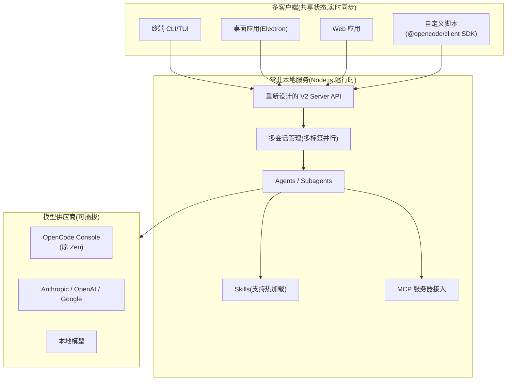
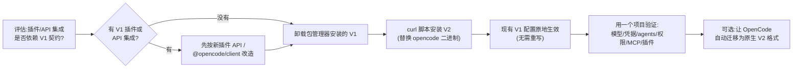

[toc]

> **本文定位：** 设计动机与日常使用（为什么升、怎么用）。完整安装矩阵、npm包管理、`upgrade`升降级、代理深排障、双线链接、`--standalone`见姊妹篇《版本发布说明@迁移和版本管理指南》。
> 姊妹篇：`./opencode@版本发布说明@迁移和版本管理指南.md`


## opencode 特点

OpenCode 是一个开源的 AI 编程智能体(AI coding agent),提供终端界面(TUI)、桌面应用和 IDE 扩展三种形态。它由 SST 团队(创始人 Dax Raad 等)打造,与 Claude Code 同类,但核心差异在于:

- **供应商无关(provider-agnostic)**:不绑定任何模型供应商——虽然官方推荐通过 OpenCode 自营网关(OpenCode Console,曾用名 Zen)提供的模型,但它可以配合 Claude、OpenAI、Google 甚至本地模型使用;团队认为随着模型演进、差距缩小和价格下降,保持供应商中立很重要。
- **TUI 优先**:团队由 neovim 用户和 terminal.shop 的作者组成,致力于把终端体验推向极限。
- **客户端/服务器架构(client/server)**:这是 v1 就有的设计底子,也是 v2 得以大幅演进的基础。

项目热度极高:官网数据显示其 GitHub star 超过 208,000,拥有 950 位贡献者、超 13,000 次提交,每月被超过 1600 万开发者使用。

---

## v2 的设计动机与理念

### "第三次迭代才做对"

Dax 表示,他职业生涯中所有东西都要经过三次迭代才能做对——OpenCode 经历了 0 和 1 两个版本,2.0 是在完全理解领域及其可能性之后进行的一次大重写;核心任务之一是重构整个 API,做出"刻意设计"的产物,而不是像以前那样自然生长出来的东西。

时间线:2.0 的 beta 于 2026 年 7 月初发布,团队计划在 beta 后约一个月推出正式版。截至 2026 年 9 月下旬,基于上游 `v2` 分支的构建中 `package.json` 已标注 **desktop 2.0.12 / cli 2.0.12**(第三方每日构建仓库披露,仅作参考)。

### 三大底层重写

OpenCode 2.0 引入了完整的 API 重新设计、运行时从 Bun 迁移到 Node,以及桌面应用从 Tauri 转向 Electron;新版本支持多标签 AI 会话并增强了性能。

**Bun → Node.js(运行时迁移)**

从 Bun 迁移到 Node.js 主要是为了解决**内存占用问题**;早期版本因服务端代码依赖 Bun 特有 API 而不得不捆绑 CLI,迁移中移除了所有这些 API,使服务端可以在 Node.js 环境中运行。这对下游意义很大:**Node 生态的兼容面远大于 Bun**,嵌入、集成、二次开发都更容易。

**Tauri → Electron(桌面端迁移)**

这是一个"反潮流"但务实的决定——Tauri 依赖各系统 WebView,行为不一致;Electron 虽然体积大,但渲染行为统一、生态成熟。

**常驻服务(runs as a service)**

v2 的第二个关键变化是**默认作为服务运行**,安装后保持活跃;当你启动 OpenCode 时会自动连接,无论使用桌面应用、Web 应用还是自定义脚本,一切都保持同步。

**技能热加载(hot reloading of Skills)**

Dax 提到 2.0 耗时较长的原因之一是重新设计以支持**热重载**——无论是让 AI 帮你创建 Skill 还是手动创建,都能立即加载而不会导致缓存失效。这在实践中意味着:**你可以边和 agent 对话边给它"装技能",无需重启会话**(v1 中修改配置/插件常需重启,还会打断上下文缓存)。

### v2 架构示意



---

## v1 与 v2 核心差异对比

| 维度               | v1(1.18.x 稳定线)         | v2(2.0)                                                | 改进意义                          |
| ------------------ | ------------------------- | ------------------------------------------------------ | --------------------------------- |
| **运行时**         | Bun                       | Node.js                                                | 解决内存问题,兼容性更好           |
| **桌面端**         | Tauri                     | Electron                                               | 跨平台渲染一致性                  |
| **进程模型**       | 按需启动                  | **默认常驻服务**                                       | 多端(桌面/Web/脚本)自动连接并同步 |
| **Server API**     | 自然生长的 API            | 修订后更符合人体工学的 API 与全新客户端集              | 面向集成者的稳定契约              |
| **会话**           | 单会话为主                | 多标签并行 AI 会话                                     | 并行任务流                        |
| **Skills**         | 修改需重载                | 热加载,不引发缓存失效                                  | 不中断工作流                      |
| **插件**           | v1 插件 API               | 全新插件 API                                           | **不兼容,需迁移**                 |
| **终端客户端配置** | 分层的 `tui.json(c)` 文件 | 单一全局 `cli.json`(自动迁移)                          | 简化配置                          |
| **配置格式**       | V1 JSON schema            | V1 格式仍受支持,原生 V2 格式为可选项、更显式更符合直觉 | 平滑过渡                          |
| **凭据存储**       | 明文 `auth.json`(用户数据目录) | 服务端 SQLite 数据库(迁移时导入一次 `auth.json`)       | 支持多账号与活动账号切换          |

### 配置字段形状差异(易踩坑,重点)

v1 和 v2 **读取相同的配置文件路径**,但少数同名字段的"形状"不同,这是混用时的主要故障点。当两个版本识别同一个键但赋予不兼容形状时会出错,重要例子包括:`mcp` 在 V1 是扁平的服务器映射,V2 则是包含 `servers` 和 `timeout` 的对象;`model` 在 V1 只接受字符串,V2 还接受显式的模型选择对象;`skills` 在 V1 是 `{ paths, urls }` 对象,V2 接受字符串数组。

| 字段     | v1 形状                                          | v2 形状                                                     | 说明                                      |
| -------- | ------------------------------------------------ | ----------------------------------------------------------- | ----------------------------------------- |
| `mcp`    | 扁平映射:键为 MCP 服务器名,值为其配置            | 对象:`servers`(服务器映射)+ `timeout`(超时)                 | MCP(Model Context Protocol)服务器接入配置 |
| `model`  | 字符串,如 `"anthropic/claude-..."`               | 字符串 **或** 模型选择对象(可显式指定 provider、模型参数等) | 默认使用的模型                            |
| `skills` | `{ paths, urls }` 对象(本地路径 + 远程 URL 分列) | 字符串数组(统一列出技能来源)                                | 技能(Skill)加载来源                       |

**缓解措施已落地**:v1.18.24 起,V1 能读取受支持的 V2 配置字段,使较新的配置文件在混合环境中继续可用。而典型的混用事故场景是:用户从一份合法的 V1 配置文件开始,运行了某个 V2 命令(如 `opencode2 mcp add`),产生了一份 V2 能接受但 V1 无法加载的混合文档——如果你团队里有人还在用 v1,**不要**急着把共享的项目配置转成纯 V2 形状。

### 凭据存储变化与 API key 过期排查(V2 实操)

V1 把密钥明文写在 `~/.local/share/opencode/auth.json`；V2 改由服务端 SQLite 数据库托管，用 `opencode debug paths db` 查路径（常见为 `~/.local/share/opencode/opencode.db`）。旧 `auth.json` 只在数据库迁移时被导入一次，之后**改它无效**，官方也明确不要直接改数据库，凭据一律通过 `/connect` 或 `opencode auth` 管理。

| 命令 | 作用 |
| --- | --- |
| `opencode auth list` | 列出集成与凭据来源（`stored` = 数据库账号，`environment` = 环境变量） |
| `opencode auth login <集成> --method key` | 新增 API key 账号（需交互终端，粘贴时隐藏输入） |
| `opencode auth export [集成]` | 导出账号（含 ID、label、`active` 标记），用于确认生效对象 |
| `opencode auth switch <集成> <label\|cred_id>` | 切换活动账号 |
| `opencode auth logout <集成> <label>` | 删除账号 |

**过期报错的定位思路**：报错原文形如

```text
AI.Error.Authentication: This API key has expired. Create a new API key in OpenCode Console
and replace it in your client or secret store. Signing in again will not renew this key.
```

正文只说了 "Console"，但一台机器上可以同时存有 OpenCode Console（集成 `opencode`）和 OpenCode Go（集成 `opencode-go`）等多套凭据，别急着替换错的那个。定位看两点：

1. 会话实际用的模型属于哪个集成：`opencode/<model>` 走 Console，`opencode-go/<model>` 走 Go；
2. 日志 `~/.local/share/opencode/log/opencode.log` 里紧邻报错的前置告警，例如 `failed to load OpenCode provider config ... 401 GET https://opencode.ai/console/api/v2/config` 指向 Console 凭据。

**替换步骤**（TUI 优先）：

1. 在 Console 新建 API key，留意有效期设置——原文已提示重新登录不会续期，必须换新 key；
2. TUI 内 `/connect` → 选对应集成 → 选 **API key** 方法 → 粘贴新 key；新账号自动成为 active，可在同一账号列表里删掉过期的那条；
3. 命令行等价写法：`opencode auth login "<集成名>" --method key`（API key 与表单类型必须交互终端，在非交互 shell 里会卡住）；
4. 验证：`opencode auth list` 状态仍为 `stored`，`opencode auth export <集成>` 的凭据 `id`/`label` 已更新；若旧 401 仍刷屏，用 `opencode service restart` 让常驻服务重新加载凭据。

> 多套凭据共存时，环境变量来源（如 `OPENROUTER_API_KEY`、`YUJIAN_API_KEY`）不会被 `auth logout` 清除，要改环境变量本身；同一集成上，数据库账号的优先级高于环境变量。

#### Zen 与 Console：同一网关的改名与密钥换代（2026-10 实测）

早先叫 **OpenCode Zen**（`opencode.ai/auth`），现在文档与服务端统一叫 **OpenCode Console**（`opencode.ai/console`）；**provider id 始终是 `opencode`，模型前缀仍是 `opencode/<model-id>`**，Go 订阅仍是独立 provider `opencode-go`。

| 现象 | 实测结果 |
| --- | --- |
| `/v2/docs/zen` | 404；V2 文档 llms.txt 全文 0 处 "zen" |
| 旧页 `opencode.ai/docs/zen` | 内容与 `/v2/docs/console/models` 几乎逐字节相同（55826 vs 55825，标题均为 Models，55 处 console、0 处 zen） |
| 旧格式 key `sk-…`（67 字符，Zen 时代） | 调 Console / Go 端点均 **401** `ServiceAPIKey.Expired / api_key_expired`，即本节的报错原文 |
| 新格式 key `oc_sk_…`（51 字符，Console 服务账号密钥） | 调 `/inference/go/...`、`/inference/anthropic/...` 均 **200** |

- 现在建 key 的位置是 Console → **Keys** → Add Service Account → Add API Key：可设 key 名称、权限（`Inference only` / `All`）与**可选有效期**；过期或被吊销立即 401。
- Console 另提供 OAuth device flow 用户令牌（带 `x-org-id`）；工作区配置 API 是 `GET https://opencode.ai/console/api/v2/config`，返回 providers / models / websearch / mcp / policies，Console 与 Go 两个 provider 都用环境变量 `OPENCODE_CONSOLE_TOKEN`，并带 header `x-opencode-org-id: wrk_…`。
- 端点归拢：Console 走 `/inference/{openai,anthropic,google}/…`，Go 走 `/inference/go/…`；旧路径 `/zen/go/v1/…` 仍返回 200（兼容别名）。
- 命名处于过渡态：官网营销页 `opencode.ai/zen` 与旧文档仍写 Zen；第三方客户端 2026-07 还在修 “OpenCode Zen Go → OpenCode Go” 的显示名。
- 官方文档没有 changelog，以上为可实测/可查阅的现状，未附精确发布时间。

#### 只用 Go 订阅时，免费模型要不要再填 Console key？

**不需要。** 一把工作区 key 同时授权 Console 与 Go 两个 provider：用 Go key 调 `GET /console/api/v2/config` 返回的是 `opencode`（本工作区 84 个模型）与 `opencode-go`（29 个模型）两套，其中 `opencode/*` 含 11 个 `*-free` 免费模型（`beam-free`、`deepseek-v4.1-flash-free`、`glm-5.3-flash-free`、`longcat-2.5-preview-free`、`mimo-v2.6-flash-free`、`nemotron-3-ultra-free` 等）。

- 所以 `/connect` 只连 **OpenCode Go** 即可，`opencode/<model>-free` 会随同一份工作区配置出现，不必再单独连 “OpenCode Console” 或另填 key。
- 免费档**按客户端身份放行，不按 key**：同一把 key 从 OpenCode 之外调用免费模型被拒（`403 FreeTierError: OpenCode's free tier can only be used from within OpenCode`），在 OpenCode 内可用；付费模型从外部调用正常（实测 `claude-opus-5-5` 走 `/inference/anthropic/v1/messages` 返回 200）。
- 若另外连过 “OpenCode Console”（按量付费 / 团队工作区），记得清理过期账号：残留的过期凭据会让服务反复拉取工作区配置失败、持续刷 401 日志，删除后即恢复。
- 无 key 时仍可查模型目录（`GET /inference/v1/models`、`/inference/go/v1/models`、models.dev），只有 `GET /console/api/v2/config` 与推理调用需要凭据；测速与命令见 `Code/ai/opencode@免费api资源利用指南.md` 的“无 key 也能查最新模型目录”一节。

---

## 安装与从 v1 迁移

> 完整安装矩阵（`opencode-ai=v1` / `@opencode/cli=v2` / beta包）、`upgrade`升降级、双线文档/脚本/brew对照，见姊妹篇 npm安装方案与双线链接总览节。本文只保留决策必需的最小结论。

### 安装方式（最小结论）

- v1：`npm i -g opencode-ai`、`curl -fsSL https://opencode.ai/install | bash`
- v2（GA后默认，2026-09-16起）：`npm i -g @opencode/cli`、`curl -fsSL https://opencode.ai/v2/install | bash`
- 两者都提供 `opencode` 命令，默认不可并存；装 v2 前先移除包管理器安装的 v1。beta期曾以 `opencode2` 并存试用，GA后已回归单一命令。

桌面应用可从 releases 页或 opencode.ai/download 直接下载。

安装脚本支持的**环境变量(占位符解释)**:安装路径按优先级依次为 `$OPENCODE_INSTALL_DIR`(自定义安装目录)、`$XDG_BIN_DIR`(符合 XDG Base Directory 规范的路径)、`$HOME/bin`(标准用户二进制目录,存在或可创建时):

| 变量                   | 含义                        | 示例                                                         |
| ---------------------- | --------------------------- | ------------------------------------------------------------ |
| `OPENCODE_INSTALL_DIR` | 强制指定安装目录,优先级最高 | `OPENCODE_INSTALL_DIR=/usr/local/bin curl -fsSL https://opencode.ai/install \| bash` |
| `XDG_BIN_DIR`          | XDG 规范下的用户 bin 目录   | `XDG_BIN_DIR=$HOME/.local/bin curl -fsSL ... \| bash`        |

### v1 → v2 迁移要点(官方口径)

> `provider→providers`、`npm→package`、`api→settings.baseURL`等键改名对照与 JSONC 示例，见姊妹篇 v1到v2迁移指南要点节。本文保留形状差异与决策流程。

这是本文最重要的实操部分,依据官方迁移文档:

1. **命令与安装冲突**:OpenCode 1 和 2 都使用 `opencode` 命令,默认不再并行安装;安装 V2 前需先移除由包管理器安装的 V1,V2 的 curl 安装器会直接替换 V1 二进制。
   > 辨析:beta 阶段曾以独立包 `@opencode-ai/cli` 发布、安装为 `opencode2` 命令,与 v1 并存试用;GA 后回归单一 `opencode` 命令。网上两种说法都对,只是对应不同阶段。
2. **配置无需重写即可试用 v2**:V2 从与 V1 相同的位置读取全局与项目配置,在内存中归一化受支持的 V1 与原生 V2 字段而不重写源文件;现有受支持的 V1 配置会继续生效,因此无需转换即可尝试或采用 V2。
3. **文件级资产大多直接可用**:现有受支持的服务端配置字段、agent 定义、command 定义、skills 以及 `.opencode/` 下的其他文件应无需改动继续工作。
4. **真正不兼容的只有三块**:插件使用新的插件 API;服务器 API 与客户端采用新契约;终端客户端配置由分层 `tui.json(c)` 移至单一全局 `cli.json`(自动迁移)。
5. **推荐的迁移姿势——让 AI 自己干**:官方推荐直接向 OpenCode 下达提示"把我的 OpenCode 配置(含文件式定义)从 V1 格式迁移到原生 V2 格式,保留其行为和所有无关设置";OpenCode 会检查完整文件、应用相关变更,并避免重写不需要改动的设置。
6. **集成方注意**:调用 V1 服务器 API 的集成必须迁移到 V2 API,使用 `@opencode/client` 包访问已发布的 V2 API,并查阅生成的 API 参考了解端点、请求类型与响应。
7. **上线前自检清单**:在把 V2 用于日常工作之前,先在一个项目中验证你的模型、供应商凭据、agents、权限、MCP 服务器和插件。若本指南描述的受支持行为在 V2 中失效,应视为兼容性 bug 而非预期的迁移要求——遇到这种情况直接提 issue。



---

## 日常使用速览(对初学者友好的主线)

上手流程(v1/v2 通用的主干体验):

- **配置模型供应商**:在 TUI 中运行 `/connect` 命令,选择 opencode 并前往 opencode.ai/auth 登录、添加账单信息并复制 API key 粘贴;也可以选择其他供应商。国内用户更常见的做法是直接配置 Anthropic/OpenAI 兼容端点或国产模型的 OpenAI 兼容 API。
- **项目初始化**:在项目中运行初始化命令,OpenCode 会分析项目并在根目录创建 `AGENTS.md` 文件;应将其提交到 Git,以帮助 OpenCode 理解项目结构与编码模式(即 TUI 内的 `/init`)。
- **内置 agent 与切换**:OpenCode 内置两个可切换的 agent,使用 Tab 键切换。具体分工:`build` 是拥有完整工具访问权限的默认主 agent;`plan` 是限制为分析与规划、拒绝大多数编辑操作的主 agent;`general` 是用于研究复杂问题和多步任务的子 agent(subagent)。
- **自定义 agent**:Agents 是可针对特定任务和工作流配置的专用 AI 助手,支持自定义提示词、模型和工具访问权限;可通过命令创建新 agent,并选择保存为全局或项目级。子 agent 主要通过 `@` 提及或由主 agent 委派调用。
- **v2 特有体验**:多标签并行会话(桌面/Web 端同时跑多个任务)、常驻服务带来的**跨端会话续接**(终端里开的会话,桌面端接着看)、Skill 即建即用。

---

## 国内网络环境注意事项

> 深排障（根因分析、Issue编号、TUN/环境变量/baseURL/系统变量/本地代理五方案）见姊妹篇代理配置节。本文只留最小可用结论。

- **一键安装脚本**：GitHub Releases直连慢时，优先 `npm i -g @opencode/cli --registry=https://registry.npmmirror.com`（v2）或临时 `https_proxy` 后再 curl。
- **模型访问**：优先用国产模型OpenAI兼容API或 `settings.baseURL` 指中转站，避开海外API网络与支付门槛。
- **中文显示**：Windows用 Windows Terminal + 等宽CJK字体（如 Sarasa Mono SC / Maple Mono NF CN），`chcp 65001`。

---

## 已知问题与社区反馈(反向验证)

负责任地讲,v2 目前并非零瑕疵:

- **文档质量落差**:有用户提出 官网主页的 Docs 入口现已指向 v2 文档,但 v2 文档远落后于 v1 文档——信息缺失、内容过时、导航也更难找;v1 文档仍在维护,但需要手动输入其 URL 才能访问(`opencode.ai/docs/` 为 v1,`opencode.ai/v2/docs/` 为 v2)。**实操建议:迁移期两套文档对照着看。**
- **beta 期稳定性**:第三方集成维护者记录过 beta 构建存在 工具输出缺失以及重启相关的 `ChildProcess.spawn` 失败等未解决问题(该记录针对特定 beta 版本,GA 版是否残留需自行验证)。
- **token 消耗上升**:Dax 提到团队 token 用量增长了五倍,归因于"过度设计"策略和 orchestrator(编排器)模型——如果你按 token 计费使用 API,升级后要留意账单曲线。
- **v1 仍是稳妥选择**:v1.18.x 直到 2026 年 9 月仍在持续发版修复(如 v1.18.31、v1.18.32),保守的生产用户可以继续留在 v1 观望一两个版本周期。

### 重要辨析:"Desktop v2 布局" ≠ "OpenCode 2.0"

社区里这两个词经常被混为一谈。"Desktop v2"是一次桌面端布局重设计,其迁移已在 2026 年 7 月 14 日的稳定版 v1.18.0 中完成;浏览器式标签页、按窗口恢复、重建的 review 面板、集成终端改进、按提示词选择模型、服务器感知的会话路由等均在 v1.17.x 落地,v1.18 收尾。两者都真实存在,但不是同一个发布,也不在同一条轨道上。也就是说:**你在 v1.18 桌面端看到的多标签新界面,不代表你已经在用 OpenCode 2.0**。

---

## 总结与建议

- **v2 的本质**:不是功能堆叠,而是一次"补设计债"的重写——**刻意设计的 API、Node 运行时、常驻服务、Electron 桌面、多标签并行、Skill 热加载**六件套,把 opencode 从"一个 CLI 工具"升级为"一套本地 agent 服务 + 多客户端"的平台形态。
- **该不该升**:
  - 个人开发者/尝鲜者:**直接上 v2**,V1 配置原地兼容,试错成本低;
  - 有 v1 插件或调用 v1 Server API 的团队:**先改造插件与集成再切**,这是仅有的硬性断裂面;
  - 保守生产用户:v1.18.x 仍在维护,可再观望,同时避免在共享配置中引入纯 V2 字段形状。

