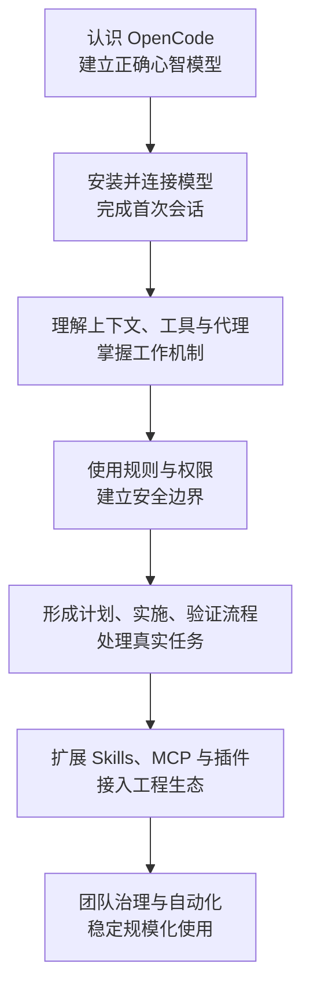
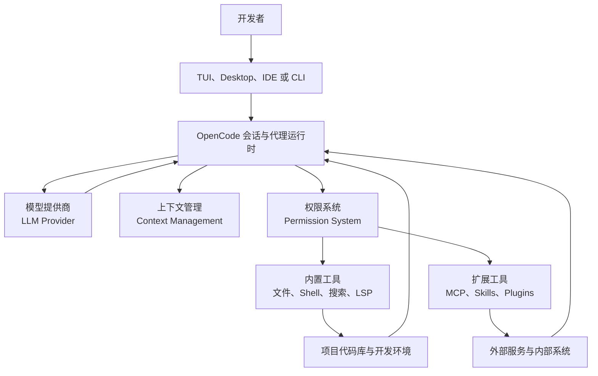
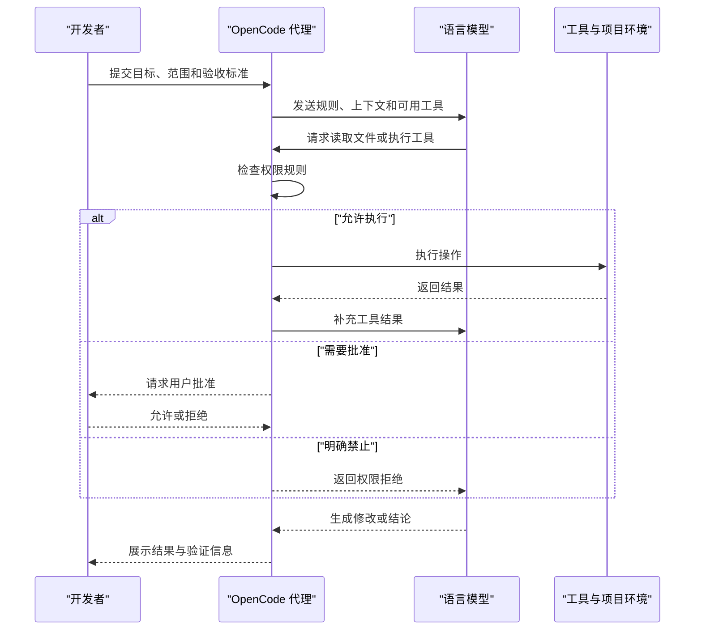
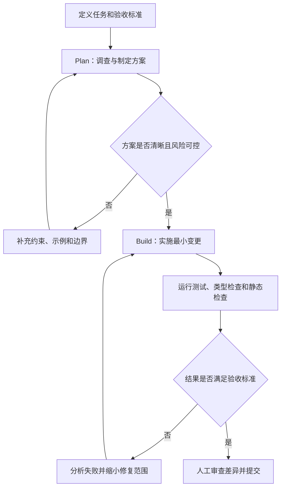
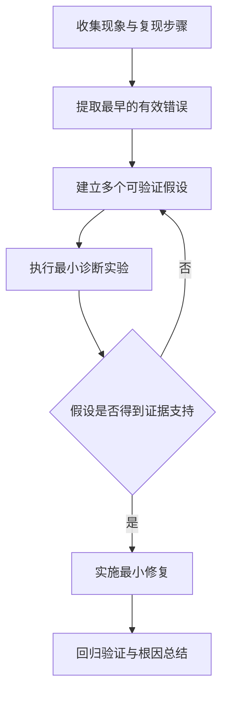
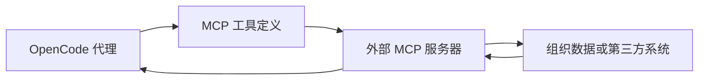

[toc]

## 主题界定

本文中的 **OpenCode** 指由 Anomaly 团队维护的开源 AI 编程代理（AI Coding Agent），官方站点为 [opencode.ai](https://opencode.ai/)，主要仓库为 [anomalyco/opencode](https://github.com/anomalyco/opencode)。

它不仅是“终端里的聊天机器人”，而是能够：

- 理解和检索代码库
- 调用大语言模型（Large Language Model，LLM）
- 读取、修改和创建文件
- 执行 Shell 命令
- 调用语言服务器协议（Language Server Protocol，LSP）
- 使用模型上下文协议（Model Context Protocol，MCP）接入外部工具
- 通过主代理和子代理协同完成复杂任务
- 运行于终端界面、桌面应用、IDE 扩展、脚本及 GitHub 工作流

以下内容依据 OpenCode 官方文档及官方仓库整理，核验日期为 **2026 年 8 月 16 日**。OpenCode 仍在快速迭代，具体配置字段应以对应版本的官方文档和配置 Schema 为准。

## 内容编排思路

这份教程建议采用“概念理解、最小实践、工程控制、扩展集成、团队落地”的递进结构：



编排时重点避免两个常见问题：

- 只介绍命令，不解释代理为什么会成功或失败。
- 只展示“生成代码”，不讲权限、验证、成本、隐私和版本控制。

------

## 教程的目标读者与学习目标

### 目标读者

- 第一次接触 AI 编程代理的开发者
- 使用过聊天式 AI，但不熟悉代理工具调用的人
- 希望从其他编码代理迁移到 OpenCode 的用户
- 需要为团队制定 OpenCode 规则和权限策略的技术负责人
- 希望把 OpenCode 接入 CI、GitHub 或内部系统的工程师

### 建议前置知识

| 能力     | 要求                                   |
| -------- | -------------------------------------- |
| 终端操作 | 能执行 `cd`、安装命令和项目脚本        |
| Git      | 理解工作区、提交、分支和差异           |
| 软件项目 | 能辨认源码、配置、测试和依赖文件       |
| LLM      | 无需深入了解，但应知道模型可能产生错误 |
| JSON     | 能阅读简单的 JSON 或 JSONC 配置        |

### 完成教程后的能力

读者应当能够：

- 正确安装和启动 OpenCode
- 区分 TUI、CLI、桌面端、IDE 和服务端模式
- 选择并配置模型提供商（Model Provider）
- 使用 Plan 与 Build 代理完成真实开发任务
- 编写高质量 `AGENTS.md`
- 设计最小权限策略
- 管理上下文、令牌、模型成本和会话
- 创建自定义命令、代理和技能
- 谨慎接入 MCP 服务器及插件
- 将代理输出纳入 Git、测试和代码审查流程
- 诊断常见的模型、配置、权限和工具问题

------

## OpenCode 是什么

### 建议讲解内容

- OpenCode 的产品定位
- AI 编程助手与 AI 编程代理的区别
- OpenCode 的开放性体现在哪里
- OpenCode 与模型提供商之间的关系
- OpenCode 不等于某一个具体模型
- OpenCode 可以运行在哪些界面
- 哪些任务适合交给 OpenCode
- 哪些任务必须由人类负责

### 核心定义

OpenCode 可以理解为一套面向软件工程的 **代理运行环境（Agent Runtime）**：

1. 接收开发者的目标和上下文。
2. 将任务发送给选定的语言模型。
3. 向模型暴露经过权限控制的工具。
4. 执行模型选择的工具调用。
5. 将执行结果返回模型。
6. 重复这一循环，直到产生结果、遇到限制或等待用户批准。

### 与普通聊天机器人的区别

| 维度       | 普通聊天式 AI      | OpenCode 编程代理               |
| ---------- | ------------------ | ------------------------------- |
| 项目上下文 | 主要依赖手动粘贴   | 可检索并读取代码库              |
| 文件操作   | 通常只输出代码文本 | 可直接读取、修改和创建文件      |
| 命令执行   | 通常不能执行       | 可调用 Shell 工具               |
| 诊断能力   | 根据描述推测       | 可运行测试、类型检查和 LSP 查询 |
| 工作状态   | 以单轮问答为主     | 维护包含工具结果的会话          |
| 外部扩展   | 由产品预设         | 可通过 MCP、Skills、插件扩展    |
| 风险       | 主要是回答错误     | 还可能修改文件或执行危险命令    |
| 验证责任   | 用户检查回答       | 用户仍须审查差异和测试结果      |

### 能力边界

OpenCode 可以提高工程效率，但不应被表述为：

- 能保证生成正确代码
- 能自动理解所有业务背景
- 能代替测试、代码审查或安全审计
- 能在没有权限的情况下安全访问任何系统
- 能因为使用了更大的模型就消除幻觉（Hallucination）
- 能自动判断不可逆操作是否符合业务意图

------

## 核心工作机制

### 总体架构



### 代理循环

建议把一次任务拆解为以下循环：



### 应重点解释的原理

- 模型不直接操作操作系统，通常通过 OpenCode 暴露的工具执行动作。
- 权限系统控制的是“工具能不能执行”，不能保证模型的判断一定正确。
- 模型可见的内容受到上下文窗口（Context Window）限制。
- 会话越长，不一定越准确；旧工具输出可能占据大量上下文。
- 代理看到测试通过，不代表没有业务逻辑或安全问题。
- 人类应负责目标、边界、验收标准和不可逆决策。

------

## 产品形态与使用入口

| 入口                                      | 适用场景                 | 特点                                |
| ----------------------------------------- | ------------------------ | ----------------------------------- |
| 终端界面（Terminal User Interface，TUI）  | 日常交互式开发           | 最典型的 OpenCode 使用方式          |
| 命令行接口（Command-Line Interface，CLI） | 单次任务、脚本和自动化   | 可使用 `opencode run` 非交互执行    |
| 桌面应用（Desktop App）                   | 偏好图形界面的用户       | 管理项目和多个会话更直观            |
| IDE 扩展                                  | 编辑器内协作             | 减少终端和编辑器之间切换            |
| Server                                    | 长驻服务和客户端集成     | 可避免重复启动部分依赖              |
| SDK                                       | 二次开发                 | 用程序调用 OpenCode 能力            |
| GitHub 集成                               | Issue、PR 与自动化工作流 | 任务在 GitHub Actions Runner 内执行 |

建议先以 TUI 作为主线，再将 CLI 和集成能力放到进阶部分。这样新手不会一开始就被部署形态分散注意力。

------

## 安装与环境准备

### 安装方式大纲

介绍以下渠道，但选择一种作为主路径：

| 平台或工具   | 方式                                             | 教学建议                        |
| ------------ | ------------------------------------------------ | ------------------------------- |
| 官方安装脚本 | `curl -fsSL https://opencode.ai/install | bash`  | Linux 和 macOS 的快速路径       |
| npm          | `npm install -g opencode-ai`                     | 已安装 Node.js 的用户           |
| Bun          | `bun install -g opencode-ai`                     | Bun 用户                        |
| Homebrew     | `brew install anomalyco/tap/opencode`            | macOS 常见选择                  |
| Chocolatey   | `choco install opencode`                         | Windows 可选                    |
| Scoop        | `scoop install opencode`                         | Windows 可选                    |
| Docker       | `docker run -it --rm ghcr.io/anomalyco/opencode` | 隔离体验或临时使用              |
| 二进制文件   | GitHub Releases                                  | 需要固定版本或手动部署          |
| Windows WSL  | 在 WSL 中安装                                    | 官方推荐的 Windows 终端体验路径 |

Markdown 表格中出现的管道符已使用转义，实际执行时应为：

```bash
curl -fsSL https://opencode.ai/install | bash
```

### 安装章节应覆盖的检查项

- CPU 与操作系统架构
- Shell 环境和 `PATH`
- Git 是否可用
- 项目运行时是否齐全
- 代理需要执行的测试命令能否由用户本人正常执行
- 企业网络中的代理服务器、证书与防火墙限制
- API 密钥应放在哪里
- 如何升级以及如何固定版本
- 如何检查安装结果
- 如何诊断“命令不存在”

### Windows 特别说明

应解释：

- 原生 Windows 可以使用 npm、Chocolatey、Scoop 等方式。
- 官方入门文档推荐 Windows 用户使用 WSL，以获得更完整的终端兼容性。
- WSL 中的项目路径、权限、换行符和 Git 配置可能影响体验。
- 不要混用 Windows 与 WSL 中的运行时、依赖目录和项目路径，除非明确理解二者边界。

------

## 模型、提供商与认证

### 三层概念

| 层次     | 英文          | 含义                             |
| -------- | ------------- | -------------------------------- |
| OpenCode | Agent Runtime | 负责编排会话、上下文、工具和权限 |
| 提供商   | Provider      | 提供认证、API 和模型访问能力     |
| 模型     | Model         | 实际负责推理和生成内容的语言模型 |

必须强调：**安装 OpenCode 不等于已经获得所有模型的使用额度。**

OpenCode 使用 AI SDK 和 Models.dev 适配大量模型提供商，也支持连接本地模型或兼容 OpenAI API 格式的端点。[官方模型文档](https://opencode.ai/docs/models/)

### 认证方式

建议介绍：

- 在 TUI 中使用 `/connect`
- 手动输入提供商 API Key
- 使用 OpenCode Zen
- 使用官方明确支持的订阅登录方式
- 使用环境变量
- 使用兼容端点连接本地或私有模型

### 模型选择维度

| 维度       | 关注问题                       |
| ---------- | ------------------------------ |
| 推理质量   | 是否能理解跨文件逻辑和复杂约束 |
| 工具调用   | 是否稳定地产生正确工具参数     |
| 上下文容量 | 能否容纳大型任务所需信息       |
| 延迟       | 交互和工具循环是否足够快       |
| 成本       | 输入、输出和缓存令牌如何收费   |
| 多模态     | 是否需要读取截图或设计稿       |
| 数据策略   | 请求是否会被存储或用于训练     |
| 地域与合规 | 数据处理位置是否满足要求       |
| 可用性     | 限流、并发和服务稳定性如何     |
| 本地运行   | 硬件是否能提供足够速度和质量   |

### 模型选择命令

可以纳入以下实践：

```bash
opencode models
opencode models anthropic
opencode models --refresh
opencode models --verbose
```

模型标识通常采用：

```text
provider/model
```

### 推荐教学原则

不要把教程写成一份很快过时的“最佳模型排行榜”。更稳妥的方式是：

- 解释如何查看当前可用模型。
- 给出任务类别与能力需求的映射。
- 教会读者用小型真实任务进行评估。
- 区分“高质量规划模型”和“低成本执行模型”。
- 要求在团队中记录模型、版本、任务和失败样本。
- 不要把模型名称硬编码进所有共享配置，除非团队确实需要统一。

------

## 第一次启动与项目初始化

### 最小流程

```bash
cd /path/to/project
opencode
```

在 TUI 中完成提供商连接后执行：

```text
/init
```

`/init` 会分析项目并创建或改进项目根目录中的 `AGENTS.md`。官方建议将项目级 `AGENTS.md` 提交到 Git。[官方入门文档](https://opencode.ai/docs/)

### 第一次练习应选择低风险任务

推荐顺序：

- 总结项目目录结构
- 定位应用入口
- 解释某个文件
- 查找某个接口的调用链
- 运行已有测试
- 规划一个小修改
- 修改一个低风险文件
- 检查差异并撤销
- 再执行一次带验收标准的修改

### 不建议第一次就做的任务

- 全项目架构重构
- 批量迁移数据库
- 修改身份认证和授权
- 升级所有依赖
- 自动修复全部静态检查问题
- 执行生产部署
- 操作真实客户数据
- 修改密钥、支付或基础设施配置

------

## TUI 核心操作

### 建议覆盖的功能

- 启动当前目录或指定目录
- 输入自然语言任务
- 使用 `@` 引用文件
- 使用命令面板
- 使用 `/models` 选择模型
- 在主代理之间切换
- 查看工具调用和权限请求
- 新建与恢复会话
- 撤销和重做
- 压缩上下文
- 分享和取消分享
- 自定义快捷键和主题

### 文件引用

```text
请解释 @packages/functions/src/api/index.ts 中认证失败的处理流程。
```

应解释：

- `@` 会执行模糊文件搜索。
- 显式引用能减少模型搜索成本。
- 引用文件不等于授权模型修改该文件。
- 一次附加过多文件会消耗上下文。
- 应优先引用入口、接口定义、测试和相似实现。

### 撤销机制

```text
/undo
```

教程中必须区分：

- OpenCode 会话内撤销
- Git 工作区恢复
- 数据库或外部服务操作的回滚

不能让读者误以为 `/undo` 可以逆转所有外部副作用。对发布、远程 API、数据库写入、Git 推送等操作，应依赖其自身的事务、备份或回滚机制。

------

## Plan、Build 与子代理

### 内置代理分类

根据当前官方文档，OpenCode 区分 **主代理（Primary Agent）** 和 **子代理（Subagent）**。

| 代理    | 类型   | 主要用途                 | 默认安全特征                 |
| ------- | ------ | ------------------------ | ---------------------------- |
| Build   | 主代理 | 实现、修改和执行开发任务 | 默认具有完整工具能力         |
| Plan    | 主代理 | 分析代码和制定方案       | 文件修改与 Bash 默认要求批准 |
| General | 子代理 | 复杂研究和多步骤任务     | 能执行较广泛的操作           |
| Explore | 子代理 | 快速搜索和理解代码库     | 只读                         |
| Scout   | 子代理 | 轻量探索或信息搜集       | 应以当前版本配置为准         |

内置代理可能随版本演进，教程应引导读者执行版本内的代理列表或查看官方文档，而不是只记忆名称。

### Plan 与 Build 的合理工作流



### 子代理适用场景

- 在不同目录中并行查找相关实现
- 分离代码探索与方案设计
- 独立进行代码审查
- 调查测试失败原因
- 对安全、性能或文档进行专项检查
- 为主代理提供摘要，减少主会话搜索负担

### 子代理风险

- 并行并不自动意味着更快。
- 多个代理可能产生重复读取和额外令牌成本。
- 具有写权限的子代理可能产生冲突。
- 深层代理嵌套会降低可观察性。
- 主代理可能把子代理结论当成事实而未重新验证。

OpenCode 提供 `subagent_depth` 控制子代理嵌套深度。默认值及具体行为应以当前配置文档为准；官方当前说明默认值为 `1`。

------

## 工具系统

### 内置工具分类

| 类别       | 典型工具                       | 作用                       |
| ---------- | ------------------------------ | -------------------------- |
| 文件读取   | `read`                         | 读取文件内容               |
| 文件修改   | `edit`、`write`、`apply_patch` | 创建或修改文件             |
| 项目搜索   | `glob`、`grep`                 | 按路径或内容查找           |
| 命令执行   | `bash`                         | 运行构建、测试、Git 等命令 |
| 语义分析   | `lsp`                          | 查询符号、诊断和引用       |
| 工作规划   | `todowrite`                    | 维护任务步骤               |
| 网络访问   | `webfetch`、`websearch`        | 获取外部资料               |
| 子代理调用 | `task`                         | 调用专门代理               |
| 技能加载   | `skill`                        | 加载按需工作说明           |
| 用户交互   | `question`                     | 请求必要的选择或输入       |

### 工具调用应讲清的原则

- 模型决定“想调用什么”，OpenCode 决定“是否允许调用”。
- 工具返回结果会继续进入模型上下文。
- 工具执行成功不代表任务目标已经完成。
- Shell 返回码为零也不能证明业务逻辑正确。
- 文件修改需要通过差异、测试和验收标准验证。
- 外部工具可能带来网络、凭据和数据泄露风险。

------

## 权限系统

### 三种结果

| 权限值  | 英文  | 行为               |
| ------- | ----- | ------------------ |
| `allow` | Allow | 自动允许执行       |
| `ask`   | Ask   | 执行前请求用户批准 |
| `deny`  | Deny  | 拒绝执行           |

官方当前说明：工具默认启用且通常不需要逐次批准。因此，生产项目和敏感代码库应主动配置权限，而不是依赖默认值。[权限文档](https://opencode.ai/docs/permissions/)

### 最小安全配置示例

```json
{
  "$schema": "https://opencode.ai/config.json",
  "permission": {
    "edit": "ask",
    "bash": "ask",
    "webfetch": "ask"
  },
  "share": "disabled"
}
```

### 细粒度 Shell 权限示例

```json
{
  "$schema": "https://opencode.ai/config.json",
  "permission": {
    "bash": {
      "*": "ask",
      "git status*": "allow",
      "git diff*": "allow",
      "git log*": "allow",
      "git commit*": "deny",
      "git push*": "deny"
    }
  }
}
```

### 规则匹配原理

需要专门说明：

- 权限可按工具或模式细分。
- 通配符规则可以覆盖一组命令或工具。
- 官方当前规则采用顺序匹配，**最后一个匹配项生效**。
- 代理级权限会与全局配置合并，并可覆盖全局规则。
- `deny` 是明确的安全边界，`ask` 只是把决策延后给用户。
- 批准权限请求前，应检查具体命令、路径、工作目录和副作用。

### 权限设计基线

| 操作       | 本地个人项目   | 团队项目         | 生产或敏感环境 |
| ---------- | -------------- | ---------------- | -------------- |
| 读取源码   | 通常允许       | 通常允许         | 按目录限制     |
| 修改源码   | 可允许或询问   | 建议询问         | 默认拒绝       |
| 运行测试   | 通常允许       | 可按命令允许     | 在隔离环境执行 |
| 安装依赖   | 建议询问       | 建议询问         | 默认拒绝       |
| Git commit | 建议询问       | 建议询问         | 默认拒绝       |
| Git push   | 默认拒绝       | 默认拒绝         | 拒绝           |
| 网络访问   | 按需询问       | 域名或工具白名单 | 默认拒绝       |
| 数据库写入 | 拒绝           | 隔离测试库中询问 | 拒绝           |
| 部署       | 询问并人工确认 | 由 CI/CD 控制    | 不交给通用代理 |

------

## 配置系统

### 配置格式

OpenCode 支持 JSON 和带注释的 JSONC。

```jsonc
{
  "$schema": "https://opencode.ai/config.json",
  "default_agent": "plan",
  "share": "disabled",
  "autoupdate": true,
  "lsp": true,
  "permission": {
    "edit": "ask",
    "bash": "ask"
  }
}
```

### 配置章节应覆盖的字段

| 配置领域   | 典型字段                                  | 作用                 |
| ---------- | ----------------------------------------- | -------------------- |
| 默认模型   | `model`                                   | 设置默认模型         |
| 默认代理   | `default_agent`                           | 设置默认主代理       |
| 提供商     | `provider`                                | 配置模型提供商       |
| 提供商限制 | `enabled_providers`、`disabled_providers` | 控制可加载的提供商   |
| 权限       | `permission`                              | 控制工具行为         |
| 代理       | `agent`                                   | 创建或覆盖代理       |
| 子代理深度 | `subagent_depth`                          | 控制代理嵌套         |
| 规则文件   | `instructions`                            | 加载额外说明         |
| 自定义命令 | `command`                                 | 封装重复工作流       |
| LSP        | `lsp`                                     | 启用或定制语言服务器 |
| MCP        | `mcp`                                     | 接入外部工具         |
| 插件       | `plugin`                                  | 加载插件             |
| 上下文压缩 | `compaction`                              | 控制会话压缩与裁剪   |
| 文件监听   | `watcher`                                 | 忽略噪声目录         |
| 分享       | `share`                                   | 控制会话分享         |
| 自动更新   | `autoupdate`                              | 控制升级行为         |
| 实验功能   | `experimental`                            | 使用未稳定的选项     |

### 配置优先级

建议独立设置一节，讲解：

- 组织远程配置
- 全局用户配置
- 项目配置
- 环境变量
- 命令行参数
- 代理级覆盖
- 同一规则中多个通配符的顺序

不要仅给出最终合并结果，应让读者学会定位“配置为何没有生效”。

### 推荐配置策略

- 个人偏好放全局配置。
- 项目约束放项目配置并提交 Git。
- 凭据不写进仓库。
- 生产限制由组织策略或执行环境保障。
- 配置中添加 `$schema` 以获得校验和编辑器提示。
- 避免无理由启用实验字段。
- 团队升级 OpenCode 时同步验证配置 Schema。

------

## AGENTS.md 与项目规则

### `AGENTS.md` 的作用

`AGENTS.md` 是传递给代理的项目级说明，用于记录无法仅通过源码稳定推断出的工程知识，例如：

- 构建、测试和检查命令
- 项目结构
- 重要架构边界
- 代码约定
- 生成文件规则
- 数据库迁移要求
- 安全限制
- 验证顺序
- 常见陷阱
- 相关规范文件的位置

### 规则来源

| 类型                 | 位置                           | 用途               |
| -------------------- | ------------------------------ | ------------------ |
| 项目规则             | 项目根目录 `AGENTS.md`         | 团队共享的项目知识 |
| 全局规则             | `~/.config/opencode/AGENTS.md` | 个人偏好           |
| 自定义说明           | `instructions` 配置            | 复用现有文档       |
| Claude Code 兼容规则 | `CLAUDE.md` 等                 | 迁移和兼容用途     |

OpenCode 支持部分 Claude Code 文件约定作为回退，但应以 OpenCode 当前规则优先级说明为准。[规则文档](https://opencode.ai/docs/rules/)

### 高质量 `AGENTS.md` 结构

```markdown
## Project overview

项目的职责、主要技术栈和部署边界。

## Repository structure

列出无法从目录名称直接判断的重要模块职责。

## Development commands

- 安装依赖：
- 启动开发环境：
- 运行全部测试：
- 运行单个测试：
- 类型检查：
- 静态检查：
- 格式化：

## Architecture constraints

记录依赖方向、模块边界和禁止的跨层调用。

## Coding conventions

记录项目特有约定，不重复语言社区常识。

## Verification

说明不同类型改动所需的最小验证集合。

## Safety

明确禁止访问、修改或提交的文件和操作。

## Generated files

说明哪些文件由工具生成，禁止手工编辑。

## Known pitfalls

记录容易误判的脚本、环境和历史兼容问题。
```

### 好规则与坏规则

| 较差写法           | 更好的写法                                                   |
| ------------------ | ------------------------------------------------------------ |
| “编写高质量代码。” | “新服务必须返回项目统一的 `Result` 类型，并补充失败路径测试。” |
| “运行测试。”       | “修改 API 后先运行目标包测试，再运行根目录类型检查。”        |
| “不要破坏功能。”   | “不得修改公开响应字段；如确需变更，先更新 OpenAPI 规范并标注兼容影响。” |
| “遵守项目规范。”   | “数据库访问只能出现在 repository 层，route 不得直接调用 ORM。” |
| “注意安全。”       | “不得读取 `.env.production`，不得向远程端点发送客户数据。”   |

### 最佳实践

- 只记录项目特有且稳定的信息。
- 使用可执行的命令，不写含糊描述。
- 说明修改后的验证方式。
- 说明禁止事项及原因。
- 随架构和脚本变化同步更新。
- 让新成员和代码审查者共同维护。
- 控制长度，避免把整本开发手册注入每次会话。
- 对长文档使用 `instructions` 或按需 Skill，而不是全部复制进 `AGENTS.md`。

------

## 上下文工程

### 什么是上下文

上下文（Context）通常包括：

- 系统提示
- 代理说明
- 项目规则
- 用户消息
- 显式引用的文件
- 搜索和文件读取结果
- Shell 输出
- MCP 工具定义与结果
- 历史对话
- 压缩后的会话摘要

### 为什么上下文决定质量

模型并不是“理解了整个仓库”，而是基于当前上下文进行推理。失败常见原因包括：

- 入口文件没有被读取
- 引用了过多无关文件
- 旧的错误结论仍在会话中
- 工具输出过长
- 规则互相冲突
- 测试失败输出被截断
- 关键业务约束从未告诉模型
- 会话压缩丢失了细节

### 上下文管理最佳实践

- 每次任务先定义范围。
- 优先让代理搜索，再读取少量关键文件。
- 引用接口、测试和相似实现，而不是整个目录。
- 大任务拆成多个可验收阶段。
- 任务方向发生重大变化时开启新会话。
- 长日志先筛选关键错误。
- MCP 工具按需启用。
- 使用 `AGENTS.md` 保存稳定知识，不依赖旧会话记忆。
- 压缩后重新确认目标、约束和未完成事项。

### 上下文压缩

配置示意：

```json
{
  "$schema": "https://opencode.ai/config.json",
  "compaction": {
    "auto": true,
    "prune": true,
    "reserved": 10000
  }
}
```

应解释：

- `auto` 控制接近上下文限制时是否自动压缩。
- `prune` 可移除旧工具输出以节省令牌。
- `reserved` 为压缩操作保留令牌空间。
- 压缩是信息摘要，不是无损存储。
- 精确要求仍应保存在规则、任务描述或项目文档中。

------

## 高质量任务描述

### 推荐提示结构

```text
目标：
为用户设置接口增加幂等更新能力。

背景：
现有实现位于 @src/routes/settings.ts。
相似模式位于 @src/routes/profile.ts。

范围：
只修改路由、服务和对应测试。
不要修改数据库结构。

约束：
保持现有公开响应格式。
沿用项目中的错误处理类型。

验收标准：
重复提交相同请求不会创建额外记录。
新增成功、重复请求和权限失败测试。
运行目标测试与类型检查。

工作方式：
先调查并给出计划，等待确认后再修改。
```

### 任务描述要素

| 要素     | 回答的问题                   |
| -------- | ---------------------------- |
| 目标     | 最终要实现什么               |
| 背景     | 为什么做、当前情况是什么     |
| 范围     | 可以修改哪些部分             |
| 非目标   | 明确不做什么                 |
| 约束     | 必须遵循哪些技术或业务条件   |
| 参考     | 哪些文件或实现可作为依据     |
| 验收标准 | 如何判断完成                 |
| 验证命令 | 应执行哪些检查               |
| 风险     | 哪些操作需要人工确认         |
| 交付形式 | 需要代码、方案、报告还是补丁 |

### 不良提示模式

- “把项目优化一下。”
- “修复所有问题。”
- “使用最佳实践重构。”
- “让测试通过。”
- “把它变得更安全。”
- “照着这个做”，但没有提供引用或验收条件。

问题不在于提示不够长，而在于目标、范围和判定标准不可验证。

------

## 标准开发工作流

### 调查阶段

要求代理：

- 阅读 `AGENTS.md`
- 检查 Git 状态
- 定位相关模块
- 搜索调用方和测试
- 说明当前实现
- 列出不确定项
- 不修改文件

### 规划阶段

计划至少包含：

- 根因或需求解释
- 预期修改文件
- 数据流和接口影响
- 兼容性影响
- 测试计划
- 回滚方式
- 尚需用户决定的问题

### 实施阶段

- 只做最小必要修改
- 复用现有抽象
- 避免顺手重构
- 保留用户已有未提交修改
- 不静默更改公共接口
- 不随意升级依赖
- 每个阶段后检查差异

### 验证阶段

建议按从快到慢执行：

- 格式检查
- 静态检查
- 类型检查
- 目标单元测试
- 相关集成测试
- 全量测试
- 构建
- 必要的手工验收
- 安全和性能检查

### 交付阶段

代理应总结：

- 修改了什么
- 为什么这样修改
- 哪些文件受影响
- 执行了哪些验证
- 哪些验证没有执行
- 是否存在已知风险
- 是否需要迁移、配置或后续操作

------

## 典型用例设计

### 理解陌生代码库

学习目标：

- 使用只读代理
- 利用搜索构建代码地图
- 区分事实和推断

经典任务：

```text
只进行只读分析。请说明一次登录请求从路由进入到生成会话的完整调用链，
列出关键文件、数据结构、失败路径和对应测试。对无法由代码确认的部分明确标为推断。
```

### 修复小型缺陷

学习目标：

- 从复现条件出发
- 先写或定位失败测试
- 最小化改动

经典任务：

```text
当用户名包含尾随空格时，注册成功但后续登录失败。
先定位注册和登录使用的规范化逻辑，给出根因与最小修复计划。
确认后补充回归测试并实施，不修改公开 API。
```

### 添加小功能

学习目标：

- 使用 Plan 到 Build 的完整流程
- 编写验收标准
- 控制范围

经典任务：

```text
为任务列表增加按状态筛选功能。
沿用现有查询参数解析方式，不增加依赖，不改变无参数请求的行为。
补充有效状态、非法状态和默认行为测试。
```

### 重构

学习目标：

- 区分行为保持与行为变更
- 使用测试保护重构

经典任务：

```text
将订单价格计算从控制器提取到领域服务。
这是行为保持型重构，不更改输入、输出和舍入规则。
先说明现有行为并确认测试覆盖缺口，再实施。
```

### 生成测试

学习目标：

- 防止“只为覆盖率而测试”
- 优先覆盖行为和边界

要求代理列出：

- 正常路径
- 边界值
- 错误路径
- 权限路径
- 并发或幂等性
- 回归场景
- 不适合通过单元测试验证的内容

### 代码审查

创建只读审查代理，输出按严重程度分类的问题：

| 等级       | 含义                             |
| ---------- | -------------------------------- |
| Blocker    | 可能造成严重安全、数据或发布事故 |
| High       | 明确的功能错误或重大回归         |
| Medium     | 在特定条件下出现的问题           |
| Low        | 可维护性或小范围风险             |
| Suggestion | 非阻塞改进建议                   |

每个问题要求包含：

- 位置
- 触发条件
- 实际影响
- 判断依据
- 最小修复建议
- 是否需要新增测试

### 故障排查

使用结构化流程：



------

## 自定义命令

### 适用场景

将团队中高频、稳定、可参数化的提示封装为命令，例如：

- `/test`
- `/review`
- `/explain`
- `/component`
- `/migration-check`
- `/release-notes`

### 配置示例

```jsonc
{
  "$schema": "https://opencode.ai/config.json",
  "command": {
    "verify": {
      "template": "Review the current changes, run the focused tests and type checking, then summarize failures without hiding unverified steps.",
      "description": "Verify current changes",
      "agent": "build"
    },
    "explain": {
      "template": "Explain $ARGUMENTS using concrete file references. Separate confirmed facts from inference.",
      "description": "Explain a project component",
      "agent": "plan"
    }
  }
}
```

### 最佳实践

- 一个命令只解决一种稳定任务。
- 在描述中说明何时使用。
- 把参数写进任务上下文。
- 指定适合的代理。
- 对写操作配置权限。
- 不要将密钥写进模板。
- 不要用命令掩盖破坏性 Shell 操作。
- 模板更新应接受代码审查。

------

## 自定义代理

### 代理应包含的元素

- 名称
- 描述
- 模式：`primary`、`subagent` 或适用范围
- 系统说明
- 模型
- 温度或其他模型选项
- 工具权限
- 可调用子代理范围
- 输出规范

### 适合创建的代理

| 代理         | 权限建议                     | 职责                     |
| ------------ | ---------------------------- | ------------------------ |
| 架构分析代理 | 只读                         | 分析模块边界和依赖       |
| 代码审查代理 | 只读                         | 检查差异和回归风险       |
| 测试代理     | 允许测试文件修改，限制 Shell | 补充或修复测试           |
| 文档代理     | 只允许文档目录写入           | 更新使用说明和变更记录   |
| 安全审查代理 | 只读，限制网络               | 查找危险数据流和权限问题 |
| 迁移规划代理 | 只读                         | 评估依赖或数据库迁移     |
| 实施代理     | 按项目授权                   | 执行确认后的开发计划     |

### 原则

- 用代理划分职责，不是仅仅换一段人格提示。
- 权限应与职责相匹配。
- 默认只读，确有需要再授予写权限。
- 输出格式应方便主代理或人类验证。
- 不要创建大量职责重叠的代理。
- 子代理结论应附带代码位置和证据。

------

## Agent Skills

### Skills 的定位

Agent Skill 是可按需加载的任务说明包。它适合保存：

- 专项工作流程
- 组织内部规范
- 发布步骤
- 特定框架指南
- 审查清单
- 可复用脚本与资源

相比把所有内容都写进 `AGENTS.md`，Skill 可以在相关任务出现时再加载，从而减少常驻上下文。

### 基本结构

```text
.opencode/
└── skills/
    └── git-release/
        └── SKILL.md
```

`SKILL.md` 示例：

```markdown
---
name: git-release
description: Create consistent releases and changelogs
license: MIT
compatibility: opencode
metadata:
  audience: maintainers
  workflow: github
---

## Purpose

为项目生成一致的发布说明和版本建议。

## Workflow

- 检查上一个版本以来的提交。
- 按功能、修复和破坏性变更分类。
- 提议语义化版本。
- 不创建标签或推送远程仓库，除非用户明确批准。
```

### 名称与描述规则

当前官方文档要求：

- 名称长度为 1 至 64 个字符。
- 使用小写字母、数字和单个连字符。
- 不以连字符开头或结尾。
- 目录名与 Skill 名称一致。
- 描述应具体说明触发场景。
- 未识别的 Frontmatter 字段会被忽略。

### Skill 权限

```json
{
  "permission": {
    "skill": {
      "*": "allow",
      "internal-*": "deny",
      "experimental-*": "ask"
    }
  }
}
```

应解释：

- `allow`：可以立即加载。
- `ask`：加载前请求批准。
- `deny`：对代理隐藏并拒绝加载。
- Skill 中的说明不能绕过 OpenCode 的底层工具权限。
- Skill 本身仍需要审查，尤其是附带脚本时。

------

## LSP 集成

### LSP 是什么

语言服务器协议（Language Server Protocol，LSP）允许开发工具查询：

- 诊断信息
- 符号定义
- 符号引用
- 类型信息
- 文件结构
- 语言级错误

它让代理获得比纯文本搜索更可靠的语义信息。

### 配置示例

```json
{
  "$schema": "https://opencode.ai/config.json",
  "lsp": true
}
```

自定义语言服务器：

```json
{
  "$schema": "https://opencode.ai/config.json",
  "lsp": {
    "rust": {
      "command": ["rust-analyzer"],
      "extensions": [".rs"],
      "env": {
        "RUST_LOG": "error"
      }
    }
  }
}
```

### 重要边界

- LSP 诊断不是完整构建结果。
- 语言服务器必须已安装或可启动。
- Monorepo 根目录选择错误会导致索引异常。
- 生成代码、条件编译和宏可能影响结果。
- 即使 LSP 没有报错，也要运行项目实际测试和构建。
- 当前部分 LSP 工具能力可能仍带实验性质，应核对版本文档。[LSP 文档](https://opencode.ai/docs/lsp/)

------

## MCP 集成

### MCP 是什么

模型上下文协议（Model Context Protocol，MCP）是一种让代理访问外部工具和数据源的标准接口。OpenCode 支持本地和远程 MCP 服务器。

典型用途：

- 查询内部文档
- 访问 Issue 系统
- 查询数据库 Schema
- 调用浏览器或自动化工具
- 获取监控与日志
- 操作第三方服务

### 配置结构

```jsonc
{
  "$schema": "https://opencode.ai/config.json",
  "mcp": {
    "example": {
      "type": "remote",
      "url": "https://example.com/mcp",
      "enabled": true
    }
  }
}
```

### 风险模型



在这个链路中需要考虑：

- 工具描述是否可信
- MCP 服务端是否可信
- 发送了哪些代码和上下文
- 服务端能访问哪些数据
- 凭据保存在哪里
- 工具是只读还是可写
- 远程结果是否可能包含提示注入（Prompt Injection）
- 是否记录审计日志
- 是否支持撤销外部动作

### MCP 最佳实践

- 只启用当前任务需要的 MCP。
- 优先使用只读凭据。
- 对写操作设置 `ask`。
- 不要把生产管理员凭据交给通用代理。
- 对 MCP 工具使用命名空间权限。
- 审查服务器代码、发布者和依赖。
- 记录数据流向与保留策略。
- 避免同时启用大量工具。

官方特别提醒：MCP 工具定义会占用上下文，大型 MCP 服务器可能快速消耗上下文窗口。[MCP 文档](https://opencode.ai/docs/mcp-servers/)

------

## References 外部参考目录

OpenCode 的 References 能让项目引用当前工作目录之外的本地目录或 Git 仓库。

适合场景：

- 主应用参考共享 SDK
- 对照另一个版本的实现
- 读取内部架构规范仓库
- 比较多个相关代码库
- 引用集中维护的接口定义

示意配置：

```jsonc
{
  "$schema": "https://opencode.ai/config.json",
  "references": {
    "sdk": {
      "path": "../shared-sdk",
      "description": "Shared client SDK and public API types"
    }
  }
}
```

使用方式：

```text
比较当前客户端实现与 @sdk/src/client.ts 的错误处理方式。
```

应说明：

- Reference 不自动等于完整读取。
- 描述帮助代理判断什么时候使用。
- `hidden` 只影响 TUI 自动补全，不代表安全隔离。
- 外部目录仍受常规工具权限控制。
- 引用 Git 仓库时应固定可信分支或提交，避免参考内容漂移。[References 文档](https://opencode.ai/docs/references/)

------

## 插件与自定义工具

### 三种扩展机制对比

| 机制        | 主要用途                     | 上下文影响           | 风险                   |
| ----------- | ---------------------------- | -------------------- | ---------------------- |
| Skill       | 加载工作说明、脚本和资源     | 按需加载，通常较可控 | 恶意说明或脚本         |
| MCP         | 接入独立的工具服务           | 工具定义可能较多     | 外部数据和权限风险     |
| Plugin      | 监听事件、增加工具和改变行为 | 取决于实现           | 运行任意插件代码       |
| Custom Tool | 为模型暴露项目专用函数       | 按工具定义计入       | 参数校验和代码执行风险 |

插件可以放在项目或全局插件目录，也可以通过配置加载 npm 包：

```json
{
  "$schema": "https://opencode.ai/config.json",
  "plugin": [
    "@my-org/custom-plugin"
  ]
}
```

### 扩展前检查表

- 谁维护它
- 最近是否更新
- 是否固定版本
- 是否有安装脚本
- 能读取哪些文件和环境变量
- 是否发送网络请求
- 是否包含遥测
- 是否执行任意命令
- 是否有审计记录
- 如何禁用和卸载
- 失败时是否影响整个会话

------

## Git 与变更管理

### 基本原则

- 开始任务前查看工作区状态。
- 不覆盖用户已有修改。
- 大任务使用独立分支或工作树。
- 每个变更保持单一目的。
- 审查完整差异，而不是只读代理摘要。
- 提交前运行验证命令。
- 不默认允许代理推送远程仓库。
- 不把密钥、生成缓存和本地配置提交进 Git。

### 建议代理执行的只读 Git 命令

```bash
git status --short
git diff
git diff --staged
git log --oneline -n 10
```

### 高风险操作

应默认拒绝或逐次批准：

- `git push`
- `git commit`
- 强制推送
- 删除分支
- 改写历史
- 大范围还原文件
- 清理未跟踪文件
- 修改远程地址
- 创建发布标签

### 为什么 Git 不是完整安全沙箱

Git 通常只能恢复受版本控制的本地文件，不能恢复：

- 未备份的未跟踪文件
- 数据库写入
- 外部 API 调用
- 云资源删除
- 已推送的敏感信息
- 包发布
- 生产部署
- 发出的消息和通知

------

## 安全、隐私与供应链

### 威胁模型

| 风险       | 示例                       | 防护                 |
| ---------- | -------------------------- | -------------------- |
| 过度权限   | 代理可执行任意 Shell       | 最小权限与批准       |
| 密钥泄露   | 读取 `.env` 后发送给模型   | 文件限制、凭据隔离   |
| 提示注入   | 网页或依赖文档诱导执行操作 | 不信任外部内容       |
| 依赖投毒   | 安装恶意 npm 包            | 固定版本与供应链审查 |
| 数据外发   | 代码发送给外部模型或 MCP   | 核对数据政策         |
| 破坏性命令 | 删除文件、数据库或资源     | 沙箱、备份和拒绝规则 |
| 错误自动化 | 在 CI 中批量产生错误 PR    | 限制范围与人工审批   |
| 会话泄露   | 分享链接包含源码和日志     | 禁用或审查分享       |
| 间接泄露   | 测试日志包含令牌           | 脱敏输出和日志治理   |

### 会话分享

OpenCode 当前默认分享策略为手动，但可以设置为自动或禁用。共享会话可能包含：

- 完整对话
- 文件内容
- 工具输出
- 会话元数据
- 专有代码或内部路径

敏感项目建议：

```json
{
  "$schema": "https://opencode.ai/config.json",
  "share": "disabled"
}
```

共享内容在取消分享前可能持续可访问，应使用 `/unshare` 主动移除。[分享与隐私文档](https://opencode.ai/docs/share/)

### 安全基线

- 代理只拿到完成任务所需的权限。
- 敏感项目禁用自动分享。
- 密钥使用环境变量或专用密钥管理系统。
- 生产凭据不进入日常开发环境。
- 对外部内容视为不可信数据。
- 安装插件和 MCP 前进行代码与供应链审查。
- 部署、支付、删除和迁移保留人工批准。
- 使用容器、虚拟机或专用 Runner 隔离高风险任务。
- 维护依赖锁文件。
- 对自动化任务设置时间、成本和并发限制。

------

## 成本与性能管理

### 成本来源

- 系统和规则上下文
- 对话历史
- 文件内容
- Shell 与测试输出
- MCP 工具定义
- MCP 返回数据
- 子代理调用
- 模型的推理和输出
- 失败后的反复尝试
- 上下文压缩

### 优化方法

- 选择与任务难度匹配的模型。
- 让低成本模型负责搜索、分类和格式化。
- 复杂架构决策使用更强模型。
- 只加载必要的 MCP 服务。
- 忽略构建产物和依赖目录。
- 限制超长日志。
- 大任务拆成有边界的小任务。
- 避免让多个子代理重复扫描整个仓库。
- 给代理明确的停止条件。
- 使用长驻 Server 减少部分工具或 MCP 的冷启动。

### 不应采用的“优化”

- 为省令牌省略验收标准
- 不给模型必要代码
- 跳过测试
- 用廉价模型执行高风险迁移
- 让代理在失败后无限重试
- 把所有团队文档永久注入上下文
- 关闭权限提示换取更快执行

------

## CLI、脚本与自动化

### 非交互执行

```bash
opencode run "Explain the use of context in Go"
```

适合：

- 一次性分析
- 脚本生成摘要
- CI 中的只读检查
- 批量任务
- 与长驻 OpenCode Server 协同

### 自动化必须额外考虑

- 无人值守时不能依赖交互式批准。
- 应默认使用只读或受限代理。
- 输入必须可重复。
- 输出格式应结构化。
- 失败必须有明确退出状态。
- 设置超时、重试和成本限制。
- 不让模型自行扩大任务范围。
- 生成修改后应通过 PR，而不是直接进入主分支。
- 把模型输出视为未经验证的构建产物。

------

## GitHub 集成

OpenCode 可以通过 GitHub Actions 参与 Issue 和 Pull Request 工作流，支持在评论中使用 `/opencode` 或 `/oc` 触发任务。任务运行在 GitHub Actions Runner 中。[GitHub 集成文档](https://opencode.ai/docs/github/)

### 适合的任务

- Issue 分类与摘要
- 调查 Bug
- 为明确 Issue 创建修复分支
- 生成 Pull Request
- 补充测试
- 审查文档差异
- 定期执行代码维护分析

### 权限治理

- 使用最小化的 `GITHUB_TOKEN` 权限。
- 区分来自可信成员和外部贡献者的触发。
- 谨慎处理 Fork PR 中的代码。
- 不向不可信代码暴露仓库密钥。
- 将生成变更提交到分支并走正常审查。
- 为可写操作设置受保护环境和审批。
- 防止评论内容产生提示注入。
- 对自动生成 PR 设置标签、所有者和数量限制。

------

## 团队落地

### 团队需要统一的内容

| 领域     | 建议产物                 |
| -------- | ------------------------ |
| 项目知识 | 版本控制中的 `AGENTS.md` |
| 权限     | 项目级安全配置           |
| 模型     | 允许的提供商与模型清单   |
| 任务模板 | 自定义命令               |
| 专项流程 | Skills                   |
| 审查流程 | PR 模板和代码所有者      |
| 数据安全 | 数据分类与外发规则       |
| 扩展治理 | MCP 和插件白名单         |
| 成本     | 预算、限额和监控         |
| 质量     | 测试与验收基线           |
| 升级     | 版本固定和升级验证流程   |

### 建议成熟度阶段

| 阶段       | 特征                                |
| ---------- | ----------------------------------- |
| 个人试用   | 只读探索和小型本地修改              |
| 团队试点   | 共享 `AGENTS.md`，建立权限基线      |
| 工作流集成 | 自定义命令、Skills、PR 流程         |
| 受控自动化 | 在隔离 Runner 中执行有限任务        |
| 平台化     | 统一模型、插件、MCP、审计和成本治理 |

------

## 常见误区

### 把 Plan 当成绝对只读沙箱

当前官方说明中，Plan 默认对文件修改和 Bash 使用 `ask`，其核心是受限规划，而不是脱离权限配置的绝对安全保证。应检查实际版本和覆盖配置。

### 给出模糊目标却期待确定结果

代理无法从“优化项目”推导出唯一正确的工程目标。必须提供范围、约束和验收标准。

### 看到测试通过就认为任务完成

测试可能覆盖不足，也可能没有执行真实构建、迁移和集成路径。

### 长会话一定更懂项目

长会话可能包含过时结论和大量噪声。稳定知识应写入项目规则，独立任务应使用独立会话。

### 启用越多 MCP 越强

大量 MCP 工具会增加上下文、成本和攻击面。工具数量与任务质量不是单调正相关。

### 使用本地模型就自动安全

本地模型减少了一类数据外发，但插件、MCP、网络工具、日志和遥测仍可能泄露数据。

### `/undo` 可以撤销所有操作

它不能替代数据库事务、基础设施回滚和 Git 历史治理。

### 代理可以自己审查自己

同一模型的自审查能发现部分问题，但不能替代独立测试、静态分析和人类审查。

------

## 故障排查大纲

### OpenCode 无法启动

检查：

- 安装位置是否进入 `PATH`
- 可执行文件架构是否匹配
- 配置 JSON 是否有效
- 插件是否损坏
- 缓存是否异常
- Desktop 后台 Sidecar 是否启动
- 端口是否冲突
- 操作系统权限是否阻止执行

### 找不到模型

检查：

- 提供商是否已经连接
- API Key 是否有效
- 模型是否在账号所在区域可用
- 是否被 `enabled_providers` 排除
- 是否被 `disabled_providers` 禁用
- 模型缓存是否需要刷新
- 模型标识是否使用正确的 `provider/model` 格式

### 权限规则没有生效

检查：

- 当前加载的是哪个配置文件
- 项目配置是否覆盖全局配置
- 代理级规则是否覆盖全局规则
- 通配符是否匹配实际命令
- 规则顺序是否导致后项覆盖前项
- 是否仍在使用已经弃用的旧 `tools` 布尔配置

官方说明从 `v1.1.1` 起，旧 `tools` 配置已弃用并合并到 `permission`，尽管仍保留兼容性。

### LSP 不工作

检查：

- `lsp` 是否启用
- 对应语言服务器是否安装
- 启动命令是否在 `PATH`
- 项目根目录是否正确
- 文件扩展名映射是否正确
- 初始化选项是否符合服务器要求
- 项目依赖是否安装完成

### MCP 启动失败

检查：

- 本地命令是否能独立运行
- 远程 URL 是否可访问
- 认证配置是否存在
- 环境变量是否传入
- 传输类型是否正确
- 服务端日志是否包含协议错误
- 是否被企业代理或防火墙拦截

### 代理反复失败

建议不要只说“再试一次”，而应：

- 停止执行
- 收集最近一次工具输出
- 找到最早失败点
- 删除无关假设
- 缩小任务
- 明确一个可验证假设
- 执行最小诊断
- 必要时开启新会话

------

## 新手实践课程

### 练习：只读理解

目标：

- 初始化项目
- 使用 `@` 引用文件
- 让 Plan 或 Explore 分析调用链
- 要求区分事实和推断

验收：

- 输出包含文件路径
- 能解释入口、数据流和错误路径
- 没有修改文件

### 练习：最小修改

目标：

- 修复一个带回归测试的小缺陷
- 审查权限提示
- 查看 Git 差异
- 使用 `/undo`

验收：

- 先复现问题
- 只修改必要文件
- 新增回归测试
- 测试通过
- 能解释撤销边界

### 练习：项目规则

目标：

- 使用 `/init`
- 审查并精简生成的 `AGENTS.md`
- 添加项目特有验证命令
- 提交到 Git

验收：

- 没有空泛规则
- 命令可以直接运行
- 包含架构限制和安全边界
- 新会话能正确使用规则

### 练习：权限配置

目标：

- 允许只读 Git 命令
- 修改文件前询问
- 禁止提交和推送
- 禁用分享

验收：

- `git status` 可直接运行
- 文件修改会请求批准
- `git push` 被拒绝
- 配置通过 Schema 校验

### 练习：自定义代理

目标：

创建只读代码审查子代理。

验收：

- 不能修改文件
- Shell 受限
- 输出含位置、影响和证据
- 不报告没有依据的问题

### 练习：Skill

目标：

创建发布说明 Skill。

验收：

- 名称符合规则
- 描述能准确触发
- 包含发布分类和版本建议流程
- 默认禁止推送标签

### 练习：MCP

目标：

接入一个只读、低敏感度的 MCP 服务。

验收：

- 说明工具数据流
- 权限默认为 `ask`
- 只启用需要的工具
- 能禁用并验证上下文变化

------

## 综合实战项目

建议以“为现有待办应用增加软删除与回收站”为贯穿案例。

### 需求

- 删除任务时设置删除时间，不立即删除数据。
- 增加回收站页面。
- 支持恢复任务。
- 永久删除需要额外确认。
- 默认列表不显示已删除任务。
- 保持旧 API 的兼容性。

### 实战阶段

- 使用 Plan 分析数据模型和调用链
- 确认是否需要数据库迁移
- 列出 API、服务、数据访问和 UI 影响
- 确定权限与不可逆操作
- 添加迁移与回滚方案
- 先补测试
- 分阶段实施
- 执行类型检查和测试
- 人工验收删除、恢复和永久删除
- 使用审查代理检查数据泄露与权限
- 生成变更说明

### 验收矩阵

| 场景       | 预期结果                 | 验证层级       |
| ---------- | ------------------------ | -------------- |
| 普通删除   | 设置删除时间             | 单元与集成测试 |
| 默认查询   | 不返回已删除项目         | API 测试       |
| 回收站查询 | 只返回当前用户已删除项目 | 权限测试       |
| 恢复       | 清除删除时间             | 集成测试       |
| 永久删除   | 记录被实际移除           | 集成测试       |
| 越权访问   | 返回拒绝结果             | 安全测试       |
| 重复恢复   | 行为明确且幂等           | 边界测试       |
| 旧客户端   | 原有请求保持兼容         | 回归测试       |
| 迁移回滚   | 可恢复旧 Schema          | 迁移演练       |

------

------

## 关键术语表

| 中文             | 英文或缩写                              | 含义                                   |
| ---------------- | --------------------------------------- | -------------------------------------- |
| 人工智能编程代理 | AI Coding Agent                         | 能规划并调用工具执行开发任务的 AI 系统 |
| 大语言模型       | Large Language Model，LLM               | 负责理解和生成内容的模型               |
| 终端用户界面     | Terminal User Interface，TUI            | 在终端中运行的交互界面                 |
| 命令行接口       | Command-Line Interface，CLI             | 通过命令和参数使用程序的接口           |
| 集成开发环境     | Integrated Development Environment，IDE | 编辑、调试和运行代码的开发工具         |
| 上下文窗口       | Context Window                          | 模型一次推理可以处理的信息范围         |
| 上下文工程       | Context Engineering                     | 选择、组织和维护模型输入的实践         |
| 工具调用         | Tool Calling                            | 模型请求宿主程序执行某项工具           |
| 主代理           | Primary Agent                           | 用户直接交互的主要代理                 |
| 子代理           | Subagent                                | 为特定任务被调用的辅助代理             |
| 权限             | Permission                              | 工具操作的允许、询问或拒绝规则         |
| 语言服务器协议   | Language Server Protocol，LSP           | 提供符号、引用和诊断的标准协议         |
| 模型上下文协议   | Model Context Protocol，MCP             | 向模型或代理暴露外部工具的协议         |
| 技能             | Agent Skill                             | 可按需加载的专业工作说明和资源         |
| 插件             | Plugin                                  | 通过代码扩展 OpenCode 行为的组件       |
| 提示注入         | Prompt Injection                        | 不可信内容诱导代理违背原始目标或规则   |
| 幻觉             | Hallucination                           | 模型生成貌似合理但没有依据的信息       |
| 最小权限         | Least Privilege                         | 只授予完成任务所需的最低权限           |
| 压缩             | Compaction                              | 将长会话摘要化以释放上下文空间         |
| 模糊搜索         | Fuzzy Search                            | 根据近似输入查找文件或命令             |
| 语言模型提供商   | Model Provider                          | 提供模型 API、认证和计费的服务方       |
| 沙箱             | Sandbox                                 | 限制程序访问范围的隔离环境             |
| 验收标准         | Acceptance Criteria                     | 判断任务是否完成的可验证条件           |
| 回归测试         | Regression Test                         | 防止已修复问题再次出现的测试           |
| 持续集成         | Continuous Integration，CI              | 自动构建、检查和测试代码的流程         |

------

## 教程质量检查清单

在正式撰写每一章时，可以用下面的标准进行审核：

- 是否区分了事实、建议和推断
- 是否说明适用版本或核验日期
- 是否优先引用官方文档
- 是否解释了概念背后的机制
- 是否给出最小可运行示例
- 是否说明示例的风险边界
- 是否包含正常路径和失败路径
- 是否提供验收方法
- 是否避免把模型能力绝对化
- 是否避免硬编码易过时的模型排行榜
- 是否说明权限、隐私和成本
- 是否提醒审查 Git 差异
- 是否明确哪些步骤没有被验证
- 是否包含新手容易犯的错误
- 是否能从基础使用自然过渡到团队治理

## 主要参考资料

- [OpenCode 官方入门文档](https://opencode.ai/docs/)
- [OpenCode 官方 GitHub 仓库](https://github.com/anomalyco/opencode)
- [配置系统](https://opencode.ai/docs/config/)
- [代理系统](https://opencode.ai/docs/agents/)
- [工具系统](https://opencode.ai/docs/tools/)
- [权限系统](https://opencode.ai/docs/permissions/)
- [项目规则与 AGENTS.md](https://opencode.ai/docs/rules/)
- [模型配置](https://opencode.ai/docs/models/)
- [模型提供商](https://opencode.ai/docs/providers/)
- [Agent Skills](https://opencode.ai/docs/skills/)
- [LSP 集成](https://opencode.ai/docs/lsp/)
- [MCP 服务器](https://opencode.ai/docs/mcp-servers/)
- [References](https://opencode.ai/docs/references/)
- [插件开发](https://opencode.ai/docs/plugins/)
- [CLI](https://opencode.ai/docs/cli/)
- [TUI](https://opencode.ai/docs/tui/)
- [GitHub 集成](https://opencode.ai/docs/github/)
- [会话分享与隐私](https://opencode.ai/docs/share/)
- [故障排查](https://opencode.ai/docs/troubleshooting/)