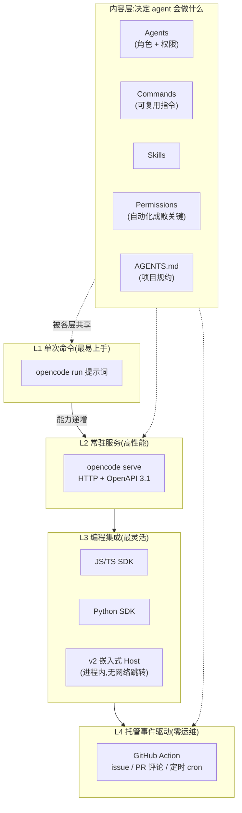
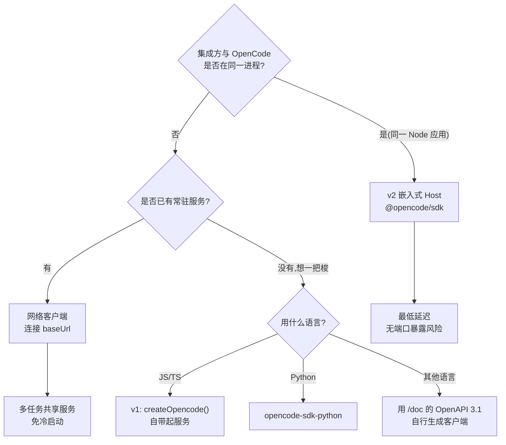
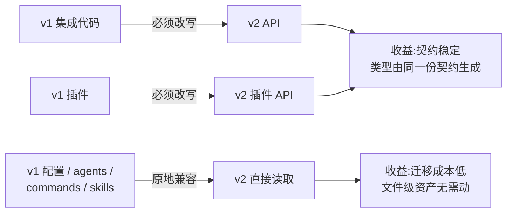
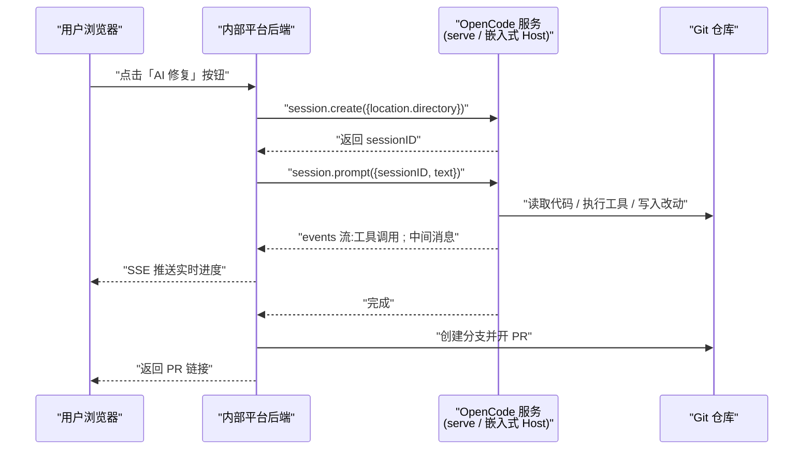
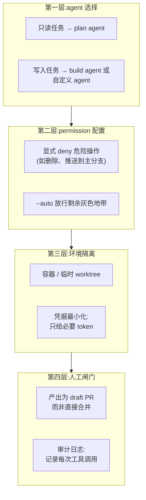

[toc]

以下正文基于**官方文档**(`opencode.ai/docs/cli`、`/docs/server`、`/docs/sdk`、`/docs/github`,以及 v2 文档 `opencode.ai/v2/docs/build/sdk`、`v2.opencode.ai/build/client`)、**官方 SDK 仓库**(`anomalyco/opencode-sdk-js`、`-python`)、**两个关键 GitHub issue**(#10411、#13851)与社区实践文章。知识依据截止 **2026 年 9 月下旬**。

---

## 非交互

给技术背景薄弱的读者一个生活化的类比:

- **交互式(interactive)**:你打开 opencode,看到一个漂亮的终端界面(TUI),打字、看它回答、它问你"要不要允许我修改这个文件?",你按回车确认。**像和人面对面聊天**。
- **非交互式(non-interactive / headless)**:你写好一句指令交给它,它自己跑完,把结果吐到标准输出(stdout),全程**没有任何人按键**。**像发一封邮件交代任务,收一封回信**。

为什么非交互如此重要?因为**只有非交互的东西才能被自动化**。

CI 流水线里没有人盯着屏幕,定时任务在凌晨三点跑,批处理脚本要连续处理 50 个仓库——这些场景下任何一个"等待用户确认"的弹窗都会让整个流程**永久卡死**。

这就引出了 opencode 自动化设计的**第一原则**,社区总结得很精辟:每个交互式的东西都有一个非交互的孪生体——TUI 对应 `run`,Web 对应 `serve`,会话连续性对应 `export`/`import`;这正是你想要的属性,当你打算脚本化、监督它、并最终交给它真正的工作时。

更根本的架构判断是:当你运行 opencode 时,它启动一个 TUI 和一个服务器,TUI 只是与服务器对话的客户端;这一架构让 opencode 支持多客户端,并让你能以编程方式与 opencode 交互。

**换句话说:opencode 从第一天起就是"一个带 TUI 的 CLI/服务",而不是"一个带 CLI 的 TUI"**。自动化不是后来贴上去的补丁,而是地基。

---

## 自动化能力全景图

opencode 的自动化接口可以分成**四个层次**,从轻到重、从简单到灵活:



**关键理解**:左边的"层次"决定**怎么调用**,右边的"内容层"决定**它会做什么、被允许做什么**。两者正交,任何一层都复用同一套 agent、command、skill 和权限定义。

---

## L1:`opencode run` —— 最基础的非交互入口

### 它是什么

官方定义极其直白:通过直接传入提示词来以非交互模式运行 opencode;这对脚本化、自动化,或当你只想要一个快速答案而不想启动完整 TUI 时很有用。

最小可用形态:

```bash
opencode run "解释一下 src/auth/session.go 里的 token 刷新逻辑"
```

它会直接把回答打印到终端,跑完就退出。**没有界面、没有交互、可以被管道(pipe)接走**。

### 关键参数详解

下表中的参数为**已核实可用**(来源:官方 CLI 文档与社区交叉验证)。注意这些多为**全局标志(global flags)**,`opencode` 和 `opencode run` 通常都可使用:

| 参数(占位符)                 | 含义                                       | 自动化中的作用                                             |
| ---------------------------- | ------------------------------------------ | ---------------------------------------------------------- |
| `<prompt>`                   | 位置参数,你要交代的自然语言任务            | 任务本体;建议用单引号包裹避免 shell 展开                   |
| `-c` / `--continue`          | 继续上一个会话(session)                    | **让多次脚本调用共享上下文**,实现分步骤流水线              |
| `-s <id>` / `--session <id>` | 继续**指定 ID** 的会话                     | 并行多任务时精确定位;`<id>` 是会话的唯一标识符             |
| `-m <provider/model>`        | 指定模型,格式为 `供应商/模型名`            | 成本控制:简单任务用便宜模型,复杂任务用强模型               |
| `--auto`                     | **自动批准未被明确拒绝的权限**             | **非交互的核心开关**;没有它,脚本会因权限询问而卡住或被取消 |
| `--attach`                   | 附着到一个正在运行的 `opencode serve` 实例 | **避免每次运行都要冷启动 MCP 服务器**,大幅提速             |
| `--pure`                     | 不加载外部插件运行                         | 出问题时的**第一排查手段**:排除插件干扰                    |
| `--log-level DEBUG`          | 日志级别                                   | 配合下一项排查 CI 中的黑盒失败                             |
| `--print-logs`               | 把日志打到 stderr                          | 让 CI 日志里能看到"它到底干了什么"                         |

> **`--auto` 的准确语义要辨析清楚**:它是"自动批准**未被明确拒绝**的权限"(auto-approve permissions not explicitly denied),**不是**"允许一切"。也就是说,你在配置里写的 `deny` 规则依然有效,`--auto` 只放行那些"没规定"的灰色地带。这个设计很重要:**你用配置画出红线,用 `--auto` 让剩下的自动通行**。

关于 `--attach` 的性能价值,官方文档明确指出:你也可以附着到一个运行中的 `opencode serve` 实例,以避免每次运行时的 MCP 服务器冷启动耗时。

> **MCP(Model Context Protocol)** 是模型上下文协议,用来让 AI 接入外部工具(比如查数据库、调内部 API)。每个 MCP 服务器启动都要几秒,如果你在循环里调 50 次 `opencode run`,冷启动开销会是**几分钟的纯浪费**。

### v1 时代的真实痛点(必须知道,否则你会踩坑)

这是本节最有价值的部分。搜索发现了两个直指要害的官方 issue:

**痛点一:`run` 并非真正"完全非交互"**

有用户在 Kubernetes/OpenShift Pod 中使用 v1.1.60 时报告:无法实现完全非交互的通用自动化工作流——`opencode run "Do X"` 无法在无任何人工交互的情况下,对任意仓库和任务使用 `write`/`edit` 等工具创建、编辑、删除文件(由 Python 通过 `subprocess` 驱动的 CI 式自动化)。

更具体地说:尽管工具可用,agent 却不执行 `write`,会话以 `cancel` 结束;"服务器 + attach" 的替代方案也缺少批处理机制,且 `run --attach` 失败。

日志显示会话被创建时带有这样的权限配置:`question` 全部 `deny`、`plan_enter` 全部 `deny`、`plan_exit` 全部 `deny`——**agent 想问问题却被禁止提问,于是整个会话被取消**。

**痛点二:社区曾正式请求一个显式的非交互模式**

有 issue 请求为 `opencode run` 增加非交互模式(如 `--non-interactive`),并提出:在非交互模式下,权限询问应该直接中止会话并退出命令;如果有人想要允许/拒绝的行为,那应该通过显式权限来处理。

**给初学者的结论**:如果你在 CI 里发现 opencode "什么都没做就成功退出了",**九成是权限问题**,不是模型太笨。请检查:

- 是否加了 `--auto`
- 配置里的 `permission` 规则是否过严(尤其是 `question` 被 deny 时,agent 无法澄清歧义就会放弃)
- 提示词是否足够明确,不需要 agent 反问

---

## L2:`opencode serve` —— 常驻无头服务

### 设计与用法

官方描述:`opencode serve` 命令运行一个无头(headless)HTTP 服务器,暴露一个 OpenAPI 端点供 opencode 客户端使用。

而且这个服务器发布 OpenAPI 3.1 规范,可在 `/doc` 端点查看(例如 `http://localhost:4096/doc`),你可以用该规范生成客户端或检查请求与响应类型,或在 Swagger 浏览器中查看。

**这意味着什么?** 你不需要等官方出 Go/Rust/Java SDK——**拿 OpenAPI spec 用代码生成器自己生成一个**。这是极高的集成自由度。

### 关键参数与环境变量

| 参数 / 环境变量            | 含义              | 说明                                                         |
| -------------------------- | ----------------- | ------------------------------------------------------------ |
| `--hostname <host>`        | 监听地址          | 启动 TUI 时会随机分配端口与主机名,可用此标志固定;容器内通常设为 `0.0.0.0` |
| `--port <port>`            | 监听端口          | 默认常见为 `4096`;固定端口才能被脚本稳定连接                 |
| `OPENCODE_SERVER_PASSWORD` | HTTP 基本认证密码 | **设置后即启用 basic auth 保护服务器**,`serve` 与 `web` 都适用 |
| `OPENCODE_SERVER_USERNAME` | 基本认证用户名    | 默认为 `opencode`,可覆盖                                     |

> **安全警示(重点)**:`opencode serve` 暴露的是一个**能读写你磁盘、能执行 shell 命令的 AI agent**。如果你把它绑到 `0.0.0.0` 并开放到公网而不设密码,等同于把一个 root shell 挂在互联网上。**务必设置 `OPENCODE_SERVER_PASSWORD`,并优先走内网或 VPN。**

社区的远程访问实践也是这个思路:相比直接开放端口,推荐的方式是通过 Tailscale VPN 连接,由于访问被限制在你的 Tailscale 网络内,不存在外部暴露的风险。

### 相关的配套命令

- `opencode attach`:将终端附着到一个已通过 `serve` 或 `web` 命令启动的、正在运行的 opencode 后端服务器;这允许使用 TUI 连接远程 opencode 后端。
  > **典型用法**:服务跑在你的开发工作站(有完整代码和依赖),你在笔记本或另一台机器上 attach 过去。重活(仓库访问、工具执行、模型调用)留在服务器端,你的移动设备只负责输入和显示。
- `/tui` 端点:该端点可用于通过服务器驱动 TUI,例如可以预填或直接运行一个提示词;这个机制正是 opencode IDE 插件所使用的。
  > 这是个被低估的自动化接口:**你可以从外部脚本"遥控"一个正在运行的 TUI**,比如让 IDE 插件把选中代码塞进提示词框。

### 容器化部署(生产自动化的标准姿势)

社区已有开箱即用的 Docker 镜像,其设计思路非常值得借鉴:一个预配置了 entrypoint 的镜像,将环境变量映射到 CLI 标志,因此你无需编写自定义脚本就能控制每个服务器选项(端口、主机名、mDNS、CORS、认证等)。

其暴露的环境变量清单是一份很好的"配置项索引":

| 环境变量                                 | 作用                                 |
| ---------------------------------------- | ------------------------------------ |
| `PORT` / `HOSTNAME_OVERRIDE`             | 端口与主机名,Docker 内默认 `0.0.0.0` |
| `CORS`                                   | 跨域来源白名单,逗号分隔              |
| `MDNS` / `MDNS_DOMAIN`                   | 局域网服务发现                       |
| `OPENCODE_SERVER_USERNAME` / `_PASSWORD` | 基本认证                             |
| `OPENCODE_CONFIG_DIR`                    | 配置目录路径                         |
| `OPENCODE_CONFIG`                        | 指定具体配置文件路径                 |

> 注意**数据持久化**:该方案将宿主机目录挂载到 `/root/.local/share/opencode` 以持久化数据,容器支持配置、凭据和自定义 agents/commands 的持久化存储。**不挂载 = 每次重启丢失登录状态和会话历史**,这是容器化时最常见的翻车点。

---

## L3:SDK —— 编程式集成

这是 **v1 与 v2 差异最大的一层**,必须分开讲。

### v1 的 SDK

安装 `@opencode-ai/sdk`,提供两种模式:

- **自带服务器模式**:`createOpencode()` 会同时启动一个服务器和一个客户端;该实例仍会读取你的 `opencode.json`,但你可以内联覆盖或追加配置。
- **连接已有实例模式**:如果你已经有一个运行中的 opencode 实例,可以用 `createOpencodeClient()` 创建一个客户端连接过去。

类型安全方面:SDK 包含所有 API 类型的 TypeScript 定义,可直接导入 `Session`、`Message`、`Part` 等类型,所有类型都由服务器的 OpenAPI 规范生成。

另有官方生成式 SDK 仓库(`opencode-sdk-js` / `opencode-sdk-python`),其工程化细节对写健壮脚本很关键:当库无法连接 API,或 API 返回非成功状态码(4xx/5xx)时,会抛出 `APIError` 的子类,可从中读取 `status`、`name`、`headers`;某些错误默认会自动重试 2 次,采用短指数退避(exponential backoff)。

### v2 的 SDK:双轨制

v2 把 SDK 拆成了**两个定位清晰的包**,这是刻意的架构设计:

**轨道一:网络客户端(network client)**——`@opencode-ai/client` 是 OpenCode HTTP API 的生成式 TypeScript 客户端,当你的应用通过网络连接到 OpenCode 服务器时使用;其类型与方法由与 API 参考相同的契约生成。

用法形态:

```ts
import { OpenCode } from "@opencode-ai/client"

const client = OpenCode.make({
  baseUrl: "http://localhost:4096",
})

const session = await client.session.create({
  location: { directory: "/workspace" },
})

await client.session.prompt({
  sessionID: session.id,
  text: "Review the current changes",
})
```

可以向 `OpenCode.make` 的 `headers` 传入默认认证或应用头部。

**轨道二:嵌入式宿主(embedded host)**——这是 v2 的**全新能力**,也是最值得关注的自动化演进:

`@opencode/sdk` 把 OpenCode 直接托管在你的应用内部;与网络客户端不同,它在内存中组装 OpenCode 服务器并通过其 HTTP 路由转发 API 调用,不开启 HTTP 监听器,客户端与服务器之间没有网络跳转。

```ts
import { OpenCode } from "@opencode/sdk"

await using opencode = await OpenCode.create()

const session = await opencode.sessions.create({
  location: { directory: "/workspace" },
})

await opencode.sessions.prompt({
  sessionID: session.id,
  text: "Review the current changes",
})
```

当显式资源管理(即 `await using` 语法)不可用时,需显式调用 `await opencode.close()`;嵌入式宿主使用与 `@opencode/client` 相同的 Promise 值、声明式错误、请求选项和 AsyncIterable 流,并额外暴露 `sessions` 和 `events` 两个便捷别名,分别对应会话组和事件组。

**参数与概念对照表**:

| 字段 / 概念           | 含义                     | 辨析                                                         |
| --------------------- | ------------------------ | ------------------------------------------------------------ |
| `baseUrl`             | 服务器地址               | **仅网络客户端需要**;嵌入式宿主没有地址概念                  |
| `headers`             | 默认请求头               | 用于传递 basic auth 或自定义应用标识                         |
| `location.directory`  | 会话的工作目录           | **决定 agent 在哪个仓库里干活**,CI 中通常是 checkout 出来的路径 |
| `sessionID`           | 会话唯一标识             | 多轮对话/分步任务靠它串联上下文                              |
| `text`                | 提示词内容               | 即你要交代的任务                                             |
| `sessions` / `events` | v2 嵌入式宿主的便捷别名  | `events` 是 **AsyncIterable 流**,可用于实时消费 agent 的中间事件(做进度条、审计日志) |
| `projectID`           | 项目标识                 | **worktree(工作树)操作需要 `projectID`**                     |
| `await using`         | TS/JS 的显式资源管理语法 | 作用域结束自动释放;不支持时手动 `close()`                    |

> **包名歧义提醒(重要且诚实)**:v2 两份官方文档页对客户端包名的写法不一致——一处写 `@opencode-ai/client`,另一处写 `@opencode/client`。这很可能是 v2 文档尚不完善所致(上一轮已提到 v2 文档落后于 v1 文档)。**安装前请以 `npm view` 实际查询为准**,不要照抄。

### 三种集成方式如何选



---

## L4:GitHub Action —— 开箱即用的事件驱动自动化

对于大多数团队,**这才是投入产出比最高的自动化形态**,因为它完全不需要你维护服务器。

### 核心机制

官方描述:OpenCode 集成进你的 GitHub 工作流,在评论中提及 `/opencode` 或 `/oc`,OpenCode 就会在你的 GitHub Actions runner 内执行任务。

三大用途被官方归纳为:

- **问题分诊(Triage issues)**:让 OpenCode 调查一个 issue 并向你解释。
- **修复与实现(Fix and implement)**:让它修复 issue 或实现功能,它会在一个新分支上工作并提交一个 PR。
- **安全性(Secure)**:OpenCode 运行在你自己的 GitHub runner 内。

> **"跑在你自己的 runner 里"这一点对企业用户非常关键**:代码不出你的 CI 环境,不需要把仓库权限交给第三方 SaaS。

### 安装

最省事的方式是官方引导命令:在一个位于 GitHub 仓库中的项目里运行该命令,它会引导你完成安装 GitHub App、创建工作流和设置密钥的全过程。

手动安装则是三步:安装 GitHub App(`github.com/apps/opencode-agent`,确保装在目标仓库上)、添加工作流文件到 `.github/workflows/opencode.yml`、在 Settings → Secrets and variables → Actions 中添加模型供应商的 API key(示例使用 `OPENCODE_API_KEY`)。

### 触发方式

官方列出的触发事件包括 **issue 评论、PR 评论、PR 审查(pull request reviews)、手动派发的任务(manually dispatched tasks)**,以及**按计划运行(schedule)以执行自动化任务**。

特别值得一提的是**行级评论**能力:在 PR 的 "Files" 标签页直接在代码行上留评论,OpenCode 会自动检测文件、行号和 diff 上下文以提供精确响应;这使得更有针对性的请求成为可能,无需手动指定文件路径或行号。

### 工作流骨架与权限字段

官方的定时任务示例结构如下(注意:官方示例中的 step 部分在我抓取的页面里被截断,**具体的 `uses:` 引用路径请以 `opencode github install` 生成的文件为准**——考虑到上游组织已从 `sst` 迁移到 `anomalyco`,硬编码旧路径有风险):

```yaml
name: Scheduled OpenCode Task
on:
  schedule:
    - cron: "0 9 * * 1"   # 每周一 UTC 09:00
jobs:
  opencode:
    runs-on: ubuntu-latest
    permissions:
      id-token: write
      contents: write
      pull-requests: write
      issues: write
    steps:
      # ... 由 opencode github install 生成
```

**`permissions` 各字段解释**(这是最容易配错、导致"Action 跑了但什么也没提交"的地方):

| 权限字段               | 授予的能力                                    | 不配会怎样                          |
| ---------------------- | --------------------------------------------- | ----------------------------------- |
| `id-token: write`      | 生成 OIDC 令牌,用于向外部服务做无密钥身份认证 | 依赖 OIDC 的认证流程失败            |
| `contents: write`      | 读写仓库内容(创建分支、提交代码)              | **agent 改完代码无法推送**,白跑一趟 |
| `pull-requests: write` | 创建/评论/修改 PR                             | 无法开 PR,也无法在 PR 下回复        |
| `issues: write`        | 创建/评论 issue                               | 无法回复 issue 评论,分诊功能失效    |

一个官方给出的定时任务提示词示例是:审查代码库中的所有 TODO 注释并创建一份摘要。

此外,官方 Action 的**输出(outputs)** 为 `opencode-version` 和 `cache-hit`。
> **辨析**:输出里有 `cache-hit` 说明这个 Action 至少承担了**安装与缓存 opencode 二进制**的职责(类似 `setup-node`)。`cache-hit` 为 `true` 表示命中缓存、跳过下载,这在国内自建 runner 上尤其值得关注(见后文网络章节)。

---

## v1 → v2:自动化方面的变化

先给**结论性对比表**。请注意可靠性标注:

| 维度                     | v1                                                           | v2                                                           | 可靠性                |
| ------------------------ | ------------------------------------------------------------ | ------------------------------------------------------------ | --------------------- |
| **进程模型**             | `opencode serve` 需手动启动;`run` 每次可能冷启动             | **默认作为服务常驻**,安装后保持活跃,启动时自动连接           | 已核实(官方/访谈)     |
| **运行时**               | Bun,服务端代码依赖 Bun 特有 API,不得不捆绑 CLI               | **Node.js**,已移除所有 Bun 特有 API,服务端可在 Node 环境运行 | 已核实                |
| **Server API**           | 自然生长的 API                                               | **重新设计的契约**,V1 API 集成必须迁移                       | 已核实                |
| **客户端 SDK**           | `@opencode-ai/sdk`(`createOpencode` / `createOpencodeClient`) | **双轨**:网络客户端 + **嵌入式宿主**(进程内,无网络跳转)      | 已核实                |
| **事件流**               | 有事件接口                                                   | 嵌入式宿主暴露 `events` 便捷别名,使用 **AsyncIterable 流**   | 已核实                |
| **并发任务**             | 单会话为主                                                   | **多标签并行 AI 会话**                                       | 已核实                |
| **Skills 加载**          | 修改后需重载                                                 | **热加载,不引发缓存失效**                                    | 已核实                |
| **插件**                 | v1 插件 API                                                  | **全新插件 API,不兼容,必须改写**                             | 已核实                |
| **`run` 的非交互健壮性** | 存在权限询问导致会话被 cancel 的问题                         | 未见官方专门说明改进                                         | **未核实,需自行验证** |
| **API 稳定性**           | 稳定                                                         | **V2 API 与客户端处于 beta,方法名、输入输出在稳定版前可能变化** | 已核实                |

### 三个真正影响自动化工程的变化

**变化一:常驻服务把"冷启动"问题从根上解决了**

v1 时代你必须手动 `opencode serve` 再 `run --attach` 才能避免 MCP 冷启动,而且有用户报告 `run --attach` 失败。v2 默认常驻,官方表述是:当你启动 OpenCode 时会自动连接,无论使用桌面应用、Web 应用还是自定义脚本,一切都保持同步。

**对脚本作者的实际意义**:你在 `for` 循环里调 50 次 opencode,理论上不再需要自己做服务生命周期管理。

**变化二:Node 运行时打开了嵌入式集成的大门**

Bun 时代要把 opencode 嵌入到你自己的 Node 应用里非常别扭(得捆绑一个 Bun 运行时)。迁移到 Node 后,才可能有 `@opencode/sdk` 这种**在内存中组装服务器、不开 HTTP 监听器**的嵌入式宿主。

**这条变化对国内用户额外友好**:Node 的国内镜像生态(npmmirror)成熟,而 Bun 的安装在国内常有网络障碍。

**变化三:API 从"自然生长"变成"刻意设计"**

这是代价与收益的权衡:



**迁移决策建议**:

- 只用 `opencode run` 写 shell 脚本的人 → **几乎零迁移成本**,直接升
- 用了 `@opencode-ai/sdk` 或直连 Server API 的人 → **需改写,且 V2 API 仍是 beta**,建议锁定 v1.18.x 观望,或做好接口层抽象
- 写了插件的人 → **必须改写**

---

## 应用场景案例

以下案例都尽量写成**可直接落地、场景完整**的形式。所有 shell 脚本建议用 `shellcheck` 静态检查、`shfmt -i 2 -ci -w` 格式化后再入库。

### 案例一:Git 提交信息自动生成(个人本地,最适合初学者起步)

**真实场景**:你是一个人维护副业项目的开发者,写完代码总是随手敲 `git commit -m "fix"`,三个月后回看提交历史完全不知道自己干了什么。你希望提交信息自动按 Conventional Commits 规范生成。

```bash
#!/usr/bin/env bash
# gen-commit-msg.sh —— 基于暂存区 diff 生成规范化提交信息
set -euo pipefail

# 仅取已暂存(staged)的改动,避免把未完成的工作也算进去
DIFF="$(git diff --cached)"

if [ -z "$DIFF" ]; then
  echo "错误:暂存区为空,请先 git add" >&2
  exit 1
fi

# 超长 diff 会浪费 token,这里截断到 400 行
DIFF="$(printf '%s' "$DIFF" | head -n 400)"

PROMPT="你是一个 Git 提交信息生成器。根据下面的 diff,生成一条符合
Conventional Commits 规范的提交信息。要求:
1. 第一行格式为 <type>(<scope>): <简短描述>,不超过 50 字符
2. 空一行后,用 2-4 个要点说明改动原因
3. 只输出提交信息本身,不要任何解释、不要代码块标记

diff 内容:
$DIFF"

# -m 选一个便宜的小模型即可;--auto 确保不会因权限询问卡住
opencode run -m "$OC_MODEL" --auto "$PROMPT"
```

**逐项讲解**:

- `set -euo pipefail`:遇错即停、未定义变量报错、管道中任一环节失败即失败。**自动化脚本的标配**,没有它出错会被静默吞掉。
- `git diff --cached`:只看**暂存区**。这很关键——如果用 `git diff`,拿到的是工作区未暂存的改动,和你即将提交的内容对不上。
- `head -n 400`:**成本控制**。一次大重构的 diff 可能几千行,直接喂进去 token 消耗惊人。
- `--auto`:此处其实不写也多半没事(生成文本不涉及文件写入),但**养成习惯**:任何非交互脚本都加上。
- `$OC_MODEL`:抽成环境变量,方便在不同机器切换模型(国内可设为某个国产模型的 OpenAI 兼容端点)。

**接入 Git 钩子**:把上面的输出写入 `.git/hooks/prepare-commit-msg`(记得 `chmod +x`)。跨平台提示:**Windows 下的 Git Bash 可以执行这类钩子,但若团队混用 Windows/Linux,务必在仓库里配置 `.gitattributes` 强制 `* text=auto eol=lf`**,否则 `CRLF` 行尾会让 Linux/macOS 上的钩子脚本报 `bad interpreter: /usr/bin/env^M`。

### 案例二:CI 中的增量代码审查(团队协作)

**真实场景**:一个 6 人后端团队,PR 经常堆积,资深工程师被 review 占满时间。你想让 AI 先做一遍"机械性审查"(空指针、错误处理缺失、SQL 注入、日志泄露敏感信息),把明显问题挡在人工 review 之前。

最省事的路径是直接用官方 GitHub Action,让成员在 PR 下评论 `/oc 帮我审查这个 PR 的错误处理`。但如果你想要**每个 PR 自动触发、无需人工提及**,思路是:

- 触发条件设为 `pull_request` 的 `opened` 和 `synchronize` 事件
- checkout 时设置 `fetch-depth: 0`,保证能拿到完整历史以计算 diff
- 用 `git diff origin/${{ github.base_ref }}...HEAD` 拿到本次 PR 的净改动
- 用 `plan` agent 而非 `build` agent(**只分析不改代码**——`plan` 被限制为分析与规划、拒绝大多数编辑操作)
- 把结果通过 `gh pr comment` 回贴到 PR

**为什么强调用 `plan` 而不是 `build`?** 这是自动化的**安全边界设计**:审查任务本质是只读的,给它写权限就是给自己埋雷。上一轮提到 `build` 是拥有完整工具访问权限的默认主 agent、`plan` 被限制为分析与规划。**最小权限原则(principle of least privilege)在 AI agent 时代同样适用,甚至更重要。**

**成本与噪音治理提醒**:

- `synchronize` 事件会在**每次 push** 时触发。一个人连推 10 次就跑 10 次审查。建议加 `concurrency` 组并设 `cancel-in-progress: true`,或改为只在 `ready_for_review` 时触发。
- 给提示词明确约束"只报告**高置信度**问题,最多 5 条,没有问题就回复 LGTM"。否则 AI 会为了显得有用而制造大量低价值评论,团队很快会开始忽略它——**这是 AI code review 最常见的失败模式**。

### 案例三:多仓库批量改造(运维/平台工程)

**真实场景**:你们公司有 40 个微服务仓库,现在要统一把日志库从 `logrus` 换成 `zap`,并给所有 `.github/workflows/*.yml` 加上依赖缓存。手工做要两周。

```bash
#!/usr/bin/env bash
# batch-migrate.sh —— 批量改造多个仓库并开 PR
set -euo pipefail

REPO_LIST="${1:?用法: $0 <仓库列表文件>}"
WORK_DIR="${WORK_DIR:-/tmp/batch-migrate}"
BRANCH="chore/migrate-to-zap"
FAILED_LOG="$WORK_DIR/failed.txt"

mkdir -p "$WORK_DIR"
: > "$FAILED_LOG"

# 先启动一个常驻服务,后续 run 全部 attach 过去,省掉重复冷启动
opencode serve --port 4096 --hostname 127.0.0.1 &
SERVER_PID=$!
trap 'kill "$SERVER_PID" 2>/dev/null || true' EXIT
sleep 5

while IFS= read -r repo; do
  [ -z "$repo" ] && continue
  echo "==> 处理 $repo"
  name="$(basename "$repo" .git)"
  target="$WORK_DIR/$name"

  git clone --depth 1 "$repo" "$target" || { echo "$repo clone失败" >> "$FAILED_LOG"; continue; }
  (
    cd "$target"
    git switch -c "$BRANCH"

    if opencode run --attach --auto \
      "将本项目的日志库从 logrus 迁移到 zap。要求:
       1. 替换所有 import 和调用点,保持日志级别语义一致
       2. 结构化字段用 zap.String/zap.Int 等强类型 API
       3. 保留原有的日志内容文本不变
       4. 修改完成后运行 go build ./... 确认编译通过
       5. 不要修改测试文件以外的任何业务逻辑"
    then
      if ! git diff --quiet; then
        git add -A
        git commit -m "chore: migrate logging from logrus to zap"
        git push -u origin "$BRANCH"
        gh pr create --fill --draft
      else
        echo "$repo 无改动" >> "$FAILED_LOG"
      fi
    else
      echo "$repo opencode失败" >> "$FAILED_LOG"
    fi
  ) || echo "$repo 子shell异常" >> "$FAILED_LOG"
done < "$REPO_LIST"

echo "完成。失败清单:"
cat "$FAILED_LOG"
```

**关键设计点逐条解释**:

| 设计                              | 理由                                                         |
| --------------------------------- | ------------------------------------------------------------ |
| `opencode serve` + `run --attach` | **本案例的核心优化**。40 个仓库 × MCP 冷启动数秒 = 大量浪费。官方明确说明 `--attach` 就是为此设计 |
| `trap ... EXIT`                   | 脚本无论正常结束还是被 Ctrl+C,都会杀掉后台服务,**避免僵尸进程占端口** |
| `--depth 1`                       | 浅克隆,40 个仓库能省下大量磁盘和时间                         |
| `gh pr create --draft`            | **开成草稿 PR**。AI 批量改动必须经人工过目,草稿状态能防止误合并 |
| `git diff --quiet` 检查           | **防止空提交**。AI 有时会"认为已经符合要求"而不做任何修改,不检查就会推一个空分支 |
| 失败清单 `FAILED_LOG`             | 批处理必须有**可恢复性**,你需要知道哪 3 个仓库失败了好单独处理 |
| 提示词第 4 条(跑 build 验证)      | **让 agent 自我验证**。这是提示词工程里性价比最高的一条:给它一个客观的成功判据 |
| 提示词第 5 条(负向约束)           | **画出红线**。不加这条,AI 很可能"顺手"重构一堆无关代码,让 PR 无法 review |

> **注意 `run --attach` 在 v1 曾有失败报告**(上文 issue #13851)。上线前请**先用 1 个仓库做试点**,确认 attach 路径可用;不可用就去掉 `--attach`,牺牲速度换可靠性。

### 案例四:定时巡检报告(零运维,GitHub Action)

**真实场景**:开源项目维护者,想每周一早上收到一份"本项目当前的技术债清单",不需要自己动手。

直接复用官方能力:按计划运行 OpenCode 以执行自动化任务,例如每周一 UTC 09:00 触发,提示词为审查代码库中的 TODO 注释并创建摘要。

**可以扩展的巡检主题**(全部只需改提示词):

- 扫描依赖文件,列出**有已知 CVE 或已超过 12 个月未更新**的依赖,并按风险排序
- 检查 `README` 中的所有外部链接与文档中的命令示例是否仍与当前代码一致(**文档漂移检测**,这是人最容易忽略的)
- 汇总本周合入的 PR,生成面向用户的 changelog 草稿
- 检查是否有硬编码的密钥、内网地址、测试用邮箱泄漏

**结果投递建议**:让它把摘要写成一个 issue(所以 `issues: write` 权限必不可少),而不是只打在 Action 日志里——**日志没人看,issue 会有通知**。

### 案例五:内部平台集成(serve + SDK,面向平台团队)

**真实场景**:你们有一个内部研发效能平台(Web 端),想加一个"AI 修一下这个告警对应的代码"按钮。用户点击后,平台在后台拉起一个 agent 任务,前端实时显示进度。

架构如下:



**v1 与 v2 在这个场景的差别非常直观**:

- **v1 方案**:平台后端用 `createOpencodeClient()` 连到一个独立的 `opencode serve` 进程。需要额外运维这个进程(健康检查、重启、端口管理、basic auth)。
- **v2 方案**:如果平台后端本身是 Node 应用,可以直接用嵌入式宿主——**它不开启 HTTP 监听器,不增加网络跳转**。运维复杂度骤降,也消除了"服务端口被内网扫描到"的攻击面。

**实现要点**:

- `location.directory` 必须指向**每个任务独立的工作目录**(建议用 `git worktree` 或临时克隆),否则并发任务会互相踩踏文件。注意 **worktree 操作需要 `projectID`**。
- 用 `events` 的 **AsyncIterable 流**消费中间事件,转成 SSE 推给前端。这也是**审计日志**的天然来源:每一次工具调用都应落库,出事时能追溯"AI 到底动了什么"。
- 错误处理照抄 SDK 的推荐模式:捕获 `APIError` 并读取 `status`;注意 SDK 默认会自动重试 2 次,**你自己的重试逻辑要避免与之叠加**导致实际重试 6 次。

---

## 国内环境下的自动化适配

这是官方文档不会讲、但你一定会遇到的部分。

### 二进制与依赖获取

| 问题                       | 方案                                                         |
| -------------------------- | ------------------------------------------------------------ |
| CI 里安装 opencode 慢/失败 | 官方 Action 有 `cache-hit` 输出,善用缓存;自建 runner 可预先烘焙镜像 |
| npm 安装慢                 | `npm i -g opencode-ai@latest --registry=https://registry.npmmirror.com` |
| GitHub Releases 下载失败   | 代理,或用 gh-proxy 类镜像前缀包裹原始下载链接(使用前自行核实可用性) |
| 容器构建                   | 在 Dockerfile 里通过 `ARG` 注入镜像源,避免把镜像地址硬编码到产物中 |

### 代理配置(跨平台差异必须说清)

自动化脚本中设置代理的方式在两类系统上不同:

- **\*nix(Linux/macOS)**:在脚本开头 `export https_proxy=http://127.0.0.1:7890` 和 `http_proxy`,同时设置 `no_proxy=localhost,127.0.0.1` 避免本地 `opencode serve` 的回环请求也被代理转发——**这是一个非常隐蔽的坑**,会导致 `--attach` 连不上本地服务。
- **Windows PowerShell**:`$env:HTTPS_PROXY="http://127.0.0.1:7890"`,同样要设 `$env:NO_PROXY="localhost,127.0.0.1"`。
- **Windows CMD**:`set HTTPS_PROXY=http://127.0.0.1:7890`。
- **systemd 管理的常驻服务**:环境变量不会继承自你的登录 shell,必须写在 unit 文件的 `Environment=` 指令里,或通过 `systemctl edit` 添加 drop-in 配置。**很多人在这里困惑半天**。

### 模型选择

opencode 的供应商中立设计在国内是实打实的优势:自动化场景下**大量重复的低价值任务**(生成提交信息、格式化文档、翻译注释)完全可以用国产模型的 OpenAI 兼容端点,只在复杂重构时切换到强模型。用 `-m <provider/model>` 在脚本里按任务分流,是最直接的**成本优化手段**。

### 中文输出的编码问题

- CI 日志里中文变成 `???` 或乱码:确保 runner 环境的 `LANG=C.UTF-8` 或 `en_US.UTF-8`;Windows runner 需 `chcp 65001`。
- 脚本把 AI 输出写入文件再被其他工具读取时,**显式指定 UTF-8 编码**(Python 里 `open(..., encoding='utf-8')`),不要依赖系统默认——Windows 上 Python 的默认编码历史上是 GBK,这是跨平台脚本的经典翻车点。
- 提交信息含中文时,建议 `git config --global i18n.commitEncoding utf-8`。

---

## 自动化的安全与成本治理

这一节的重要性不亚于前面所有内容。**让 AI 在无人值守下拥有写权限和 shell 权限,是一件需要认真设计的事。**

### 权限分层模型



**权限规则的结构**(从 issue 日志可见的形态)包含三个字段:`permission`(权限类型,如 `question`、`plan_enter`)、`pattern`(匹配模式,如 `*`)、`action`(动作,`allow` 或 `deny`)。

> **重要辨析**:把 `question` 设为 `deny` 看似"更非交互",实际会导致**遇到歧义时 agent 直接放弃、会话被 cancel**——这正是 issue #13851 反映的现象。正确做法是**把提示词写得足够明确**,让 agent 不需要提问,而不是粗暴禁止它提问。

### 成本治理

| 手段             | 说明                                                         |
| ---------------- | ------------------------------------------------------------ |
| **模型分流**     | 用 `-m` 按任务难度选模型                                     |
| **输入截断**     | diff、日志等超长输入先 `head` 截断                           |
| **并发限流**     | CI 中设 `concurrency` + `cancel-in-progress`,避免连续 push 触发多次 |
| **复用会话**     | `-c` / `-s <id>` 复用上下文,避免每次重传背景资料             |
| **设置预算告警** | 上一轮提到 v2 的 token 用量因编排器策略增长了五倍,**升级 v2 后务必先观察一到两周账单** |

---

## 排错速查

按**出现频率**排序的自动化故障清单:

| 现象                     | 最可能原因                            | 处置                                                         |
| ------------------------ | ------------------------------------- | ------------------------------------------------------------ |
| 命令"成功"退出但文件没变 | **权限被拒 / 会话被 cancel**          | 加 `--auto`;检查 `permission` 配置;确认用的是 `build` 而非 `plan` |
| 脚本在 CI 里永久挂起     | agent 在等待用户确认                  | 加 `--auto`;确保没有分配 TTY 的交互提示                      |
| 看不出它做了什么         | 日志默认不输出                        | `--log-level DEBUG --print-logs`                             |
| 行为诡异、结果不稳定     | 插件干扰                              | **先用 `--pure` 跑一次**排除插件因素                         |
| 每次调用都很慢           | MCP 冷启动                            | `opencode serve` + `run --attach`                            |
| `--attach` 连不上        | 本地回环被代理拦截 / 端口未固定       | 设 `no_proxy`;用 `--port` 固定端口                           |
| 容器重启后要重新登录     | 未挂载数据目录                        | 挂载宿主目录到 `/root/.local/share/opencode`                 |
| Action 跑完没开 PR       | `permissions` 缺 `contents: write` 等 | 按上文权限表补齐                                             |
| v2 SDK 报找不到方法      | **V2 API 仍是 beta,方法名可能已变**   | 对照当前官方 API 参考,锁定版本号                             |

---

## 总结

**一句话概括 opencode 的自动化哲学**:它是一个**带 TUI 的服务**,而不是一个带脚本接口的 GUI 工具——因此自动化不是附加功能,而是原生形态。

**给不同读者的行动建议**:

- **初学者**:从 `opencode run "提示词" --auto` 开始,先做案例一(提交信息生成)这种低风险、高频次的小任务,建立直觉。
- **团队开发者**:直接上 GitHub Action,用 `/oc` 评论触发,几乎零配置成本,且**跑在自己的 runner 里**,安全可控。
- **平台/基础设施工程师**:用 `serve` + SDK,注意 basic auth 与网络隔离;v2 的嵌入式宿主值得评估,但**记住 V2 API 与客户端仍是 beta**。
- **准备升级 v2 的人**:`run` 脚本零成本;SDK/插件必须改写;升级后**密切关注 token 账单**。

---

### 本轮搜索的局限与下一轮建议关键词

**坦白说明**:本轮受限于**单轮搜索配额**(第一批 4 组并行查询成功,追加查询被限流),我**没有进行迭代式多轮搜索**。以下问题未能深入,且官方 v2 文档本身对自动化的覆盖也不完整:

- v2 中 `opencode run` 的具体行为变更与新增标志,官方 v2 CLI 文档我未能抓取
- v2 新插件 API 的钩子(hooks)清单与写法
- `@opencode-ai/client` 与 `@opencode/client` 的包名歧义未能证实
- 官方 GitHub Action 在组织迁移(`sst` → `anomalyco`)后的正确引用路径

**建议你在下一轮对话中使用的搜索词**(基于本轮结果中出现的**新线索**,而非泛化发散):

- `opencode v2 docs cli run` —— 定位 v2 版 CLI 文档
- `opencode v2 plugin API hooks` —— 新插件 API 的事件钩子
- `anomalyco/opencode github action uses path` —— 确认 Action 的正确引用
- `opencode permission config question deny` —— 权限模型的完整字段与取值
- `opencode run --attach failed 13851` —— 追踪该 issue 是否已在 v2 修复
- `opencode-headless` / `Juliusolsson05/opencode-headless` —— 本轮发现的第三方无头驱动项目,可能揭示社区规避官方限制的方案
- `opencode sessions export import automation` —— 会话导出/导入在自动化中的用法
- `opencode orchestrator model token usage` —— 上一轮遗留的成本相关线索

