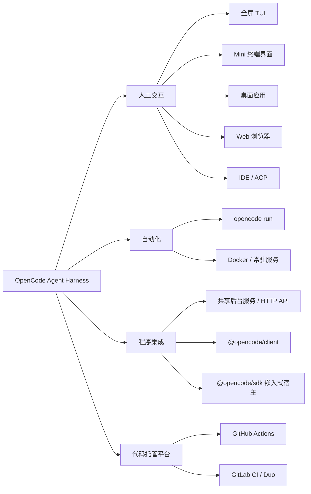

[toc]


## 使用形式

这里的 **coding agent harness** 不只是模型，而是围绕模型提供的一整套运行框架：

- **上下文管理**：读取代码、项目说明和历史会话
- **Agent 循环**：分析、调用工具、观察结果、继续执行
- **工具系统**：读写文件、执行命令、调用 MCP
- **权限控制**：决定哪些操作允许自动执行
- **用户界面**：TUI、IDE、桌面、Web
- **自动化接口**：非交互 CLI、RPC、HTTP API、SDK、CI
- **扩展系统**：插件、Skills、自定义工具和 Agent

几个常见术语：

| 术语                  | 含义                                                 | 适合谁                   |
| --------------------- | ---------------------------------------------------- | ------------------------ |
| **TUI**               | Terminal User Interface，全屏终端界面                | 日常开发者               |
| **Headless / 非交互** | 不打开界面，执行一次任务后退出                       | Shell 脚本、CI           |
| **RPC**               | 外部程序持续控制一个 Agent 进程                      | 自定义客户端、跨语言集成 |
| **HTTP Server**       | 通过网络 API 控制 Agent                              | 内部平台、远程工作站     |
| **ACP**               | Agent Client Protocol，编辑器和 Agent 之间的开放协议 | Zed、JetBrains 等 IDE    |
| **SDK**               | 在自己的应用进程内调用或嵌入 Agent                   | 平台开发者               |

## OpenCode v2 的使用形式全景

OpenCode v2 的核心设计可以概括为：

> **同一个 Agent 服务，向人类、脚本、编辑器和应用程序提供不同客户端。**



### OpenCode 使用形态盘点

| 使用形式             | 入口                       | 工作方式                                   | 典型场景                         |
| -------------------- | -------------------------- | ------------------------------------------ | -------------------------------- |
| **全屏终端 TUI**     | `opencode`                 | 在当前项目中打开完整终端界面               | 日常编码、调试、重构             |
| **简化终端界面**     | `opencode mini`            | 不进入复杂全屏布局的最小交互界面           | 小终端、快速问答、远程 SSH       |
| **桌面应用**         | OpenCode Desktop           | 图形界面连接 OpenCode 服务                 | 多会话并行、可视化查看修改       |
| **Web 应用**         | `opencode pair`            | 浏览器连接本机共享后台服务                 | 不熟悉终端、跨设备访问           |
| **IDE 集成**         | `opencode acp` 或 IDE 扩展 | 编辑器通过 ACP 或终端扩展调用 OpenCode     | Zed、JetBrains、VS Code 类编辑器 |
| **一次性非交互任务** | `opencode run "任务"`      | 执行任务、输出结果、随后退出               | Shell 脚本、CI、批处理           |
| **共享后台服务**     | 默认自动发现或启动         | 多个本地客户端共享会话、权限、工具和配置   | TUI、桌面、Web 之间共享状态      |
| **独立服务**         | `opencode serve`           | 前台运行专用服务器                         | Docker、systemd、远程主机        |
| **连接远程服务**     | `opencode --server <URL>`  | 客户端不在本机运行 Agent 服务              | 开发服务器、远程工作站           |
| **网络客户端**       | `@opencode/client`         | TypeScript 应用通过 HTTP API 连接服务      | 内部平台、自定义 Web 前端        |
| **进程内嵌入**       | `@opencode/sdk`            | Agent 和应用运行在同一进程，无 HTTP 监听器 | Node/Bun 应用、Agent 编排平台    |
| **GitHub 工作流**    | GitHub Action              | issue、PR 评论、定时任务触发 Agent         | PR 审查、修复 issue、自动开 PR   |
| **GitLab 工作流**    | GitLab CI / Duo            | 在 GitLab Runner 中执行任务                | issue 分诊、MR 修改、定时检查    |

OpenCode v2 官方文档明确列出了 **TUI、Mini、桌面应用、Web、非交互运行和共享后台服务**；所有本地客户端默认连接同一个用户级后台服务，也可以通过 `--standalone` 启动私有实例，或通过 `--server` 连接指定服务。

OpenCode 的 ACP 模式通过标准输入输出上的 JSON-RPC，把完整 Agent 能力交给兼容编辑器；当前文档列出了 Zed、JetBrains、Avante.nvim 和 CodeCompanion.nvim 等接入方式。

### OpenCode v2 的三种编程集成方式

| 方案                   | 进程关系                 | 网络接口             | 生命周期管理            | 更适合                         |
| ---------------------- | ------------------------ | -------------------- | ----------------------- | ------------------------------ |
| **`opencode run`**     | 每次执行一个任务         | 不要求调用者理解 API | CLI 自己管理            | 简单脚本和 CI                  |
| **`@opencode/client`** | 应用与 OpenCode 服务分离 | HTTP + 流式事件      | 服务独立管理            | 多语言平台、远程服务、多客户端 |
| **`@opencode/sdk`**    | OpenCode 嵌入应用进程    | 无外部 HTTP 监听     | 应用调用 `close()` 管理 | Node/Bun 内部工具、低延迟集成  |

`@opencode/client` 是根据 OpenCode HTTP API 契约生成的 TypeScript 客户端，支持异步事件流；`@opencode/sdk` 则在应用内存中组装服务器并直接路由请求，不打开网络监听端口。

**初学者可以这样理解：**

- 只想使用 OpenCode：选择 **TUI、Mini、桌面或 Web**
- 想写一个简单脚本：选择 **`opencode run`**
- 想让不同机器连接同一个 Agent：选择 **`opencode serve` + `--server`**
- 想开发自己的 Agent 产品：选择 **Client 或 SDK**
- 想在编辑器里使用：选择 **IDE 扩展或 ACP**
- 想处理 issue 和 PR：选择 **GitHub/GitLab 工作流**

## 主流 harness 的交互形式对比

这里的 Pi 指当前的 **Pi Agent Harness**。它原先广为人知的仓库名称是 `badlogic/pi-mono`，现在官方仓库和 npm 包已经迁移到 `earendil-works` 命名空间。

| Harness              | 终端交互                     | IDE                                        | 桌面 / Web                                            | 远程或托管云任务                                       | 整体定位                                                |
| -------------------- | ---------------------------- | ------------------------------------------ | ----------------------------------------------------- | ------------------------------------------------------ | ------------------------------------------------------- |
| **OpenCode v2**      | 完整 TUI；另有 `mini`        | ACP；另有 VS Code 类扩展                   | 官方桌面；本地或自托管 Web                            | 支持连接远程自托管服务；没有同等级的官方托管异步云任务 | **多客户端、自托管、供应商中立的平台型 harness**        |
| **Pi Agent Harness** | 核心使用方式，TUI 高度可定制 | 官方文档未将 IDE 插件列为主要成品形态      | 官方未提供成品桌面/Web 客户端                         | 官方未提供托管云任务                                   | **最小内核、可编程、可自行构建客户端的 harness 工具箱** |
| **OpenAI Codex**     | `codex` TUI                  | 官方 Codex IDE 扩展                        | ChatGPT 桌面应用和 Web                                | **Codex cloud**、远程控制、异步任务                    | **OpenAI 本地 Agent 与托管云执行平台的组合**            |
| **Claude Code**      | `claude` CLI                 | VS Code、Cursor、JetBrains                 | 官方桌面、Web 和移动端                                | 云端任务、Remote Control、Routines、Slack 等           | **使用入口和团队集成最广的完整产品平台**                |
| **Gemini CLI**       | 核心使用方式                 | VS Code Companion；ACP 支持 JetBrains、Zed | 官方文档未把独立桌面/Web 客户端列为 Gemini CLI 使用面 | 没有与 Codex cloud 相同的通用托管任务形态              | **CLI、IDE、ACP 和 Google 自动化生态结合**              |

OpenCode v2 官方提供 CLI、桌面和 Web，并以共享后台服务连接这些客户端。Pi 官方主要强调终端、脚本、RPC 和 SDK，并允许开发者自行构建界面。

Codex 当前提供 TUI、IDE、ChatGPT 桌面应用、Web、Codex cloud 和远程控制；Claude Code 则覆盖终端、IDE、桌面、Web、移动端、远程控制、云端计划任务和聊天平台。

Gemini CLI 提供 VS Code Companion 和 ACP 两种 IDE 路径：前者提供选区、光标和原生 diff 上下文，后者面向 JetBrains、Zed 等兼容编辑器。

## 自动化与嵌入形式对比

| Harness         | 一次性非交互              | 机器可读输出                                | 长驻控制接口                                              | 官方 SDK                            | 仓库 / CI 集成                               |
| --------------- | ------------------------- | ------------------------------------------- | --------------------------------------------------------- | ----------------------------------- | -------------------------------------------- |
| **OpenCode v2** | `opencode run`            | CLI JSON 事件；Client/SDK 异步事件流        | **共享后台服务、HTTP API、ACP**                           | `@opencode/client`、`@opencode/sdk` | GitHub Action；GitLab CI/Duo                 |
| **Pi**          | `pi --print`              | `--mode json` 输出 JSONL                    | **`--mode rpc`，stdin/stdout 双向 RPC**                   | `@earendil-works/pi-coding-agent`   | 可在任意 CI 中运行；无同等级官方仓库机器人   |
| **Codex**       | `codex exec`              | JSONL、最终消息文件、JSON Schema 结构化结果 | `codex app-server`，但当前标记为**实验性**                | `@openai/codex-sdk`                 | `openai/codex-action`；GitHub、GitLab 等集成 |
| **Claude Code** | `claude -p`               | `text`、`json`、`stream-json`、JSON Schema  | 没有面向一般用户的通用 HTTP daemon；由 Agent SDK 管理会话 | Python 和 TypeScript Agent SDK      | GitHub Actions、GitLab CI/CD                 |
| **Gemini CLI**  | `gemini -p` 或非 TTY 环境 | 单个 JSON 或流式 JSONL                      | ACP 面向编辑器；没有通用 RPC/HTTP 服务作为主要产品接口    | 官方文档未提供同等级应用嵌入 SDK    | `google-github-actions/run-gemini-cli`       |

### Pi：最明确的“Unix 进程型 harness”

Pi 把 CLI 接口明确分为四种模式：

| Pi 模式         | 生命周期           | 输出                   | 用途                     |
| --------------- | ------------------ | ---------------------- | ------------------------ |
| **Interactive** | 用户退出前一直运行 | TUI                    | 人工开发                 |
| **Print**       | 单次执行           | 最终文本               | Shell 和 CI              |
| **JSON**        | 单次执行           | JSONL 事件流           | 监控完整执行过程         |
| **RPC**         | 长期运行           | JSONL 命令、响应和事件 | 自定义客户端、跨语言集成 |

其 RPC 模式从 `stdin` 接收命令、向 `stdout` 输出响应和事件；SDK 则直接把 Pi 嵌入 Node.js 或 Bun 进程。Pi 因此特别适合“**我不需要现成 GUI，而是要拿一个 Agent 内核搭自己的系统**”这类需求。

### Codex：非交互和云任务最完整

Codex 的 `codex exec` 对自动化尤其友好：

- 普通模式只把最终回答写入 `stdout`
- 执行进度写入 `stderr`
- `--json` 输出完整 JSONL 事件
- 可以用 JSON Schema约束最终结果
- 默认运行在**只读沙箱**
- 需要修改代码时显式启用 `workspace-write`
- `codex cloud exec` 可以把任务提交到托管环境执行

这让 Codex 很适合**结构化 CI、受控修改和异步云任务**。

其 `app-server` 支持 stdio、WebSocket 和 Unix socket，但官方当前仍将其标记为**实验性接口**；如果只是自动执行任务，官方更推荐 `codex exec` 或 SDK。

### Claude Code：成品使用面的覆盖最广

Claude Code 的非交互入口是：

```bash
claude -p "检查本项目中的权限验证漏洞"
```

它支持：

- 普通文本输出
- 单个 JSON 结果
- 流式 JSON
- JSON Schema 结构化输出
- Python/TypeScript Agent SDK
- GitHub Actions 和 GitLab CI
- 桌面计划任务和云端 Routines
- Web、移动端、Remote Control、Slack

因此它更像是**横跨个人开发、团队协作和企业工作流的完整 Agent 产品族**，而不只是一个 CLI。

### Gemini CLI：CLI、ACP 和 GitHub 自动化

Gemini CLI 的 headless 模式可以在检测到非 TTY 环境时自动启用，也可以显式使用 `-p`。它支持普通输出、单个 JSON 结果和流式 JSONL，并定义了标准退出码。

在 IDE 方面，Gemini CLI 同时提供：

- **VS Code Companion**：获取打开文件、选区和光标上下文
- **ACP**：让 JetBrains、Zed 等兼容编辑器直接加载 Agent

GitHub 自动化应使用当前官方的 `google-github-actions/run-gemini-cli`；旧的 `google-gemini/gemini-cli-action` 已归档。

## OpenCode 与其他 harness 的核心差异

| 对比对象                      | OpenCode 的优势                                              | 对方的优势                                                   |
| ----------------------------- | ------------------------------------------------------------ | ------------------------------------------------------------ |
| **OpenCode vs Pi**            | OpenCode 已提供桌面、Web、HTTP 服务、ACP、GitHub/GitLab等成品入口 | Pi 的 Print、JSON、RPC、SDK 分层更纯粹，更适合自行组装和深度改造 |
| **OpenCode vs Codex**         | OpenCode 更强调自托管、多模型供应商和多客户端共享服务        | Codex 的默认沙箱、结构化非交互输出和托管云任务更成熟         |
| **OpenCode vs Claude Code**   | OpenCode 开源、自托管、模型选择更自由，HTTP API 更适合内部平台 | Claude Code 的桌面、Web、移动端、远程控制、聊天平台和计划任务覆盖更广 |
| **OpenCode vs Gemini CLI**    | OpenCode 有桌面/Web、HTTP 服务和进程内 SDK                   | Gemini 的 VS Code Companion、ACP Registry 和 Google GitHub Action 结合紧密 |
| **OpenCode vs传统 CLI Agent** | 不只是一条 CLI，而是共享服务和多客户端平台                   | 传统 CLI 往往更简单、更容易放进小型 Shell 流程               |

**我的判断**：OpenCode v2 最鲜明的定位不是“又一个终端 Agent”，而是：

> **一个可自托管、模型供应商中立、同时面向终端、桌面、Web、IDE、脚本和应用程序的 Agent 运行服务。**

Pi 更像**可组装的 Agent 内核**；Codex 更像**本地 Agent 加托管云执行平台**；Claude Code 更像**覆盖面极广的成品开发平台**；Gemini CLI 则偏向**Google 模型、CLI、ACP 和 IDE 自动化**。

## OpenCode v1 与 v2 的使用形式变化

| 维度         | v1                                            | v2                                                           | 实际影响                               |
| ------------ | --------------------------------------------- | ------------------------------------------------------------ | -------------------------------------- |
| **默认拓扑** | 运行 TUI 时启动一个与之配套的服务             | 默认发现或启动**用户级共享后台服务**                         | 多个客户端可以共享会话和状态           |
| **终端形式** | 主要是完整 TUI                                | 完整 TUI + `opencode mini`                                   | 小终端和快速交互更方便                 |
| **Web**      | `opencode web` 启动单独的 Web 服务            | `opencode pair` 连接共享服务                                 | Web 更像正式客户端，而不是附加启动模式 |
| **桌面端**   | 不是 v1 文档的核心编程接口                    | v2 文档直接提供跨平台桌面版本                                | 图形界面成为一等使用面                 |
| **远程连接** | `serve`、`attach` 等显式组合                  | `--server <URL>`、`--standalone` 和共享服务模型              | 本地、远程、专用服务之间切换更统一     |
| **SDK**      | `@opencode-ai/sdk` 可以同时启动服务器和客户端 | 拆分为网络客户端 `@opencode/client` 和嵌入式 `@opencode/sdk` | “远程调用”与“进程内嵌入”边界更清楚     |
| **应用架构** | 更像“带服务器的 CLI”                          | 更像“带多个客户端的 Agent 服务”                              | 更适合平台化、远程化和自定义客户端     |

v1 文档描述的是“TUI 作为客户端连接自身启动的服务器”，并通过 `opencode serve` 提供独立 HTTP API；其 SDK 使用 `createOpencode()` 同时启动服务器与客户端。

v2 则默认使用共享后台服务，同时提供独立网络客户端和无网络跳转的嵌入式宿主。

## 按应用场景选择

| 你的场景                       | 更建议的形式                                               | 原因                                                     |
| ------------------------------ | ---------------------------------------------------------- | -------------------------------------------------------- |
| **刚开始接触 Coding Agent**    | OpenCode TUI、Codex TUI、Claude Code CLI                   | 使用门槛最低，可以观察 Agent 如何工作                    |
| **不喜欢全屏终端**             | `opencode mini`                                            | 保留交互性，但界面更轻                                   |
| **希望使用浏览器或桌面 GUI**   | OpenCode Desktop/Web、Claude Code、Codex                   | 都有官方图形使用面                                       |
| **只写一个简单 Shell 脚本**    | Pi Print、Codex Exec、Claude `-p`、OpenCode Run            | 都能执行一次后退出                                       |
| **需要可靠 JSON 事件流**       | Pi JSON、Codex Exec、Claude `stream-json`、Gemini headless | 事件协议更适合程序解析                                   |
| **开发跨语言自定义客户端**     | OpenCode HTTP API，或 Pi RPC                               | HTTP 和 stdio RPC 都不强制调用方使用 TypeScript          |
| **开发 Node/Bun 内部平台**     | OpenCode嵌入式 SDK 或 Pi SDK                               | 可以直接访问会话、工具和事件                             |
| **需要托管异步任务**           | Codex cloud 或 Claude Code Web/Routines                    | 不必维护自己的 Agent 服务器                              |
| **需要自托管远程 Agent**       | OpenCode v2                                                | 共享服务、Web、网络 Client 和 Docker 组合最自然          |
| **需要高度定制自己的 harness** | Pi                                                         | RPC、SDK、Extensions、Packages 和自定义 TUI 组件非常直接 |
| **自动审查 GitHub PR**         | OpenCode、Codex、Claude、Gemini 的官方 Action              | 不需要自己实现事件接收和评论回写                         |
| **模型供应商选择自由**         | OpenCode 或 Pi                                             | 二者都更强调多供应商和可替换模型                         |

## 给 OpenCode 初学者的最短选择路径

```bash
# 日常人工开发
opencode

# 希望使用更轻量的终端界面
opencode mini

# 浏览器使用
opencode pair

# Shell、脚本或 CI
opencode run "审查当前修改并列出高风险问题"

# 连接远程或专用 OpenCode 服务
opencode --server http://server.example:4096

# 作为前台服务运行，适合 Docker 或 systemd
opencode serve
```

如果进一步开发应用：

- **已有 OpenCode 服务**：使用 `@opencode/client`
- **想把 OpenCode直接装进 Node/Bun 应用**：使用 `@opencode/sdk`
- **要给 Zed、JetBrains 等编辑器提供 Agent**：使用 `opencode acp`
- **只想在 GitHub issue/PR 中调用**：使用官方 GitHub Action

## 最终结论

- **OpenCode v2 的使用形式最均衡**：终端、Mini、桌面、Web、ACP、非交互 CLI、HTTP 服务、网络 Client、嵌入式 SDK、GitHub/GitLab 基本都覆盖。
- **Pi 的成品界面最少，但 harness 属性最纯粹**：特别适合希望自己搭 UI、编排器或开发工具的人。
- **Codex 的本地自动化和托管云任务结合最好**：尤其是沙箱、JSONL、结构化输出和云端执行。
- **Claude Code 的最终用户入口最丰富**：从 CLI 一直延伸到桌面、Web、移动端、Slack 和计划任务。
- **Gemini CLI 的重点是 CLI、IDE Companion、ACP 和 GitHub 自动化**，而不是作为通用嵌入式 Agent 服务。

如果重点是**自己使用并保留模型自由度**，优先看 OpenCode；如果重点是**开发自己的 Agent 产品**，重点比较 **OpenCode v2 SDK/Client 与 Pi RPC/SDK**；如果重点是**托管云端任务和企业协作入口**，则重点考察 Codex 与 Claude Code。