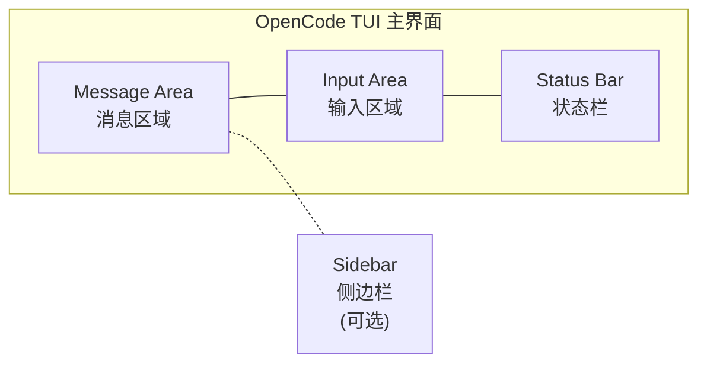
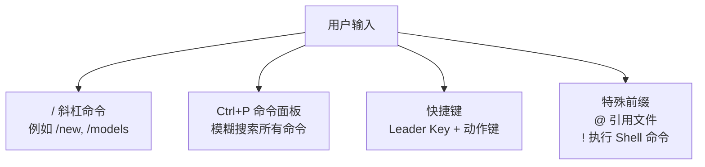
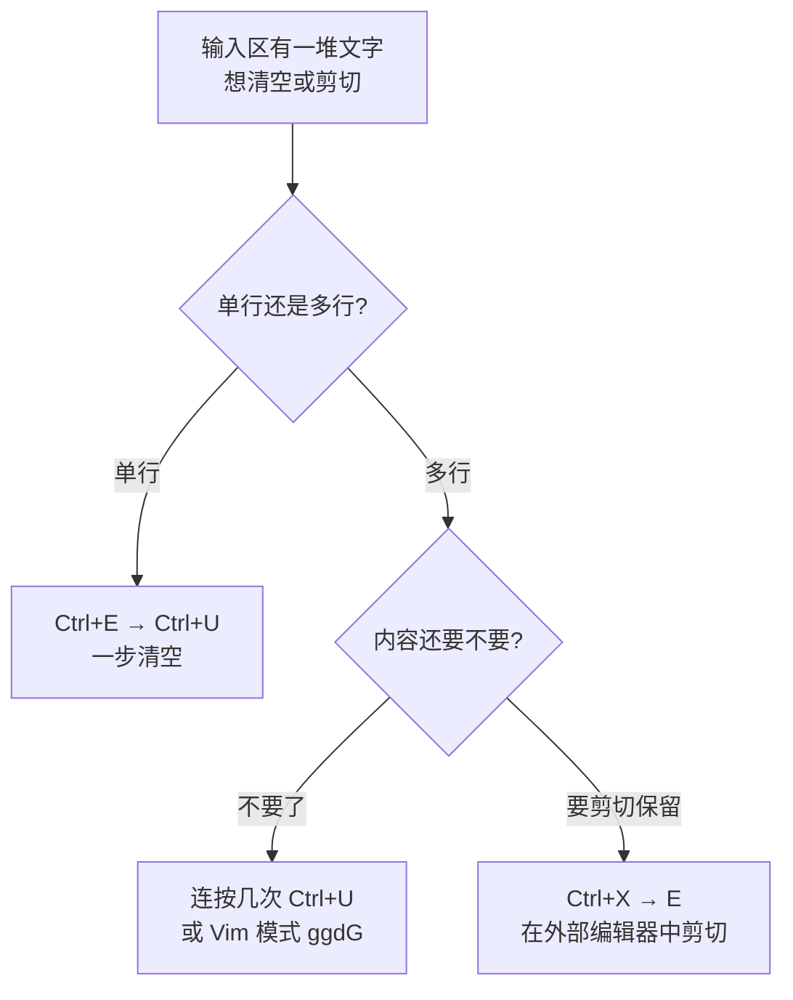

[toc]


> **自报家门**：我是 Claude（由 Anthropic 开发），具体内部版本号我不确定。我拥有联网搜索工具，可在本轮对话中执行搜索。本轮为**正常调研（单轮搜索）**，详略等级 **1（full）**。
>
> **任务确认**：以 CLI/TUI 工具技术布道师身份，面向中文 IT 读者，系统整理 **OpenCode TUI** 的完整快捷键指南。

---

> **内容依据**：OpenCode 官方文档 (opencode.ai/docs/keybinds, opencode.ai/docs/tui)，社区文档 mudrii/opencode-docs v1.2.27，第三方整理 fastshortcuts.com、deepwiki.com (anomalyco/opencode)。知识截止日期约 **2026 年 9 月**。

---

## OpenCode TUI 快捷键完全指南

### OpenCode 简介

**OpenCode** 是一个基于 Go 语言的 CLI 应用程序，将 AI 辅助编码能力引入终端，提供 **TUI（Terminal User Interface，终端用户界面）** 来与多种 AI 模型交互，辅助编码、调试等任务。 截至 2026 年，OpenCode 已获得超过 20 万 GitHub Star，支持 75+ 种 AI 提供商（Provider），注重隐私优先设计。

核心特性包括：交互式 TUI（基于 Bubble Tea 构建）、多 AI 提供商支持（OpenAI、Anthropic Claude、Google Gemini、AWS Bedrock、Groq、Azure OpenAI、OpenRouter 等）、会话管理、工具集成（执行命令/搜索文件/修改代码）、类 Vim 编辑器、SQLite 持久存储、LSP 集成等。

### TUI 界面布局

在了解快捷键前，需要先理解 TUI 的空间分区——每个区域有各自对应的快捷键操作范围。

OpenCode TUI 主屏幕分为以下主要区域：
- **Message Area（消息区域）**：累积显示你的输入提示、AI 回复、工具输出等对话内容
- **Input Area（输入区域）**：多行输入框，支持完整的 **Readline/Emacs 风格** 快捷键
- **Status Bar（状态栏）**：显示当前会话名称、模型、Agent 模式等信息
- **Sidebar（侧边栏，可选）**：右侧面板，显示文件浏览器、工具列表等



### 三种交互方式概览

TUI 提供三种主要的交互方式：
1. **Slash Commands（斜杠命令）** — 在输入框中以 `/` 前缀直接输入命令
2. **Command Palette（命令面板）** — 默认通过 `Ctrl+P` 打开，搜索并执行所有已注册命令
3. **Keybindings（快捷键）** — 直接使用键盘快捷方式执行频繁操作，通常配合 **Leader Key** 使用



此外，输入框中使用 `@` 可以引用文件，它会在当前工作目录下进行模糊文件搜索。 以 `!` 作为首字符则切换到 **Shell 模式**，提交后会直接作为 bash 命令执行。

---

### 核心概念：Leader Key 机制

这是理解 OpenCode TUI 快捷键体系的**核心前提**。

OpenCode 的许多快捷键使用 **Leader Key（领导键）** 机制。这样做是为了**避免与终端自身的快捷键冲突**。默认情况下，`Ctrl+X` 是 Leader Key，许多操作要求你**先按 Leader Key，再按对应的快捷键**。

**操作方式（极其重要）：**

先按 `Ctrl+X`，**松开**后，再按动作键。例如：`Ctrl+X` 然后按 `N` 即可新建会话。**同时按住两个键不会生效**——这是"OpenCode 快捷键不起作用"的最常见原因。

**`leader_timeout`** 参数控制按下 Leader Key 后等待下一个键的时间窗口，默认为 **2000 毫秒**。

部分导航类快捷键故意**不**使用 Leader Key，可以直接按下即生效。

> **助记**：可以将 `<leader>` 理解为类似 Vim 的 `<leader>` 键，只不过 OpenCode 默认绑定到了 `Ctrl+X`。

---

### 全部默认快捷键速查

以下表格基于官方文档中 `tui.json` 的完整默认配置整理。表中 `<leader>` 即 `Ctrl+X`（默认）。

#### 应用级（Application）快捷键

这些快捷键在 TUI 的**任何位置**都生效，控制整个应用的行为。

| 动作名                                | 默认快捷键                      | 说明                                                         |
| ------------------------------------- | ------------------------------- | ------------------------------------------------------------ |
| `app_exit`                            | `Ctrl+C`, `Ctrl+D`, `<leader>q` | **退出** OpenCode                                            |
| `command_list`                        | `Ctrl+P`                        | 打开**命令面板**（Command Palette），模糊搜索所有可用命令    |
| `help_show`                           | `none`                          | 显示帮助对话框                                               |
| `docs_open`                           | `none`                          | 打开文档                                                     |
| `editor_open`                         | `<leader>e`                     | 打开**外部编辑器**编写消息（使用 `$EDITOR` 环境变量指定的编辑器） |
| `theme_list`                          | `<leader>t`                     | 列出/切换**主题**                                            |
| `theme_switch_mode`                   | `none`                          | 切换主题模式                                                 |
| `theme_mode_lock`                     | `none`                          | 锁定主题模式                                                 |
| `sidebar_toggle`                      | `<leader>b`                     | 切换**侧边栏**显示/隐藏                                      |
| `scrollbar_toggle`                    | `none`                          | 切换滚动条                                                   |
| `status_view`                         | `<leader>s`                     | 查看**状态信息**                                             |
| `app_debug`                           | `none`                          | 调试模式（默认禁用）                                         |
| `app_console`                         | `none`                          | 控制台（默认禁用）                                           |
| `app_heap_snapshot`                   | `none`                          | 堆快照（默认禁用）                                           |
| `app_toggle_animations`               | `none`                          | 切换动画                                                     |
| `app_toggle_file_context`             | `none`                          | 切换文件上下文                                               |
| `app_toggle_diffwrap`                 | `none`                          | 切换 diff 换行                                               |
| `app_toggle_paste_summary`            | `none`                          | 切换粘贴摘要                                                 |
| `app_toggle_session_directory_filter` | `none`                          | 切换会话目录过滤                                             |

> **提示**：值为 `none` 表示该功能默认未分配快捷键，可通过 `/` 斜杠命令或命令面板访问，也可自行在 `tui.json` 中绑定。

#### 会话管理（Session）快捷键

会话是 OpenCode 的核心工作单元，管理对话的生命周期。

| 动作名              | 默认快捷键  | 说明                          |
| ------------------- | ----------- | ----------------------------- |
| `session_new`       | `<leader>n` | **新建会话**                  |
| `session_list`      | `<leader>l` | 打开**会话列表**              |
| `session_timeline`  | `<leader>g` | 会话**时间线**                |
| `session_export`    | `<leader>x` | **导出**当前会话为 Markdown   |
| `session_compact`   | `<leader>c` | **压缩**当前会话（summarize） |
| `session_rename`    | `Ctrl+R`    | **重命名**当前会话            |
| `session_delete`    | `Ctrl+D`    | **删除**当前会话              |
| `session_interrupt` | `Escape`    | **中断**当前 AI 的响应        |
| `session_fork`      | `none`      | 分叉会话                      |
| `session_share`     | `none`      | 分享会话                      |
| `session_unshare`   | `none`      | 取消分享                      |
| `session_copy`      | `none`      | 复制会话                      |
| `session_move`      | `none`      | 移动会话                      |

#### 子 Agent 会话导航（Subagent Session Navigation）

OpenCode 支持嵌套会话（子对话），可以在它们之间切换。子 Agent 会话的默认导航键如下：

| 动作名                        | 默认快捷键     | 说明                   |
| ----------------------------- | -------------- | ---------------------- |
| `session_child_first`         | `<leader>Down` | 进入**第一个**子会话   |
| `session_child_cycle`         | `Right`        | 切换到**下一个**子会话 |
| `session_child_cycle_reverse` | `Left`         | 切换到**上一个**子会话 |
| `session_parent`              | `Up`           | 返回**父会话**         |

> 注意这组快捷键中 `Right`、`Left`、`Up` 三个方向键**不需要** Leader Key 前缀，可直接按下使用。

#### 消息区域（Messages）快捷键

| 动作名                 | 默认快捷键  | 说明                   |
| ---------------------- | ----------- | ---------------------- |
| `messages_copy`        | `<leader>y` | **复制**选中的消息内容 |
| `messages_scroll_up`   | —           | 向上滚动消息           |
| `messages_scroll_down` | —           | 向下滚动消息           |

#### 模型与 Agent

| 动作名     | 默认快捷键（斜杠命令） | 说明                        |
| ---------- | ---------------------- | --------------------------- |
| 切换模型   | `/models`              | 列出并切换可用模型          |
| 切换 Agent | `/agents` 或 `Ctrl+X` → `A` | 列出并切换主 Agent（`build`/`plan`），`Shift+Tab` 快速循环 |
| 连接提供商 | `/connect`             | 添加 AI 提供商及其 API 密钥 |

> **主 Agent 分工**（依据 V2 官方 Agents 文档，2026-10-15 核验）：`build` 为默认编码 Agent，工具默认放行；`plan` 只探索规划，不改正常项目文件。固定新会话默认 Agent 在 `opencode.json(c)` 配 `"default_agent": "plan"`（已有会话不受影响）；非交互式用 `opencode run --agent plan "…"` 指定。

#### 输入区域编辑（Input）快捷键

输入区域支持 **Readline/Emacs 风格**的文本编辑快捷键。这些快捷键是内置的，目前**不能**通过 `opencode.json` 自定义。

来自源码的确认：这些快捷键包括 `Ctrl+A` / `Ctrl+E`（行首/行尾），`Ctrl+K`（删除到行尾），`Ctrl+U`（删除到行首），`Ctrl+W` / `Alt+Backspace`（删除前一个词）。

**光标移动类**

| 快捷键   | 说明                                 |
| -------- | ------------------------------------ |
| `Ctrl+A` | 移动到**行首**                       |
| `Ctrl+E` | 移动到**行尾**                       |
| `Ctrl+F` | **向前**移动一个字符（等同 `Right`） |
| `Ctrl+B` | **向后**移动一个字符（等同 `Left`）  |
| `Alt+F`  | 向前移动**一个单词**                 |
| `Alt+B`  | 向后移动**一个单词**                 |

**删除类**

| 快捷键          | 说明                                                    |
| --------------- | ------------------------------------------------------- |
| `Ctrl+K`        | 删除从光标到**行尾**的所有内容（Kill to end of line）   |
| `Ctrl+U`        | 删除从光标到**行首**的所有内容（Kill to start of line） |
| `Ctrl+W`        | 删除光标前的**一个单词**                                |
| `Alt+Backspace` | 同 `Ctrl+W`，删除前一个词                               |
| `Ctrl+D`        | 删除光标处字符（或在空行时退出）                        |
| `Ctrl+H`        | 退格删除（等同 `Backspace`）                            |

**撤销与粘贴**

| 动作名        | 默认快捷键                    | 说明                   |
| ------------- | ----------------------------- | ---------------------- |
| `input_undo`  | `Ctrl+Z`, `Ctrl+-`, `Super+Z` | **撤销**上一步输入操作 |
| `input_paste` | `Ctrl+V`                      | **粘贴**               |

在 Windows 平台上，`input_undo` 默认绑定了 `Ctrl+Z`、`Ctrl+-`、`Super+Z`。这是因为 Windows 终端不支持 POSIX suspend 信号（即不会像 Unix 那样把 `Ctrl+Z` 解释为挂起进程）。

**提交与换行**

| 快捷键        | 说明                         |
| ------------- | ---------------------------- |
| `Enter`       | **提交**当前输入，发送给 AI  |
| `Shift+Enter` | 插入**换行**（不提交）       |
| `Ctrl+Enter`  | 插入换行（备选）             |
| `Alt+Enter`   | 插入换行（备选）             |
| `Ctrl+J`      | 插入换行（**最可靠**的方式） |

某些终端默认不会正确发送带修饰键的 Enter。你可能需要配置终端以将 `Shift+Enter` 发送为特定的转义序列。

> **Windows Terminal 用户特别注意**：需要在 Windows Terminal 的 `settings.json` 中添加 `sendInput` 动作，将 `Shift+Enter` 映射为 `\u001b[13;2u` 转义序列，保存后重启终端或打开新标签页生效。
>
> 如果 `Shift+Enter` 依然无效，使用 `Ctrl+J` 是最可靠的换行方式。

#### 挂起（Suspend）

| 动作名             | 默认快捷键          | 说明                                |
| ------------------ | ------------------- | ----------------------------------- |
| `terminal_suspend` | `Ctrl+Z`（仅 Unix） | 挂起 OpenCode 进程（POSIX suspend） |

在 Windows 平台上，`terminal_suspend` 被**强制设为 `none`**，因为原生 Windows 终端不支持 POSIX suspend。

---

### 斜杠命令（Slash Commands）速查

在 OpenCode TUI 中，输入 `/` 加命令名即可快速执行操作。 单独输入 `/` 可查看当前会话中所有可用命令的完整列表。

| 斜杠命令    | 别名          | 说明                        | 对应快捷键  |
| ----------- | ------------- | --------------------------- | ----------- |
| `/new`      | `/clear`      | 新建会话                    | `<leader>n` |
| `/sessions` | —             | 列出所有会话                | `<leader>l` |
| `/models`   | —             | 列出/切换模型               | —           |
| `/agents`   | —             | 列出/切换 Agent（build/plan） | `Ctrl+X` → `A`，`Shift+Tab` 循环 |
| `/compact`  | `/summarize`  | 压缩当前会话                | `<leader>c` |
| `/editor`   | —             | 用外部编辑器编写消息        | `<leader>e` |
| `/export`   | —             | 导出对话为 Markdown         | `<leader>x` |
| `/help`     | —             | 显示帮助                    | —           |
| `/connect`  | —             | 添加 AI 提供商              | —           |
| `/init`     | —             | 引导创建/更新 `AGENTS.md`   | —           |
| `/share`    | —             | 分享会话                    | —           |
| `/undo`     | —             | 撤销文件修改（需 Git 仓库） | —           |
| `/redo`     | —             | 重做文件修改（需 Git 仓库） | —           |
| `/exit`     | `/quit`, `/q` | 退出 OpenCode               | `Ctrl+C` 等 |

注意：`/undo` 和 `/redo` 底层使用 **Git**，因此只在 Git 仓库的项目中有效。

---

### 输入区特殊前缀

| 前缀字符 | 功能                             | 示例                         |
| -------- | -------------------------------- | ---------------------------- |
| `/`      | 触发**斜杠命令**                 | `/models`                    |
| `@`      | **引用文件**（模糊搜索工作目录） | `请检查 @src/main.ts 的逻辑` |
| `!`      | **执行 Shell 命令**              | `!ls -la`                    |

通过 `@` 引用的文件内容会自动添加到对话上下文中。 `@alias` 可以添加已配置的引用根目录作为上下文，`@alias/` 可以自动补全该引用目录下的文件。

---

### Vim 模式

可以通过 `tui.vimMode` 启用 Vim 模式，或在命令面板中切换。启用后编辑器默认进入 **INSERT** 模式，按 `Esc` 切换到 **NORMAL** 模式。

这对于 Vim 用户来说非常自然——在 NORMAL 模式下可以使用 `h`/`j`/`k`/`l` 移动光标、`w`/`b` 词级移动、`dd` 删行等常见 Vim 操作；按 `i`/`a`/`o` 等回到 INSERT 模式继续输入。

---

### 跨平台差异说明

OpenCode 的键绑定系统使用 `mod` 作为跨平台抽象修饰键：在 **macOS** 上映射为 `Command`，在 **Windows/Linux** 上映射为 `Control`。

重要的平台差异汇总：

| 特性               | Unix (Linux/macOS)        | Windows                            |
| ------------------ | ------------------------- | ---------------------------------- |
| `Ctrl+Z` 行为      | POSIX suspend（挂起进程） | 绑定到 `input_undo`（撤销）        |
| `terminal_suspend` | 可用                      | 强制 `none`                        |
| `Shift+Enter` 换行 | 多数终端直接支持          | 可能需要在终端中额外配置转义序列   |
| `Ctrl+J` 换行      | 可用                      | 可用（**最可靠**的跨平台换行方式） |

---

### 自定义快捷键

#### 配置文件位置

TUI 行为可以通过 `tui.json`（或 `tui.jsonc`）文件自定义。 此文件**独立于** `opencode.json`（后者用于配置服务端/运行时行为）。

配置文件位置：

- **全局配置**：`~/.config/opencode/tui.json`
- **项目级配置**：项目根目录下的 `tui.json`
- **自定义路径**：通过环境变量 `OPENCODE_TUI_CONFIG` 指定

旧版在 `opencode.json` 中的 `theme`、`keybinds`、`tui` 配置键已弃用，会在可能时自动迁移。

#### 配置语法

**`keybinds` 配置会与内置默认值合并**，因此你只需要配置想要修改的快捷键。

基本的 `tui.json` 结构：

```json
{
  "$schema": "https://opencode.ai/tui.json",
  "leader_timeout": 2000,
  "keybinds": {
    "leader": "ctrl+x",
    "session_new": "<leader>n",
    "session_list": "<leader>l",
    "command_list": "ctrl+p",
    "app_exit": "ctrl+c,ctrl+d,<leader>q"
  }
}
```

各字段说明：

| 字段              | 类型     | 说明                                                       |
| ----------------- | -------- | ---------------------------------------------------------- |
| `$schema`         | `string` | JSON Schema 地址，提供编辑器自动补全和校验                 |
| `leader_timeout`  | `number` | Leader Key 按下后等待下一键的超时时间（毫秒），默认 `2000` |
| `keybinds`        | `object` | 键值对，key 为动作名，value 为快捷键字符串                 |
| `keybinds.leader` | `string` | Leader Key 本身的绑定，默认 `ctrl+x`                       |

#### 绑定值的格式

快捷键字符串使用 `+` 连接修饰键和主键。

同一个动作绑定**多个快捷键**时，用**逗号分隔**。

也可以使用**数组**来绑定多个快捷键。

高级场景下，可以使用**对象**形式指定 `key`、`event`、`preventDefault`、`fallthrough` 等属性。

几种写法对照：

```json
{
  "keybinds": {
    "app_exit": "ctrl+c,ctrl+d,<leader>q",

    "messages_copy": ["<leader>y", "ctrl+shift+c"],

    "input_paste": {
      "key": "ctrl+v",
      "preventDefault": false
    }
  }
}
```

| 写法                                             | 适用场景                   |
| ------------------------------------------------ | -------------------------- |
| 逗号分隔字符串 `"ctrl+c,ctrl+d"`                 | 简洁地为同一动作绑定多个键 |
| 数组 `["<leader>y", "ctrl+shift+c"]`             | 等价写法，可读性更好       |
| 对象 `{ "key": "...", "preventDefault": false }` | 需要精细控制事件行为时使用 |

对象写法中各属性：

| 属性             | 类型      | 说明                 |
| ---------------- | --------- | -------------------- |
| `key`            | `string`  | 快捷键字符串         |
| `event`          | `string`  | 触发的事件类型       |
| `preventDefault` | `boolean` | 是否阻止默认行为     |
| `fallthrough`    | `boolean` | 是否允许事件继续传递 |

#### 禁用快捷键

将快捷键的值设为 `"none"` 或 `false` 即可禁用该绑定。

```json
{
  "keybinds": {
    "session_compact": "none"
  }
}
```

#### 使用 `<leader>` 变量

在绑定值中使用 `<leader>` 标记引用 Leader Key。这样当你修改了 `leader` 的实际绑定时，所有包含 `<leader>` 的绑定会自动跟随变化。

---

### 完整默认快捷键配置参考

以下是从官方文档提取的**完整默认 `tui.json` keybinds 配置**，一次性展示所有可配置的动作名和默认值：

完整的默认配置包含以下所有动作绑定（来源：官方 keybinds 文档）：

| 分类       | 动作名                                | 默认值                    |
| ---------- | ------------------------------------- | ------------------------- |
| **Leader** | `leader`                              | `ctrl+x`                  |
| **应用**   | `app_exit`                            | `ctrl+c,ctrl+d,<leader>q` |
|            | `app_debug`                           | `none`                    |
|            | `app_console`                         | `none`                    |
|            | `app_heap_snapshot`                   | `none`                    |
|            | `app_toggle_animations`               | `none`                    |
|            | `app_toggle_file_context`             | `none`                    |
|            | `app_toggle_diffwrap`                 | `none`                    |
|            | `app_toggle_paste_summary`            | `none`                    |
|            | `app_toggle_session_directory_filter` | `none`                    |
| **命令**   | `command_list`                        | `ctrl+p`                  |
|            | `help_show`                           | `none`                    |
|            | `docs_open`                           | `none`                    |
| **编辑器** | `editor_open`                         | `<leader>e`               |
| **主题**   | `theme_list`                          | `<leader>t`               |
|            | `theme_switch_mode`                   | `none`                    |
|            | `theme_mode_lock`                     | `none`                    |
| **界面**   | `sidebar_toggle`                      | `<leader>b`               |
|            | `scrollbar_toggle`                    | `none`                    |
|            | `status_view`                         | `<leader>s`               |
| **会话**   | `session_export`                      | `<leader>x`               |
|            | `session_copy`                        | `none`                    |
|            | `session_move`                        | `none`                    |
|            | `session_new`                         | `<leader>n`               |
|            | `session_list`                        | `<leader>l`               |
|            | `session_timeline`                    | `<leader>g`               |
|            | `session_fork`                        | `none`                    |
|            | `session_rename`                      | `ctrl+r`                  |
|            | `session_delete`                      | `ctrl+d`                  |
|            | `session_share`                       | `none`                    |
|            | `session_unshare`                     | `none`                    |
|            | `session_interrupt`                   | `escape`                  |
|            | `session_compact`                     | `<leader>c`               |
| **消息**   | `messages_copy`                       | `<leader>y`               |
| **输入**   | `input_undo`                          | `ctrl+z,ctrl+-,super+z`   |
|            | `input_paste`                         | `ctrl+v`                  |
| **子会话** | `session_child_first`                 | `<leader>down`            |
|            | `session_child_cycle`                 | `right`                   |
|            | `session_child_cycle_reverse`         | `left`                    |
|            | `session_parent`                      | `up`                      |

---

### TUI 其他配置项

在 `tui.json` 中除了 `keybinds` 外，还有一些影响交互体验的配置值得了解：

| 配置项                        | 默认值       | 说明                                                   |
| ----------------------------- | ------------ | ------------------------------------------------------ |
| `theme`                       | `"opencode"` | 主题名                                                 |
| `leader_timeout`              | `2000`       | Leader Key 超时（毫秒）                                |
| `scroll_speed`                | `3`          | 滚动速度（最小 0.001，支持小数）                       |
| `scroll_acceleration.enabled` | `false`      | macOS 风格滚动加速，启用后覆盖 `scroll_speed`          |
| `diff_style`                  | `"auto"`     | Diff 渲染风格：`"auto"` 适配终端宽度，`"stacked"` 单列 |
| `mouse`                       | `true`       | 是否启用鼠标支持                                       |
| `cursor.style`                | `"block"`    | 光标样式：`"block"`/`"underline"`/`"line"`/`"default"` |
| `cursor.blinking`             | `true`       | 光标是否闪烁                                           |
| `attention.enabled`           | —            | 启用桌面通知和提示音                                   |
| `attention.sound`             | —            | 启用声音                                               |
| `attention.volume`            | `0.4`        | 音量                                                   |

---

### 日常高频操作速查卡

OpenCode TUI 的快捷键设计源于 **Bash/Readline**，加上自身的 **Leader Key 系统**。与其死记硬背整张表，不如理解**分类逻辑**——移动、选择、删除、提交——将常用键融入日常操作即可。

以下按使用频率排列最常用的操作：

**每天都用的（必记）**

| 操作         | 快捷键         | 备注                     |
| ------------ | -------------- | ------------------------ |
| 提交消息     | `Enter`        | —                        |
| 插入换行     | `Ctrl+J`       | 最可靠，跨平台通用       |
| 中断 AI 回复 | `Escape`       | 立即停止当前响应         |
| 新建会话     | `Ctrl+X` → `N` | 清空当前对话             |
| 打开命令面板 | `Ctrl+P`       | 不记得快捷键时的万能入口 |
| 退出         | `Ctrl+C`       | —                        |

**经常用的（建议记）**

| 操作           | 快捷键         | 备注                 |
| -------------- | -------------- | -------------------- |
| 会话列表       | `Ctrl+X` → `L` | 切换历史会话         |
| 切换模型       | `/models`      | 斜杠命令方式         |
| 打开外部编辑器 | `Ctrl+X` → `E` | 适合编写长提示词     |
| 复制消息       | `Ctrl+X` → `Y` | 复制 AI 回复         |
| 压缩会话       | `Ctrl+X` → `C` | 对话过长时压缩上下文 |
| 撤销文件更改   | `/undo`        | 需要 Git 仓库        |
| 切换侧边栏     | `Ctrl+X` → `B` | 显示/隐藏文件树      |

**偶尔用的（知道就行）**

| 操作       | 快捷键         | 备注            |
| ---------- | -------------- | --------------- |
| 会话时间线 | `Ctrl+X` → `G` | 查看操作历史    |
| 导出会话   | `Ctrl+X` → `X` | 导出为 Markdown |
| 重命名会话 | `Ctrl+R`       | 无需 Leader Key |
| 切换主题   | `Ctrl+X` → `T` | 审美切换        |
| 查看状态   | `Ctrl+X` → `S` | 诊断信息        |


## 清空/剪切输入区内容的方法

### 单行内容（最常见场景）

输入区只有一行时，一个快捷键就够了：

| 方法                | 操作                 | 说明                                                         |
| ------------------- | -------------------- | ------------------------------------------------------------ |
| **`Ctrl+U`**        | 直接按               | 删除从光标到**行首**的全部内容。如果光标已在行尾，等于清空整行 |
| `Ctrl+A` → `Ctrl+K` | 先跳行首，再删到行尾 | 无论光标在哪都能清空                                         |

> 如果光标不确定在哪，**`Ctrl+E`（跳到行尾）再 `Ctrl+U`（删到行首）**是最保险的组合。

### 多行内容（写了一大段提示词）

问题在于 `Ctrl+U` 和 `Ctrl+K` 是 **Readline 风格**，只作用于**当前行**，不会一次性清掉所有行。对付多行内容有以下策略：

**方法一：重复 `Ctrl+U`（简单粗暴）**

每按一次 `Ctrl+U` 清一行，连续按几次就清完了。行数不多时这是最快的方式。

**方法二：开外部编辑器（推荐，适合"剪切走"）**

如果你想把已输入的内容**剪切保存**而非直接丢弃：

1. 按 **`Ctrl+X` → `E`** 打开外部编辑器（`$EDITOR`，如 Vim / nano / VS Code）
2. 在编辑器中 **全选 → 剪切**（Vim 里 `ggVGd`，nano 里 `Ctrl+6` 全选再 `Ctrl+K`）
3. 保存退出，输入区就空了，内容留在系统剪贴板

这个方法的好处是内容不会丢失，可以粘贴到别处。

**方法三：启用 Vim 模式后一键清空**

如果你在 `tui.json` 中启用了 `vimMode`：

1. 按 `Esc` 进入 **NORMAL** 模式
2. 输入 `gg` 跳到首行，然后 `dG` 删除到末尾

即 **`Esc` → `ggdG`**，整个输入区瞬间清空。

**方法四：直接新建会话**

如果你不仅想清空输入区，连对话也不想要了：

- **`Ctrl+X` → `N`**（新建会话）— 输入区和消息区全部重置

### 小结



**最实用的记忆**：日常大多数情况 **`Ctrl+U`** 就够了；写了很长的多行提示词想带走，用 **`Ctrl+X` → `E`** 跳到编辑器里操作最灵活。

### 常见问题排查

**问题：快捷键完全不响应**

"同时按住两个键不会生效——这是'OpenCode 快捷键不起作用'的最常见原因。" 确保操作方式是：**先按 `Ctrl+X` 然后松开**，再在 2 秒内按动作键。

**问题：`Shift+Enter` 无法换行**

- OpenCode 将换行映射到 `Shift+Enter`、`Ctrl+Enter`、`Alt+Enter` 和 `Ctrl+J`。
- 如果 `Shift+Enter` 不生效，检查你的终端是否正确传递了该键序列。推荐改用 **`Ctrl+J`**，或使用 **Ghostty**、**Warp** 等原生支持的现代终端。

**问题：`Ctrl+Z` 行为不符合预期**

- 在 **Unix** 系统：`Ctrl+Z` 默认会**挂起**（suspend）OpenCode 进程
- 在 **Windows** 系统：`Ctrl+Z` 被重映射为**撤销**（undo）

**问题：`Ctrl+D` 意外退出**

`Ctrl+D` 同时绑定了 `app_exit` 和 `session_delete`，这取决于当前焦点上下文。如果你容易误触，可以在 `tui.json` 中将 `app_exit` 改为仅保留 `ctrl+c,<leader>q`，去掉 `ctrl+d`。

---

### 参考资源

| 来源                       | 链接                                                         |
| -------------------------- | ------------------------------------------------------------ |
| 官方 Keybinds 文档         | https://opencode.ai/docs/keybinds/                           |
| 官方 TUI 文档              | https://opencode.ai/docs/tui/                                |
| 官方配置文档               | https://opencode.ai/docs/config/                             |
| tui.json Schema            | https://opencode.ai/tui.json                                 |
| 社区完整文档 (v1.2.27)     | https://github.com/mudrii/opencode-docs                      |
| FastShortcuts 整理         | https://fastshortcuts.com/shortcuts/opencode/                |
| OpenCode School Cheatsheet | https://opencode.school/cheatsheet/                          |
| DeepWiki 源码级分析        | https://deepwiki.com/anomalyco/opencode/9.2-tui-commands-and-keybindings |