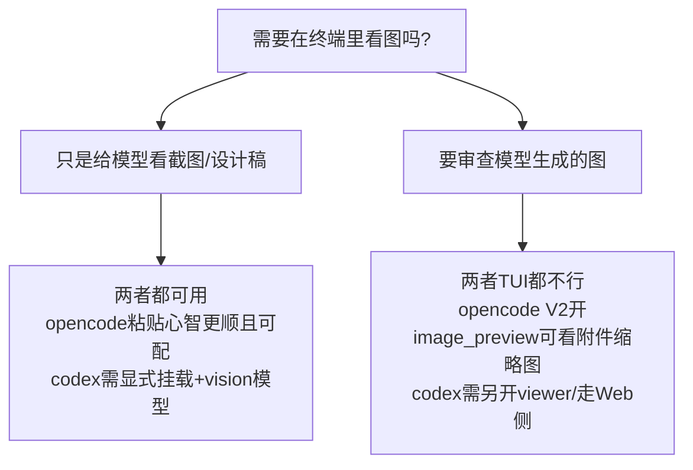

[toc]

## abstract

本文对比 **opencode TUI** 与 **Codex CLI/TUI** 的图片预览、token速度显示与总体功能。核验日期为 **2026-10-10**。

先给结论：**两家都是“图片输入可用，终端内像素预览缺席或默认关闭；token实时速度仅opencode V2原生支持”。**

| 维度 | opencode TUI | Codex CLI/TUI |
| --- | --- | --- |
| 图片输入（给模型看图） | 支持：粘贴、`@`引用、`read`工具、拖放 | 支持：`--image/-i`、TUI粘贴、拖拽、路径自动识别 |
| 图片输出（在终端里看到图） | V1无；V2有图形预览但默认全关 | TUI无通用内联预览，仅`Viewed Image`文字 |
| token速度（tok/s） | V1无，V2 `session.tps=true`显示output tok/s | 无实时速率，仅`/status`用量+`exec --json`事后usage |
| 终端图形协议 | Kitty -> Sixel -> Unicode块降级，无iTerm2 1337 | 仅pets玩具用Kitty+Sixel，无iTerm2 1337，artifact预览只是未合并原型 |
| 主要坑 | `Cmd+V`在macOS无效，需`Ctrl+V`；MCP落盘图只显示路径 | macOS必须`Ctrl+V`而非`Cmd+V`；tmux下禁用；VSCode终端Sixel检测bug |

---

## 1. opencode TUI

### 1.1 版本差异

| | V1（1.x，如1.18.x） | V2（v2分支，@opencode/tui 2.0.x） |
| --- | --- | --- |
| 图形预览 | 无，只显示`[Image #N]`占位符 | 有，OpenTUI `<image protocol="auto">`，默认全关 |
| 引入点 | — | 2026-08-10 PR #41603 `feat(tui): add clipboard image previews and transcript rendering` |
| 预览配置 | `tui.json(c)`，无图片项 | 全局`~/.config/opencode/cli.json`新增`prompt.image_preview` / `session.image_preview` |

### 1.2 协议栈

`auto = Kitty graphics -> Sixel -> Unicode象限块降级`，失败显示`No preview`文本。

* 强制协议：`OPENTUI_IMAGE_PROTOCOL=auto|kitty|sixel|blocks`，`OPENTUI_GRAPHICS=false`关闭检测。
* **不支持iTerm2 inline images（OSC 1337）**，协议枚举只有`auto|kitty|sixel|blocks`。
* tmux下`auto`倾向直接用blocks；Sixel需终端像素几何信息，否则回退blocks。

上游文档：[OpenTUI Image](https://opentui.com/docs/components/image/)、[Terminal capabilities](https://opentui.com/docs/reference/terminal-capabilities/)。

代码位置（v2 HEAD 2026-10-09，共5处`protocol="auto"`）：

* `packages/tui/src/component/prompt/index.tsx:1713`（输入框预览）
* `routes/session/index.tsx:2540`（transcript）
* `component/dialog-image-preview.tsx:53`（全屏查看器）
* `feature-plugins/system/diff-viewer-image.tsx:71`（diff图片）
* `mini/footer.prompt.tsx:301`（mini模式）

### 1.3 输入路径

* **剪贴板粘贴**：`Ctrl+V`（macOS上`Cmd+V`不行）。粘贴后显示`[Image #N]`。见issue [#906](https://github.com/sst/opencode/issues/906)。
* **拖放**：终端以文本路径形式贴入，由`local-attachment.ts`解析路径/`file://` URL并转`data:` URI附件；行为随终端而异。
* **`@`引用图片文件**：走文件附件通道，能否进模型取决于是否为vision模型。
* **`read`工具读图**：按内容识别PNG/JPEG/GIF/WebP，上限20MiB源码数据，受`media.image`归一化限制。见[V2 Attachments](https://opencode.ai/v2/docs/attachments/)。
* **Markdown图片``**：只做文本渲染，不渲染成图形。
* **模型返回图**：模型只返回文本；图只能以tool-result附件（`data:image/`）形式出现，`session/index.tsx:2504`受`session.image_preview`门控。MCP/工具落盘的纯路径图片仍只显示文本路径，这是[#24769](https://github.com/sst/opencode/issues/24769)的未解决缺口。

### 1.4 配置/快捷键/命令

| 项 | 值 |
| --- | --- |
| `cli.json` | `prompt.image_preview`默认`false`；`session.image_preview`默认`false`；`session.markdown: rendered\|source` |
| `opencode.json(c)` | V1 `attachment.image` -> V2 `media.image{auto_resize=true,max_width=2000,max_height=2000,max_base64_bytes=5242880}` |
| 快捷键 | `prompt.paste=ctrl+v`；`prompt.images.view=<leader>i`（默认leader `ctrl+x`，即`ctrl+x i`开查看器）。TUI内`Ctrl+P` -> Open settings可改 |
| `/image`命令 | 不存在。V1/V2命令表均无图片命令 |
| 支持格式 | PNG/JPEG/GIF/WebP可见；SVG按文本；PDF/AVIF/BMP/音视频不支持，需先转图 |

官方位置：[V2 Attachments](https://opencode.ai/v2/docs/attachments/)、[V2 CLI config](https://opencode.ai/v2/docs/cli/config/)、[V2 CLI keybinds](https://opencode.ai/v2/docs/cli/keybinds/)、[V1 TUI](https://opencode.ai/docs/tui/)。

---

## 2. Codex CLI/TUI

### 2.1 图片输入：支持

官方文档：[Codex CLI](https://developers.openai.com/codex/cli)明确`codex --image` / `paste an image into the interactive composer`。

| 入口 | 用法 |
| --- | --- |
| 启动flag | `codex -i screenshot.png "..."` / `codex --image a.png,b.jpg "..."` / 可重复`-i`；`codex exec --image ... -- "..."` |
| TUI内粘贴 | `Ctrl+V`（WSL为`Ctrl+Alt+V`），存为`codex-clipboard-*.png`再挂载 |
| 拖拽 | 显示`[image: filename.png]`占位符，支持`file://`、空格/括号文件名 |
| 路径自动识别 | 键入`Look at screenshot.png`自动作为`LocalImage`附带 |

格式以PNG/JPEG为主，社区口径GIF只读首帧、WebP亦可；BMP/TIFF/SVG/HEIC需先转PNG/JPEG。

两个坑：

* **macOS必须`Ctrl+V`而非`Cmd+V`**。TUI只监听`Ctrl+V`快捷键路径，终端原生`Paste(String)`只收文本。见[#10523](https://github.com/openai/codex/issues/10523)、[#24322](https://github.com/openai/codex/issues/24322)。Finder复制已存盘文件时两者都可（贴的是路径）；截图只放raw pixels时Ghostty等需后台daemon转存。
* **Agent不能按路径自主读图**，必须显式挂载。`read this screenshot from path X`会被拒或不稳定。

模型门控已代码化（2026-02-03 commit `7e07ec8 Gate image inputs by model modalities`）：非vision模型禁用粘贴+拦截含图提交。`config.toml`无预览开关，`hide_agent_reasoning`与图片无关。`/diff`+图片无官方证据。

### 2.2 图片输出/预览：不支持

* `view_image`/`image_gen`/MCP `ImageContent`只显示`Viewed Image`文字+路径，需另开viewer。
* 追踪issue [#29451 Show image artifacts inline in the Codex TUI](https://github.com/openai/codex/issues/29451)（2026-06-22，仍open）：提案Kitty优先+Sixel兜底+否则纯文本，原型复用pets路径但未合并。
* 复现issue [#35755](https://github.com/openai/codex/issues/35755)（2026-07-28，Warp+Kitty仍无预览）：`view_image succeeds but no inline image is rendered`，与#29451互证。
* iTerm2协议明确不在路上：[#6123](https://github.com/openai/codex/issues/6123)于2025-12-31以`not_planned`关闭。

### 2.3 终端兼容性（源码级）

唯一已落地图形栈是ambient pets（2026-05-12 commit `95b332c`），`codex-rs/tui/src/pets/image_protocol.rs`：

| 终端 | 状态 |
| --- | --- |
| Ghostty/Kitty/WezTerm | Kitty graphics可用（pets已验证） |
| Windows Terminal/foot/mlterm | Sixel分支 |
| iTerm2 | 无原生1337；`TERM=xterm-kitty`强制走Kitty会在SSH下刷`Gi=0;OK`垃圾（#37454） |
| Warp | 自称支持Kitty，但`view_image`仍无预览（#35755） |
| VSCode集成终端 | Sixel检测bug：`TERM_PROGRAM=vscode`掩盖能力，需`env -u TERM_PROGRAM TERM=xterm-sixel`绕过（#27335） |
| tmux/zellij | 有意禁用，防scrollback错乱 |
| 2026-08 changelog中`display screenshots in Codex web` | Web侧，非TUI |

官方位置：[Codex CLI](https://developers.openai.com/codex/cli)、[CLI reference](https://developers.openai.com/codex/cli/reference)、[Configuration](https://developers.openai.com/codex/configuration)、仓库[openai/codex](https://github.com/openai/codex)。

---

## 3. 对比与选型建议

| | opencode | Codex |
| --- | --- | --- |
| 粘贴 | `Ctrl+V`，`[Image #N]` | `Ctrl+V`/`Ctrl+Alt+V(WSL)`，`[image: xxx]` |
| 命令行挂载 | 无等价`--image` | `codex --image/-i` |
| 按路径读图 | `read`工具可读图给模型 | 不可靠，必须显式挂载 |
| 输出预览开关 | V2 `prompt.image_preview` / `session.image_preview` | 无 |
| 协议 | Kitty/Sixel/blocks | 仅pets用Kitty/Sixel |
| iTerm2 1337 | 不支持 | 不支持 |

实操建议：

* 要在终端看缩略图，优先用opencode V2并打开两个`image_preview`，终端选Kitty/Ghostty/WezTerm；tmux、VSCode集成终端、旧Windows Terminal先做兼容性验证。
* Codex看生成图不要等TUI，直接开文件或走Web/Cloud前端；长任务中把截图路径写进任务记录，避免指望模型自主按路径读图。

---

## 4. token速度显示

### 4.1 Codex：无实时tok/s

| 能力 | 状态 | 说明 |
| --- | --- | --- |
| `/status` | 有 | 本会话配置+用量，非速率 |
| `/usage [daily\|weekly\|cumulative]` | 有 | 账户52周活动图+Lifetime/Peak/Streak |
| `/statusline`底部常驻栏 | 有 | 可配model、context%、5h/weekly限额、git/session/cwd/version；无tok/s、无成本、无耗时，对应`~/.codex/config.toml`的`tui.status_line` |
| reasoning区速率/`--verbose`速率/实时成本 | 无 | RFC #5085明确“无可见性”，企业版才有analytics dashboard |
| `codex exec --json` | 仅完成时有usage | `turn.completed.usage{input_tokens,cached_input_tokens,output_tokens,reasoning_output_tokens}`，无速率字段，需外部计时自算 |

来源：[Codex non-interactive](https://developers.openai.com/codex/non-interactive-mode)（`turn.completed.usage`示例）、[#21324](https://github.com/openai/codex/issues/21324)（`/statusbar`维护者回复）、[#5085](https://github.com/openai/codex/issues/5085)（RFC）。

注意：`1000 tokens/s`指Codex-Spark模型吞吐，非TUI仪表。

### 4.2 opencode：V1无，V2原生支持

| | V1 | V2 |
| --- | --- | --- |
| 实时tok/s | 无；footer仅时长如`18.3s` | `cli.json: {"session":{"tps":true}}` -> assistant footer显示output tok/s（per-step） |
| per-turn明细 | 无 | `debug.turn_tokens: true\|verbose` |
| 事后统计 | `opencode stats [--days N] [--tools N] [--models N] [--project]` | 同左 |

V2原文（[V2 Settings](https://opencode.ai/v2/docs/cli/config)）：`session.tps | boolean | Shows output tokens per second in assistant footers.`一次性覆盖：`OPENCODE_CLI_CONFIG_CONTENT='{"session":{"tps":true}}' opencode`。

V1 PR #12721（`18.3s · 131 tok/s`）仍open；issue #5374于2026-10-01以“V2已原生支持”关闭；#17449确认流式时无实时计数。V1替代：`opencode-tps-meter`类插件或`time + stats`手算。

---

## 5. 总体功能对比：相同、相近、差异

### 5.1 相同

| 维度 | 共同点 |
| --- | --- |
| 开源终端优先 | opencode MIT；Codex Apache-2.0 |
| 项目规则 | 都以`AGENTS.md`为仓库级常驻指令 |
| 图片 | 输入都可，输出TUI都不渲染像素（见第1-2章） |
| 扩展 | 都支持本地+远端MCP、Skills、resume、非交互管道 |

### 5.2 相近（形似实异）

| 功能 | opencode | Codex | 实异点 |
| --- | --- | --- | --- |
| 模型接入 | 75+ providers菜单式切 | 默认GPT-5.x/6.1-Sol，兼容端点只剩Responses | 前者多模型路由，后者单主力+手写网关 |
| 权限 | `permissions[] allow/ask/deny`规则列表 | `sandbox + approval`双旋钮+OS隔离 | 前者管prompt，后者OS隔离+审批分离 |
| 计划模式 | 常驻`plan` agent | `/review`+read-only profile | 前者常驻agent，后者命令+沙箱 |
| 子代理 | 单机会话内并行强 | 跨会话/goals/Cloud委托强 | — |
| `@`引用 | `@file`读文件 | `$skill`调skill，符号体系相反 | 照抄会错 |
| 自动化JSON | `run --share`+HTTP API偏分享 | `exec --json --output-schema -o`+SDK+官方Action | 后者机器契约更完整 |

来源：[opencode permissions](https://opencode.ai/v2/docs/permissions/)、[codex permission-modes](https://developers.openai.com/codex/permission-modes/)、[opencode agents](https://opencode.ai/v2/docs/agents/)、[codex non-interactive](https://developers.openai.com/codex/non-interactive-mode)、[opencode migrate-v1](https://opencode.ai/v2/docs/migrate-v1/)、[codex configuration](https://developers.openai.com/codex/configuration)。

### 5.3 差异

| 维度 | opencode强 | Codex强 |
| --- | --- | --- |
| 定位 | BYOK+成本优化+本地Ollama | 订阅登录即用+主力调优 |
| 入口 | Tauri桌面、自托管Web `pair` | App/IDE/Web/Mobile/`remote-control`/Chrome扩展/Cloud |
| 编辑语义 | `edit` search-replace | `apply_patch` unified-diff |
| LSP | 内置实验性`lsp`工具 | 无对等内置 |
| 沙箱 | 无OS级，靠allowlist | seatbelt/Landlock/Win sandbox |
| 云任务 | 无官方托管 | `Codex Cloud`独立workspace->PR |
| 实现 | TS/Bun | Rust单二进制 |

选型一句话：**订阅内+要开箱沙箱/云任务选Codex；要多模型/压成本/自托管/定制agent选opencode。**

---

## 6. 证据账本（关键结论双源）

| # | 主张 | 来源A | 来源B | 时效 |
| --- | --- | --- | --- | --- |
| 1 | opencode V2预览默认关 | [V2 Settings](https://opencode.ai/v2/docs/cli/config) | 代码`dialog-config.tsx:99,247` | 文档当前；代码2026-10-09 |
| 2 | 协议Kitty->Sixel->blocks，无iTerm2 | [OpenTUI Image](https://opentui.com/docs/components/image/) | opencode代码`protocol="auto"`x5 | 当前 |
| 3 | 粘贴`Ctrl+V`->`[Image #N]` | [#906](https://github.com/sst/opencode/issues/906) | 代码`prompt.paste: ctrl+v` | 2025-07起 |
| 4 | 功能引入2026-08-10 PR#41603 | commit `283258e` | V2 settings页对应项 | 2026-08-10 |
| 5 | 仅PNG/JPEG/GIF/WebP | [V2 Attachments](https://opencode.ai/v2/docs/attachments/) | 本次抓取确认 | 2026-10-10 |
| 6 | codex输入`--image`+粘贴 | [Codex CLI](https://developers.openai.com/codex/cli) | PR #2120 / Discussion #2085 | 2026年页面 |
| 7 | codex TUI无内联预览 | [#29451](https://github.com/openai/codex/issues/29451) | [#35755](https://github.com/openai/codex/issues/35755) | 2026-06/07，仍open |
| 8 | iTerm2不在计划 | [#6123 closed not_planned](https://github.com/openai/codex/issues/6123) | #29451注明 | 2025-12-31 |
| 9 | codex无实时tok/s | [#5085 RFC](https://github.com/openai/codex/issues/5085) | [non-interactive usage字段](https://developers.openai.com/codex/non-interactive-mode) | 2025-10-11~2026-10-10 |
| 10 | opencode V2 `session.tps` | [V2 Settings](https://opencode.ai/v2/docs/cli/config) | [#5374 维护者背书](https://github.com/sst/opencode/issues/5374) | 2026-09-22~10-01 |
| 11 | opencode V1无tok/s | [#17449](https://github.com/sst/opencode/issues/17449) | [PR #12721 open](https://github.com/sst/opencode/pull/12721) | 2026-03~09 |

缺口：`opencode mini`图片行为、桌面/Web客户端预览、各终端实测矩阵未全覆盖；codex #29451是否合并决定图片结论有效期；V2 `tps`为输出侧速率，输入占比大时成本优化仍看`stats`的input/output split。下一轮搜索词：`opencode v2 release image preview changelog`、`site:github.com openai/codex view_image`。
