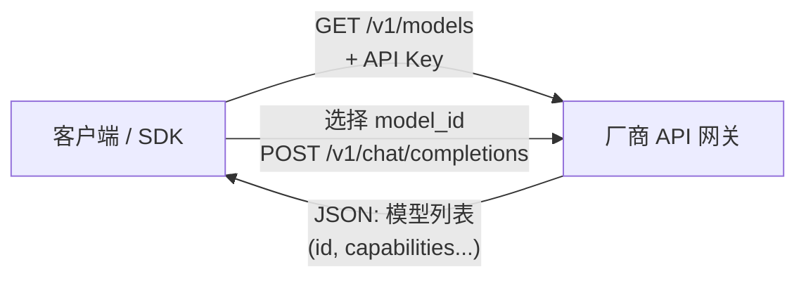
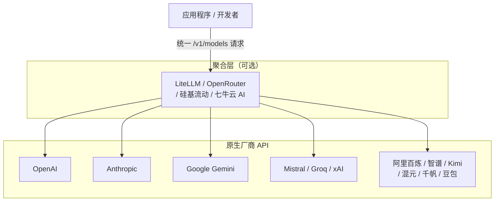

[toc]


---

## 大模型 API「可用模型列表」接口（`GET /v1/models`）全景调研

> **知识截止日期**：本文信息基于截至2026年9月的搜索结果，所引用的官方文档和第三方分析均在此范围内。

### 背景：为何需要「查询可用模型」接口

在将大模型 API 集成到应用程序时，开发者面临一个基础问题：**我的 API Key 当前能调用哪些模型？** 这个需求催生了「列出可用模型」接口。它允许客户端程序在运行时动态发现当前 Key 可访问的模型，而不必硬编码模型名称、也不必手动翻阅文档——这对构建多模型路由、灰度降级、计费审计等系统尤为关键。



这一模式由 OpenAI 首创，现已成为行业**事实标准（de facto standard）**。

---

### 响应结构：两大格式阵营

在深入各厂商之前，有必要先理解两种主流响应格式：

**OpenAI 格式**（被大多数兼容厂商沿用）：

```json
{
  "object": "list",
  "data": [
    {
      "id": "gpt-4o",
      "object": "model",
      "created": 1715367049,
      "owned_by": "openai"
    }
  ]
}
```

**Anthropic 原生格式**（结构略有差异）：

```json
{
  "data": [
    {
      "type": "model",
      "id": "claude-opus-4-5",
      "display_name": "Claude Opus 4.5",
      "created_at": "2025-05-14T00:00:00Z"
    }
  ],
  "has_more": false
}
```

关键字段辨析：

| 字段         | OpenAI 格式              | Anthropic 格式           | 说明                   |
| ------------ | ------------------------ | ------------------------ | ---------------------- |
| 外层包装键   | `object: "list"`         | （无此字段）             | 标识响应为列表         |
| 模型类型标识 | `object: "model"`        | `type: "model"`          | 语义相同，键名不同     |
| 模型显示名   | （通常无，仅有 `id`）    | `display_name`           | Anthropic 额外提供     |
| 创建时间     | `created`（Unix 时间戳） | `created_at`（ISO 8601） | 格式不同               |
| 所有者       | `owned_by`               | （无）                   | Anthropic 不暴露此字段 |

---

### 国际主流厂商

#### OpenAI — 标准的制定者

OpenAI 提供原生的 `GET /v1/models` 端点，是该接口范式的起源。

```bash
curl https://api.openai.com/v1/models \
  -H "Authorization: Bearer $OPENAI_API_KEY"
```

认证方式为标准 `Bearer Token`，响应格式即为上文所述的 OpenAI 格式。

---

#### Anthropic（Claude）— 原生支持，格式略异

Anthropic 提供 `GET /v1/models` 端点，用于列出可用模型，其 Models API 的响应可用于确定哪些模型在 API 中可以使用。

```bash
curl https://api.anthropic.com/v1/models \
  -H "anthropic-version: 2023-06-01" \
  -H "X-Api-Key: $ANTHROPIC_API_KEY"
```

注意：Anthropic 的认证方式与 OpenAI 不同，使用自定义请求头 `X-Api-Key`，并**强制要求携带 `anthropic-version`** 请求头，否则会返回错误。响应格式也是 Anthropic 的原生结构（见上文字段对比表）。

---

#### Google Gemini — 双路并行：原生 REST + OpenAI 兼容

Google 采用双接口策略：

**原生 REST 接口**（`v1beta` 路径）：

Google 的 Models API 提供了一种编程方式来列出通过 Gemini API 可用的模型，并检索扩展元数据，例如支持的功能和上下文窗口大小。

```bash
# 列出所有模型
curl "https://generativelanguage.googleapis.com/v1beta/models?key=$GEMINI_API_KEY"

# 获取单个模型详情
curl "https://generativelanguage.googleapis.com/v1beta/models/gemini-2.0-flash?key=$GEMINI_API_KEY"
```

注意：认证使用 `?key=` 查询参数，而非 `Authorization` 请求头，这与其他厂商有明显差异。

**OpenAI 兼容接口**（推荐迁移路径）：

Google Gemini 同时提供了 OpenAI 兼容入口，`base_url` 为 `https://generativelanguage.googleapis.com/v1beta/openai/`，这意味着可以直接使用 OpenAI 客户端库向 Gemini API 发起请求。通过此路径访问 `/v1/models` 时，响应格式将与 OpenAI 格式兼容。

---

#### Mistral AI — OpenAI 格式，携带能力元数据

Mistral 提供 `GET /v1/models` 端点，用于列出当前用户可访问的所有模型，响应的外层结构为 `object: "list"`，每个模型条目包含 `id`、`object`、`capabilities` 等字段。

```bash
curl https://api.mistral.ai/v1/models \
  -X GET \
  -H "Authorization: Bearer $MISTRAL_API_KEY"
```

Mistral 的响应中特别值得关注的是 `capabilities` 字段，它枚举了模型支持的能力，例如：

```json
{
  "id": "mistral-large-latest",
  "capabilities": {
    "completion_chat": true,
    "completion_fim": false,
    "function_calling": true,
    "fine_tuning": false,
    "vision": true
  }
}
```

这比其他厂商返回的基础元数据更加丰富，对于需要**按能力动态路由**的场景价值显著。

---

#### Groq — OpenAI 兼容，路径略有差异

Groq 的托管模型可以直接通过 GroqCloud Models API 端点访问，可以通过 `https://api.groq.com/openai/v1/models` 端点返回一个包含所有活跃模型的 JSON 列表。

```bash
curl -X GET "https://api.groq.com/openai/v1/models" \
  -H "Authorization: Bearer $GROQ_API_KEY" \
  -H "Content-Type: application/json"
```

注意：Groq 的 base URL 路径中包含 `/openai/` 中间段，这是其 OpenAI 兼容层的标志，完整路径为 `/openai/v1/models` 而非 `/v1/models`。

---

#### xAI（Grok）

LiteLLM 的 PR 记录显示，通过调用 `/v1/model` 端点，已实现对 Gemini、Anthropic、xAI 等厂商模型的自动发现（model discovery）。xAI 的 API 文档（`docs.x.ai`）采用 OpenAI 兼容格式，`/v1/models` 端点可用。

```bash
curl https://api.x.ai/v1/models \
  -H "Authorization: Bearer $XAI_API_KEY"
```

---

### 国内主流厂商

#### 阿里云百炼（通义千问/Qwen）— OpenAI 兼容，支持多地域

阿里云百炼的千问模型支持 OpenAI 兼容接口，开发者只需调整 API Key、`BASE_URL` 和模型名称，即可将原有 OpenAI 代码迁移至阿里云百炼服务使用。

阿里云百炼是一站式大模型开发与应用平台，集成千问及主流第三方模型，面向开发者提供兼容 OpenAI 的 API 和全链路模型服务。

由于是 OpenAI 兼容接口，`/v1/models` 理论上可用：

```bash
curl https://{WorkspaceId}.cn-beijing.maas.aliyuncs.com/compatible-mode/v1/models \
  -H "Authorization: Bearer $DASHSCOPE_API_KEY"
```

百炼平台支持**多地域部署**，不同地域的 `base_url` 不同（`WorkspaceId` 需替换为实际业务空间 ID）：

| 地域             | base_url                                                     |
| ---------------- | ------------------------------------------------------------ |
| 华北2（北京）    | `https://{WorkspaceId}.cn-beijing.maas.aliyuncs.com/compatible-mode/v1` |
| 新加坡           | `https://{WorkspaceId}.ap-southeast-1.maas.aliyuncs.com/compatible-mode/v1` |
| 美国（弗吉尼亚） | `https://{WorkspaceId}.us-east-1.maas.aliyuncs.com/compatible-mode/v1` |
| 中国香港         | `https://{WorkspaceId}.cn-hongkong.maas.aliyuncs.com/compatible-mode/v1` |

此外，百炼平台除了通义千问系列（商业版、开源版）、Qwen-VL、Qwen-Coder 等外，还集成了 DeepSeek（阿里云直供）、Kimi（月之暗面）等第三方模型的直供服务。

---

#### 智谱 AI（GLM 系列）— 双入口：原生 + 百炼托管

智谱 AI 有两种接入方式：

1. **官方原生入口**（`bigmodel.cn`）：文档显示提供 OpenAI 兼容的对话补全接口，`/v1/models` 可查询。智谱 AI 开放文档中，对话补全接口支持多种模型，包含多模态（文本、图片、音频、视频、文件），支持流式和非流式输出。

2. **百炼托管入口**：智谱模型也可在阿里云百炼平台直接调用，接入方式与百炼平台完全一致，使用相同的 `DASHSCOPE_API_KEY` 和 OpenAI 兼容接口。

官方原生接入：

```bash
curl https://open.bigmodel.cn/api/paas/v4/models \
  -H "Authorization: Bearer $ZHIPU_API_KEY"
```

---

#### 月之暗面（Moonshot/Kimi）— OpenAI 兼容

Moonshot 的 API 为 OpenAI 兼容格式，支持工具调用（function calling）。

```bash
curl https://api.moonshot.cn/v1/models \
  -H "Authorization: Bearer $MOONSHOT_API_KEY"
```

`/v1/models` 端点在 OpenAI 兼容框架下可用，返回标准的 OpenAI 格式响应。

---

#### 腾讯混元、百度千帆（文心 ERNIE）

百度千帆（ERNIE 系列）兼容 OpenAI，需在千帆控制台获取 API Key。

腾讯混元同样提供 OpenAI 兼容接口入口（`hunyuan.tencent.com/openapi/v1`），`/v1/models` 端点可访问。

| 厂商     | 原生 API base URL                          | 是否兼容 OpenAI `/v1/models` |
| -------- | ------------------------------------------ | ---------------------------- |
| 腾讯混元 | `https://api.hunyuan.cloud.tencent.com/v1` | 是                           |
| 百度千帆 | `https://qianfan.baidubce.com/v2`          | 是（兼容模式下）             |

---

#### 硅基流动（SiliconFlow）— 国内 API 聚合平台

硅基流动（SiliconFlow）提供一百余种开源大模型 API，支持按量付费、开箱即用，助力企业与开发者高效接入 AI 能力。聚合平台同样支持 OpenAI 兼容的 `/v1/models` 接口，可一次性获取平台上所有可用模型的列表。

```bash
curl https://api.siliconflow.cn/v1/models \
  -H "Authorization: Bearer $SILICONFLOW_API_KEY"
```

---

### 综合对比总表

| 厂商                 | `GET /v1/models` 端点                                        | 认证方式                                 | 响应格式                          | 特殊说明                   |
| -------------------- | ------------------------------------------------------------ | ---------------------------------------- | --------------------------------- | -------------------------- |
| **OpenAI**           | `https://api.openai.com/v1/models`                           | `Authorization: Bearer`                  | OpenAI 标准                       | 标准创始者                 |
| **Anthropic**        | `https://api.anthropic.com/v1/models`                        | `X-Api-Key` + `anthropic-version` 请求头 | Anthropic 原生                    | 需 `anthropic-version` 头  |
| **Google Gemini**    | `…/v1beta/models?key=KEY`（原生）；`…/v1beta/openai/models`（兼容） | `?key=` 查询参数 / `Bearer`              | Google 自有格式 / OpenAI 格式     | 双路并行                   |
| **Mistral AI**       | `https://api.mistral.ai/v1/models`                           | `Authorization: Bearer`                  | OpenAI 格式 + `capabilities` 扩展 | 能力元数据最丰富           |
| **Groq**             | `https://api.groq.com/openai/v1/models`                      | `Authorization: Bearer`                  | OpenAI 格式                       | 路径含 `/openai/` 中间段   |
| **xAI（Grok）**      | `https://api.x.ai/v1/models`                                 | `Authorization: Bearer`                  | OpenAI 格式                       | —                          |
| **DeepSeek**         | `https://api.deepseek.com/models`                            | `Authorization: Bearer`                  | OpenAI 格式                       | 路径无 `/v1/` 前缀         |
| **阿里百炼（Qwen）** | `https://{Workspace}.{region}.maas.aliyuncs.com/compatible-mode/v1/models` | `Authorization: Bearer`                  | OpenAI 格式                       | 多地域，需替换 WorkspaceId |
| **智谱 AI（GLM）**   | `https://open.bigmodel.cn/api/paas/v4/models`                | `Authorization: Bearer`                  | OpenAI 格式                       | 也可通过百炼平台接入       |
| **月之暗面（Kimi）** | `https://api.moonshot.cn/v1/models`                          | `Authorization: Bearer`                  | OpenAI 格式                       | —                          |
| **腾讯混元**         | `https://api.hunyuan.cloud.tencent.com/v1/models`            | `Authorization: Bearer`                  | OpenAI 格式                       | —                          |
| **百度千帆**         | `https://qianfan.baidubce.com/v2/models`（兼容模式）         | `Authorization: Bearer`                  | OpenAI 格式                       | —                          |
| **硅基流动**         | `https://api.siliconflow.cn/v1/models`                       | `Authorization: Bearer`                  | OpenAI 格式                       | 聚合 100+ 开源模型         |

---

### 生态视角：LiteLLM 等聚合层的作用

LiteLLM 是一个支持调用 100+ LLM API 的 Python SDK 和代理服务器，近期新增了对 Gemini、Anthropic、xAI 等厂商 `/v1/models` 端点的自动发现（model discovery）能力，允许用户通过 `get_valid_models(check_provider_endpoint=True)` 动态查询指定厂商当前可用的模型列表。

LLM Gateway 等聚合跟踪平台目前追踪了来自 54 个厂商、共 415 个模型，涵盖 OpenAI、Anthropic、Google、Meta、Mistral 和 DeepSeek 等主流提供商。



---

### 关键结论

1. **`/v1/models` 已是事实标准**：几乎所有主流厂商均支持该接口或其变体，差异集中在路径细节和认证方式上，而非接口存在与否。

2. **国内厂商全面跟进 OpenAI 兼容格式**：阿里百炼、智谱、月之暗面、腾讯混元等均通过 OpenAI 兼容层支持 `/v1/models`，迁移和适配成本极低。

3. **三处最常见的细节差异**需要特别注意：
    - **路径前缀**：DeepSeek 的路径是 `/models`（无 `/v1/`），Groq 是 `/openai/v1/models`；
    - **认证方式**：Google Gemini 原生接口用 `?key=` 查询参数，Anthropic 用 `X-Api-Key` 请求头；
    - **版本头要求**：Anthropic 强制要求携带 `anthropic-version` 请求头。

4. **Mistral 的响应元数据最丰富**：`capabilities` 字段提供了精细的能力声明（视觉、函数调用、微调等），对构建多模型路由系统最有价值。