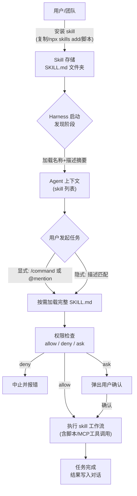
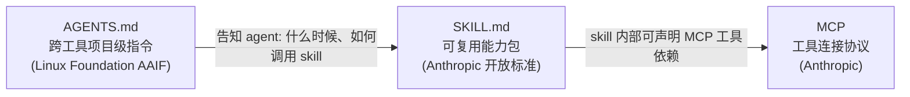

[toc]


## 为何 Skill 成为 Agent 的核心扩展机制

一个没有 skill 的 Claude、Amp、Cline、Cursor、OpenCode 或 Copilot 就像一位刚入职的高级工程师：聪明，但缺乏让他真正能发挥作用的项目上下文。

**Skill（技能）** 正是填补这个缺口的机制——它是一种可复用的、结构化的知识与工作流包，让 agent 能够掌握特定领域的操作能力，而无需用户每次重新解释。

---

## Skill 的本质：一个开放标准的诞生

Claude Skills 是可复用的指令包，用于教会 AI agent 如何处理特定类别的任务。每个 skill 是一个包含 `SKILL.md` 文件的文件夹，文件头部使用 YAML frontmatter（包含 `name`、`description` 字段）加上 Markdown 格式的指令，并可选地捆绑脚本、参考文档和资产文件。Anthropic 于 2025 年 10 月引入该格式，并于 2025 年 12 月将其作为开放标准发布。

目前该标准已被 Claude Code、Claude.ai、Claude API、OpenAI Codex、Cursor、Gemini CLI、Antigravity 以及 Windsurf 等工具原生支持。

和 MCP 一样：由 Anthropic 创建，成为了事实上的行业标准。

### Skill 的文件结构

一个 skill 就是一个包含 `SKILL.md` 的文件夹。该文件至少需要包含 `name`（名称）、`description`（描述）和 agent 应遵循的 `instructions`（指令）。skill 还可以捆绑脚本、参考文档、模板和其他资产：

```
my-skill/
├── SKILL.md          # 必需：name, description, instructions
├── scripts/          # 可选：可执行脚本
├── references/       # 可选：文档与规范
└── assets/           # 可选：模板与数据
```

对于 OpenAI Codex 还额外推荐：

```
my-skill/
├── SKILL.md
├── agents/
│   └── openai.yaml   # 推荐：调用策略、工具依赖声明
├── scripts/
├── references/
└── assets/
```

> `agents/openai.yaml` 用于在 Codex Desktop 应用中配置 UI 元数据、设定调用策略，以及声明工具依赖，从而让 skill 使用体验更加流畅。

---

## 各主流 Harness 的 Skill 使用与管理方式

下面按工具逐一拆解，从用户视角梳理其 skill 的发现、调用、配置和权限管理机制。

---

### Claude Code（Anthropic）

**官方文档**：`code.claude.com/docs/skills`

#### Skill 发现路径

Agent skills 让 OpenCode（同样适用于 Claude Code）能够从你的仓库或 home 目录中发现可复用指令。Skill 通过原生的 `skill` 工具按需加载——agent 先看到可用 skill 列表，在需要时才加载完整内容。

对于项目级路径，它加载 `.opencode/skills/*/SKILL.md` 以及 `.claude/skills/*/SKILL.md` 或 `.agents/skills/*/SKILL.md`。全局定义从 `~/.config/opencode/skills/*/SKILL.md`、`~/.claude/skills/*/SKILL.md` 以及 `~/.agents/skills/*/SKILL.md` 加载。

Claude Code 在启动时将来自插件 `skills` 子目录和 `.claude` 目录下 `skills` 文件夹中的 skill 注入系统提示，作为可用 skill 列表。

#### Skill 调用方式

有两种方式：

- **自动触发**——当请求内容匹配 skill 的描述时，agent 自动加载并应用，无需用户主动要求；
- **手动调用**——用户可以通过名称显式调用 skill。

skill 可以通过斜杠命令显式调用（例如 `/frontend-design`），也可以在 agent 识别到相关任务时自动触发。

#### 渐进式加载（Progressive Disclosure）

其魔法在于渐进式加载：Claude 只在需要时加载所需内容。这意味着你可以给 agent 提供一本 200 页的操作手册，而在相关时刻到来之前不会消耗任何 token。

#### 权限控制

在用户、项目和本地设置中，Claude Code 仅根据 skill 名称匹配条目。如果你为 `review` 设置了一个条目，它只作用于名为 `review` 的 skill，而不会通过别名作用于其他捆绑命令。

当一个命令匹配到 deny 规则时，调用会中止并提示权限检查失败。在 auto 模式之外，如果命令的权限检查返回除 allow 之外的任何结果，Claude Code 同样会中止调用，包括本应弹出确认框的规则。

#### 企业治理层面

skill 可以执行代码、指示 Claude 使用 MCP 工具连接访问敏感数据，并在标准安全控制之外运行，这给企业带来了治理挑战。

自 2025 年 10 月 Anthropic 正式推出 skill 以来，目前已有数千个 skill，覆盖从无障碍审计到视频生成代码的各类场景。

---

### OpenAI Codex（CLI + Desktop App）

**官方文档**：`developers.openai.com/codex/skills`

#### 整体定位

通过 skill，你可以轻松地将 Codex 能力扩展到代码生成之外，涵盖信息收集与综合、问题解决、写作等任务。skill 将指令、资源和脚本捆绑在一起，使 Codex 能够可靠地连接工具、执行工作流，并按照团队偏好完成任务。

#### 采用标准的时间节点

这不只是一个功能，而是一个协议。两个月后（2025 年 12 月），OpenAI 悄悄地在 ChatGPT 和 Codex CLI 中采用了同一标准。眼尖的用户在会话中发现了痕迹：完全镜像 Anthropic 标准的 `/home/oai/skills` 目录结构，以及其中的 `skill.md` 文件。

#### Skill 调用方式

**手动调用**:

- 在 ChatGPT 中，输入 `@` 可以选择 skill；

- 在 Codex CLI 或 IDE 扩展中，运行 `/skills` 或输入 `$` 来引用 skill。

**隐式调用**：当任务与 skill 描述匹配时，ChatGPT 或 Codex 会自动选择相应 skill。

#### Desktop App 专属界面

Codex App 提供了一个专用界面来创建和管理 skill。你可以明确要求 Codex 使用特定的 skill，也可以让它根据当前任务自动使用。

#### Token 开销控制

Codex 会预先加载 skill 的名称和描述，但在选中某个 skill 前才延迟加载完整的 `SKILL.md` 指令。系统将初始 skill 列表限制在约 8,000 字符以防止上下文溢出——如果安装了过多 skill，Codex 会自动缩短描述。因此，简洁、精准的描述至关重要。

#### 官方 Skill 目录

OpenAI 在 `openai/skills` 仓库维护着一个公开的 skill 目录，是打包好的 agent 指令、脚本和资源的集合，用于扩展 Codex CLI 的特定任务能力。该仓库拥有 19,000+ stars，包含 38 个精选 skill，采用三层分类体系：system（系统级）、curated（精选）和 experimental（实验性）。

#### 功能标志启用

skill 目前受功能标志保护，通过运行 `codex --enable skills` 开启。

---

### OpenCode

**官方文档**：`opencode.ai/docs/skills/`

OpenCode 是一个开源的 terminal/IDE 编码 agent，对 skill 有原生的、设计良好的支持。

#### Skill 发现机制

Agent skill 让 OpenCode 能够从你的仓库或 home 目录中发现可复用指令。skill 通过原生 `skill` 工具按需加载。

OpenCode 在 `.opencode/` 下加载匹配 `skills/*/SKILL.md` 的条目，以及沿路径向上找到的 `.claude/skills/*/SKILL.md` 或 `.agents/skills/*/SKILL.md`。全局定义从 `~/.config/opencode/skills/*/SKILL.md`、`~/.claude/skills/*/SKILL.md` 以及 `~/.agents/skills/*/SKILL.md` 加载。

#### 调用方式

[Skills | OpenCode School](https://opencode.school/lessons/skills/)

| 调用方式                     | 是否需要额外配置                   | 用法示例                    | 适用场景                                       |
| ---------------------------- | ---------------------------------- | --------------------------- | ---------------------------------------------- |
| **自然语言请求**             | 无需                               | "Use the git-release skill" | 日常使用，最简单直观                           |
| **`/<skill-name>` 自动命令** | 无需（skill 放对路径即可）         | `/git-release`              | 快速触发已知 skill                             |
| **自定义 command 文件**      | 需要创建 `.opencode/commands/*.md` | `/plan Refactor auth`       | 需要参数模板、路由 agent、后台子任务等高级控制 |
| **`opencode.json` 内联**     | 需要编辑配置文件                   | `/my-command args`          | 简单命令，不想创建单独文件                     |

最简单的方式就是直接在对话中按名字引用 skill，agent 会自动匹配并加载。需要更精细控制（指定 agent、传参、后台运行）时，再考虑创建命令文件。

#### 与 AGENTS.md 的协同

Agent Skills 提供两种可选的使用风格：**agent 驱动工作流**——skill 由内置的 skill 工具自动选择，并由你为项目编写的 `AGENTS.md` 引导 agent 调用；**显式命令模式**——可选地在 `.opencode/commands/*.md` 中添加斜杠命令。

核心规则示例：如果任务匹配某个 skill，先用 `skill` 工具调用它再行动；skill 位于 `.opencode/skills/<skill-name>/SKILL.md`；严格遵循 skill 的工作流，不能部分应用。

#### 权限控制（opencode.json）

通过 `opencode.json` 中基于模式的权限配置来控制哪些 agent 可以访问哪些 skill，支持通配符和按 skill 名前缀的精细化授权。可以给特定 agent 设置不同权限。

例如：

```json
{
  "permission": {
    "skill": {
      "*": "allow",
      "pr-review": "allow",
      "internal-*": "deny",
      "experimental-*": "ask"
    }
  }
}
```

- `"*": "allow"` — 默认允许所有 skill
- `"internal-*": "deny"` — 拒绝所有以 `internal-` 开头的 skill（例如内部保密工作流）
- `"experimental-*": "ask"` — 调用实验性 skill 前弹出确认

permission 字段支持 skill 和 tool 两个子键，pattern 匹配基于名称并支持通配符；若将某个 tool 设为 `false`，它将被完全禁用并对 agent 隐藏。

#### Plugin 生态（第三方）

当你用 `use_skill` 加载一个 skill 时，其内容会以 `noReply: true` 标志注入对话上下文，这使得 skill 内容在整个对话中持续可用，即使 OpenCode 为管理上下文而压缩了较早的消息。会话开始时，插件会自动注入所有已发现 skill 的列表，包裹在 `<available-skills>` 标签中，无需 agent 主动查询。

---

### Cursor

Cursor 的规则格式（MDC）支持在 frontmatter 中使用 `alwaysApply`、`globs` 和 `description` 字段进行条件激活。2025 年底，Cursor 将新规则以文件夹形式组织以提升可读性，并将 `AGENTS.md` 作为跨工具标准读取。

**Cursor 对 skill 的支持方式**与 Claude Code 稍有不同：它将 skill 的概念部分融合进其 **Rules**（`.cursor/rules/`）体系中，同时原生读取 `SKILL.md` 标准文件。如果你要发布一个公开 skill，官方建议明确支持 Claude Code、Cursor、Codex、Gemini CLI 和 Cline（六大主流核心），其余可通过安装器适配。

---

### Gemini CLI（Google）

Gemini CLI 读取项目根目录的 `GEMINI.md` 文件作为项目级指令。

skill 安装路径分为项目级（`.gemini/skills/`）和用户级（`~/.gemini/skills/`），通过 `gemini-extension.json` 注册扩展元数据，其中 `skills` 字段指定所包含 skill 的路径模式。

---

### Aider

Aider 拥有 42,000+ GitHub stars 和 410 万次安装，其模型无关性是所有工具中最彻底的：支持 Claude、GPT、Gemini、Groq、本地模型（Ollama）以及几乎所有主流 API，无厂商锁定。

Aider 最具辨识度的设计选择是 Git 深度集成——每次 agent 变更都自动成为一个语义化的 Git commit，附带描述实际操作的 commit message，使代码审查和回滚极为清晰。

对于 skill 的支持：skill 可以原生运行于包括 Aider 在内的 13 个工具中，但 Aider 对 `SKILL.md` 的处理方式属于 将 skill 文件夹视为系统提示片段（每轮加载，类似 AGENTS.md），而非 Claude Code 或 Cursor 那样的一等原语（first-class primitive），属于适配层支持。

---

### Windsurf（Codeium）

Windsurf 经历了与 Cursor 类似的从单文件到目录的演进。规则可以设置为 Always On、Manual（通过 `@mention`）或 Model Decision 三种模式。注意：单个规则文件上限为 6,000 字符，所有规则总和不得超过 12,000 字符。

Windsurf 使用根级别的简单规则文件加上可选的规则目录。

---

## 横向对比：Skill 管理机制全景表

| 维度                         | Claude Code                          | Codex CLI/App                  | OpenCode                      | Cursor                        | Gemini CLI               | Aider              | Windsurf                    |
| ---------------------------- | ------------------------------------ | ------------------------------ | ----------------------------- | ----------------------------- | ------------------------ | ------------------ | --------------------------- |
| **Skill 格式**               | `SKILL.md`（开放标准创始）           | `SKILL.md`（采纳）             | `SKILL.md`（原生）            | `SKILL.md` + `.cursor/rules/` | `SKILL.md` + `GEMINI.md` | `SKILL.md`（适配） | `SKILL.md`（适配）          |
| **项目配置文件**             | `CLAUDE.md`                          | `AGENTS.md`                    | `AGENTS.md`                   | `.cursor/rules/`              | `GEMINI.md`              | `AIDER.conf`       | `.windsurfrules`            |
| **Skill 存储路径（项目级）** | `.claude/skills/*/SKILL.md`          | `~/.codex/skills/`             | `.opencode/skills/*/SKILL.md` | `.cursor/skills/`             | `.gemini/skills/`        | 适配层注入         | `.windsurf/skills/`         |
| **Skill 存储路径（全局）**   | `~/.claude/skills/`                  | `~/.codex/skills/`             | `~/.config/opencode/skills/`  | `~/.cursor/skills/`           | `~/.gemini/skills/`      | —                  | —                           |
| **调用方式**                 | 自动 + `/command`                    | 自动 + `@mention` + `$mention` | 自动 + slash 命令             | 自动 + Rules 触发             | 自动                     | 系统提示注入       | Always On / Manual / AI决策 |
| **渐进式加载**               | ✅ 原生支持                           | ✅ 原生支持                     | ✅ 原生支持                    | 部分                          | 部分                     | ❌                  | 部分                        |
| **权限控制粒度**             | 基于名称+通配符，支持 allow/deny/ask | 功能标志 + 调用策略            | JSON 配置，支持通配符模式     | frontmatter 条件              | 扩展注册表               | 模型级别           | 字符上限限制                |
| **官方 Skill 市场**          | ✅（Anthropic 官方 + 社区）           | ✅（openai/skills，38 个精选）  | 依托 Claude Skills 生态       | —                             | —                        | —                  | —                           |
| **多 Agent 配置**            | ❌ 非主打                             | ✅ Desktop App 多 agent         | ✅ 原生子 agent 系统           | ❌                             | ❌                        | ❌                  | ❌                           |

---

## Skill 生命周期全流程



**流程各阶段说明：**

- **安装（Install）**：通过手动复制、`npx skills add`（Vercel 跨工具安装器）或各 harness 官方命令完成
- **发现（Discovery）**：harness 启动时扫描预设路径，仅将 skill 的名称和描述摘要注入上下文，**不加载全文**
- **触发（Invocation）**：分显式（命令/mention）和隐式（语义匹配）两种路径
- **权限检查（Permission）**：不同 harness 实现深度不同，OpenCode 和 Claude Code 最为精细
- **执行（Execution）**：完整指令加载，可调用捆绑脚本、MCP 工具、外部 API

---

## 跨工具安装：生态工具链

Vercel 发布的 `vercel-labs/skills` 成为事实上的跨 agent 安装器（16,900+ stars，MIT 许可，主要使用 TypeScript）。CLI 通过 `npx skills add <source>` 调用，支持 6 种源格式：GitHub 短写（owner/repo）、完整 GitHub URL、仓库内 skill 路径、GitLab URL、原始 Git URL 和本地路径。已列出支持的 agent 目标超过 50 个，包括 OpenCode、Claude Code、Codex、Cursor、OpenHands、Cline、Continue、GitHub Copilot、Antigravity、Roo Code、Kiro CLI、Windsurf、Devin、Gemini CLI 等。

安装器的契约非常清晰：每个 agent 都有指定的项目路径和全局路径。CLI 使用符号链接而非拷贝，使得单一来源的更新能在下次 agent 发现时自动传播至所有已安装 agent。

---

## 配置文件标准化背景

为了减少"每个工具都需要单独维护配置"的碎片化问题，社区形成了三层规范：



AGENTS.md 最初由 OpenAI 于 2025 年 8 月提出，并于 2025 年 12 月捐赠给 Linux Foundation 旗下的 Agentic AI Foundation（AAIF），目前已被 Codex、Cursor、GitHub Copilot、Gemini CLI、Aider、Windsurf、Zed、Devin、Amp、Factory、Jules 以及 VS Code 等 20+ 工具原生读取。

AAIF 形成于 2025 年 12 月，正在推动生态融合：AGENTS.md、Agent Skills 和 MCP 均已纳入 AAIF 治理。

三个文件的定位区别：

| 文件                         | 作用层                                            | 类比                     |
| ---------------------------- | ------------------------------------------------- | ------------------------ |
| `AGENTS.md`                  | 项目级指令（告诉 agent 这个项目"是什么/怎么做"）  | 项目 README 的 AI 专用版 |
| `CLAUDE.md` / `GEMINI.md` 等 | 工具专属的项目级配置（AGENTS.md 的厂商方言）      | 各家的私有配置           |
| `SKILL.md`                   | 可复用能力包（告诉 agent "如何完成特定类别任务"） | 可安装的工作流插件       |
| `MCP`                        | 工具连接协议（提供外部 API/数据访问）             | 中间件接口层             |

---

## 最佳实践与常见陷阱

### 推荐做法

- **保持描述精准简洁**：系统对初始 skill 列表有约 8,000 字符的总上限，过多 skill 会导致描述自动缩短，因此精准的描述至关重要。
- **控制 skill 总数**：安装过多 skill 会造成 token 开销，需定期审查哪些 skill 真正有用。
- **脚本与模型分工明确**：重复性的 shell 操作放在 skill 脚本里执行；解读、比较和报告留给模型处理。
- **跨工具共享**：skill 可通过 `CLAUDE.md` 在团队中共享，每位进入项目的开发者都能找到已配置好的工作流。
- **使用跨工具安装器**：用 `npx skills add` 而非手动复制，以确保路径正确、更新同步。

### 常见陷阱

- **Skill 名称与别名混淆**：权限规则按 skill 名称匹配，不按别名。
- **修改 skill 后忘记重启**：添加或修改 skill 后需要重启 harness 才能生效。
- **企业环境下未做治理**：skill 可访问敏感数据和执行代码，企业部署需要建立认证、访问控制和审计日志机制。
- **描述写得过于宽泛**：容易导致 agent 在不相关任务中错误触发 skill，造成意外行为。

---

## 生态版图总结

目前 SKILL.md 标准已原生兼容 13 个主流工具：Claude Code、OpenAI Codex、Gemini CLI、OpenClaw、Hermes Agent、Mistral Vibe、Cursor、Aider、Windsurf、Kilo Code、OpenCode、Augment 以及 Antigravity。

skill 之于今天，正如浏览器插件之于 2005 年：掌握它的人，从结构上就与还不了解它的人工作方式不同。