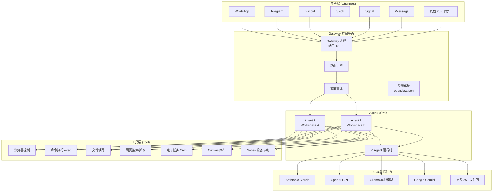
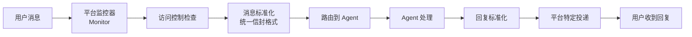
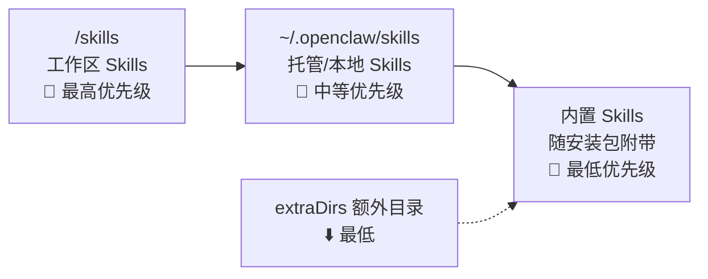
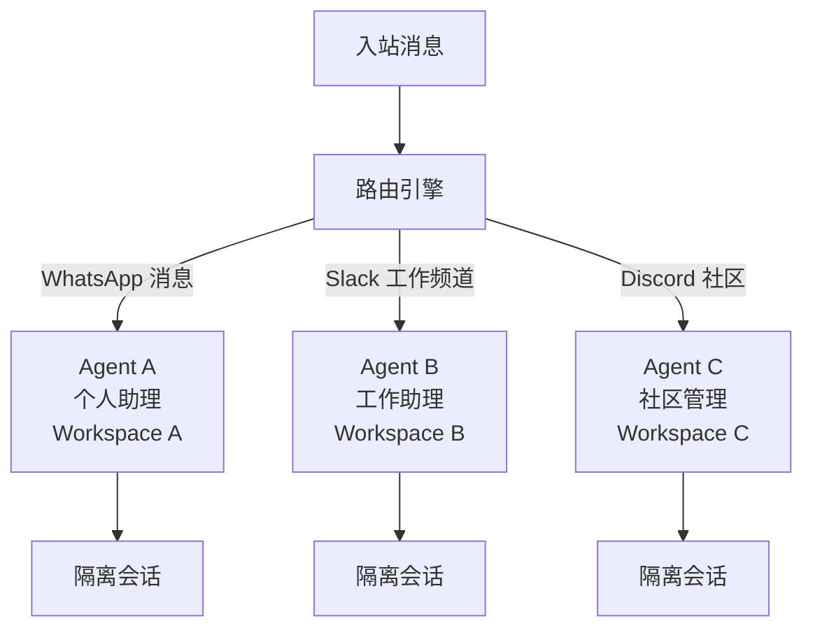
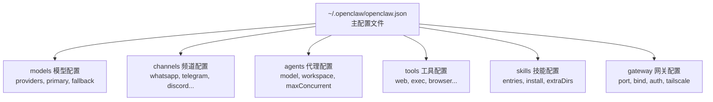
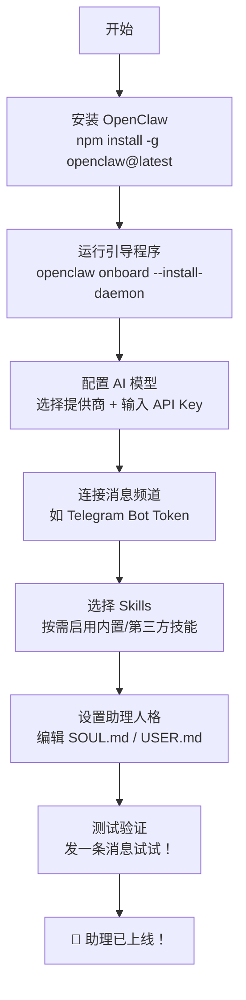

# OpenClaw — 你的私人 AI 助理全面指南 🦞

## 什么是 OpenClaw

OpenClaw（曾用名 Clawdbot、Moltbot、Molty）是一个免费开源的自主 AI 智能体（Agent），由 Peter Steinberger 开发。 它是一个能够通过大语言模型（LLM）执行任务的自主代理，以消息平台作为主要用户界面。

简单来说，OpenClaw 与传统聊天机器人有本质区别：当你让 ChatGPT "帮我整理桌面文件"时，它只能给你建议；而 OpenClaw 会真的按照你的规则去重命名、分类和移动文件——这就是"聊天机器人"和"AI Agent"的根本区别。

> **核心理念**：你的助理、你的机器、你的规则。它运行在你控制的基础设施上——笔记本、家庭服务器或 VPS——你对数据和行为拥有完全控制权。

---

## 项目背景

| 项目信息   | 详情                                                         |
| ---------- | ------------------------------------------------------------ |
| 创始人     | Peter Steinberger（奥地利开发者），2025 年 11 月以 Clawdbot 之名首次发布 |
| 更名历程   | 2026 年 1 月 27 日因 Anthropic 商标投诉改名 Moltbot，三天后改名 OpenClaw |
| 开源协议   | MIT 许可，社区驱动                                           |
| 主技术栈   | TypeScript                                                   |
| 运行时要求 | Node 24（推荐）或 Node 22 LTS（22.16+）                      |
| 现状       | 2026 年 2 月 14 日，Steinberger 宣布加入 OpenAI，项目将移交到一个开源基金会 |

---

## 核心架构

OpenClaw 的架构围绕一个中心原则构建："Gateway 只是控制平面——产品是那个助理。"

### Gateway（网关）

你在自己的机器（或服务器）上运行一个 Gateway 进程，它就成为你的消息应用与始终可用的 AI 助理之间的桥梁。 它作为单一进程在你的基础设施上运行，管理会话、路由、工具执行和频道连接。

Gateway 的核心职责：

| 职责              | 说明                                                         |
| ----------------- | ------------------------------------------------------------ |
| **会话管理**      | Gateway 是会话（Sessions）、路由和频道连接的唯一事实来源     |
| **频道连接**      | WhatsApp、Telegram、Discord 和 iMessage 等可通过单个 Gateway 进程连接 |
| **WebSocket RPC** | 客户端（CLI、Web UI、移动应用、频道插件）通过 WebSocket RPC 连接到默认端口 18789 |
| **配置热加载**    | 大多数配置更改无需重启即可生效（端口/绑定需要重启）          |
| **控制 UI**       | 控制界面 + WebChat 直接从 Gateway 提供服务                   |

### Agent（智能体）

Agent 是 AI 助理的核心，通过工作区文件（Identity、Soul、Tools、Skills 等）定义，指定能力、记忆和交互风格。

Agent 的工作区目录通常包含以下关键文件：

| 文件           | 作用                                       |
| -------------- | ------------------------------------------ |
| `AGENTS.md`    | 定义 Agent 的身份与角色                    |
| `SOUL.md`      | 定义人格特征，编辑此文件可以改变助理的个性 |
| `USER.md`      | 关于你（用户）的信息                       |
| `MEMORY.md`    | 长期记忆存储                               |
| `HEARTBEAT.md` | 编辑此文件可以改变助理的主动签到计划       |

> **什么是 Heartbeat（心跳）？** OpenClaw 的 Heartbeat 功能允许它主动行动：监控收件箱并主动提醒紧急邮件、定期检查日程并提前准备会议材料、监控特定网页变化并即时通知你——这个特性将 OpenClaw 从"工具"升级为真正的"助理"。

### Channel（频道）

频道（Channel）是 OpenClaw 与用户交互的入口，支持 WhatsApp、Telegram、Discord、iMessage 等。

频道子系统通过提供者模式（Provider Pattern）集成外部消息平台：每个平台运行一个独立的监控器，接收原始事件、执行访问控制、将消息标准化为通用信封格式，并通过平台特定的投递机制路由回复。

频道分为核心频道（内置于主源码树）和扩展频道（独立的扩展包）。 频道支持每个平台多个账户（例如多个 Telegram Bot、多个 Discord Bot）。

---

## Tools 与 Skills：理解两大核心概念

这是新手最容易混淆的两个概念。用一个类比来理解：

> **Tools 是器官**——它们决定 OpenClaw "能不能"做某事。read 和 write 让它访问文件，exec 让它运行系统命令，web_search 让它像 Google 一样搜索，browser 让它与网页交互。没有启用 Tool，就像没有手——什么都做不了。
>
> **Skills 是教科书**——它们教 OpenClaw 如何组合 Tools 来完成任务。gog 教它使用 Google Workspace 处理邮件和日历，obsidian 教它整理笔记，github 教它操作仓库，slack 教它向频道发消息。

### Tools 分类

| Tool 类别    | 具体工具                       | 功能                                     |
| ------------ | ------------------------------ | ---------------------------------------- |
| **文件操作** | read, write                    | 读写本地文件                             |
| **命令执行** | exec                           | 运行 shell 命令和脚本                    |
| **网页**     | web_search, web_fetch, browser | 搜索、抓取网页、浏览器自动化             |
| **画布**     | canvas                         | A2UI 推送/重置、eval、截图               |
| **设备节点** | nodes                          | 相机拍照/录像、屏幕录制、位置获取、通知  |
| **定时**     | cron, wakeups                  | 定时任务 + 唤醒；Webhooks；Gmail Pub/Sub |
| **消息**     | message                        | 向频道发送消息                           |
| **会话**     | sessions                       | 管理和生成子会话                         |

### Skills 系统

OpenClaw 使用兼容 AgentSkills 的技能文件夹来教 Agent 如何使用工具。每个 Skill 是一个包含 SKILL.md（带 YAML frontmatter 和指令）的目录。OpenClaw 加载内置 Skills 和可选的本地覆盖，在加载时根据环境、配置和二进制文件存在性进行过滤。

**Skills 加载优先级**（从高到低）：

如果同名 Skill 存在于多个位置，按照通常优先级：工作区优先，然后是托管/本地，最后是内置。

### Skill 生效的三个必要条件

要让 OpenClaw 通过 Skill 真正做事，需要同时满足三个条件——以"读取 Gmail"为例：①配置（Configuration）：你是否允许 OpenClaw 运行命令？（没有 exec，它连程序都启动不了）②安装（Installation）：机器上是否安装了 gog 桥接工具？（没有它，OpenClaw 知道做什么但无法连接 Google）③授权（Authorization）：你是否登录了 Google 账户并授予权限？（没有授权，Google 不会放行）三个条件缺一不可。

### ClawHub — Skills 生态

ClawHub 是 OpenClaw 的公共技能注册中心，可在 https://clawhub.com 浏览，用来发现、安装、更新和备份 Skills。 目前 ClawHub 上已有 13,700+ 第三方 Skills。

> ⚠️ **安全提醒**：将第三方 Skills 视为不受信任的代码，在启用之前先阅读它们，对不受信任的输入和高风险工具优先使用沙盒运行。

---

## 多 Agent 路由

OpenClaw 支持多 Agent 路由——将入站频道/账户/对等方路由到隔离的 Agent（独立的工作区 + 每 Agent 独立会话）。

会话文件以 JSONL 格式存储在 `~/.openclaw/agents/<agentId>/sessions/<sessionKey>.jsonl` 中。

这意味着你可以为不同场景配置不同人格、不同能力的 Agent，彼此之间完全隔离。

---

## 模型提供商与配置

OpenClaw 开箱即支持 25+ 个 LLM 提供商，包括 Anthropic、OpenAI 等，通过单一配置切换。

| 提供商类型     | 示例                                                         | 认证方式                  |
| -------------- | ------------------------------------------------------------ | ------------------------- |
| **API Key**    | Anthropic, OpenAI, Google                                    | 直接 API Key 或 SecretRef |
| **OAuth 订阅** | Anthropic (Claude Pro/Max) + OpenAI (ChatGPT/Codex) 通过 OAuth |                           |
| **本地模型**   | Ollama 本地模型                                              | 本地 API 端点             |
| **自定义端点** | OpenRouter、AI/ML API 等                                     | OpenAI 兼容 API           |

模型提供商的凭据存储在 auth-profiles.json 中，位于 Agent 目录下。

**模型容错（Failover）**：OpenClaw 支持模型选择、模型容错切换和会话剪枝。 你可以配置一个主模型和备用模型，当主模型不可用时自动切换。

> **最佳实践**：为获得最佳质量和安全性，使用你能获取到的最强最新一代模型。

---

## 配置系统

配置文件位于 `~/.openclaw/openclaw.json`，使用 Zod schema 进行验证，支持 JSON5 格式（允许注释和尾逗号）。

### 关键配置层级

### 秘密管理

OpenClaw 使用 SecretRef 模式来避免直接在配置文件中存储凭据。 OAuth 令牌以加密 JSON 文件形式存储在 `~/.openclaw/auth/` 中（按提供商分别存储）。

SecretRef 支持三种引用方式：

- **环境变量**：引用系统环境变量
- **文件引用**：引用外部文件中的密钥
- **exec 命令**：动态执行命令获取密钥

---

## Companion Apps（伴侣应用）

OpenClaw 提供 macOS 菜单栏应用 + iOS/Android 节点应用。

### macOS 客户端

macOS 客户端（OpenClaw.app）是一个菜单栏应用，同时作为 Gateway 控制界面和设备节点，提供语音唤醒/按住说话、Talk Mode 覆盖层、WebChat 访问、调试工具以及通过 SSH 隧道和 Tailscale 发现的远程 Gateway 控制。

Node 模式：以设备节点身份连接 Gateway，注册能力（屏幕自动化、摄像头、画布），处理 node.invoke 请求。Operator 模式：维护第二个 WebSocket 连接用于聊天、会话管理和配置 RPC 调用。

### Windows 支持

OpenClaw 运行在 macOS、Linux、Windows（WSL2），甚至树莓派上。 Windows 端有专门的 Windows Hub 应用（系统托盘 + WebView2 界面）。

---

## 安全模型

OpenClaw 的安全架构包括访问控制、认证、沙盒、秘密管理和网络加固。

### 纵深防御层级

| 层级       | 机制                                                         | 说明                                  |
| ---------- | ------------------------------------------------------------ | ------------------------------------- |
| **消息级** | DM 发送者和群组成员默认被视为不受信任                        | 白名单机制控制谁可以与助理交互        |
| **工具级** | exec、browser、nodes 等工具可对主机执行特权操作              | 通过工具策略（Tool Policies）精细控制 |
| **凭据级** | API 密钥、令牌和 OAuth 凭据必须受保护                        | SecretRef 模式 + 日志脱敏             |
| **网络级** | Gateway 在远程暴露时（通过 Tailscale 或公开绑定）必须安全    | Token/Password 认证                   |
| **沙盒级** | OpenClaw 可以将 Agent 会话隔离在 Docker 容器中以限制主机访问 | 文件系统和网络隔离                    |

### 已知安全风险

OpenClaw 的设计因其有效运作所需的广泛权限而受到网络安全研究人员和技术记者的审视。由于该软件可以访问电子邮件账户、日历、消息平台和其他敏感服务，配置错误或暴露的实例会带来安全和隐私风险。

该 Agent 也容易受到提示注入攻击（Prompt Injection），即在数据中嵌入恶意指令，意图让 LLM 将其解释为合法的用户指令。

> ⚠️ **安全最佳实践**：
> - 保持依赖更新：定期运行 `openclaw update` 并审查 CHANGELOG.md
> - 限制媒体根目录：使用 `mediaLocalRoots` 限制文件附件来源
> - 在 VPS 上使用 Docker + UFW：遵循 VPS 加固指南进行面向公网的部署
> - 运行 `openclaw doctor` 来发现高风险/配置错误的 DM 策略

---

## 快速开始

### 安装方式选择

| 方式                       | 命令                                                         | 适合人群           |
| -------------------------- | ------------------------------------------------------------ | ------------------ |
| **一键脚本 (macOS/Linux)** | `curl -fsSL https://openclaw.ai/install.sh \| bash`          | 新手推荐           |
| **npm 全局安装**           | `npm install -g openclaw@latest`                             | Node.js 开发者     |
| **pnpm 全局安装**          | `pnpm add -g openclaw@latest`                                | 偏好 pnpm 的开发者 |
| **Windows**                | `powershell -c "irm https://openclaw.ai/install.ps1 \| iex"` | Windows 用户       |
| **Nix**                    | Nix 声明式配置模式                                           | NixOS 用户         |
| **Docker**                 | Docker 容器化安装                                            | 服务器/VPS 部署    |

### 引导式上手流程

OpenClaw Onboard 引导你逐步完成 Gateway、工作区、频道和 Skills 的设置。

### 上手后的推荐验证清单

| 验证步骤 | 操作                                           |
| -------- | ---------------------------------------------- |
| 基础对话 | 向助理发任意消息                               |
| 记忆测试 | 问它"我叫什么名字？"验证它是否正确读取 USER.md |
| 心跳测试 | 等待一个 Heartbeat，验证主动签到是否触发       |
| 系统健康 | 发送 `/status` 查看系统运行状态                |
| 语音消息 | 发送语音消息体验免提交互                       |

---

## 进阶话题

### 语音功能

Voice Wake + Talk Mode——在 macOS/iOS 上支持唤醒词，在 Android 上支持持续语音（ElevenLabs + 系统 TTS 回退）。

### Live Canvas（实时画布）

Agent 驱动的视觉工作区，使用 A2UI（Agent-to-UI）技术——Agent 可以推送 HTML/JS 内容到你设备上的画布，创建交互式可视化界面。

### 浏览器控制

专用的 OpenClaw Chrome/Chromium 实例，支持快照、操作、上传、多配置。 可以填写表单和抓取网页数据。

### 远程访问

通过 Tailscale Serve/Funnel 或 SSH 隧道配合 Token/Password 认证进行远程访问。 也可以使用 Tailscale 或类似 VPN 方案进行安全远程访问。

### Lobster 工作流引擎

Lobster 是 OpenClaw 原生的工作流 shell：一种类型化的、本地优先的"宏引擎"，将 Skills/工具转换为可组合的管道和安全的自动化流程。

---

## 社区生态与影响力

OpenClaw 在 2026 年 1 月下旬迅速走红，归功于其开源特性以及 Moltbook 项目的病毒式传播。

行业影响：

- OpenClaw 已在小型企业和自由职业者中获得采用，用于自动化销售线索生成工作流。
- 2026 年 3 月 10 日，腾讯宣布基于 OpenClaw 推出了一套完整的易用 AI 产品，且兼容其超级应用微信。
- 技术评论将 OpenClaw 与更广泛的自主 AI 系统趋势联系起来——独立行动而非仅仅回应用户提示。

---

## 新手最佳实践总结

| 领域            | 建议                                                         |
| --------------- | ------------------------------------------------------------ |
| **模型选择**    | 从最强模型开始（如 Claude Opus/Sonnet），确保助理能力上限足够高 |
| **频道起步**    | Telegram 是一个很好的第一个连接器，然后根据需要添加更多频道  |
| **Skills 策略** | 先用内置 Skills，在理解 Tool/Skill 关系后再逐步添加第三方 Skills |
| **安全意识**    | 始终为 DM 和群聊配置白名单，不要将未认证的 Gateway 暴露到公网 |
| **记忆维护**    | 定期审查和编辑 MEMORY.md，纠正不准确的记忆                   |
| **增量扩展**    | 不要一次启用所有 Tools——从 read/write + web_search 开始，按需开放 exec 和 browser |
| **更新习惯**    | 项目迭代极快，定期运行 `openclaw update` 和 `openclaw doctor` 保持健康 |
| **备份**        | 定期备份 `~/.openclaw/` 目录，这里存储了所有配置、会话和记忆 |

---

## 学习资源导航

| 资源         | 链接                                                         | 用途               |
| ------------ | ------------------------------------------------------------ | ------------------ |
| 官方文档     | [docs.openclaw.ai](https://docs.openclaw.ai/)                | 配置参考和操作指南 |
| DeepWiki     | [deepwiki.com/openclaw/openclaw](https://deepwiki.com/openclaw/openclaw) | 架构深度解析       |
| GitHub 仓库  | [github.com/openclaw/openclaw](https://github.com/openclaw/openclaw) | 源码和 CHANGELOG   |
| ClawHub      | [clawhub.com](https://clawhub.com)                           | 浏览和安装 Skills  |
| Discord 社区 | 官方 Discord                                                 | 获取帮助和交流经验 |

OpenClaw 正在快速发展，是当前 AI Agent 领域最具代表性的开源项目之一。它将 AI 从"对话工具"推向了"行动助手"，让每个人都能拥有一个运行在自己设备上、通过日常使用的消息应用随时可达的 AI 伙伴。