[toc]


# OpenClaw — 你的私人 AI 助理全面指南 🦞

## 什么是 OpenClaw

OpenClaw（曾用名 Clawdbot、Moltbot、Molty）是一个免费开源的自主 AI 智能体（Agent），由 Peter Steinberger 开发。 它是一个能够通过大语言模型（LLM）执行任务的自主代理，以消息平台作为主要用户界面。

简单来说，OpenClaw 与传统聊天机器人有本质区别：当你让 ChatGPT "帮我整理桌面文件"时，它只能给你建议；而 OpenClaw 会真的按照你的规则去重命名、分类和移动文件——这就是"聊天机器人"和"AI Agent"的根本区别。

> **核心理念**：你的助理、你的机器、你的规则。它运行在你控制的基础设施上——笔记本、家庭服务器或 VPS——你对数据和行为拥有完全控制权。

---

## 项目背景

| 项目信息   | 详情                                                         |
| ---------- | ------------------------------------------------------------ |
| 创始人     | Peter Steinberger（奥地利开发者），2025 年 11 月以 Clawdbot 之名首次发布 |
| 更名历程   | 2026 年 1 月 27 日因 Anthropic 商标投诉改名 Moltbot，三天后改名 OpenClaw |
| 开源协议   | MIT 许可，社区驱动                                           |
| 主技术栈   | TypeScript                                                   |
| 运行时要求 | Node 24+（推荐）或 Node 22 LTS（22.16+）                     |
| 现状       | 2026 年 2 月 14 日，Steinberger 宣布加入 OpenAI，项目将移交到一个开源基金会 |

---

## 文档

[OpenClaw - OpenClaw](https://docs.openclaw.ai/)

[OpenClaw/OpenClaw |DeepWiki](https://deepwiki.com/openclaw/openclaw)

##  从入门到配置

> 受mermaid图的限制,放大可能导致子图标题被遮挡,可以缩小查看;

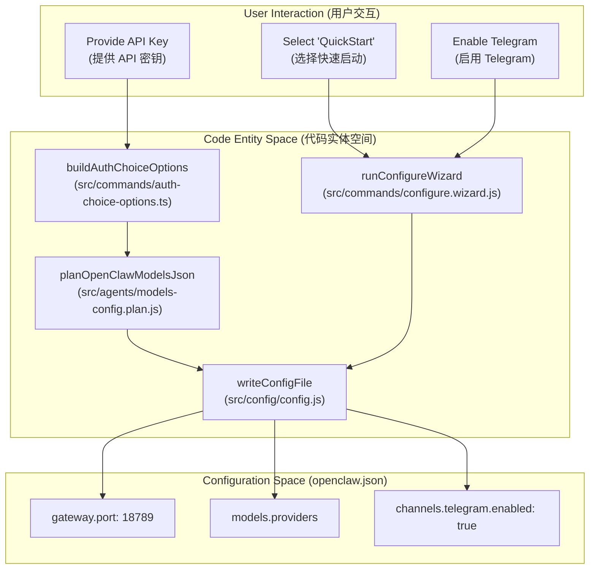

此图说明了引导 CLI 如何将用户输入与特定的代码实体和配置键关联起来。

OpenClaw 如何通过 CLI 实现**声明式配置**的自动化生成。整个过程可以分为三个维度：

A. 用户交互层 (User Interaction)

这是引导程序的起点，捕捉用户的初衷。

- **API 密钥输入：** 针对需要模型访问权限的用户。
- **快速启动 (QuickStart)：** 为新用户提供一套默认的、可工作的最小化配置。
- **频道启用 (Telegram等)：** 针对特定集成场景的选择。

B. 代码实体层 (Code Entity Space)

这是系统的“大脑”，负责将模糊的用户意图转化为**结构化的数据**计划。

- **权限与模型规划：** * `buildAuthChoiceOptions` 负责构建认证选项。
  - 紧接着 `planOpenClawModelsJson` 会生成一个逻辑上的“模型计划”，它决定了哪些 Provider（如 OpenAI, Anthropic）会被写入配置。
- **配置向导：** * `runConfigureWizard` 是一个交互式状态机，它汇总了类似“快速启动”或“启用频道”的各种开关。
- **统一写入器：** * `writeConfigFile` 是所有逻辑的收敛点。它不直接关心用户点击了什么，它只负责接收前面步骤生成的 JSON 对象，并将其持久化。

C. 配置空间 (Configuration Space)

这是最终生成的 `openclaw.json` 文件内容，也是系统运行时的物理依据。

- **网络层：** 自动分配或确认 `gateway.port`（默认为 18789）。
- **模型层：** 填充 `models.providers` 数组。
- **集成层：** 将特定频道的 `enabled` 状态标记为 `true`。

这种设计采用了典型的 **Plan-then-Execute（先计划，后执行）** 模式：

1. **解耦：** 具体的 UI 交互（如命令行提问）与文件写入逻辑是完全分离的。这意味着未来如果你想增加一个 Web 版的初始化页面，只需要调用 `writeConfigFile` 即可。
2. **安全性：** 通过 `Zod`（结合前一张图）或类似的验证机制，在 `writeConfigFile` 之前可以确保 `openclaw.json` 永远不会因为用户输错一个单词而损坏。
3. **可追溯性：** 明确的文件路径（如 `src/commands/`）说明了 CLI 命令的逻辑边界非常清晰。

## 核心系统架构概述(System Architecture Overview)

openclaw的源码获取：

```bash
git clone --depth=1 --single-branch   https://github.com/openclaw/openclaw.git
```

第一层目录结构:

```bash
# (base) (node:v22.22.1)[Ubuntu][bash]opcxxu@OP-XCX in ~/openclaw-code-repo/openclaw on git:main [17:10:56]
$ tree -L 1 -d
.
├── Swabble
├── apps
├── assets
├── docs
├── extensions
├── git-hooks
├── packages
├── patches
├── scripts
├── skills
├── src
├── test
├── test-fixtures
├── ui
└── vendor

```

通过`tree -L 2 -d`命令查看基础的项目原码结构,部分目录在下面的架构图中提及

这是一个基于Mermaid的架构图，旨在更清晰地展示OpenClaw AI的各个组件及其相互关系：

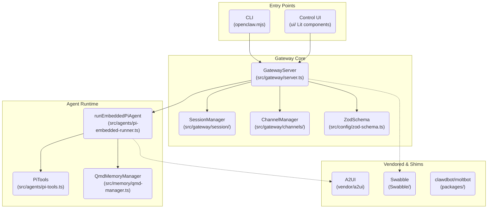

此架构图展示了 OpenClaw AI 的模块化系统设计，主要分为四个逻辑和文件系统区域：**Entry Points (入口点)**、**Gateway Core (网关核心)**、**Agent Runtime (代理运行时)** 和 **Vendored & Shims (供应商和填充)**。这种设计强调了关注点分离、中心化控制和对核心人工智能代理运行时的灵活支持。

以下是各部分的详细介绍：

###  Entry Points (入口点)

这部分代表了外部系统与 OpenClaw AI 交互的两种主要方式。它们是系统的门面，不直接运行代理逻辑，而是充当将用户请求转发给核心的适配器。

- **CLI (openclaw.mjs):**
  - **描述:** 一个命令行界面 (CLI)，通过核心的 `openclaw.mjs` 文件运行。
  - **作用:** 它是一个基于终端的工具，允许开发人员、系统管理员或自动化脚本通过命令行与 OpenClaw 系统交互。它可能包括用于代理管理、会话检查或系统诊断的命令。
- **Control UI (ui/ Lit components):**
  - **描述:** 一个基于 Web 的控制用户界面 (UI)，使用 **Lit** 组件构建。
  - **作用:** 为用户提供一个可视化的、基于浏览器的仪表板，用于监控代理、配置设置和查看日志。它通过 Web API 与核心服务器通信。

> Lit 是一个由 Google 推出的轻量级 JavaScript 库，用于构建快速、现代的 **Web Components**。它的核心理念是通过极小的体积提供响应式状态管理和高效的模板渲染。

###  Gateway Core (网关核心)

这是系统的中央协调枢纽，充当**所有外部请求和内部代理操作之间的流量控制和资源管理服务器**。它基于文件系统路径 `src/gateway/`。

- **GatewayServer (src/gateway/server.ts):**
  - **描述:** 核心服务器组件。它是整个 OpenClaw 系统的主要处理单元。
  - **作用:** 接收来自 Entry Points（CLI 和 Control UI）的所有请求。它验证这些请求，应用必要的安全和权限检查，然后将其路由到适当的内部组件。它是管理会话、通道和代理状态的中央控制器。
- **SessionManager (src/gateway/session/):**
  - **描述:** 管理特定用户会话的组件。
  - **作用:** 负责维护所有活动客户端会话的状态。它管理会话生命周期（创建、维护、终止），并确保代理上下文在会话之间保持一致或正确地重新加载。
- **ChannelManager (src/gateway/channels/):**
  - **描述:** 管理通信通道的组件。
  - **作用:** 负责管理代理与其客户端或用户之间的实时、双向通信通道。这可能用于代理输出流、用户反馈收集或实时状态更新。
- **ZodSchema (src/config/zod-schema.ts):**
  - **描述:** 用于配置和数据验证的 Zod 模式定义。
  - **作用:** 这是一个数据验证和类型定义库。GatewayServer 使用它来验证所有输入请求的结构和有效性，确保配置设置是正确的。这有助于保持系统的数据完整性。

###  Agent Runtime (代理运行时)

这是实际**人工智能代理**逻辑执行的容器。它通过文件系统路径 `src/agents/` 分隔开来，专注于代理行为和资源管理。

- **runEmbeddedPiAgent (src/agents/pi-embedded-runner.ts):**

  - **描述:** 嵌入式 Pi 代理的主执行器。它是 GatewayServer 调用的代理逻辑入口点。
  - **作用:** 这是核心执行循环。**它管理 Pi 代理的生命周期，负责加载代理代码，执行代理动作，并协调其所需的工具和记忆组件**。它从 GatewayServer 接收指令，并将代理状态和输出发送回网关。

- **PiTools (src/agents/pi-tools.ts):**

  - **描述:** **代理可访问的一组工具或能力**。
  - **作用:** 这是**代理的“手和脚”**。PiTools 包含了代理与之交互的所有实用程序、API 接口和外部系统挂钩。这可能包括文件系统访问、网络 API、甚至是指向**外部 LLM 服务的接口**。代理通过调用这些工具来影响外部世界。

- **QmdMemoryManager (src/memory/qmd-manager.ts):**

  - **描述:** 用于管理代理记忆（短期和长期）的 **Qmd 存储管理组件**。
  - **作用:** 这是代理的“大脑”。QmdMemoryManager 允许代理持久化保存其先前的对话、动作日志、以及它构建的知识库。它提供了一个结构化的方式来检索、存储和搜索这些信息，从而实现具有持久性的多会话交互。


###  Vendored & Shims (供应商和填充)

这一层代表了**系统的所有外部依赖项**，无论是预构建的供应商代码还是桥接不同组件的填充（Shim）。

1. A2UI (vendor/a2ui)

**A2UI** 在 OpenClaw 中通常是指 **"Agent-to-User Interface"** 的缩写，或者是一个被引入（Vendor）的 UI 框架。

- **核心功能：** 它定义了 Agent 与用户之间交互的标准化界面。
- **为什么放在 Vendor 目录：** 意味着它原本是一个独立的项目，但被复制到了 `vendor/` 目录下，以便开发者对其进行针对性的性能微调，而不受外部 npm/包管理更新的影响。
- **作用：** 处理对话气泡、状态显示以及 Agent 的多模态渲染输出。

2. Swabble (Swabble/)

**Swabble** 是 OpenClaw 项目中一个非常特殊的逻辑层或小型工具集。

- **核心功能：** 它主要负责 **"Data Sanitization"（数据清洗）** 和 **"Context Cleaning"（上下文归并）**。
- **功能定位：**
  - **洗牌/转换：** 在将数据交给模型之前，Swabble 会“清洗”掉无关的原始元数据，只保留核心 Prompt 逻辑。
  - **Shim 作用：** 它可以看作是底层数据接口与高层 Agent 逻辑之间的“垫片”，解决数据结构不匹配的问题。
- **代码位置：** 既然它有独立的文件夹，说明它包含了一套完整的逻辑转换规则。

3. clawdbot / moltbot (packages/)

这两个组件是 **OpenClaw** 核心功能的具象化，作为内部包（Packages）管理。

- **clawdbot：** 这是系统的默认基础 Agent 驱动包。它负责基础的任务分发、指令解析和 QMD 存储的调用。
- **moltbot：** "Molt"（蜕变/换羽）暗示了这是一个具有**自我进化**或**动态策略切换**能力的 Bot 模块。
  - 它通常用于实验性的 AI 行为，或者根据不同的任务场景（如编码、搜索、翻译）动态调整 Agent 的“形态”。
- **管理方式：** 使用 `packages/` 意味着项目采用了 **Monorepo（单仓多包）** 架构。你可以独立地更新 `moltbot` 而不影响系统的 UI 或其他基础组件。

### 总结

- **A2UI (vendor/a2ui):** 代理运行时需要与之通信的外部 UI 库或供应商 API 包装器。它可能是代理本身需要使用的特定 UI 框架，或者是一个特定于供应商的控制层。
- **Swabble (Swabble/):** 核心服务器所需的一个关键供应商库。它通过虚线连接到 `GatewayServer`，表明它是一个必要的、但可能不是直接由核心代码库维护的核心依赖项。
- **clawdbot/moltbot (packages/):** 两个供应商提供的软件包。它们是系统中更具体的特定于项目的包依赖，可能作为系统整体架构的一部分使用。

OpenClaw  架构采用了一种经典的**Gateway+Agent Running Time**的设计。它提供了一个**中心化的网关服务器**，用于处理外部交互和会话管理，从而保持了系统的稳健性和安全性。与此同时，它将代理逻辑隔离在一个**专用的运行时环境**中，使得代理可以灵活地扩展其工具集和记忆管理。外部依赖项的清晰分离使得整个系统更具模块化和可维护性。

## 系统架构System Architecture

OpenClaw 遵循**中心辐射式架构** ，网关作为中央控制平面。 所有用户界面（命令行界面、Web 界面、原生应用程序）和消息通道都通过网关通过 **WebSocket 或 HTTP** 进行通信。

网关协调agent执行。 管理具有每通道隔离的会话，处理认证，并将消息路由到/从消息平台。

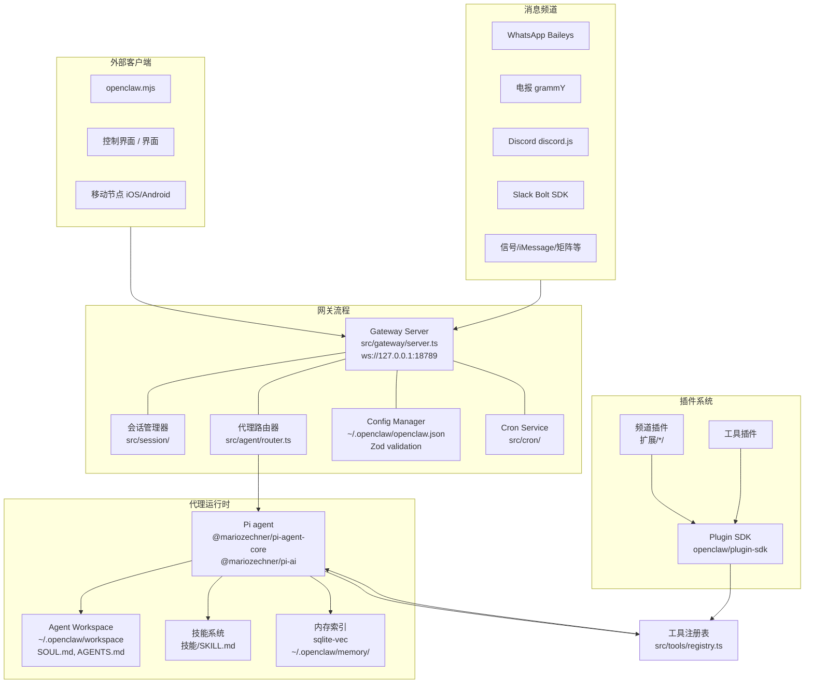

```
WhatsApp / Telegram / Slack / Discord / Google Chat / Signal / iMessage / BlueBubbles / IRC / Microsoft Teams / Matrix / Feishu / LINE / Mattermost / Nextcloud Talk / Nostr / Synology Chat / Tlon / Twitch / Zalo / Zalo Personal / WebChat
               │
               ▼
┌───────────────────────────────┐
│            Gateway            │
│       (control plane)         │
│     ws://127.0.0.1:18789      │
└──────────────┬────────────────┘
               │
               ├─ Pi agent (RPC)
               ├─ CLI (openclaw …)
               ├─ WebChat UI
               ├─ macOS app
               └─ iOS / Android nodes
```

架构描述:

**OpenClaw** 的智能代理（AI Agent）系统的架构。它是一个高度模块化的系统，旨在将各种外部客户端和消息频道连接到一个核心的 AI 代理运行时。

该系统主要由四个核心板块组成：

###  接入层 (External Clients & Message Channels)

这是系统的入口点，分为两类：

- **外部客户端 (External Clients):** 包括命令行工具 (CLI)、控制界面 (UI) 以及移动端应用 (iOS/Android)。
- **消息频道 (Message Channels):** 集成了主流社交平台，如 WhatsApp (Baileys)、Telegram (grammY)、Discord (discord.js)、Slack (Bolt SDK) 以及 Signal/iMessage 等。

###  网关流程 (Gateway Process)

这是系统的中枢，负责协调通信和管理：

- **Gateway Server:** 核心服务器，运行在 `ws://127.0.0.1:18789`。
- **管理组件:** 包含会话管理器 (Session Manager)、代理路由 (Agent Router)、配置管理器 (Config Manager，使用 **Zod** 进行校验) 以及定时任务 (Cron Service)。

> **Zod 是一个面向 TypeScript 的模式声明和验证库（Schema Declaration and Validation Library）。**
>
> 在像 OpenClaw 这样复杂的系统中，配置文件（如 `openclaw.json`）非常关键。如果用户在 JSON 里填错了字段类型（比如该填数字的地方填了字符串），程序运行到一半崩溃会很难排查。
>
> **Zod 的核心任务是：**
>
> - **守门员：** 当系统加载 `openclaw.json` 时，Zod 会立即检查数据格式是否符合预定义的规则。
> - **类型安全：** 它能自动为 TypeScript 生成类型定义，确保开发者在写代码时（如 `src/gateway/server.ts`）能获得精准的自动补全，且不会出现 `undefined` 导致的错误。
>
> 在 OpenClaw 的架构里，Zod 确保了系统的**稳定性**。它保证了不论是用户手动修改的配置文件，还是通过网关传入的参数，只要进入系统内部，就一定是符合预期、干净、安全的数据。

###  代理运行时 (Agent Runtime)

这是 AI 的“大脑”所在：

- **Pi Agent:** 基于 `@mariozechner/pi-agent-core` 构建的核心引擎。
- **支撑系统:**  
  - **工作空间 (Agent Workspace):** 存储 `SOUL.md` 和 `AGENTS.md`。
  - **技能系统 (Skills):** 定义在 `SKILL.md`。
  - **内存索引 (Memory Index):** 使用 `sqlite-vec` 进行向量检索。
  

###  插件系统 (Plugin System)

提供扩展能力：

- **插件分类:** 分为频道插件 (Channel Extensions) 和工具插件 (Tool Plugins)。
- **Plugin SDK:** 通过专门的 SDK 与核心系统进行交互。

------

## openclaw对需求和任务的理解和执行

**OpenClaw** 能够**理解需求并完成复杂任务**的核心关键在于 **代理运行时 (Agent Runtime)** 与 **工具注册表 (Tool Registry)** 之间的解耦与协作机制。

具体可以拆解为以下三个核心维度：

####  核心大脑：Pi Agent (@mariozechner/pi-agent-core)

这是系统的“智力”来源。

- **角色定位：** 它不是简单的脚本，而是一个基于大语言模型（LLM）的推理引擎。它负责将用户从不同频道（Discord, Slack 等）发送的自然语言**解析成可执行的逻辑**。
- **关键点：** 它决定了系统是否能理解“模糊需求”。如果这个核心使用了高性能的 LLM 结合合理的 Prompt 工程，它就能进行任务拆解（Task Planning）。

####  知识与约束：Agent Workspace (SOUL.md / AGENTS.md)

这是决定代理**“行为准则”和“上下文感知”**的地方。

- **SOUL.md：** 通常定义了 **AI 的性格、目标和决策偏好**。这决定了在面对复杂任务时，AI 是倾向于保守执行还是主动探索。
- **AGENTS.md：** 可能定义了不同**子代理的角色分工**。复杂任务往往需要**多个角色**协作，这个文件是系统实现“多代理协作”的基础。

####  执行能力：工具注册表 (src/tools/registry.ts) 与 Plugin SDK

**这是从“想到”到“做到”的关键桥梁。**

- **能力边界：** AI 即使再聪明，如果没有工具也无法干活。`Tool Registry` 充当了 AI 的“军火库”。
- **任务闭环：** 复杂任务通常涉及外部操作（如查数据库、调用 API、读写文件）。
- **插件化：** 通过 `Plugin SDK` 和 `工具插件`，用户可以不断给系统安装“新技能”。这意味着 OpenClaw 的上限取决于你为它注册了多少强大的工具。

------

#### 总结

如果非要选一个**最关键**的点，那就是 **Pi Agent 对工具注册表（Tool Registry）的调用能力**。

1. **感知：** 网关接收到复杂任务。
2. **规划：** Pi Agent 结合 `SOUL.md` 进行思考，拆解任务。
3. **行动：** 关键点！Pi Agent 从 `Tool Registry` 中检索并选择合适的工具执行。
4. **反馈：** 通过 `Memory Index (sqlite-vec)` 记录中间结果，直到任务完成。

如果没有这个灵活的工具注册机制，OpenClaw 充其量只是一个聊天机器人；有了它，它才真正具备了“完成任务”的生产力。

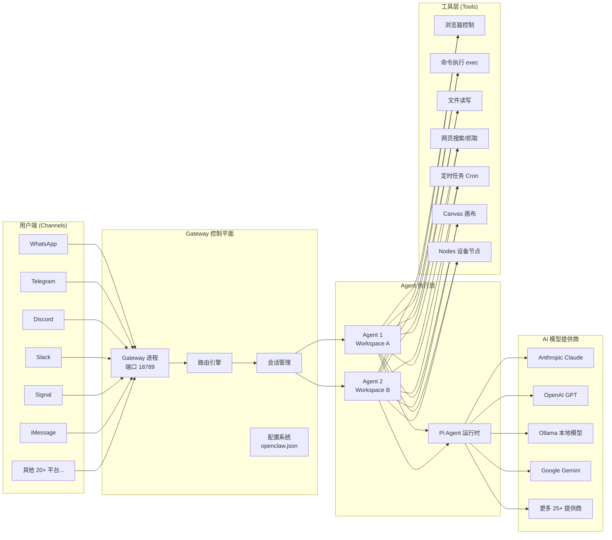

## 相关概念补充和说明

### Gateway（网关）

你在自己的机器（或服务器）上运行一个 Gateway 进程，它就成为你的消息应用与始终可用的 AI 助理之间的桥梁。 它作为单一进程在你的基础设施上运行，管理会话、路由、工具执行和频道连接。

Gateway 的核心职责：

| 职责              | 说明                                                         |
| ----------------- | ------------------------------------------------------------ |
| **会话管理**      | Gateway 是会话（Sessions）、路由和频道连接的唯一事实来源     |
| **频道连接**      | WhatsApp、Telegram、Discord 和 iMessage 等可通过单个 Gateway 进程连接 |
| **WebSocket RPC** | 客户端（CLI、Web UI、移动应用、频道插件）通过 WebSocket RPC 连接到默认端口 18789 |
| **配置热加载**    | 大多数配置更改无需重启即可生效（端口/绑定需要重启）          |
| **控制 UI**       | 控制界面 + WebChat 直接从 Gateway 提供服务                   |

### Agent（智能体和工作区文件）

Agent 是 AI 助理的核心，通过**工作区文件**（Identity、Soul、Tools、Skills 等）定义，指定**能力、记忆和交互风格**。

Agent 的工作区目录通常包含以下关键文件：

| 文件           | 作用                                       |
| -------------- | ------------------------------------------ |
| `AGENTS.md`    | 定义 Agent 的身份与角色                    |
| `SOUL.md`      | 定义人格特征，编辑此文件可以改变助理的个性 |
| `USER.md`      | 关于你（用户）的信息                       |
| `MEMORY.md`    | 长期记忆存储                               |
| `HEARTBEAT.md` | 编辑此文件可以改变助理的主动签到计划       |

### heartbeat(心跳)

> **什么是 Heartbeat（心跳）？** OpenClaw 的 Heartbeat 功能允许它主动行动：监控收件箱并**主动**提醒紧急邮件、定期检查日程并提前准备会议材料、监控特定网页变化并**即时通知你**——这个特性将 OpenClaw 从"工具"升级为真正的"助理"。

### Channel（频道）

频道（Channel）是 OpenClaw 与**用户交互的入口**，支持 WhatsApp、Telegram、Discord、iMessage 等。

频道(子系统)通过**提供者模式**（Provider Pattern）集成**外部消息平台**：每个平台运行一个独立的**监控器**，接收原始事件、执行访问控制、将消息**标准化为通用信封格式**，并通过平台特定的投递机制路由回复。

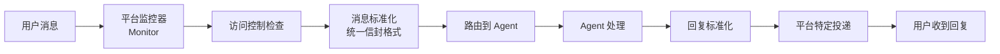

频道分为核心频道（内置于主源码树）和扩展频道（独立的扩展包）。 频道支持每个平台多个账户（例如多个 Telegram Bot、多个 Discord Bot）。


## 运行时组件

### 网关进程(Gateway)

**网关**(gateway)是一个长时间运行的 **Node.js 守护进程**，它：

- 管理通道插件生命周期和健康状况监控
- 使用中心辐射型模型将入站消息路由到代理会话。
- 以 JSONL 格式保存配置、凭据和会话记录。

#### 认证模式 ：

- `SecretRef` ：OpenClaw 使用 `SecretRef` 系统安全地从环境变量或文件中引用敏感令牌。
- `OAuth` ：支持 OpenAI 和 MiniMax 等提供商的原生 OAuth 流程

### 代理运行时（Pi Agent）

OpenClaw 嵌入了 **Pi Agent** 运行时，该运行时负责处理：

- **工具执行** ： `exec` 、 `read` 和 `write` 等工具都受到严格的策略约束。
- **上下文压缩** ：通过 `compactEmbeddedPiSession` 自动汇总会话，以保持在模型令牌限制内
- **内存** ：支持多种后端，包括 `builtin` (SQLite )和用于矢量/混合搜索的 `qmd` （**Quick Markdown**）

------

### 关键引入组件与兼容适配层(Key Vendored Components & Shims)

OpenClaw 集成了几个关键的外部组件和兼容层：

| **组件名称**           | **核心职责 (Role)**                                          | **存放路径 (Location)** |
| ---------------------- | ------------------------------------------------------------ | ----------------------- |
| **A2UI**               | **智能体用户界面**：负责渲染 Canvas（画布）及其他交互式 UI 元素的标准格式。 | `vendor/a2ui`           |
| **Swabble**            | **唤醒词守护进程**：用于实现语音助手功能的“唤醒词”监听后台服务。 | `Swabble/`              |
| **clawdbot / moltbot** | **兼容性适配层 (Shims)**：用于集成旧版机器人（Legacy Bot）的兼容层，提供包级别的抽象支持。 | `packages/`             |

1. Key Vendored Components (关键引入组件)

- **Vendored (引入/供应商化):**  在编程中，“Vendoring” 指的是**将第三方库的源代码直接拷贝到自己的项目代码库中**，而不是通过包管理器（如 npm, pip）远程引用。
  - **为什么要这么做？** 主要是为了确保即使外部库删库或更新了，项目依然能稳定运行；同时也方便开发者对这些第三方代码进行微调或定制。
- **Components (组件):** 指项目中独立的功能模块。
- **合起来理解：** 这些是 OpenClaw 项目**直接内置**的、非自研但至关重要的第三方功能模块。

在很多中文技术社区中，"`vendored`" 这个词常常不翻译，直接使用英文原词，因为它是一个约定俗成的技术概念。

> vendor(ed):将第三方依赖代码直接复制/内置到项目中（而非通过包管理器动态引用）
>
> Vendored Components:**内置（第三方）组件**或**捆绑的依赖组件**

2. Shims (兼容适配层/垫片)

- **Shim (垫片/适配器):**
  - **直观比喻：** 就像在摇晃的桌子腿下垫一块小木片（Shim），让它变平稳。
  - **技术定义：** 它是一段轻量级的代码，用于**拦截 API 调用**或在两个不兼容的接口之间建立桥梁。
  - **在这里的意义：** 指为了让旧版代码（如老款机器人 `moltbot`）能在新框架下跑起来而写的“翻译层”或“转换层”。
- **合起来理解：** 这些是为了保持向下兼容、连接新旧系统而存在的**胶水代码**。

### 数据流:从消息到操作

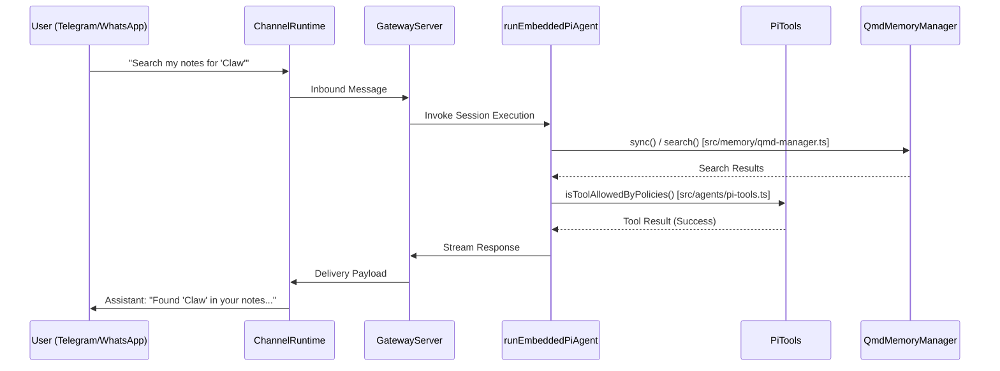


流程说明

该流程可以分为四个主要阶段：**消息接收、核心处理、数据检索与验证、结果返回**。

#### 阶段一：消息接收 (Inbound)

1. **用户 (User)** 在终端（Telegram 或 WhatsApp）输入指令：“Search my notes for 'Claw'”。
2. **ChannelRuntime (频道运行时)** 接收到原生平台的消息，并将其转发给 **GatewayServer (网关服务器)**。网关负责统一处理不同渠道的输入。

#### 阶段二：核心逻辑触发 (Execution)

1. **GatewayServer** 调用 **runEmbeddedPiAgent**（嵌入式 Pi 代理），这是系统的核心大脑，负责协调任务执行。

#### 阶段三：数据检索与策略检查 (Memory & Policy)

1. **代理 (REPA)** 首先与 **QmdMemoryManager (存储管理器)** 通信，调用 `search()` 方法在用户的笔记数据中查找关键字 "Claw"。
2. **QmdMemoryManager** 返回搜索到的结果。
3. 在生成最终答复前，**代理** 访问 **PiTools**，通过 `isToolAllowedByPolicies()` 检查该操作或结果是否符合安全与权限策略。
4. **PiTools** 确认操作合法并返回成功信号（Success）。

#### 阶段四：结果流式返回 (Response)

1. **代理** 将处理好的结果以流的形式（Stream Response）传回 **GatewayServer**。
2. **GatewayServer** 将响应封装成 **Delivery Payload (投递负载)** 发送回特定的频道运行时。
3. **ChannelRuntime** 最终将文本转化为用户可见的消息：“Found 'Claw' in your notes...”。

------

总结

该架构体现了一个典型的**解耦设计**：

- **网关层**处理多平台接入。
- **内存层 (QmdMemoryManager)** 专门负责 RAG（检索增强生成）或笔记搜索。
- **策略层 (PiTools)** 确保 AI 的行为在合规范围内。

## 关键功能

### 多通道网关(Multi-Channel Gateway)

OpenClaw 连接到各种消息界面。 通过 `dmPolicy` 严格控制 DM 访问（配对、白名单、开放、或禁用)

在 **OpenClaw** 的架构中，`dmPolicy`（Direct Message Policy，私信策略,私聊访问策略）是一个核心的安全控制组件。它决定了 AI 助手在接入社交平台（如 Telegram, Discord, WhatsApp 等）时，**如何过滤并响应非群聊的个人私信**。

> 这里将 **"Direct Message"** 	翻译为 **“私信”** 

由于 OpenClaw 作为一个 AI 代理系统，如果直接向互联网开放，可能会面临 Token 消耗过快或隐私泄露的问题，因此 `dmPolicy` 充当了“门卫”的角色。

------

`dmPolicy` 的四种核心模式

根据你的描述，这四种模式分别代表了从“完全封闭”到“完全开放”的不同安全等级：

| **模式**               | **行为描述**                                                 | **适用场景**                 |
| ---------------------- | ------------------------------------------------------------ | ---------------------------- |
| **禁用 (Disabled)**    | 彻底关闭私信功能。AI 不会读取或回复任何私信。                | 仅限群组管理的专用机器人。   |
| **配对 (Pairing)**     | 仅允许已通过特定流程（如输入验证码或后台手动绑定）的特定账号访问。 | 个人专属的 AI 助理。         |
| **白名单 (Whitelist)** | 只有记录在配置文件中的特定用户 ID (UID) 才能得到响应。       | 核心团队或受邀用户内部测试。 |
| **开放 (Open)**        | 任何发送私信的用户，AI 都会响应。                            | 公共客服机器人或推广型 AI。  |

------

为什么 `dmPolicy` 对 OpenClaw 至关重要？

1. **资源保护 (Cost Control)**：

   AI 响应需要消耗大量的 API Token。如果设置成 `Open`，外部恶意脚本可能会通过大量私信刷爆你的 API 额度。`dmPolicy` 让你能精准控制谁在花你的钱。

2. **反垃圾/防骚扰 (Anti-Spam)**：

   在 Telegram 等平台上，机器人极易被垃圾信息账户盯上。通过 `Whitelist` 或 `Pairing` 策略，可以确保 AI 只服务于真实且有权限的用户。

3. **身份隔离**：

   在 OpenClaw 这种多接口连接的系统中，`dmPolicy` 确保了私人对话环境的纯净。例如，你可以设置为“群聊开放，但私聊仅限管理员”。

### 工具与技能系统(Tool & Skills System)

代理可以通过在 `SKILL.md` 文件中定义的"技能"进行扩展。这些技能映射到如下工具：

- 执行：Shell 命令执行
- 内存：通过 `qmd` 或 `builtin` SQLite 进行向量搜索
- 浏览器：网页抓取和解析

## 主要功能

### 网关(Gateway)：中央控制平面

**网关**是协调所有 OpenClaw 活动的中心 **WebSocket RPC** 服务器。 它充当"主"进程，管理连接、路由和状态。

**主要职责：**

- **频道管理：** 维护与消息平台的持久连接（WhatsApp， Telegram 等 
- **路由：** 根据绑定将传入消息定向到正确的代理和会话
- **认证：** 执行基于角色和基于设备的安全策略
- **持久性：** 作为会话记录和令牌计数的真实来源 

**网关实现：**

- `src/gateway/gateway.ts`: 主要服务入口。
- `src/gateway/rpc-server.ts`: 处理控制界面和节点的 WebSocket 协议。


------

### 智能体(代理agent)：执行单元

一个**agent**是一个独立的"大脑"，拥有自己的工作空间、角色和配置。 OpenClaw 支持在**单个 Gateway 进程**中同时托管**多个代理**

**agent隔离：** 每个代理由唯一的 `agentId` 定义(例如`main`)，并维护其自身：

> 典型路径`~/.openclaw/agents/{id}/SOUL.md`,`~/.openclaw/workspace/AGENTS.md`

- **工作区：** 类似于 `SOUL.md` 和 `AGENTS.md`.
- **状态目录 (`agentDir`):** 存储 `auth-profiles.json `(API 密钥) 和模型注册表
- **会话存储：** 与其他代理隔离的聊天历史

**agent路由（确定性）：** 传入消息通过基于优先级的绑定系统进行路由 

1. 精确的 `peer` 匹配（直接消息或群组 ID）。
2. `parentPeer` 匹配（线程继承）。
3. `guildId` / `teamId` (Discord/Slack 服务器)
4. `accountId` (特定频道登录).
5. 默认代理回退.


------

### 会话：对话状态

一个**会话**代表一个单独的对话线程。 OpenClaw 使用一个复杂的**密钥系统**来确定消息是属于现有的聊天还是开启一个新的聊天。

**会话作用域 (`dmScope`):** 控制如何将私信分组 

- `main`: 所有 DM 共享一个全局会话（默认）。
- `per-peer`: 在所有频道中，通过发送者 ID 进行隔离。
- `per-channel-peer`: 通过通道+发送者进行隔离（推荐用于安全） 

**会话生命周期与维护:**

- **存储：** 会话以 JSONL 转录形式存储在 `~/.openclaw/agents/<agentId>/sessions/` 
- **清理：** 网关根据 `pruneAfter`（默认 30 天）和 `maxEntries`
- **分支:** 新的线程（例如，Slack/Discord 线程）可以从父会话中"分支"出来， 在不修改原始内容的情况下继承上下文 


------

### 频道：消息集成

**频道**是用户与代理交互的接口。 OpenClaw 支持包括 WhatsApp、Telegram、Discord 和 iMessage 在内的众多平台 

**安全策略：** 每个通道强制执行一个 `dmPolicy` 来处理不可信输入 ：

- `pairing`: 未知发送者将收到一个代码，必须通过 `openclaw `配对批准
- `allowlist` : 只有 `allowFrom` 中的特定 ID 可以与代理交互 
- `open`: 公开访问（需要明确选择加入）

------

### 工具与技能(Tools & Skills)

**工具**(Tools)是指功能能力（例如，`exec`, `web_search`, `read_file`）是代理可以调用的。 

**技能**(Skills):以 `v` 格式定义的模块化工具和提示词包。

- 工具策略：可以通过 `tools` 对工具进行全局或按agent进行访问限制。profile (例如，"coding")
- **网络搜索：** 集成服务商如 Perplexity 或 Brave 可以在初始设置过程中进行配置 


------

### 模型提供者与认证配置

OpenClaw 支持多个 LLM 提供商（Anthropic，OpenAI， 通过插件式架构（如 Google 等）

- **认证配置文件：** 凭证（API 密钥或 OAuth 令牌）存储在 `auth-profiles.json`
- **故障转移：** 如果主模型失败（例如，429 速率限制）， OpenClaw 可以自动旋转到不同的 API 密钥或回退模型
- **向前兼容性：** 该系统包含通过 `resolveDynamicModel`

------

## 核心组件与架构

### 系统实体映射

下图将高级概念映射到其特定的代码实现和配置键。

**图：自然语言到代码实体空间**

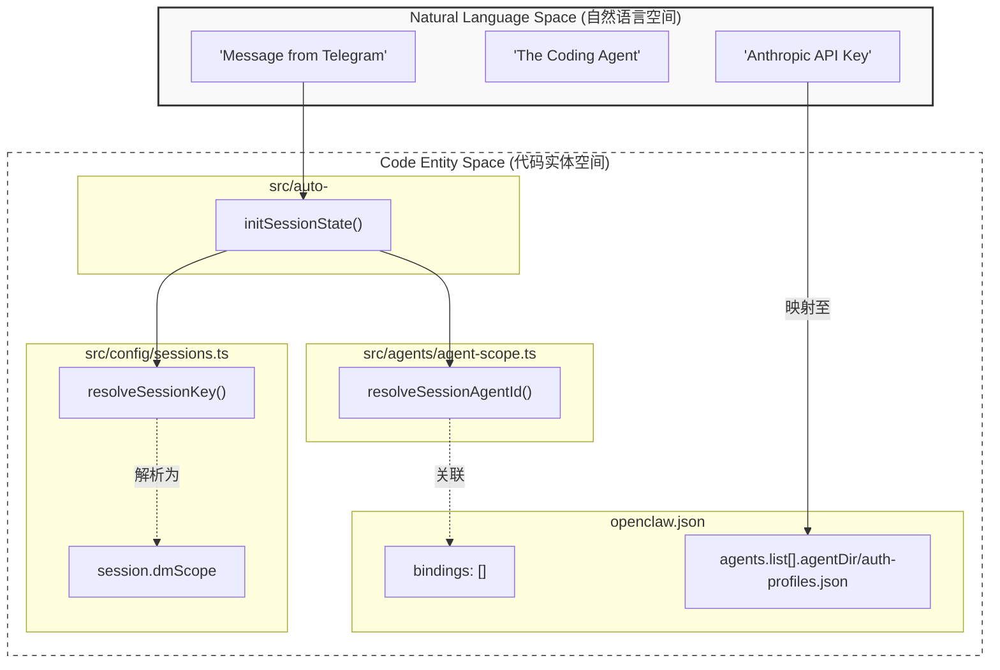

**会话初始化 (Session Initialization)**

- **输入**：来自 Telegram 的消息。
- **处理**：由 `initSessionState()` 承接，随后分流。
- **路径 A**：进入 `sessions.ts` 确定会话密钥，最终锁定到 `session.dmScope`（直连私信范围）。
- **路径 B**：进入 `agent-scope.ts` 确定 Agent ID，并查阅 `openclaw.json` 中的 `bindings` 绑定关系。

**身份与鉴权 (Authentication)**

- **输入**：例如自然语言中提到的 “Anthropic API Key”。
- **映射**：直接对应到配置文件 `openclaw.json` 里的 `auth-profiles.json`。这意味着系统能识别用户提到的“密钥”并自动关联到后台存储的物理路径。


### 组件架构

该图说明了网关如何与第三方组件和适配器交互。

**图示：网关与组件交互**

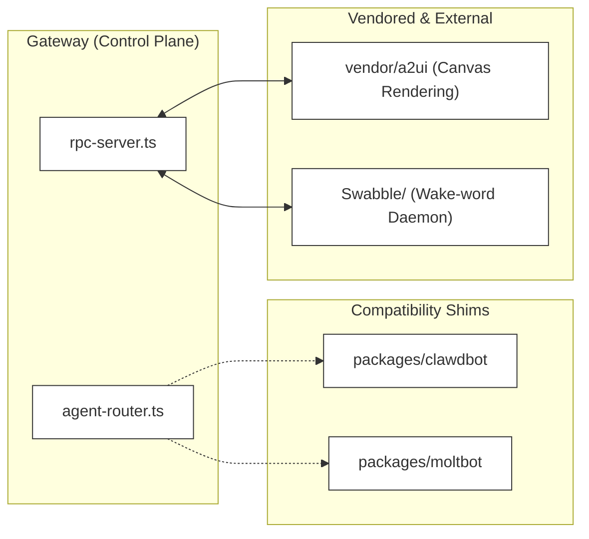

1. Gateway (Control Plane) - 核心控制层

这是系统的“大脑”，负责逻辑分发和通信协调。

- **agent-router.ts (代理路由)**：主要负责**指令分发**。它通过虚线连接到“兼容层”，意味着它可能是在进行静态链接或逻辑上的路由引导，决定将请求发送给哪个具体的机器人实例。
- **rpc-server.ts (RPC 服务端)**：负责**实时通信与数据交换**。它通过双向实线与外部组件连接，表明这是一种高频、双向的数据流（例如状态同步或命令回传）。

2. Compatibility Shims - 兼容适配层

这一层主要存放特定设备的驱动或适配逻辑。

- **packages/clawdbot** 和 **packages/moltbot**：看起来是针对不同机器人型号（Clawdbot 和 Moltbot）的“适配插件”或“垫片（Shim）”。这种设计允许核心网关保持通用，通过适配层来处理不同硬件的差异。

3. Vendored & External - 供应商与外部组件

这一层集成了第三方库或独立的系统服务：

- **vendor/a2ui (Canvas Rendering)**：负责图形界面或画布渲染逻辑。`rpc-server` 与其交互，可能是为了根据指令实时更新 UI 画面。
- **Swabble/ (Wake-word Daemon)**：这是一个**唤醒词守护进程**（类似“嘿，Siri”的机制）。双向连接意味着 `rpc-server` 既接收来自它的唤醒信号，也可能向其反馈监听状态。

------

## 本机组件与适配器

### A2UI（代理用户界面）

位于 `vendor/a2ui` 这是 OpenClaw 用于渲染 **Canvas** 的标准格式。 它允许代理控制移动节点（iOS/Android）上的实时 UI 以及 macOS 客户端 [[README.md:22\]](https://deepwiki.com/openclaw/openclaw/1.2-core-concepts)。

### Swabble（唤醒词守护进程）

位于 `Swabble/`，该组件负责 macOS 应用程序的本地语音唤醒词检测， 允许通过语音指令激活助手 [[docs/start/hubs.md:131\]](https://deepwiki.com/openclaw/openclaw/1.2-core-concepts)。

### 兼容性适配层 (clawdbot/moltbot)

位于 `packages/` 中，这些适配层为传统的命名规范和集成（Clawd/Molt）提供向后兼容性， 确保旧版工作流程在现代 OpenClaw 网关中继续运行 [[docs/docs.json:244-250\]](https://deepwiki.com/openclaw/openclaw/1.2-core-concepts)。

## Openclaw 中大模型（LLM）在架构中的作用

openclaw 是一个多平台 AI 网关，LLM 并非单一组件，而是贯穿于**整个 Agent Runtime（代理运行时）**的核心驱动力。以下是 LLM 在各层架构中发挥作用的详细说明。

---

### Openclaw使用LLM的示意图

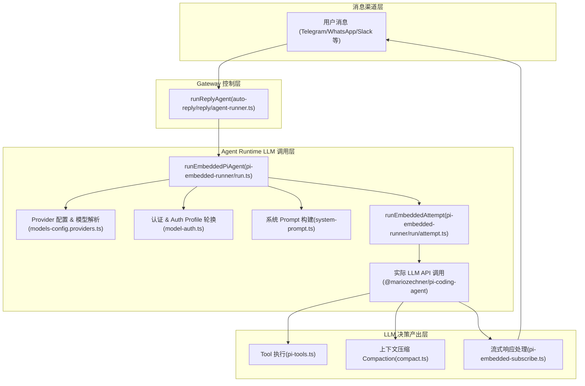

---

### 模型调用前置步骤

####  Provider 配置与模型发现

这是 LLM 接入的**入口配置层**，负责将各种 LLM 服务商（OpenAI、Anthropic、Gemini、Ollama、Amazon Bedrock 等）规范化为统一格式。

- **`normalizeProviders()`** 处理用户在 `openclaw.json` 中显式配置的 provider（包括 Base URL、API Key、请求适配器类型等）。

- **`resolveImplicitProviders()`** 负责从环境变量或 Auth Profile 中自动发现未显式配置的 provider（如 GitHub Copilot、Amazon Bedrock）。

- 规范化结果持久化到 `models.json`，供 Agent Runtime 使用（原子写入、进程锁保护）。

---

####  模型解析（resolveModel）

在每次 Agent 运行前，`resolveModel()` 函数将用户指定的 `provider/modelId` 解析为实际可用的模型对象（含 `api`、`baseUrl`、`contextWindow`、`cost` 等元数据）。

支持从模型注册表（`modelRegistry`）查找、内联配置覆盖、OpenRouter 透传、前向兼容等多种解析路径。

---

####  System Prompt 构建层

在每次 LLM 调用前，系统动态构建 System Prompt，内容包括：

- **Skills 指令**（技能加载规则）
- **Memory 召回提示**（是否调用 `memory_search`）
- **用户身份标识**（Authorized Senders）
- **工具使用指导**、沙箱路径、时区信息等

LLM 的行为完全由这个动态构建的 Prompt 驱动。

###  Agent 运行时核心

LLM 实际调用的地方(Agent Runtime LLM 调用层)

####  入口：`runEmbeddedPiAgent`

这是整个 LLM 调用链的**主入口**，负责：

- 序列化执行（通过 session lane 和 global lane 队列）
- 调用 `resolveModel()` 解析模型
- 管理 Auth Profile 轮换（多凭证轮询、冷却检测）
- 循环调用 `runEmbeddedAttempt` 进行实际推理 

####  核心执行：`runEmbeddedAttempt`

这是**真正向 LLM 发起请求**的地方，主要步骤包括：

| 步骤                         | 功能                                 |
| ---------------------------- | ------------------------------------ |
| `buildEmbeddedSystemPrompt`  | 构建发送给 LLM 的 System Prompt      |
| `createOpenClawCodingTools`  | 创建 LLM 可调用的工具集              |
| `createAgentSession`         | 初始化 pi-coding-agent 会话          |
| `agent.run(prompt)`          | **向 LLM Provider API 发起推理请求** |
| `subscribeEmbeddedPiSession` | 处理 LLM 流式输出                    |

针对不同 provider，会配置不同的 Stream 函数（如 Ollama 使用 `createConfiguredOllamaStreamFn`，OpenAI Responses 使用 WebSocket 流）： 

---

###  LLM 决策产出：Tool 执行

LLM 在推理后**决定调用哪些工具**（如文件读写、bash 执行、网络搜索、子 Agent 生成等）。`createOpenClawCodingTools` 将所有可用工具注册给 LLM，工具策略流水线（`applyToolPolicyPipeline`）控制工具访问权限。

---

###  上下文压缩（Compaction）

当会话历史超出 LLM 的上下文窗口时，系统会**再次调用 LLM** 对历史进行摘要压缩（`compactEmbeddedPiSession`），压缩完成后继续正常运行。这意味着 **LLM 既用于主对话推理，也用于上下文管理**。

---

###  故障转移与重试（Failover）

当 LLM 调用失败时，系统根据错误类型（认证失败、上下文溢出、超时、限流等）自动：

- 切换到下一个 Auth Profile（多 API Key 轮换）
- 触发 Compaction 后重试
- 指数退避后重试  

---

### 小结

LLM 在 openclaw 架构中的角色：

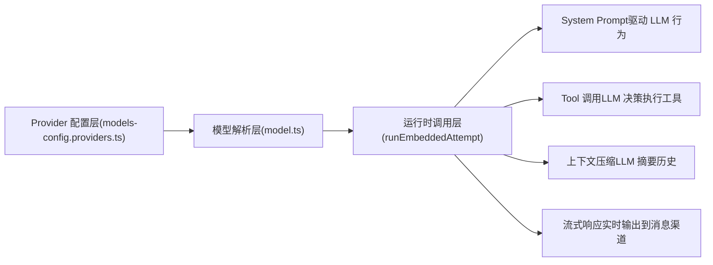

LLM 是 openclaw **Agent Runtime 的核心引擎**，所有的智能行为（回复生成、工具选择、记忆检索、上下文管理）都由 LLM 推理驱动，而 openclaw 的其他层（渠道接入、工具系统、认证管理、沙箱）都是围绕 LLM 调用提供支撑服务。

---

Notes

1. **底层依赖**：实际的 LLM API 调用封装在外部包 `@mariozechner/pi-agent-core` 和 `@mariozechner/pi-coding-agent` 中，openclaw 通过 `createAgentSession` 和 `agent.run()` 进行调用，具体流的适配（Anthropic Messages API、OpenAI Completions、OpenAI Responses、Google Generative AI）由 `api` 字段决定。
2. **多 Provider 支持**：openclaw 支持同时配置多个 LLM provider，通过 Auth Profile 机制实现自动故障转移，用户无需感知底层 provider 的切换。
3. **`disableTools` 模式**：存在一个"仅 LLM"模式（`disableTools: true`），此时不向 LLM 注册任何工具，适用于简单问答场景。


---

## Tools 与 Skills：理解两大核心概念

**Tools 是器官**——它们决定 OpenClaw "能不能"做某事。read 和 write 让它访问文件，exec 让它运行系统命令，**web_search** 让它像 Google 一样搜索，**browser** 让它与网页交互。没有启用 Tool，就像没有手——什么都做不了。

**Skills 是教科书**——它们教 OpenClaw 如何组合 Tools 来完成任务。gog 教它使用 Google Workspace 处理邮件和日历，obsidian 教它整理笔记，github 教它操作仓库，slack 教它向频道发消息。

### Tools 分类

| Tool 类别    | 具体工具                       | 功能                                     |
| ------------ | ------------------------------ | ---------------------------------------- |
| **文件操作** | read, write                    | 读写本地文件                             |
| **命令执行** | exec                           | 运行 shell 命令和脚本                    |
| **网页**     | web_search, web_fetch, browser | 搜索、抓取网页、浏览器自动化             |
| **画布**     | canvas                         | A2UI 推送/重置、eval、截图               |
| **设备节点** | nodes                          | 相机拍照/录像、屏幕录制、位置获取、通知  |
| **定时**     | cron, wakeups                  | 定时任务 + 唤醒；Webhooks；Gmail Pub/Sub |
| **消息**     | message                        | 向频道发送消息                           |
| **会话**     | sessions                       | 管理和生成子会话                         |

### Skills 系统

OpenClaw 使用兼容 AgentSkills 的**技能文件夹**来教 Agent 如何使用工具。每个 **Skill** 是一个包含 `SKILL.md`（带 YAML frontmatter 和指令）的**目录**。

OpenClaw 加载**内置 Skills** 和**可选的本地覆盖**，在加载时根据环境、配置和二进制文件存在性进行过滤。

**Skills 加载优先级**（从高到低）：

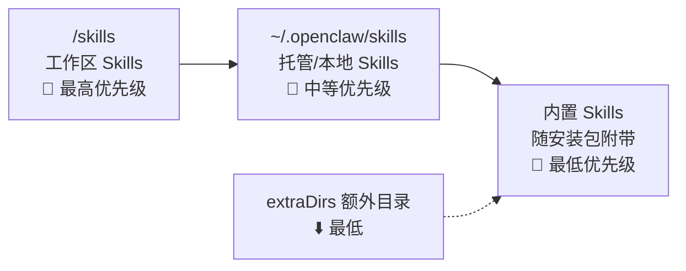

如果同名 Skill 存在于多个位置，按照通常优先级：工作区优先，然后是托管/本地，最后是内置。

### Skill 生效的三个必要条件

要让 OpenClaw 通过 Skill 真正做事，需要同时满足三个条件

以"读取 Gmail"为例：

①配置（Configuration）：你是否允许 OpenClaw 运行命令？（没有 exec，它连程序都启动不了）

②安装（Installation）：机器上是否安装了 gog 桥接工具？（没有它，OpenClaw 知道做什么但无法连接 Google）

③授权（Authorization）：你是否登录了 Google 账户并授予权限？（没有授权，Google 不会放行）三个条件缺一不可。

### ClawHub — Skills 生态

ClawHub 是 OpenClaw 的公共技能注册中心，可在 https://clawhub.com 浏览，用来发现、安装、更新和备份 Skills。 目前 ClawHub 上已有 13,700+ 第三方 Skills。

> ⚠️ **安全提醒**：将第三方 Skills 视为**不受信任的代码，在启用之前先阅读它们**，对不受信任的输入和高风险工具优先使用沙盒运行。

---

## 多 Agent 路由

OpenClaw 支持**多 Agent 路由**——将入站频道/账户/对等方**路由到隔离的 Agent**（独立的工作区 + 每 Agent 独立会话）。

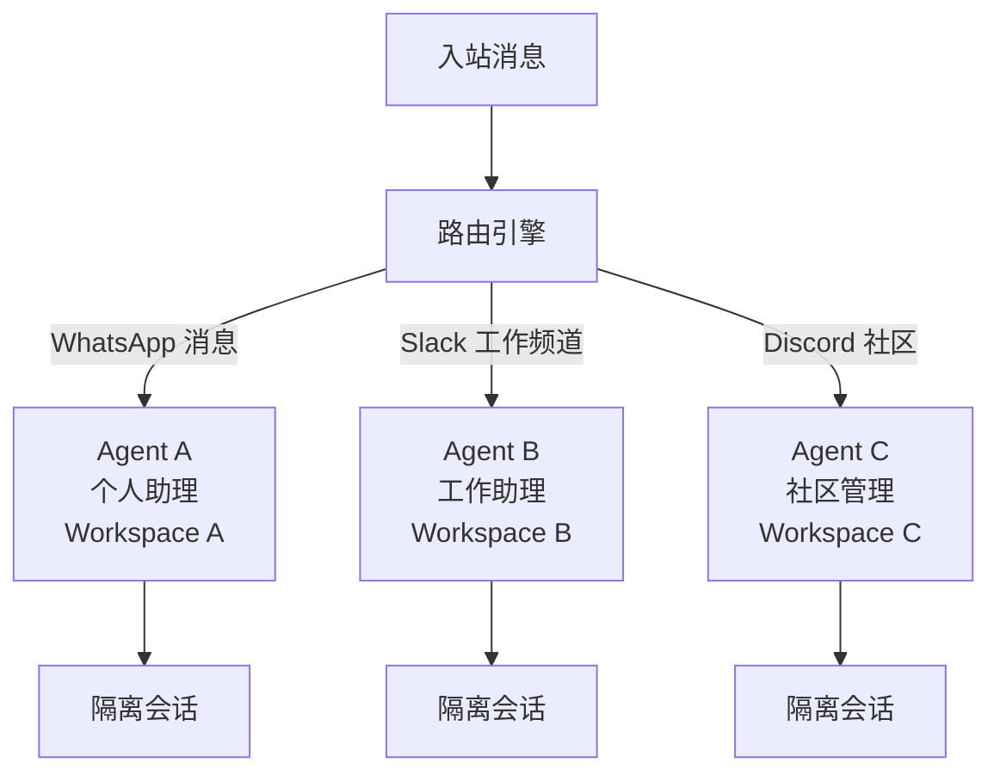

会话文件以 `JSONL` 格式存储在 `~/.openclaw/agents/<agentId>/sessions/<sessionKey>.jsonl` 中。

这意味着你可以为**不同场景**配置**不同人格、不同能力的 Agent**，彼此之间完全隔离。

### jsonl(ndjson)

> **NDJSON** (Newline Delimited JSON)，也常被称为 **JSON Lines (JSONL)**，是一种每行包含一个独立 JSON 对象的文本格式。
>
> **JSONL**（全称 **JSON Lines**）是一种非常实用的文本格式，专门为了**逐行处理数据**而设计。
>
> 简单来说，它就像是把一个巨大的 JSON 数组“拍扁”了，每一行都是一个完整、独立的 JSON 对象。

JSONL 的三大核心优势

> - **流式处理（Streaming）**：这是它最大的优点。解析标准 JSON 必须把整个文件读入内存，而 JSONL 可以**一行一行地读**。如果你有一个 100GB 的日志文件，JSONL 可以轻松处理，而标准 JSON 会直接让内存溢出。
> - **易于追加 (Appendable)**：如果需要增加数据，只需在文件末尾添加新行即可，无需重新解析和重写整个结构。
> - **容错性高**：在标准 JSON 中，如果文件末尾少了一个括号或中间多了一个逗号，整个文件就坏了。在 JSONL 中，如果某一行损坏，你只需要跳过那一行，剩下的数据依然有效。
> - **方便读写**：向文件末尾追加新数据时，JSONL 只需要直接写入新的一行，不需要像标准 JSON 那样先解析、再 Push、最后重新写入。

jsonl用途

> **大模型训练（LLM Datasets）**： 你会发现 OpenAI、HuggingFace 上的数据集几乎全是 `.jsonl`。因为训练数据通常以亿计，逐行读取能极大节省内存开销。
>
> **日志记录（Logging）**： 系统产生的日志每秒成千上万条，JSONL 格式非常适合这种持续追加的场景。
>
> **数据流水线（ETL）**： 在数据处理过程中，常用于在不同的处理脚本之间传递结构化数据。

---

## 模型提供商与配置

OpenClaw 开箱即支持 25+ 个 LLM 提供商，包括 Anthropic、OpenAI 等，通过单一配置切换。

| 提供商类型     | 示例                                                         | 认证方式                  |
| -------------- | ------------------------------------------------------------ | ------------------------- |
| **API Key**    | Anthropic, OpenAI, Google                                    | 直接 API Key 或 SecretRef |
| **OAuth 订阅** | Anthropic (Claude Pro/Max) + OpenAI (ChatGPT/Codex) 通过 OAuth |                           |
| **本地模型**   | Ollama 本地模型                                              | 本地 API 端点             |
| **自定义端点** | OpenRouter、AI/ML API 等                                     | OpenAI 兼容 API           |

模型提供商的凭据存储在 `auth-profiles.json` 中，位于 `Agent` 目录下。

> `.openclaw/agents`下面默认有一个`main`目录,其中的`agent`目录包含若干`.json`文件
>
> 

```bash
# [Ubuntu][bash] opcxxu @ OP-XCX in ~/.openclaw/agents/main/agent [15:41:12]                                                                                                                                               
$ ls -l
total 8
-rw------- 1 opcxxu opcxxu  332 Mar 20 14:58 auth-profiles.json
-rw------- 1 opcxxu opcxxu 1426 Mar 19 17:02 models.json
```

**模型容错（Failover）**：OpenClaw 支持模型选择、模型容错切换和会话剪枝。 你可以配置一个**主模型和备用模型**，当主模型不可用时**自动切换**。(降低罢工的可能)

> **最佳实践**：为获得最佳质量和安全性，使用你能获取到的最强最新一代模型。

---

## 目录结构参考

```bash
# [Ubuntu][bash] opcxxu @ OP-XCX in ~/.openclaw [15:43:10]                                                                                                                                                                 
$ tree
.
├── agents
│   └── main
│       ├── agent
│       │   ├── auth-profiles.json
│       │   └── models.json
│       └── sessions
│           ├── 1149a84f-ee8e-4e12-94d3-bdf8b55d5fc0.jsonl.reset.2026-03-20T00-15-40.173Z
│           ├── 47b018b5-aac8-4eb9-9202-d03e92faed66.jsonl
│           └── sessions.json
├── canvas
│   └── index.html
├── completions
│   ├── openclaw.bash
│   ├── openclaw.fish
│   ├── openclaw.ps1
│   └── openclaw.zsh
├── cron
│   └── jobs.json
├── devices
│   ├── paired.json
│   └── pending.json
├── exec-approvals.json
├── identity
│   ├── device-auth.json
│   └── device.json
├── logs
│   └── config-audit.jsonl
├── memory
│   └── main.sqlite
├── openclaw.json
├── openclaw.json.bak
├── openclaw.json.bak.1
├── update-check.json
└── workspace
    ├── AGENTS.md
    ├── BOOTSTRAP.md
    ├── HEARTBEAT.md
    ├── IDENTITY.md
    ├── SOUL.md
    ├── TOOLS.md
    └── USER.md

```


## 配置系统

[openclaw/openclaw|configuration-overview | DeepWiki --- openclaw/openclaw | DeepWiki](https://deepwiki.com/openclaw/openclaw#configuration-overview)

[Configuration - OpenClaw](https://docs.openclaw.ai/gateway/configuration#enable-relay-backed-push-for-official-ios-builds)

OpenClaw 读取一个可选参数**JSON5**配置来自 `~/.openclaw/openclaw.json` 。如果文件缺失，OpenClaw 将使用安全的默认值。添加配置文件的常见原因：

- 连接频道并控制谁可以向机器人发送消息
- 设置模型、工具、沙箱或自动化（定时任务、钩子）
- 调整会话、媒体、网络或用户界面

请查看每个可用字段的[完整参考文档 ](https://docs.openclaw.ai/gateway/configuration-reference)。

### 最小配置

最小配置仅需一个模型： `~/.openclaw/openclaw.json`

例如

```json
{
  agent: {
    model: "anthropic/claude...",
  },
}
```

**资料来源：** [README.md320-328](https://github.com/openclaw/openclaw/blob/17eaa59a/README.md#L320-L328)

### 关键配置部分

| 部分       | 目的                        | 例子                                                     |
| ---------- | --------------------------- | -------------------------------------------------------- |
| `gateway`  | 端口、绑定、认证、Tailscale | `gateway: { port: 18789, auth: { mode: "token" } }`      |
| `agents`   | 代理列表、工作区、绑定      | `agents: { list: [{ name: "work", workspace: "..." }] }` |
| `channels` | 渠道凭证和策略              | `channels: { whatsapp: { allowFrom: ["+1..."] } }`       |
| `tools`    | 工具策略和允许列表          | `tools: { global: { allowlist: ["bash", "read"] } }`     |
| `skills`   | 技能配置和门槛              | `skills: { entries: { mcp: { enabled: true } } }`        |
| `memory`   | 向量搜索配置                | `memory: { provider: "openai" }`                         |
| `cron`     | 计划任务                    | `cron: { jobs: [{ schedule: "0 9 * * *" }] }`            |

有关完整的配置参考，请参阅[配置 ](https://deepwiki.com/openclaw/openclaw/2.3.1-configuration-reference)。

主配置文件位于 `~/.openclaw/openclaw.json`，使用 **Zod schema** 进行验证，支持 JSON5 格式（允许注释和尾逗号）。

### 关键配置层级

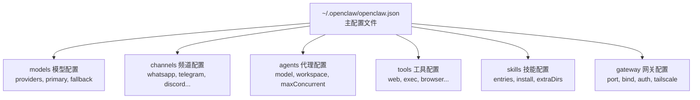

例如:

```json
  "agents": {
    "defaults": {
      "model": {
        "primary": "openrouter/free"
      },
      "models": {
        "openrouter/auto": {
          "alias": "OpenRouter"
        },
        "openrouter/minimax/minimax-m2.5": {},
        "openrouter/free": {}
      },
      "workspace": "/home/opcxxu/.openclaw/workspace"
    }
  },
```


### 秘密管理

OpenClaw 使用 SecretRef 模式来避免直接在配置文件中存储凭据。 OAuth 令牌以加密 JSON 文件形式存储在 `~/.openclaw/auth/` 中（按提供商分别存储）。

SecretRef 支持三种引用方式：

- **环境变量**：引用系统环境变量
- **文件引用**：引用外部文件中的密钥
- **exec 命令**：动态执行命令获取密钥

---


## Openclaw涉及的基础文件格式

在 OpenClaw 的架构中，文件的设计遵循“**文本即配置**”和“**Markdown 驱动**”的原则。对于初学者，你不需要去钻研复杂的数据库代码，只需要理解以下几类主要文件即可：

------

### 核心配置文件 (`.json`)

这类文件是系统的“开关”和“名片”，主要用于存放技术参数。

- **`openclaw.json` (或 `config.json`)**:
  - **用途**：存储 API Keys (如 OpenRouter)、服务器端口、数据库路径等。
  - **格式**：标准 JSON。
  - **初学者注意**：这是你最常修改的文件，比如更换 Key 或调整模型。
- **`package.json`**:
  - **用途**：定义项目依赖（比如它用到了哪些 Node.js 库）。
  - **格式**：标准 JSON。

------

### 身份与行为定义 (`.md`)

OpenClaw 的一大特色是使用 **Markdown** 来定义 AI 的灵魂和记忆。这极其方便初学者通过文字直接修改 AI 的表现。

| **文件名**      | **作用描述**                                                 | **形象比喻**  |
| --------------- | ------------------------------------------------------------ | ------------- |
| **`SOUL.md`**   | 定义 AI 的性格、语气、核心价值观和长远目标。                 | **灵魂/三观** |
| **`USER.md`**   | 记录关于你的信息、偏好、习惯（它会从这里知道你是 Web 开发人员）。 | **你的简历**  |
| **`AGENTS.md`** | 规定 AI 的工作流程、构建命令、代码规范和安全准则。           | **员工守则**  |
| **`MEMORY.md`** | 存放 AI 总结的长期事实，避免它“转头就忘”。                   | **记事本**    |

------

### 功能扩展文件 (`.md` & `.ts`)

这些文件决定了 OpenClaw “能做什么”。

- **`SKILL.md` (或在 `skills/` 文件夹下)**:
  - **用途**：这是**技能模板**。它用 Markdown 描述了一个具体任务的操作流程（比如“如何采集产品”）。
  - **内容**：通常包含任务描述、触发条件和具体的 Prompt 指令。
- **`tools/` 目录下的 `.ts` 文件**:
  - **用途**：这是**具体的工具代码**（TypeScript）。
  - **内容**：定义了 AI 可以调用的实际功能，比如“打开浏览器”、“读取文件”、“写入 CSV”。
  - **初学者建议**：虽然是代码，但结构很固定。你可以模仿现有的工具，把你写的 Python 脚本封装进去。

------

### 运行数据与日志 (`.log` & `.sqlite`)

系统在运行时产生的文件，用于调试和持久化存储。

- **`memory/YYYY-MM-DD.md`**:
  - **用途**：当天的原始对话记录。AI 会定期阅读这些文件并把精华提炼到 `MEMORY.md`。
- **`memory.sqlite` (或 `sqlite-vec`)**:
  - **用途**：向量数据库文件。用于存放 AI 的“深层记忆”，支持根据语义进行搜索。
- **`openclaw.log`**:
  - **用途**：记录系统运行时的报错和状态信息。当你发现 AI 不听话时，先看这个文件。

------

给初学者的“无痛”学习路径(以采集网站数据为例)：

1. **先改 `openclaw.json`**：确保网络连通。
2. **读写 `USER.md`**：告诉 AI 你是谁，让它更懂你。
3. **创建 `SKILL.md`**：用自然语言写下你的采集需求模板。
4. **最后碰 `.ts`**：当你需要 AI 真正去执行那个 Python 采集脚本时，再去研究怎么写一个简单的工具包装器。

## Companion Apps（伴侣应用）

OpenClaw 提供 macOS 菜单栏应用 + iOS/Android 节点应用。

### macOS 客户端

macOS 客户端（OpenClaw.app）是一个菜单栏应用，同时作为 Gateway 控制界面和设备节点，提供语音唤醒/按住说话、Talk Mode 覆盖层、WebChat 访问、调试工具以及通过 SSH 隧道和 Tailscale 发现的远程 Gateway 控制。

Node 模式：以设备节点身份连接 Gateway，注册能力（屏幕自动化、摄像头、画布），处理 node.invoke 请求。Operator 模式：维护第二个 WebSocket 连接用于聊天、会话管理和配置 RPC 调用。

### Windows 支持

OpenClaw 运行在 macOS、Linux、Windows（WSL2），甚至树莓派上。 Windows 端有专门的 Windows Hub 应用（系统托盘 + WebView2 界面）。

---

## 安全模型

OpenClaw 的安全架构包括访问控制、认证、沙盒、秘密管理和网络加固。

### 纵深防御层级

| 层级       | 机制                                                         | 说明                                  |
| ---------- | ------------------------------------------------------------ | ------------------------------------- |
| **消息级** | DM 发送者和群组成员默认被视为不受信任                        | 白名单机制控制谁可以与助理交互        |
| **工具级** | exec、browser、nodes 等工具可对主机执行特权操作              | 通过工具策略（Tool Policies）精细控制 |
| **凭据级** | API 密钥、令牌和 OAuth 凭据必须受保护                        | SecretRef 模式 + 日志脱敏             |
| **网络级** | Gateway 在远程暴露时（通过 Tailscale 或公开绑定）必须安全    | Token/Password 认证                   |
| **沙盒级** | OpenClaw 可以将 Agent 会话隔离在 Docker 容器中以限制主机访问 | 文件系统和网络隔离                    |

### 已知安全风险

OpenClaw 的设计因其有效运作所需的广泛权限而受到网络安全研究人员和技术记者的审视。由于该软件可以访问电子邮件账户、日历、消息平台和其他敏感服务，配置错误或暴露的实例会带来安全和隐私风险。

该 Agent 也容易受到提示注入攻击（Prompt Injection），即在数据中嵌入恶意指令，意图让 LLM 将其解释为合法的用户指令。

> ⚠️ **安全最佳实践**：
> - 保持依赖更新：定期运行 `openclaw update` 并审查 CHANGELOG.md
> - 限制媒体根目录：使用 `mediaLocalRoots` 限制文件附件来源
> - 在 VPS 上使用 Docker + UFW：遵循 VPS 加固指南进行面向公网的部署
> - 运行 `openclaw doctor` 来发现高风险/配置错误的 DM 策略

---

## 快速开始

### 安装方式选择

| 方式                       | 命令                                                         | 适合人群           |
| -------------------------- | ------------------------------------------------------------ | ------------------ |
| **一键脚本 (macOS/Linux)** | `curl -fsSL https://openclaw.ai/install.sh \| bash`          | 新手推荐           |
| **Windows**                | `powershell -c "irm https://openclaw.ai/install.ps1 \| iex"` | Windows 用户       |
| **npm 全局安装**           | `npm install -g openclaw@latest`                             | Node.js 开发者     |
| **pnpm 全局安装**          | `pnpm add -g openclaw@latest`                                | 偏好 pnpm 的开发者 |
| **Nix**                    | Nix 声明式配置模式                                           | NixOS 用户         |
| **Docker**                 | Docker 容器化安装                                            | 服务器/VPS 部署    |

### 引导式上手流程

OpenClaw Onboard 引导你逐步完成 Gateway、工作区、频道和 Skills 的设置。

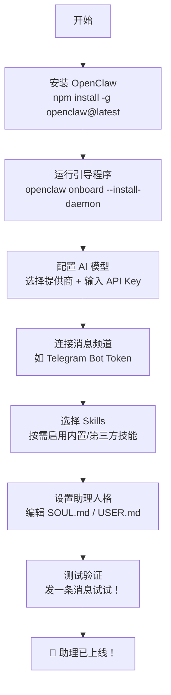

### 上手后的推荐验证清单

| 验证步骤 | 操作                                           |
| -------- | ---------------------------------------------- |
| 基础对话 | 向助理发任意消息                               |
| 记忆测试 | 问它"我叫什么名字？"验证它是否正确读取 USER.md |
| 心跳测试 | 等待一个 Heartbeat，验证主动签到是否触发       |
| 系统健康 | 发送 `/status` 查看系统运行状态                |
| 语音消息 | 发送语音消息体验免提交互                       |

---

## 进阶话题

### 语音功能

Voice Wake + Talk Mode——在 macOS/iOS 上支持唤醒词，在 Android 上支持持续语音（ElevenLabs + 系统 TTS 回退）。

### Live Canvas（实时画布）

Agent 驱动的视觉工作区，使用 A2UI（Agent-to-UI）技术——Agent 可以推送 HTML/JS 内容到你设备上的画布，创建交互式可视化界面。

### 浏览器控制

专用的 OpenClaw Chrome/Chromium 实例，支持快照、操作、上传、多配置。 可以填写表单和抓取网页数据。

### 远程访问

通过 Tailscale Serve/Funnel 或 SSH 隧道配合 Token/Password 认证进行远程访问。 也可以使用 Tailscale 或类似 VPN 方案进行安全远程访问。

### Lobster 工作流引擎

Lobster 是 OpenClaw 原生的工作流 shell：一种类型化的、本地优先的"宏引擎"，将 Skills/工具转换为可组合的管道和安全的自动化流程。

---

## 社区生态与影响力

OpenClaw 在 2026 年 1 月下旬迅速走红，归功于其开源特性以及 Moltbook 项目的病毒式传播。

行业影响：

- OpenClaw 已在小型企业和自由职业者中获得采用，用于自动化销售线索生成工作流。
- 2026 年 3 月 10 日，腾讯宣布基于 OpenClaw 推出了一套完整的易用 AI 产品，且兼容其超级应用微信。
- 技术评论将 OpenClaw 与更广泛的自主 AI 系统趋势联系起来——独立行动而非仅仅回应用户提示。

---

## 新手最佳实践总结

| 领域            | 建议                                                         |
| --------------- | ------------------------------------------------------------ |
| **模型选择**    | 从最强模型开始（如 Claude Opus/Sonnet），确保助理能力上限足够高 |
| **频道起步**    | Telegram 是一个很好的第一个连接器，然后根据需要添加更多频道  |
| **Skills 策略** | 先用内置 Skills，在理解 Tool/Skill 关系后再逐步添加第三方 Skills |
| **安全意识**    | 始终为 DM 和群聊配置白名单，不要将未认证的 Gateway 暴露到公网 |
| **记忆维护**    | 定期审查和编辑 MEMORY.md，纠正不准确的记忆                   |
| **增量扩展**    | 不要一次启用所有 Tools——从 read/write + web_search 开始，按需开放 exec 和 browser |
| **更新习惯**    | 项目迭代极快，定期运行 `openclaw update` 和 `openclaw doctor` 保持健康 |
| **备份**        | 定期备份 `~/.openclaw/` 目录，这里存储了所有配置、会话和记忆 |

---

## 学习资源导航

| 资源         | 链接                                                         | 用途               |
| ------------ | ------------------------------------------------------------ | ------------------ |
| 官方文档     | [docs.openclaw.ai](https://docs.openclaw.ai/)                | 配置参考和操作指南 |
| DeepWiki     | [deepwiki.com/openclaw/openclaw](https://deepwiki.com/openclaw/openclaw) | 架构深度解析       |
| GitHub 仓库  | [github.com/openclaw/openclaw](https://github.com/openclaw/openclaw) | 源码和 CHANGELOG   |
| ClawHub      | [clawhub.com](https://clawhub.com)                           | 浏览和安装 Skills  |
| Discord 社区 | 官方 Discord                                                 | 获取帮助和交流经验 |

 

