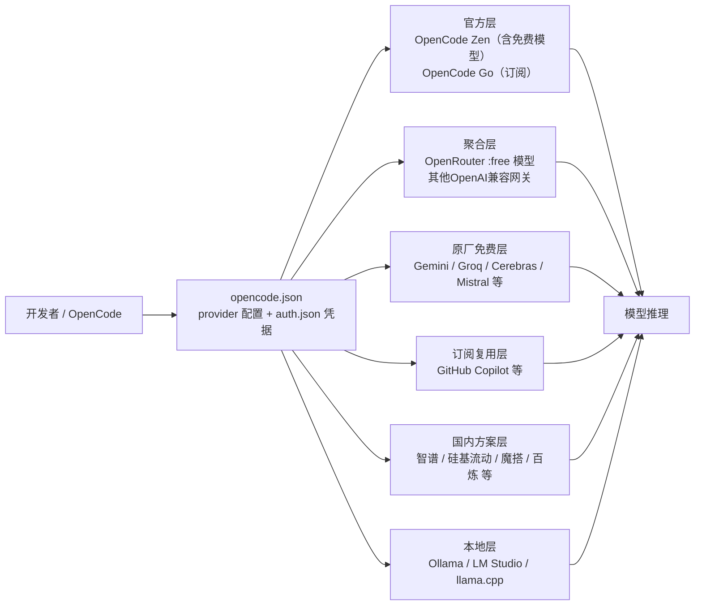
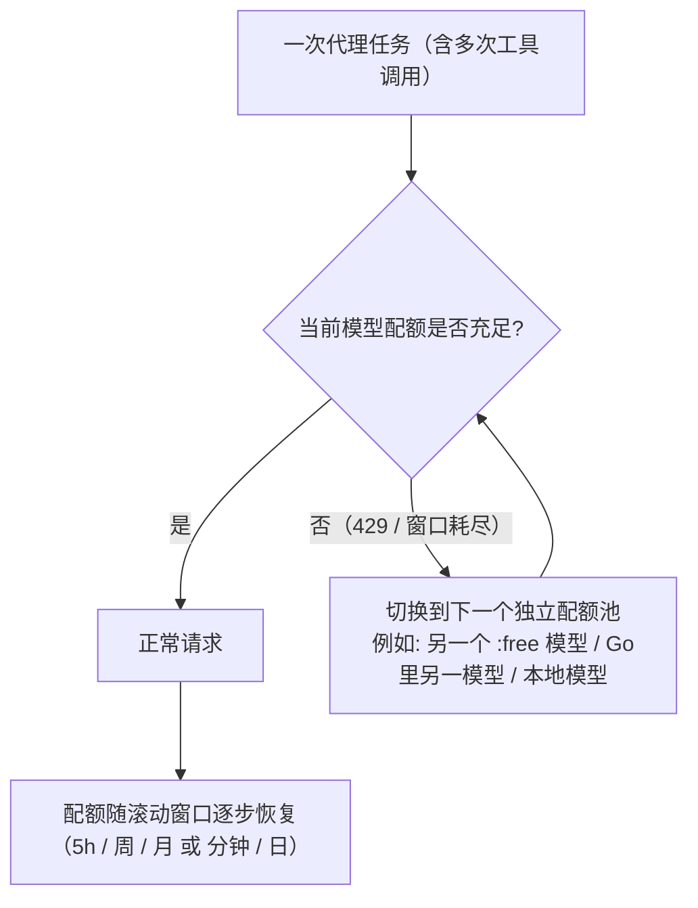

[toc]


## abstract

这是初学者最常混淆的一点。OpenCode是一个开源的终端AI编程代理（coding agent），它本身不出售模型能力。

OpenCode在这个品类里是个例外，简短的回答确实简短：没有订阅，也没有月费。CLI是免费开源的。你要么自带任意供应商的API密钥（BYOK），这时由该供应商直接向你计费，OpenCode不抽成；

要么使用OpenCode Zen,按token付费、请求不加价的网关。官方文档对此说得很直白：Zen是OpenCode可选的按量付费模型服务。免费的OpenCode客户端并不意味着托管推理是免费的。

> 还有Go/Go Plus订阅.可以使用一些便宜或者开源模型

因此，"OpenCode的免费API资源"实际上是一个**多层供给体系**，用下图表示它们和OpenCode的关系：



本文按这六层逐一展开，再归纳"免费额度的规律"，最后给出配置实践与综合方案。

---

## 官方层之一：OpenCode Zen 与它的免费模型

### 它是什么

Zen是OpenCode团队维护的**模型网关**。OpenCode Zen是团队精选并做过基准测试的模型网关——完全可选，用法与其他供应商一样：在opencode.ai/auth登录，复制API密钥，在TUI中运行/connect，再用/models查看推荐模型。

它的定位是解决"模型太多但真正适合做编程代理的不多"的问题：市面上有大量模型，但只有少数能很好地作为编程代理工作。

### 计费规则（付费部分）

- **按量付费、预充值、不加价**：Zen对请求不加价。它按成本转嫁的是卡支付手续费：每笔4.4%加0.30美元。这是支付费用而非服务费用，也是建议一次多充、少充几次的理由。
- **四种计费维度**：价格为每百万token的美元数。输入、输出、缓存读取和缓存写入分别计费；标注处适用上下文分档。表中的短横线不代表免费。

### 免费模型及其规则

这是本话题的重点。截至近期，官方文档列出的免费模型包括：Big Pickle、MiMo-V2.5 Free、Ling 3.0 Flash Fin Free、Nemotron 3 Ultra Free、Nemotron 3.5 Lightning Free、Muse Spark 1.3 Contributor Free、Jev 1.13 Free。

第三方价格追踪站统计的口径更宽：该页面列出102个模型。其中71个有公开价格。

**免费名单是滚动更换的**。

**必须理解的三条规则**：

- **限时性**：Zen也有标为0美元输入和0美元输出的模型。OpenCode将其中几个标记为限时优惠，所以在把某个模型用于长期工作流之前，请先查看实时目录。
- **非承诺性**：下列模型在目录中有免费报价。可用性和数据条款可能不同；该报价不承诺无限或永久的免费推理。
- **功能差异**：Jev返回的是结构化决策，因此它不能替代生成文本的编程模型。也就是说，免费名单里的模型并非都是通用编程模型，选用前要看用途。

**Big Pickle**值得单独一提：它是Zen长期提供的免费模型，多次出现在"免费"栏目，在社区配置中也常被当作**兜底项**——例如有人的配置里保留opencode-zen仅作为omni/opencode-zen/big-pickle的回退参考。

### 命名与密钥现状（2026-10 实测更新）

- **Zen 已改称 OpenCode Console**：旧页 `opencode.ai/docs/zen` 现在返回的就是 Console 的 Models 页面，V2 文档已无 Zen 页（`/v2/docs/zen` → 404）；provider id 仍是 `opencode`，模型前缀仍是 `opencode/<model-id>`，Go 仍是 `opencode-go`。官网营销页与旧文档仍留 Zen 字样，属过渡期。
- **密钥换代**：Zen 时代的 `sk-…` key 已失效，调用返回 `api_key_expired`（即 “This API key has expired. Create a new API key in OpenCode Console…” 那段报错）；现在在 Console → **Keys** → Add Service Account → Add API Key 建 `oc_sk_…` 服务账号密钥，可设权限与**可选有效期**，过期或被吊销立即 401。
- **免费模型不需要单独填 Console key**：一把工作区密钥（只订阅 Go 时就是那把 `opencode-go` 的 key）同时授权 Console 与 Go 两个 provider，`opencode/<model>-free` 随同一份工作区配置出现，`/connect` 只连 OpenCode Go 就够了；免费档按客户端身份放行，**只在 OpenCode 内可用**（外部调用 403 `FreeTierError`），付费模型则在 OpenCode 之外也能调。
- 完整实测记录（含端点变化 `/zen/go/v1` → `/inference/go/...`、`OPENCODE_CONSOLE_TOKEN`、工作区配置 API）见 `Code/ai/harness/opencode/opencode@v2版本的设计和使用指南.md` 的“凭据存储变化与 API key 过期排查”一节。

### 无 key 也能查最新模型目录（含 Console 与 Go，2026-10 实测）

模型目录本身是**公开**的，不带任何凭据即可查询；只有“你的工作区实际能用哪些”需要 key。

| 来源 | 实测 | 内容 |
| --- | --- | --- |
| `GET https://opencode.ai/inference/v1/models` | 200，85 条 | Console 目录（含全部 `*-free` 免费模型） |
| `GET https://opencode.ai/inference/go/v1/models` | 200，37 条 | Go 目录（订阅可用模型） |
| `GET https://models.dev/api.json` | 200，5.8 MB，232 个 provider | `opencode` 127 个、`opencode-go` 32 个模型，且带 `cost`、`limit` 元数据 |
| 文档页 `/v2/docs/console/models`、`/v2/docs/console/go` | 公开 HTML | 模型 + 价格 + 端点 + 弃用表 + Go 额度/隐私表 |
| `opencode models`（客户端内，用空数据库 `--standalone` 实测） | 409 条，其中 `opencode/*` 12 条、`opencode-go/*` **0 条** | 只列出无需订阅即可直接用的免费模型 |

```bash
curl -s https://opencode.ai/inference/v1/models    | jq -r '.data[].id'   # Console 目录
curl -s https://opencode.ai/inference/go/v1/models | jq -r '.data[].id'   # Go 目录
curl -s https://opencode.ai/inference/v1/models    | jq -r '.data[].id' | grep -- '-free$'
curl -s https://models.dev/api.json | jq -r '."opencode-go".models | keys[]'
```

Windows 用 `curl.exe`（本机 `Invoke-WebRequest` 对同一端点会莫名 401，属环境/代理怪癖，不能拿来判断鉴权）：

```powershell
(& curl.exe -s https://opencode.ai/inference/go/v1/models | ConvertFrom-Json).data.id
```

**仍然需要 key 的三件事**：① `GET https://opencode.ai/console/api/v2/config`（工作区视角的启用模型/策略，免 key 返回 401 `{"_tag":"Unauthorized"}`）；② 推理调用本身（Go 还要求 `x-opencode-session`）；③ 免费档还额外要求“请求来自 OpenCode 客户端”，否则 403 `FreeTierError`。

**两个坑**：① 公开目录 ≠ 你的可用范围——同一天实测公开为 Console 85 / Go 37，而本工作区配置里是 **84 / 29**（差额通常是地区限制或未开通）；② 口径有差——models.dev 的 `opencode` 有 127 个（含旧/弃用模型），公开端点只返回当前目录 85 个；models.dev 里该 provider 的环境变量名仍是 V1 的 `OPENCODE_API_KEY`，而 Console 工作区配置用的是 `OPENCODE_CONSOLE_TOKEN`。

---

## 官方层之二：OpenCode Go 订阅——低成本的主力方案

### 它是什么

Go是2026年出现的包月订阅，把多家开源权重模型打包成一把密钥。它在OpenCode TUI里就像一个供应商：用户通过OpenCode Zen订阅，复制API密钥，用/connect连接，用/models查看可用模型。首月5美元、之后每月10美元，OpenCode Go包含GLM、Kimi、MiMo、Qwen、MiniMax和DeepSeek等模型，对于想要低价AI编程支持又不想分别设置多个供应商的程序员来说是实用选择。

它不绑定OpenCode客户端：订阅10美元/月（首月5美元），可以在任何你想用的地方使用这些模型，如Claude Code、Codex、OpenCode、你自己的应用等。它类似GLM Coding Plan，但不是来自单一AI实验室的模型。部署区域方面，该计划主要面向国际用户开发，模型托管在美国、欧盟和新加坡以保证全球稳定访问。

**关于首月5美元优惠的冲突**：一个11天前更新的追踪站称OpenCode Go订阅：10美元/月，用量价值6倍（首月5美元的促销已于8月24日取消），而其他较早的页面仍写首月5美元。**以订阅页面实际显示为准**，不要指望促销。

### 额度规律：这是Go最值得研究的部分

Go不是"无限用"，而是**每个模型各自独立的三层滚动窗口（5小时/每周/每月）**，加上**每模型的月度美元上限**。

**三层窗口示例**（不同来源快照略有差异，取近期一份）：

| 模型                | 5小时  | 每周   | 每月    | 月度美元上限 |
| ------------------- | ------ | ------ | ------- | ------------ |
| Space Bunny Free    | 无限   | 无限   | 无限    | 限时免费     |
| MiMo-V2.6-Flash     | 30,100 | 75,200 | 150,400 | $60          |
| DeepSeek V4.1 Flash | 26,000 | 65,000 | 130,000 | $60          |
| GLM-5.3-Flash       | 6,320  | 15,790 | 31,580  | $60          |
| Qwen3.7 Plus        | 4,300  | 10,800 | 21,600  | $60          |
| GLM-5.2             | 880    | 2,150  | 4,300   | $60          |
| GLM-5.3             | 220    | 540    | 1,080   | $15          |
| Grok 4.7            | 169    | 423    | 845     | $15          |
| Kimi K3             | 110    | 250    | 490     | $15          |

数据来源：MiMo-V2.6-Flash月上限$60，5小时30,100次、每周75,200次、每月150,400次；DeepSeek V4.1 Flash $60，26,000/65,000/130,000；DeepSeek V4 Flash $30，13,000/32,500/65,000；GLM-5.3-Flash $60，6,320/15,790/31,580；Qwen3.7 Plus $60，4,300/10,800/21,600；GLM-5.2 $60，880/2,150/4,300；GLM-5.3 $15，220/540/1,080；Grok 4.7 $15，169/423/845；Kimi K3 $15，110/250/490。

**月度美元上限的分档**：Go上60美元月上限的模型：GLM-5.3-Flash、GLM-5.2、Kimi K2.7 Code、Kimi K2.6、LongCat-2.0、MiMo-V2.6-Flash、MiMo-V2.5、MiniMax M3、MiniMax M2.7、Muse Spark 1.3和1.2 Contributor（限定地区）、Qwen3.7 Plus、DeepSeek V4.1 Flash和Hy3。30美元上限：Qwen3.8 Flash、DeepSeek V4 Flash和Hy4 preview。15美元上限：GLM-5.3、Kimi K3、MiMo-V2.6-Pro、MiMo-V2.5-Pro、Qwen3.8 Max、DeepSeek V4 Pro、DeepSeek V4 Flash Vision Exp、Grok 4.7、Grok 4.6、GPT 6 Luna和GPT 5.6 Luna。此外限时免费、无付费上限的有：Space Bunny Free和LongCat 2.5 Preview Free。

**从这些数字可以读出的规律**：

- **额度与单价成反比**：便宜的Flash类模型给几万次请求，昂贵的旗舰（Kimi K3、Grok、Qwen Max）每5小时只有一百多次。本质是"每模型月度美元上限 ÷ 该模型单价 ≈ 请求配额"。
- **三层窗口的比例大致是 1 : 2.5 : 5**（5小时：周：月），意味着**周额度约等于2.5个5小时窗口，月额度约等于5个**。换句话说，如果你每天都把5小时窗口打满，一周两天就能耗尽周额度——窗口设计鼓励的是"分散使用"而不是"集中冲刺"。
- **限时免费模型不占付费上限**，是"白嫖"的首选，但随时可能下线。
- **升级档位不是简单倍数**：Go Plus每月40美元，每个模型的月上限更高。这个跳跃不是单一倍数。GLM-5.3-Flash从60美元涨到180美元，Kimi K2.6从60涨到240，Kimi K3从15涨到60。而且Go Plus以40美元使用与Go相同的模型。提高的是每个模型的月上限，且比例并不相同。

**使用建议**（综合实践者经验）：按任务和上限选模型。短问题、文档和小改动适合用高上限、请求次数多的模型。一位用了三周的评测者的分工是：把Grok 4.5、GPT 5.6 Luna和Kimi K3留给难题，MiniMax M3或GLM-5.2用于常规代理会话，DeepSeek Flash用于其余任务。

---

## 聚合层：OpenRouter 的 `:free` 模型

OpenRouter是最常被配置进OpenCode的第三方聚合网关，它的免费规则是所有免费资源里**最清晰、最有代表性**的。

### 官方规则

OpenRouter帮助中心（2026年9月23日更新）给出的要点是：免费使用：每天50次请求、每分钟20次；购买超过10美元额度：每天1000次请求、每分钟20次；付费模型：OpenRouter不强制限速，但上游模型供应商可能限流或宕机；429错误是让你减速的信号——要内建智能重试。

关键细节：

- **模型标识**：免费模型在模型标识符中带有:free后缀，例如google/gemma-4-31b-it:free或nvidia/nemotron-3-super:free。
- **10美元门槛是一次性、终身的**：每分钟20次的上限即使购买额度后也固定不变——一次性购买10美元（额度永不过期）只是把每日:free上限从50提升到1000次。哪些模型免费会随时间轮换。
- **不需要信用卡**：OpenRouter没有促销赠金，但提供28+个每token字面意义上0美元的模型（ID以:free结尾），可以在0余额、无信用卡的情况下使用。免费模型受限速而非额度限制。
- **429多来自上游**：OpenRouter把免费模型限制在每分钟20次、每天50到1000次（取决于额度购买），而付费模型取消平台上限、改为取决于上游供应商容量。大多数HTTP 429错误来自下游供应商拥塞而非网关限流。

**冲突提示**：部分第三方站点写"200次/天"（OpenRouter上的免费模型通常限制为每分钟20次、每天200次。），与官方帮助中心的50/1000不一致，**以官方为准**。

### 两个实战技巧

- **轮换与自动路由**：当某个模型变慢或失败时轮换模型。免费模型共享容量。如果nvidia/nemotron-3-super-120b-a12b:free返回429或超时，就对同一请求切换到meta-llama/llama-3.3-70b-instruct:free，或者通过openrouter/free路由让OpenRouter替你挑一个能用的。
- **尽早充10美元**：尽早考虑10美元充值。一次性花10美元（终身、不过期）把每日免费模型上限从50提升到1000次。如果你已过了纯测试阶段，这通常是杠杆最高的一件事。

**对OpenCode用户的特别提醒**：编程代理一次任务会发出**几十上百次请求**（每次工具调用都是一次请求），所以每天50次对代理工作流几乎不够用——10美元门槛对OpenCode用户几乎是"必选项"。

---

## 原厂免费层：Google Gemini 及其他

### Gemini API 免费层（已验证，但数字波动大）

Gemini免费层在2026年经历了明显收缩，各来源数字差异很大，**我只能给出趋势，不敢给出确定数字**：

- **Pro模型已退出免费层**：2026年4月1日，Google在所有计费档强制实施支出上限，对免费用户把Pro模型设为付费墙，并为新账户引入预付费。今年起只有Flash和Flash-Lite模型留在免费层。Gemini Pro需要计费账户，没有例外。
- **额度被削减且不再固定公布**：Google也不再为每个模型公布固定的每日请求数，因为它会在不通知的情况下调整（2025年12月曾把免费配额削减50%到80%）。你的实际当前限制实时显示在AI Studio里，而不在静态文档页。
- **近期数字分歧**：一个9月份来源说截至2026年9月，Gemini 3.8 Flash、3.7 Flash、3.6 Flash和3.5 Flash目前大约提供每天20次免费请求，而Gemini 3.5 Flash-Lite和3.1 Flash-Lite提供500次。另一个来源则给出Gemini 3 Flash每分钟10次、每分钟25万token、每天1500次。Gemini 3.1 Flash-Lite每分钟15次、每天1000次上限。两者相差悬殊，印证了"按账户和地区变化"的说法。
- **三类限制维度**：Gemini免费层有三种限制类型：RPM（每分钟请求数）、RPD（每天请求数）和TPM（每分钟token数）。它们的失败方式不同，修复方法也不同。对编程代理而言，TPM往往先于RPM触顶：如果你发送大文档或上下文很重的系统提示，单次调用就可能大到在低请求频率下也撞上TPM天花板。
- **数据条款差异**：关键差异在于限速（150-300 RPM对5-15 RPM）、数据隐私（Tier 1不使用你的数据训练）以及以付费价格访问上下文缓存和Batch API等功能。免费层数据可能用于训练，**处理私有代码时要注意**。

**对OpenCode的实际意义**：Gemini免费层更适合做`small_model`（标题生成、简单摘要）或轻量查询，不适合做长时间的代理主模型。

### 其他原厂免费层（未经本轮搜索验证，基于训练知识）

以下供应商在我的训练知识中提供免费或试用额度，但**本轮未能验证当前状态**，请以各自官方页面为准：

| 供应商                        | 我所知的免费形式                              | 对OpenCode的适用性提示  |
| ----------------------------- | --------------------------------------------- | ----------------------- |
| Groq                          | 免费层按模型的RPM/RPD/TPM限制，速度极快       | 适合快速小任务，TPM偏紧 |
| Cerebras                      | 免费层有每日token上限，速度极快               | 模型选择少              |
| Mistral                       | La Plateforme有免费实验档，需同意数据使用条款 | 有Codestral等编程模型   |
| NVIDIA NIM / build.nvidia.com | 注册赠送调用额度                              | 开源模型为主            |
| Cloudflare Workers AI         | 每日免费神经元额度                            | 模型较小                |

上述Groq的规模可从一个Gemini对比来源侧面印证：与Groq每模型每天1000次请求、6000 TPM相比，Google提供约166倍的每分钟token量。

---

## 订阅复用层：GitHub Copilot 等（未经本轮搜索验证）

基于训练知识：OpenCode内置了GitHub Copilot供应商，通过`opencode auth login`选择GitHub Copilot后走设备码（device flow）登录，可复用Copilot订阅（包括Copilot Free的有限额度）。需要注意两点：一是**Copilot的"premium requests"配额按模型倍率扣减**，高端模型消耗很快；二是**GitHub对第三方客户端调用Copilot API的服务条款立场存在争议**，有账号风险，这属于"可以这样做但需自担风险"的范畴。社区还存在将ChatGPT/Codex、Google Antigravity等订阅通过OAuth插件接入OpenCode的做法，这同样存在条款风险，本轮未能搜索验证其现状。

---

## 国内方案层（未经本轮搜索验证，基于训练知识）

对国内网络环境的读者，这一层的价值在于**无需代理、延迟低、支持人民币支付**。我所知的情况如下，请务必自行核对最新额度：

| 平台                 | 免费/低价形式                                                | 备注                                                         |
| -------------------- | ------------------------------------------------------------ | ------------------------------------------------------------ |
| 智谱 BigModel        | GLM-4.5-Flash等Flash级模型免费；GLM Coding Plan低价包月（曾有约¥20/月的入门档） | Coding Plan同样是"5小时窗口"模式；OpenCode搜索结果中也把Go与GLM Coding Plan类比：它类似GLM Coding Plan |
| 硅基流动 SiliconFlow | 部分小参数模型永久免费；新用户赠送额度                       | OpenAI兼容接口，配置简单                                     |
| 魔搭 ModelScope      | API-Inference对开源模型有每日免费调用次数                    | 适合试用大参数开源模型                                       |
| 阿里云百炼           | 新用户各模型赠送百万级token，有效期限                        | Qwen系列；注意有效期                                         |
| DeepSeek 官方        | 无免费层，但单价极低，且有缓存命中折扣                       | 低成本而非免费                                               |
| Kimi / MiniMax       | 新用户赠送额度；有Coding Plan类订阅                          | 本轮未验证                                                   |

**合规提醒**：国内平台通常要求实名认证；部分平台的免费模型会注明"可能用于模型优化"，处理敏感代码时请阅读条款。

---

## 本地层：零API成本的兜底

OpenCode对任何OpenAI兼容端点都支持，本地推理是真正的"无限额度"。官方文档给出的Ollama配置示例：在opencode.json中配置`"ollama": {"npm": "@ai-sdk/openai-compatible", "name": "Ollama (local)", "options": {"baseURL": "http://localhost:11434/v1"}, "models": {...}}`，llama.cpp也类似：在opencode.json中添加供应商，指向本地端点`http://localhost:8080/v1`，然后运行/models选择你的本地模型。

本地模型做代理主模型的瓶颈是**上下文长度和工具调用质量**，建议只在"离线/隐私/简单任务"场景下作为兜底。

---

## 免费额度的通用规律归纳

把上述各家规则放在一起，可以提炼出跨平台的共性规律。理解这些规律比记住具体数字更重要，因为数字会变。

| 规律                          | 典型表现                                  | 对OpenCode用户的含义                     |
| ----------------------------- | ----------------------------------------- | ---------------------------------------- |
| **三维限制：RPM / RPD / TPM** | Gemini、Groq均如此                        | 代理工作流**先撞TPM**（大上下文）而非RPM |
| **滚动窗口而非自然日**        | Go的5小时/周/月；Gemini的RPM是滚动分钟    | 避免集中冲刺，分散使用更划算             |
| **分模型独立配额池**          | Go每模型独立；OpenRouter各`:free`模型独立 | 多模型轮换可**成倍放大**可用量           |
| **小额门槛换大额度**          | OpenRouter一次性10美元 → 50变1000次/天    | 最高杠杆的"低成本"动作                   |
| **额度与模型单价成反比**      | Go里Flash类数万次、旗舰仅百余次           | 把旗舰留给难题                           |
| **限时与轮换**                | Zen免费名单变动；OpenRouter免费模型轮换   | 不要把长期工作流绑死在某个免费模型       |
| **数据条款换免费**            | Gemini免费层可用于训练                    | 私有代码慎用免费层                       |
| **多地区托管**                | Go在美/欧/新加坡                          | 国内需代理；国内方案层无此问题           |

用一张图表示"独立配额池 + 滚动窗口"的叠加效果：



---

## 配置实践：把免费资源接入 OpenCode

### 配置文件位置与基本结构

- **全局配置**：位置：~/.config/opencode/opencode.json（也可用`opencode.jsonc`以支持注释）。
- **项目配置**：检查文件位置：系统配置`ls -la ~/.config/opencode/opencode.json`，项目配置`ls -la opencode.json`。
- **凭据文件**：手动添加时，在~/.config/opencode/opencode.jsonc中加入供应商条目，npm设为'@ai-sdk/openai-compatible'，baseURL设为对应地址，并填上想要的模型，然后把API密钥加到~/.local/share/opencode/auth.json。重启OpenCode并用/models切换。
- **交互式登录**：`opencode auth login`会启动一个交互流程来连接你的API密钥。OpenCode支持同时使用多个供应商——你可以在会话中切换模型。

**Windows提示**：OpenCode遵循XDG约定，Windows下全局配置通常在`%USERPROFILE%\.config\opencode\`（部分版本也可能使用`%APPDATA%`），以`opencode`启动时的提示或文档为准。TUI在Windows上建议使用Windows Terminal并安装Nerd Font，否则图标和中文宽字符可能错位。

### 字段讲解

以一个典型的自定义供应商片段为例：

```jsonc
{
  "$schema": "https://opencode.ai/config.json",
  "provider": {
    "myfree": {
      "npm": "@ai-sdk/openai-compatible",
      "name": "My Free Gateway",
      "options": {
        "baseURL": "https://api.example.com/v1",
        "apiKey": "{env:MYFREE_API_KEY}"
      },
      "models": {
        "some-model-id": { "name": "Some Model" }
      }
    }
  },
  "model": "myfree/some-model-id",
  "small_model": "opencode/big-pickle"
}
```

| 字段                | 含义                                         | 注意事项                                                     |
| ------------------- | -------------------------------------------- | ------------------------------------------------------------ |
| `$schema`           | 配置的JSON Schema地址，供编辑器校验与补全    | 建议保留                                                     |
| `provider.<id>`     | 供应商标识，自定义时任取（这里是`myfree`）   | 内置供应商（如`anthropic`、`openrouter`、`opencode`）使用固定id，可只覆盖`options` |
| `npm`               | 底层AI SDK适配包                             | OpenAI兼容端点用`@ai-sdk/openai-compatible`；Anthropic格式用`@ai-sdk/anthropic`等 |
| `name`              | TUI中显示的名称                              | 纯展示                                                       |
| `options.baseURL`   | API根地址，通常以`/v1`结尾                   | 国内网关注意是否需要`/v1`                                    |
| `options.apiKey`    | 密钥                                         | **推荐用`{env:VAR}`引用环境变量**，避免明文入库；或留空改用`auth.json` |
| `models.<model-id>` | 该供应商下可用的模型ID                       | 与网关的模型名完全一致；可附`name`、上下文长度等元数据       |
| `model`             | 默认主模型，格式为`<provider-id>/<model-id>` | 影响主代理                                                   |
| `small_model`       | 轻量任务模型（标题、摘要等）                 | **把免费模型放这里最划算**                                   |

`{env:VAR}`写法在官方示例中有体现：`"apiKey": "{env:MEGALLM_API_KEY}"`。

**辨析**：搜索中出现的`"providers"`（复数）+ `"defaults"`写法（`"providers": {"local_ollama": {...}, "openrouter_free": {...}}, "defaults": {...}`）与官方`"provider"`（单数）结构不同，疑为过时或其他工具的格式，**请以`provider`单数为准**。

### 凭据与代理（国内环境）

- **凭据**：优先`opencode auth login`写入`auth.json`，或在shell配置中导出环境变量。多台设备同步时，只同步`opencode.json`（不含密钥），密钥通过各设备的环境变量提供。
- **代理（*nix）**：在`~/.bashrc`或`~/.zshrc`中`export HTTPS_PROXY=http://127.0.0.1:7890`（以mihomo等本地代理端口为准）。
- **代理（Windows PowerShell）**：`$env:HTTPS_PROXY = "http://127.0.0.1:7890"`；永久设置可用`[Environment]::SetEnvironmentVariable("HTTPS_PROXY", "http://127.0.0.1:7890", "User")`。
- OpenCode基于Bun运行时，一般遵循`HTTP(S)_PROXY`环境变量，但**请实测**；若某些供应商走不通，可考虑为该供应商改用国内可达的网关`baseURL`。
- **安装脚本加速**：若通过GitHub Releases安装，可用`gh-proxy`类镜像包裹下载链接（可用性需核实），或改用npm/包管理器渠道。

### 综合示例：一个"免费优先、按需升级"的配置

场景：一位国内独立开发者，有mihomo代理，希望日常零成本，偶尔付费用强模型。

```jsonc
{
  "$schema": "https://opencode.ai/config.json",
  "provider": {
    // 官方Zen：用免费模型做兜底与轻量任务（通过 opencode auth login 登录）
    "opencode": {},
    // OpenRouter：已一次性充值10美元，解锁每日1000次 :free
    "openrouter": {
      "options": { "apiKey": "{env:OPENROUTER_API_KEY}" },
      "models": {
        "openrouter/free": { "name": "OpenRouter Auto Free" }
      }
    },
    // 国内网关：无需代理，低延迟（示例，baseURL请以实际为准）
    "cn-gateway": {
      "npm": "@ai-sdk/openai-compatible",
      "name": "CN Gateway",
      "options": {
        "baseURL": "https://api.example.cn/v1",
        "apiKey": "{env:CN_GATEWAY_API_KEY}"
      },
      "models": {
        "glm-flash": { "name": "GLM Flash (free tier)" }
      }
    },
    // 本地：离线兜底
    "ollama": {
      "npm": "@ai-sdk/openai-compatible",
      "name": "Ollama (local)",
      "options": { "baseURL": "http://localhost:11434/v1" },
      "models": { "qwen3-coder:30b": { "name": "Qwen3 Coder 30B" } }
    }
  },
  "model": "cn-gateway/glm-flash",
  "small_model": "opencode/big-pickle"
}
```

这份配置的设计思路：

- **主模型**用国内免费Flash级模型，不走代理、无日限焦虑。
- **`small_model`**用Zen的Big Pickle，把标题、摘要等高频低价值请求从主模型配额里剥离出来。
- **OpenRouter的`openrouter/free`自动路由**作为第二梯队，避免手动追踪哪个`:free`模型今天可用。
- **Ollama**作为离线兜底。
- 当遇到难题时，用`/models`临时切到OpenCode Go或付费模型，用完切回——这就是"按需升级"。

社区里的多代理框架也体现了同样思路：把探索类子代理指向免费模型并设置回退链，例如`"explore": {"model": "opencode/minimax-m2.5-free", "fallback_models": ["opencode-go/minimax-m2.5", "opencode/gpt-5-nano", "openai/gpt-5-nano", "opencode/claude-haiku-4-5"]}`——免费模型在前，低价模型居中，付费模型垫底。

---

## 最佳实践清单

**必须做**：

- 把`small_model`指向免费模型，这是零风险的节省。
- 用`{env:VAR}`或`auth.json`管理密钥，**不要把密钥写进会提交到git的`opencode.json`**。
- 在依赖某个免费模型前查看实时目录，因为该报价不承诺无限或永久的免费推理。

**推荐做**：

- OpenRouter一次性充值10美元解锁1000次/天。
- 为高频低价值任务选高配额模型，为难题预留低配额旗舰（Go的分工经验）。
- 配置至少两个独立配额池并了解`/models`切换，遇到429就换池。
- 控制上下文：代理工作流的TPM消耗主要来自反复读取大文件，善用`AGENTS.md`约束代理不要无谓地读整个仓库。
- 国内读者优先把国内免费层作为主模型，把需要代理的免费层作为补充。

**可以做**：

- 本地Ollama作为离线兜底。
- 使用Go的限时免费模型（如Space Bunny Free）做大批量低价值任务。
- 复用已有订阅（Copilot等），但要了解条款风险。

**避免做**：

- 把私有/商业代码送进标注"可能用于训练"的免费层。
- 用免费层跑无人值守的长任务——限速和轮换会让它半途失败。
- 迷信第三方站点的具体额度数字（本文已指出多处冲突），以官方页面和AI Studio/控制台实时显示为准。
- 在Zen小额多次充值——每笔4.4%加0.30美元的手续费会显著抬高小额成本。

