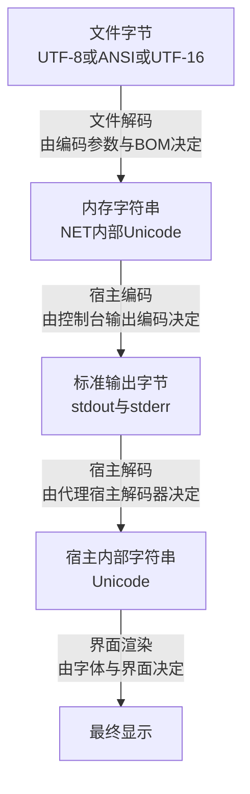

[toc]

## 摘要

在Agent Harness(代理宿主，指以子进程加管道重定向方式调用PowerShell的父进程)中观察到的中文乱码，包含两个相互独立的故障点，另有一个易混淆的独立现象，三者须分别定位。

- **读取解码问题**：文件字节被错误解码为内存字符串。典型情形为Windows PowerShell 5.1(以下简称5.1，指Windows内置的Desktop版本)读取无BOM的UTF-8文件时，默认按系统活动ANSI代码页(简体中文系统通常为GBK/CP936)解码，内存字符串在生成时即已损坏，后续任何显示手段均无法恢复。
- **传输编码问题**：内存字符串正确，但标准输出字节编码与宿主解码约定不一致。典型情形为PowerShell按遗留代码页将正确字符串编码写入管道，而Agent Harness(代理宿主)按UTF-8解码；或宿主未使用增量解码器(Incremental Decoder，指可跨数据块维护多字节字符状态的解码器)，将每个数据块独立解码。
- **字体缺字形问题**：字符串解码全程正确，但界面字体缺失对应字形，显示为方框。该现象与编码无关，须独立排查。

最终约定为：文件统一使用UTF-8无BOM并在兼容5.1的代码中显式指定读取编码；PowerShell标准输出与标准错误统一使用UTF-8无BOM；宿主对两个流分别执行UTF-8增量解码；诊断过程保留原始字节或Base64对照；引擎优先选用PowerShell 7(以下简称7，指PowerShell Core 6及以上版本)，5.1仅作兼容环境。

## 范围与术语

本文适用范围为Windows平台上PowerShell与Agent Harness(代理宿主)之间的中文乱码定位，覆盖文件读取、进程管道传输、宿主解码、界面渲染四个阶段，不讨论网络传输损坏与日志截断问题。

下表统一本文术语，后续章节均按此表表述，不再交替使用别名。

| 术语 | 含义 |
| --- | --- |
| **BOM(Byte Order Mark，字节顺序标记)** | 文件首部的特征字节。UTF-8的BOM为字节序列`EF BB BF`，UTF-16LE的BOM为`FF FE`。有无BOM直接影响5.1的编码探测结果。 |
| **ANSI代码页** | Windows系统活动代码页对应的遗留单双字节编码统称。简体中文系统通常为GBK/CP936，繁体中文系统通常为Big5/CP950，西文系统通常为Windows-1252。 |
| **OEM代码页** | 控制台程序默认使用的遗留编码，常与ANSI代码页不同。中文环境常见数值为437或936，需以实测代码页为准。 |
| **内存字符串** | PowerShell与.NET内部使用的Unicode字符串(.NET内部按UTF-16存储)。该字符串正确与否是区分读取问题与传输问题的分界线。 |
| **Agent Harness(代理宿主)** | 启动`powershell.exe`或`pwsh.exe`子进程并重定向标准输出与标准错误的父进程，例如Node.js或Python编写的自动化调度程序。 |
| **增量解码器** | 可跨越多个数据块维护解码状态的UTF-8解码器。普通按块独立解码会在多字节字符被拆分到两个数据块时产生偶发乱码。 |
| **乱码(Mojibake，错误解码导致的文字错乱)** | 字节序列被错误的编码假设解码后产生的可读但语义错误的文字，例如`涓枃`。须与字体缺字形的方框显示相区分。 |

## 完整链路与故障定位

字节从磁盘到达人眼共经历四次形态转换，每次转换均有独立的编码决策，任一环节失配即产生乱码。



上图中外显的重点为编码与解码交替出现。**文件字节框**到**内存字符串框**的转换为文件解码环节，该环节错误则内存字符串已损坏，不可恢复。**内存字符串框**到**标准输出字节框**的转换为宿主编码环节，该环节由PowerShell侧编码设置决定。**标准输出字节框**到**宿主内部字符串框**的转换为宿主解码环节，该环节由Agent Harness(代理宿主)侧解码设置决定。**宿主内部字符串框**到**最终显示框**的转换为界面渲染环节，该环节仅与字体字形有关，与前三个环节无关。图中未包含分支，分支情形(例如原生命令与脚本命令采用不同输出路径)见后文特例分析。

下表列出各环节的典型错误与可观察表现，定位时按自上而下顺序逐项排除。

| 环节 | 典型错误 | 常见表现 |
| --- | --- | --- |
| 文件字节到内存字符串 | UTF-8字节被按ANSI或GBK读取 | `Get-Content`变量在内存中已为乱码，码点检查失败 |
| 内存字符串到标准输出字节 | 子进程按CP936输出，宿主按UTF-8解码 | 不可逆的替换字符`�`，或整段文字损坏 |
| 标准输出字节到宿主字符串 | UTF-8字节被按GBK或Windows-1252解码 | `涓枃`或`中文`形态的错乱文字 |
| 流式传输中的分块解码 | 每个数据块独立解码，多字节字符被切断 | 偶发`�`，出现位置不固定，长输出中更常见 |
| 宿主字符串到界面显示 | 字体缺失对应字形 | `□`或空白方框，复制文本后粘贴到他处显示正常 |

### 乱码形态速查

下表根据乱码的视觉形态反推故障环节，适用于初步分类，最终结论仍以探针脚本的码点与Base64对照为准。

| 乱码形态示例 | 实际发生的事 | 指向的环节 |
| --- | --- | --- |
| `涓枃鏂囨湰` | UTF-8字节被按GBK解码 | 文件读取环节未指定UTF-8，或宿主侧用GBK解码 |
| `测试` | UTF-8字节被按Windows-1252或Latin-1解码 | 同上，西文系统下的变体 |
| 以`锘�`开头 | UTF-8的BOM字节`EF BB BF`被按GBK解码 | 5.1写出带BOM的UTF-8，而下游工具不识别BOM |
| `????`或`锛烇紵` | 编码阶段字符无法映射，被替换为问号或近似字符 | 写出环节的目标代码页不含该字符，属不可逆损坏 |
| 以`ÿþ`开头或字间出现空白 | UTF-16LE字节流被按单字节编码读取 | 5.1的`>`或`Out-File`默认写出UTF-16LE，下游按单字节解码 |

## 版本差异

两代PowerShell的默认编码存在系统性差异，跨版本脚本不得依赖任何默认值。下表纵向对比同一操作在两个版本中的默认行为，阅读时以行为单位逐行确认。

| 行为 | Windows PowerShell 5.1 | PowerShell 7 |
| --- | --- | --- |
| `Get-Content`读取无BOM文件 | 按系统活动ANSI代码页解释 | 按UTF-8无BOM解释 |
| `Out-File`与`>`默认写文件 | UTF-16LE | UTF-8无BOM |
| `Set-Content`默认写文件 | ANSI代码页 | UTF-8无BOM |
| `-Encoding utf8`的写出语义 | UTF-8带BOM | 等同`utf8NoBOM`(UTF-8无BOM) |
| `$OutputEncoding`默认值 | ASCII | UTF-8 |

5.1的`Get-Content`在无BOM时使用系统活动代码页，该行为导致现代编辑器保存的UTF-8无BOM文件在5.1中极易被误读。7起全部文本输出默认采用UTF-8无BOM，跨平台一致性显著改善。

此处存在一个版本语义陷阱，须单独说明。在5.1中，`-Encoding`参数不支持`utf8NoBOM`取值，`utf8`取值在写出时固定带BOM。在7中，`utf8NoBOM`为默认值，`utf8`取值等同于`utf8NoBOM`。因此，`Get-Content -Encoding utf8`在5.1中读取无BOM文件正确(读取环节对BOM有无均兼容)，但`Out-File -Encoding utf8`在5.1中写出带BOM文件。带BOM的UTF-8文件在类Unix工具链中可能引发问题，`cat`、`sed`、`awk`等工具不识别文件首部的BOM字节。若宿主为Python程序，建议宿主侧使用`utf-8-sig`解码，该编解码器对有无BOM均可正确处理，而普通`utf-8`编解码器会将BOM解为可见杂字符。

## 定位方法

定位遵循先验证内存字符串再怀疑传输的顺序。内存字符串的验证输出限定为纯ASCII字符，因此验证结果不受显示环节干扰。

按以下有序步骤执行定位。

1. 执行快速码点检查，确认文件读取环节是否正确。
2. 采集当前会话的编码旋钮取值，确认宿主编码环节的配置。
3. 执行完整探针脚本，取得Base64分界证据与标准输出和标准错误的可见文本。
4. 对照结果解释表判定故障环节。

快速码点检查使用以下脚本。该脚本输出每个字符的十六进制码点，中文字符的正确码点应落在`4E00`至`9FFF`区间。若输出中出现大量`00C0`至`00FF`区间字符或GBK映射字符，则文件读取环节已错误。

```powershell
$s = (Get-Content -Raw -Encoding UTF8 .\test.txt)
$s.ToCharArray() | ForEach-Object { '{0:X4}' -f [int]$_ }
```

会话编码旋钮采集使用以下两条命令。第一条确认PowerShell写标准输出及解码外部程序输出所用的编码，第二条确认PowerShell向外部程序管道发送数据所用的编码。

```powershell
[Console]::OutputEncoding
$OutputEncoding
```

完整探针脚本仅使用ASCII源码生成中文探针字符，因此可排除脚本文件自身编码错误对测试的干扰。该脚本同时兼容5.1与7。

```powershell
$utf8NoBom = New-Object System.Text.UTF8Encoding($false)

# 脚本源码中不直接书写中文，避免5.1误读脚本文件自身
$probe = -join @(
    [char]0x4E2D
    [char]0x6587
)

$path = Join-Path $env:TEMP 'powershell-encoding-probe.txt'
[System.IO.File]::WriteAllText($path, $probe, $utf8NoBom)

$implicit = Get-Content -LiteralPath $path -Raw
$explicit = Get-Content -LiteralPath $path -Raw -Encoding UTF8

"PS_VERSION=$($PSVersionTable.PSVersion)"
"PS_EDITION=$($PSVersionTable.PSEdition)"
"DEFAULT_CODEPAGE=$([System.Text.Encoding]::Default.CodePage)"
"CONSOLE_INPUT_CODEPAGE=$([Console]::InputEncoding.CodePage)"
"CONSOLE_OUTPUT_CODEPAGE=$([Console]::OutputEncoding.CodePage)"
"OUTPUT_ENCODING_CODEPAGE=$($OutputEncoding.CodePage)"
"STDOUT_REDIRECTED=$([Console]::IsOutputRedirected)"
"STDERR_REDIRECTED=$([Console]::IsErrorRedirected)"

"IMPLICIT_READ_OK=$($implicit -ceq $probe)"
"EXPLICIT_READ_OK=$($explicit -ceq $probe)"

$base64 = [Convert]::ToBase64String(
    $utf8NoBom.GetBytes($explicit)
)

"EXPLICIT_UTF8_BASE64=$base64"
"VISIBLE_STDOUT=$explicit"

[Console]::Error.WriteLine("VISIBLE_STDERR=$explicit")

Remove-Item -LiteralPath $path -Force
```

正确执行的关键输出应为以下三行。

```powershell
EXPLICIT_READ_OK=True
EXPLICIT_UTF8_BASE64=5Lit5paH
VISIBLE_STDOUT=中文
```

### 结果解释

下表给出每种结果组合对应的结论，判定以表中条件为准，不依赖主观估计。

| 结果 | 结论 |
| --- | --- |
| `EXPLICIT_READ_OK=False` | 文件读取阶段仍错误，文件实际编码不是UTF-8，需先确认文件真实编码 |
| `EXPLICIT_READ_OK=True`且Base64为`5Lit5paH`，但可见文字乱码 | 内存字符串正确，故障位于标准输出传输、宿主解码或界面渲染环节 |
| 标准输出正常而标准错误乱码 | 宿主对两个流使用了不同的解码配置 |
| 纯PowerShell探针正常而特定命令乱码 | 该命令为原生可执行程序，其输出编码由程序自身决定 |
| Base64等纯ASCII内容亦损坏 | 故障超出字符编码范围，存在协议截断或日志传输损坏 |
| 显示为`□` | 字体缺字形问题，与编码无关 |
| 偶发`�`且位置不固定 | 宿主逐数据块独立解码UTF-8，多字节字符被切断 |

Base64对照为有效的分界手段。Base64字母表仅含ASCII字符，宿主即使无法正确显示中文，通常仍可无损传递Base64文本。Base64正确而中文可见文本乱码，即可确诊内存字符串正确而传输环节失配。

## 变量辨析

各编码设置的作用方向互不重叠，配置时须按作用方向逐项设置，不可互相替代。下表为各设置的职责定义。

| 设置 | 实际控制范围 |
| --- | --- |
| `Get-Content -Encoding UTF8` | 文件字节转换为内存字符串的方式，仅作用于单条命令的文件读取 |
| `[Console]::OutputEncoding` | PowerShell向重定向标准输出写出的编码，以及解码外部程序输出字节所用的编码 |
| `[Console]::InputEncoding` | 从标准输入读入脚本或数据时所用的解码 |
| `$OutputEncoding` | PowerShell通过管道向原生程序标准输入发送文本时所用的编码 |
| `chcp 65001` | Windows控制台活动代码页，影响原生程序的控制台输入输出，在宿主管道重定向场景下作用有限 |
| 宿主的`encoding="utf-8"` | 父进程解码子进程标准输出与标准错误字节所用的编码 |
| 界面字体 | 已正确解码的Unicode字符的绘制方式 |

其中，`$OutputEncoding`不控制`Get-Content`、`Out-File`或普通文件重定向，仅控制发往原生程序管道输入的编码。因此，以下单条设置不能修复宿主显示问题，须与`[Console]::OutputEncoding`及宿主侧解码配合使用。

```powershell
$OutputEncoding = [System.Text.Encoding]::UTF8
```

## PowerShell端基线

当宿主约定标准输出与标准错误均为UTF-8时，在实际执行脚本的最开始设置以下基线。该基线对5.1与7均有效，设置内容包含控制台输入输出编码与管道输出编码三个旋钮。

```powershell
$utf8NoBom = New-Object System.Text.UTF8Encoding($false)

[Console]::InputEncoding  = $utf8NoBom
[Console]::OutputEncoding = $utf8NoBom

# PowerShell通过管道向原生程序传递文本时使用UTF-8
$OutputEncoding = $utf8NoBom
```

读取已知UTF-8文件时，若脚本须同时兼容5.1与7，仍应显式指定编码，不可依赖7的默认值。

```powershell
$content = Get-Content -LiteralPath $path -Raw -Encoding UTF8
```

基线设置不得仅依赖PowerShell配置文件。宿主通常以以下方式启动子进程，此时配置文件不会加载，编码初始化须置于实际执行的脚本或宿主启动包装器中。

```powershell
powershell.exe -NoLogo -NoProfile -NonInteractive -File script.ps1
```

默认值统一须限定作用范围。允许为三个文件命令分别设置有作用域的默认值，但禁止使用通配符设置全局默认值，原因是通配设置影响会话中全部相关命令，且5.1与7的`utf8`写出语义不同。以下通配写法不建议在兼容脚本中使用。

```powershell
$PSDefaultParameterValues['*:Encoding'] = 'utf8'
```

以下三类做法须避免。第一类为将系统区域设置改为Beta版UTF-8支持作为通用解，该改动同时改变OEM与ANSI代码页，影响全部遗留GBK程序，不适合作为通用方案。第二类为在5.1中使用`>`重定向生成供Unix工具链消费的文件，该操作默认生成UTF-16LE文件，应改用`Out-File -Encoding utf8`或后文的.NET接口。第三类为依赖`utf7`编码，该编码已不推荐使用，在7.1及以上版本中指定该编码将产生警告。

### 跨版本写出无BOM文件

因两个版本的`-Encoding UTF8`写出行为不同，对输出字节完全一致性有要求的场景，建议直接使用.NET接口写出UTF-8无BOM文件，不经过命令默认编码。

```powershell
$utf8NoBom = New-Object System.Text.UTF8Encoding($false)

[System.IO.File]::WriteAllText(
    $path,
    $content,
    $utf8NoBom
)
```

### 启动引擎选择

当宿主可选择启动引擎时，优先调用`pwsh`(PowerShell 7)而非`powershell.exe`(Windows PowerShell 5.1)。7的全链路默认UTF-8，仅剩外部程序接收一处需对齐，维护成本显著低于5.1。

## Harness端约定

仅修复PowerShell侧不足以消除乱码，父进程须明确执行以下约定。

1. 标准输出与标准错误统一约定为UTF-8。
2. 对两个流分别配置UTF-8解码，不可仅配置其中之一。
3. 使用增量解码器，不可将每个字节块单独转换为字符串。
4. 诊断阶段使用严格解码，遇到非法UTF-8立即报错，不可静默替换为`�`。
5. 保留一份原始标准输出与标准错误字节，或其十六进制或Base64日志，用于分界定位。

若宿主为.NET程序，将`ProcessStartInfo.StandardOutputEncoding`指定为UTF-8；若宿主为Python程序，使用`utf-8-sig`解码，以兼容5.1可能输出的带BOM字节。

### Node.js示例

以下示例展示正确的宿主解码方式。`setEncoding`方法在底层维护跨数据块的UTF-8解码状态，注释中已标明该关键点。

```javascript
import { spawn } from "node:child_process";

const child = spawn(
  "powershell.exe",
  [
    "-NoLogo",
    "-NoProfile",
    "-NonInteractive",
    "-File",
    "script.ps1"
  ],
  {
    shell: false,
    windowsHide: true,
    stdio: ["ignore", "pipe", "pipe"]
  }
);

// setEncoding方法维护跨数据块的UTF-8解码状态
child.stdout.setEncoding("utf8");
child.stderr.setEncoding("utf8");

child.stdout.on("data", text => {
  process.stdout.write(text);
});

child.stderr.on("data", text => {
  process.stderr.write(text);
});
```

以下写法须避免。一个UTF-8字符可能正好被拆分到两个数据块中，按块独立转换将产生偶发乱码。如需保留原始字节，应先收集全部`Buffer`对象，最后经由`Buffer.concat`统一解码。

```javascript
child.stdout.on("data", chunk => {
  // 一个UTF-8字符可能正好被拆分到两个chunk中
  show(chunk.toString("utf8"));
});
```

### Python示例

以下示例展示Python宿主的正确启动参数。`encoding`参数显式指定为UTF-8，`errors`参数指定为严格模式，`shell`参数保持关闭以避免经过命令解释器的代码页与转义层。

```python
import subprocess

result = subprocess.run(
    [
        "powershell.exe",
        "-NoLogo",
        "-NoProfile",
        "-NonInteractive",
        "-File",
        "script.ps1",
    ],
    shell=False,
    capture_output=True,
    text=True,
    encoding="utf-8",
    errors="strict",
    check=False,
)

print(result.stdout)
print(result.stderr)
```

不建议使用`encoding=None`以依赖系统区域设置，亦不建议无必要地使用`shell=True`。后者可能额外经过`cmd.exe`的代码页与命令行转义层，引入新的编码变量。

## 特例分析

当纯PowerShell探针显示正常而特定命令乱码时，先确认命令类型，再按类型排查。确认命令使用以下脚本。

```powershell
Get-Command your-command |
    Select-Object Name, CommandType, Source, Definition
```

下表列出各命令类型的编码特点。

| 命令类型 | 编码特点 |
| --- | --- |
| `Cmdlet`与`Function` | 首先产生.NET Unicode对象或字符串，受PowerShell编码设置控制 |
| `Application` | 原生程序直接产生字节流，编码由程序自身决定 |
| `ExternalScript` | 除命令输出外，还须考虑脚本文件自身的编码 |
| `Alias` | 为别名，须继续查找其实际指向的命令后再判定 |

若探针正常而`git`、旧版编译器、传统Windows工具或特定厂商命令行工具乱码，故障通常位于以下四项之一：原生程序输出OEM、ANSI或CP936编码；程序在终端模式与重定向管道模式下采用不同输出方式；PowerShell错误解码原生程序输出；宿主正确处理标准输出但错误处理标准错误。修改`$OutputEncoding`主要影响发送给原生程序的输入，不修复原生程序自身的输出。原生程序的输出编码须查阅该程序自身的参数、环境变量或文档。

关于脚本文件自身编码，若5.1执行的脚本文件为UTF-8无BOM且源码直接包含中文，则脚本在执行前即可能被错误解析。兼容策略如下：数据文件保存为UTF-8无BOM，读取时显式指定编码；须兼容5.1且源码包含中文的脚本文件优先保存为UTF-8带BOM；要求全部源码统一UTF-8无BOM的工程，应避免在兼容5.1的脚本中直接书写非ASCII字面量，或停止支持5.1；长期方案为宿主优先使用PowerShell 7。

## 最终约定

针对所报告的现象，可作出以下判断。

> 5.1的`Get-Content`在未指定`-Encoding UTF8`时乱码，属明确的文件读取解码问题。指定该参数后宿主仍显示乱码，属另一个独立问题：PowerShell输出字节编码与宿主解码约定不一致，或宿主的流式解码实现错误。该后续问题位于标准输出传输链路，不属于单纯的界面显示问题。

推荐的最终约定如下。

- **文件读写**：数据文件统一使用UTF-8无BOM，兼容5.1的代码在读取时显式指定编码。
- **标准输出**：PowerShell标准输出与标准错误统一使用UTF-8无BOM。
- **宿主解码**：宿主对标准输出与标准错误分别执行UTF-8增量解码。
- **诊断日志**：诊断阶段保存原始字节或Base64对照，不直接以可见文字作为唯一证据。
- **引擎选择**：优先运行PowerShell 7，5.1仅作兼容环境。
