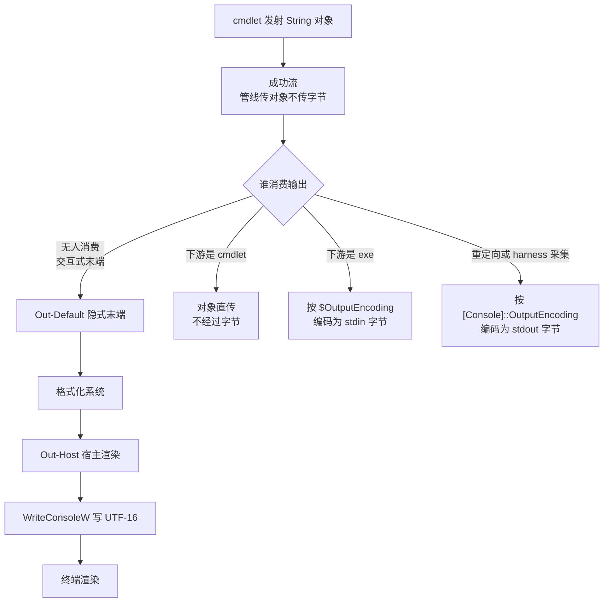
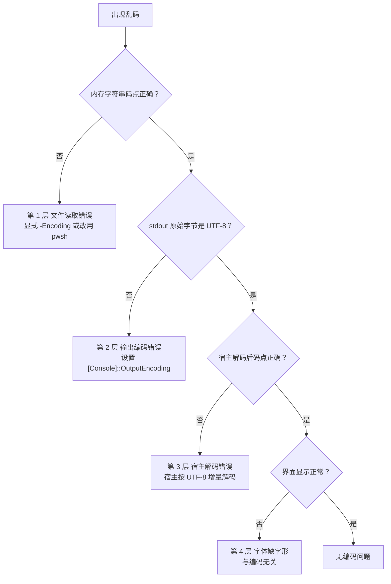

[toc]

## abstract

在 Agent Harness 中观察到的中文乱码，几乎都是**两个相互独立的故障点叠加**，而不是单纯的"显示问题"：

- **第 1 层，读取（解码）问题**：文件字节被错误解码为内存字符串。Windows PowerShell 5.1 对无 BOM 的 UTF-8 文件默认按系统 ANSI 代码页（中文系统为 CP936）解码，字符串在生成时即已损坏，后续任何显示手段都无法恢复。
- **第 2 层，输出（传输）问题**：内存字符串正确，但写向 stdout 的字节编码与宿主解码约定不一致。PowerShell 按控制台 OEM 代码页（中文系统 936）写管道，而 Agent Harness 按 UTF-8 解码，于是出现 `�`。
- **与编码无关的第三种现象**：字节与字符串全程正确，仅因界面字体缺少字形而显示为方框，须独立排查。

因此"已经指定 `-Encoding utf8` 仍然乱码"几乎可以断定是**输出层**问题：`-Encoding` 只管"文件到字符串"，与 stdout 字节无关。

### 现象到环节的速查

| 观察到的现象 | 优先检查的环节 |
| --- | --- |
| 5.1 读取 UTF-8 无 BOM 文件，指定 `-Encoding utf8` 后恢复 | **第 1 层 文件读取解码** |
| 指定 `-Encoding utf8` 后 PowerShell 内字符串正确，但 Agent 仍看到乱码 | **第 2 层 进程输出编码与宿主解码** |
| `Select-String` 乱码 | 区分它是**自己读文件**，还是接收上游已读错的字符串 |
| `Get-Help` 正常，`help` 异常 | **分页器路径** |
| 宿主字符串正确，只有界面显示方框、缺字 | 才优先检查**字体与渲染** |

**不能仅凭"屏幕上乱码"确定故障位置。**本文的定位顺序是：先验证内存字符串（码点或 Base64），再核对 stdout 原始字节，最后才看渲染。

### 一句话行动指引

1. 能换引擎就换 `pwsh`（PowerShell 7）；5.1 只作兼容环境。
2. 每条经 Agent 执行的 PowerShell 命令前加 **UTF-8 三件套**（`[Console]::InputEncoding` / `[Console]::OutputEncoding` / `$OutputEncoding`），不要依赖 `$PROFILE`，Harness 普遍以 `-NoProfile` 启动；**且要在该进程第一次输出之前完成**（先输出再设，同一进程内可能不生效）。
3. 所有文件读写显式指定 `-Encoding`；**读后写**的操作尤其必须显式指定，否则可能把文件写成双重编码。
4. 诊断时保留原始字节或 Base64 对照，不以可见文字作为唯一证据。

## 范围与术语

本文适用范围为 Windows 平台上 PowerShell 与 Agent Harness（代理宿主）之间的中文乱码定位，覆盖文件读取、进程管道传输、宿主解码、界面渲染四个阶段，不讨论网络传输损坏与日志截断。更宽泛的文本编码通用原理（浏览器嗅探、`.editorconfig`、跨平台换行规范）见同目录《文本编码处理原理和最佳实践指南.md》。

下表统一本文术语，后续章节均按此表表述。

| 术语 | 含义 |
| --- | --- |
| **BOM（Byte Order Mark，字节顺序标记）** | 文件首部的编码签名字节。UTF-8 的 BOM 为 `EF BB BF`，UTF-16LE 的 BOM 为 `FF FE`。有无 BOM 直接影响 5.1 的编码探测结果。 |
| **ANSI 代码页** | Windows 系统活动代码页对应的遗留单双字节编码统称。简体中文系统通常为 GBK（代码页 936），西文系统通常为 Windows-1252。同一个"ANSI"文件换台机器含义即变。 |
| **OEM 代码页** | 控制台程序默认使用的遗留编码，常与 ANSI 代码页不同，中文环境常见数值为 437 或 936，需以实测代码页为准。 |
| **内存字符串** | PowerShell 与 .NET 内部使用的 Unicode 字符串（.NET 内部按 UTF-16 存储）。该字符串正确与否是区分第 1 层问题与第 2 层问题的分界线。 |
| **Agent Harness（代理宿主）** | 启动 `powershell.exe` 或 `pwsh.exe` 子进程并重定向标准输出与标准错误的父进程，例如 Node.js、Python 或 Rust 编写的自动化调度程序。 |
| **增量解码器（incremental decoder）** | 可跨越多个数据块维护解码状态的解码器。普通按块独立解码会在多字节字符被拆分到两个数据块时产生偶发乱码。 |
| **乱码（mojibake）** | 字节序列被错误的编码假设解码后产生的可读但语义错误的文字，例如 `涓枃`。须与字体缺字形的方框显示相区分。 |
| **stdout / stderr / stdin** | 标准输出 / 标准错误 / 标准输入。Agent Harness 采集的是前两者，解码约定由宿主决定。 |

## 编码链路：四层形态转换

字节从磁盘到达人眼共经历四次形态转换，每次转换都有独立的编码决策，任一环节失配即产生乱码。


**第 1 层**错误则内存字符串已损坏，不可恢复。**第 2 层**由 PowerShell 侧编码设置决定。**第 3 层**由宿主侧解码设置决定。**第 4 层**仅与字体字形有关，与前三层无关。

两个关键结论：

- **PowerShell 7 只修好了第 1 层。**官方文档说明 PowerShell 6 及以上的文本输出默认是 `utf8NoBOM`，而 Windows PowerShell 遇到没有 BOM 的文件会把脚本误当作遗留 ANSI 代码页解释。
- **第 2 层在 5.1 和 7 中都要手动设置。**Agent 用管道接收 PowerShell 输出时，重定向的 `powershell.exe` 输出按控制台 OEM 代码页写出（简体中文系统即 CP936），而 harness 按 UTF-8 解码，结果就是乱码。PowerShell 仓库 issue #7233 至今未实现"让控制台默认 UTF-8"，因此 pwsh 7 在 Windows 上同样继承 OEM 代码页。

### 各层由谁决定

| 控制项 | 作用方向 | 5.1 默认 | 7.x 默认（Windows） | 典型误解 |
| --- | --- | --- | --- | --- |
| `Get-Content -Encoding` | 文件字节到字符串 | 无 BOM 时按 ANSI（中文系统 CP936） | 无 BOM 时按 UTF-8 | 以为它影响输出 |
| `Select-String -Encoding` | 它自己读文件时使用的解码 | 无 BOM 时假定 UTF-8 | 无 BOM 时假定 UTF-8 | 以为能修复上游已读错的字符串 |
| `[Console]::OutputEncoding` | 编码自身写向 stdout 的字节；解码原生命令 stdout | 继承控制台 OEM 代码页（中文系统 936） | 同左，pwsh 不会自动改为 65001 | 以为只管"显示" |
| `[Console]::InputEncoding` | 解码 stdin 与控制台输入 | 同上 | 同上 | 常被遗漏，一般一并设置 |
| `$OutputEncoding` | 编码发给原生命令 stdin 的字节 | ASCII | UTF-8 | 以为设了它就够 |
| `$PSDefaultParameterValues['*:Encoding']` | 带 `-Encoding` 参数 cmdlet 的默认值 | 未设置 | 未设置 | 对原生命令无效 |
| `chcp` | Windows 控制台活动代码页 | 936 | 936 | 以为改了等于改了所有编码 |
| 宿主解码设置 | stdout / stderr 字节到宿主字符串 | 由 harness 决定，常见为 UTF-8 | 同左 | 不能修复此前已丢失的字符 |

**特别不要把 `$OutputEncoding` 理解为"所有输出的编码"。**它的方向是 PowerShell 到原生命令的 stdin。PowerShell 仓库 issue #4681 对此描述最准确：`$OutputEncoding` 决定 PowerShell 向外部工具发送输出时使用的编码，`[Console]::OutputEncoding` 决定 PowerShell 读取外部工具输出时假定的编码。此外 .NET 的 `Console.Out` 在 stdout 被重定向到管道时同样使用 `[Console]::OutputEncoding` 编码，这就是 Agent 场景的关键。

### 对象流与字节流的分界

PowerShell 命令之间传递的是**对象和 Unicode 字符串**；只有文件、原生程序、进程管道才引入字节编码边界。因此"文件读对了"不等于"harness 一定接收正确"。



图中左支是屏显路径，全程无字节编码，**内存字符串对了就显示对**；右三支是字节路径，每次跨越对象与字节边界都要经过一个编码器，错任何一个都乱码。

这解释了两个常见现象：

- **交互式终端正常、Agent 里乱码**：交互式会话中 `[Console]::IsOutputRedirected` 为 `False`，宿主用 `WriteConsoleW`（UTF-16）直写屏幕缓冲，不经过字节编码；Agent 采集时该值为 `True`，`powershell.exe` 必须把字符串按 CP936 编码成字节经管道吐出，外层按 UTF-8 解就烂。
- **`Get-Content` 不直接写 stdout 字节**：它输出的是 String 对象，只有落屏、管道给原生程序、重定向成文件时才编码。

## 版本默认差异

两代 PowerShell 的默认编码存在系统性差异，跨版本脚本不得依赖任何默认值。

| 行为 | Windows PowerShell 5.1 | PowerShell 7+ |
| --- | --- | --- |
| `Get-Content` 读无 BOM 文件 | 按系统活动 ANSI 代码页解释 | 按 UTF-8 解释 |
| `Select-String` 直接读无 BOM 文件 | 假定 UTF-8 | 假定 UTF-8 |
| `Out-File` 与 `>` 写文件 | UTF-16LE（带 BOM） | UTF-8 无 BOM；**7.4 起原生命令 stdout 直接重定向到文件时保留原始字节** |
| `Set-Content` / `Add-Content` 写文件 | ANSI（中文系统即 GBK） | UTF-8 无 BOM |
| `Export-Csv` 写文件 | ASCII（中文直接丢失） | UTF-8 无 BOM |
| `-Encoding utf8` 的写出语义 | UTF-8 带 BOM | 等同 `utf8NoBOM`（UTF-8 无 BOM） |
| `-Encoding Default` 的含义 | 系统 ANSI 代码页（中文系统即 936） | **UTF-8**（.NET Core 改了 `Encoding.Default`） |
| `$OutputEncoding` 默认值 | ASCII | UTF-8 |
| `[Console]::OutputEncoding` 默认值 | OEM 代码页 936 | 同左 |
| `[System.Text.Encoding]::Default` | 系统 ANSI 代码页（`gb2312` / 936） | UTF-8（.NET Core 改的） |
| 脚本源文件（无 BOM） | 按 ANSI 代码页解析 | 按 UTF-8 解析 |
| `-Encoding Byte` | 可用 | 已移除，改用 `-AsByteStream` |

三处需要单独说明的语义陷阱：

1. **`-Encoding utf8` 在两个版本含义不同。**5.1 的 `utf8` 写出固定带 BOM，7 的 `utf8` 等同 `utf8NoBOM`（要 BOM 用 `utf8BOM`）。因此 `Get-Content -Encoding utf8` 在 5.1 中读取有无 BOM 均正确，但 `Out-File -Encoding utf8` 在 5.1 中写出带 BOM 文件。带 BOM 的 UTF-8 文件在类 Unix 工具链中会引发问题，`cat`、`sed`、`awk` 不识别文件首部的 BOM 字节。
2. **`Select-String` 不能直接套用 `Get-Content` 的结论。**5.1 官方文档的参数小节把默认值标成 `Default`，但描述小节与 *about_Character_Encoding* 明确说明无 BOM 时按 UTF-8 处理；本文采用后者。无论如何，排障时都应显式指定编码。
3. **7.4 的重定向行为变化。**PowerShell 7.4 起，将原生程序的标准输出直接重定向到文件时会保留其原始字节流，不做解释也不添加格式。影响是 `git log > a.txt` 在 7.4+ 得到 git 原始字节（git 在中文系统上通常输出 UTF-8），不再经过 `Out-File` 的编码转换；而 7.3 及以下，该文件内容受 `[Console]::OutputEncoding` 解码与 `Out-File` 编码的双重影响。**因此"7 的所有 `>` 都统一写 UTF-8"是错误的说法。** **但"直接"要按字面理解**：一旦在原生程序与文件之间插入 PowerShell 命令或函数（`function Emit { & python ... }; Emit > a.txt`、`| Out-File`、先赋值给变量再写），输出重新变成字符串，字节保留不再适用（2026-10-21 实测：同一调用直接重定向得到原始 UTF-8，包进函数即双重错位）。
4. **`-Encoding Default` 在两个版本含义不同。**5.1 的 `Default` 是系统 ANSI 代码页（中文系统即 936），7 的 `Default` 是 UTF-8（.NET Core 改了 `Encoding.Default`）。本机实测：同一个 GBK 文件，5.1 用 `-Encoding Default` 读取正确，7 用 `-Encoding Default` 读取失败。**处理 GBK 旧文件必须显式写 936，不能依赖 `Default`。**

处理 GBK 旧文件的跨版本一致写法是直接用 .NET 接口显式指定 936：

```powershell
# 5.1 与 7 行为一致的处理方式
[System.IO.File]::ReadAllText($full, [System.Text.Encoding]::GetEncoding(936))
```

## 按乱码形态定位

### 形态速查

乱码的视觉形态直接暴露"哪种字节被按哪种编码解了"，这是最快的诊断线索。

| 看到的形态 | 发生了什么 | 所属层 | 典型场景 |
| --- | --- | --- | --- |
| `涓枃`、`鍙戠敓` 这类生僻汉字 | UTF-8 字节被按 GBK 解码 | 第 1 层 / 第 3 层 | 5.1 默认 `Get-Content` 读无 BOM UTF-8 文件；宿主侧按 GBK 解码 UTF-8 |
| `测试` | UTF-8 字节被按 Windows-1252 或 Latin-1 解码 | 第 1 层 / 第 3 层 | 西文系统下的变体 |
| `��ã��…`、`�`（U+FFFD 替换字符） | GBK 字节被按 UTF-8 解码，遇非法序列 | 第 2 层 | PowerShell 按 936 写管道，宿主按 UTF-8 解码 |
| `锟斤拷` | 先产生 U+FFFD，再被编码成 UTF-8 后按 GBK 解码 | 两层叠加 | 经过两次错误转换 |
| `ÖÐÎÄ` 这类带音标的拉丁字母 | GBK 字节被按 Windows-1252 解码 | 第 1 层 | 英文 Windows 系统 |
| `??` 问号 | 字符在目标编码中无法表示，被替换 | `$OutputEncoding` 层 / 写文件层 | 5.1 默认 ASCII，管道传给原生命令；目标代码页不含该字符 |
| `锘�` 开头 | UTF-8 的 BOM 字节 `EF BB BF` 被按 GBK 解码 | 第 1 层 | 5.1 写出带 BOM 的 UTF-8，下游不识别 BOM |
| `ÿþ` 开头或字间出现空白 | UTF-16LE 字节流被按单字节编码读取 | 第 1 层 | 5.1 的 `>` 或 `Out-File` 写出 UTF-16LE，下游按单字节解码 |
| `你好，世�?` | 两层都错，部分错误互相抵消 | 第 1 层 + 第 2 层 | 最具迷惑性："大部分正常、个别字符损坏" |

### 决定性测试：绕开编码层，只输出 ASCII

码点是数字，不受任何编码影响，宿主一定能正确看到。

```powershell
# 测试文件内容为"中文"（码点 20013 25991）
$s = Get-Content -LiteralPath .\test.txt -Raw -Encoding UTF8
[char[]]$s.Trim() -join ' '
```

判定规则：

- 码点正确（`20013 25991`）但直接 `Write-Output $s` 在宿主里是 `�` → **第 2 层问题**，修 `[Console]::OutputEncoding`。**设置必须发生在该进程第一次输出之前**：本机实测同一进程先输出过一行再改属性，中文仍乱；改成新调用里先设再输出即正常。若新调用先设仍乱、而同批原生程序（python/node）直写 stdout 正常，才转向第 3 层宿主捕获。
- 码点错误（例如出现 `28051` 对应 `涓` 的码点）→ **第 1 层问题**，去修 `-Encoding`。

更彻底的做法是输出 **Base64**。Base64 字母表仅含 ASCII 字符，宿主即使无法正确显示中文，通常仍可无损传递 Base64 文本，因此它是"内存正确但传输失配"的无歧义分界：

```powershell
[Convert]::ToBase64String([System.Text.UTF8Encoding]::new($false).GetBytes($s))
```

"中文"的 UTF-8 字节为 `E4 B8 AD E6 96 87`，对应 Base64 为 `5Lit5paH`。

一条不含任何中文的速测命令，若在宿主里就是乱码，问题**必定在第 2 层**：

```powershell
[char]0x4F60 + [char]0x597D   # 输出"你好"；整条命令只有 ASCII
```

### 环境事实采集

下面的输出全部是 ASCII，乱码环境下也可读：

```powershell
$PSVersionTable.PSVersion.ToString()
$PSVersionTable.PSEdition
[Console]::OutputEncoding.WebName     # 期望 utf-8；中文系统默认 gb2312
[Console]::OutputEncoding.CodePage     # 936 说明输出层还没修
[Console]::InputEncoding.WebName
$OutputEncoding.WebName               # 5.1 默认 us-ascii；7 默认 utf-8
[System.Text.Encoding]::Default.WebName
[System.Text.Encoding]::Default.CodePage
[Console]::IsOutputRedirected          # Agent 场景应为 True
[Console]::IsErrorRedirected
```

`[Console]::IsOutputRedirected` 为 `True` 即"管道传输"模式，此时 `[Console]::OutputEncoding` 的值直接决定 harness 收到什么字节。

### 判定树



"stdout 原始字节是 UTF-8"这一步需要绕过 PowerShell 自身的重定向（5.1 的 `>` 会写成 UTF-16LE），用 .NET 进程接口直接取原始字节：

```powershell
$psi = New-Object System.Diagnostics.ProcessStartInfo
$psi.FileName = 'powershell.exe'
$psi.Arguments = '-NoProfile -NonInteractive -Command "Write-Output ([char]0x4E2D)"'
$psi.UseShellExecute = $false
$psi.RedirectStandardOutput = $true
$proc = [System.Diagnostics.Process]::Start($psi)
$ms = New-Object System.IO.MemoryStream
$proc.StandardOutput.BaseStream.CopyTo($ms)
$proc.WaitForExit()
$bytes = $ms.ToArray()
($bytes | ForEach-Object { $_.ToString('X2') }) -join ' '
```

判断：UTF-8 的"中"为 `E4 B8 AD`；若出现 `D6 D0` 则是 GBK 字节，说明第 2 层仍是 OEM 代码页。原始字节已经变成 `3F 3F`（问号）则说明字符在此前被替换，信息已丢失。

## Agent Harness 中的特殊表现

Agent（Codex、各类 AI coding agent、CI runner 等）通常：

1. 启动**非交互** PowerShell 进程；
2. 执行命令，**捕获 stdout 与 stderr**（管道或重定向，非直接 TTY）；
3. 把捕获的文本作为上下文交给模型。

此时：直接控制台"看起来正常"的输出，一旦被捕获就可能乱；5.1 加默认 ANSI 读取 UTF-8 文件则上下文已是 mojibake，后续 edit 或 patch 基于错误文本匹配必然失败。

### 各家 harness 的具体成因

| Harness | 启动方式 | 已知问题 |
| --- | --- | --- |
| 通用 agent（经 Git Bash 调用） | `powershell.exe` 或 `pwsh.exe`，stdout 为管道 | bash 侧通常按 UTF-8，被调用的 Windows 原生命令按控制台代码页或 UTF-16、CPxxxx 输出，两端不匹配 |
| Claude Code | 每次调用都设 `$OutputEncoding` 为 UTF-8 | **从不设 `[Console]::OutputEncoding`**；两个是不同的 .NET 编码属性，修一个不等于修另一个 |
| Codex CLI | 硬编码 `-NoProfile` | `$PROFILE` 里的编码设置根本不加载；不写进命令前缀就等于没设 |
| OpenCode | Agent 工具路径为 `pwsh -NoLogo -NoProfile -NonInteractive -Command`，TUI `!` 路径为 `pwsh -NoProfile -Command` | 两条路径的注入不一致，`!` 路径不经过 `tool.execute.before` 钩子，因此靠插件注入只覆盖前者 |

### 控制台代码页的共享污染

控制台代码页是共享且持久的操作系统控制台属性，不是进程状态。一旦会话中任何一次 `chcp` 改了它，后续派生的每个 `pwsh.exe` 子进程都会继承；若新代码页与宿主解码不一致（例如 936 对 UTF-8 宿主），非 ASCII 输出就会变成 `�`。因此：

- **避免在 Agent 会话中执行 `chcp`**，包括 `chcp 65001`。
- `chcp 65001` 也不能当作通用乱码修复命令：控制台代码页不等于 5.1 的文件读取编码，.NET 还可能缓存输出编码。
- 修好第 2 层的唯一可靠办法是在**子进程内部**设置 `[Console]::OutputEncoding`，且要在该子进程第一次输出之前完成。

#### 本机实测：子进程确实继承父进程的控制台输出代码页

这一点在来源文档之间存在分歧，本机实测给出了明确答案。下例在父进程中分别把控制台输出代码页设为 65001、936、437，再用重定向管道启动 `powershell.exe -NoProfile`，直接抓取子进程 stdout 的原始字节：

```powershell
Add-Type -Namespace Win32 -Name ConsoleCp -MemberDefinition @'
[DllImport("kernel32.dll", SetLastError = true)]
public static extern bool SetConsoleOutputCP(uint codePage);
'@

function Get-ChildBytes {
    $psi = New-Object System.Diagnostics.ProcessStartInfo
    $psi.FileName = 'powershell.exe'
    $psi.Arguments = '-NoProfile -NonInteractive -Command "Write-Output ([char]0x4E2D)"'
    $psi.UseShellExecute = $false
    $psi.RedirectStandardOutput = $true
    $proc = [System.Diagnostics.Process]::Start($psi)
    $ms = New-Object System.IO.MemoryStream
    $proc.StandardOutput.BaseStream.CopyTo($ms)
    $proc.WaitForExit()
    (($ms.ToArray() | ForEach-Object { $_.ToString('X2') }) -join ' ')
}

[Win32.ConsoleCp]::SetConsoleOutputCP(65001) | Out-Null
Get-ChildBytes
[Win32.ConsoleCp]::SetConsoleOutputCP(936) | Out-Null
Get-ChildBytes
```

实测输出：

| 父进程控制台输出代码页 | 子进程 stdout 原始字节 | 含义 |
| --- | --- | --- |
| 65001 | `E4 B8 AD 0D 0A` | UTF-8，正确 |
| 936 | `D6 D0 0D 0A` | GBK，宿主按 UTF-8 解即乱码 |
| 437 | `3F 0D 0A` | 437 无法表示"中"，被替换为问号，**信息已不可恢复** |
| 936，但子进程内设 `[Console]::OutputEncoding=[Text.Encoding]::UTF8` | `E4 B8 AD 0D 0A` | UTF-8，正确 |

结论有三层：

1. **控制台输出代码页确实被子进程继承**，且直接决定 `-NoProfile` 子进程写向重定向 stdout 的字节。父进程为 936 时子进程就写 GBK 字节。
2. **在子进程内部显式设置 `[Console]::OutputEncoding` 可以覆盖继承值**，这是唯一可靠的修法；设置要发生在该进程第一次输出之前（先输出再设可能不生效）。
3. 代码页为 437 这类无法表示目标字符的 OEM 代码页时，字符被替换成 `?`，对应形态速查表中的"问号"行，**此类损坏不可逆**。

#### 继承的到底是"控制台代码页"还是"父进程的 .NET 属性"

结论：**在同一个控制台上，子进程继承的是控制台的活动输出代码页；而设置 `[Console]::OutputEncoding` 本身就会改这个代码页**，不存在"只改 .NET 属性、子进程仍按旧代码页初始化"的分离。

用两条独立证据核对（Windows 11 / zh-CN，pwsh 7.5.4 父进程，`powershell.exe` 5.1 子进程，stdout 均已重定向）：

| 父进程状态 | `GetConsoleOutputCP()` | 5.1 子进程自报 | 子进程 stdout 字节 |
| --- | --- | --- | --- |
| 未设置（脏基线 936） | 936 | 936 / `gb2312` | `D6 D0`（GBK） |
| `[Console]::OutputEncoding = UTF8` | 65001 | 65001 / `utf-8` | `E4 B8 AD`（UTF-8） |
| 仅 `chcp 65001`（.NET 仍 936） | 65001 | 65001 / `utf-8` | `E4 B8 AD`（UTF-8） |

第二行就是"父进程 .NET 是 65001、子进程仍按 936 初始化"的直接反例。

之所以容易得出相反结论，是把 `chcp` 的数字当成了控制台代码页：本机在同一状态下（`[Console]::OutputEncoding=65001`、`GetConsoleOutputCP()` 返回 65001、5.1 子进程继承 65001 并输出 UTF-8 字节）仍看到 `chcp` 与 `cmd /c chcp` 打印 936。这个自报值为何不一致尚未定位，但**不能用它推断子进程初值**；判断实际状态用 `[Console]::OutputEncoding.CodePage`，需要内核视角时用 P/Invoke `GetConsoleOutputCP()`。

同样不能拿校准矩阵里子进程的 `DOTNET=936` 当继承证据：矩阵为了让用例可比，**每个子进程都会先显式复位到 ANSI 基线**，所以报告 936 是脚本设计的结果，与父进程继承无关。

| 父进程做了什么 | 子进程 `Console.OutputEncoding` 初值 |
| --- | --- |
| 改了控制台输出代码页（`chcp` / `SetConsoleOutputCP`，或设置 `[Console]::OutputEncoding` 成功） | 继承该代码页（实测 65001、936、437 均跟随） |
| 在子进程内显式设 `[Console]::OutputEncoding` | 取显式值，与继承无关 |

需要注意的边界条件：上例的父子进程附着同一个控制台。若宿主为子进程分配新控制台（`CREATE_NEW_CONSOLE`）或父进程本身没有控制台，继承关系可能不成立。**无论继承与否，实践结论一致：不要依赖继承，必须在子进程内部、第一次输出之前显式设置 `[Console]::OutputEncoding`。**

### 流式输出必须使用增量解码

**不要把每个输出字节块独立解码成 UTF-8。**一个中文字符可能跨越两个读取块；即使生产者编码完全正确，逐块无状态解码也会报错或产生替换字符。应使用增量解码器，且 stdout 与 stderr 各自维护状态。Python 标准库的做法：

```python
import codecs

decoder = codecs.getincrementaldecoder("utf-8")("strict")

assert decoder.decode(b"\xe4\xb8") == ""
assert decoder.decode(b"\xad") == "\u4e2d"
assert decoder.decode(b"", final=True) == ""
```

前两个字节暂存，第三个字节到达后才输出"中"；流结束时执行最终刷新。**如果普通捕获正常、Agent 实时流式展示异常，这是值得优先检查的实现细节。**

### 读后写的双重编码风险

这是比乱码显示更严重的**风险**。OpenCode 的 issue 报告过：在非 UTF-8 系统代码页下，工具按 ANSI 读取 UTF-8 文件后再按 UTF-8 写回，导致文件被双重编码，且改动无法自动撤销。

因此**凡是涉及"读后写"的操作，都必须显式指定编码**。同样地，**已经被替换成 `?` 或 `�` 的字符不能靠后来改解码器恢复**，必须回到仍保留原始信息的边界（原始字节或备份）。

## 具体命令与场景

### Get-Content 及其别名

PS 5.1 对普通无 BOM UTF-8 文件按 ANSI 解码，UTF-8 字节被按 GBK 每两字节切成一个汉字，即产生乱码。实测"你好，UTF-8测试"被解成 `浣犲ソ锛孶TF-8娴嬭瘯`。

```powershell
# 错误示范（5.1 下乱码）
Get-Content .\utf8-file.txt

# 正确
Get-Content .\utf8-file.txt -Encoding utf8

# 精确控制（强制无 BOM 语义，兼容 5.1 与 7）
[System.IO.File]::ReadAllText((Resolve-Path .\utf8-file.txt), [System.Text.UTF8Encoding]::new($false))
```

`cat` 与 `type` 只是 `Get-Content` 的别名，同样要加 `-Encoding`。有 BOM 时多数情况能自动检测；PS 7 通常直接正确。

### Select-String

无 BOM 时官方假定 UTF-8，比 `Get-Content` 友好，但仍受文件实际编码、管道、捕获影响。关键在于**读取责任归属**：

```powershell
# 由 Select-String 自己读文件
Select-String -LiteralPath .\sample.txt -Pattern 'ERROR' -Encoding utf8

# 由 Get-Content 读文件，Select-String 接收已生成的字符串
Get-Content -LiteralPath .\sample.txt -Encoding utf8 | Select-String -Pattern 'ERROR'
```

**如果上游 `Get-Content` 已经把中文读错，给下游 `Select-String` 加 `-Encoding utf8` 不能恢复原文**，编码参数应放在真正读取文件的命令上。

另有一点：PowerShell 7 的 `Select-String` 高亮受 `$PSStyle.OutputRendering` 控制。默认 `Host` 时，捕获（重定向）的文本通常已经不含转义序列；只有显式设为 `Ansi` 时才出现 `ESC[...m`（2026-10-21 实测：`Host` 下无 ESC，`Ansi` 下出现）。这是高亮标记而非乱码；需要纯文本时取 `.Line`，或把 `OutputRendering` 设为 `PlainText`。

### help 与分页器

**`help` 不是 `Get-Help` 的简单别名，而是带分页行为的函数。**Windows PowerShell 官方资料显示它调用 `Get-Help` 后进入 `more`；核对到的 PowerShell 7.4 源码默认在 Windows 使用 `more.com`、在 Unix 使用 `less`，并支持 `PAGER` 环境变量，函数内部还会调整用于分页器输入的 `$OutputEncoding`。

`more.com` 是古老的控制台工具，对 UTF-8 与 BOM 的支持差，常见把 UTF-8 BOM 显示成 `∩╗┐` 或中文乱码。

需要区分的是：`Get-Help` 本身不分页，直接返回对象；走分页路径的是 `help`。因此**同一 harness、同一启动环境下，`Get-Help` 正常而 `help` 异常，可以优先怀疑分页路径**，但这仍是基于两条执行路径差异的定位推断，不能仅凭"分页器存在"就断定某次乱码的根因。

规避方式：

```powershell
# 在 Agent 中使用不分页的写法
Get-Help Get-Content -Full | Out-String -Width 200
```

`Out-String` 负责格式化为文本，`-Width` 控制格式化宽度，**不是编码修复选项**。需要检查实际分页路径时：

```powershell
Get-Command help, more -All
(Get-Command help).Definition
Get-Item Env:PAGER -ErrorAction SilentlyContinue
```

### 重定向与写文件

过程是"对象 → 格式化（仅 `>` 与 `Out-File`）→ 编码 → 落盘"，实测落盘头字节为证。

| 场景 | 5.1 默认 | 7 默认 | 备注 |
| --- | --- | --- | --- |
| `>` / `Out-File` | `FF FE`（UTF-16LE 带 BOM） | UTF-8 无 BOM | `>` 走显示格式化，会按屏宽截断长行；7.4 起原生命令 stdout 保留原始字节 |
| `Set-Content` | ANSI（中文机即 GBK），如 `C4 E3 BA C3` | UTF-8 无 BOM，如 `E4 BD A0` | 存数据用它，写 `.ToString()` |
| `-Encoding utf8` | 带 BOM | 无 BOM，要 BOM 用 `utf8BOM` | 跨版本同名不同义 |

跨版本需要无 BOM UTF-8 时，别信 `-Encoding` 名称，直接用 .NET 接口：

```powershell
[System.IO.File]::WriteAllText('C:\path\f.txt', $s, [System.Text.UTF8Encoding]::new($false))
```

注意 .NET 的当前目录不等于 PowerShell 的当前位置，写入相对路径时用绝对路径。

### 脚本源文件

5.1 下若脚本需要非 ASCII 字符，须保存为**带 BOM 的 UTF-8**；没有 BOM 时 Windows PowerShell 会把脚本误当作遗留 ANSI 代码页。Agent 通常用 `-Command` 传入命令字符串（经由 UTF-16 的进程命令行），不受此影响；但一旦 Agent 把带中文的内容写成 `.ps1` 再执行，这一层就会触发。

数据文件保存为 UTF-8 无 BOM，读取时显式指定编码；要求全部源码统一 UTF-8 无 BOM 的工程，应避免在兼容 5.1 的脚本中直接书写非 ASCII 字面量，或停止支持 5.1。

这一条在实践中极易被忽略：本次整理本文时，一个 UTF-8 无 BOM 的测试脚本在 5.1 下执行，脚本源码里的中文常量被按 ANSI 读成 `浣犲ソ`，而该脚本恰好用 `[System.Text.Encoding]::GetEncoding(936)` 把这个字符串编码回去，得到的仍是原始 UTF-8 字节——**错误发生在"读脚本源码"这一步，却在下游表现为"编码函数行为异常"**，极难定位。**凡是要在 5.1 下执行的脚本，源码含非 ASCII 字面量时一律存为 UTF-8 带 BOM，或用 `[char]` 码点拼接。**

### 原生命令输出

`Application` 类型的命令（`git.exe`、`python.exe`、`findstr.exe` 等）直接产生字节流，编码由**程序自身**决定，不受 PowerShell 编码设置控制。PowerShell 用 `[Console]::OutputEncoding` 去解码它们的 stdout。

因此会出现"PowerShell 探针正常而特定命令乱码"的情况，此时先确认命令类型：

```powershell
Get-Command your-command | Select-Object Name, CommandType, Source, Definition
```

| 命令类型 | 编码特点 |
| --- | --- |
| `Cmdlet` 与 `Function` | 产生 .NET Unicode 对象或字符串，受 PowerShell 编码设置控制 |
| `Application` | 原生程序直接产生字节流，编码由程序自身决定 |
| `ExternalScript` | 除命令输出外，还须考虑脚本文件自身的编码 |
| `Alias` | 为别名，须继续查找其实际指向的命令后再判定 |

排查原生程序乱码的四个常见原因：程序输出 OEM、ANSI 或 CP936 编码；程序在终端模式与重定向管道模式下采用不同输出方式；PowerShell 错误解码了原生程序输出；宿主正确处理 stdout 但错误处理 stderr。修改 `$OutputEncoding` 主要影响发送给原生程序的输入，不修复原生程序自身的输出。

### 无 BOM 文件的编码判定

无 BOM 即无元数据，只能启发式猜，PowerShell 没有内置探测。

有 BOM 是铁证，看头字节即可：

```powershell
Format-Hex -LiteralPath 'C:\path\file.txt' | Select-Object -First 1
```

`EF BB BF` 为 UTF-8，`FF FE` 为 UTF-16LE，`FE FF` 为 UTF-16BE。看前几个字节推荐用 .NET 接口，5.1 与 7 行为一致：

```powershell
$b = [System.IO.File]::ReadAllBytes('C:\path\file.txt')
($b[0..15] | ForEach-Object { $_.ToString('X2') }) -join ' '
```

若用 cmdlet，注意参数在两个版本间不通用：`Format-Hex` 的 `-Count` 参数 5.1 没有、7 才有；`Get-Content -Encoding Byte` 在 5.1 可用、在 7 已移除（改用 `-AsByteStream`）。

无 BOM 时的通用策略是"严格 UTF-8 能解就按 UTF-8（ASCII 是其子集），解不爆回落本地 ANSI"，VS Code、`file -i`、`chardet` 用的都是这套。严格校验写法：

```powershell
$b = [System.IO.File]::ReadAllBytes('C:\path\file.txt')
$u = [System.Text.Encoding]::GetEncoding('utf-8',
    (New-Object System.Text.EncoderExceptionFallback),
    (New-Object System.Text.DecoderExceptionFallback))
try { $u.GetString($b) | Out-Null; 'utf8:ok' } catch { 'utf8:fail -> 试按 GBK 936' }
```

## 诊断步骤

按下列有序步骤执行，不要跳步。

1. **采集环境事实**：`$PSVersionTable`、`[Console]::OutputEncoding`、`[Console]::InputEncoding`、`$OutputEncoding`、`[System.Text.Encoding]::Default`、`[Console]::IsOutputRedirected`。
2. **验证内存字符串**：用码点或 Base64 判断第 1 层是否正确。
3. **核对 stdout 原始字节**：用 .NET 进程接口取字节，判断第 2 层是否正确。
4. **对照形态速查表**判定故障环节。
5. **按结论修复并复测**：修复后重跑同一组探针，确认码点、字节、可见文本三者一致。

完整流程如下：

```powershell
# 1. 版本与编码现状
$PSVersionTable.PSVersion.ToString()
$OutputEncoding.WebName
[Console]::OutputEncoding.WebName
[Console]::InputEncoding.WebName
[Console]::IsOutputRedirected
# chcp 只作参考：重定向下它的自报值可能与实际代码页不一致（见"继承"一节）
chcp

# 2. 造一个无 BOM 的 UTF-8 测试文件（5.1 与 7 通用写法）
$probe = -join ([char]0x4E2D, [char]0x6587)
[System.IO.File]::WriteAllText("$PWD\test-utf8.txt", $probe, [System.Text.UTF8Encoding]::new($false))

# 3. 对比读取（码点判定）
(Get-Content .\test-utf8.txt).Trim() -join ' '
(Get-Content .\test-utf8.txt -Encoding utf8).Trim() -join ' '

# 4. 看真实字节（5.1 与 7 通用：用 .NET 直接读字节，避开 cmdlet 参数的版本差异）
$b = [System.IO.File]::ReadAllBytes("$PWD\test-utf8.txt")
($b[0..15] | ForEach-Object { $_.ToString('X2') }) -join ' '

# 5. 输出层测试
$probe | Out-String
```

### 自诊断脚本

下面的脚本一次运行即可区分第 1 层与第 2 层故障，**源码与判定输出全部为 ASCII**，因此在已经乱码的环境里结论仍然可读。源码为纯 ASCII 意味着 5.1 下也无需 BOM 即可解析；也可以让 Agent 用 `-File` 执行。

在 Windows PowerShell 5.1 与 PowerShell 7.5.4 上的实测结果为：5.1 输出 `READ_DEFAULT_OK=False` 而 `READ_EXPLICIT_OK=True`，7 两者均为 `True`；两者都输出 `READ_EXPLICIT_BASE64=5Lit5paH` 与 `READ_EXPLICIT_POINTS=20013 25991`。

```powershell
<#
.SYNOPSIS
  诊断 PowerShell 在 Agent Harness 中的乱码来源：第 1 层读取 vs 第 2 层输出。
.PARAMETER Fix
  若指定，则在诊断前应用 UTF-8 三件套，用于对比修复前后的差异。
.NOTES
  兼容 Windows PowerShell 5.1 与 PowerShell 7.x；源码与判定输出均为纯 ASCII。
#>
[CmdletBinding()]
param([switch]$Fix)

if ($Fix) {
    try {
        $utf8 = [System.Text.UTF8Encoding]::new($false)
        [Console]::InputEncoding = $utf8
        [Console]::OutputEncoding = $utf8
        $OutputEncoding = $utf8
    } catch {
        Write-Output "WARN: cannot set console encoding: $($_.Exception.Message)"
    }
}

# 1. 环境事实（ASCII）
Write-Output "PS_VERSION=$($PSVersionTable.PSVersion)"
Write-Output "PS_EDITION=$($PSVersionTable.PSEdition)"
Write-Output "CONSOLE_OUT_ENC=$([Console]::OutputEncoding.WebName)/$([Console]::OutputEncoding.CodePage)"
Write-Output "CONSOLE_IN_ENC=$([Console]::InputEncoding.WebName)"
Write-Output "OUTPUT_ENCODING=$($OutputEncoding.WebName)"
Write-Output "ENCODING_DEFAULT=$([System.Text.Encoding]::Default.WebName)/$([System.Text.Encoding]::Default.CodePage)"
Write-Output "STDOUT_REDIRECTED=$([Console]::IsOutputRedirected)"
Write-Output "STDERR_REDIRECTED=$([Console]::IsErrorRedirected)"

# 2. 第 1 层：写一个无 BOM UTF-8 文件，比较默认读取与显式读取
$probe = -join ([char]0x4E2D, [char]0x6587)   # 用码点构造，避免源码编码干扰
$utf8NoBom = [System.Text.UTF8Encoding]::new($false)
$path = Join-Path ([System.IO.Path]::GetTempPath()) ('ps-enc-probe-' + [guid]::NewGuid().ToString('N') + '.txt')
[System.IO.File]::WriteAllText($path, $probe, $utf8NoBom)

try {
    $readDefault  = (Get-Content -LiteralPath $path -Raw).Trim()
    $readExplicit = (Get-Content -LiteralPath $path -Raw -Encoding UTF8).Trim()
    Write-Output "READ_DEFAULT_OK=$($readDefault -ceq $probe)"
    Write-Output "READ_EXPLICIT_OK=$($readExplicit -ceq $probe)"
    Write-Output "READ_EXPLICIT_BASE64=$([Convert]::ToBase64String($utf8NoBom.GetBytes($readExplicit)))"
    Write-Output "READ_EXPLICIT_POINTS=$(([int[]][char[]]$readExplicit) -join ' ')"

    # 3. 第 2 层：把已知正确的字符串写到 stdout，由宿主解码
    Write-Output "OUTPUT_PROBE=$probe"
} finally {
    Remove-Item -LiteralPath $path -Force -ErrorAction SilentlyContinue
}
```

解读方式：

- `READ_DEFAULT_OK=False` 而 `READ_EXPLICIT_OK=True` → 第 1 层问题，5.1 加 `-Encoding UTF8` 即可（7 下两者一般都为 True）。
- `READ_EXPLICIT_OK=True` 且 `READ_EXPLICIT_BASE64=5Lit5paH`，但 `OUTPUT_PROBE` 那行在宿主里是 `�` 或 `涓枃` → **第 2 层问题**，用 `-Fix` 再跑一次，对比 `CONSOLE_OUT_ENC` 从 `gb2312/936` 变为 `utf-8/65001` 后是否正常。
- `READ_EXPLICIT_OK=False` → 文件实际编码不是 UTF-8，须先确认文件真实编码。

### 可重复实验

本目录的 `experiments/` 子目录提供了一套可重复的对照实验，判读只看计数、布尔值与十六进制，不看字形：

| 脚本 | 演示内容 |
| --- | --- |
| `Show-EncodingDefaults.ps1` | 打印宿主版本、各变量默认值、样例的 UTF-8 与系统默认字节对照 |
| `Test-ReadLayer.ps1` | 第 1 层：默认读取、`-Encoding UTF8`、BOM 嗅探、`Select-String` 计数差异 |
| `Test-OutputLayer.ps1` | 第 2 层：同一字符串按 UTF-8 与 GBK 编码的字节差异，以及 UTF-8 下游解不开 GBK 字节 |
| `Test-NativePipe.ps1` | `$OutputEncoding` 对管道给原生程序（如 `python`）的影响 |
| `Test-RedirectDefaults.ps1` | `>`、`Out-File`、`Set-Content`、显式 UTF-8、.NET 无 BOM 五种写法的落盘头字节分类 |
| `Run-All.ps1` | 按顺序串跑以上五个脚本并汇总退出码 |

运行方式：

```powershell
# PowerShell 7 优先
pwsh -NoProfile -File ./experiments/Run-All.ps1

# Windows PowerShell 5.1 对照
powershell -NoProfile -ExecutionPolicy Bypass -File ./experiments/Run-All.ps1
```

这些脚本有意以 `-NoProfile` 运行，以复现 Agent 采集链路（该链路下 profile 不加载）；脚本源码全部为纯 ASCII，中文样例一律用 `[char]` 码点拼接，产物写在系统临时目录，不污染仓库。

#### 跨版本校准矩阵

`powershell-pitfalls` 技能自带一个更严格的校准脚本 `scripts/calibrate-encoding.ps1`：**每个用例各起一个独立子进程，并从统一的 ANSI 代码页基线出发**，因此用例之间不会互相继承状态；判读只依据码点与 ASCII 裁决，不依赖人眼看字形。

```powershell
# 两个版本各跑一遍矩阵
pwsh -NoProfile -File calibrate-encoding.ps1 -IncludeWindowsPowerShell
```

本机实测结果（Windows 11，区域 `zh-CN`，`CALIB_ANSI_CP=936`，`CALIB_CHCP=936`）：

| 用例 | PowerShell 7.5.4 | Windows PowerShell 5.1 | 结论 |
| --- | --- | --- | --- |
| `read-default`（默认 `Get-Content`） | PASS | **MANGLED** | 5.1 按 ANSI 读 UTF-8 无 BOM 文件必烂 |
| `read-utf8`（`-Encoding UTF8`） | PASS | PASS | 显式指定即正确 |
| `read-dotnet`（`ReadAllText`） | PASS | PASS | .NET 接口跨版本一致 |
| `read-ascii-json` | PASS | PASS | ASCII JSON 中间格式保真 |
| `ps-to-file`（.NET 写文件） | PASS | PASS | 生产者自己按字节写最稳 |
| `redirect-dirty`（经函数再 `>`，未设编码） | **MANGLED** | **MANGLED** | 坏在落盘那一跳 |
| `redirect-utf8`（经函数 `>` + UTF-8 三件套） | PASS | PASS | 设了编码即正确 |
| `native-redirect`（原生命令直接 `>`） | PASS | **MANGLED** | 7.4+ 保留原始字节；5.1 仍是文本重定向 |
| `outfile-dirty`（`\| Out-File`） | **MANGLED** | **MANGLED** | 同上 |
| `outfile-utf8` | PASS | PASS | 同上 |
| `outstring-dirty`（`\| Out-String`） | **MANGLED** | **MANGLED** | 同上 |
| `outstring-utf8` | PASS | PASS | 同上 |
| `gate-utf8`（字节闸门） | PASS | PASS | 不经 PowerShell 文本层即稳定 |
| `producer-bytes`（生产者直接写字节） | PASS | PASS | 同上 |
| `json-fallback` | PASS | PASS | 同上 |

三条可直接引用的结论：

1. **`|` 管道与"先经函数/变量再 `>`"是"落盘/中转那一跳"的失真点**，不是显示问题。文件仍是合法 UTF-8，内容却已双重错位（形如 `鍓ュ帀`）；7.4+ 的原生命令直接 `>` 是例外，5.1 没有这个例外。
2. **不经 PowerShell 文本层的三条路径实测稳定正确**：子进程直写 stdout、生产者自己按字节写文件、管道里插字节闸门。
3. **`.NET` 接口与显式 `-Encoding` 在两个版本行为一致**，可以放心用于跨版本脚本。

校准脚本还会在最后打印 `VISUAL_*` 段，**须以原始输出判读**，一旦经过 `Select-Object` 或 `Out-String` 就会被再次改写。

## 修复方案

### 必须做

**命令级 UTF-8 三件套。**Harness 普遍以 `-NoProfile` 启动，且会话中可能被 `chcp` 污染，因此**不要依赖 profile 或系统设置，而在每条命令前显式设置**。这条语句在 5.1 与 7 都有效，PowerShell 仓库早在 2017 年就把它列为让控制台与终端一致使用 UTF-8 的过渡性变通方案：

```powershell
$OutputEncoding = [Console]::InputEncoding = [Console]::OutputEncoding = [System.Text.UTF8Encoding]::new($false)
```

要点：

- **必须在该进程第一次输出之前设置。** 本机实测同一进程里先 `Write-Output` 过一行、再设置 `[Console]::OutputEncoding=UTF8`，属性读数已是 65001，随后输出中文仍是旧编码的字节；改成新调用、先设再输出即正常。可见已输出后再设只改了属性，实际写出仍沿用旧的编码器。
- 用 `[System.Text.UTF8Encoding]::new($false)` 显式指定无 BOM，优于 `[System.Text.Encoding]::UTF8`（后者是带 BOM 前缀语义的对象）。
- 在没有真正控制台句柄的宿主下设置 `[Console]::OutputEncoding` 可能抛出 `The handle is invalid`，且这是**任何错误偏好设置都拦不住的终止性错误**。因此包一层 `try/catch`，吞掉异常、保留旧编码，避免整条命令失败：

```powershell
try {
    $utf8 = [System.Text.UTF8Encoding]::new($false)
    [Console]::InputEncoding  = $utf8
    [Console]::OutputEncoding = $utf8
    $OutputEncoding          = $utf8
} catch { }
```

社区中流传的规避法是在赋值前先触发一次子进程（如 `cmd /c ver | Out-Null`）以确保句柄存在。该做法非官方保证，遇到再用。

**显式指定 `-Encoding`。**所有文件读写都必须显式指定编码：读 UTF-8 用 `utf8`，写时明确目标是带 BOM 还是无 BOM。需要跨版本一致的字节时用 .NET 接口。

**读后写必须显式指定编码。**否则在非 UTF-8 系统代码页下会产生双重编码并覆盖原文件。

**优先使用 PowerShell 7（`pwsh`）。**默认 UTF-8 友好且跨平台一致，Agent 配置应指向 `pwsh.exe` 而非 `powershell.exe`。安装：`winget install Microsoft.PowerShell`。

### 应该做

- **把编码初始化放进 harness 的每次启动脚本**，而不是只写进 `$PROFILE`。`-NoProfile` 明确禁止加载配置文件，不同的 PowerShell 进程也不能假定共享会话设置。
- **在 Agent 规则文件中写明**："执行任何 PowerShell 命令前先应用 UTF-8 三件套"、"读取文本文件必须显式 `-Encoding UTF8`"、"禁止执行 `chcp`"。
- **对 5.1 兼容的脚本文件用 UTF-8 带 BOM**，普通文档用 UTF-8 无 BOM。
- **对混合编码文件先探测再解码**：有 BOM 按 BOM，无 BOM 严格 UTF-8 优先，失败回落 `Default` 或 936。
- **大文件与日志用 .NET `ReadAllText` / `WriteAllText` 精确控制 BOM**。
- **验证方式固定为"写后立刻 `Get-Content -Encoding utf8` + hex 检查"**。

### 推荐做

- **Agent 的 shell 优先用 `pwsh` 7**。第 1 层直接解决，只剩第 2 层需要对齐，维护成本显著低于 5.1。注意 MSIX 版 pwsh 可能被静默检测失败而回退 5.1，建议使用 MSI 版安装路径 `C:\Program Files\PowerShell\7\pwsh.exe`。
- **给需要的 cmdlet 设置有作用域的默认值**，而不是全局通配：

```powershell
$PSDefaultParameterValues['Get-Content:Encoding']  = 'utf8'
$PSDefaultParameterValues['Select-String:Encoding'] = 'utf8'
$PSDefaultParameterValues['Out-File:Encoding']     = 'utf8'
$PSDefaultParameterValues['Set-Content:Encoding']  = 'utf8'
```

**不建议在兼容脚本中使用通配写法** `$PSDefaultParameterValues['*:Encoding'] = 'utf8'`：通配设置影响会话中全部相关命令，且 5.1 与 7 的 `utf8` 写出语义不同（5.1 带 BOM），读写方向不能一视同仁。

- **管道到原生工具前确认 `$OutputEncoding` 与目标期望一致**。注意 7 中存在"反向"的不一致：PowerShell 默认 `$OutputEncoding` 是 UTF-8，而原生 Windows 控制台工具期望控制台编码，`echo 中文文本 | more` 因此会得到 `涓枃鏂囨湰`。
- **禁用或不依赖有问题的分页器**，用 `Get-Help ... | Out-String -Width 200` 代替 `help`。
- **Windows Terminal 配合支持中文的等宽字体**（如 Cascadia Code、Sarasa Mono SC）。

### 可以做

- **临时会话**：直接执行三件套即可。
- **系统级"Beta：使用 Unicode UTF-8 提供全球语言支持"**（把系统代码页改为 65001）：能一次性修好第 1、2 层，但**副作用要重视**。它会让 Windows PowerShell 中默认 ANSI 编码的 cmdlet（尤其 `Get-Content` 与 `Set-Content`）转为 UTF-8，从向后兼容角度看可能有问题；社区实测修好了编码却弄坏了依赖 CP932 的 Excel VBA 宏等遗留应用，也有仅改 OEMCP 注册表导致系统不稳定被迫回滚的案例。国内环境中依赖 GBK 的老程序（部分国产软件、旧游戏）同样会受影响。**不建议在开发主力机上作为首选**，更适合专用的 Agent 沙箱机。
- **在 profile 中设置编码**：对交互式有效，对带 `-NoProfile` 的 harness 无效；放置位置与写法见 [profile 配置（仅交互式会话）](#profile-配置仅交互式会话)。
- **换行风格另算**：PowerShell 5.1 写文件用 CRLF，若 Agent 生成脚本在 Linux 执行，配合 `.gitattributes` 中 `*.sh text eol=lf` 防止 `\r` 进入 shell 脚本。

### 避免做

- **避免在 Agent 会话中执行 `chcp`**：它改的是共享的控制台代码页，会污染后续所有子进程。
- **避免只设 `$OutputEncoding` 就认为修好了**：它只影响向原生命令 stdin 的写入，Agent 场景的关键项是 `[Console]::OutputEncoding`。
- **避免依赖 PS 5.1 默认**（尤其 `Get-Content`、`Out-File`、`>`）。
- **避免在 5.1 里用 `>` 写"UTF-8 文件"**，得到的是 UTF-16LE。
- **避免在已乱码的字符串上"修复"**：信息已丢失，只能回到原始字节或备份重新正确读取。
- **避免混用带 BOM 与无 BOM 而不说明**，尤其不要让 `Out-File -Encoding utf8` 在 5.1 下悄悄产出带 BOM 文件。
- **避免假设 Agent 捕获与交互终端行为一致**。
- **避免使用 `UTF7`**（已不推荐；7.1 及以上指定该编码会产生警告）。
- **避免在 7 中使用 `-Encoding Byte`**（已移除，改用 `-AsByteStream`）。
- **避免用 `-EncodedCommand` 解决输出乱码**：它的 UTF-16LE 要求是**命令输入协议**，不是 stdout 编码。
- **避免忽略国内 GBK 遗留文件**：用 `[System.Text.Encoding]::GetEncoding(936)` 显式处理旧文件，**不要用 `-Encoding Default`**——它在 5.1 是 ANSI 936、在 7 是 UTF-8，含义不同。

### profile 配置（仅交互式会话）

`$PROFILE` 只在未使用 `-NoProfile` 时加载；Agent Harness 通常带 `-NoProfile`，所以 profile **修不了 Agent 调用**，只适合固化交互终端、手动 `powershell -File` 和不带该参数的工具。

放置与写法：

- 放 `$PROFILE.CurrentUserAllHosts`（覆盖所有宿主），或 `$PROFILE`（只当前宿主）。加载顺序是 AllUsersAllHosts → AllUsersCurrentHost → CurrentUserAllHosts → CurrentUserCurrentHost。
- **块放文件最顶部、任何输出之前**：profile 里的初始化脚本或欢迎语一旦先打印，编码器就按旧值绑定；之后设属性只改读数，不改实际写出（见上文设置时机的实测）。
- 用 `try/catch` 包住：无真实控制台句柄的宿主里赋值可能抛 `The handle is invalid`，且是终止性错误。

```powershell
try {
    $utf8 = [System.Text.UTF8Encoding]::new($false)
    [Console]::OutputEncoding = $utf8
    # [Console]::InputEncoding  = $utf8   # 可选
    $OutputEncoding = $utf8
} catch { }
```

- 源码保持 ASCII 最稳；5.1 读取的 profile 若加中文注释，文件要 UTF-8 带 BOM。
- 不要放 `chcp`：共享控制台代码页的副作用比这里需要的更大；也不要在编码块之前打印中文 banner。
- 不要设 `$PSDefaultParameterValues['*:Encoding']`：5.1 写 BOM，且会把 5.1 的 ANSI 默认读取改成 UTF-8，读坏 GBK 旧文件。
- 副作用：当前窗口的控制台代码页会变成 65001，同窗口子进程继承 UTF-8；只认 GBK 的老式控制台程序要另开窗口。

验证（新开窗口）：

```powershell
[Console]::OutputEncoding.CodePage    # 65001
"中文 café 日本語 😀"
help <自定义函数>                      # 分页器路径，单独看
```

`-NoProfile` 启动不会执行这段块；但子进程可能继承同一控制台的 65001，能否正常显示仍取决于该进程自身的控制台与捕获方，不能拿交互窗口的结果推断 Agent。

`help` 走分页器，历史上在 profile 里设控制台编码曾让它乱码；出现时去掉 `InputEncoding`，或用 `Get-Help <命令> -Full`。

## Harness 端约定

仅修复 PowerShell 侧不足以消除乱码，父进程须明确执行以下约定。

1. 标准输出与标准错误统一约定为 UTF-8。
2. 对两个流分别配置 UTF-8 解码，不可仅配置其中之一。
3. **使用增量解码器**，不可将每个字节块单独转换为字符串。
4. 诊断阶段使用严格解码，遇到非法 UTF-8 立即报错，不可静默替换为 `�`。
5. 保留一份原始 stdout 与 stderr 字节，或其十六进制或 Base64 日志，用于分界定位。

严格解码只能暴露非法字节，不能保证识别所有"合法却用错编码"的情况。**已经被替换成 `?` 或 `�` 的字符，不能仅靠后来改解码器恢复，必须回到仍保留原始信息的边界。**

若宿主为 .NET 程序，将 `ProcessStartInfo.StandardOutputEncoding` 指定为 UTF-8；若宿主为 Python 程序，用 `utf-8-sig` 解码可兼容 5.1 可能输出的带 BOM 字节。

### Python 宿主示例

```python
import subprocess

result = subprocess.run(
    [
        "powershell.exe",       # 改用 "pwsh" 则为 PowerShell 7
        "-NoLogo",
        "-NoProfile",
        "-NonInteractive",
        "-File",
        "script.ps1",
    ],
    shell=False,
    capture_output=True,
    text=True,
    encoding="utf-8",
    errors="strict",
    check=False,
)

print(result.stdout)
print(result.stderr)
```

`text=True` 时 Python 使用增量解码语义处理流式数据；不使用文本模式时捕获的是字节，需要自行以 `codecs.getincrementaldecoder("utf-8")` 处理。不要使用 `encoding=None` 依赖系统区域设置，也不建议无必要地使用 `shell=True`，后者会额外经过 `cmd.exe` 的代码页与命令行转义层。

### Node.js 宿主示例

```javascript
import { spawn } from "node:child_process";

const child = spawn(
  "powershell.exe",
  ["-NoLogo", "-NoProfile", "-NonInteractive", "-File", "script.ps1"],
  {
    shell: false,
    windowsHide: true,
    stdio: ["ignore", "pipe", "pipe"],
  },
);

// setEncoding 维护跨数据块的 UTF-8 解码状态
child.stdout.setEncoding("utf8");
child.stderr.setEncoding("utf8");

child.stdout.on("data", (text) => {
  process.stdout.write(text);
});

child.stderr.on("data", (text) => {
  process.stderr.write(text);
});
```

以下写法须避免——一个 UTF-8 字符可能正好被拆分到两个数据块中，按块独立转换将产生偶发乱码：

```javascript
child.stdout.on("data", (chunk) => {
  show(chunk.toString("utf8"));   // 偶发乱码
});
```

如需保留原始字节，应先收集全部 `Buffer` 对象，最后经由 `Buffer.concat` 统一解码。

## 落地示例

### UTF-8 前缀规则

把三件套写进项目的 `AGENTS.md` 或 `CLAUDE.md`，让 Agent 每次调用 PowerShell 时自动加前缀：

```markdown
在 Windows 上执行任何 PowerShell 命令，必须以以下前缀开头：

$OutputEncoding = [Console]::InputEncoding = [Console]::OutputEncoding = [System.Text.UTF8Encoding]::new($false)

读取文本文件必须显式指定 `-Encoding UTF8`；禁止执行 `chcp`。
```

### 包装脚本

适合自定义工具链或无法改 Agent 规则文件的场景：

```powershell
# pwsh-utf8.ps1
# 用途: 在 Agent Harness 中以 UTF-8 编码执行一条 PowerShell 命令
# 用法: pwsh -NoProfile -ExecutionPolicy Bypass -File .\pwsh-utf8.ps1 -Command "Get-Content .\a.txt -Encoding UTF8"
param(
    [Parameter(Mandatory)]
    [string]$Command
)

# 无 BOM 的 UTF-8 编码对象
$utf8 = [System.Text.UTF8Encoding]::new($false)

try {
    # 第 2 层: 控制 PowerShell 写入 stdout 与读取 stdin 的字节编码
    [Console]::OutputEncoding = $utf8
    [Console]::InputEncoding  = $utf8

    # 与外部原生命令交互时使用的编码
    $OutputEncoding = $utf8
} catch {
    # 没有控制台句柄的宿主下赋值可能抛终止性错误，保留旧编码继续执行
}

Invoke-Expression $Command
```

### opencode 的 UTF-8 包装器

opencode 的 TUI `!` 命令路径不经过 `tool.execute.before` 钩子，插件注入只覆盖 Agent 工具路径。可行的做法是配置一个**伪装成 `pwsh.exe` 的包装器**，由包装器统一注入 UTF-8 前缀。

关键约束（均来自本机实测与源码核对）：

| 约束 | 原因 |
| --- | --- |
| 包装器必须命名为 `pwsh.exe` | opencode 用文件名判断 shell 类型，`path.parse(name).name.toLowerCase()` |
| **不能**用 `pwsh.cmd` | `.cmd` 会被 `cmd.exe` 以 GBK 重新解析 argv，中文在到达 pwsh 之前就已损坏 |
| 命令用 `-EncodedCommand`（Base64 UTF-16LE）传递 | 命令行完全无引号与管线歧义 |
| exe 内部继承父进程已重定向的 stdio | 避免二次重定向引入新的编码层 |
| 包装器须同时处理 `-NoLogo -NoProfile -NonInteractive -Command` 与 `-NoProfile -Command` 两种前缀 | Agent 工具路径与 TUI `!` 路径的前缀不同 |

注入的前缀与上游 opencode PR #31658 一致：`$OutputEncoding = [Console]::OutputEncoding = [System.Text.UTF8Encoding]::new($false);`。

接线方式是在 `~/.config/opencode/opencode.jsonc` 增加 `"shell"` 键指向包装器路径。需要重启 opencode 让配置生效；回退只需删除该键与包装器目录，无系统级残留。

同类经验对其他 harness 同样适用：**PATH 上的包装器可能完全无效**，因为某些 harness 使用 `pwsh.exe` 的完整路径而不走 PATH 解析，包装器只对自己的工具链或 hook 有效。

### 综合示例：Agent 友好的安全读取与搜索

场景：Agent 需要读取项目中的 UTF-8 Markdown 或日志（可能无 BOM，含中文），搜索关键词，并安全输出结果。

```powershell
# 假设已在前缀或 profile 中设置 UTF-8 基础
function Read-Utf8Safe {
    param([string]$Path)
    $full = (Resolve-Path -LiteralPath $Path -ErrorAction Stop).Path
    # -Encoding utf8 在 5.1 与 7 行为一致：有 UTF-8 BOM 时自动剥离，无 BOM 时按 UTF-8 解码
    Get-Content -LiteralPath $full -Encoding utf8 -Raw -ErrorAction Stop
}

$content = Read-Utf8Safe '.\README.md'
$matches = $content -split "`r?`n" | Select-String -Pattern '乱码|TODO|错误' -Context 0,2

# 安全输出给 Agent（避免再编码问题）；取 .Line 可同时去掉 7 的高亮转义序列
$matches | ForEach-Object { $_.Line } | Out-String -Width 4096
```

对 GBK 旧文件，改用 .NET 接口显式指定 936，两个版本行为一致：

```powershell
[System.IO.File]::ReadAllText($full, [System.Text.Encoding]::GetEncoding(936))
```

## 跨平台与邻近场景

### Linux 与 macOS

这个问题是 Windows 特有的：pwsh 在 Linux 与 macOS 上 `[Console]::OutputEncoding` 就是 UTF-8，不存在代码页继承。若生产环境在 Linux 服务器上跑 pwsh，不会遇到此问题；本地 Windows 开发机是重灾区。

### Git Bash 与 WSL

Git Bash / MSYS2 路径下调用 `powershell.exe` 时，bash 侧 `LANG` 通常是 UTF-8，上述三件套同样是正确解法。若 Agent 使用 WSL，PowerShell 通过 `powershell.exe` 互操作调用，仍要加前缀。

### 与 bash 下 cat 的区别

`cat` 搬字节，`Get-Content` 搬对象，路径不同：

- **bash 的 `cat`**：不解码，只搬字节。路径是"文件字节 → stdout 字节 → 终端按 `$LANG` 解码渲染"，没有 `-Encoding` 参数，文件编码与 locale 不一致就乱。
- **PowerShell 的 `Get-Content`**：路径是"文件字节 → `-Encoding` 解码 → UTF-16 String → 宿主再编码 → 终端"，多一层对象与一次二次编码，还有 BOM 嗅探。

所以 Linux 乱在终端 locale 对不上文件，WinPS 5.1 多一种乱：默认按 GBK 解 UTF-8 文件，String 层已错。

### cmd 下 type 的行为

`type` 与 `cat` 同类，只搬字节，无解码参数。路径是"文件字节 → stdout 字节 → conhost 按 `chcp` 解码显示"。

- `chcp 936` 配 GBK 文件正常，`chcp 936` 配 UTF-8 无 BOM 文件屏显乱；`chcp 65001` 配 UTF-8 文件正常，前提是使用真字体而非点阵字体。
- **管道重定向时字节直通，显示层的 `chcp` 不起作用**。这点与 `Get-Content` 不同，后者在管道里也会烂。

## 最终约定与行动清单

**根因**：Windows PowerShell 5.1 的遗留默认（ANSI、ASCII、UTF-16）与现代 UTF-8 无 BOM 及 Agent 的捕获路径不匹配；读取错误产生损坏字符串，输出层再放大。

**显示与读取的先后**：先修第 1 层（显式 `-Encoding` 或改用 pwsh），再统一第 2 层（`[Console]::OutputEncoding`），最后核对宿主解码；Agent 中三者常同时存在。

**最终约定**：

- **文件读写**：数据文件统一使用 UTF-8 无 BOM，兼容 5.1 的代码在读取时显式指定编码，含非 ASCII 字面量且须兼容 5.1 的脚本文件用 UTF-8 带 BOM。
- **标准输出**：PowerShell 标准输出与标准错误统一使用 UTF-8 无 BOM，在**子进程内部**设置而非依赖 `$PROFILE`。
- **宿主解码**：宿主对标准输出与标准错误分别执行 UTF-8 增量解码，诊断阶段使用严格解码。
- **诊断日志**：保存原始字节或 Base64 对照，不直接以可见文字作为唯一证据。
- **引擎选择**：优先运行 PowerShell 7，5.1 仅作兼容环境。
- **读后写**：凡涉及读后写的操作必须显式指定编码，避免双重编码覆盖原文件。

**行动清单**：

1. 能换就换 `pwsh`。
2. 每条 Agent 执行的 PowerShell 命令前加 UTF-8 三件套（含 `try/catch`）。
3. 所有关键读写加 `-Encoding utf8`，或用 .NET 接口精确控制 BOM。
4. Agent 配置强制 UTF-8 启动前缀，并优先 `pwsh`。
5. 禁止在 Agent 会话中执行 `chcp`。
6. 用 .NET `ReadAllBytes` 看头字节、码点、Base64 三重对照验证。

## 参考来源

**本文新增的本机实测**（Windows 11 中文系统，Windows PowerShell 5.1.26100.8875 与 PowerShell 7.5.4 双版本对照）：

| 实测项 | 结果 |
| --- | --- |
| 自诊断脚本在 5.1 与 7 的输出 | 5.1 `READ_DEFAULT_OK=False`、7 为 `True`；两者 `READ_EXPLICIT_BASE64=5Lit5paH`、`READ_EXPLICIT_POINTS=20013 25991` |
| `Get-Content -Encoding Byte` | 5.1 可用，7 报 "not a supported encoding name" |
| `Get-Content -AsByteStream` | 7 可用，5.1 报 "A parameter cannot be found" |
| `Format-Hex -Count` | 7 可用，5.1 报 "A parameter cannot be found" |
| 子进程继承父进程控制台输出代码页 | 成立：父 65001 得 `E4 B8 AD`，父 936 得 `D6 D0`，父 437 得 `3F` |
| 子进程内显式设 `[Console]::OutputEncoding=[Text.Encoding]::UTF8` | 覆盖继承值，输出 `E4 B8 AD` |
| 设 `[Console]::OutputEncoding=UTF8` 后子进程继承值 | 65001：P/Invoke `GetConsoleOutputCP()`、5.1 子进程自报与 stdout 字节（`E4 B8 AD`）三者一致 |
| `chcp` 自报值与实际代码页 | 不一致：`.NET=65001`、`GetConsoleOutputCP()=65001`、子进程继承 65001 时，`chcp` 与 `cmd /c chcp` 仍打印 936 |
| 编码设置的时机 | 同一进程先输出一行再设属性，5.1 与 7.5.4 中文仍乱；新调用先设再输出正常 |
| 7.4+ 原生命令直接 `>` vs 经函数再 `>` | 直接重定向 `E4 B8 AD...`（原始字节）；包进函数或 `\| Out-File` 即双重错位 |
| `File.WriteAllText(..., [Text.Encoding]::UTF8)` | 5.1 与 7 均写出 `EF BB BF`（带 BOM） |
| `[System.Text.Encoding]::Default.CodePage` | 5.1 为 936（gb2312），7 为 65001（UTF-8） |
| `-Encoding Default` 读 GBK 文件 | 5.1 正确，7 **失败**（7 的 `Default` 是 UTF-8） |
| `[System.Text.Encoding]::GetEncoding(936)` 读 GBK 文件 | 5.1 与 7 均正确 |
| `Get-Content -Encoding utf8` 读带 UTF-8 BOM 的文件 | 5.1 与 7 均正确剥离 BOM，首字符码点为 20320 |
| `calibrate-encoding.ps1` 跨版本校准矩阵 | 15 个用例在 7 与 5.1 上各跑一遍，安全路径 14/14 通过；MANGLED 为 5.1 的 `read-default`、两版本的 `redirect/outfile/outstring-dirty`，以及 5.1 的 `native-redirect`（7 为 PASS） |

