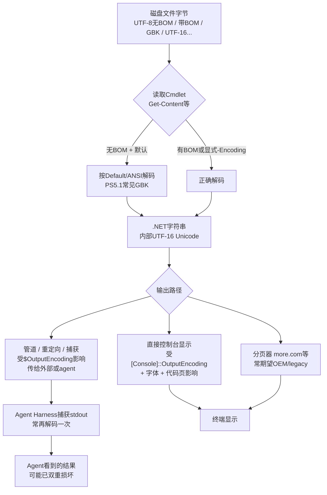

[toc]

## abstract

在agent harness中看到的乱码，**多数情况下是“读取（解码）问题”叠加“输出/捕获编码不匹配”**，而非单纯“显示问题”。  
- **读取问题**：`Get-Content`（尤其PS 5.1）对无BOM的UTF-8文件默认按系统ANSI（中文Windows常为GBK/CP936）解码，字节被错误解释成错误的.NET字符串（内部是UTF-16），后续再怎么显示都已损坏。  
- **显示/捕获问题**：即使字符串正确，`$OutputEncoding`、`[Console]::OutputEncoding`、代码页（chcp）、管道/重定向、分页器（more.com）或agent捕获stdout的方式不一致，也会在传到harness时再次乱码。Agent环境常非交互、经管道捕获，更容易触发。  
- help的分页器问题确实存在（more.com对Unicode/BOM处理差）。  
- PS 7默认大幅改善（BOM-less UTF-8），但agent若仍调用`powershell.exe`（5.1）则问题依旧。  

乱码本质是**字节序列被错误的编码假设解码/再编码**（mojibake）。文件本身常完好（用hex或正确`-Encoding`可读）。

### 核心原理：多层编码与数据流

PowerShell处理文本时存在多个独立层，默认值在Windows PowerShell 5.1（Desktop）与PowerShell 7+（Core）差异巨大，且中文Windows（ANSI/OEM多为CP936）特别容易踩坑。



**关键变量/概念解释**（避免混淆）：

- **文件编码（File Encoding）**：磁盘上的字节如何表示字符。常见：UTF-8（推荐无BOM跨平台）、UTF-8 with BOM、UTF-16LE（Windows传统）、ANSI/Default（系统活动代码页，中文常GBK）。
- **BOM（Byte Order Mark）**：文件开头的特殊字节（UTF-8为`EF BB BF`），用于自动检测。PS 5.1对无BOM的UTF-8几乎总按ANSI处理。
- **`$OutputEncoding`**：PowerShell把字符串**编码成字节**送给外部程序（管道stdin）时使用的编码。PS 5.1默认**ASCII**（非ASCII变`?`，信息丢失）；PS 7默认UTF-8无BOM。
- **`[Console]::OutputEncoding` / `InputEncoding`**：控制台相关。.NET用它解码**来自外部程序的stdout**；也影响显示。默认跟随系统OEM/ANSI代码页。
- **代码页（Code Page，chcp）**：Windows控制台传统机制。65001 = UTF-8；936 = GBK。`chcp 65001`常配合使用，但.NET有时缓存，需同时设Console属性。
- **Cmdlet的`-Encoding`参数**：覆盖文件读写默认。值在PS 5.1与7有差异（7支持`utf8NoBOM`等更精细）。
- **内部表示**：PowerShell/.NET字符串始终是Unicode（UTF-16）。乱码一旦在解码时产生，字符串就已错，后续无法完美恢复。

官方说明：无BOM时，`Get-Content`和`Import-PowerShellDataFile`用**Default（ANSI）**；`Select-String`、`Import-Csv`等假定**UTF-8**。PS 7整体默认BOM-less UTF-8。

### PowerShell 5.1 vs 7 关键默认差异

| 场景/Cmdlet                 | Windows PowerShell 5.1 默认 | PowerShell 7+ 默认        | 中文/无BOM UTF-8影响          | 推荐                                       |
| --------------------------- | --------------------------- | ------------------------- | ----------------------------- | ------------------------------------------ |
| `Get-Content` 无BOM         | ANSI（Default，中文常GBK）  | UTF-8                     | 5.1必乱码，需`-Encoding utf8` | 始终显式或改默认                           |
| `Select-String` 无BOM       | 假定UTF-8                   | UTF-8 / utf8NoBOM         | 相对好，但仍建议显式          | 显式`-Encoding`                            |
| `Out-File` / `>`            | UTF-16LE（带BOM）           | UTF-8无BOM                | 5.1文件变大且不兼容Unix工具   | `$PSDefaultParameterValues`                |
| `Set-Content`               | ANSI                        | UTF-8无BOM                | 同上                          | 同上                                       |
| `$OutputEncoding`           | ASCII                       | UTF-8无BOM                | 5.1管道中文变?                | 设为UTF-8                                  |
| `[Console]::OutputEncoding` | 系统OEM/ANSI                | 系统（但整体更UTF-8友好） | 外部工具UTF-8输出乱码         | 设为UTF-8 + chcp 65001                     |
| 脚本源文件无BOM             | 按ANSI读（中文脚本可能挂）  | UTF-8                     | 5.1脚本本身乱码               | 保存为UTF-8 **with BOM**（5.1兼容）或用PS7 |

PS 7从根源绕开大量问题，但许多agent/CI默认仍调`powershell.exe`（5.1）。

### 具体命令问题

**Get-Content（及别名`cat`/`type`）**  
PS 5.1对普通无BOM UTF-8文件：  
```powershell
# 错误示范（乱码）
Get-Content .\utf8-file.txt   # 按GBK解UTF-8字节 → 乱码字符串

# 正确
Get-Content .\utf8-file.txt -Encoding utf8
# 或更精确 .NET（无BOM强制）
[System.IO.File]::ReadAllText((Resolve-Path .\utf8-file.txt), [System.Text.UTF8Encoding]::new($false))
```
有BOM时多数情况能自动检测。PS 7通常直接正确。

**Select-String**  
无BOM时官方假定UTF-8，比Get-Content友好，但仍受文件实际编码、管道、捕获影响。复杂场景（混合编码日志）建议：  
```powershell
Get-Content .\log.txt -Encoding utf8 -Raw | Select-String -Pattern '错误|exception'
# 或对已知GBK：
$enc = [System.Text.Encoding]::GetEncoding(936)
[System.IO.File]::ReadAllText($path, $enc) -split "`r?`n" | Select-String '模式'
```
避免直接对可能错误解码的结果做匹配（agent patch会失败）。

**help / 分页器**  
`Get-Help`常通过`more.com`（或less）分页。more.com是古老控制台工具，对UTF-8/BOM支持差，常见把UTF-8 BOM显示成`∩╗┐`或中文乱码。VS Code集成终端等也有相关issue。  
规避：  
- `$env:PAGER = ''` 或禁用分页。  
- `Get-Help ... | Out-String -Width 200` 或 `| more` 前确保编码一致。  
- 用`help -Full`后重定向，或直接`Get-Help ... | Select-Object -ExpandProperty ...`。  
管道到native工具时，`$OutputEncoding`与Console编码不匹配会乱。

### Agent Harness中的特殊表现

Agent（Codex、各类AI coding agent、CI runner等）通常：  
1. 启动非交互PowerShell进程。  
2. 执行命令，**捕获stdout/stderr**（管道或重定向，非直接TTY）。  
3. 把捕获的文本作为“上下文”给模型。  

此时：  
- 直接控制台“看起来正常”的输出，一旦被捕获就可能乱（因为解码路径变了）。  
- PS 5.1 + 默认ANSI读取UTF-8文件 → 上下文已是mojibake → 后续edit/patch基于错误文本匹配失败。  
- 真实案例：BOM-less UTF-8 Markdown在agent中显示`—`等，文件本身完好；`Get-Content -Encoding utf8`正常，但默认命令乱。修复需在启动前缀强制UTF-8。  

**读取 vs 显示判断方法**：  
1. 用`Format-Hex`或外部工具看文件真实字节（是否`EF BB BF`开头？多字节中文是否符合UTF-8）。  
2. 在同一会话：`Get-Content -Encoding utf8` vs 默认。若前者好后者坏 → **读取问题**。  
3. 字符串已正确后，`$str | Out-File -Encoding utf8`再读，或管道到`cmd /c type`等，若变坏 → **输出/捕获问题**。  
4. Agent中：对比本地交互终端 vs harness捕获结果。

### 诊断步骤（必须做）

```powershell
# 1. 版本与编码现状
$PSVersionTable
$OutputEncoding
[Console]::OutputEncoding
[Console]::InputEncoding
chcp

# 2. 测试文件（创建无BOM UTF-8中文）
"测试中文 café 你好" | Out-File -Encoding utf8NoBOM test-utf8.txt   # PS7；PS5.1用下面.NET
# PS5.1无BOM写法：
[System.IO.File]::WriteAllText("$pwd\test-utf8.txt", "测试中文 café 你好", [System.Text.UTF8Encoding]::new($false))

# 3. 对比读取
Get-Content test-utf8.txt                  # 可能乱
Get-Content test-utf8.txt -Encoding utf8   # 应正常
Format-Hex test-utf8.txt -Count 32         # 看字节

# 4. 输出/管道测试
"测试" | more
"测试" | Out-String
```

### 最佳实践与解决方案（按优先级）

**必须做（根治方向）**：  
- **优先使用PowerShell 7（`pwsh`）**：默认UTF-8友好，跨平台。安装：`winget install Microsoft.PowerShell`。Agent配置指向`pwsh.exe`而非`powershell.exe`。  
- **所有文件读写显式指定`-Encoding`**：读UTF-8用`utf8`（或PS7的`utf8NoBOM`）；写时明确。不要依赖默认。  
- **Profile强制UTF-8**（PS 5.1尤其需要）：  
  ```powershell
  # 编辑 $PROFILE（若无则 New-Item -Path $PROFILE -ItemType File -Force）
  if ($PSVersionTable.PSEdition -eq 'Desktop' -or $PSVersionTable.PSVersion.Major -le 5) {
      chcp 65001 | Out-Null
      $OutputEncoding = [Console]::InputEncoding = [Console]::OutputEncoding = [System.Text.UTF8Encoding]::new($false)
  }
  # 通用：让支持-Encoding的Cmdlet默认UTF-8
  $PSDefaultParameterValues['*:Encoding'] = 'utf8'   # PS5.1会带BOM；PS7为无BOM效果
  # 更精细：
  $PSDefaultParameterValues['Out-File:Encoding'] = 'utf8'
  $PSDefaultParameterValues['Set-Content:Encoding'] = 'utf8'
  $PSDefaultParameterValues['Get-Content:Encoding'] = 'utf8'  # 谨慎，可能影响预期ANSI文件
  ```
  注意：系统级“Beta UTF-8”代码页（Windows 10/11设置）影响面大，需评估兼容性。

**应该/推荐做**：  
- 新文件统一**UTF-8无BOM**（跨平台最佳）；PS 5.1脚本源文件用**UTF-8 with BOM**以保证非ASCII正确解析。  
- Agent/harness启动命令前缀加入上述编码设置（许多agent已有或可配置）。  
- 大文件/日志用.NET `ReadAllText`/`WriteAllText`精确控制BOM。  
- 管道到native工具前确保`$OutputEncoding`匹配目标期望。  
- 禁用或不依赖有问题的分页器；用`Out-Host`或宽度控制。  
- 验证：写后立刻`Get-Content -Encoding utf8` + hex检查。

**可以做**：  
- 临时会话：直接执行三行`chcp 65001` + Console + `$OutputEncoding`。  
- 对混合编码：先检测BOM/尝试UTF-8，失败再试Default/936。  
- Windows Terminal + 支持中文的等宽字体（Cascadia Code等）。  
- 脚本开头：`$PSDefaultParameterValues['*:Encoding'] = 'utf8'`（作用域当前会话）。

**避免做**：  
- 依赖PS 5.1默认（尤其Get-Content、Out-File、`>`）。  
- 在已乱码的字符串上“修复”（信息已丢失，只能重新正确读取源）。  
- 混用BOM/无BOM而不说明。  
- 假设agent捕获与交互终端行为一致。  
- 用`UTF7`（已不推荐）。  
- 忽略国内GBK遗留文件（显式`-Encoding Default`或936处理旧文件）。

### 综合示例：Agent友好的安全读取 + 搜索 + 输出

场景：agent需要读取项目中的UTF-8 Markdown/日志（可能无BOM，含中文），搜索关键词，并安全输出结果（避免污染上下文）。

```powershell
# 假设已在profile或启动前缀设置了UTF-8基础
function Read-Utf8Safe {
    param([string]$Path)
    $full = Resolve-Path $Path -ErrorAction Stop
    # 优先BOM自动，否则强制无BOM UTF-8（兼容PS5/7）
    try {
        Get-Content -LiteralPath $full -Encoding utf8 -Raw -ErrorAction Stop
    } catch {
        [System.IO.File]::ReadAllText($full, [System.Text.UTF8Encoding]::new($false))
    }
}

$path = ".\README.md"   # 或日志
$content = Read-Utf8Safe $path
$matches = $content -split "`r?`n" | Select-String -Pattern '乱码|TODO|错误' -Context 0,2

# 安全输出给agent（避免再编码问题）
$matches | ForEach-Object { $_.Line } | Out-String -Width 4096
# 或写临时UTF-8文件再让agent读
$matches | Out-File -FilePath .\agent-result.txt -Encoding utf8
```

此例串联了安全读取、Select-String、明确输出，适合harness。对GBK旧文件分支加`GetEncoding(936)`即可。

### 总结与行动清单

- **根因**：PS 5.1遗留默认（ANSI/ASCII/UTF-16）与现代UTF-8（无BOM）及agent捕获路径不匹配；读取错误产生损坏字符串，输出层再放大。  
- **显示 vs 读取**：先修读取（显式Encoding或PS7），再统一输出编码；agent中两者常同时存在。  
- **立即行动**：  
  1. 能换就换`pwsh`。  
  2. Profile + `$PSDefaultParameterValues` + chcp/Console三件套。  
  3. 所有关键读写加`-Encoding utf8`（或精确.NET）。  
  4. Agent配置强制UTF-8启动前缀，并优先pwsh。  
  5. 用Format-Hex + 对比测试验证。  

