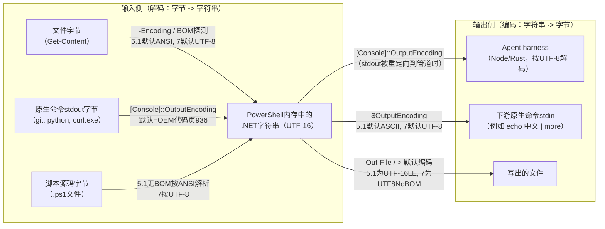

[toc]


## abstract

**你的问题其实混合了两个独立的故障点，而且在agent里通常是"两个都有"**：

- **读取（解码）问题**：PowerShell进程把"外部字节"（文件内容、原生命令stdout）翻译成.NET字符串时用错了编码。典型是5.1的`Get-Content`按ANSI代码页读无BOM的UTF-8文件，产生`涓枃`这类乱码。这一步`-Encoding utf8`能修。
- **输出（传输）问题**：agent不是终端，它通过**匿名管道**捕获PowerShell的stdout字节，再按UTF-8解码。而PowerShell写到管道时用的编码是`[Console]::OutputEncoding`，在中文Windows上默认是CP936（GBK）。于是即使内存里字符串完全正确，harness拿到的是GBK字节，按UTF-8解码就出现`�`。这一步`-Encoding utf8`**完全无效**，必须改`[Console]::OutputEncoding`。

所以"指定了`-Encoding utf8`还乱码"几乎可以断定是**输出层**问题。下文给出可靠的判定方法与分层修复方案。

## 编码链路：乱码可能发生在哪四个位置



各环节的控制变量，必须分清，**名字相似但职责完全不同**：

| 控制项                                    | 作用方向                                                     | 5.1默认                              | 7.x默认（Windows）          | 典型误解               |
| ----------------------------------------- | ------------------------------------------------------------ | ------------------------------------ | --------------------------- | ---------------------- |
| `Get-Content -Encoding`                   | 文件字节到字符串                                             | 无BOM时按ANSI（中文系统为CP936）     | 无BOM时按UTF-8              | 以为它影响输出         |
| `[Console]::OutputEncoding`               | 两个方向：解码原生命令stdout；编码PowerShell自己写向stdout（含管道） | 继承控制台代码页（OEM，中文系统936） | 同左，pwsh不会自动改为65001 | 以为只管"显示"         |
| `[Console]::InputEncoding`                | 控制台输入解码                                               | 同上                                 | 同上                        | 常被遗漏，一般一并设置 |
| `$OutputEncoding`                         | PowerShell向原生命令stdin写入时的编码                        | ASCII                                | UTF-8                       | 以为设了它就够         |
| `$PSDefaultParameterValues['*:Encoding']` | 给所有带`-Encoding`参数的cmdlet设默认值                      | 未设置                               | 未设置                      | 对原生命令无效         |

官方文档对关键差异的描述：总体上Windows PowerShell默认使用UTF-16LE，但各cmdlet的默认编码并不一致；当目标文件为空或不存在时，Set-Content和Add-Content使用Default编码，即系统区域设置的ANSI遗留代码页。而PowerShell 6及更高版本对所有文本输出默认使用utf8NoBOM。这正是你观察到"5.1读普通UTF-8文件乱码而7正常"的原因。

`$OutputEncoding`与`[Console]::OutputEncoding`的分工，PowerShell仓库issue #4681说得最准确：$OutputEncoding决定PowerShell向外部工具发送输出时使用的编码，而[Console]::OutputEncoding决定PowerShell读取外部工具输出时假定的编码。此外，.NET的`Console.Out`在stdout被重定向到管道时同样用`[Console]::OutputEncoding`来编码——这就是agent场景的关键。

## 为什么"终端里正常，agent里乱码"

在交互式终端（Windows Terminal/conhost）里，PowerShell按CP936写字节，conhost按同一代码页显示，两端一致，看起来正常。而agent harness是另一回事：

- Claude Code在Windows上默认经Git Bash调用`powershell.exe`或`pwsh.exe`，stdout是管道。Claude Code issue #7332的分析指出，这是多层编码链不一致造成的：bash端通常是UTF-8，而被调用的原生Windows命令（尤其是PowerShell 5、cmd工具）在管道中使用控制台代码页（OEM/ANSI）或UTF-16/CPxxxx，两端不匹配自然导致字节错误。
- 更精确的根因见issue #81187：harness每次调用都把`$OutputEncoding`（管道/格式化层）设为UTF-8，但从不设置`[Console]::OutputEncoding`（控制台层，.NET从进程继承的控制台输出代码页初始化）；这是.NET/PowerShell中两个不同的编码属性，修一个不等于修另一个。并且控制台输出代码页是共享且持久的OS控制台属性而非进程状态，一旦会话中任何一次`chcp`改了它，harness后续派生的每个pwsh.exe进程都会继承，于是此后所有非ASCII输出变成`�`。
- Codex CLI的情况类似但原因是另一个：PowerShell调用硬编码了`-NoProfile`，所以你写在`$PROFILE`里的编码设置根本不会加载。
- OpenCode的issue描述了同一机制：中日韩区域的Windows上，通过bash工具执行的PowerShell命令输出中非ASCII字符乱码，因为`[Console]::OutputEncoding`默认是系统编码（中文Windows为GB2312/936），而终端期望UTF-8。

一句话：**agent场景下的"显示问题"本质是"PowerShell以CP936编码写管道、harness以UTF-8解码"的传输层不一致**，它和文件读取编码无关。

## 如何判定是读取问题还是输出问题

### 方法一：看乱码的形态

乱码形态直接暴露"哪种字节被按哪种编码解了"，这是最快的诊断线索（以"中文"二字为例）：

| 看到的形态                      | 发生了什么                                   | 所属层              | 典型场景                                                     |
| ------------------------------- | -------------------------------------------- | ------------------- | ------------------------------------------------------------ |
| `涓枃`、`鍙戠敓` 这类生僻汉字   | UTF-8字节被按GBK解码                         | 读取层              | 5.1默认`Get-Content`读无BOM UTF-8文件；`[Console]::OutputEncoding`为936时读git/python的UTF-8输出 |
| `�`（U+FFFD替换字符）或`\ufffd` | GBK字节被按UTF-8解码，遇到非法序列           | 输出层              | PowerShell按936写管道，harness按UTF-8读。Claude Code #81187的症状正是如此 |
| `锟斤拷`                        | 先产生了U+FFFD，再被编码成UTF-8后又按GBK解码 | 两层叠加            | 经过两次错误转换                                             |
| `ÖÐÎÄ` 这类带音标的拉丁字母     | GBK字节被按Windows-1252解码                  | 读取层              | 英文Windows系统                                              |
| `??` 问号                       | 字符在目标编码中无法表示，被替换             | `$OutputEncoding`层 | 5.1默认ASCII，`'中文' | findstr`等管道传给原生命令           |

issue #25698复现的`echo 中文文本 | more`得到`涓枃鏂囨湰`，原因是PowerShell默认`$OutputEncoding`是UTF-8，而原生Windows控制台工具期望控制台编码（如GB2312）——这是pwsh 7里"反向"的不一致，也说明`$OutputEncoding`只管下游stdin。

### 方法二：用码点验证内存中的字符串（决定性测试）

乱码形态只能推测，决定性的办法是**绕开编码层，输出纯ASCII的码点**。因为码点是数字，不受任何编码影响，agent一定能正确看到：

```powershell
# 测试文件内容（假设 test.txt 是无BOM的UTF-8，内容为"中文"）
$s = Get-Content -Path .\test.txt -Encoding UTF8 -Raw
# 输出每个字符的Unicode码点；"中文"应为 20013 25991
[int[]][char[]]$s.Trim() -join ' '
```

判定规则：

- 码点正确（`20013 25991`）但直接`Write-Output $s`在agent里是`�` → **输出层问题**，去修`[Console]::OutputEncoding`。
- 码点错误（例如出现`28051`等对应`涓`的码点，或者码点数量多于字符数）→ **读取层问题**，去修`-Encoding`或读原生命令时的`[Console]::OutputEncoding`。

### 方法三：打印环境事实（纯ASCII输出，乱码环境下也可读）

```powershell
$PSVersionTable.PSVersion.ToString()
[Console]::OutputEncoding.WebName   # 期望 utf-8；中文系统默认 gb2312
[Console]::InputEncoding.WebName
$OutputEncoding.WebName             # 5.1 默认 us-ascii；7 默认 utf-8
[System.Text.Encoding]::Default.WebName  # 5.1 为ANSI代码页；7 为 utf-8
[Console]::IsOutputRedirected       # agent 场景应为 True
```

`[Console]::IsOutputRedirected`为`True`时就是前文所说的"管道传输"模式，此时`[Console]::OutputEncoding`的值直接决定harness收到什么字节。

## 修复方案：按层次与优先级

### 必须做：命令级三件套（agent环境中最可靠）

harness常用`-NoProfile`，且会话中可能被`chcp`污染，所以**不要依赖profile或系统设置，而是在每条命令前显式设置**。这条历史悠久的"三合一"语句在5.1和7都有效，PowerShell仓库早在2017年就把它列为让控制台/终端一致使用UTF-8的过渡性变通方案：`$OutputEncoding = [console]::InputEncoding = [console]::OutputEncoding = [System.Text.UTF8Encoding]::new()`。

```powershell
# 建议放在每条经agent执行的PowerShell命令最前面；UTF8Encoding::new() 表示无BOM，
# 比 [Text.Encoding]::UTF8（带BOM前缀对象）更稳妥
$OutputEncoding = [Console]::InputEncoding = [Console]::OutputEncoding = [System.Text.UTF8Encoding]::new()
```

落地方式有两种：

- **写进项目指令文件**（`CLAUDE.md`/`AGENTS.md`），让agent每次调用PowerShell时自动加前缀。例如一条规则："在Windows上执行任何PowerShell命令，必须以上述三合一语句开头；读取文本文件必须显式`-Encoding UTF8`；禁止执行`chcp`。"
- **包装脚本**：Claude Code issue #46486给出的变通方案就是一个bash包装器，用`powershell.exe -NoProfile -Command "[Console]::OutputEncoding=[Text.Encoding]::UTF8;$OutputEncoding=[Text.Encoding]::UTF8; $1"`执行传入的命令。注意issue #62862作者实测PATH包装器无效，因为Claude Code使用pwsh.exe的完整路径而不走PATH解析，所以包装器只适合自定义hook或自己的工具链，不能"偷梁换柱"。

对于5.1，还要防一个坑：在没有真正控制台句柄的宿主下设置`[Console]::OutputEncoding`可能抛出"The handle is invalid"，稳妥写法是加`try/catch`并在前面触发一次子进程（如`cmd /c ver | Out-Null`）以确保句柄存在——这是社区中流传的规避法（habr的一篇文章提到过），非官方保证，若遇到再用。

### 应该做：文件读写显式指定编码

- 5.1读无BOM UTF-8文件：**必须**`Get-Content -Encoding UTF8`。官方文档明确：在类Unix平台或用VS Code等跨平台编辑器创建的文件是UTF8NoBOM，在PowerShell 7中正常，但若含非ASCII字符，在Windows PowerShell中可能出错。
- 一次性设默认值：`$PSDefaultParameterValues['*:Encoding'] = 'utf8'`可为所有带Encoding参数的cmdlet更改默认编码。注意5.1的`utf8`会写BOM，7的`utf8`是无BOM（要BOM用`utf8BOM`）。
- 5.1里`>`重定向写文件得到UTF-16LE，Out-File和重定向运算符`>`、`>>`生成UTF-16LE，这与Set-Content/Add-Content明显不同。如果agent用5.1做`命令 > out.txt`再读，会得到带BOM的UTF-16文件，用`-Encoding Unicode`读或直接避免。
- 脚本文件本身：5.1下若脚本需要非ASCII字符，请保存为带BOM的UTF-8；没有BOM时Windows PowerShell会把脚本误当作遗留ANSI代码页。agent通常用`-Command`传入命令字符串（经由UTF-16的进程命令行），不受此影响；但一旦agent把带中文的内容写成`.ps1`再执行，这一层就会触发。

### 推荐：优先用PowerShell 7，并了解7.4的字节流变化

PowerShell 7在"读取层"已基本现代化（文件默认UTF-8、`$OutputEncoding`默认UTF-8），但**`[Console]::OutputEncoding`在Windows上仍然继承OEM代码页**，"让控制台默认UTF-8"的issue #7233至今未实现，所以输出层问题7依然存在，三件套仍然必要。

另外7.4有一个容易被忽略的变化：PowerShell 7.4改变了重定向运算符用于原生命令stdout时的行为，现在会保留字节流数据，不做解释也不添加格式。影响是：`git log > a.txt`在7.4+得到的是git原始字节（git在中文系统上通常输出UTF-8），不再经过`Out-File`的编码转换；而在7.3及以下，这个文件内容受`[Console]::OutputEncoding`解码与`Out-File`编码的双重影响。issue #21456也指出`curl.exe ... > C:\test.txt`这个例子在pwsh 7.4+已不再适用，但对旧版本仍适用。

### 可以做：profile级与系统级（有明确边界）

- **profile级**：把三件套写入`$PROFILE`，对交互式使用有效；但对带`-NoProfile`的harness（Codex明确如此，Claude Code也常见）无效。
- **系统级"Beta: Use Unicode UTF-8 for worldwide language support"**：把遗留非Unicode应用的系统代码页改为UTF-8（65001），只在应用需要UTF-8时启用，老软件依赖区域代码页时应禁用，并需重启。副作用要重视：它会让Windows PowerShell中默认ANSI编码的cmdlet（尤其`Get-Content`和`Set-Content`）转为UTF-8，从向后兼容角度看可能有问题；issue #62862的作者实测它修好了编码却弄坏了依赖CP932的Excel VBA宏等遗留应用；仅改OEMCP注册表导致系统不稳定被迫回滚；`HKCU\Console\CodePage`只影响交互式控制台窗口，不影响管道子进程。国内环境中依赖GBK的老程序（部分国产软件、旧游戏、Excel宏）同样会受影响，**不建议在开发主力机上作为首选**，更适合专用的agent沙箱机。

### 避免做

- **避免在agent会话中执行`chcp`**：它改的是共享的控制台代码页，会污染后续所有子进程（见#81187）。
- 避免只设`$OutputEncoding`就认为修好了——它只影响向原生命令stdin的写入。
- 避免5.1里用`>`写"UTF-8文件"，得到的是UTF-16LE。
- 避免在7中用`-Encoding Byte`（已移除，改用`-AsByteStream`）。

## 综合示例：一个可在agent中运行的自诊断脚本

目标：一次运行区分"读取层"和"输出层"故障，并且所有判定输出都用ASCII，保证在乱码环境下结论仍可读。把它保存为带BOM的UTF-8（兼容5.1），或者让agent用`-File`执行。

```powershell
<#
.SYNOPSIS
  诊断PowerShell在agent harness中的乱码来源：读取层 vs 输出层。
.PARAMETER Fix
  若指定，则在诊断前应用UTF-8三件套，用于对比修复前后的差异。
.NOTES
  兼容 Windows PowerShell 5.1 与 PowerShell 7.x；判定行只含ASCII。
#>
[CmdletBinding()]
param([switch]$Fix)

if ($Fix) {
    try {
        $OutputEncoding = [Console]::InputEncoding = [Console]::OutputEncoding = [System.Text.UTF8Encoding]::new()
    } catch { Write-Output "WARN: cannot set console encoding: $($_.Exception.Message)" }
}

# 1. 环境事实（ASCII）
Write-Output "PSVersion            : $($PSVersionTable.PSVersion)"
Write-Output "Console.OutputEnc    : $([Console]::OutputEncoding.WebName)"
Write-Output "OutputEncoding(var)  : $($OutputEncoding.WebName)"
Write-Output "IsOutputRedirected   : $([Console]::IsOutputRedirected)"

# 2. 读取层测试：写一个无BOM UTF-8文件，再用默认方式与显式方式读取
$expected = [string]::new([char[]](20013, 25991))   # "中文"，用码点构造，避免源码编码干扰
$tmp = Join-Path ([IO.Path]::GetTempPath()) 'enc-probe.txt'
[IO.File]::WriteAllText($tmp, $expected, [System.Text.UTF8Encoding]::new($false))

$readDefault  = (Get-Content -Path $tmp -Raw).Trim()
$readExplicit = (Get-Content -Path $tmp -Raw -Encoding UTF8).Trim()
Write-Output "READ default  codepoints: $(([int[]][char[]]$readDefault) -join ' ')  match=$($readDefault -eq $expected)"
Write-Output "READ explicit codepoints: $(([int[]][char[]]$readExplicit) -join ' ') match=$($readExplicit -eq $expected)"

# 3. 原生命令解码测试：cmd 以当前控制台代码页输出，PowerShell 用 Console.OutputEncoding 解码
$native = (cmd /c "echo $expected") -join ''
Write-Output "NATIVE codepoints       : $(([int[]][char[]]$native.Trim()) -join ' ')  match=$($native.Trim() -eq $expected)"

# 4. 输出层测试：直接把正确字符串写到stdout，由harness解码。若上面match均为True
#    而下面这一行在agent中显示为乱码或U+FFFD，即为输出层问题。
Write-Output "OUTPUT probe            : $expected"
Remove-Item $tmp -ErrorAction SilentlyContinue
```

解读方式：

- `READ default ... match=False`且`READ explicit ... match=True` → 5.1的ANSI默认读取问题，加`-Encoding UTF8`即可（7下两者一般都为True）。
- `NATIVE ... match=False` → 原生命令stdout解码问题，修`[Console]::OutputEncoding`（或确认原生命令实际输出编码；比如git默认UTF-8、而cmd跟随控制台代码页，二者不同）。
- 前面全是True，但`OUTPUT probe`那行在agent里是`�`或`涓枃` → **输出层问题**，再用`-Fix`运行一次，对比`Console.OutputEnc`从`gb2312`变为`utf-8`后probe行是否正常。这就是你问题中"指定了utf8还乱码"的那种情况。

## 跨平台与网络环境补充

- 这个问题是Windows特有的：pwsh在Linux/macOS上`[Console]::OutputEncoding`就是UTF-8，不存在代码页继承。若生产环境在国外Linux服务器上跑pwsh，不会遇到；本地Windows开发机是重灾区。
- Git Bash/MSYS2路径下调用`powershell.exe`时，bash侧LANG通常是UTF-8，上述三件套同样是正确解法；若agent使用WSL，则PowerShell通过`powershell.exe`互操作调用，仍要加前缀。
- 换行风格另算：PowerShell 5.1写文件用CRLF，若agent生成脚本在Linux执行，配合`.gitattributes`中`*.sh text eol=lf`防止`\r`进入shell脚本。

## 复盘

一轮搜索覆盖了官方文档（编码、重定向、7.4变更）、PowerShell仓库的三个核心issue，以及Claude Code/Codex/OpenCode三家harness的issue，足以支撑本文的核心判断（两层独立、agent场景以输出层为主）。未能验证的点有两处：一是5.1在无控制台句柄时设置`[Console]::OutputEncoding`抛异常的具体触发条件（社区经验，非官方文档）；二是各harness对#81187等issue的修复进度（issue发布于约78天前，状态可能已变化）。如需追踪，下一轮可搜索"claude-code 81187 fix"、"codex use_profile PowerShell encoding"以及"PSNativeCommandPreserveBytePipe 7.5 changes"。
