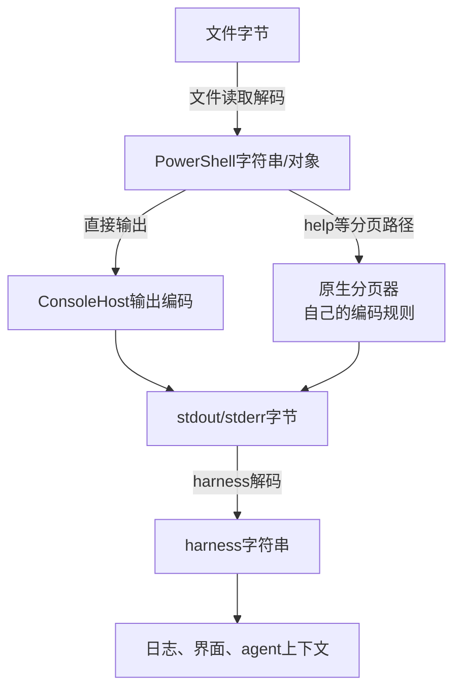

[toc]

## abstract

显示乱码**可能是读取问题，也可能是输出编码或harness解码问题；这几个环节可以同时出错。**

针对你的例子：

| 现象                                                         | 优先检查的环节                                       |
| ------------------------------------------------------------ | ---------------------------------------------------- |
| 5.1读取UTF-8无BOM文件，指定`-Encoding utf8`后恢复            | **文件读取解码**                                     |
| 指定`-Encoding utf8`后，PowerShell中的字符串正确，但agent仍看到乱码 | **进程输出编码、harness解码**                        |
| `Select-String`乱码                                          | 区分它是**直接读文件**，还是接收上游已经读错的字符串 |
| `Get-Help`正常，`help`异常                                   | **分页器路径**                                       |
| harness字符串正确，只有界面显示方框、缺字                    | 才优先检查**字体和渲染**                             |

这些判断来自下面的编码边界分析，**不能仅凭“屏幕上乱码”确定故障位置**。

资料核查日期：**2026年10月12日**。本轮进行了1轮分项搜索，并阅读微软文档和官方源码；下面的脚本未在本环境实机运行。具体模型训练知识截止日期未向本会话提供。

## 必须区分的编码边界

PowerShell命令之间通常传递的是**对象和Unicode字符串**；文件、原生程序、进程管道才引入字节编码边界。因此，文件读对了，不等于harness一定接收正确。



这是抽象示意：分页器的输出可能被PowerShell捕获，也可能直接流向继承的标准输出，具体取决于启动和重定向方式。重点是：**每一次“字节↔字符串”转换，都需要双方采用兼容的编码。**官方ConsoleHost源码也区分了直接控制台输出与重定向输出路径。

几个容易混淆的设置：

| 设置                           | 主要控制什么                                                 | 不能解决什么                       |
| ------------------------------ | ------------------------------------------------------------ | ---------------------------------- |
| `Get-Content -Encoding utf8`   | 文件字节如何读成字符串                                       | harness如何解码stdout              |
| `Select-String -Encoding utf8` | 它自己读取文件时使用的编码                                   | 上游已经读错的字符串               |
| `[Console]::OutputEncoding`    | Console输出编码；核对到的7.4实现也用它解码捕获的原生命令文本输出 | 不能强制所有原生程序采用同一种编码 |
| `$OutputEncoding`              | **PowerShell向原生程序stdin写入文本的编码**                  | 不是PowerShell自身stdout的总开关   |
| harness的解码设置              | stdout/stderr字节如何变成宿主字符串                          | 不能修复此前已丢失的字符           |

**尤其不要把`$OutputEncoding`理解为“所有输出的编码”。**它的主要方向是PowerShell到原生程序的输入，而非PowerShell到agent harness的输出。

## 5.1与7的重要差异

以下讨论普通文本文件，未显式指定编码，也没有自定义默认参数。

| 行为                                      | Windows PowerShell5.1 | PowerShell7     |
| ----------------------------------------- | --------------------- | --------------- |
| `Get-Content`读取无BOM文件                | 系统ANSI代码页        | 默认UTF-8       |
| `Select-String`直接读取无BOM文件          | **默认按UTF-8读取**   | 默认按UTF-8读取 |
| 普通PowerShell命令经`Out-File`或`>`写文件 | 默认UTF-16LE          | 默认UTF-8无BOM  |
| 写文件时指定`-Encoding utf8`              | UTF-8带BOM            | UTF-8不带BOM    |
| `$OutputEncoding`默认值                   | ASCII                 | UTF-8           |

上述差异由微软字符编码文档及版本对应的命令、偏好变量文档确认。

因此，你说的“普通UTF-8文件”，还需要明确是否包含**BOM（字节顺序标记，Byte Order Mark）**。**5.1的典型问题是把UTF-8无BOM文件按系统ANSI代码页读取**；有BOM时可以识别对应编码。另外，ANSI代码页不一定是936，也可能因系统设置而成为UTF-8。

### `Select-String`不能直接套用`Get-Content`的结论

这两种写法的读取责任不同：

```powershell
Select-String -LiteralPath .\sample.txt -Pattern 'ERROR' -Encoding utf8

Get-Content -LiteralPath .\sample.txt -Encoding utf8 |
    Select-String -Pattern 'ERROR'
```

- 第一种由`Select-String`读取文件。
- 第二种由`Get-Content`读取文件，`Select-String`接收已经生成的字符串。

因此，**如果上游`Get-Content`已经把中文读错，给下游`Select-String`加`-Encoding utf8`不能恢复原文**。此时编码参数应放在真正读取文件的命令上。

这里还有一处文档不一致：5.1的`Select-String`参数小节将默认值标成`Default`，但描述小节以及*about_Character_Encoding*明确说明，无BOM时按UTF-8处理。本回答采用后两处明确的读取行为说明；实际排障仍建议显式指定编码。

## `help`确实需要检查分页器

**`help`不是简单的`Get-Help`别名，而是带分页行为的函数。**Windows PowerShell官方资料展示了它调用`Get-Help`后进入`more`的路径。核对到的PowerShell7.4源码默认在Windows使用`more.com`、在Unix使用`less`，并支持`PAGER`环境变量；函数内部还会调整用于分页器输入的`$OutputEncoding`。

在agent中，**推荐直接使用不分页的命令**：

```powershell
Get-Help Get-Content -Full | Out-String -Width 200
```

这里`Out-String`负责格式化为文本，`-Width 200`控制格式化宽度，**不是编码修复选项**。

如果需要检查实际分页路径：

```powershell
Get-Command help, more -All
(Get-Command help).Definition
Get-Item Env:PAGER -ErrorAction SilentlyContinue
```

**如果同一harness、同一启动环境下，`Get-Help`正常而`help`异常，可以优先怀疑分页路径；但还不能仅据此断言一定是`more.com`的哪个编码设置。**这是基于两条执行路径差异的定位推断。

## 最有效的定位方法：检查内存字符串，而非只看显示

下面的测试兼容5.1与7，**源码全部是ASCII**，通过码点生成“中文”，避免测试脚本自身的中文编码再干扰诊断。

它创建一个临时UTF-8无BOM文件，检查默认读取、显式UTF-8读取和`Select-String`直接读取：

```powershell
$expected = -join ([char]0x4E2D, [char]0x6587)
$utf8 = [System.Text.UTF8Encoding]::new($false)
$path = Join-Path ([IO.Path]::GetTempPath()) (
    [guid]::NewGuid().ToString('N') + '.txt'
)

[IO.File]::WriteAllText($path, $expected, $utf8)

try {
    $defaultRead = Get-Content -LiteralPath $path -Raw
    $utf8Read = Get-Content -LiteralPath $path -Raw -Encoding utf8
    $matchLine = (Select-String -LiteralPath $path -Pattern '.').Line

    'default-read-ok={0}' -f ($defaultRead -ceq $expected)
    'utf8-read-ok={0}' -f ($utf8Read -ceq $expected)
    'select-read-ok={0}' -f ($matchLine -ceq $expected)

    $points = $utf8Read.ToCharArray() |
        ForEach-Object { 'U+{0:X4}' -f [int]$_ }

    'memory-points={0}' -f ($points -join ' ')
    "direct-output=$expected"
    "file-output=$utf8Read"
}
finally {
    Remove-Item -LiteralPath $path
}
```

字段含义及预期：

| 输出字段          | 含义                            | 正常预期                        |
| ----------------- | ------------------------------- | ------------------------------- |
| `default-read-ok` | 默认读取是否得到原文            | 5.1通常为`False`；7通常为`True` |
| `utf8-read-ok`    | 显式UTF-8读取是否正确           | `True`                          |
| `select-read-ok`  | `Select-String`直接读取是否正确 | `True`                          |
| `memory-points`   | 显式读取结果的字符码点          | `U+4E2D U+6587`                 |
| `direct-output`   | 不经过文件读取，直接输出原文    | 应显示“中文”                    |
| `file-output`     | 输出显式读取的文件内容          | 应显示“中文”                    |

这些是按官方行为设计的预期，不是本环境的实测结果；自定义默认参数、系统ANSI已设为UTF-8等情况会改变默认读取结果。

**关键判断：**

- **`utf8-read-ok=True`且码点正确，但中文输出乱码：读取层已经通过检查，应向输出链路排查。**
- **直接生成的中文也乱码：至少这部分乱码不能归因于文件读取。**
- **harness解码后的字符串码点已经错误：不是单纯的字体问题。**
- **只有界面缺字，但harness字符串码点正确：再检查字体、渲染和终端控制序列。**

这是根据编码边界作出的定位推断；最终需要原始stdout字节区分“输出错了”与“harness解码错了”。

## 推荐方案：明确约定UTF-8，而不是只改一端

对于**harness启动`powershell.exe`或`pwsh.exe`并通过普通进程管道捕获文本**的场景，建议：

1. 文件按实际编码读取。
2. 在**实际执行命令的PowerShell进程内**初始化编码。
3. harness明确按UTF-8解码stdout和stderr。
4. 排障期间保留原始字节，避免静默替换错误字符。

这些设置分别对应不同边界，不存在一个能替代全部设置的“UTF-8总开关”。

### PowerShell端初始化

以下适用于文本协议约定为UTF-8的任务：

```powershell
$utf8 = [System.Text.UTF8Encoding]::new($false)

[Console]::InputEncoding = $utf8
[Console]::OutputEncoding = $utf8
$OutputEncoding = $utf8

# Optional: only when these commands should assume UTF-8 files.
$PSDefaultParameterValues['Get-Content:Encoding'] = 'utf8'
$PSDefaultParameterValues['Select-String:Encoding'] = 'utf8'
```

- `$false`表示该UTF-8编码对象不生成BOM。
- `[Console]::InputEncoding`设置Console输入编码。
- `[Console]::OutputEncoding`设置Console输出编码。
- `$OutputEncoding`设置传给原生程序stdin的文本编码。
- 最后两行设置特定命令的默认文件读取编码，**不应拿来盲读GBK等其他编码文件**。

**把初始化放进harness的每次启动脚本，比只写进`$PROFILE`可靠。**`-NoProfile`明确禁止加载配置文件；不同的PowerShell进程也不能假定共享这些会话设置。

### harness端验证示例

下面以Python父进程为例，完整验证PowerShell输出协议。默认以字节捕获，再显式解码：

```python
import subprocess

script = r"""
$utf8 = [System.Text.UTF8Encoding]::new($false)
[Console]::InputEncoding = $utf8
[Console]::OutputEncoding = $utf8
$OutputEncoding = $utf8

-join ([char]0x4E2D, [char]0x6587)
"""

result = subprocess.run(
    [
        "powershell.exe",  # Change to "pwsh" for PowerShell 7.
        "-NoLogo",
        "-NoProfile",
        "-NonInteractive",
        "-Command",
        script,
    ],
    capture_output=True,
    timeout=30,
)

print("exit-code:", result.returncode)
print("stdout-hex:", result.stdout.hex(" "))

stdout = result.stdout.decode("utf-8", errors="strict")
stderr = result.stderr.decode("utf-8", errors="strict")

print("decode-ok:", stdout.strip() == "\u4e2d\u6587")
```

这里`stdout`和`stderr`是解码后的文本，后续应直接交给harness的文本接口。Python官方文档明确说明：未启用文本模式时，捕获的是字节；启用文本模式时，解码采用指定编码或默认编码。

预期stdout中的中文部分为`E4 B8 AD E6 96 87`，后面可能有换行字节。判断如下：

| 检查结果                                | 定位方向                 |
| --------------------------------------- | ------------------------ |
| 原始字节正确，但harness文本错误         | harness解码或后续转码    |
| 内存码点正确，原始字节却不是约定的UTF-8 | 输出编码或原生程序路径   |
| 原始字节已经变成`3F 3F`                 | 字符已在此前被替换成问号 |
| harness文本正确，界面异常               | 渲染、字体或控制序列     |

**已经被替换成`?`或`�`的字符，不能仅靠后来改解码器恢复；必须回到仍保留原始信息的边界。**严格解码可以暴露非法字节，但不能保证识别所有“合法却用错编码”的情况。

## agent harness特别容易遗漏的问题

### 流式输出必须使用增量解码

**不要把每个输出字节块独立解码成UTF-8。**一个中文字符可能跨越两个读取块；即使生产者编码完全正确，逐块无状态解码也会报错或产生替换字符。应使用**增量解码器（incremental decoder）**，且stdout、stderr各自维护状态。

这个小例子展示了正确行为：

```python
import codecs

decoder = codecs.getincrementaldecoder("utf-8")("strict")

assert decoder.decode(b"\xe4\xb8") == ""
assert decoder.decode(b"\xad") == "\u4e2d"
assert decoder.decode(b"", final=True) == ""
```

前两个字节暂存，第三个字节到达后才输出“中”；流结束时执行最终刷新。**如果普通捕获正常、agent实时流式展示异常，这是值得优先检查的实现细节。**后一句是基于增量解码规则的排障推断。

### 避免几种“看起来相关，实际改错层”的修复

| 做法                            | 注意事项                                                    |
| ------------------------------- | ----------------------------------------------------------- |
| 只执行`chcp 65001`              | 控制台代码页不等于5.1的文件读取编码；.NET还可能缓存输出编码 |
| 只修改`$OutputEncoding`         | 不保证PowerShell自身stdout与harness解码一致                 |
| 将`>`生成的文件当成原始stdout   | 5.1普通重定向会写成UTF-16LE，已经经过另一层转换             |
| 认为7的所有`>`都统一写UTF-8     | **7.4起，原生命令stdout直接重定向到文件会保留原始字节**     |
| 用`-EncodedCommand`解决输出乱码 | 它的UTF-16LE要求是**命令输入协议**，不是stdout编码          |
| 5.1执行含中文的UTF-8无BOM`.ps1` | 脚本源码可能已经读错；需兼容5.1时应注意UTF-8 BOM            |

这些边界分别由Windows Console、PowerShell字符编码、重定向及启动参数文档说明。

另外，PowerShell7的`Select-String`可以产生匹配高亮。如果看到的是`ESC`、`

## 对你的场景的建议

**先运行上面的ASCII诊断脚本，再检查原始stdout字节。**不要先全局修改系统区域设置，也不要把所有问题统一归因于5.1。

最可能需要落实的是：

- **5.1：对确认是UTF-8的文件显式指定读取编码。**
- **agent：明确建立“PowerShell输出UTF-8，harness按UTF-8解码”的协议。**
- **帮助：使用`Get-Help`，绕过分页器。**
- **流式捕获：检查是否逐块独立解码。**

但要对你的具体harness下结论，还缺三项信息：**启动命令、使用普通管道还是PTY/嵌入式Runspace、诊断结果或原始stdout十六进制**。仅凭目前的乱码现象，无法严谨地区分输出端与接收端责任。
