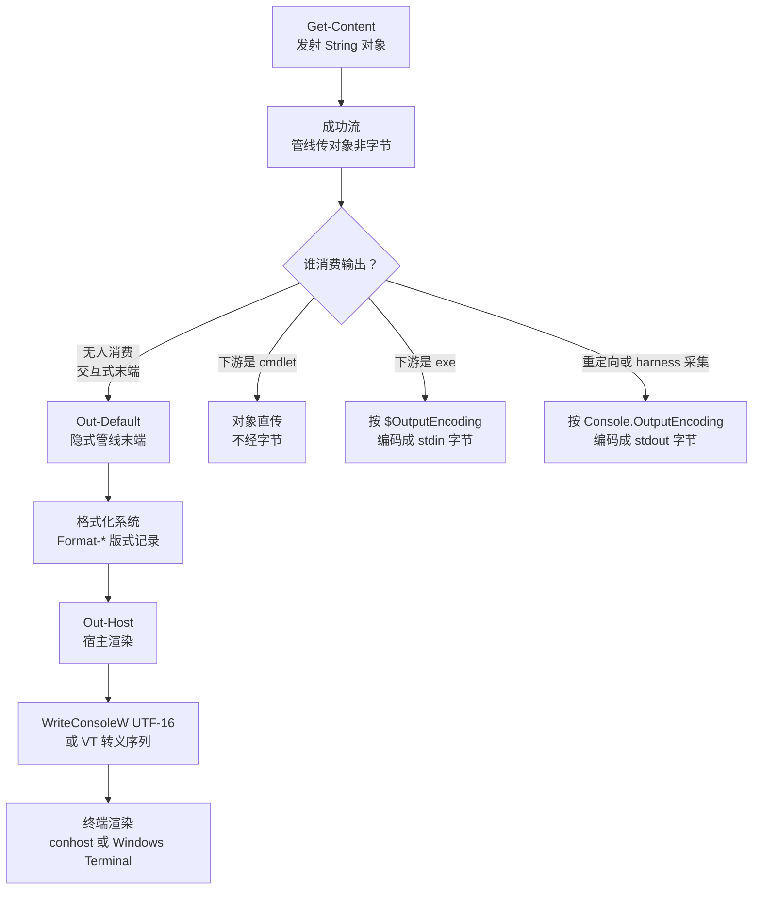

[toc]

## 默认读取乱码原理

**核心结论**：**读取解码器选错**，文件本身多半完好。

- `Windows PowerShell 5.1(Desktop)`的`Get-Content`无`-Encoding`时先看**字节顺序标记BOM(Byte Order Mark)**，无`BOM`按**系统活动代码页ANSI(Active Code Page)**硬解，中文`Windows`即`GBK(Code Page 936)`。
- `UTF-8无BOM`中文多为 3 字节，如`你=E4 BD A0`，按`GBK`每 2 字节切成一个汉字，即**乱码 mojibake**。实测`你好，UTF-8测试`被解成`浣犲ソ锛孶TF-8娴嬭瘯`。
- 加`-Encoding UTF8`强制`UTF-8`解码即正常；带`EF BB BF`的`UTF-8 BOM`文件不加参数也能自动识别。
- `cat`/`type`只是`Get-Content`别名，同样要加`-Encoding`。
- `PowerShell 7+(Core)`默认改为`UTF-8无BOM(utf8NoBOM)`，此坑消失。

读取模板：

```powershell
[Console]::OutputEncoding = [System.Text.Encoding]::UTF8
$OutputEncoding = [System.Text.Encoding]::UTF8
Get-Content -LiteralPath 'C:\path\file.txt' -Encoding UTF8 -ErrorAction Stop
```

## 解码正确显示仍可能乱

**核心结论**：**文件解码**与**输出捕获**是两层，修完第一层还可能烂在第二层。

- 第一层：`文件字节-Encoding->.NET字符串String(内部UTF-16)`。
- 第二层：`String-控制台编码->[Console]::OutputEncoding→终端字节→渲染`。
- `Get-Content`不直接写**标准输出stdout(Standard Output)**字节，它输出`String`对象；只有落屏、管道给原生程序、重定向成文件时才编码。
- 实测同是`-Encoding UTF8`，不设控制台编码经管道采集仍烂成`��ã�`，设为`UTF-8`才正常。

判读：行号对但中文烂是显示层问题，重跑三行模板而非换解码。

## 原生程序与控制台输出关系

**核心结论**：终端显示走宿主渲染通道，不走**标准输出stdout(Standard Output)**字节；`stdout`字节只在重定向时出现。

- 第一步发射：`Get-Content`等`cmdlet`把`.NET`对象写到成功流，管线里传的是对象，与字节无关。
- 第二步分流：输出有四种归宿，无人消费才上屏；`$x=...`、`| Out-File`、`| Select-String`都会半路截走对象。
- 第三步渲染：上屏经过`Out-Default`隐式末端、格式化系统、`Out-Host`宿主三站，与`stdout`编码无关。
- 第四步桥接：只有下游是原生程序或重定向时，对象才被编码成字节，各段编码器不同。



文字说明：上图左支是屏显路径，全程无字节编码，`String`对了就显示对；右三支是字节路径，每次跨越对象与字节边界都要经过一个编码器，错任何一个都乱码。

- **原生程序(Native Program)**指`*.exe`，如`python.exe`、`git.exe`、`findstr.exe`，只懂字节`stdin/stdout`，不懂`.NET`对象。
- 桥接时：`PS对象|exe`用`$OutputEncoding`编码；`exe|PS`用`[Console]::OutputEncoding`解码；重定向或`Agent`采集用`[Console]::OutputEncoding`编码。

## 交互式不用额外设置的原因

**核心结论**：直写屏与管道采集是两条路径。

- 交互式`[Console]::IsOutputRedirected=False`，宿主用`WriteConsoleW(UTF-16)`直写屏显缓冲，不经过字节编码，`String`对了就显示对。
- `Agent/shell`采集时实测`IsOutputRedirected=True, CodePage=936`，`powershell.exe`必须按`GBK`编码成字节经管道吐出，外层按`UTF-8`解就烂，必须同次设`[Console]::OutputEncoding=UTF8`对齐。
- 因此`-Encoding UTF8`只修`文件->String`，屏显修不修取决于走直写还是管道。

## 与bash下cat的区别

**核心结论**：`cat`搬字节，`Get-Content`搬对象。

- `bash/cat`：不解码，只搬字节，`文件字节->stdout字节->终端按$LANG解码渲染`，无`-Encoding`参数，文件编码与`locale`不一致就烂。
- `PowerShell/Get-Content`：`文件字节-Encoding->UTF-16 String->Host再编码->终端`，多一层对象加二次编码，还有`BOM`嗅探。
- 所以`Linux`烂在终端`locale`对不上文件，`WinPS5.1`多一种烂：默认按`GBK`解`UTF-8`文件，`String`层已错。

## cmd下type的行为

**核心结论**：`type`与`cat`同类，只搬字节，无解码参数。

- 路径是`文件字节->stdout字节->conhost按chcp解码显示`。
- `chcp 936+GBK文件`正常，`chcp 936+UTF-8无BOM`屏显烂；`chcp 65001+UTF-8文件`正常，前提是真字体而非点阵字体。
- 管道重定向时字节直通，显示层`chcp`不起作用，这点与`Get-Content`不同，后者管道里也会烂。

## 无BOM时查看文件编码

**核心结论**：无`BOM`即无元数据，只能启发式猜，`PowerShell`无内置探测。

- 有`BOM`是铁证：`EF BB BF=UTF-8`，`FF FE=UTF-16LE(小端)`，`FE FF=UTF-16BE(大端)`，看头字节即可：

```powershell
Format-Hex -LiteralPath 'C:\path\file.txt' | Select-Object -First 1
```

- 无`BOM`策略：严格`UTF-8`能解就按`UTF-8`（`ASCII`是其子集），解爆回落本地`ANSI`，中文机即`GBK`，`VSCode`、`file -i`、`chardet`全是这套。
- 严格校验：

```powershell
$b=[IO.File]::ReadAllBytes('C:\path\file.txt')
$u=[Text.Encoding]::GetEncoding('utf-8',(New-Object Text.EncoderExceptionFallback),(New-Object Text.DecoderExceptionFallback))
try{$u.GetString($b)|Out-Null;'utf8:ok'}catch{'utf8:fail->按GBK试'}
```

- `5.1`无`BOM`不猜，直接按`ANSI`硬解；`7+`直接按`UTF-8`硬解，跨版本行为相反。

## 重定向过程与最佳实践

过程是`对象->Format(仅>/Out-File)->-Encoding编码->落盘`，实测落盘头字节为证。

| 场景 | 5.1默认 | 7默认 | 备注 |
|---|---|---|---|
| `>/Out-File` | `FF FE=UTF-16LE带BOM` | `UTF-8无BOM` | `>`走显示格式化，会按屏宽截断长行 |
| `Set-Content` | `ANSI(中文机=GBK)`，如`C4 E3 BA C3` | `UTF-8无BOM`，如`E4 BD A0` | 存数据用它，写`.ToString()` |
| `-Encoding utf8` | 带`BOM` | 无`BOM`，要`BOM`用`utf8BOM` | 跨版本同名不同义 |

最佳实践：

- 跨版本别用裸`>`，数据用`Set-Content`，日志快照用`Out-File -Width 2147483647`防截断。
- 读写一律显式`-Encoding`，读回配对。
- 真跨`5.1/7`要无`BOM UTF-8`时别信`-Encoding`名，用`.NET`：

```powershell
[IO.File]::WriteAllText('C:\path\f.txt',$s,(New-Object Text.UTF8Encoding $false))
```

- 例外：含中文要被`5.1`解析的`.ps1`脚本源文件，必须`UTF-8带BOM`，否则解析期就烂；普通文档用无`BOM`。

## 编码相关特殊变量表

两主机实测默认值已对齐，按链路方向记。

| 变量或属性 | 管哪段 | 5.1默认 | 7默认 | 说明 |
|---|---|---|---|---|
| `$OutputEncoding` | `PS对象->exe stdin` | `us-ascii` | `utf-8` | 5.1传中文先设为无`BOM UTF-8`，只影响本次进程 |
| `[Console]::OutputEncoding` | `exe stdout->PS`解码加采集屏显编码 | 跟`chcp`，中文机`gb2312(936)` | 同左，跟`chcp` | 不管文件解码，采集侧按`UTF-8`收时必须同次设`UTF8` |
| `[Console]::InputEncoding` | 键盘或控制台输入解码 | `gb2312` | `Win=gb2312/Linux=utf-8` | 没有`$InputEncoding`变量，`$Input`是管道枚举器 |
| `[Text.Encoding]::Default` | 系统`ANSI`基准 | `gb2312` | `utf-8(.NET Core改的)` | 只读基准，别当`UTF-8`用 |
| `$PSDefaultParameterValues['Out-File:Encoding']`等 | 各`cmdlet -Encoding`缺省 | 见上表 | 全`utf8NoBOM` | 跨版本统一默认入口 |

另：`Win`看`chcp`，`Linux`看`$env:LANG`；`$PSCulture`只管报错语言，不管字节。
