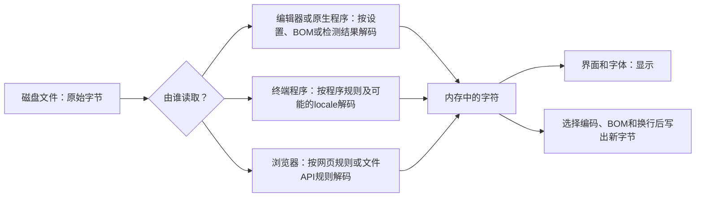
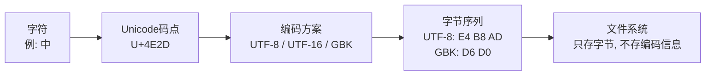
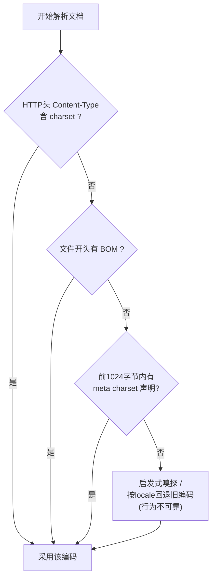

[toc]

## abstract

新建、跨平台交换的文本，优先使用UTF-8无BOM；通常统一为LF换行。

读取旧文件时先确认原编码，再解码、转换和保存；不要用“另存为UTF-8”修复已经按错误编码读入的乱码。

具体格式或旧程序有明确要求时，以其要求为准。

### 工作模型

文本文件在磁盘上首先是**字节序列**。程序读取它时，按某种**字符编码**将**字节**解码为**字符**；显示字符还要经过**字体和界面**；保存时再将**字符编码为字节**。

操作系统能打开文件、文件名含中文，**不等于它知道文件内容采用什么编码**。

> 例如Windows的Unicode文件名和应用内部字符串，与该文件的正文是否为UTF-8，是两回事。
>
> 主流文件系统（NTFS、ext4、APFS）**均不在元数据中记录文件编码**，所以“这个文件是什么编码”永远靠**约定、声明或猜测**。



写入是上述过程的逆向，可单独理解为：



图中的**“解码”与“显示”是两步**：文件字节正确但终端显示错误，未必需要修改文件；

文件已被错误解码并覆盖保存，则可能已发生数据损失。

浏览器也不是一套统一规则：**打开HTML网页**与**网页脚本读取用户选择的文件**走的是不同路径。

### 基本概念：编码、换行、BOM、名称声明是四件事

任何文本文件的“身份”由三个独立维度决定，**乱码几乎都能归因于其中之一**；文件名与类型声明是第四个容易混淆的维度：

| 概念 | 应如何理解 | 容易混淆之处 |
| ---- | ---------- | ------------ |
| **Unicode与UTF-8** | Unicode给字符定义编码位置；UTF-8规定如何表示为字节。字符“中”为`U+4E2D`，其UTF-8字节是`E4 B8 AD`。UTF-8变长（1～4字节），**与ASCII完全兼容**——纯英文的UTF-8文件和ASCII文件逐字节相同，这是它普及的根本原因。 | “软件支持Unicode”不说明它写出的文件一定是UTF-8。老版Windows语境中的“保存为Unicode”实际指UTF-16 LE。 |
| **旧编码与代码页** | GBK、GB18030、Windows代码页等也规定字节如何对应字符。GB18030是中国国家标准，GBK的超集，覆盖全部Unicode，国内政务、金融遗留系统中仍常见。 | Windows软件所称的“ANSI”通常指**当前系统代码页**，不是全球统一编码。简体中文系统上是GBK（cp936），西欧系统上是Windows-1252。**同一个“ANSI”文件换台机器含义就变**，这是跨区域乱码的主要来源。 |
| **BOM，字节顺序标记** | 文件开头的编码签名；UTF-8 BOM为`EF BB BF`，UTF-16LE常见BOM为`FF FE`。本质是码点`U+FEFF`置于文件开头。对UTF-16它标识字节序（LE/BE）；对UTF-8字节顺序本来一致，BOM并非必需，但允许存在。 | UTF-8不需要借BOM表示字节顺序；脚本等格式还可能被BOM干扰。带BOM的shell脚本会破坏开头的`#!`，典型报错为`#!/bin/bash: No such file or directory`（实际被当成命令的是`\xEF\xBB\xBF#!/bin/bash`）。BOM还可能被JSON/CSV解析器算进第一个字段名，老版PHP在`<?php`前输出BOM会导致`headers already sent`。 |
| **换行符** | LF为`0A`；CRLF为`0D 0A`。 | **换行风格不是字符编码**。编码正确，换行仍可能不符合程序要求。带CRLF的shell脚本在Linux上常报`$'\r': command not found`；Windows老记事本打不开纯LF的问题已在Windows 10 1809后修复。 |
| **文件名、扩展名、内容类型** | `报告.txt`是名字；`.txt`及HTTP的`text/plain`描述文件用途或类型。 | 它们通常**不足以证明正文采用UTF-8**；HTTP的`charset`若存在，是另一项需要与实际字节一致的声明。文件名本身还有一层编码：NTFS/APFS文件名是UTF-16/Unicode，ext4文件名只是字节序列；`zip`等老格式不记录文件名编码，**Windows中文环境打包的zip在Linux上解出乱码文件名**是经典问题（可用`unzip -O GBK`缓解）。 |

另一个名称相似但不同的概念是HTTP **`Content-Encoding`**：它通常说明gzip等**内容压缩**，不是字符集；字符集由适用的格式规则及`Content-Type`中的`charset`等信息决定。

## 先看字节：检测、查看与转换

诊断的第一步是**看字节，不看渲染结果**。

- **Linux/macOS**：`file -i document.txt`可猜测编码与MIME类型，但它是启发式**猜测**，不是旧中文编码的权威证明；`hexdump -C document.txt | head`或`xxd`直接看字节，开头`ef bb bf`即UTF-8 BOM，`ff fe`即UTF-16LE BOM；`cat -A script.sh`显示控制字符，CRLF行尾会显示为`^M$`，可快速识别换行问题。
- **Windows**：PowerShell 7可用`Get-Content file.txt -AsByteStream -TotalCount 4 | Format-Hex`查看头部字节；记事本、VS Code状态栏直接显示检测到的编码与换行风格；Git Bash、WSL中同样可用`file`、`xxd`。

跨编码转换的标准工具是`iconv`（Linux/macOS原生，Windows可经Git Bash/WSL使用）：

```bash
iconv -f GBK -t UTF-8 legacy.txt > fixed.txt
```

| 字段 | 含义 |
| ---- | ---- |
| `-f GBK` | from，**源编码**，即你断定的原始编码，断错则输出乱码或报错 |
| `-t UTF-8` | to，**目标编码**；写成`UTF-8//TRANSLIT`可对无法映射的字符做近似转写，`//IGNORE`则丢弃 |
| `legacy.txt` | 输入文件 |
| `> fixed.txt` | 重定向到**新文件**；**切勿**写回原文件（`> legacy.txt`会先清空输入，导致数据丢失） |

换行符转换可用`dos2unix`/`unix2dos`，或`sed -i 's/\r$//' file`。

## 不同程序究竟有哪些差异

### 终端与控制台

| 场景 | 读取与显示 | 写入时特别注意 |
| ---- | ---------- | -------------- |
| **Linux/macOS终端中的程序** | `cat`这类工具主要将文件字节送往输出；终端及其他文本处理工具可能按当前**locale**、自身设置和字体处理它们。`locale charmap`可查看当前区域设置的字符集，**不能据此断定某个文件的编码**。locale形如`LANG=zh_CN.UTF-8`（格式为`语言_地区.编码`）；现代发行版与macOS默认UTF-8，问题多出现在SSH到老系统或容器内locale为`POSIX/C`时（此时非ASCII显示异常，可设置`LC_ALL=C.UTF-8`）。 | 重定向原生程序输出时，要辨别程序实际输出了什么字节；不要把终端里“看着正常”当作保存格式的证明。 |
| **Windows `cmd`、控制台程序及Windows Terminal** | 传统程序还可能受控制台**输入/输出代码页**影响；字体是否有对应字形也是另一层问题。`chcp`查看或改变活动控制台代码页，但**不会转换磁盘文件的字节**，也不能让所有程序采用同一种解码方式。简体中文系统默认936（GBK）；`chcp 65001`可切到UTF-8，但对老批处理兼容性有风险。Windows Terminal、现代xterm系默认按UTF-8渲染；中文显示还依赖**字体覆盖**，国外CLI工具中文对不齐、显示方块常属字体与东亚宽度问题，并非编码错误，可换用Sarasa Term、Maple Mono NF CN等中文等宽字体缓解。 | 不要把`chcp 65001`当作通用乱码修复命令。应分别检查文件、程序所用的编码和控制台输出。 |
| **Windows PowerShell 5.1与PowerShell 7** | 无BOM文件的读取默认行为在5.1可能依赖旧系统代码页，且各命令并不一致；7对无BOM文本通常采用UTF-8，更适合现代跨平台文本，但仍应为需互通的文件明确指定编码。 | 5.1与7的默认对照如下；同是PowerShell命令，也不能假定写出相同格式： |

| 操作 | Windows PowerShell 5.1 | PowerShell 7+ |
| ---- | ---------------------- | ------------- |
| `Out-File`与重定向`>` | UTF-16LE（带BOM） | UTF-8无BOM |
| `Set-Content`/`Add-Content` | ANSI（中文系统即GBK），对新文件的默认值与`Out-File`不同 | UTF-8无BOM |
| `Get-Content`读无BOM文件 | 按ANSI解读 | 按UTF-8解读 |
| `Export-Csv` | ASCII（中文直接丢失） | UTF-8无BOM |
| 脚本文件本身（无BOM） | 按ANSI代码页解释 | 按UTF-8解释 |

其中5.1的`-Encoding UTF8`会写**UTF-8 BOM**；7的`$OutputEncoding`已从ASCII改为UTF-8 NoBOM。另须区分：从**7.4起**，将原生程序的标准输出直接重定向至文件时，PowerShell会保留其**原始字节流**，不能简单说所有`>`都会重新编码。推论是：无法强制PowerShell使用特定输入编码，5.1在无BOM时按系统ANSI代码页解读——因此**需要兼容PowerShell 5.1的含非ASCII字符脚本，应保存为“UTF-8 with BOM”**，这是“UTF-8无BOM”总原则的著名例外。更通用的做法是编写供其他工具消费的文件时显式指定`-Encoding utf8`等参数，不依赖版本默认值。

### 桌面编辑器、原生应用、程序文件API

| 场景 | 读取与显示 | 写入时特别注意 |
| ---- | ---------- | -------------- |
| **桌面编辑器、原生应用** | 往往结合BOM、配置和猜测。VS Code可在状态栏选择**“以编码重新打开”**；macOS TextEdit也允许打开时选择编码。猜测不是证据。无BOM时所有程序都只能猜，内容巧合时就会猜错（历史上著名的“Bush hid the facts”案例即短ANSI文本被误判为UTF-16）。Windows记事本是风向标：Windows 10 1903起把“UTF-8无BOM”设为新文件默认（理由是向后兼容ASCII，且与Web互操作性更好），Windows 11延续；此前它默认“ANSI”，保存UTF-8则强制带BOM，大量历史遗留文件的格局由此形成。 | **“重新打开”是改变读法；“以编码保存”是改变写法。混用会造成双重编码。**此外，TextEdit的新文档默认可能是富文本，制作`.txt`时须选**纯文本**。记事本中的“ANSI”表示当前Windows系统代码页；Windows设置中“Beta：使用Unicode UTF-8提供全球语言支持”可把系统ANSI代码页整体切为UTF-8（65001），能治本但会让依赖GBK的老软件乱码，国内环境需谨慎评估。项目级可用`.editorconfig`固化约定（`charset = utf-8`、`end_of_line = lf`），该机制被各主流编辑器广泛支持，是团队统一的首选轻量手段。面向Excel的CSV是另一个“建议带BOM”的例外：Excel在中文系统上打开无BOM的UTF-8 CSV常按GBK解读导致乱码。 |
| **程序调用文件API** | 同一系统上的不同语言、版本也不一致：.NET的`File.ReadAllText`可凭BOM识别若干Unicode格式，不能据此推断它能可靠识别无BOM的旧编码。Python **3.15起**省略编码参数时默认UTF-8；较早版本及特定模式的默认值可能取决于locale，Windows中文环境下历史上是GBK，极易踩坑。Java在JDK 18起（JEP 400）`Charset.defaultCharset()`默认UTF-8，之前取决于平台；C/C++在Windows上Win32 API分`A`（ANSI代码页）与`W`（UTF-16）两套，新代码应走UTF-8（可通过应用清单声明`activeCodePage=UTF-8`）或`W`系API；Node.js、Go、Rust字符串原生UTF-8或默认UTF-8读写，包袱最小。 | **需要可移植性就显式写编码**，例如Python的`open(path, encoding="utf-8")`，或启用`PYTHONUTF8=1`（PEP 540/686）；不要把当前运行环境的默认值当作文件协议。 |

### 浏览器还必须按操作分开看

浏览器处理网络来源的对象，有一套**规范化的声明与嗅探体系**，与本地程序“纯猜测”根本不同。HTML文档的编码裁决优先级可概括为：



要点是：HTML5规范定义了编码嗅探算法，BOM一旦存在即设定页面编码并覆盖其他声明；`<meta charset="utf-8">`应尽早出现在`<head>`内，且必须完整位于文档前1024字节之内；HTML规范要求所有文档以UTF-8编码，WHATWG编码标准规定了浏览器必须支持的编码清单并要求新格式、新协议、新文档一律使用UTF-8（现实也已如此：在可统计编码的网站中UTF-8占99.1%，W3Techs，2026年9月）；声明不一致时浏览器按优先级裁决，结果可能并非作者意图，所以**HTTP头与页面内声明必须一致**；用`file://`打开本地HTML时没有HTTP头，编码完全依赖BOM/meta/嗅探，这解释了“服务器上正常、本地双击打开乱码”；历史上浏览器菜单里的“手动选择编码”已基本移除（Chrome 55+），进一步强化“由文档自我声明”的模型。

但上述只是**打开HTML文档**的规则，不可直接套到任意`.txt`，网页脚本读写文件另有规则：

| 浏览器操作 | 编码依据 |
| ---------- | -------- |
| **打开HTML文档** | HTML规范先检查BOM，再考虑传输层声明（如HTTP `Content-Type`中的`charset`），之后才可能使用文档中的`<meta charset="utf-8">`。`meta`声明应完整位于文件**前1024字节**；不要让服务器声明、BOM和文件实际字节互相矛盾。 |
| **网页脚本读取用户选择的本地文件** | `file.text()`始终按UTF-8解码；`FileReader.readAsText(file, encoding)`可以指定编码，未指定时通常回退到UTF-8，也可能参考Blob的类型信息。磁盘文件的`File.type`**不是可靠的编码检测结果**。 |
| **`fetch()`取得响应后调用`response.text()`** | **始终按UTF-8解码文本**，不能因为响应头写了`charset=gb18030`，就推定这个JavaScript方法会按GB18030解码。如确需处理旧编码，应取得原始字节后用`TextDecoder`指定编码。 |
| **上传文件或用文本构造新文件** | 用户选中的`File`提供原始文件字节供上传；**只有当应用先把它解码成字符串、再生成新文件或新请求内容时，才进入重新编码的问题**。`new Blob([字符串])`中的字符串会编码为UTF-8。 |

### 三类环境对照小结

| 维度 | 终端/控制台 | 原生应用 | 浏览器 |
| ---- | ----------- | -------- | ------ |
| 编码来源 | 环境约定（locale/代码页/版本默认） | 打开时检测＋保存设置 | 声明优先（HTTP头＞BOM＞meta），辅以嗅探 |
| 有无标准化裁决规则 | 无（各工具自定） | 无（各应用自定） | **有**（WHATWG规范） |
| 最大风险点 | PowerShell 5.1与7默认不一致；Windows代码页 | 历史“ANSI”遗产；猜测失误 | 声明缺失/声明与实际字节不符 |

## 一个贯穿桌面、终端和浏览器的例子

假设旧业务系统生成`report-legacy.txt`，内容只有“中”和一个Windows换行；经业务记录确认，文件为GB18030兼容的旧中文编码，开头字节为`D6 D0 0D 0A`。若改为**UTF-8无BOM、LF换行**，对应字节将是`E4 B8 AD 0A`。**后两字节的变化是换行转换，前面的变化是字符编码转换；两者应分别决定。**

- **在VS Code中**：先备份原文件，选择“以GB18030重新打开”，确认显示为“中”；然后选择“以UTF-8保存”，并按项目要求设置LF。若一开始已显示乱码，**不要在乱码状态直接另存**。
- **在Linux/macOS终端中**：`locale charmap`只说明当前环境。可先用`od -An -tx1 -N16 "report-legacy.txt"`查看前16个原始字节，再用`file "report-legacy.txt"`获得辅助判断；`file`的文本编码识别依赖检测规则，**不是旧中文编码的权威证明**。若编码已确认，可用`iconv -f GB18030 -t UTF-8 "report-legacy.txt" > "report-utf8.txt"`转换到**新文件**，随后检查命令是否成功及内容是否正确；不要先覆盖原件。这里`-f`指定**输入编码**，`-t`指定**输出编码**，`>`把输出写到右侧文件，若目标已存在会覆盖它。
- **在浏览器网页中**：直接调用`file.text()`会按UTF-8读这份旧文件。若来源编码已经确认，可让用户选择文件，然后**按原始字节明确解码**：

```html
<input id="source" type="file" accept=".txt">
<pre id="preview"></pre>
<script>
  document.querySelector("#source").addEventListener("change", async (event) => {
    const file = event.currentTarget.files[0];
    if (!file) return;

    const preview = document.querySelector("#preview");
    try {
      const bytes = await file.arrayBuffer();
      preview.textContent =
        new TextDecoder("gb18030", { fatal: true }).decode(bytes);
    } catch (error) {
      preview.textContent = `读取或解码失败：${error.message}`;
    }
  });
</script>
```

这里`source`是文件选择控件，`preview`是**按纯文本显示**结果的区域；`arrayBuffer()`取得字节，`"gb18030"`指定**已确认的输入编码**，`fatal: true`使无效字节序列触发错误，而非静默替换。**严格解码只能发现“不合法”的字节，不能证明“解出来有字但语义正确”**；仍须核对来源记录和关键内容。此例只预览，不修改磁盘原文件。

若需要做一份明确采用UTF-8、LF的副本，以下Python示例把这两种转换写在了不同的步骤中，便于审查：

```python
from pathlib import Path

src = Path("report-legacy.txt")
dst = Path("report-utf8.txt")

raw = src.read_bytes()
text = raw.decode("gb18030", errors="strict")  # 前提：已确认来源编码
text = text.replace("\r\n", "\n").replace("\r", "\n")  # 仅在决定统一换行时执行
dst.write_bytes(text.encode("utf-8"))
```

`src`、`dst`分别是**原文件和新文件路径**；`raw`保留读取到的字节；`errors="strict"`避免无效输入被悄悄丢弃；最后的`write_bytes`直接写出已编码的字节，不再依赖平台的文本模式换行转换。**若必须保留原换行，就删除中间的`replace`语句。**此例会将整个文件读入内存，适合小文件；大文件应改用分块处理，并谨慎管理输出文件与失败后的清理。

## 综合案例：一次跨平台乱码事故的完整复盘

以下场景把前文知识点串联起来，贴近真实团队日常。

**背景**：小王（Windows 11，中文系统）为团队写了一个部署脚本`deploy.sh`和配套数据`users.csv`，提交到Git；CI与生产环境为Linux；小李（macOS）负责审查。

**事故链**：

1. 小王在Windows PowerShell 5.1里用`Get-Content template.csv | ... | Out-File users.csv`生成数据——5.1中`Out-File`与`>`重定向默认产出UTF-16LE文件。小李在macOS上`cat users.csv`看到一堆`␀`间隔的字符（UTF-16的NUL字节），Python的`csv`模块直接解析失败。
2. 小王改用记事本重新另存。由于是Windows 11，记事本默认保存为UTF-8无BOM，文本内容恢复正常；但他顺手也编辑了`deploy.sh`，记事本保留了该文件原有的CRLF——CI上执行报`$'\r': command not found`。
3. 另一位同事为“兼容Excel”把CSV又转成了带BOM的UTF-8，结果下游一个朴素的解析器把`\ufeffname`当成了第一列列名，按`name`取列返回空。
4. 诊断过程：在Linux上`file -i`与`xxd | head`确认各文件真实编码与BOM；`cat -A deploy.sh`确认CRLF；用`dos2unix`修复脚本，用`iconv -f UTF-16LE -t UTF-8`转换遗留的UTF-16文件（**输出到新文件**）。
5. 根治措施：仓库根目录加入下节的`.gitattributes`并`git add --renormalize .`；加入`.editorconfig`（`charset = utf-8`、`end_of_line = lf`、`*.bat`单独设CRLF）；PowerShell脚本中所有文件输出显式加`-Encoding utf8`；面向Excel的导出单独声明为“UTF-8 with BOM”并文档化；CI中加一道检查（如`git grep -lI $'\r'`检测误入库的CRLF）。

这个案例的教训浓缩成一句话：**默认值不可信，约定要落在仓库里**——个人编辑器设置、个人Git配置、Shell版本都会变，只有`.gitattributes`、`.editorconfig`和显式的`-Encoding`参数跟着代码走。

## 出现问题时，先定位是哪一层

| 现象 | 优先检查 | 不宜立即做什么 |
| ---- | -------- | -------------- |
| 编辑器正常、终端乱码 | 对照**文件字节**、终端locale、输出程序编码及字体；Windows再检查程序和控制台代码页。 | 不要仅因终端显示异常就重存原文件。 |
| 出现`�`，或原文变成问号 | 检查是否按错误编码解码、是否采用了**替换式错误处理**，以及保存到旧编码时是否有字符无法表示。特征可反推病因：UTF-8被当作单字节编码读时，一个中文变成三个奇怪符号（如UTF-8内容被按ISO-8859-1/Windows-1252解读时，“München”会显示异常）；GBK被当UTF-8读则大量出现替换字符`�`（U+FFFD）。 | 不要在尚有原始字节可查时，对乱码反复“转码”；被替换并覆盖的数据可能无法从新文件恢复。已被“再次正确保存”的**双重编码**字节层面已污染，**不可逆**，比单纯读错更难修复。 |
| HTML在某些浏览器或部署环境乱码 | 同时核对**实际字节、BOM、HTTP `charset`、`meta charset`**；检查服务端是否错报编码。 | 不要只修改`<meta>`或响应头而不转换实际文件字节。 |
| 脚本在Windows可用，到Linux不能运行；Git差异满屏 | 检查**CRLF/LF、文件开头BOM**及仓库的`.gitattributes`。BOM可能妨碍要求文件以`#!`开头的脚本。 | 不要把所有问题统称为“UTF-8乱码”。 |
| 肉眼相同的文字比较或搜索不相等 | 除编码外，还要考虑Unicode**规范化**：某些字符可有不同但规范等价的表示。 | 不要假定“显示一样”就必然是同一串字节。 |

排查的可靠顺序是：**保留原件 → 看原始字节与外部声明 → 确定来源编码 → 严格解码并核对内容 → 决定是否转换编码和换行 → 写入新文件并验证。**特别是纯ASCII内容，即使能按UTF-8读取，也不能仅凭这些字节判断作者原本使用的是哪一种ASCII兼容编码。`file`、`xxd`、`chardet`类工具只提供线索，不是结论。

## 可直接采用的管理约定

**推荐把“编码”和“换行”作为项目约定显式保存，而不是依赖每台电脑的默认值。**下面是一组适合*已决定统一为UTF-8*的跨平台代码或文档仓库的示例；**不要直接套到尚未核对、尚未转换的历史旧编码文件上**。EditorConfig主要约束支持它的**编辑器保存行为**，Git属性主要约束**入库与检出时的换行**，两者互补，并不会自动替你辨认旧文件原编码。

`.editorconfig`：

```ini
root = true

[*]
charset = utf-8
end_of_line = lf
insert_final_newline = true

[*.{bat,cmd}]
end_of_line = crlf
```

`.gitattributes`：

```gitattributes
* text=auto
*.txt text eol=lf
*.md  text eol=lf
*.sh  text eol=lf
*.bat text eol=crlf
*.cmd text eol=crlf
# 二进制文件：禁止任何换行转换，防止损坏
*.png binary
*.zip binary
*.jar binary
```

其中，`charset`规定编辑器使用的字符编码，`end_of_line`规定保存时的换行风格，`insert_final_newline`要求非空文本在文件末尾保留换行；`text=auto`让Git判断一般文件是否作为文本处理、入库时规范化为LF，具体的`eol=lf`、`eol=crlf`则规定相应文件**在所有系统的工作区**都用LF/CRLF，无视个人配置；`binary`按二进制处理、完全跳过换行转换（等价于`-text -diff`），若二进制文件被误判为文本，换行字节被转换会直接损坏文件。这里为`.bat`和`.cmd`设CRLF是**有意的格式例外**。

`.gitattributes`提交进仓库后会覆盖所有协作者的`core.autocrlf`设置，确保行为对所有人一致；个人机器层面可建议Windows成员设`core.autocrlf=true`、Unix成员设`input`，但这只是本地补充。给已有仓库引入规则时，应先备份或确保工作区干净、核对历史文件编码，再审查规范化所产生的差异；Git文档提供了`git add --renormalize .`用于在规则变化后重新处理已跟踪文件，**它处理这些换行规则，不是通用的乱码修复器**。可在CI中加`git grep`检查误入库的CRLF。

## 最佳实践总表

**必须（MUST）**：

- **新建文本文件一律UTF-8**；Web文档必须UTF-8，这已是HTML规范的硬性要求。
- **shell脚本必须LF、无BOM**（shebang与解释器的硬约束）。
- Web页面**在前1024字节内声明`<meta charset="utf-8">`**，且与HTTP头声明保持一致；服务器端显式发送`Content-Type: ...; charset=utf-8`。
- 跨平台仓库**必须提交`.gitattributes`**，二进制文件显式标记`binary`。
- 修复乱码时**永远在副本上转换**，严禁对已乱码文本“重新保存”；**必须遵守目标格式或接收方的协议**，例如跨系统交换的JSON须使用UTF-8，且发送方不得在网络传输的JSON文本前添加BOM，不能用个人编辑器偏好覆盖格式规范。

**推荐（SHOULD）**：

- UTF-8**默认不带BOM**（与Web、*nix工具链互操作性最好），仅在两个例外场景使用BOM：需兼容**Windows PowerShell 5.1的含非ASCII字符脚本**、面向**Excel的CSV**。
- 程序读写文件**显式指定编码**（Python的`encoding='utf-8'`、PowerShell的`-Encoding utf8`），不依赖平台默认。
- 项目内提交`.editorconfig`统一编辑器行为。
- Windows日常Shell迁移到PowerShell 7+，获得文本输出统一UTF-8无BOM的现代默认。

**可以（MAY）**：

- Windows上评估开启系统级“Beta：UTF-8全球语言支持”（先在非关键机器验证遗留GBK软件）。
- Windows上`iconv`的`//TRANSLIT`近似转写、`//IGNORE`丢弃等策略，按需选用。
- 旧文件转换应先解码核对，再生成副本；大文件改用分块处理，并管理输出文件与失败后的清理。

**避免（AVOID）**：

- 避免“ANSI”/系统代码页保存任何需要跨机器的文件；避免用UTF-16存储配置/脚本/数据交换文件（除非对接明确要求它的Windows遗留接口）。
- 避免在HTML中依赖编码嗅探（不声明编码）。
- 避免靠口头约定管理换行符而不提交`.gitattributes`。
- 避免猜测后直接覆盖、忽略或替换解码错误、向现有文件追加不同编码的内容；还应留意`>`覆盖目标文件、权限不足、并发修改或写入中断等普通文件管理风险。**保存原始字节的备份**，是处理来源不明或珍贵文本时最重要的保障。
