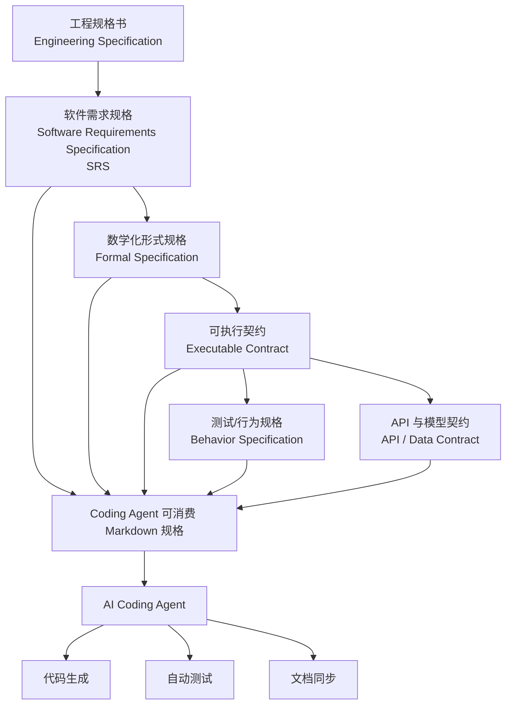

[toc]


## 核心结论

“Spec”不是 Coding Agent 时代发明的。它经历了大约六十年的演化：



关于“谁率先引入”，需要区分三个不同问题：

| 问题                                                         | 较准确的答案                                                 |
| ------------------------------------------------------------ | ------------------------------------------------------------ |
| 谁最早提出软件应依据精确规格验证？                           | 1960年代已有多人推进，Tony Hoare 1969年的程序逻辑是关键奠基工作 |
| 谁最早公开使用“Specification-Driven Development”这个名称？   | Jonathan Ostroff、David Makalsky、Richard Paige，2004年      |
| 谁最早把它作为 Coding Agent 产品的核心工作流？               | 目前可核实的主流公开产品中，是 AWS 的 Kiro 团队，2025年7月14日 |
| 谁率先普及 `spec.md → plan.md → tasks.md` 这种开放文件工作流？ | GitHub Spec Kit，2025年9月2日                                |

因此，最简洁但仍准确的说法是：

> **Kiro 率先把 Spec-Driven Development 产品化到 AI Coding Agent；GitHub Spec Kit 随后把它开放化、Agent 无关化，并普及了 `spec.md` 文件工作流。**

------

# 一、Spec 最初并不是软件概念

`spec` 是 `specification` 的缩写，本来就是传统工程中的“规格说明”。

在机械、建筑、电气、航空等领域，规格书回答的是：

- 最终产品必须满足什么条件；
- 尺寸和材料是什么；
- 允许的误差是多少；
- 如何检查是否合格；
- 供应商交付什么才算完成。

软件工程只是继承了这个思想：

```text
先定义“正确是什么”
然后才讨论“怎样制造出来”
```

软件的特殊困难在于，它不像机械零件那样容易用尺寸描述。软件行为涉及：

- 输入和输出；
- 状态变化；
- 并发；
- 异常；
- 权限；
- 时间；
- 数据一致性；
- 无穷多种执行路径。

所以软件领域一直在寻找更好的方式描述“程序应该做什么”。

------

# 二、1960年代：从“写代码”转向“证明程序符合规格”

## 1. 软件危机推动规格化

1960年代，软件项目规模迅速扩大，出现了延期、超预算、缺陷多、维护困难等问题。1968年的 NATO 软件工程会议是“软件工程”成为独立工程问题的重要标志之一。会议讨论的核心背景，就是软件不能再被当作单纯的编程技巧，而需要需求、设计、验证和管理方法。([docslib.org](https://docslib.org/doc/3343032/the-1968-nato-software-engineering-conference))

这一阶段逐渐形成了一个核心问题：

> 在开始编程前，能否先精确说明程序应该满足什么性质？

------

## 2. Tony Hoare 的关键奠基

1969年，Tony Hoare 发表《An Axiomatic Basis for Computer Programming》，提出用逻辑规则证明程序性质。

后来广泛使用的 Hoare Triple 可以表示为：

```text
{前置条件} 程序 {后置条件}
```

例如：

```text
{x ≥ 0}
y = sqrt(x)
{y ≥ 0 且 y² = x}
```

它表达的不是程序具体怎么计算，而是：

- 调用程序前必须满足什么；
- 程序执行后保证什么。

这奠定了“实现必须服从规格”的理论基础。Hoare 的论文发表于1969年10月，是形式化程序验证最重要的奠基文献之一。([DOI](https://doi.org/10.1145/363235.363259))

但这里需要注意：

> Hoare 没有发明所有意义上的“spec”，也没有提出今天 Coding Agent 所说的 `spec.md`；他的贡献是建立了“用规格描述并证明程序正确性”的逻辑基础。

------

# 三、1970—1980年代：Spec 分成两条路线

这一时期逐渐形成两种不同类型的规格。

## 路线一：需求规格文档

这条路线主要面向：

- 客户；
- 产品经理；
- 系统分析师；
- 软件团队；
- 承包方和验收方。

典型产物是 Software Requirements Specification，简称 SRS。

它通常描述：

- 系统用途；
- 功能需求；
- 外部接口；
- 性能要求；
- 约束；
- 异常行为；
- 验收要求。

IEEE 在1984年发布 IEEE 830-1984《Guide for Software Requirements Specifications》，描述了良好软件需求规格的内容、质量要求和示例结构。它后来经历1993、1998等修订版本。([IEEE Standards Association](https://standards.ieee.org/ieee/830/1220/))

这就是今天 PRD、requirements.md、feature spec 的直接祖先之一。

------

## 路线二：形式化规格

另一条路线试图消除自然语言歧义，用数学语言描述系统。

例如：

- VDM；
- Z Notation；
- CSP；
- Larch；
- B Method；
  -后来出现的 Alloy、TLA+、Event-B。

Z 规格语言源自 Jean-Raymond Abrial 在1970年代后期的研究，随后由牛津大学 Programming Research Group 扩展。Z 使用集合论和谓词逻辑描述系统状态和操作。([open-std.org](https://www.open-std.org/jtc1/sc22/wg19/))

这类规格具有更高精度，可以用于：

- 一致性检查；
- 模型验证；
- 定理证明；
- 从抽象模型逐步精化到实现。

问题是它们的成本较高，需要专门知识，因此长期主要用于安全关键或高可靠领域，而没有成为普通应用开发的默认方式。

------

# 四、1980—1990年代：从“文档规格”到“可执行规格”

形式规格通常与代码分离。一个长期问题是：

```text
规格写得很好
↓
开发者实现代码
↓
代码变化
↓
规格没有同步
```

于是出现了把部分规格直接放进程序语言的思路。

## Design by Contract

Bertrand Meyer 在 Eiffel 语言和 Design by Contract 中，把以下内容放到代码接口附近：

- 前置条件；
- 后置条件；
- 类不变量。

例如：

```text
withdraw(amount)

前置条件：
amount > 0
balance ≥ amount

后置条件：
new_balance = old_balance - amount
```

这让规格不再只是外部文档，而成为能够被工具或运行时检查的契约。

这种思想后来影响了：

- Java assertions；
- JML；
- Spec#；
- .NET Code Contracts；
- 类型系统；
- API contract；
- 运行时验证。

在演化意义上，这一步非常关键：

```text
静态规格文档
→ 与代码绑定的可执行契约
```

------

# 五、2000年代：Agile 没有消灭 Spec，而是改变了 Spec 的形态

## 1. 对大型前置文档的反思

2001年的《敏捷软件开发宣言》提出：

> Working software over comprehensive documentation。

但原文同时强调：右边的内容仍然有价值，只是左边更受重视。也就是说，敏捷反对的是僵化、过量、长期不更新的文档，而不是反对需求和规格本身。([agilesoftwaremanifesto.com](https://www.agilesoftwaremanifesto.com/))

于是，规格从大型、一次性文档，转向：

- User Story；
- Acceptance Criteria；
- Definition of Done；
- Example；
- Test；
- API contract；
- 小型设计文档。

规格开始变得更小、更迭代、更接近代码。

------

## 2. TDD：测试成为局部可执行规格

测试驱动开发的结构是：

```text
先定义预期行为
→ 写一个失败的测试
→ 编写最小实现
→ 重构
```

虽然名为“测试驱动”，但测试实际上承担了局部 specification 的作用：

```text
给定某种输入
程序必须产生某种输出
```

问题在于，单个测试只描述具体例子，未必完整表达业务目的和整体约束。

------

## 3. BDD：把行为描述变成业务可读规格

Dan North 在2003年前后开始讨论 BDD，2004年实验 JBehave，并在2006年正式发表相关介绍。BDD 强调：

- 用行为而不是测试来描述系统；
- 测试名称应像句子；
- 需求也是行为；
- 验收条件应尽可能可执行。([Dan North & Associates Limited](https://dannorth.net/blog/bdd-article-published-in-better-software-magazine/))

典型格式是：

```gherkin
Given 用户尚未登录
When 用户访问账户页面
Then 系统应跳转到登录页面
```

这使 specification 同时可以被：

- 产品人员理解；
- 开发人员实现；
- 测试工具执行；
- 客户用来验收。

因此，今天 Coding Agent 中的 acceptance criteria、Given/When/Then，本质上大量继承自 BDD 和 Specification by Example。

------

# 六、“Specification-Driven Development”这个名称何时出现？

这比 AI 时代早得多。

2004年，Jonathan S. Ostroff、David Makalsky 和 Richard F. Paige 在 XP 2004 会议发表论文：

> **Agile Specification-Driven Development**

论文把 Test-Driven Development 与 Design by Contract 结合起来，并明确提出：

- 测试是一类 specification；
- contract 也是一类 specification；
- 两者粒度不同但互补；
- 开发可以由这些 specification 驱动。

论文发表于 Springer LNCS 3092，页码104—112。([麦克马斯特专家](https://experts.mcmaster.ca/scholarly-works/1645551))

所以，从目前可以核实的学术公开记录来看：

> **“Specification-Driven Development”作为明确的方法名称，至少可以追溯到2004年的 Ostroff、Makalsky 和 Paige。**

这意味着：

- GitHub 没有发明 SDD；
- Kiro 没有发明 SDD；
- AI 时代只是重新解释并放大了这个方法。

------

# 七、为什么过去 Spec 没有成为主流开发中心？

过去的 specification 存在一个经济问题：

```text
编写精确规格的成本很高
代码仍然要由人重新实现一遍
规格和代码还可能漂移
```

也就是说，团队经常觉得自己在做两份工作：

```text
先把系统写成文档
再把系统写成代码
```

如果规格不能直接生成或验证代码，它很容易退化为：

- 审批文档；
- 合同附件；
- 开发前参考材料；
- 写完后无人维护的历史记录。

因此，传统工程通常采用“代码是最终事实源”：

```text
规格提供方向
代码决定现实
```

Coding Agent 改变了这项经济关系。

------

# 八、Coding Agent 时代发生了什么根本变化？

LLM Coding Agent 可以直接把自然语言转化为：

- 架构；
- 数据模型；
- API；
- 前端；
- 测试；
- 部署脚本；
- 文档。

因此 specification 不再只是让人读的说明，它开始成为机器输入：

```text
自然语言规格
→ Agent 规划
→ Agent 分解任务
→ Agent 生成代码
→ Agent 生成测试
→ Agent 对照规格验证
```

GitHub 对这种变化的描述是：

> 规格不再只是静态文档，而成为持续演化、可由 Agent 使用的事实源；AI 让 specification 在实践上变得“可执行”。([The GitHub Blog](https://github.blog/ai-and-ml/generative-ai/spec-driven-development-with-ai-get-started-with-a-new-open-source-toolkit/))

这形成了一次“权力反转”：

### 传统方式

```text
Spec → 参考 → 人工编码 → Code 是事实源
```

### Agent 方式

```text
Spec → 生成计划和任务 → Agent 编码 → Code 是 Spec 的派生产物
```

所以 AI 时代真正的新东西不是“写需求”，而是：

> **Specification 第一次可以用较低成本直接驱动大规模代码生成。**

------

# 九、Coding Agent 时代谁率先引入？

## 答案一：作为主流 Agent 产品，Kiro 最早

AWS 的 Kiro 于 **2025年7月14日**公开发布预览版。

Kiro 从发布时就把自己定位为：

- Agentic IDE；
- 不仅支持 vibe coding；
- 通过 specs 将模糊意图转化为结构化开发过程；
- 用 specification 指导 Agent 的实现。

发布文章直接称其方法为 **spec-driven development**。([Kiro](https://kiro.dev/blog/introducing-kiro/))

Kiro 后来的官方文章明确声称：

> Kiro 是第一个把 spec-driven development 带入 AI coding tools 的产品。([Kiro](https://kiro.dev/blog/general-availability/))

从目前能够核实的主流公开发布时间看，这个说法基本符合时间顺序：

```text
2025-07-14  Kiro 公布
2025-09-02  GitHub Spec Kit 公布
2025-09     Tessl 的相关产品公开发布
```

但严谨地说，这应表述为：

> **Kiro 是目前有明确公开记录、最早将 SDD 作为一等产品功能发布的主流 Coding Agent 工具。**

不能绝对证明，在此之前世界上没有个人、内部团队或小型开源项目采用类似流程。

------

## 是 Kiro 团队，不宜归功于单一个人

Kiro 的发布文章由：

- Nikhil Swaminathan，Product Lead；
- Deepak Singh，VP DevEx & Agents

共同署名。Marc Brooker 也在发布后的文章中系统阐述了 Kiro 对 AI spec-driven software development 的愿景。([Kiro](https://kiro.dev/blog/introducing-kiro/))

但目前公开材料没有足够依据把 SDD 在 Kiro 中的引入归为某一个人的独立发明。

更适合的说法是：

> **AWS/Kiro 产品与工程团队率先完成了主流产品化。**

------

# 十、但 Kiro 当时并不使用单一 `spec.md`

这是一个重要细节。

Kiro 的 spec 是一组结构化文件：

```text
.kiro/specs/<feature>/
├── requirements.md
├── design.md
└── tasks.md
```

其中：

- `requirements.md`：用户故事和验收条件；
- `design.md`：技术架构和实现方法；
- `tasks.md`：离散、可追踪的任务。

Agent 按需求、设计、任务、执行的顺序工作。([Kiro](https://kiro.dev/docs/web/specs/))

所以，Kiro 率先产品化的是：

> **Spec 工作流**

而不是必须叫作 `spec.md` 的单文件标准。

------

# 十一、谁普及了确切的 `spec.md` 工作流？

## GitHub Spec Kit

GitHub 于 **2025年9月2日**发布开源的 Spec Kit，发布文章作者是 GitHub Principal Product Manager Den Delimarsky。([The GitHub Blog](https://github.blog/ai-and-ml/generative-ai/spec-driven-development-with-ai-get-started-with-a-new-open-source-toolkit/))

Spec Kit 把 Agent 工作流明确拆成：

```text
Specify
→ Plan
→ Tasks
→ Implement
```

并在每个功能目录中生成类似：

```text
specs/001-feature/
├── spec.md
├── plan.md
├── tasks.md
├── research.md
├── data-model.md
└── contracts/
```

GitHub 的模板明确将功能 specification 放在：

```text
/specs/[feature]/spec.md
```

然后让 `plan.md` 读取并引用它。([GitHub](https://github.com/github/spec-kit/blob/main/templates/plan-template.md))

GitHub 的关键贡献不是最早想到 spec，而是：

1. 将流程做成开源工具；
2. 不绑定单个 Agent；
3. 支持 Copilot、Claude Code、Gemini CLI 等；
4. 固化 `spec → plan → tasks → implement`；
5. 把 Markdown 规格文件放进 Git 仓库；
6. 将 specification 变成 Agent 可重复读取的持久上下文。

GitHub 将其描述为：spec 是代码行为的合同，也是生成、测试和验证代码的事实源。([The GitHub Blog](https://github.blog/ai-and-ml/generative-ai/spec-driven-development-with-ai-get-started-with-a-new-open-source-toolkit/))

因此：

> **若问题特指今天常见的 `spec.md + plan.md + tasks.md` 仓库文件结构，最有影响力的率先普及者是 GitHub Spec Kit，而不是 Kiro。**

这里也应使用“普及”和“规范化”，而不是绝对意义上的“发明”，因为在此之前开发者完全可能自己使用名为 `spec.md` 的 Markdown 文件。

------

# 十二、完整的历史归属应如何表述？

可以分为四层。

## 第一层：思想奠基者

Tony Hoare 等形式方法先驱建立了：

```text
先规定正确性条件
再证明实现满足条件
```

Hoare 1969年的工作是最重要的理论源头之一。([DOI](https://doi.org/10.1145/363235.363259))

------

## 第二层：方法名称的早期提出者

Jonathan Ostroff、David Makalsky、Richard Paige 于2004年公开发表：

```text
Agile Specification-Driven Development
```

这是目前可核实的早期学术使用。([麦克马斯特专家](https://experts.mcmaster.ca/scholarly-works/1645551))

------

## 第三层：Coding Agent 产品化先行者

AWS/Kiro 团队于2025年7月14日将 SDD 作为 Agentic IDE 的核心功能公开推出。([Kiro](https://kiro.dev/blog/introducing-kiro/))

------

## 第四层：开放工作流的普及者

GitHub 于2025年9月2日推出 Spec Kit，把 SDD 做成开放、Agent 无关、仓库原生的流程，并明确采用 `spec.md`、`plan.md` 和 `tasks.md` 等文件。([The GitHub Blog](https://github.blog/ai-and-ml/generative-ai/spec-driven-development-with-ai-get-started-with-a-new-open-source-toolkit/))

------

# 十三、为什么很多人误认为是 GitHub 发明了 Spec？

主要有三个原因。

## 1. Spec Kit 是开源的

开发者可以直接安装、查看模板并修改工作流，比封闭 IDE 功能更容易传播。

## 2. 文件形式非常清晰

```text
spec.md
plan.md
tasks.md
```

这种形式容易理解、复制，也适合 Git 和代码审查。

## 3. 它是 Agent 无关的

GitHub Spec Kit 从发布时就强调可与多个 Coding Agent 配合，而不只是某一个 IDE。([The GitHub Blog](https://github.blog/ai-and-ml/generative-ai/spec-driven-development-with-ai-get-started-with-a-new-open-source-toolkit/))

因此，在开发者社区的感知中，Spec Kit 比 Kiro 更像一个“方法标准”，即使 Kiro 的公开发布时间更早。

------

# 十四、最终判断

最准确的历史结论是：

> **Spec 的思想源于传统工程规格和1960年代以来的软件形式方法；Tony Hoare 等人奠定了程序规格与验证的理论基础。**

> **“Specification-Driven Development”这一明确名称至少在2004年已经由 Jonathan Ostroff、David Makalsky 和 Richard Paige 用于学术论文。**

> **在现代 Coding Agent 时代，AWS 的 Kiro 团队于2025年7月14日率先把 Spec-Driven Development 作为主流 AI Coding 产品的一等工作流公开推出。**

> **GitHub 随后于2025年9月2日通过 Spec Kit，把它发展为开放、Agent 无关的工程流程，并最有影响力地普及了 `spec.md → plan.md → tasks.md → implement` 这一文件化模式。**

可以浓缩成一条时间线：

```text
1969  Hoare：程序逻辑与正确性规格
  ↓
1970s–1980s  Z、VDM、SRS、IEEE 830
  ↓
1980s–1990s  Design by Contract、可执行契约
  ↓
2000s  TDD、BDD、Specification by Example
  ↓
2004  Ostroff / Makalsky / Paige：
      Agile Specification-Driven Development
  ↓
2025-07-14  AWS Kiro：
            首批主流 Agentic SDD 产品化
  ↓
2025-09-02  GitHub Spec Kit：
            开源化、Agent 无关化、spec.md 工作流普及
```