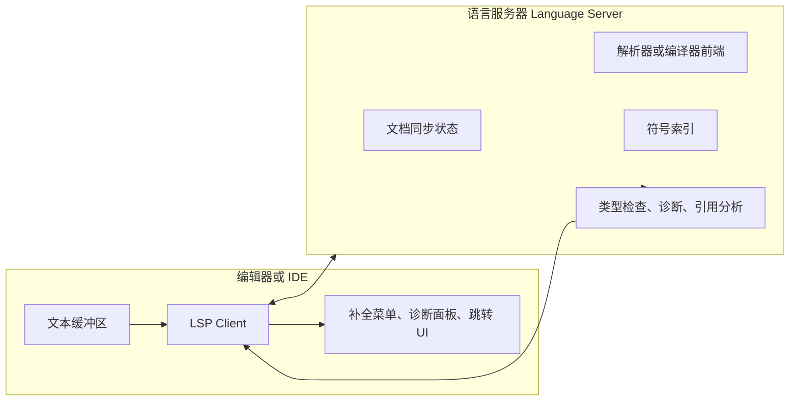
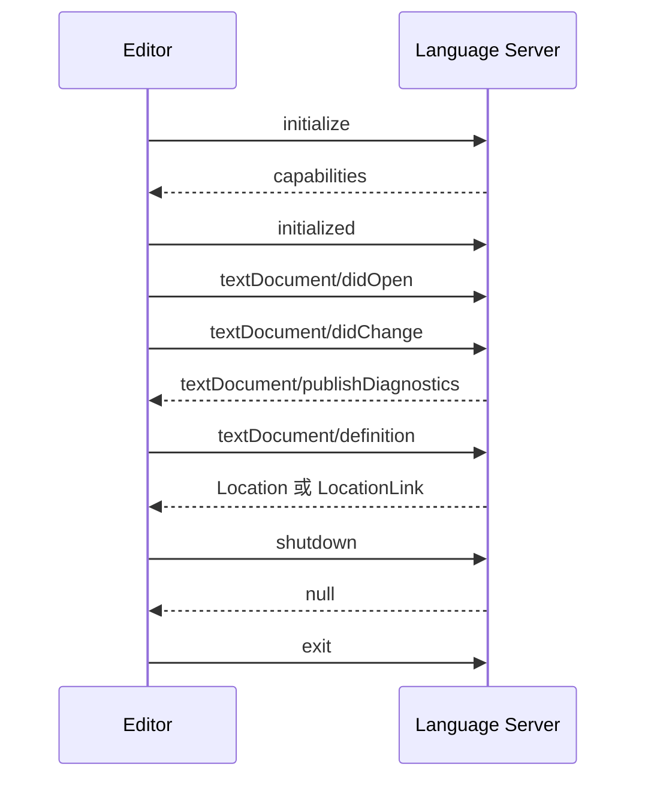
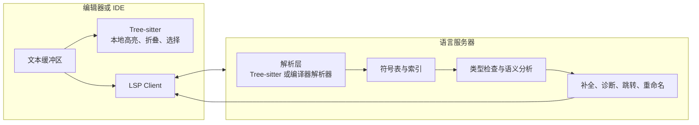
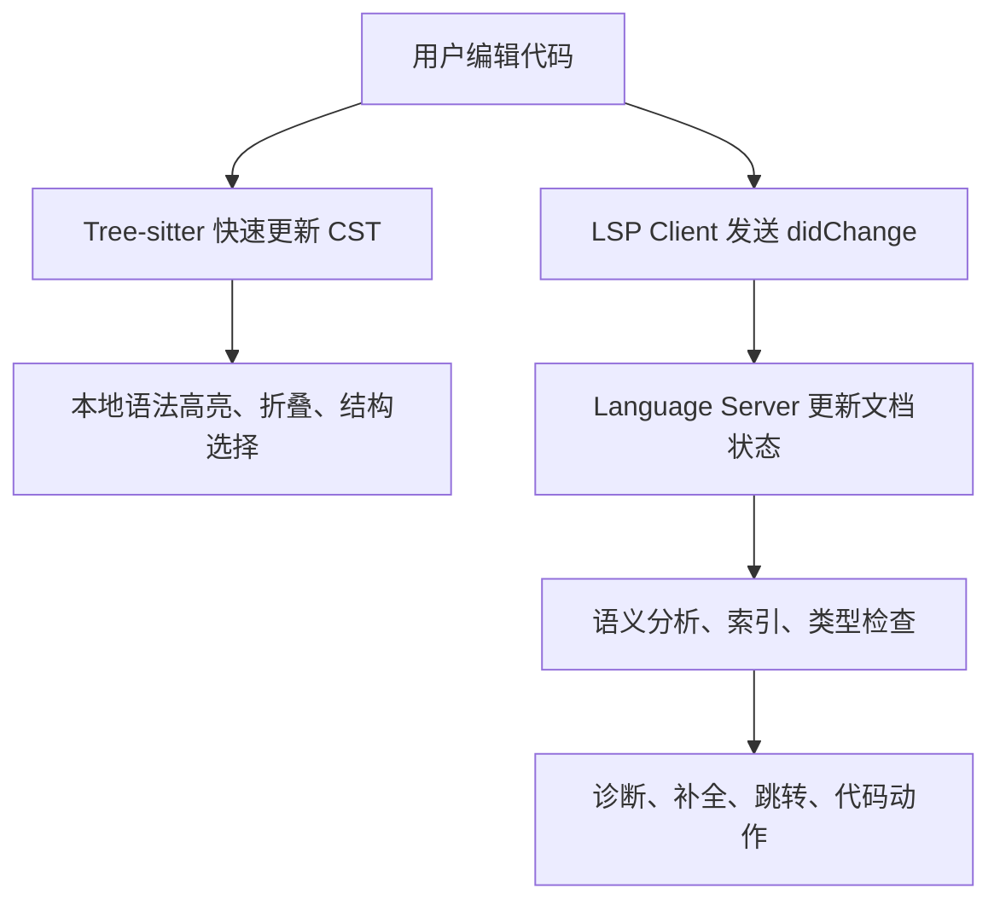
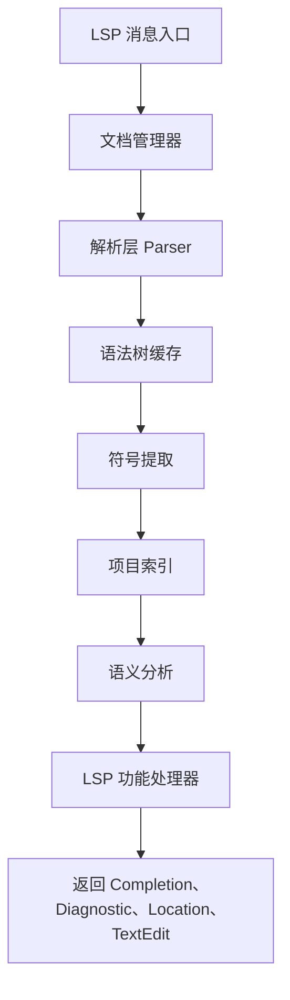
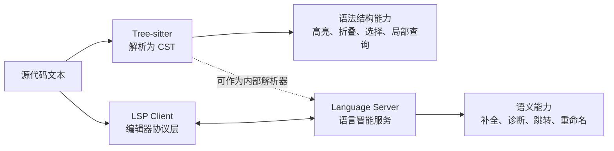

[toc]


## 详细大纲

本文按下面的学习路线展开：

| 模块             | 你需要掌握的问题                                             | 学习目标                                           |
| ---------------- | ------------------------------------------------------------ | -------------------------------------------------- |
| 基础定位         | Tree-sitter 和 LSP 分别解决什么问题                          | 先建立边界，避免把“解析器”和“语言智能协议”混为一谈 |
| Tree-sitter 核心 | 语法树、增量解析、查询系统、语法高亮、语言注入               | 理解它为什么适合编辑器、代码浏览器、结构化搜索     |
| LSP 核心         | 客户端、语言服务器、JSON-RPC、能力协商、文本同步、诊断与补全 | 理解现代编辑器如何复用语言智能                     |
| 两者关联         | Tree-sitter 能否替代 LSP，LSP 是否需要 Tree-sitter           | 理解两者是互补关系，而不是竞争关系                 |
| 工程实践         | 新语言支持、编辑器插件、语言服务器、代码分析工具如何选型     | 能为实际项目做技术决策                             |
| 新手路线         | 从语法高亮到语言服务器的渐进式学习路径                       | 能按难度逐步上手                                   |

## 一句话概括

**Tree-sitter** 是“把源代码快速解析成语法树”的工具：它是一个解析器生成器（parser generator）和增量解析库（incremental parsing library），能为源文件构建具体语法树（Concrete Syntax Tree, CST），并在编辑时高效更新语法树。官方强调它适合文本编辑器场景：足够通用、足够快、能在语法错误存在时仍给出有用结果，并且运行时是可嵌入的 C11 库。([Tree-sitter](https://tree-sitter.github.io/tree-sitter/))

**LSP** 是“编辑器和语言服务器之间通信的标准协议”：语言服务器协议（Language Server Protocol, LSP）规定编辑器或 IDE 如何与语言服务器通信，以获得自动补全、跳转定义、查找引用、悬停文档等语言功能。官方说明，LSP 的目标是让一个语言服务器可以被多个开发工具复用，而不是每个编辑器都重新实现一套语言智能。([Microsoft GitHub](https://microsoft.github.io/language-server-protocol/))

可以这样记：

| 技术        | 更像什么                       | 主要输入                                 | 主要输出                                     | 典型用途                               |
| ----------- | ------------------------------ | ---------------------------------------- | -------------------------------------------- | -------------------------------------- |
| Tree-sitter | 结构化解析引擎                 | 源代码文本                               | 语法树、节点范围、查询匹配结果               | 语法高亮、代码折叠、结构选择、局部分析 |
| LSP         | 编辑器与语言智能服务的通信协议 | 编辑器事件、文档 URI、光标位置、文本变更 | 补全项、诊断、跳转位置、重命名编辑、代码动作 | 跨编辑器复用语言服务器                 |

## Tree-sitter 的定位

Tree-sitter 关注的是**语法结构**，不是完整语义。它擅长回答这类问题：

| 问题                                 | Tree-sitter 是否擅长 | 原因                                     |
| ------------------------------------ | -------------------- | ---------------------------------------- |
| 这个位置属于哪个函数？               | 擅长                 | 可以通过语法树向上查找 enclosing node    |
| 这个节点是不是函数定义？             | 擅长                 | 节点类型由语法规则决定                   |
| 这个字符串中嵌入的是 SQL 还是 Bash？ | 擅长                 | 可以用 injection query 重新解析嵌入语言  |
| 这个变量最终类型是什么？             | 不擅长               | 需要类型系统、符号表、跨文件分析         |
| 这个函数在哪些文件被调用？           | 不直接擅长           | 需要索引、引用解析、项目级语义分析       |
| 自动补全应该推荐哪些成员？           | 只能辅助             | 需要语法上下文，但核心仍是语义和类型信息 |

Tree-sitter 的最大价值在于：它能在编辑器中“每次按键”级别地维护代码结构。官方文档明确说它的目标包括“快到可以在文本编辑器中每次按键都解析”，并且在存在语法错误时仍尽量产生有用结果。([Tree-sitter](https://tree-sitter.github.io/tree-sitter/))

## LSP 的定位

LSP 关注的是**语言智能服务的标准化通信**，而不是规定语言服务器内部怎么实现。一个 LSP 请求通常只包含通用数据：文档 URI、光标位置、范围、配置、能力等。官方概览中特别说明，LSP 通信的数据类型是语言无关的，例如文档引用和位置；协议不会把抽象语法树、编译器符号、类型系统这类语言领域模型标准化传输。([Microsoft GitHub](https://microsoft.github.io/language-server-protocol/overviews/lsp/overview))

所以，LSP 解决的是：

| 问题                                                   | LSP 的作用                     |
| ------------------------------------------------------ | ------------------------------ |
| VS Code、Neovim、Emacs、Eclipse 如何复用同一个语言服务 | 定义统一协议                   |
| 编辑器如何通知服务端“文件打开了、内容变了、关闭了”     | 定义文档同步消息               |
| 编辑器如何请求“补全、跳转定义、悬停说明”               | 定义请求和响应格式             |
| 服务端如何告诉编辑器“这里有错误或警告”                 | 定义诊断消息                   |
| 服务端和客户端能力不一致怎么办                         | 通过 capabilities 能力协商解决 |

## Tree-sitter 的核心概念

### 具体语法树

Tree-sitter 生成的是 **CST（Concrete Syntax Tree，具体语法树）**，而不是传统编译器里常说的简化版 AST（Abstract Syntax Tree，抽象语法树）。

| 对比项                                   | CST                  | AST                    |
| ---------------------------------------- | -------------------- | ---------------------- |
| 中文理解                                 | 更接近源码原貌的树   | 更接近语义结构的树     |
| 是否保留标点、关键字、括号等具体语法元素 | 通常保留更多         | 通常会省略或归约       |
| 适合编辑器吗                             | 很适合               | 视实现而定             |
| 适合类型检查吗                           | 不够，需要额外语义层 | 更常用于编译器语义分析 |
| Tree-sitter 生成哪一种                   | CST                  | 不是主要目标           |

例如一段函数：

```go
func add(a int, b int) int {
  return a + b
}
```

Tree-sitter 不只是知道“这里有一个函数”，它还能知道函数名、参数列表、返回类型、函数体、return 语句、二元表达式等结构。之后你可以用查询（query）匹配“所有函数定义”“所有字符串字面量”“所有 import 语句”。

### 增量解析

传统解析思路常常是：文件变了，就重新解析整个文件。Tree-sitter 的思路是：编辑发生后，只更新受影响的语法树区域，尽量复用未变化的子树。

编辑器中的真实情况是：


这就是它适合编辑器的原因：用户输入时，不应该每次都做昂贵的全量分析。

### 语法规则

Tree-sitter 的语法通常写在 `grammar.js` 中。官方 Grammar DSL 提供了 `seq`、`choice`、`repeat`、`optional`、`prec`、`field`、`alias`、`token`、`extras`、`conflicts`、`externals` 等机制，用来描述语言的词法和语法结构。([Tree-sitter](https://tree-sitter.github.io/tree-sitter/creating-parsers/2-the-grammar-dsl.html))

一个非常简化的示意：

```js
module.exports = grammar({
  name: "mini_lang",

  rules: {
    source_file: $ => repeat($.statement),

    statement: $ => choice(
      $.let_statement,
      $.expression_statement
    ),

    let_statement: $ => seq(
      "let",
      field("name", $.identifier),
      "=",
      field("value", $.expression),
      ";"
    ),

    expression_statement: $ => seq($.expression, ";"),

    expression: $ => choice(
      $.identifier,
      $.number
    ),

    identifier: _ => /[a-zA-Z_][a-zA-Z0-9_]*/,
    number: _ => /\d+/
  }
});
```

这里的重点不是 JavaScript 语言本身，而是 Tree-sitter 用 JS 作为一种语法描述 DSL。

### 节点、字段、命名节点

Tree-sitter 语法树中常见三类信息：

| 概念     | 英文术语   | 作用                                                  |
| -------- | ---------- | ----------------------------------------------------- |
| 节点类型 | node type  | 表示语法结构，如 `function_declaration`、`identifier` |
| 命名节点 | named node | 通常表示有语义价值的结构节点                          |
| 字段名   | field name | 给子节点命名，如 `name`、`body`、`condition`          |
| 范围     | range      | 节点在源代码中的起止行列或字节位置                    |
| 错误节点 | ERROR node | 语法不完整或错误时仍保留可用结构                      |

字段名非常重要。比如函数声明里的 `name` 字段，让工具不用猜“第几个子节点是函数名”。

### 优先级、结合性与冲突

真实编程语言经常有二义性。例如：

```txt
a + b * c
```

应该解析成：

```txt
a + (b * c)
```

而不是：

```txt
(a + b) * c
```

Tree-sitter 提供 `prec`、`prec.left`、`prec.right` 等机制处理优先级与结合性；当存在真实或局部 LR(1) 冲突时，可以用 precedence 解决，也可以通过 `conflicts` 声明冲突，让运行时探索多种解释并选择合适结果。官方 DSL 文档对 `prec`、左右结合性、动态优先级、`conflicts`、外部扫描器等都作了说明。([Tree-sitter](https://tree-sitter.github.io/tree-sitter/creating-parsers/2-the-grammar-dsl.html))

经验上，新手写 grammar 时最常见的问题是：

| 问题               | 表现                               | 建议                                             |
| ------------------ | ---------------------------------- | ------------------------------------------------ |
| 表达式优先级混乱   | 二元表达式树不符合预期             | 先列出优先级表，再用 `prec.left` 或 `prec.right` |
| 空白和注释处理不当 | 注释出现在奇怪位置，或语法匹配失败 | 用 `extras` 统一处理空白和注释                   |
| 节点过多           | 树很碎，查询困难                   | 用 `_` 私有规则、`inline`、`alias` 调整树形      |
| 节点过少           | 后续高亮、折叠、符号提取困难       | 保留有工具价值的结构节点                         |
| 词法规则过复杂     | 正则难以表达缩进、heredoc 等       | 考虑 external scanner                            |

## Tree-sitter 查询系统

Tree-sitter 的查询（query）是一种类似 Lisp/Scheme 的模式匹配语言，通常写在 `.scm` 文件中。官方高亮文档说明，Tree-sitter 的高亮系统基于 tree queries，用来匹配语法树节点，并通过 capture 给节点分类。([Tree-sitter](https://tree-sitter.github.io/tree-sitter/3-syntax-highlighting.html))

例如：

```scheme
"func" @keyword
"return" @keyword
(type_identifier) @type
(int_literal) @number
(function_declaration name: (identifier) @function)
```

这段查询的意思是：

| 查询片段                                              | 含义                             |
| ----------------------------------------------------- | -------------------------------- |
| `"func" @keyword`                                     | 把字面量 `func` 标记为关键字     |
| `(type_identifier) @type`                             | 把类型标识符标记为类型           |
| `(int_literal) @number`                               | 把整数字面量标记为数字           |
| `(function_declaration name: (identifier) @function)` | 把函数声明的 name 字段标记为函数 |

Tree-sitter 常见 query 文件如下：

| 文件             | 作用                 | 典型输出                                                |
| ---------------- | -------------------- | ------------------------------------------------------- |
| `highlights.scm` | 语法高亮             | `@keyword`、`@function`、`@type`                        |
| `locals.scm`     | 局部变量与作用域跟踪 | `@local.scope`、`@local.definition`、`@local.reference` |
| `injections.scm` | 嵌入语言识别         | HTML 中的 JS/CSS、Markdown 中的代码块                   |
| `folds.scm`      | 折叠范围             | 函数体、类体、注释块                                    |
| `indents.scm`    | 缩进规则             | 编辑器自动缩进                                          |
| `tags.scm`       | 符号提取             | 函数、类、方法、常量索引                                |

官方文档列出高亮配置中常见的三类 query：`highlights`、`locals`、`injections`；其中 `locals` 使用固定 capture 名称来表达局部作用域、定义和引用，`injections` 用 `@injection.content` 和 `@injection.language` 表示嵌入语言区域。([Tree-sitter](https://tree-sitter.github.io/tree-sitter/3-syntax-highlighting.html))

## Tree-sitter 适合做什么

| 用例           | 是否推荐     | 说明                                         |
| -------------- | ------------ | -------------------------------------------- |
| 语法高亮       | 推荐         | 比纯正则更结构化                             |
| 代码折叠       | 推荐         | 可基于函数、类、块级节点                     |
| 结构化选择     | 推荐         | 例如“扩大选择到当前表达式、语句、函数”       |
| 文档符号粗提取 | 推荐         | 函数、类、方法、变量声明                     |
| 代码格式化     | 可辅助       | 需要额外格式化策略                           |
| lint           | 可辅助       | 语法级 lint 很适合，语义级 lint 需要更多分析 |
| 自动补全       | 可辅助       | 可判断上下文，但不能单独完成类型补全         |
| 跳转定义       | 有限制       | 单文件或简单语言可做，复杂语言需要符号解析   |
| 重命名         | 不建议单独做 | 需要作用域、引用、跨文件语义                 |
| 类型检查       | 不适合单独做 | 需要类型系统                                 |

一个实用判断：

> 只要问题主要依赖“源码形状”，Tree-sitter 很合适；只要问题依赖“符号含义、类型、跨文件关系”，Tree-sitter 只能作为前置解析层。

## LSP 的核心架构

LSP 的基本结构是客户端与服务器：



官方概览说明，语言服务器通常作为单独进程运行，开发工具通过 JSON-RPC 与它通信。典型会话包括：打开文档时发送 `textDocument/didOpen`，编辑时发送 `textDocument/didChange`，服务端分析后通过 `textDocument/publishDiagnostics` 发布错误和警告，用户执行跳转定义时客户端发送 `textDocument/definition` 请求。([Microsoft GitHub](https://microsoft.github.io/language-server-protocol/overviews/lsp/overview))

## LSP 消息模型

LSP 使用 JSON-RPC 2.0 作为内容部分。当前 3.18 规范说明，基础协议由类似 HTTP 的 header 和 content 组成，`Content-Length` 是必需 header，content 使用 JSON-RPC 2.0；协议定义 request、response、notification 三类消息。([Microsoft GitHub](https://microsoft.github.io/language-server-protocol/specifications/lsp/3.18/specification/))

| 消息类型 | 英文术语                  | 是否需要响应 | 例子                                                 |
| -------- | ------------------------- | ------------ | ---------------------------------------------------- |
| 请求     | Request                   | 需要         | `textDocument/definition`、`textDocument/completion` |
| 响应     | Response                  | 是请求的结果 | 返回位置、补全项、错误                               |
| 通知     | Notification              | 不需要       | `textDocument/didOpen`、`textDocument/didChange`     |
| 进度通知 | Progress Notification     | 不一定       | `$/progress`                                         |
| 取消通知 | Cancellation Notification | 不需要       | `$/cancelRequest`                                    |

示意：



注意：Mermaid 中这里的消息名是 LSP 方法名，不代表函数调用；底层仍是 JSON-RPC 消息。

## LSP 生命周期

LSP 生命周期由客户端管理。当前规范明确说，服务器生命周期由客户端决定，例如 VS Code、Emacs 这类工具决定何时启动和关闭语言服务器。([GitHub](https://github.com/microsoft/language-server-protocol/blob/gh-pages/_specifications/lsp/3.18/specification.md))

典型生命周期：

| 阶段       | LSP 方法                      | 方向            | 说明                               |
| ---------- | ----------------------------- | --------------- | ---------------------------------- |
| 启动       | `initialize`                  | Client → Server | 交换初始化参数、客户端能力         |
| 初始化完成 | `initialized`                 | Client → Server | 初始化后通知，服务端可动态注册能力 |
| 打开文件   | `textDocument/didOpen`        | Client → Server | 服务端开始跟踪文档                 |
| 修改文件   | `textDocument/didChange`      | Client → Server | 同步文本变化                       |
| 保存文件   | `textDocument/didSave`        | Client → Server | 通知保存事件                       |
| 关闭文件   | `textDocument/didClose`       | Client → Server | 服务端释放内存状态                 |
| 请求功能   | 如 `completion`、`definition` | Client → Server | 用户触发语言功能                   |
| 关闭服务   | `shutdown`                    | Client → Server | 请求服务端准备关闭                 |
| 退出进程   | `exit`                        | Client → Server | 通知服务端退出                     |

规范还说明，`initialized` 只能发送一次；`shutdown` 后客户端不应再发送除 `exit` 之外的请求或通知。([Microsoft GitHub](https://microsoft.github.io/language-server-protocol/specifications/lsp/3.18/specification/))

## LSP 能力协商

LSP 不假设所有客户端和服务端都支持所有功能。它通过 **capabilities（能力）** 协商功能。官方规范说明，客户端和服务端会在 `initialize` 阶段交换能力；例如服务端可以声明支持 `textDocument/hover`，但不支持 `workspace/symbol`。([Microsoft GitHub](https://microsoft.github.io/language-server-protocol/specifications/lsp/3.18/specification/))

服务端常见能力：

| 能力字段                     | 对应功能           |
| ---------------------------- | ------------------ |
| `completionProvider`         | 自动补全           |
| `hoverProvider`              | 悬停文档           |
| `definitionProvider`         | 跳转定义           |
| `referencesProvider`         | 查找引用           |
| `documentSymbolProvider`     | 文档符号           |
| `semanticTokensProvider`     | 语义高亮           |
| `renameProvider`             | 重命名             |
| `codeActionProvider`         | 代码动作、快速修复 |
| `documentFormattingProvider` | 格式化             |
| `inlayHintProvider`          | 内嵌提示           |
| `diagnosticProvider`         | pull 模型诊断      |

规范中的 `ServerCapabilities` 包含这些字段，并标注了不少功能的引入版本，例如 semantic tokens 从 3.16 起，type hierarchy、inline value、inlay hint、pull diagnostics 从 3.17 起，inline completion 和部分刷新能力属于 3.18。([Microsoft GitHub](https://microsoft.github.io/language-server-protocol/specifications/lsp/3.18/specification/))

## 文档同步

LSP 语言服务器不能直接假设磁盘文件就是最新内容，因为用户可能在编辑器里改了文件但还没保存。官方概览也说，文档打开后，内容真相不再是文件系统，而是在编辑器内存中，需要在工具和语言服务器之间同步。([Microsoft GitHub](https://microsoft.github.io/language-server-protocol/overviews/lsp/overview))

LSP 文档同步有三种模式：

| 模式     | 英文术语      | 值   | 含义                               |
| -------- | ------------- | ---- | ---------------------------------- |
| 不同步   | `None`        | 0    | 不跟踪文档内容                     |
| 全量同步 | `Full`        | 1    | 每次变化发送整个文档               |
| 增量同步 | `Incremental` | 2    | 打开时发送全文，之后只发送变化范围 |

当前规范明确列出 `TextDocumentSyncKind.None = 0`、`Full = 1`、`Incremental = 2`，并说明客户端必须支持 `didOpen`、`didChange`、`didClose` 通知；服务端要么三者都实现，要么都不实现。([GitHub](https://github.com/microsoft/language-server-protocol/blob/gh-pages/_specifications/lsp/3.18/specification.md))

工程上通常建议：

| 场景                     | 建议                                                    |
| ------------------------ | ------------------------------------------------------- |
| 新手写原型语言服务器     | 先用 Full，同步逻辑简单                                 |
| 文件较小、功能简单       | Full 可以接受                                           |
| 大文件、真实编辑器插件   | 尽快支持 Incremental                                    |
| 服务端内部用 Tree-sitter | Incremental sync 与 Tree-sitter edit/parse 模型天然契合 |
| 多线程分析               | 需要严格处理文档版本，避免旧结果覆盖新结果              |

## LSP 的主要语言功能

| 功能           | LSP 方法                                              | 依赖什么能力                       |
| -------------- | ----------------------------------------------------- | ---------------------------------- |
| 悬停说明       | `textDocument/hover`                                  | 光标位置、符号解析、文档生成       |
| 跳转定义       | `textDocument/definition`                             | 符号表、作用域、跨文件索引         |
| 查找引用       | `textDocument/references`                             | 全项目索引、引用解析               |
| 自动补全       | `textDocument/completion`                             | 当前语法上下文、类型、作用域、导入 |
| 补全详情懒加载 | `completionItem/resolve`                              | 延迟计算文档、详情                 |
| 文档符号       | `textDocument/documentSymbol`                         | 当前文件结构                       |
| 工作区符号     | `workspace/symbol`                                    | 项目级索引                         |
| 诊断           | `textDocument/publishDiagnostics` 或 pull diagnostics | 编译、lint、类型检查               |
| 代码动作       | `textDocument/codeAction`                             | 诊断、重构规则、编辑生成           |
| 重命名         | `textDocument/rename`                                 | 引用解析、安全改写                 |
| 格式化         | `textDocument/formatting`                             | 格式化器                           |
| 语义高亮       | `textDocument/semanticTokens/*`                       | 符号类型、作用域、语义分类         |
| 内嵌提示       | `textDocument/inlayHint`                              | 类型推断、参数名、返回类型         |

补全有一个重要实践：不要在首次 completion 响应里计算所有昂贵字段。规范说明，如果完整补全项计算昂贵，服务端可以用 `completionItem/resolve` 在用户选中某项后再补充文档等信息；同时 LSP 模型通常让客户端负责过滤和排序，服务端可用 `filterText`、`sortText` 影响行为。([Microsoft GitHub](https://microsoft.github.io/language-server-protocol/specifications/lsp/3.18/specification/))

## Tree-sitter 与 LSP 的关系

二者最重要的关系是：

> Tree-sitter 可以成为语言服务器内部的解析层，但 LSP 本身不要求使用 Tree-sitter。



### 它们的互补分工

| 需求     | Tree-sitter 侧               | LSP 侧                                           |
| -------- | ---------------------------- | ------------------------------------------------ |
| 语法高亮 | 用 `highlights.scm` 匹配节点 | 可提供 semantic tokens 增强语义色彩              |
| 折叠     | 基于语法节点生成范围         | 可通过 `textDocument/foldingRange` 返回范围      |
| 结构选择 | 直接沿 CST 父子节点扩展      | 可通过 selection range 返回建议范围              |
| 文档符号 | 查询函数、类、方法节点       | 返回 `DocumentSymbol[]` 或 `SymbolInformation[]` |
| 补全     | 判断当前语法上下文           | 结合类型、作用域、导入、索引生成候选             |
| 跳转定义 | 单文件简单匹配               | 跨文件、作用域、类型系统解析                     |
| 诊断     | 语法错误、简单 lint          | 编译错误、类型错误、项目规则                     |
| 重命名   | 找局部节点和范围             | 判断是否同一符号并生成安全编辑                   |
| 代码动作 | 找可改写语法模式             | 结合诊断和语义生成修复                           |

### 为什么 LSP 不直接传语法树

LSP 的设计选择是传递通用结构：URI、Position、Range、TextEdit、Diagnostic、CompletionItem 等。官方概览明确指出，LSP 的数据类型不是语言领域模型层面的 AST、编译器符号或已解析类型；这样做是为了让协议保持语言无关和易标准化。([Microsoft GitHub](https://microsoft.github.io/language-server-protocol/overviews/lsp/overview))

这意味着：

| 误解                                    | 正确理解                                                     |
| --------------------------------------- | ------------------------------------------------------------ |
| LSP 会把 AST 从服务端传给编辑器         | 通常不会，协议传的是位置、范围、编辑、诊断、符号等           |
| Tree-sitter 是 LSP 的替代品             | 不是，它只解决解析与结构匹配的一部分                         |
| 有 Tree-sitter 就能跳转定义             | 只能做简单情况，复杂语言需要语义分析                         |
| 有 LSP 就不需要 Tree-sitter             | 不一定，编辑器本地高亮和结构操作仍很适合 Tree-sitter         |
| Semantic Tokens 等同于 Tree-sitter 高亮 | 不等同，semantic tokens 是协议功能，Tree-sitter query 是本地语法匹配机制 |

## 典型组合模式

### 编辑器本地 Tree-sitter 加远程 LSP

这是现代编辑器中很常见的模式。



这种组合的优点：

| 优点   | 说明                                  |
| ------ | ------------------------------------- |
| 响应快 | 本地 Tree-sitter 可以立刻更新语法结构 |
| 语义强 | LSP 服务端可以做项目级分析            |
| 解耦好 | 高亮和语言智能可以分别演进            |
| 可复用 | 一个语言服务器可服务多个编辑器        |

### 语言服务器内部使用 Tree-sitter

如果你在写一个语言服务器，可以把 Tree-sitter 用作 parser。

适合场景：

| 场景                     | 为什么适合                                             |
| ------------------------ | ------------------------------------------------------ |
| 自定义 DSL               | 编译器前端可能不存在，Tree-sitter grammar 易于单独维护 |
| 配置语言                 | 语义简单，Tree-sitter 足以提供大部分结构信息           |
| Markdown、模板、嵌入语言 | injections 很有价值                                    |
| 快速原型                 | 比手写 parser 更快形成可用结构                         |
| 语法级 lint              | 查询系统能快速定位模式                                 |

不适合单独依赖的场景：

| 场景                                         | 原因                                           |
| -------------------------------------------- | ---------------------------------------------- |
| Rust、TypeScript、C++ 这类复杂语言的完整语义 | 需要成熟编译器前端、类型系统、宏展开或泛型解析 |
| 安全重命名                                   | 需要精确符号绑定                               |
| 跨项目引用分析                               | 需要索引和依赖解析                             |
| 类型驱动补全                                 | 需要类型推断和解析结果                         |

## Tree-sitter 与 LSP 功能重叠区

有些功能二者都“能做”，但层次不同。

| 功能     | Tree-sitter 实现方式     | LSP 实现方式                   | 实践建议                                  |
| -------- | ------------------------ | ------------------------------ | ----------------------------------------- |
| 高亮     | query 匹配语法节点       | semantic tokens 返回语义 token | 基础高亮用 Tree-sitter，语义增强用 LSP    |
| 折叠     | 按块级节点生成范围       | `textDocument/foldingRange`    | 简单折叠 Tree-sitter 足够，复杂区域可 LSP |
| 文档符号 | 查询 class/function 节点 | `textDocument/documentSymbol`  | 简单语言可 Tree-sitter，复杂语言交给 LSP  |
| 结构选择 | 语法树父子关系           | `textDocument/selectionRange`  | 本地 Tree-sitter 响应更快                 |
| 诊断     | ERROR 节点、语法模式     | publish 或 pull diagnostics    | 语法错误可 Tree-sitter，语义错误交给 LSP  |
| 重构     | query 捕获可替换节点     | code action / rename           | 真正重构优先 LSP                          |

## 实践：从零支持一门语言

假设你要为一门新 DSL 提供编辑器支持，可以按这个顺序做。

### 先做 Tree-sitter grammar

目标：让编辑器“看懂结构”。

建议产物：

| 文件                     | 作用             |
| ------------------------ | ---------------- |
| `grammar.js`             | 描述语法         |
| `test/corpus/*.txt`      | 解析测试         |
| `queries/highlights.scm` | 语法高亮         |
| `queries/locals.scm`     | 局部变量和作用域 |
| `queries/injections.scm` | 嵌入语言         |
| `queries/folds.scm`      | 折叠             |
| `queries/tags.scm`       | 符号提取         |

最佳实践：

| 建议                               | 原因                                   |
| ---------------------------------- | -------------------------------------- |
| 先覆盖核心语法，不要一开始追求完整 | Tree-sitter grammar 调试成本不低       |
| 为每个语法结构写 corpus 测试       | 防止优先级、冲突修改破坏旧语法         |
| 用 `field` 标记重要子节点          | 方便后续 query 和工具使用              |
| 让树形稳定                         | query、插件、下游工具依赖节点名称      |
| 对错误输入保持可恢复               | 编辑器中代码经常是不完整的             |
| 不要把语义塞进 grammar             | 类型、作用域、解析导入应放到后续分析层 |

### 再做轻量语言服务器

目标：提供跨编辑器语言智能。

最小可用 LSP 功能：

| 阶段       | 功能                                                         |
| ---------- | ------------------------------------------------------------ |
| 起步       | `initialize`、`shutdown`、`didOpen`、`didChange`、`didClose` |
| 第一批体验 | diagnostics、documentSymbol、hover                           |
| 第二批体验 | completion、definition、references                           |
| 进阶体验   | rename、codeAction、formatting、semanticTokens、inlayHint    |
| 大项目体验 | workspace symbol、索引、缓存、增量分析                       |

语言服务器内部可以这样组织：



### 再考虑语义层

当你想支持跳转定义、查找引用、重命名时，需要引入语义模型。

| 语义层组件 | 作用                                             |
| ---------- | ------------------------------------------------ |
| 符号表     | 记录定义、作用域、可见性                         |
| 作用域树   | 判断变量绑定关系                                 |
| 导入解析   | 处理跨文件依赖                                   |
| 类型系统   | 支持类型检查和类型补全                           |
| 项目索引   | 支持跨文件引用、workspace symbol                 |
| 编辑生成器 | 为 rename、code action、formatting 生成 TextEdit |

Tree-sitter 可以帮助构建这些结构，但不能自动替你完成语义分析。

## LSP 工程最佳实践

| 主题     | 建议                                                        |
| -------- | ----------------------------------------------------------- |
| 初始化   | 严格根据 client capabilities 返回 server capabilities       |
| 文档同步 | 新手可先 Full，真实项目优先 Incremental                     |
| 版本管理 | 每个文档维护 version，避免旧分析结果覆盖新文档              |
| 请求取消 | 支持 `$/cancelRequest`，长任务不要阻塞交互                  |
| 进度反馈 | 大型索引、workspace diagnostics 使用 progress               |
| 补全性能 | 首次 completion 只返回必要字段，文档详情用 resolve 懒加载   |
| 诊断策略 | 语法诊断快反馈，语义诊断可 debounce                         |
| 并发     | completion、hover 可并行，rename、definition 等要注意一致性 |
| URI 处理 | 统一 URI 编码、大小写、路径规范                             |
| 日志     | 用 `window/logMessage` 或 trace，不要污染用户界面           |
| 能力注册 | 简单服务端用静态注册，复杂场景再用 dynamic registration     |
| 测试     | 用协议级测试覆盖 JSON-RPC 输入输出                          |

LSP 规范也提醒，响应一般应尽量按请求顺序返回，但服务端可以并行处理，只要重排不会影响正确性；例如 completion 和 signatureHelp 通常可重排，但 definition 与 rename 这类可能相互影响的请求就要谨慎。([Microsoft GitHub](https://microsoft.github.io/language-server-protocol/specifications/lsp/3.18/specification/))

## Tree-sitter 工程最佳实践

| 主题         | 建议                                                   |
| ------------ | ------------------------------------------------------ |
| grammar 命名 | 节点名要稳定、清晰、面向工具使用                       |
| 字段         | 重要子节点加 `field`，比如 `name`、`condition`、`body` |
| 私有规则     | 用 `_rule` 隐藏中间规则，避免树过于嘈杂                |
| 优先级       | 表达式语法先画优先级表，再写规则                       |
| 错误恢复     | 用 corpus 测试不完整输入                               |
| query        | 高亮 query 与 grammar 一起维护                         |
| locals       | 不要忽略作用域，否则变量高亮会误判                     |
| injections   | 对 Markdown、HTML、模板、heredoc 尤其重要              |
| 外部扫描器   | 只在正则和普通规则表达不了时使用                       |
| 下游兼容     | 改节点名要谨慎，因为会破坏 query 和插件                |

官方高亮文档还提到，Tree-sitter 支持高亮测试，可以在 `test/highlight` 中用特殊注释断言某位置的高亮类别，这对维护 query 很有帮助。([Tree-sitter](https://tree-sitter.github.io/tree-sitter/3-syntax-highlighting.html))

## 新手常见误区

| 误区                                          | 正确理解                                                     |
| --------------------------------------------- | ------------------------------------------------------------ |
| Tree-sitter 是编译器                          | 它主要是解析器和增量语法树工具                               |
| LSP 是语言服务器本身                          | LSP 是协议，语言服务器是协议的一种实现方                     |
| LSP 一定比 Tree-sitter 强                     | 二者解决的问题不同                                           |
| Tree-sitter 高亮一定比 LSP semantic tokens 好 | Tree-sitter 擅长语法层，semantic tokens 擅长语义层           |
| 有 parser 就能做补全                          | 补全还需要作用域、类型、导入和上下文策略                     |
| 语言服务器必须用编译器前端                    | 不一定，小语言或 DSL 可用 Tree-sitter 起步                   |
| LSP 会同步文件系统内容                        | LSP 同步的是编辑器中的文档状态，未保存内容也要同步           |
| 诊断只能服务端主动推送                        | 现代 LSP 也支持 pull diagnostics；3.17 引入了相关能力，3.18 当前规范继续包含它。([Microsoft GitHub](https://microsoft.github.io/language-server-protocol/specifications/lsp/3.18/specification/)) |

## 学习路线

### 入门阶段

先掌握这些概念：

| 顺序 | 内容                                                         |
| ---- | ------------------------------------------------------------ |
| 首先 | CST、AST、token、node、range                                 |
| 然后 | Tree-sitter grammar 的 `seq`、`choice`、`repeat`、`field`    |
| 然后 | `highlights.scm` 查询                                        |
| 然后 | LSP 的 client、server、JSON-RPC                              |
| 然后 | `initialize`、`didOpen`、`didChange`、`completion`、`diagnostics` |

适合练习的小项目：

| 项目                                       | 练什么                 |
| ------------------------------------------ | ---------------------- |
| 为一个迷你 DSL 写 Tree-sitter grammar      | 语法建模               |
| 写 `highlights.scm`                        | query 与 capture       |
| 写一个只返回 document symbols 的语言服务器 | LSP 生命周期和文档同步 |
| 在语言服务器里接入 Tree-sitter             | 两者组合               |
| 增加简单 diagnostics                       | 语法错误和规则检查     |
| 增加 hover 和 completion                   | 基础语言智能           |

### 进阶阶段

继续学习：

| 内容            | 目标                               |
| --------------- | ---------------------------------- |
| 作用域与符号表  | 支持 definition、references        |
| 项目索引        | 支持 workspace symbol 和跨文件跳转 |
| 类型系统        | 支持类型补全、类型诊断             |
| semantic tokens | 语义级高亮                         |
| code action     | 快速修复和重构                     |
| rename          | 安全批量编辑                       |
| 性能优化        | debounce、缓存、取消、增量分析     |

## 选型建议

| 你的目标                       | 推荐方案                                     |
| ------------------------------ | -------------------------------------------- |
| 只想做语法高亮                 | Tree-sitter                                  |
| 想做结构化搜索或代码折叠       | Tree-sitter                                  |
| 想让多个编辑器支持同一门语言   | LSP                                          |
| 想做补全、跳转、诊断           | LSP，内部可用 Tree-sitter                    |
| 想快速支持 DSL                 | Tree-sitter 起步，再加轻量 LSP               |
| 想支持复杂主流语言             | 优先复用成熟语言服务器或编译器前端           |
| 想做代码理解工具               | Tree-sitter 做解析，索引和语义层自行构建     |
| 想做 AI 代码工具的结构化上下文 | Tree-sitter 很适合作为语法切分和符号提取基础 |

## 最终心智模型

把二者放在一张图里：



最重要的结论是：

| 总结                     | 说明                                                 |
| ------------------------ | ---------------------------------------------------- |
| Tree-sitter 是解析层工具 | 负责快速、增量、容错地理解代码结构                   |
| LSP 是协议层标准         | 负责让编辑器和语言服务器交换语言智能结果             |
| Tree-sitter 可以支撑 LSP | 语言服务器内部可以用它解析文档                       |
| LSP 不依赖 Tree-sitter   | 也可以用编译器前端、手写 parser、现有分析器          |
| 二者组合最实用           | Tree-sitter 提供快速结构感知，LSP 提供跨文件语义智能 |