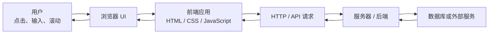
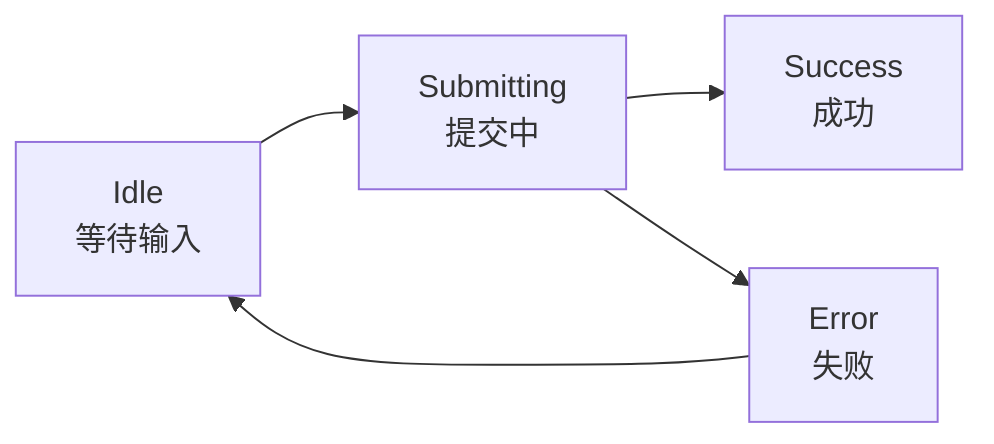
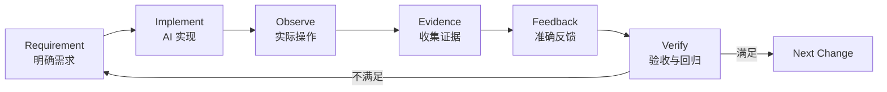

[toc]


## abstract

下面这份文档按“**AI Coding 时代的 Web 前端最低必要技术素养**”来组织。

它不是要求初学者先成为传统意义上的前端工程师，而是让你具备足够的**判断、描述、调试、验收和反馈能力**，从而显著提高与 Coding Agent 协作构建 Web 应用的效率。

> AI Coding 降低了“把代码写出来”的门槛，却没有完全消除“知道自己想构建什么、判断结果是否正确、发现问题在哪里、准确描述如何修改”的门槛。

对于通过 AI 构建 Web 应用的初学者，真正需要培养的能力可以概括为：

> **不一定要熟练手写所有代码，但至少要能够读懂页面结构，认识常见 UI 控件，理解基本交互和状态，知道浏览器在做什么，并能把需求和问题转换成 AI 可以执行的描述。**

因此，本教程并不以“背诵前端 API”为主，而是围绕下面几个目标展开：

1. 能准确描述一个 Web 页面由什么组成。
2. 能区分按钮、链接、下拉选择、菜单、对话框等常见 UI 控件。
3. 能描述布局、间距、尺寸、响应式行为，而不仅仅说“这里不好看”。
4. 能描述用户操作、应用状态和预期结果。
5. 能判断问题属于 HTML、CSS、JavaScript、网络请求、数据还是后端。
6. 能使用浏览器开发者工具（DevTools）获得比截图更有价值的信息。
7. 能向 AI 提供清晰的需求、复现步骤和验收标准（Acceptance Criteria）。
8. 能对 AI 生成的方案进行基本的技术合理性判断。
9. 理解现代 Web 项目的基本工程结构，而不被 React、Next.js、Vite、npm 等术语吓住。
10. 建立基本的可访问性（Accessibility）、性能（Performance）和安全（Security）意识。

这里尤其强调一个区别：

| 能力层次       | 典型描述                                                     |
| -------------- | ------------------------------------------------------------ |
| 只会表达感受   | “这个弹窗不太对。”                                           |
| 会描述现象     | “弹窗打开后背景还能点击。”                                   |
| 会描述交互要求 | “这是模态对话框，打开后背景区域不应可交互，Esc 应关闭，键盘焦点应限制在对话框内部。” |
| 能辅助定位     | “视觉遮罩存在，但背景按钮仍然能收到点击；请检查 modal 的交互隔离和 focus management，而不仅是提高 z-index。” |

AI Coding 环境下，后三种能力带来的效率差距非常明显。

------

## 一个重要结论：你仍然需要学习技术，但学习目标发生了变化

过去学习 Web 开发，常见目标是：

> “我必须自己知道怎样实现。”

AI Coding 环境下，更实际的目标变成：

> “我必须知道怎样描述、怎样判断、怎样验证，以及什么时候 AI 的实现虽然能运行但并不正确。”

因此初学者需要的不是“所有东西都能手写”，而是一种 **Web 技术识读能力（Web Technical Literacy）**。

可以把能力分成四层：

| 层次     | 需要做到什么                               | 初学者优先级 |
| -------- | ------------------------------------------ | ------------ |
| 产品语言 | 页面、表单、弹窗、筛选、排序、分页、状态等 | 极高         |
| Web 基础 | HTML、CSS、JavaScript、DOM、HTTP           | 极高         |
| 调试能力 | DevTools、Console、Network、Computed Style | 极高         |
| 工程实现 | React/Vue、TypeScript、构建、测试、部署等  | 逐步掌握     |

一个有效的学习顺序通常不是：

> JavaScript 语法 → 框架 → 算法 → 项目

而更适合 AI Coding 用户的是：

> **页面和控件 → 浏览器 → HTML/CSS → 交互与状态 → DevTools → JavaScript → 网络/API → 工程化 → 框架内部机制**

------

## 建立 Web 应用的整体心智模型

先不要把 Web 应用理解成“很多代码文件”。

从用户角度，它更像一条链路：



这里的几个概念非常重要。

### 前端（Frontend）

运行在用户设备浏览器中的界面和交互部分。

典型职责：

- 页面结构
- 样式
- 按钮和表单
- 用户交互
- 页面状态
- 调用 API
- 展示服务器返回的数据

### 后端（Backend）

通常运行在服务器中。

典型职责：

- 业务规则
- 数据库访问
- 用户认证
- 权限判断
- API
- 支付、邮件等服务集成

### 客户端（Client）

在典型 Web 应用中通常指浏览器这一侧。

因此你经常会看到：

- Client-side：客户端
- Server-side：服务器端
- Client Component：客户端组件
- Server Component：服务器组件

这些概念的核心并不是“代码放在哪个文件”，而是：

> **代码到底在哪里执行？浏览器，还是服务器？**

现代 Next.js 等框架尤其强调这条“网络边界（Network Boundary）”。Next.js 官方文档也将 client 定义为用户设备上的浏览器，将 server 定义为接收请求并进行计算的服务端环境。 ([Next.js](https://nextjs.org/learn/react-foundations/server-and-client-components?utm_source=chatgpt.com))

------

## 浏览器不是“显示网页的软件”，而是 Web 应用的运行环境

这是初学者很容易低估的一点。

浏览器同时承担了很多工作：

- 解析 HTML。
- 创建 DOM。
- 加载 CSS。
- 计算样式。
- 进行页面布局。
- 绘制页面。
- 执行 JavaScript。
- 发送网络请求。
- 保存 Cookie 和 Web Storage。
- 处理鼠标、键盘、触摸事件。
- 管理历史记录和 URL。
- 执行同源策略等安全机制。
- 向辅助技术暴露可访问性信息。

所以有时候 AI 生成的代码“逻辑看起来没问题”，实际页面仍然出现问题，原因可能来自：

- 浏览器默认样式；
- CSS 层叠；
- DOM 结构；
- 事件冒泡；
- 浏览器缓存；
- CORS；
- Cookie；
- 元素尺寸计算；
- stacking context；
- 响应式布局；
- 浏览器兼容性。

学习前端实际上有很大一部分是在学习：

> **浏览器是怎样理解你的代码的。**

------

## 先学会“看页面”：UI 不应该只是视觉印象

初学者面对页面时，容易看到：

> “一个网页。”

开发人员通常看到：

> “导航栏 + Sidebar + Toolbar + Form + Data Table + Pagination + Modal。”

如果你希望 AI 更准确地实现 UI，就需要逐渐建立这种“结构化观察能力”。

例如，一个典型后台页面可以拆成：

- Application Shell
  - Header
  - Sidebar
  - Main Content
- Page Header
  - Breadcrumb
  - Title
  - Primary Action
- Filter Bar
  - Search Input
  - Select
  - Date Range Picker
- Data Table
  - Header Row
  - Data Rows
  - Row Actions
- Pagination
- Modal Dialog

比起告诉 AI：

> “做一个用户管理页面。”

下面的信息已经准确得多：

> 用户管理页面采用左侧固定 Sidebar 和顶部 Header。主内容区域包含页面标题、搜索和角色筛选。主体是用户数据表格，每行右侧提供 Edit 和 Delete 操作。点击 Edit 打开模态对话框，Delete 需要二次确认。桌面端显示完整表格，小屏幕允许表格横向滚动。

这就是技术术语带来的表达效率。

------

## 常见 UI 控件：这是 AI Coding 用户最值得掌握的一组术语

很多 AI UI 问题，实际上来源于一个非常基础的问题：

> **需求里说的控件究竟是什么？**

“一个能点开的东西”“一个下拉框”“一个小弹窗”在开发语境中可能分别对应完全不同的组件。

W3C 的 ARIA Authoring Practices Guide（APG）专门定义了大量常见 UI Pattern，包括 Accordion、Breadcrumb、Button、Combobox、Dialog、Menu、Tabs、Tooltip 等。 ([W3C](https://www.w3.org/WAI/ARIA/apg/patterns/?utm_source=chatgpt.com))

### Button 和 Link

这是最重要的区别之一。

| 控件 | 英文   | 主要语义               |
| ---- | ------ | ---------------------- |
| 按钮 | Button | 执行操作               |
| 链接 | Link   | 导航到另一个资源或位置 |

例如：

- “Save” → Button
- “Delete” → Button
- “Open settings dialog” → Button
- “View documentation” → Link
- “Go to user detail page” → Link

不建议因为视觉上想做成按钮，就把链接语义改成 Button。

同样：

> 不应该因为一个 Button 被设计成文字样式，就把它改成 `<div>`。

语义 HTML 能直接获得很多浏览器内置能力，包括键盘操作、焦点和辅助技术语义。MDN 明确建议“为正确的任务使用正确的元素”；例如实际按钮应该优先使用 `<button>` 而不是模拟按钮的 `<div>`。 ([MDN Web Docs](https://developer.mozilla.org/en-US/docs/Learn_web_development/Core/Accessibility/HTML?utm_source=chatgpt.com))

------

### Checkbox、Radio 和 Switch

| 控件         | 中文理解 | 适合场景              |
| ------------ | -------- | --------------------- |
| Checkbox     | 复选框   | 多个选项可以分别开启  |
| Radio Button | 单选按钮 | 一组选项中选择一个    |
| Switch       | 开关     | 一个设置的开 / 关状态 |

例如：

通知方式：

- Email
- SMS
- Push

允许多选时适合 Checkbox。

主题：

- Light
- Dark
- System

三选一时适合 Radio。

设置：

- Enable notifications

则可以使用 Switch。

一个常见误区是：

> “只要是 true / false 就使用 Switch。”

更准确的判断还要考虑交互语义。

Switch 通常代表**立即改变某项设置**。

例如：

> “启用自动保存”。

而表单中的：

> “我同意服务条款”

更适合 Checkbox。

------

### Select 和 Combobox

中文中经常都被称为“下拉框”，但它们并不完全相同。

| 类型     | 特点                                             |
| -------- | ------------------------------------------------ |
| Select   | 从已知选项中选择                                 |
| Combobox | 输入控件关联一个 Popup，通常支持输入、筛选或建议 |

WAI APG 将 Combobox 定义为“具有相关弹出内容的输入控件”，Popup 可以展示 listbox、grid、tree 或 dialog。Combobox 有些允许文本输入，有些只允许从选项中选择。 ([W3C](https://www.w3.org/WAI/ARIA/apg/patterns/combobox/?utm_source=chatgpt.com))

例如：

国家：

> United States / Canada / Japan

选项不多时普通 Select 通常足够。

搜索城市：

> 输入 `san` 后显示 San Francisco、San Diego……

则更接近可搜索 Combobox / Autocomplete。

因此告诉 AI：

> “这里做个 dropdown。”

仍然非常模糊。

更准确的是：

> “这里使用 searchable combobox。用户可以输入关键字过滤选项，也可以使用键盘上下方向键选择，Enter 确认。”

------

### Dropdown 不是一个足够准确的组件名称

“Dropdown”更多描述的是：

> 有东西向下弹出来。

它并没有告诉开发者弹出来的是什么。

可能是：

- Select
- Combobox
- Menu
- Popover
- Date Picker

因此出现 UI 偏差时，不要只说：

> “Dropdown 不对。”

最好指出：

> “这个控件应该是 action menu，不是 form select。里面是 Edit、Duplicate、Delete 三个命令，并不是在选择一个字段值。”

------

### Menu

Menu 更接近“命令列表”。

例如一个 `···` 按钮打开：

- Rename
- Duplicate
- Archive
- Delete

这是一种非常典型的 **Menu Button**。

WAI APG 对 menu button 的定义正是：一个 Button 被激活后打开一个 Menu。 ([W3C](https://www.w3.org/WAI/ARIA/apg/patterns/menu-button/?utm_source=chatgpt.com))

所以：

> “一个显示操作列表的 dropdown”

可以改写成：

> “一个 icon-only menu button，点击后打开 action menu。”

专业程度马上提高很多。

------

### Tabs

Tabs 用于在同一区域中切换不同内容面板。

例如：

- Overview
- Activity
- Billing
- Settings

其中一个 Tab 被选中，对应的 Tab Panel 显示。

Tabs 不应该和普通导航栏、Filter Button、Segmented Control 混为一谈。

一个很有价值的需求说明是：

> “这里是真正的 Tabs，切换只替换内容区域，不打开新页面，并且当前选中项保持明显的 selected state。”

------

### Accordion / Disclosure

两者都用于展开和折叠内容。

Accordion 通常是一组垂直排列的可展开区域。WAI APG 将其描述为一组交互式标题，每一个标题控制对应内容区域显示或隐藏。 ([W3C](https://www.w3.org/WAI/ARIA/apg/patterns/accordion/?utm_source=chatgpt.com))

典型场景：

- FAQ
- 设置项分组
- 长表单分区

------

### Dialog / Modal

Dialog 是覆盖在当前界面上的独立窗口。

Modal Dialog 表示：

> 在关闭它之前，不允许用户继续操作背景界面。

WAI APG 对 Modal Dialog 的要求包括：背景内容处于 inert 状态；键盘 Tab 焦点应保持在 Dialog 内；`Escape` 通常关闭 Dialog。 ([W3C](https://www.w3.org/WAI/ARIA/apg/patterns/dialog-modal/?utm_source=chatgpt.com))

因此一个完整的 Modal 需求并不是：

> “点按钮弹个框。”

而可能是：

> 点击“Delete user”后打开 modal confirmation dialog。背景变暗且不可操作，初始焦点进入 Dialog，Esc 可以关闭；Cancel 关闭 Dialog 并恢复触发按钮焦点；Confirm Delete 使用 destructive button。

这类描述非常适合 AI。

------

### Drawer / Sheet

Drawer 通常从屏幕边缘滑入。

常见：

- Navigation Drawer
- Settings Drawer
- Detail Drawer

例如：

> 点击表格中的用户后，从右侧打开 420px 的详情 Drawer，不离开当前列表页面。

在移动设备中经常也会使用 Bottom Sheet，从屏幕底部出现。

不要把 Drawer 和 Modal 混称为“弹窗”。

------

### Popover

Popover 一般是与某个触发元素相关联、悬浮在页面上的内容容器。

例如：

- 日期选择器
- Emoji Picker
- 简单帮助内容
- Filter Panel

Popover 可以包含交互元素。

------

### Tooltip

Tooltip 用来提供简短补充说明。

典型行为：

- 鼠标 Hover 时显示。
- Keyboard Focus 时也能显示。
- 通常不应该放按钮等需要进一步操作的交互元素。

WAI APG 将 Tooltip 描述为在相关元素 Hover 或 Focus 时出现的信息 Popup，并指出 Tooltip 本身不接收焦点。 ([W3C](https://www.w3.org/WAI/ARIA/apg/patterns/tooltip/?utm_source=chatgpt.com))

如果需要放：

- Link
- Button
- Checkbox

那么它通常已经不是简单 Tooltip，而更接近 Popover 或非模态 Dialog。

------

### Toast、Alert 和 Banner

这些常常被 AI 混用。

| 控件   | 用途                         |
| ------ | ---------------------------- |
| Toast  | 短暂的操作反馈               |
| Alert  | 需要用户注意的重要信息       |
| Banner | 页面或区域顶部持续展示的信息 |

例如保存成功：

> Changes saved.

非常适合 Toast。

数据库无法连接：

> Unable to connect. Some features are unavailable.

可能需要持续 Alert / Banner，而不是出现 2 秒就消失的 Toast。

------

### Spinner、Progress Bar 和 Skeleton

它们都和 Loading 有关，但表达不同。

| 类型         | 适合表达                     |
| ------------ | ---------------------------- |
| Spinner      | 正在处理，但不知道还需要多久 |
| Progress Bar | 有明确进度                   |
| Skeleton     | 页面内容结构正在加载         |

例如：

> 页面列表初次加载时显示 Skeleton Rows，而提交按钮请求过程中只在按钮内部显示小 Spinner。

比：

> “加载时弄个 loading。”

准确很多。

------

### Table 和 Data Grid

普通 Table 更强调：

> 表格数据展示。

Data Grid 往往包含更多复杂交互：

- 排序
- 筛选
- 行选择
- 单元格编辑
- 固定列
- 键盘导航
- 虚拟滚动

不要仅仅因为“长得像 Excel”就让 AI 随意实现 ARIA Grid。复杂 Grid 的键盘和可访问性模型明显更复杂。

对于普通业务列表：

> 使用语义 `<table>` 往往比人为模拟 Grid 更合适。

------

## 学会描述 UI 状态，比学组件名称还重要

一个真实组件几乎永远不只有一个样子。

例如 Button 至少可能出现：

| 状态     | 英文术语         |
| -------- | ---------------- |
| 默认     | Default          |
| 鼠标悬停 | Hover            |
| 键盘焦点 | Focus            |
| 按下     | Active / Pressed |
| 禁用     | Disabled         |
| 加载     | Loading          |

输入框还可能有：

- Empty
- Filled
- Focused
- Invalid
- Disabled
- Read-only

Checkbox 可能有：

- Checked
- Unchecked
- Indeterminate

Accordion 可能有：

- Expanded
- Collapsed

Tabs 可能有：

- Selected
- Unselected

因此 UI 需求不要只设计：

> “组件长什么样。”

还应该定义：

> **它在各种状态下长什么样和怎样响应。**

这也是 AI 生成 UI 最容易遗漏的部分之一。

------

## 应用本质上是“状态变化”

很多交互问题都可以用一个非常有效的模型理解：

> **用户操作 → 状态发生改变 → UI 根据新状态重新呈现。**

例如登录：



假设用户投诉：

> “按钮点了没反应。”

真正的问题可能是：

- Click Event 没触发。
- Form 被浏览器拦截。
- `loading` State 没更新。
- API 没发送。
- API 发送了但一直 Pending。
- 请求失败但 Error 没显示。
- 请求成功但页面 State 没更新。
- State 更新了但 CSS 看不出来。

所以“没反应”不是一个技术结论。

你需要继续观察。

------

## 初学者应该习惯检查这些页面状态

对于包含服务器数据的页面，至少考虑：

- Initial
- Loading
- Success
- Empty
- Error

例如订单列表：

### Loading

请求正在进行。

应该出现：

- Skeleton
- Spinner
- Loading Message

至少其中一种。

### Success

成功并且有数据。

展示正常列表。

### Empty

请求成功，但结果为 `[]`。

这和 Error 完全不同。

可以显示：

> No orders yet.

### Error

网络或服务器出错。

显示：

> Failed to load orders. Retry.

因此：

> “没有数据显示”

可能至少代表三种完全不同的问题：

1. 正在 Loading。
2. 请求成功但数据为空。
3. 请求失败。

这是向 AI 反馈时必须分清的。

------

## HTML：理解“页面是什么”

HTML（HyperText Markup Language，超文本标记语言）主要定义：

> **内容和结构。**

HTML 并不是“决定页面漂不漂亮”的主要工具。

一个简单页面可能有：

```html
<header>
  <nav>...</nav>
</header>

<main>
  <h1>Users</h1>

  <form>
    ...
  </form>

  <table>
    ...
  </table>
</main>
```

这些元素告诉浏览器：

- 哪个区域是 Header。
- 哪个区域是 Navigation。
- 哪个区域是 Main。
- 哪个内容是 Heading。
- 哪个区域是 Form。
- 哪个内容是 Table。

这叫做 **Semantic HTML（语义化 HTML）**。

WHATWG 的 HTML Living Standard 持续维护现代 HTML 规范；HTML 的结构和语义最终会被浏览器解析成 DOM。 ([HTML Living Standard](https://html.spec.whatwg.org/multipage/dom.html?utm_source=chatgpt.com))

------

## DOM：浏览器眼中的页面结构

DOM 是：

> Document Object Model，文档对象模型。

可以把它理解为浏览器将 HTML 转换成的一棵对象树。

例如：

```html
<main>
  <h2>Profile</h2>
  <button>Edit</button>
</main>
```

浏览器理解为大致类似：

- main
  - h2
    - text
  - button
    - text

JavaScript 可以通过 DOM：

- 找到元素。
- 修改文本。
- 添加 Class。
- 移除元素。
- 监听事件。
- 修改属性。

MDN 将 HTML DOM API 描述为控制 HTML 元素、表单、导航历史等浏览器功能的一系列接口。 ([MDN Web Docs](https://developer.mozilla.org/en-US/docs/Web/API/HTML_DOM_API?utm_source=chatgpt.com))

理解 DOM 后，你会更容易理解：

> 为什么 DevTools 的 Elements 面板如此重要。

因为你在那里看到的是：

> **浏览器实际得到的结构。**

而不仅是源代码文件。

------

## 常见语义 HTML 元素

初学阶段尤其值得认识：

| HTML             | 语义           |
| ---------------- | -------------- |
| `<header>`       | 页头或区域头部 |
| `<nav>`          | 导航           |
| `<main>`         | 页面主要内容   |
| `<section>`      | 内容章节       |
| `<article>`      | 独立内容       |
| `<aside>`        | 辅助内容       |
| `<footer>`       | 页脚           |
| `<h1>` ～ `<h6>` | 标题层级       |
| `<p>`            | 段落           |
| `<ul>` / `<ol>`  | 列表           |
| `<a>`            | 链接           |
| `<button>`       | 操作按钮       |
| `<form>`         | 表单           |
| `<label>`        | 表单控件标签   |
| `<input>`        | 输入           |
| `<textarea>`     | 多行输入       |
| `<select>`       | 选择           |
| `<table>`        | 表格           |

语义化并不只是为了“代码漂亮”。

它直接影响：

- 可访问性；
- 键盘操作；
- 浏览器默认行为；
- SEO；
- 维护性。

MDN 特别强调，正确使用语义 HTML 能直接获得浏览器内置的可访问能力。 ([MDN Web Docs](https://developer.mozilla.org/en-US/docs/Learn_web_development/Core/Accessibility/HTML?utm_source=chatgpt.com))

------

## Form：不要低估浏览器原生表单

HTML Form 已经提供大量行为：

- 输入；
- 校验；
- 自动填充；
- 提交；
- Keyboard Interaction；
- Disabled；
- Required；
- 输入类型。

HTML Standard 本身就定义了大量 `<input>` 类型，包括：

- text
- search
- tel
- url
- email
- password
- date
- time
- checkbox
- radio
- file

等等。 ([HTML Living Standard](https://html.spec.whatwg.org/multipage/input.html?utm_source=chatgpt.com))

一个重要原则是：

> **能使用浏览器原生控件解决的问题，不要为了视觉效果轻易完全重造。**

自定义控件意味着你可能需要自己补：

- 键盘交互；
- Focus；
- ARIA；
- Disabled；
- Screen Reader 语义。

------

## CSS：理解“页面为什么长成这样”

CSS（Cascading Style Sheets，层叠样式表）负责：

- 颜色；
- 字体；
- 尺寸；
- 间距；
- Border；
- Shadow；
- Layout；
- Responsive Design；
- Animation。

很多 AI Coding 初学者最容易挫败的地方其实是 CSS。

因为 CSS 并不是：

> “设置几个像素。”

它是一个布局和约束系统。

------

## CSS Box Model：几乎所有布局问题都绕不开

浏览器可以把元素理解成一个盒子：

- Content
- Padding
- Border
- Margin

例如：

> Card 看起来太大。

不能立即得出：

> width 太大。

可能真正的问题是：

- `padding` 太大；
- `margin` 太大；
- `gap` 太大；
- `min-width` 限制；
- 父容器 Stretch；
- `box-sizing`；
- 文本换行。

因此反馈给 AI 时：

不推荐：

> “这个卡片缩小一点。”

更好：

> “卡片宽度可以保持不变，但内部 horizontal padding 从当前视觉上的约 32px 收紧到 20px，标题和正文之间的 vertical gap 也减少。”

------

## CSS 中要认识的几种尺寸

常见：

- `width`
- `height`
- `min-width`
- `max-width`
- `min-height`
- `max-height`

这几个概念非常实用。

例如：

> “页面太宽。”

经常不是应该设置：

```css
width: 900px;
```

而是：

```css
width: 100%;
max-width: 1200px;
```

意思是：

> 小屏幕尽量利用可用空间，大屏幕不要无限变宽。

这就是典型 Responsive 思维。

------

## `px`、`rem`、`%`、`vw` 不需要一开始全部精通

初学者先知道：

| 单位  | 大致含义                 |
| ----- | ------------------------ |
| `px`  | CSS Pixel                |
| `%`   | 相对父元素               |
| `rem` | 相对根字体尺寸           |
| `vw`  | Viewport Width 的百分比  |
| `vh`  | Viewport Height 的百分比 |

不要陷入：

> “到底 rem 才专业还是 px 才专业？”

现代项目通常会混合使用不同单位。

重要的是：

> **单位应该与约束意图匹配。**

------

## Normal Flow：不要一开始就靠 Position 搬东西

浏览器默认会按照正常文档流（Normal Flow）布置元素。

简单理解：

- 块元素通常上下排列。
- Inline 内容通常横向排列并换行。

现代布局最常见的是：

- Flexbox
- Grid

而不是：

- 到处 `position: absolute`。

如果 AI 生成的页面大量依靠 Absolute Position 实现普通布局，这是值得警惕的。

------

## Flexbox：一维布局的主力

Flexbox 适合：

> 一行或一列中的项目布局。

例如：

- Toolbar
- Navigation
- Button Group
- Card Header
- Icon + Label

MDN 将 Flexbox 定义为一种一维布局方法，用于排列 Row 或 Column 中的元素。 ([MDN Web Docs](https://developer.mozilla.org/en-US/docs/Learn_web_development/Core/CSS_layout/Flexbox?utm_source=chatgpt.com))

常见概念：

- Flex Container
- Flex Item
- Main Axis
- Cross Axis

常见需求可以这样描述：

> Header 使用 horizontal flex layout。Logo 靠左，Actions 靠右，中间自动占据剩余空间。

或者：

> Button group 的 items 水平排列，gap 设为 8px，并 vertically centered。

这比：

> “把两个按钮往右挪。”

好很多。

------

## CSS Grid：二维布局

Grid 适合：

> 同时考虑 Row 和 Column。

典型场景：

- Dashboard Cards
- Gallery
- Settings Layout
- Complex Page Grid

MDN 将 CSS Grid 描述为二维布局系统，用于按行和列组织内容。 ([MDN Web Docs](https://developer.mozilla.org/en-US/docs/Learn_web_development/Core/CSS_layout?utm_source=chatgpt.com))

例如：

> 桌面端使用 12-column grid。Sidebar 占 3 列，Content 占 9 列。

或者更简单：

> 卡片区域使用 responsive grid；空间足够时显示 3 列，中等屏幕显示 2 列，移动端显示 1 列。

------

## Gap、Padding、Margin 要能区分

这是描述 UI 时非常有价值的一组词。

### Padding

元素内部：

> 内容距离边框的距离。

### Margin

元素外部：

> 当前元素与外部环境的间距。

### Gap

Flex 或 Grid 中：

> 相邻项目之间的间隔。

例如你看到：

> 两个按钮间距太大。

可以告诉 AI：

> Button group 的 `gap` 从 16px 调整为 8px。

而不是：

> “两个按钮靠近一点。”

------

## Alignment：不要只说“位置不对”

建议掌握：

- Left aligned
- Right aligned
- Center aligned
- Top aligned
- Bottom aligned
- Vertically centered
- Horizontally centered
- Baseline aligned

例如：

> Icon 和 Label 看起来没有对齐。

可以描述为：

> Icon 与 Label 应在 flex row 中 vertically centered；当前 icon 视觉上偏上约 2px。

------

## Responsive Design：不是“做一个手机版”

Responsive Web Design（响应式 Web 设计）意味着：

> 页面根据可用空间和设备能力调整布局和表现。

MDN 强调响应式设计应采用灵活布局，并在内容真正开始无法良好呈现的位置设置 Breakpoint，而不是试图对每种设备做像素级适配。Flexbox 和 Grid 本身就是响应式布局的重要工具。 ([MDN Web Docs](https://developer.mozilla.org/en-US/docs/Learn_web_development/Core/CSS_layout/Responsive_Design?utm_source=chatgpt.com))

几个必须认识的术语：

### Viewport

用户当前浏览网页的可视区域。

### Breakpoint

布局发生明显改变的临界尺寸。

例如：

- Desktop
- Tablet
- Mobile

但不要把具体设备型号当成唯一依据。

更好的思路是：

> 当布局开始放不下时发生变化。

### Mobile-first

先建立小屏幕基础布局，再通过更大的 Breakpoint 增强。

它是一种设计和 CSS 策略，并不意味着：

> “只重视手机。”

------

## 一个好的响应式需求应该描述“行为”

不够好：

> “手机版做好一点。”

更好：

> 当 viewport 小于约 768px 时：
>
> - Sidebar 不再固定占据左侧空间，改为由 Menu Button 打开的 Drawer。
> - Toolbar 从一行改为两行。
> - Data table 保持最小列宽，并允许水平滚动，不强行压缩文本。
> - Dialog 左右保留至少 16px 页面边距。
> - Primary action 保持可见。

这就是 AI 可以真正执行的需求。

------

## Overflow：很多“内容被截断”的问题都在这里

常见术语：

- Overflow
- Scroll
- Horizontal Scroll
- Vertical Scroll
- Clipping
- Text Overflow

典型反馈：

> 表格在 1024px 宽度下超出内容区，目前导致整个页面产生 horizontal scroll。希望仅 table wrapper 自己 horizontal scroll，页面主体不横向滚动。

这比：

> “表格太宽。”

有效很多。

------

## Position：常见定位方式

认识这些词就已经很有帮助：

| 值         | 大致用途                 |
| ---------- | ------------------------ |
| `static`   | 默认布局                 |
| `relative` | 保持原布局并作为定位参考 |
| `absolute` | 相对定位上下文定位       |
| `fixed`    | 相对 Viewport 固定       |
| `sticky`   | 滚动到特定位置后保持     |

例如：

> 页面 Header 滚动后仍然保持在顶部。

通常意味着：

> Sticky Header。

而：

> Chat floating button 固定在右下角。

通常是：

> Fixed Position。

------

## z-index：不是数字越大越无敌

这是 AI 很容易“暴力修复”的问题。

遇到：

> Dialog 被 Header 遮住。

AI 有时会不断修改：

- `z-index: 100`
- `z-index: 999`
- `z-index: 99999`

但真正的问题可能是 **Stacking Context（层叠上下文）**。

MDN 强调 stacking context 是相互独立的层级环境；一个子元素的 `z-index` 只在其所属 stacking context 中比较，不能简单理解成所有页面元素共用一个全局 z-index 排行榜。 ([MDN Web Docs](https://developer.mozilla.org/en-US/docs/Web/CSS/Guides/Positioned_layout/Stacking_context?utm_source=chatgpt.com))

因此正确反馈可以是：

> Modal 的 z-index 已经很高，但仍被 Header 覆盖。请检查 modal portal 所在 DOM 层级以及父级是否创建了独立 stacking context，不要继续简单增加 z-index。

这就是掌握一个术语带来的巨大收益。

------

## CSS Cascade：为什么“明明写了 CSS 却没生效”

CSS 的 C 就是：

> Cascading。

多个 CSS Rule 同时命中元素时，浏览器需要决定：

> 到底谁获胜？

会涉及：

- Origin
- Importance
- Cascade Layer
- Specificity
- Scoping
- Source Order

MDN 指出，Specificity 只是 Cascade 决策中的一个阶段；不同来源或 Cascade Layer 的规则还会先比较其层叠优先级。 ([MDN Web Docs](https://developer.mozilla.org/en-US/docs/Web/CSS/Guides/Cascade/Specificity?utm_source=chatgpt.com))

初学者至少应该知道：

> “CSS 不生效”不等于浏览器没执行 CSS。

应该先去 DevTools 的 Styles / Computed 查看：

- Rule 是否匹配；
- 是否被划掉；
- 最终 Computed Value 是什么；
- 来自哪个 Rule。

------

## Modern CSS：可以用，但不要为“新”而新

现代 CSS 已经拥有许多过去需要 JavaScript 或预处理器才能实现的能力，例如：

- CSS Custom Properties
- Grid
- Flexbox
- `clamp()`
- Container Queries
- CSS Nesting
- Cascade Layers
- Logical Properties
- `:has()`

但初学者不需要马上全部学习。

判断一个新 Web Platform Feature 是否已经适合项目使用时，可以关注 **Baseline**。

Web Platform Baseline 的目标，就是告诉开发者某个 Web Feature 是否已经跨主流浏览器达到足够稳定的支持状态。2026 年仍持续更新。 ([Web.dev](https://web.dev/baseline/2026?utm_source=chatgpt.com))

所以和 AI 沟通时，必要时可以加一句：

> 优先使用 Baseline Widely Available 的 Web Platform APIs；如果使用较新的特性，请说明 browser compatibility。

------

## JavaScript：理解“页面怎样动起来”

JavaScript 在浏览器中主要负责：

- 响应用户操作；
- 改变状态；
- 修改 UI；
- 处理数据；
- 发网络请求；
- 执行业务逻辑。

初学者无需第一天就系统学习所有语法。

但这些概念非常值得掌握：

- Variable
- Function
- Object
- Array
- Condition
- Loop
- Event
- Promise
- `async` / `await`
- Module
- Import / Export

------

## Event：理解用户操作

常见浏览器事件：

- `click`
- `input`
- `change`
- `submit`
- `focus`
- `blur`
- `keydown`
- `pointerdown`
- `scroll`

例如：

> “输入搜索关键字以后更新结果。”

应该继续明确：

- 每输入一个字符就搜索？
- 按 Enter 搜索？
- 点击 Search Button 搜索？
- 是否 Debounce？
- 输入为空怎样处理？

这些区别最终都和 Event 有关。

------

## Event Bubbling：为什么点内部按钮触发了外部 Card

假设有：

- Card 点击 → 打开 Detail
- Card 内 Delete Button 点击 → 删除

用户点击 Delete 后却：

1. 触发 Delete；
2. 同时打开 Detail。

这种问题很可能与 **Event Bubbling（事件冒泡）** 有关。

浏览器事件可以从内部元素向祖先传播。MDN 将 Event Bubbling 描述为事件从目标元素向外层父元素传播的机制。 ([MDN Web Docs](https://developer.mozilla.org/en-US/docs/Learn_web_development/Core/Scripting/Event_bubbling?utm_source=chatgpt.com))

`stopPropagation()` 可以阻止继续传播，但不要形成：

> “看到冒泡问题就全部 stopPropagation。”

的习惯。

有时更好的方案是：

- 改结构；
- 调整事件委托；
- 避免把整个复杂容器变成 Click Target。

另外：

`preventDefault()` 和 `stopPropagation()` 并不是一回事。

- `preventDefault()`：阻止浏览器默认行为。
- `stopPropagation()`：阻止事件继续传播。

MDN 对两者有明确区分。 ([MDN Web Docs](https://developer.mozilla.org/en-US/docs/Web/API/Event/stopPropagation?utm_source=chatgpt.com))

------

## State：现代前端最核心的概念之一

State 可以简单理解为：

> UI 当前需要“记住”的信息。

例如：

- Dialog 是否打开。
- 当前选中哪个 Tab。
- Search Input 是什么。
- 当前页码。
- 当前用户信息。
- API 是否 Loading。
- 是否发生 Error。

在 React 中，官方文档甚至直接把 State 称为组件的“memory”。 ([React](https://react.dev/learn/adding-interactivity?utm_source=chatgpt.com))

理解 State 后，可以把很多 UI Bug 重新描述。

原始描述：

> “弹窗老是自己关掉。”

更准确：

> “Modal open state 在父组件重新 render 后被 reset。请检查是否因为 component key、conditional rendering 或 state ownership 导致本地 state 被重新初始化。”

初学者一开始未必能判断最后一句，但至少应该知道：

> “开还是关”本身是一种 State。

------

## 不要保存可以计算出来的重复 State

这是现代前端非常重要的基本思想。

假设已有：

- `items`

同时又保存：

- `itemCount`

如果 `itemCount` 永远只是：

> ```
> items.length
> ```

那么它可能属于可推导数据。

重复 State 容易失去同步。

React 官方状态管理文档也专门指出，冗余或重复 State 是常见 Bug 来源之一。 ([React](https://react.dev/learn/managing-state?utm_source=chatgpt.com))

对初学者来说，可以先形成一个问题意识：

> “这个信息真的需要单独保存吗？还是可以从其他数据推导？”

------

## UI State、Server State、URL State 最好区分

一种很实用的分类方式：

### UI State

纯界面：

- Modal Open
- Selected Tab
- Sidebar Collapsed

### Form State

用户当前输入：

- Name
- Email
- Validation Errors

### Server State

来自服务器：

- Users
- Orders
- Product Details

### URL State

适合出现在 URL：

- Search Query
- Page
- Sort
- Filter

例如：

```
?page=2&status=active
```

对于用户希望：

- 刷新后保留；
- 分享链接；
- 浏览器返回；

的页面状态，URL 往往比普通 Component State 更合理。

------

## Component：现代 UI 开发的基本组织单位

Component（组件）可以理解成：

> 可复用、有明确职责的一部分 UI。

例如：

- Button
- SearchBox
- UserTable
- UserRow
- EditUserDialog

React 官方将 Component 描述为 UI 的一个组成部分，可以小到 Button，也可以大到整个页面。 ([React](https://react.dev/learn?utm_source=chatgpt.com))

一个常见 AI Coding 问题是：

> 生成一个 1500 行的大组件。

虽然“可以运行”，但会越来越难修改。

值得要求 AI：

> 把页面按稳定的 UI responsibility 拆成合理组件，但不要为了抽象而把每个 `<div>` 都拆成组件。

------

## Props：组件的外部输入

例如：

一个 `UserCard` 需要：

- `name`
- `avatar`
- `role`

父组件将这些数据传入。

可以理解为：

> Component Parameters。

所以遇到：

> 同一个 Button 在不同位置样式不一样。

你可以考虑：

> 是不是应该存在一个 Variant Prop，例如 `primary`、`secondary`、`destructive`？

------

## TypeScript：不是另一种浏览器语言

TypeScript（TS）非常常见。

最重要的一句话是：

> **TypeScript 是 JavaScript 的静态类型检查工具和语言扩展，最终通常仍要转换为浏览器可以执行的 JavaScript。**

TypeScript 官方 Handbook 将目标明确描述为：

> JavaScript 程序的 static typechecker。 ([TypeScript](https://www.typescriptlang.org/docs/handbook/intro?utm_source=chatgpt.com))

例如 JavaScript：

```js
function greet(user) {
  return user.name;
}
```

TypeScript 可以告诉开发工具：

```ts
type User = {
  name: string;
};

function greet(user: User) {
  return user.name;
}
```

于是 AI 或编辑器更容易在运行前发现：

> 你把一个完全不符合 User 结构的值传进来了。

对 AI Coding 用户而言，TypeScript 很有价值，因为它提供了：

> **额外的机器可验证约束。**

------

## Framework 是什么

React、Vue、Svelte 等帮助开发者组织复杂 UI。

它们并没有取代：

- HTML
- CSS
- JavaScript
- Browser
- HTTP

而是建立在这些技术之上。

截至 2026 年的官方定位大致可以这样理解：

| 技术    | 初学者可以怎么理解                         |
| ------- | ------------------------------------------ |
| React   | 以 Component 和 State 构建 UI              |
| Vue     | 渐进式 JavaScript Framework                |
| Svelte  | Compiler-oriented UI Framework             |
| Next.js | 建立在 React 上的 Full-stack Web Framework |

React 官方当前文档仍以 Component、Events、State 等为核心概念；Vue 官方称其为 Progressive Framework；Svelte 强调通过 Compiler 构建组件；Next.js 官方则明确称其为用于 full-stack Web Application 的 React Framework。 ([React](https://react.dev/learn?utm_source=chatgpt.com))

初学者尤其应该避免一种思维：

> “我使用 React，所以不需要学 HTML/CSS。”

React UI 最终仍然必须面对浏览器、DOM、CSS 和 Web Platform。

------

## SPA、CSR、SSR、SSG：经常听到但不要混淆

### SPA

Single-Page Application。

页面主要在浏览器端通过 JavaScript 切换和更新，而不是每次导航都重新加载完整 HTML Document。

### CSR

Client-Side Rendering。

主要在浏览器中生成或更新页面内容。

### SSR

Server-Side Rendering。

服务器参与生成初始 HTML。

### SSG

Static Site Generation。

在构建阶段提前生成静态页面。

这些不是简单的“先进程度排序”。

它们解决的是不同问题。

例如：

- SEO
- Initial Load
- Personalization
- Hosting
- Dynamic Data
- Complexity

Vue 官方也将 SPA、SSR、SSG 列为不同使用方式，而不是互相替代的单一路径。 ([Vue.js](https://vuejs.org/guide/introduction?utm_source=chatgpt.com))

------

## Hydration 是什么

在某些 SSR Framework 中：

1. Server 先提供 HTML。
2. Browser 能先显示页面。
3. JavaScript 加载。
4. Framework 将交互逻辑连接到已有 UI。

这个过程通常称为：

> Hydration。

因此：

> 页面看得见，但刚打开时点按钮没反应。

在 SSR 应用中，有时可能与 Hydration 或 Client JavaScript 尚未准备好有关。

你不需要马上掌握其底层算法，但需要认识这个术语。

------

## HTTP：前端和服务器怎么说话

HTTP（Hypertext Transfer Protocol）是 Web 数据交换的核心协议之一。

MDN 将 HTTP 描述为客户端与服务器之间的请求-响应协议；浏览器发送 Request，服务器返回 Response。 ([MDN Web Docs](https://developer.mozilla.org/en-US/docs/Web/HTTP/Guides/Overview?utm_source=chatgpt.com))

简化理解：

```text
Browser:
我需要 /api/users

Server:
好的，这是结果。
```

真正的请求会包含：

- Method
- URL
- Headers
- Body

响应会包含：

- Status Code
- Headers
- Body

------

## API：不要把它神秘化

前端语境中的 API 经常可以理解为：

> 前端请求某个地址，服务器返回结构化数据。

例如：

```
GET /api/users
```

服务器返回 JSON：

```json
{
  "users": [
    {
      "id": 1,
      "name": "Alice"
    }
  ]
}
```

于是前端负责把它变成：

> User Table。

------

## 常见 HTTP Method

初学阶段认识下面几个就够实用：

| Method | 常见用途   |
| ------ | ---------- |
| GET    | 获取       |
| POST   | 创建或提交 |
| PUT    | 整体更新   |
| PATCH  | 部分更新   |
| DELETE | 删除       |

不要把它当绝对业务规则，但这是常见 REST 风格约定。

------

## HTTP Status Code 是调试网络问题的重要线索

建议至少认识：

| Code            | 常见含义               |
| --------------- | ---------------------- |
| 200             | 成功                   |
| 201             | 创建成功               |
| 204             | 成功但无 Response Body |
| 400             | 请求有问题             |
| 401             | 未认证                 |
| 403             | 无权限                 |
| 404             | 资源不存在             |
| 409             | 冲突                   |
| 422             | 请求语义或校验问题     |
| 429             | 请求过多               |
| 500             | 服务器错误             |
| 502 / 503 / 504 | 网关或服务可用性问题   |

所以用户说：

> “保存失败。”

最好马上查看 Network：

> Request 是多少 Status Code？

如果是 `422`，和 `500` 的处理方向完全不一样。

------

## Fetch

浏览器中的 Fetch API 是常用网络请求方式。

例如：

```js
const response = await fetch("/api/users");

if (!response.ok) {
  throw new Error(`Request failed: ${response.status}`);
}

const data = await response.json();
```

很重要的一点：

> Fetch Promise 成功完成并不自动代表 HTTP Status 是 2xx。

因此代码经常需要检查：

> ```
> response.ok
> ```

------

## CORS：非常常见的“明明 API 能访问，前端却报错”

CORS：

> Cross-Origin Resource Sharing。

浏览器出于安全原因限制某些跨 Origin Request。

Origin 主要由：

- Scheme
- Host
- Port

共同决定。

例如：

- `http://localhost:3000`
- `http://localhost:8000`

即使都是 localhost，Port 不一样，Origin 也不同。

MDN 说明，`fetch()` 等浏览器 API 受到 Same-Origin Policy 限制；跨 Origin 请求需要服务器返回正确的 CORS Header。 ([MDN Web Docs](https://developer.mozilla.org/en-US/docs/Web/HTTP/Guides/CORS?utm_source=chatgpt.com))

因此出现：

> “CORS Error。”

通常不要让 AI 在前端直接：

> “关闭 CORS。”

更应该问：

- API 服务器是否允许这个 Origin？
- Preflight 是否成功？
- Credential 是否配置正确？
- Proxy 是否配置合理？

尤其不要用：

> ```
> mode: "no-cors"
> ```

作为万能修复。

MDN 明确指出 `no-cors` 会产生 opaque response，JavaScript 无法正常读取响应内容，大多数网站并不应该这样解决 CORS。 ([MDN Web Docs](https://developer.mozilla.org/en-US/docs/Web/API/Fetch_API/Using_Fetch?utm_source=chatgpt.com))

------

## Cookie、localStorage 和 sessionStorage 不要混为一谈

### Cookie

可以随 HTTP Request 自动发送给服务器。

常用于：

- Session
- Authentication

### localStorage

浏览器侧持久 Key-Value Storage。

通常不会自动随 HTTP Request 发送。

### sessionStorage

类似 localStorage，但生命周期和 Tab Session 更相关。

一个非常重要的安全常识：

> 不要看到“需要保存 Token”就机械地让 AI 把敏感 Session Token 放进 localStorage。

实际 Authentication Strategy 要根据：

- XSS
- CSRF
- Cookie Attributes
- Backend Architecture

综合设计。

对于 Session Cookie，常常需要关注：

- `HttpOnly`
- `Secure`
- `SameSite`

MDN 建议承载敏感 Session 信息的 Cookie 使用 `HttpOnly`，避免 JavaScript 直接读取；`Secure` 用于 HTTPS；`SameSite` 可以帮助限制跨站 Cookie 行为。 ([MDN Web Docs](https://developer.mozilla.org/en-US/docs/Web/HTTP/Reference/Headers/Set-Cookie?utm_source=chatgpt.com))

------

## Authentication 和 Authorization 是两个概念

### Authentication

认证：

> 你是谁？

例如：

- Login
- Session
- Passkey

### Authorization

授权：

> 你是否有权做这件事情？

例如：

- 普通用户能查看；
- Admin 才能删除。

非常重要：

> “前端不显示 Delete Button”不是安全权限控制。

真正的 Authorization 必须在 Server 端执行。

否则用户仍可能直接请求 API。

------

## 前端安全：初学者至少认识几个红线

### 不要信任用户输入

用户输入永远应该被视为不可信数据。

### XSS

Cross-Site Scripting。

攻击者让恶意脚本进入页面执行。

OWASP 指出现代 Framework 的默认 escaping 能减少许多 XSS 风险，但并不能代替正确的输出编码、HTML Sanitization 等安全措施。CSP 是 Defense-in-Depth，而不是唯一防线。 ([OWASP Cheat Sheet Series](https://cheatsheetseries.owasp.org/cheatsheets/Cross_Site_Scripting_Prevention_Cheat_Sheet.html?utm_source=chatgpt.com))

尤其要警惕：

- `innerHTML`
- 任意 HTML Rendering
- 用户提供的富文本
- URL
- 第三方 Script

### Secret 不能放在前端

任何发到浏览器里的内容都应该假设：

> 用户最终可以看到。

因此：

- Database Password
- Private API Key
- Server Secret

不能因为写在：

> ```
> .env
> ```

就自动安全。

很多 Framework 中有明确的：

> Server-only Environment Variables

和：

> Public Environment Variables

区别。

------

## 浏览器 DevTools：AI Coding 初学者最应该尽早掌握的工具

如果只选择一项技能来提高 AI Coding 效率，我会非常推荐：

> **Browser DevTools。**

因为它可以把：

> “看起来不对”

转换成：

> “具体哪里不对”。

------

## Elements 面板

主要用于：

- 查看实际 DOM。
- 查看 Class。
- 查看 Attribute。
- 临时修改 HTML。
- 检查元素结构。

比如按钮没有 Disabled 效果，可以检查：

> 浏览器中它到底有没有 `disabled` Attribute？

------

## Styles 面板

主要看：

- 哪些 CSS Rule 命中。
- 哪些 Rule 被覆盖。
- Rule 来自哪里。
- 当前修改 CSS 的即时效果。

适合问题：

> “我让 AI 改成 12px，为什么还是 16px？”

------

## Computed 面板

查看浏览器最终算出的值。

例如：

- Width
- Height
- Padding
- Font Size
- Line Height
- Display
- Position

所以比起截图告诉 AI：

> “这个地方间距看着不对。”

你可以检查：

> 当前 Computed padding 是 `24px 32px`，我希望改成 `16px 20px`。

准确度会大幅提升。

------

## Box Model 可视化

DevTools 通常可以直接看到：

- Content
- Padding
- Border
- Margin

这对于定位：

> “空间到底从哪里来的？”

非常有价值。

------

## Console

Console 用来查看：

- JavaScript Error
- Warning
- Debug Output

典型错误例如：

- `TypeError`
- `ReferenceError`
- Unhandled Promise Rejection

向 AI 反馈时：

不推荐：

> 页面坏了。

推荐：

> 点击 Save 后页面没有响应。Console 出现 `TypeError: Cannot read properties of undefined (reading 'id')`，错误指向 `UserForm.tsx` 的 submit handler。

后者几乎已经完成了一半定位。

------

## Network：调 API 问题最重要的面板之一

Network 可以检查：

- 是否真的发送 Request；
- Method；
- URL；
- Request Headers；
- Request Payload；
- Status；
- Response；
- Timing。

假设：

> “登录没反应。”

建议按照顺序观察：

### Request 是否存在

不存在：

> 可能是前端事件 / Validation / JavaScript Problem。

存在：

继续。

### Status 是多少

例如：

- 401
- 422
- 500

### Response Body 是什么

服务器可能已经告诉你：

> ```
> email is required
> ```

但前端没有显示。

------

## Application 面板

常用于查看：

- Cookies
- Local Storage
- Session Storage
- Cache
- Service Worker

适合：

> “为什么刷新后还是旧状态？”

> “Cookie 到底有没有保存？”

------

## Responsive Device Mode

用来模拟不同 Viewport。

注意：

> 浏览器手机模拟并不等于真实手机测试。

但它非常适合早期检查：

- Breakpoint；
- Layout；
- Overflow；
- Touch Target；
- Responsive Behavior。

------

## 调试时形成“分层定位”习惯

页面出错时，不要马上修改代码。

推荐先判断在哪一层。

| 现象                     | 优先检查                       |
| ------------------------ | ------------------------------ |
| 元素不存在               | DOM / Rendering                |
| 元素存在但看不见         | CSS                            |
| 样式不对                 | CSS Cascade / Layout           |
| 点击无反应               | Event / State                  |
| 点击后 Loading 一直转    | Network / Promise              |
| 请求根本没发送           | Frontend Logic                 |
| Request 400 / 422        | Payload / Validation           |
| Request 401 / 403        | Authentication / Authorization |
| Request 500              | Backend                        |
| Request 成功但 UI 不更新 | State / Data Flow              |
| 刷新后状态丢失           | Persistence / URL / Server     |
| 只有某个浏览器异常       | Compatibility                  |

这张表非常值得形成条件反射。

------

## 调试的核心不是“猜”，而是收集证据

AI 很擅长根据线索分析问题。

但如果你只提供：

> “这不工作。”

AI 只能猜。

如果你提供：

- 操作步骤；
- 当前结果；
- 预期结果；
- Console；
- Network；
- DOM；
- Computed Style；

AI 的推理空间会被大幅缩小。

这通常比：

> “换一个更聪明的 Model 再试。”

更有效。

------

## 一个高质量 Bug Report 应该包含什么

推荐结构：

### 环境

- 页面 / Route：
- 浏览器：
- Viewport：
- 登录身份：
- Relevant Data：

### 复现步骤

1. 打开 Users 页面。
2. Search 输入 `alice`。
3. 点击第一行 Edit。
4. 修改 Role。
5. 点击 Save。

### 实际结果

例如：

> Save Button 进入 Loading，但 Dialog 一直不关闭。

### 预期结果

例如：

> API 成功后关闭 Dialog，刷新当前 Row，并显示 Success Toast。

### 已观察到的证据

例如：

> Network 中 `PATCH /api/users/123` 返回 200，Response 数据正确。Console 没有 Error。因此问题更可能位于前端成功后的 State 更新或 Dialog Close Logic。

### 范围限制

例如：

> 不修改 Backend API Contract，不重写整个 Table，只修复 Save 成功后的 UI 状态同步。

这是一种非常高效的 Coding Agent 输入。

------

## 需求描述要从“视觉”变成“约束”

初学者经常这样告诉 AI：

> “做得像 Linear 一点。”

或者：

> “现代一点。”

这种描述并非完全无效，但自由度极高。

AI 必须猜：

- Color；
- Typography；
- Spacing；
- Border；
- Density；
- Layout；
- Component Style。

更好的描述是：

> 整体使用 compact SaaS dashboard 风格。Main content 最大宽度约 1200px；背景与 Card 之间只使用轻微层次差，不使用大面积强阴影。Card radius 保持中等；主要信息使用 14–16px body text。页面密度偏高，Toolbar、Table Row 和 Form Control 不要做成过大的 marketing-site 风格。

甚至可以进一步：

> Primary button 高度 36px，secondary controls 与之保持统一 control height；table row 高度约 44px；页面 section 之间使用 24px vertical spacing。

AI 的输出会稳定很多。

------

## 设计 Token：比逐个告诉 AI 颜色更有效

Design Token 可以理解成：

> 一组统一的设计变量。

例如：

### Color

- Background
- Surface
- Text Primary
- Text Secondary
- Border
- Primary
- Danger

### Spacing

- 4
- 8
- 12
- 16
- 24
- 32

### Radius

- Small
- Medium
- Large

### Typography

- Heading
- Body
- Caption

### Shadow

- Small
- Medium

如果项目已经使用 Design System，修改时最好告诉 AI：

> 使用现有 spacing / radius / color tokens，不新增接近但重复的 magic values。

这样能显著减少：

- `#333333`
- `#343434`
- `#353535`

这种逐渐失控的样式。

------

## UI Variant：不要每个按钮写一套 CSS

Button 通常可以设计成：

- Primary
- Secondary
- Ghost
- Destructive

Size：

- Small
- Medium
- Large

State：

- Default
- Hover
- Focus
- Disabled
- Loading

所以如果 AI 在每个页面都重新创建：

- `.blue-button`
- `.save-button`
- `.toolbar-button`
- `.confirm-button`

可以考虑要求：

> 使用共享 Button component，并通过 semantic variants 表达用途，不要通过页面特定 class 重复实现同类按钮。

------

## 描述视觉偏差时，建议按固定顺序

看到页面和预期不一致时，可以按下面顺序检查。

### Structure

> 结构是否错？

例如：

- Toolbar 应该在 Card 外。
- Filter 应该和 Search 同一层。

### Layout

> Flex / Grid / Width 是否错？

### Alignment

> 左右、垂直、Baseline 是否错？

### Spacing

> Margin / Padding / Gap。

### Typography

> Font Size / Weight / Line Height。

### Surface

> Background / Border / Radius / Shadow。

### State

> Hover / Focus / Disabled / Selected。

这个顺序比：

> “感觉整体怪怪的。”

容易行动得多。

------

## 不要轻易要求“Pixel Perfect”

Pixel Perfect 通常需要：

- 明确 Reference；
- 精确尺寸；
- Font；
- Device Pixel Ratio；
- Browser Rendering；
- Asset；
- Viewport。

只给一张 Screenshot，却让 AI：

> “做到 100% pixel perfect。”

通常并不现实。

更合理的说法：

> 以 Reference Screenshot 为视觉基准，在 1440×900 viewport 下优先匹配 layout hierarchy、component dimensions、spacing 和 typography。允许字体抗锯齿等平台差异，不通过绝对定位硬编码整页坐标。

------

## 描述交互时，使用“触发 → 条件 → 状态变化 → 反馈”

这是非常实用的需求公式。

例如：

> 用户点击 Save 后，如果表单校验通过，则禁用 Save Button 并显示 loading indicator，然后发送 PATCH Request。成功后关闭 Dialog、更新 Table Row 并显示 Success Toast；失败时保持 Dialog 打开，在表单顶部显示错误，并恢复 Save Button。

这里已经定义：

- Trigger
- Validation
- Loading State
- Request
- Success State
- Error State

AI 基本不需要猜。

------

## 交互需求一定考虑失败路径

很多 AI Prototype 只实现：

> Happy Path。

例如上传：

1. 选择文件。
2. 上传。
3. 成功。

现实还应该考虑：

- 文件类型错误；
- 文件过大；
- 网络断开；
- 服务器返回 500；
- 用户取消；
- 重复上传；
- 上传中再次点击。

因此描述需求时可以主动问：

> 这个操作有哪些 Loading、Empty、Error、Disabled 和 Retry 状态？

这句话极其有用。

------

## Acceptance Criteria：让“做好了”变成可验证

Acceptance Criteria（验收标准）是 AI Coding 非常重要的技巧。

坏需求：

> 做好搜索。

更好的验收条件：

- Search 输入框位于 Toolbar 左侧。
- 输入后等待约 300ms 再请求，避免每次 Key Stroke 立即请求。
- Keyword 前后空格被忽略。
- 清空 Search 后恢复完整列表。
- 请求期间显示 Table Loading State。
- 无结果时显示 Empty State，而不是空白区域。
- Network Error 时显示 Retry。
- Search Query 写入 URL。
- Refresh 页面后仍保留搜索条件。

现在：

> “搜索是否做好？”

已经可以逐项检查。

------

## AI Coding 最有效的工作方式：不要一次生成整个复杂系统

一个常见失败方式：

> “帮我实现一个完整 CRM，现代漂亮，所有功能都实现。”

AI 可能一次生成大量：

- UI
- State
- API
- Mock Data
- Authentication
- Database
- Styling

此时任何一个环节出现问题都很难定位。

更稳定的顺序是：

### 先确定信息架构

页面有哪些。

### 再确定页面结构

有哪些 Section。

### 再确认静态 UI

先不连接复杂数据。

### 再确认 Responsive Behavior

不同宽度正确。

### 再加入交互

Modal、Tabs、Form。

### 再加入数据

API。

### 再处理完整状态

Loading、Empty、Error。

### 最后做质量检查

Accessibility、Performance、Test。

重点不是严格执行瀑布流程，而是：

> **降低每一次修改同时变化的变量数量。**

------

## 一个非常推荐的 AI 工作循环



真正决定 Coding Agent 效率的，经常不是：

> 第一次 Prompt 是否完美。

而是：

> **反馈循环是否高质量。**

------

## 第一次要求 AI 实现之前，先让需求结构化

一个实用模板：

> 我需要实现用户管理页面。
>
> **目标用户**：管理员。
>
> **页面结构**：左侧 Sidebar，顶部 Header，主区域包含 Page Header、Filters、User Table、Pagination。
>
> **主要操作**：搜索用户、筛选 Role、创建用户、编辑用户、删除用户。
>
> **Edit 行为**：点击 Edit 打开 Modal，不导航到新页面。
>
> **Delete 行为**：需要 Confirmation Dialog。
>
> **状态**：必须处理 Loading、Empty、Error。
>
> **Responsive**：桌面显示完整 Table；小屏幕允许 Table 横向滚动，Sidebar 改为 Drawer。
>
> **约束**：使用已有组件库和 Design Tokens，不新增另一套 Button/Input。
>
> **验收**：键盘可以操作主要控件，Console 无 Error，Network Failure 有用户可见错误反馈。

注意这种内容不需要复杂 Prompt Engineering。

它只是：

> 结构清楚。

------

## 修改已有页面时，不要重新描述整个产品

如果只需要修一个问题，给 AI 一个窄范围任务通常更可靠。

例如：

> 只修改 UserEditDialog，不重构 UserTable 和 API 层。
>
> 当前问题：请求成功后 Dialog 不关闭。
>
> 已确认：PATCH Request 返回 200，Response 正确。
>
> 预期：成功后更新对应 Row、关闭 Dialog、显示 Toast。
>
> 请先检查 success handler、local state 和 query/cache invalidation，不要改变 Backend API。

这种 Task Scope 很重要。

------

## 不要过早告诉 AI “怎么修”，除非你确定

假设现象：

> Button 在 Modal 后面。

如果你说：

> “把 z-index 调成 99999。”

你可能已经错误约束了解决方法。

更好的反馈：

> Button 被 Modal Overlay 覆盖行为符合预期，但 Modal Panel 本身被 Header 覆盖。请定位实际 stacking context 原因并修复，不要仅靠继续提高全局 z-index。

换句话说：

> **优先描述 Problem 和 Constraint，Implementation 可以让 AI 分析。**

------

## 什么时候应该告诉 AI Implementation

当你已经明确 Architecture 时。

例如：

> 不增加新的 global store。当前 filter 已使用 URL search params，请继续沿用 URL state。

或者：

> 不引入第三方 modal package，项目已经统一使用现有 Dialog component。

这时 Implementation Constraint 非常有价值，因为它避免 AI：

> 为修一个 Bug 又引入一套新架构。

------

## 让 AI 先解释它看到的系统，也是一种验证方法

遇到复杂代码时可以要求：

> 在修改前，先说明这个页面当前的数据流：数据从哪里获取、状态保存在哪里、UserTable 如何收到数据、Edit Dialog 如何更新数据、更新成功后列表如何刷新。

这不是为了听长篇解释。

它的价值在于：

> **检查 AI 是否真的理解现有代码。**

如果它的描述已经明显不对，就不应该马上允许它做大规模修改。

------

## 给 AI 截图时，不要只给截图

截图最适合表达：

- Visual Hierarchy
- Spacing
- Alignment
- Typography
- Color
- Visual Bug

不擅长表达：

- Click Behavior
- Console Error
- API Status
- Hidden DOM
- State Transition

所以推荐：

> Screenshot + Viewport + 操作步骤 + Console / Network 信息。

例如：

> Screenshot 是 Chrome 1440×900、100% Zoom。问题只发生在 1024px 以下。此时 Toolbar 右侧按钮溢出 Card；DOM 中仍然是一个 flex row，Computed Style 显示 `flex-wrap: nowrap`。希望空间不足时 Filter Group 换到第二行，而 Primary Action 保持第一行右侧。

这是非常高质量的反馈。

------

## AI 生成 UI 后的第一轮检查，不要只看“像不像”

建议至少检查：

### 页面结构

- Heading 是否合理。
- Link 和 Button 是否语义正确。
- Form Label 是否存在。
- Table 是否真的是 Table。

### Layout

- Desktop。
- Tablet。
- Mobile。
- 长文本。
- 空数据。

### Interaction

- Hover。
- Keyboard。
- Focus。
- Disabled。
- Loading。

### Network

- Success。
- Error。
- Slow Network。

### Content

- 很长的 Username。
- 空字段。
- 极大数字。
- 多语言。

很多 Prototype 只在：

> 6 个长度完美的英文 Mock Data

下看起来很好。

一连接真实数据就崩。

------

## Accessibility：不是“以后再做的高级优化”

Accessibility，简称：

> a11y。

2026 年进行新 Web 项目时，一个合理的参考目标仍然是 **WCAG 2.2**。W3C 建议开发或更新 Web Accessibility Policy 时使用当前版本；WCAG 2.2 目前是 W3C Recommendation。 ([W3C](https://www.w3.org/TR/WCAG22/?utm_source=chatgpt.com))

初学阶段不必背完整 WCAG，但必须形成基本习惯。

------

## Keyboard Accessibility

问自己：

> 不用鼠标，能不能完成主要操作？

常见键：

- Tab
- Shift + Tab
- Enter
- Space
- Escape
- Arrow Keys

尤其检查：

- Dialog
- Menu
- Tabs
- Combobox

不要因为鼠标能用就认为组件完成了。

------

## Focus

Focus 是：

> 当前键盘输入作用在哪个元素。

不要随意：

```css
outline: none;
```

然后不提供替代 Focus Style。

用户需要知道：

> 当前焦点在哪里。

WCAG 2.2 甚至加入了 Focus Not Obscured 等新的成功标准。 ([W3C](https://www.w3.org/WAI/standards-guidelines/wcag/new-in-22/?utm_source=chatgpt.com))

------

## Label

表单 Input 应有明确 Label。

Placeholder 不等于 Label。

不推荐仅靠：

> ```
> Enter your email
> ```

作为唯一说明。

因为用户输入后 Placeholder 消失。

------

## Icon-only Button

例如垃圾桶 Icon。

视觉用户知道是 Delete，但辅助技术不一定知道。

需要 Accessible Name。

例如：

> Delete user

而不只是：

> trash icon。

------

## Color 不能是唯一的信息渠道

例如 Error 不应该仅仅：

> 输入框边框变红。

还应该有：

- Error Icon；
- Error Text；
- Accessible Description。

------

## ARIA：不是“加上就更 Accessible”

ARIA：

> Accessible Rich Internet Applications。

它给动态 UI 和复杂 Widget 提供额外语义。

W3C 将 ARIA 定义为帮助动态内容和高级 UI Control 对辅助技术更加可访问的一组标准。 ([W3C](https://www.w3.org/WAI/standards-guidelines/aria/?utm_source=chatgpt.com))

但一个非常重要的原则是：

> **优先使用原生 HTML 语义。**

不要把：

```html
<div role="button">
```

当成比：

```html
<button>
```

更高级。

原生 Button 已经内置许多正确行为。

------

## Performance：先关注用户感知，而不是只看 Bundle 大小

现代 Web Performance 中经常提到：

> Core Web Vitals。

当前核心指标包括：

| 指标 | 衡量           |
| ---- | -------------- |
| LCP  | 主要内容加载   |
| INP  | 用户交互响应   |
| CLS  | 页面视觉稳定性 |

目前 web.dev 给出的 Good Threshold 是：

- LCP ≤ 2.5s
- INP ≤ 200ms
- CLS ≤ 0.1

并推荐使用真实页面访问的第 75 百分位判断体验。 ([Web.dev](https://web.dev/articles/vitals?authuser=5&hl=en&utm_source=chatgpt.com))

初学者无需一开始专门优化到极致，但应该理解几类常见问题。

------

## LCP

Largest Contentful Paint。

简单理解：

> 用户看到主要内容花多久。

常见问题：

- Hero Image 太大。
- Server Response 慢。
- CSS / Font 阻塞。
- Client-side Data Fetch 太晚。

web.dev 将 LCP 定义为初始导航后 Viewport 中最大可见 Image、Text Block 或 Video 等元素完成渲染的时间。 ([Web.dev](https://web.dev/articles/lcp?utm_source=chatgpt.com))

------

## CLS

Cumulative Layout Shift。

典型现象：

1. 用户准备点 Button。
2. 图片突然加载。
3. Button 被挤到下面。
4. 用户点错。

常见原因：

- Image 未预留尺寸；
- 动态内容插入顶部；
- Font 导致明显布局变化。

------

## INP

Interaction to Next Paint。

大体衡量：

> 用户操作后，页面多久产生对应视觉反馈。

例如点击：

> Button 半秒后才出现 Pressed / Loading。

用户就会感觉卡。

------

## Loading 体验不是“多放几个 Spinner”

性能体验很大程度上是：

> 用户是否知道系统正在做什么。

例如点击 Save：

不好的：

> Button 什么都不变，3 秒后突然成功。

更好：

- 立即进入 Loading；
- 防止重复提交；
- 成功后明确反馈。

这既属于 UX，也属于感知性能。

------

## npm、pnpm、yarn：Package Manager

现代前端项目通常依赖很多 Package。

例如：

- Framework
- Router
- Test Runner
- Icon Library

Package Manager 用于：

- 安装依赖；
- 管理版本；
- 执行 Script。

常见：

- npm
- pnpm
- yarn

它们不是 JavaScript Framework。

------

## `package.json`

可以把它理解成项目的重要配置清单之一。

通常包含：

- Project Metadata
- Dependencies
- Scripts

例如你会看到类似：

```json
{
  "scripts": {
    "dev": "vite",
    "build": "vite build",
    "test": "vitest"
  }
}
```

所以：

> ```
> npm run dev
> ```

通常只是：

> 执行 `package.json` 中叫 `dev` 的 Script。

不要把命令当魔法。

------

## Lockfile

常见：

- `package-lock.json`
- `pnpm-lock.yaml`
- `yarn.lock`

主要价值是：

> 记录实际依赖解析结果，提高不同环境安装的一致性。

一般不要因为：

> “依赖有问题。”

就首先删除 Lockfile 重新安装。

那可能掩盖真正的问题。

------

## Vite：常见现代前端 Build Tool

Vite 可以理解为现代 Web Project 常用的开发服务器和构建工具。

其官方文档将 Vite 概括为：

- Development Server；
- Production Build Tool。

当前 Vite 8 已使用 Rolldown 作为统一 Bundler。 ([vitejs](https://vite.dev/guide/?utm_source=chatgpt.com))

初学者不必先理解 Bundler 内部。

你只需要知道：

> Vite 不是 React。

例如：

- React + Vite
- Vue + Vite
- Vanilla JS + Vite

都可以存在。

------

## Build 是什么

开发时源码可能包含：

- TypeScript
- JSX
- CSS Imports
- Modules

Build Process 会将它们处理成适合生产部署的 Asset。

常见结果：

- HTML
- JavaScript
- CSS
- Images

可能还涉及：

- Minification
- Tree Shaking
- Code Splitting
- Hashing

------

## Development 和 Production 不一样

非常重要。

开发环境可能有：

- Hot Module Replacement
- Debug Information
- Source Maps
- Extra Warning

Production 则会：

- 优化；
- 压缩；
- 使用正式配置。

因此：

> “Dev 模式能跑。”

不能完全等于：

> “Production Build 一定没问题。”

至少应该执行一次：

> Production Build。

------

## Environment Variable

常见：

- API Base URL
- Feature Flag

但一定注意：

> Browser 可访问的 Environment Variable 不应该包含 Secret。

Build Tool 经常会将 Public Environment Variable 直接写进最终 JavaScript。

------

## Git：AI Coding 时代反而更重要

AI 能很快修改很多文件，所以：

> Version Control 重要性更高，而不是更低。

至少理解：

- Repository
- Commit
- Branch
- Diff
- Revert

尤其推荐学会看：

> **Diff。**

因为它告诉你：

> AI 到底改了什么。

------

## 每次让 Agent 大改之前最好保持可恢复状态

理想习惯：

- 当前版本能运行；
- Commit；
- 再让 AI 修改；
- 查看 Diff；
- Test；
- 再 Commit。

这样即使 AI：

> 重构了 24 个文件结果页面坏掉，

你仍然可以恢复。

------

## 不要接受与任务无关的大范围修改

例如任务：

> 修改 Modal Padding。

结果 AI：

- 升级 Framework；
- 重写 Router；
- 替换 UI Library；
- 修改 API；
- 改 30 个文件。

这是高风险信号。

可以明确要求：

> Keep the change minimal and localized. Do not refactor unrelated code.

也可以要求它解释：

> 为什么每个修改文件是必要的。

------

## Testing：不要把“我点了一遍”当完整测试

常见测试层级：

### Unit Test

测试小的 Logic。

### Component Test

测试一个 Component 的行为。

### Integration Test

测试多个模块协同。

### End-to-End Test

E2E。

模拟真实用户在浏览器中：

- Login
- Navigate
- Fill Form
- Submit

对于 AI Coding，测试尤其重要，因为：

> 测试可以把“需求”转成机器自动判断的约束。

------

## 回归（Regression）

Regression 指：

> 修复 A 后把原本正常的 B 弄坏。

例如：

> 修复 Mobile Toolbar 后 Desktop Toolbar 错位。

所以修改完成后不要只检查：

> Bug 本身有没有消失。

还应检查：

> 相邻功能是否仍然正常。

------

## Lint、Format 和 Type Check 各自做什么

### Formatter

主要处理：

> 代码格式。

例如：

- 缩进；
- 换行。

### Linter

检查：

> 代码模式和潜在问题。

### Type Checker

检查：

> 类型关系。

因此：

> ```
> format passed
> ```

不等于：

> ```
> type check passed
> ```

更不等于：

> “功能正确”。

------

## AI 说“完成”以后应该至少要求验证什么

根据项目不同，一般可以考虑：

- Type Check；
- Lint；
- Test；
- Production Build；
- Browser Console；
- Core User Flow。

不要完全相信：

> “The implementation is complete.”

要求：

> 说明实际执行了哪些验证，以及哪些没有验证。

------

## 初学者最值得掌握的术语优先级

### 第一优先级：马上就能提升 AI 沟通

| 术语           | 应该理解          |
| -------------- | ----------------- |
| Component      | UI 组成模块       |
| Button         | 执行动作          |
| Link           | 导航              |
| Input          | 输入              |
| Select         | 选择              |
| Combobox       | 输入 + Popup 选择 |
| Modal / Dialog | 对话框            |
| Drawer         | 边缘滑入面板      |
| Tooltip        | 简短辅助说明      |
| Menu           | 操作列表          |
| Tabs           | 内容切换          |
| Loading        | 加载              |
| Empty State    | 无数据            |
| Error State    | 错误              |
| Disabled       | 禁用              |
| Hover          | 悬停              |
| Focus          | 键盘焦点          |
| Responsive     | 响应式            |
| Breakpoint     | 响应式临界点      |
| Padding        | 内部间距          |
| Margin         | 外部间距          |
| Gap            | 项目间距          |
| Overflow       | 内容溢出          |

### 第二优先级：定位 Bug

| 术语            | 应该理解               |
| --------------- | ---------------------- |
| DOM             | 浏览器文档树           |
| Event           | 用户或浏览器事件       |
| State           | UI 记忆信息            |
| Props           | 组件外部输入           |
| Render          | 产生 UI                |
| Network Request | 网络请求               |
| API             | 系统接口               |
| Payload         | 请求数据               |
| Response        | 返回数据               |
| Status Code     | HTTP 结果码            |
| Console         | JavaScript 日志 / 错误 |
| CORS            | 跨 Origin 请求控制     |
| Cookie          | HTTP 状态数据          |
| localStorage    | 浏览器本地存储         |

### 第三优先级：理解项目结构

| 术语           | 应该理解              |
| -------------- | --------------------- |
| npm / pnpm     | Package Manager       |
| Dependency     | 项目依赖              |
| `package.json` | 项目和依赖配置        |
| Build          | 生产构建              |
| Dev Server     | 开发服务器            |
| TypeScript     | JavaScript 静态类型层 |
| Vite           | Build Tool            |
| SPA            | 单页应用              |
| CSR            | 客户端渲染            |
| SSR            | 服务端渲染            |
| SSG            | 静态生成              |
| Hydration      | SSR UI 接入客户端交互 |
| Git Diff       | 代码变化              |

------

## 初学者学习路线

不建议一开始：

> “完整学完 JavaScript 再做项目。”

更有效的是边做 Web Application 边获得必要知识。

### 起步阶段：UI 与浏览器

目标：

> 能把“页面”拆成明确结构。

学习：

- Page
- Header
- Sidebar
- Form
- Table
- Button
- Link
- Modal
- Menu
- Tabs
- Loading / Error / Empty

同时学：

- Chrome DevTools Elements
- Styles
- Computed
- Console
- Network

练习：

> 随便打开一个熟悉的网站，不写代码，只尝试用术语描述它的页面结构。

------

### HTML 阶段

重点：

- Semantic HTML
- Heading
- Link
- Button
- Form
- Label
- Input
- Table

练习：

> 要求 AI 生成一个完全没有 Framework 的 Profile Form，然后检查语义结构。

------

### CSS 阶段

重点：

- Box Model
- Flexbox
- Grid
- Width / Max Width
- Padding / Margin / Gap
- Position
- Overflow
- Responsive
- Cascade

练习：

> 用 DevTools 不改源码，尝试把页面布局从两列改成一列。

这会非常快地建立 CSS 直觉。

------

### JavaScript 和交互阶段

重点：

- Variable
- Function
- Object
- Array
- Event
- DOM
- State
- Async
- Promise
- Fetch

练习：

> 创建一个 TODO App，但重点不是代码，而是写清楚 Add、Complete、Delete、Empty State 和 Persistence 的行为。

------

### 网络阶段

重点：

- HTTP
- GET / POST / PATCH / DELETE
- Status Code
- Request / Response
- JSON
- CORS
- Authentication

练习：

> 操作一个真实应用，在 Network 中追踪一次“保存”。

------

### Framework 阶段

再学习：

- Component
- Props
- State
- Lifecycle / Effects
- Router
- Forms
- Data Fetching

此时你会发现 React/Vue 的很多概念已经不再抽象。

------

### 工程阶段

逐步补：

- Git
- Package Manager
- TypeScript
- Build
- Test
- Lint
- Deployment

不需要一次全部吃完。

------

## 非常推荐的练习：故意让 AI 做错

这比一直让 AI 生成正确答案更能锻炼能力。

例如要求 AI 创建：

> 一个用户列表。

然后人为制造：

### CSS Bug

让 Button 被遮住。

尝试通过 DevTools 定位：

- `z-index`
- Stacking Context

### Network Bug

API URL 改错。

观察：

- 404
- Console
- Network

### State Bug

Request 成功但不更新列表。

尝试判断：

> Network 正常，所以更可能是 UI State。

### Responsive Bug

设置固定宽度。

观察：

> Mobile Overflow。

这种练习可以快速培养：

> **技术诊断能力。**

------

## 一个非常实用的“从用户语言翻译成开发语言”表

| 用户感受                      | 可以进一步描述成                                      |
| ----------------------------- | ----------------------------------------------------- |
| 按钮太大                      | Control height / horizontal padding / font size 过大  |
| 页面太空                      | Content max-width、section spacing 或 density 过松    |
| 看起来很挤                    | Gap / padding / line-height 不足                      |
| 弹窗怪                        | Modal size、placement、overlay、focus、close behavior |
| 下拉不好用                    | Select / Combobox / Menu 类型可能错误                 |
| 手机版坏了                    | Breakpoint / overflow / wrapping / min-width          |
| 按了没反应                    | Event、Loading State、Network、Error Handling         |
| 数据没有刷新                  | State / Query Cache / Revalidation                    |
| 页面闪一下                    | Loading transition / hydration / layout shift         |
| 盖不住别的元素                | Stacking Context / z-index                            |
| 样式改了没用                  | Cascade / Specificity / Rule Order                    |
| 刷新就没了                    | State Persistence                                     |
| 登录后又退出                  | Session / Cookie / Auth                               |
| API 在 Postman 能用但网页不行 | CORS / Browser Security / Cookie                      |
| 越改越乱                      | Scope 过大 / Regression / 缺少 Design Tokens          |

------

## 给 AI 反馈 UI 问题的推荐模板

> **位置**：Users 页面顶部 Filter Toolbar。
>
> **环境**：Chrome，viewport 1024px。
>
> **当前行为**：Search、Role Select 和 Add User Button 被强制保持在一行，导致 Search 缩到约 90px，placeholder 被严重截断。
>
> **预期行为**：Primary Add User Button 保持右侧；空间不足时 Search + Filters 可以换到第二行。Search 最小宽度约 220px。
>
> **约束**：保持现有 DOM 和 Button component，优先调整 flex wrapping / sizing，不使用 absolute positioning。
>
> **验收**：1440px 时保持单行；1024px 附近可以合理换行；768px 以下 Filters 纵向排列；页面本身不能产生 horizontal scroll。

------

## 给 AI 反馈功能 Bug 的推荐模板

> **功能**：编辑用户。
>
> **复现**：
>
> 1. 打开 `/users`。
> 2. 点击任意用户 Edit。
> 3. 修改 Role。
> 4. 点击 Save。
>
> **实际结果**：Save Button Loading 后恢复，但 Dialog 保持打开，Table 中 Role 仍然是旧值。
>
> **预期结果**：Request 成功后关闭 Dialog，并立即显示新的 Role。
>
> **观察证据**：Network 中 PATCH 返回 200，Response 包含更新后的正确 Role；Console 无 Error。
>
> **初步范围判断**：Backend 看起来已经成功更新，优先检查前端 success handler、list state / query cache 更新以及 Dialog close state。
>
> **约束**：不要修改 API Contract，也不要通过整页刷新解决。

------

## 给 AI 实现一个新功能时的推荐模板

> **目标**
>
> 增加 User Search。
>
> **用户行为**
>
> 用户在 Search Input 中输入 Name 或 Email。
>
> **触发方式**
>
> 输入停止约 300ms 后自动搜索。
>
> **状态**
>
> Loading 时保留 Table Header，并显示 Skeleton Rows。
>
> **Empty**
>
> 返回 0 条时显示“No matching users”。
>
> **Error**
>
> 显示 Inline Error 和 Retry。
>
> **URL**
>
> Keyword 保存到 `?q=`，刷新和分享链接后条件保持。
>
> **Responsive**
>
> Search 在 Desktop 宽约 280px；Mobile 占满可用宽度。
>
> **Accessibility**
>
> 有 visible label 或合理 accessible name。
>
> **约束**
>
> 使用现有 Input、Table 和 query abstraction。
>
> **验收**
>
> 清空输入恢复完整列表；旧请求不能覆盖较新的搜索结果；Console 无 Error。

------

## “会描述”实际上需要三个层级

### 描述意图

> 我想让用户更容易找到订单。

### 描述产品行为

> 增加 Status Filter 和 Search。

### 描述实现约束

> Filter 放入 URL Search Params，刷新页面后条件保持。

AI Coding 初学者应该重点培养前两层。

第三层随着经验增加逐步掌握。

不要走到另一个极端：

> 为了和 AI 沟通，必须先成为高级工程师。

不需要。

------

## 遇到不懂的技术术语时，最有效的问题方式

不要只问：

> “Redux 是什么？”

可以问：

> 这个项目为什么需要 Redux？当前哪些 State 存在 Redux 中？如果不用 Redux，这些 State 可以放在哪里？对于这个项目规模它解决的具体问题是什么？

同样：

不要只问：

> “为什么要 SSR？”

而问：

> 这个页面使用 SSR 的具体收益是什么？是 SEO、首屏数据还是 Authentication？如果改成 CSR，会失去什么？

这样技术知识会和真实问题连接起来。

------

## 判断 AI 是否在“过度工程化”

下面情况值得警惕：

- 一个简单 Form 引入大型 State Library。
- 一个 Tooltip 引入复杂 Overlay Framework。
- 一个页面修改新建十几个 abstraction。
- 简单 CRUD 创建复杂 Event Bus。
- 所有东西都做成 Generic Component。
- 为可能永远不存在的需求建立插件系统。
- 为修一个 Bug 大规模迁移 Architecture。

可以告诉 AI：

> Prefer the simplest solution that satisfies the current requirements. Avoid speculative abstractions.

------

## 判断 AI 是否在“欠工程化”

反过来，也会出现：

- 所有东西一个 Component。
- 大量 duplicated CSS。
- API Request scattered everywhere。
- 没有 Loading / Error。
- Secret 放浏览器。
- `<div onClick>` 模拟 Button。
- 所有尺寸 fixed px。
- 直接使用 `innerHTML`。
- Error 全部 `console.log`。
- 所有页面用 Hard-coded Mock Data。

因此“能运行”只是最低标准。

------

## Web UI 最重要的一条原则：语义先于外观

一个东西：

> 看起来像 Button

并不说明：

> 它就是 Button。

判断应该来自：

> 用户操作它以后发生什么。

执行动作：

> Button。

前往位置：

> Link。

选择值：

> Select / Radio / Checkbox。

打开操作列表：

> Menu Button。

切换区域：

> Tabs。

打开独立工作区域：

> Dialog / Drawer。

正确命名控件往往直接提高：

- Accessibility；
- UX；
- Implementation Quality；
- AI Prompt Accuracy。

------

## Web 开发中需要养成的另一个原则：状态先于动画

不要先告诉 AI：

> “做一个很丝滑的 Loading Animation。”

先回答：

- 什么情况下 Loading？
- Loading 多久后出现？
- Loading 时能否再次点击？
- Request 成功怎么办？
- Request 失败怎么办？
- 用户取消怎么办？

状态模型正确之后：

> Animation 才是表现层。

------

## 还有一条重要原则：约束先于像素

相比：

> “左边 327px。”

更重要的问题是：

> 为什么是 327px？

真正的意图可能是：

- Sidebar 固定 280px。
- Content 填满剩余区域。
- 两边有 24px Gap。

后者比截图量出来三个 Pixel 更稳健。

------

## 对 AI 输出进行 Code Review 时，初学者可以先问这些问题

不需要一开始读懂每行代码。

可以让 AI 自己回答：

### 结构

- 修改了哪些文件？
- 为什么？
- 是否存在与需求无关修改？

### UI

- 使用了哪些现有 Component？
- 是否新建重复 Component？

### State

- 新 State 放在哪里？
- 为什么放这里？

### API

- Request 在哪里发生？
- Loading / Error 怎样处理？

### Security

- 用户输入如何处理？
- 有没有把 Secret 放到 Client？

### Accessibility

- Button / Link 语义正确吗？
- Keyboard 可以操作吗？

### Testing

- 执行了哪些验证？
- 哪些没有验证？

这相当于：

> 用 AI 辅助你 Review AI。

------

## 初学者不需要优先学习什么

为了提高 AI Web Coding 效率，一开始通常不需要深入：

- Browser Rendering Engine 内部实现；
- JavaScript Engine JIT；
- Compiler Theory；
- 高级算法；
- WebAssembly；
- 手写 Bundler；
- 自定义 Virtual DOM；
- CSS Specification 的全部细节；
- Kubernetes；
- 大规模 Distributed System。

除非你的应用真的涉及。

初期最高 ROI 仍然是：

> UI + HTML + CSS + State + Events + Network + DevTools。

------

## 一个实用的能力自测

如果你能比较自然地回答下面问题，已经拥有不错的 AI Web Coding 基础。

### 看 UI

看到页面时能否指出：

- Navigation；
- Form；
- Table；
- Modal；
- Menu；
- Tabs；
- Loading State？

### 看布局

能否分辨：

- Padding；
- Margin；
- Gap；
- Flex；
- Grid；
- Overflow？

### 看交互

能否回答：

- Trigger 是什么？
- State 怎样变化？
- Success 怎样反馈？
- Error 怎样反馈？

### 看网络

能否检查：

- Request 是否发出？
- Status 是多少？
- Response 是什么？

### 看 Bug

能否提供：

- Steps to Reproduce；
- Actual；
- Expected；
- Evidence？

如果可以做到这些：

> 即使你不能独立写出完整 React App，也已经能够非常有效地指导 AI 编程。

------

## 一个建议的“最低可行前端知识栈”

对于以 AI Coding 为主要方式构建 Web App 的初学者，不妨把最低知识栈控制在：

### 必须比较熟悉

- HTML Semantic
- Form Controls
- CSS Box Model
- Flexbox
- Grid 基础
- Responsive
- DOM 基础
- Event
- State
- HTTP
- JSON
- DevTools

### 必须认识

- JavaScript 基础语法
- Async / Await
- Fetch
- Component
- Props
- TypeScript
- API
- Authentication
- Cookie
- CORS
- npm / pnpm
- Git

### 后续逐渐掌握

- Framework State Management
- Routing
- SSR
- Testing
- Accessibility
- Performance
- Security
- Build
- Deployment

这个范围已经足以显著改善绝大多数 Coding Agent Web 项目的协作质量。

------

## Web 项目验收 Checklist

### 页面结构

- 使用合理 Semantic HTML。
- Button 和 Link 没有混用。
- Heading 层级合理。
- Form 有 Label。
- Table 结构合理。

### UI

- Spacing 一致。
- Typography 一致。
- Component Variant 一致。
- Hover 正常。
- Focus 可见。
- Disabled 明确。
- Loading 明确。

### Responsive

- Desktop 正常。
- Tablet 正常。
- Mobile 正常。
- 没有意外 Page-level Horizontal Scroll。
- 长文本不会破坏布局。

### Interaction

- Click 正常。
- Keyboard 基本可用。
- Dialog 可以关闭。
- 重复提交被处理。
- Destructive Action 有合理确认。

### Data

- Loading。
- Empty。
- Error。
- Success。
- Retry。

### Network

- Request Method 正确。
- Status Error 被处理。
- Error 不只打印 Console。
- Slow Network 下仍有反馈。

### Security

- Client 中没有 Secret。
- 不盲目渲染不可信 HTML。
- Authorization 不只依赖隐藏 UI。
- Authentication Cookie / Token 策略合理。

### Accessibility

- Keyboard 可操作。
- Focus 可见。
- Icon Button 有 Accessible Name。
- Form Error 可以被理解。
- Color 不是唯一信息载体。

### Engineering

- Type Check。
- Lint。
- Test。
- Production Build。
- Git Diff 已检查。

------

## 向 AI 提交 Bug 前的 Checklist

先回答：

- 在哪个页面？
- 哪个 Component？
- 什么 Viewport？
- 怎样复现？
- Actual Behavior？
- Expected Behavior？
- Console 有什么？
- Network Request 有吗？
- Status Code？
- Response？
- 问题每次都发生吗？
- 哪个版本以前正常？
- 是否只影响某一浏览器？
- 是否可以缩小修改范围？

只要这些问题能回答一半，AI 的修复准确率通常都会明显高于：

> “还是不行，再修一下。”

------

## AI 修改完成后的 Checklist

不要马上说：

> “看起来好了。”

至少操作一次：

- 原始 Bug 路径；
- 相邻路径；
- Success；
- Error；
- Loading；
- Mobile；
- Keyboard；
- Console；
- Network。

然后再看：

> Git Diff。

------

## 关于“技术背景用户为什么 AI Coding 效率更高”

原因通常并不是：

> 技术用户 Prompt 写得更华丽。

真正差异在于技术用户更容易：

### 建立正确抽象

看到的是：

> Modal State。

而不是：

> “那个白色框”。

### 缩小问题范围

知道：

> API 已经 200，所以先别改 Backend。

### 提供证据

会给：

> Console Error + Network Response。

### 使用正确术语

会说：

> Horizontal overflow。

而不是：

> “页面跑出去了”。

### 识别错误方案

AI 说：

> “把 z-index 改成 999999。”

有经验的人会怀疑：

> Stacking Context。

### 定义约束

知道：

> 不应该为了修一个局部 Bug 重写 Architecture。

AI 并没有让这些知识失效。

相反：

> **AI 放大了技术判断力的价值。**

------

## 但这并不意味着你必须成为传统意义上的高级前端工程师

AI Coding 带来的真正变化，是技术能力的“投入结构”发生了变化。

过去一个开发者可能花大量时间：

> 记 API、查语法、手工写 Boilerplate。

现在这些工作大量可以交给 AI。

人更值得投入的地方逐渐变成：

- 问题定义；
- Architecture Judgment；
- UI / UX；
- Technical Vocabulary；
- Debugging；
- Verification；
- Security Awareness；
- Product Understanding。

因此对于 AI Coding 初学者，最理想的目标不是：

> “没有 AI 我也能把所有代码完整写出来。”

而是：

> **“即使主要代码由 AI 产生，我仍然知道系统大体怎样工作，能够判断它是否合理，能够定位问题，并且能够精确指导下一步修改。”**

这是完全现实、也非常有价值的一条技术成长路线。

------

## 推荐形成的最终工作习惯

面对一个新需求时：

> 先描述用户目标，再拆 UI，再定义交互和状态，然后才让 AI 写代码。

面对一个 UI 偏差时：

> 先判断 Structure、Layout、Alignment、Spacing、Typography、State，不要只说“看起来不对”。

面对一个功能 Bug 时：

> 先复现，再看 Console，再看 Network，再判断层级，不要立即猜实现。

面对一次 AI 修改时：

> 先限制 Scope，再看 Diff，再运行验证，再检查 Regression。

面对一个陌生术语时：

> 不必马上深入源码，而是先理解“它在这个项目里解决什么问题”。

只要这些习惯建立起来，你会发现：

> Web 技术知识不再是一座必须先翻过去才能使用 AI Coding 的大山，而更像是一套逐渐增加精度的语言和诊断工具。

而掌握这套语言，正是技术背景用户与完全没有技术背景的 AI Coding 用户之间最主要、也最容易逐渐缩小的效率差距之一。

------

## 进一步学习时优先参考什么

对于基础 Web Platform：

> 优先参考 MDN 和 WHATWG HTML Standard。

对于 Accessibility：

> W3C WAI、WCAG 和 ARIA APG。

对于具体 Framework：

> 优先参考对应官方 Documentation，而不是只依赖旧教程。

对于浏览器兼容性：

> 可结合 MDN Browser Compatibility Data 和 Web Platform Baseline。

对于 Security：

> OWASP Cheat Sheet Series 是非常实用的工程参考。

现代 Web Platform 和工具链变化较快。例如 HTML 本身采用持续更新的 Living Standard；Baseline 也持续标记新浏览器能力；构建工具和 Framework 则可能每年出现显著变化。因此学习时最好掌握稳定概念，再针对当前项目核对官方文档。 ([HTML Living Standard](https://html.spec.whatwg.org/multipage/dom.html?utm_source=chatgpt.com))

------

## 最后的一句话

AI Coding 并没有消除 Web 开发知识的价值，它更像是把技术门槛从：

> **“必须全部亲手实现”**

逐渐移动到了：

> **“必须能够正确理解、描述、判断、调试和验收。”**

对于技术入门者，这其实是一个更友好的学习路径。

你不需要先成为前端专家再开始构建产品。

但随着你逐渐掌握：

> **HTML 语义、CSS 布局、UI 控件、交互状态、DOM、事件、HTTP、DevTools 和基本工程术语，**

你和 Coding Agent 之间的沟通会从：

> “帮我把这个地方弄好看一点。”

逐渐变成：

> “这是一个 selectable list，不是 action menu；移动端目前因为 item 的 min-width 造成 container horizontal overflow；请保持现有 DOM 语义，调整 responsive sizing，并验证 keyboard focus 和 empty state。”

到了这一步，AI Coding 的体验会发生非常明显的变化。

