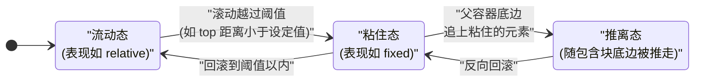
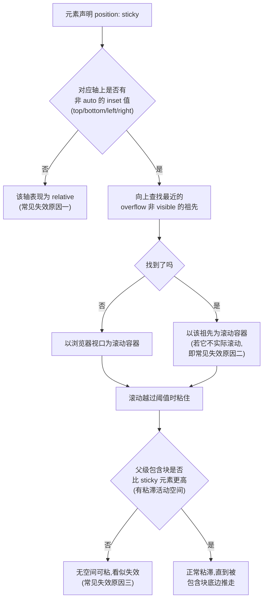

[toc]

---

## 粘性定位(`position: sticky`)完整指南

### 什么是粘性定位（Sticky Positioning）

**粘性定位**（`position: sticky`）是 CSS 定位中的一种**混合模式**：元素在正常文档流中先表现为 `relative`（相对定位），跟随内容滚动；当滚动到指定阈值（由 `top`/`right`/`bottom`/`left` 或逻辑 inset 定义）时，它“粘住”并表现得像 `fixed`（固定定位），直到其**包含块**（通常是最近滚动祖先）的边界被触达后才释放。

它始终**保留在文档流中**（不会像 fixed/absolute 那样完全脱离），因此不会影响其他元素的布局位置计算（偏移本身不推动兄弟元素）。它总是创建新的**层叠上下文**（stacking context）。

**核心价值**：用纯 CSS 实现吸顶导航、粘性侧边栏、表格表头固定、滚动索引标题等层次感效果，避免 JS 滚动监听带来的性能与复杂度问题。尤其适合现代层次分明的网页设计（多层 sticky 叠加产生深度感）。

### 写在前面:它解决什么问题

在浏览网页时,你一定见过这样的效果:

> **导航栏随页面滚动到顶部后就"钉"在那里**,不随内容一起消失。
>
> 在 `position: sticky` 技术出现之前,这类效果通常靠 `JavaScript` 监听滚动事件,在滚动到特定位置时给元素动态添加 `position: fixed`; 而固定定位会脱离文档流,还得事先给元素加一个占高度的父元素,否则切换瞬间页面会抖动。

`sticky` 用**一行 CSS 声明**替代了这一整套 JS 逻辑,而且性能更好;

> 滚动事件监听是非常昂贵的操作,滚动又是用户最高频的行为之一,在滚动事件中执行 JavaScript 很难维持 60 FPS 的流畅度,UI 容易与用户的手指/鼠标脱节。纯 CSS 的 sticky 由浏览器合成器直接处理,天然流畅。

---

### 定位体系速览:sticky 在 position 家族中的位置

先建立全局认知。`position` 属性的五个核心取值:

| 取值       | 是否占据文档流空间 | 参照物                               | 典型用途                   |
| ---------- | ------------------ | ------------------------------------ | -------------------------- |
| `sticky`   | **是**             | 最近的**滚动容器**(scroll container) | 吸顶导航、表头冻结         |
| `static`   | 是(默认值)         | 无,`top` 等属性无效                  | 常规排版                   |
| `relative` | 是                 | 自身原本位置                         | 微调、为子元素建立定位参照 |
| `absolute` | **否**(脱离文档流) | 最近的**已定位祖先**的包含块         | 弹层、角标                 |
| `fixed`    | **否**(脱离文档流) | 视口(viewport)                       | 全局悬浮按钮               |

`static` 和 `relative` 会保留元素在文档流中的自然空间,而 `absolute` 和 `fixed` 则脱离文档流呈悬浮行为;新的 sticky 与这几类都有相似之处。

**一句话定义**:`position: sticky` 让元素根据用户的滚动位置,在**相对定位(relative)**和**固定定位(fixed)**之间灵活切换,从而实现"粘性"效果。MDN 的规范化表述是:粘性定位元素(stickily positioned element)被视为相对定位,直到其包含块在其流根(或其滚动容器)内越过指定的阈值(例如将 `top` 设置为非 `auto` 的值),此时它被视为"粘住"。

---

### 基本语法与字段解释

最小可用写法:

```css
.sticky-element {
  position: sticky;
  top: 0;   /* 粘性阈值:必须至少指定一个方向 */
}
```

**这里的 `top: 0` 不是可有可无的装饰,而是 sticky 生效的必要条件**。必须指定至少一个方向值(如 `top: 10px`),否则粘性定位不会生效,元素会表现为相对定位。MDN 官方备注进一步精确到"轴"的层面:对于需要粘性定位的轴,至少需要将一个 inset 属性(`top`、`inset-block-start`、`right`、`inset-inline-end` 等)设置为非 `auto` 的值;如果某个轴的两个 inset 属性都是 `auto`,那么在该轴上 sticky 的行为将与 `relative` 相同。

各字段(inset 属性)含义逐项解释:

| 字段                   | 含义                                           | 触发时机(以垂直滚动为例)                                     |
| ---------------------- | ---------------------------------------------- | ------------------------------------------------------------ |
| `top: <length>`        | 元素上边缘与滚动容器上边缘的**最小距离**       | 元素顶边触及视口顶部(偏移 0)时开始粘住,最常用于**吸顶导航**  |
| `bottom: <length>`     | 元素下边缘与滚动容器下边缘的最小距离           | 如 `bottom: 20px` 表示元素底边距视口底部 20px 时粘住,用于**吸底操作条** |
| `left` / `right`       | 水平轴同理                                     | 用于**横向滚动**场景,如表格首列冻结                          |
| `inset-block-start` 等 | 上述属性的**逻辑属性**(logical properties)版本 | 随书写模式(如竖排、RTL)自动映射方向,国际化场景推荐           |

**易混淆辨析**:sticky 元素上的 `top: 50px` 与 `relative` 元素上的 `top: 50px` 含义完全不同——后者是"立刻从原位向下偏移 50px",前者是"**平时待在原位,当滚动导致我距滚动容器顶部不足 50px 时才粘住**"。设置 `position: sticky; top: 50px` 后,在视口滚动到元素 top 距离小于 50px 之前,元素为相对定位;之后元素固定在距顶部 50px 的位置,直到视口回滚到阈值以内。

---

### 核心机制:滚动容器、包含块与三态生命周期

这是理解 sticky 一切"怪异行为"的钥匙,也是本文的**重点章节**。sticky 的行为由两个"参照系"共同决定:

- **滚动容器 / 流盒(flow box / scrolling ancestor)**:决定元素**粘在哪里**。粘性定位中的"流盒"指粘性定位元素最近的可滚动元素(`overflow` 属性值不是 `visible` 的元素)的尺寸盒子;如果没有可滚动元素,则表示浏览器视窗盒子。
- **包含块(containing block,通常是直接父元素)**:决定元素**最远能粘多久**。sticky 被约束在其直接父元素内——一旦父元素滚出视野,元素就会"解除粘住"。

据此,sticky 元素的生命周期呈**三个状态**:



台湾 iT 邦帮忙社区的一篇文章总结得很直观:sticky 元素不会脱离原本的排版流,在还没碰到滚动祖先(scrolling ancestor)时表现像 `position: relative`;碰到之后表现像 `position: absolute`,位置固定在相对于滚动祖先这个参考点的位置上。而第三种"推离态"是 sticky 区别于 fixed 的**灵魂特性**:当滚动超过容器的范围时,元素将恢复正常流位置,重新随滚动而移动——正是这个特性造就了通讯录字母索引那种"新表头顶走旧表头"的经典层次感效果。

浏览器判定 sticky 行为的完整逻辑可以用下图表示:



规范层面还有一个更精确的概念——**粘性约束矩形**:它是粘性定位元素的包含块在文档流中呈现的矩形区域,和流盒四个边缘在应用 `left`、`top`、`right`、`bottom` 偏移计算值后的新矩形的**交集**。初学者不必死抠这个定义,记住直观结论即可:**sticky 元素永远不会跑出它的父元素边界,粘滞只发生在父元素与滚动容器重叠的范围内**。

---

### 经典应用场景与完整示例

以下场景按使用频率排序,每个例子都是可直接运行的完整片段。

#### 吸顶导航栏(最高频场景)

真实场景:一个博客站点,页头有 Logo 横幅(banner),其下是导航栏。要求横幅正常滚走,**导航栏滚到顶部时吸附**:

```html
<header class="banner">Logo 与宣传图(随页面滚走)</header>
<nav class="site-nav">首页 | 文章 | 归档 | 关于</nav>
<main>…长内容…</main>
```

```css
.site-nav {
  position: sticky;
  top: 0;            /* 触顶即粘 */
  z-index: 10;       /* 盖住后续滚上来的内容 */
  background: #fff;  /* 必须给背景色,否则下方文字会透出来 */
}
```

三个细节都不能省:**阈值 `top: 0`** 是生效前提;**`z-index`** 保证导航压在内容之上(sticky 是定位元素,`z-index` 有效);**不透明背景**防止内容从导航底下透出。注意这里 `nav` 的父元素是 `body`,`body` 足够高,所以导航能一路粘到底——这就是"包含块要够高"原则的正面案例。

#### 通讯录字母索引(展示"推离态"的层次感)

真实场景:手机通讯录按 A/B/C 分组,滚动时当前字母吸顶,**下一个字母组滚上来时把上一个字母"顶走"**:

```html
<dl>
  <dt>A</dt>
  <dd>阿林</dd><dd>安琪</dd>
  <dt>B</dt>
  <dd>白露</dd><dd>毕成</dd>
  <!-- ……更多分组 -->
</dl>
```

```css
dt {
  position: sticky;
  top: 0;
  background: #f0f0f0;
}
```

为什么会出现"顶走"效果?因为每个 `dt` 的包含块是共同的父元素 `dl`,而多个同级 sticky 元素粘在同一个 `top: 0` 位置时,**后来者会在文档流中自然地滑到前者之上并遮盖/推走它**。如果你想要更优雅的"推挤"动画,可以把每组包在独立的容器里:如果把 sticky 元素嵌套进各自的父元素中,当另一个 sticky 元素开始接触它时,前一个会开始让位移出——这是一个好的实践,效果也更雅致(此时每个标题的包含块变成了各自的分组容器,粘滞在分组结束时自然终止)。

#### 表格表头与首列冻结

真实场景:后台管理系统的数据表格,行数很多,滚动时**表头(`thead` 里的 `th`)保持可见**;列数很多时,**首列冻结**方便对照:

```css
/* 表头吸顶:sticky 要加在 th 上,而不是 thead/tr 上 */
thead th {
  position: sticky;
  top: 0;
  background: #fafafa;
  z-index: 2;
}

/* 首列冻结:横向滚动时左侧粘住 */
tbody th:first-child,
thead th:first-child {
  position: sticky;
  left: 0;
  background: #fafafa;
  z-index: 3;   /* 左上角交叉单元格需要最高层级 */
}
```

**为什么强调加在 `th`/`td` 上**:历史上浏览器对 `thead`、`tr` 这类表格中间盒子的 sticky 支持很不一致(早年 Chrome 长期不支持),把 sticky 施加到单元格上是**兼容性最稳的写法**。张鑫旭的文章里也记录过类似的表格实践困惑:table 的父级元素设置了 `overflow: auto` 后,第一列设置 `position: sticky` 能固定在左边,第一行却可能没有粘附效果——表格 + sticky 的组合务必逐浏览器实测。

#### 侧边栏目录(TOC)随读随停

真实场景:文档站左文右目录的双栏布局,目录随滚动保持可见,但**不越过所属文章的范围**:

```css
.layout {
  display: flex;
  gap: 24px;
}
.toc {
  position: sticky;
  top: 80px;              /* 给已有的 80px 高吸顶导航让位 */
  align-self: flex-start; /* Flexbox 场景的关键一行,见下文 */
  max-height: calc(100vh - 96px);
  overflow-y: auto;       /* 目录自身太长时内部滚动 */
}
```

两个要点:第一,如果页面还有固定表头,应把表头的高度计入 `top` 偏移量——所以这里写 `top: 80px` 而非 `top: 0`。第二,**`align-self: flex-start` 在 Flex 布局中几乎是必写的**:Flex 子项默认 `align-items: stretch`,会被拉伸到与最高的兄弟(正文)等高,导致 sticky 元素"自身已占满父容器高度、无空间可粘"而失效。"检查 sticky 元素是否在 Flexbox 中被拉伸"正是官方排查清单中的独立一项。

#### 吸底操作条(`bottom` 方向)

真实场景:移动端商品详情页,"加入购物车 / 立即购买"操作条,内容不足一屏时待在自然位置,内容很长时**先粘在屏幕底部**,滚到详情末尾后回归文档流:

```css
.action-bar {
  position: sticky;
  bottom: 0;
  background: #fff;
  box-shadow: 0 -2px 8px rgba(0, 0, 0, 0.08);
}
```

`top` 适合绝大多数吸顶导航,而 `bottom` 适合页脚类粘性元素。`bottom` 方向的粘滞逻辑与 `top` 镜像:元素**从下方进入视口前**就先粘在底部,滚动到其自然位置后解除。

---

### sticky 失效排查(最有实战价值的一节)

sticky 失效几乎总是出于少数几种原因之一,而且**不会抛出任何错误**——元素只是像从未声明过 sticky 一样滚走了;按顺序过一遍清单就能快速定位。

| 优先级 | 症状根因                | 检查点                                                       | 修复方式                                                     |
| ------ | ----------------------- | ------------------------------------------------------------ | ------------------------------------------------------------ |
| 1      | **缺少阈值**            | 这是头号原因:sticky 需要 `top`/`right`/`bottom`/`left` 至少一个来确定钉在哪里,缺了它声明依然合法但永不生效 | 补上 `top: 0` 等;并确认该值没有被层叠中更低处的规则覆盖      |
| 2      | **祖先设置了 overflow** | 第二大原因:sticky 元素与滚动根之间的某个祖先带有 `overflow: hidden`/`auto`/`scroll`,它会成为新的滚动容器,元素只在它内部粘滞——看起来往往就是完全不粘 | 移除该 `overflow`;或给该祖先**设定高度使其真正滚动**(见下文);或改用 `overflow: clip` |
| 3      | **父元素不够高**        | 如果父元素和 sticky 元素一样高,就没有可移动的空间,看起来就像不粘 | 给父元素更多高度,或把 sticky 元素上移一层 DOM                |
| 4      | **Flex/Grid 拉伸**      | 子项被 `stretch` 拉满父容器高度,等效于原因 3                 | 加 `align-self: flex-start`(或 `start`)                      |
| 5      | **父级高度陷阱**        | 父容器上的 `height: 100%` 或 `height: -webkit-fill-available` 等组合可能破坏粘性行为 | 改用 `min-height` 或明确的高度来源                           |
| 6      | **样式被覆盖**          | 其他 CSS 规则覆盖了粘性声明;用开发者工具检查元素的最终计算样式 | 提高选择器特异性                                             |

**重点展开原因 2(overflow 祖先)**,这是实际项目中最阴险的一类,因为肇事的 `overflow` 往往写在很远的布局容器上:

- 典型翻车现场:一切正常,直到你因为某个兄弟元素需要横向滚动(比如横滑卡片区)而给 sticky 元素的祖先加了 `overflow-x: hidden`——sticky 立刻失灵。因为 overflow 创建了新的格式化上下文,sticky 元素改以这个祖先作为粘滞参照,而它永远到不了那个祖先的顶部。
- **修复方案 A——给滚动容器设高度**:W3C CSSWG 的讨论中就有结论:若给 sticky 祖先设置了非默认 `overflow`,还需要同时给该祖先设置高度(如 `.wrapper { overflow-x: hidden; height: 100vh; }`),否则 sticky 不生效。原理:祖先有了确定高度并真正成为滚动区域后,sticky 就名正言顺地"粘在它里面"。
- **修复方案 B——改用 `overflow: clip`**(现代推荐):当你加 `overflow-x: hidden` 只是想裁剪横向溢出、根本不想造出滚动容器时,`clip` 是更对症的值——`clip` 的裁剪效果与 `hidden` 相同,区别是它完全禁用了任何形式的滚动,因此**不会创建滚动容器,也就不会劫持 sticky 的参照系**。这是近年社区公认的现代化解法。
- **调试脚本**:肉眼翻查几十层 DOM 不现实,在浏览器控制台跑这段脚本一次列出所有嫌疑祖先:在开发者控制台执行以下代码,可以找出所有 `overflow` 计算值非 `visible` 的祖先元素:

```js
let parent = document.querySelector('.sticky').parentElement;
while (parent) {
  const overflow = getComputedStyle(parent).overflow;
  if (overflow !== 'visible') console.log(overflow, parent);
  parent = parent.parentElement;
}
```

英国开发者 John Kavanagh 给出的排查心法值得背下来:先查 inset 值;再检查哪个祖先提供了滚动口(scrollport)、哪个盒子提供了包含块、目标轴上是否有 inset、sticky 元素在到达包含块边界前是否还有移动空间;并留意祖先上的 `overflow`、滚动与 `contain` 规则是否创建了与预期不同的上下文。(注:`contain: paint/layout` 等**CSS 容器性属性**同样会劫持 sticky 的包含块,排查时别漏掉。)

---

### sticky 与 fixed 的辨析

初学者最容易把两者混为一谈,列表对比:

| 维度       | `position: fixed`               | `position: sticky`                  |
| ---------- | ------------------------------- | ----------------------------------- |
| 文档流     | 脱离,不占空间(需手动占位防抖动) | **保留原空间**,无抖动               |
| 参照物     | 视口(或有 `transform` 的祖先)   | 最近的滚动容器                      |
| 生效范围   | 永远固定                        | **仅在包含块范围内**粘滞,滚过即释放 |
| 需要阈值   | 否                              | **是**(至少一个 inset)              |
| 局部滚动区 | 不跟随局部容器                  | 天然支持容器内粘滞                  |

经验法则:**"永远悬浮"用 fixed,"陪一段路"用 sticky**。需要"元素只在其所属区块可见期间吸附"的一切场景(分组标题、章节侧栏、表头),sticky 都是正解。

---

### 兼容性与渐进增强

好消息是兼容性早已不是障碍:`position: sticky` 支持 Chrome 56+、Edge 16+、Firefox 32+、Opera 42+、Samsung Internet 6.2+ 和 Safari 13+,在 Chrome、Firefox、Safari、Edge 等现代浏览器中支持都很强且稳定。国内主流浏览器(360、QQ、UC、微信内置 WebView 等)内核均基于 Chromium/WebKit 较新版本,亦无问题。需要留意的边角:

- **IE**:IE 11 及更早版本完全不支持,IE 会把 sticky 视为非法值回退到 `static`,元素留在正常流中、没有任何粘滞——好在"回退到正常流"通常是可接受的优雅降级。
- **老 Safari 前缀**:旧版 Safari 需要 `-webkit-` 前缀,写法为先 `position: -webkit-sticky;` 再 `position: sticky;`。Safari 13+ 已无需前缀,如今仅在需要兼顾很老的 iOS 时保留双写。
- **表格元素**:如前所述,`thead`/`tr` 上的 sticky 历史支持不一,**优先写在 `th`/`td` 上**。
- **特性检测**:需要精确区分时用 `@supports`。一个真实的防御场景——如果 sticky 元素内部有 `position: absolute` 子元素,在不支持 sticky 的老浏览器里该元素不会成为定位参照;更稳的方案是父级先写 `position: relative`,再在 `@supports (position: sticky)` 块内升级为 sticky 并设置 `bottom` 偏移(注意 `@supports` 必须写在根层级,不能嵌套):

```css
.panel {
  position: relative; /* 兜底:保证 absolute 子元素有参照 */
}
@supports (position: sticky) {
  .panel {
    position: sticky;
    bottom: 20px;
  }
}
```

- **移动端补充**:避免在父元素上使用 `overflow: hidden`,并始终包含 viewport meta 标签——后者是移动端布局的通用前提,缺失时各种定位行为都会异常。

---

### 无障碍与用户体验注意事项

粘性元素改善导航效率的同时也有代价,粘性导航菜单会引入无障碍(accessibility)方面的挑战,需要用简单的最佳实践来应对。实践建议:

- **控制占屏高度**:吸顶元素在小屏幕上会持续吞掉可视区域;移动端可考虑降低其高度、或"下滑隐藏 / 上滑再现"的混合策略。
- **锚点跳转让位**:页面内 `#anchor` 跳转会被吸顶栏遮住目标标题,用现代 CSS 一行解决:给目标元素(或全局 `:target`)设置 `scroll-margin-top: 导航高度`。
- **键盘与焦点**:Tab 聚焦到被粘性条遮挡区域的链接时,同样存在遮挡问题,`scroll-padding-top`(设在滚动容器上)可统一治理。
- **对比度与层级**:吸附后元素叠在任意内容之上,务必保证背景不透明、文本对比度达标(WCAG AA)。

---

### 最佳实践清单(速查)

**只看这一节也能做对大部分事情**:

- **必写阈值**:`position: sticky` 永远搭配至少一个 `top`/`bottom`/`left`/`right`。
- **必给背景与 `z-index`**:粘住后会与内容重叠。
- **父容器要够高**:sticky 只在父元素内活动;Flex/Grid 里记得 `align-self: flex-start`。
- **警惕一切祖先 `overflow`**:纯裁剪需求一律改用 `overflow: clip`;确需滚动容器就给它明确高度。
- **表格场景 sticky 写在 `th`/`td` 上**。
- **配套 `scroll-margin-top`** 修正锚点遮挡。
- **优先 CSS,拒绝 JS 滚动监听**:sticky 覆盖不了的复杂联动(如"粘住后变色"),优先考虑 **Intersection Observer** 或新兴的 **CSS 滚动驱动动画(scroll-driven animations)**,而不是 `onscroll`。
- **失效时按顺序排查**:阈值 → 祖先 overflow(跑上文调试脚本)→ 父容器高度 → Flex 拉伸 → 样式覆盖。

---

### 延伸阅读

- MDN 官方文档 *CSS position*(中文版可访问 `developer.mozilla.org/zh-CN/docs/Web/CSS/position`)——规范术语与权威行为定义
- W3C *CSS Positioned Layout Module Level 3*——sticky 的规范出处
- 张鑫旭 *"杀了个回马枪,还是说说 position:sticky 吧"*——中文社区对粘性约束矩形的深度解读
- Elad Shechter *"CSS Position Sticky — How It Really Works!"*——三态机制的经典图解文章
- caniuse.com——查询 sticky 在各移动浏览器的最新支持情况

