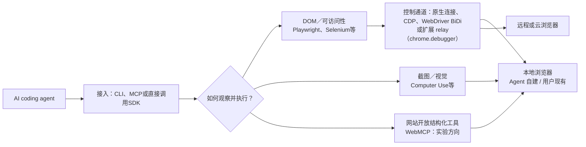
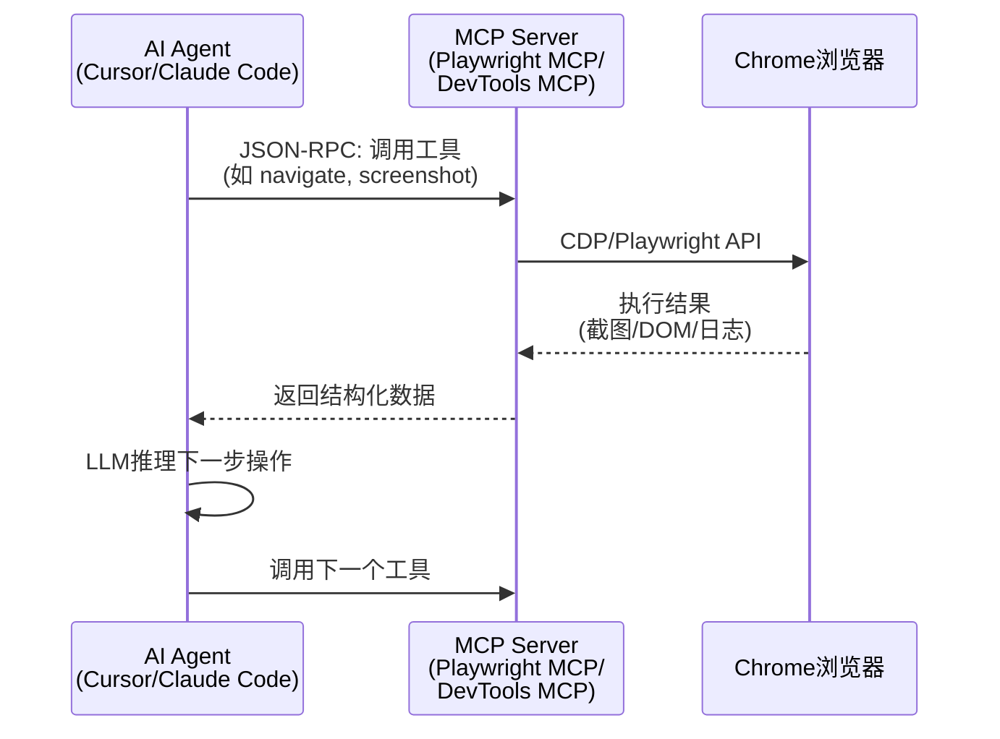
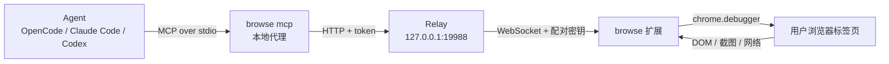
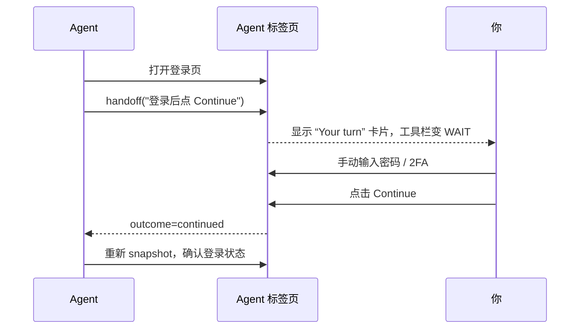
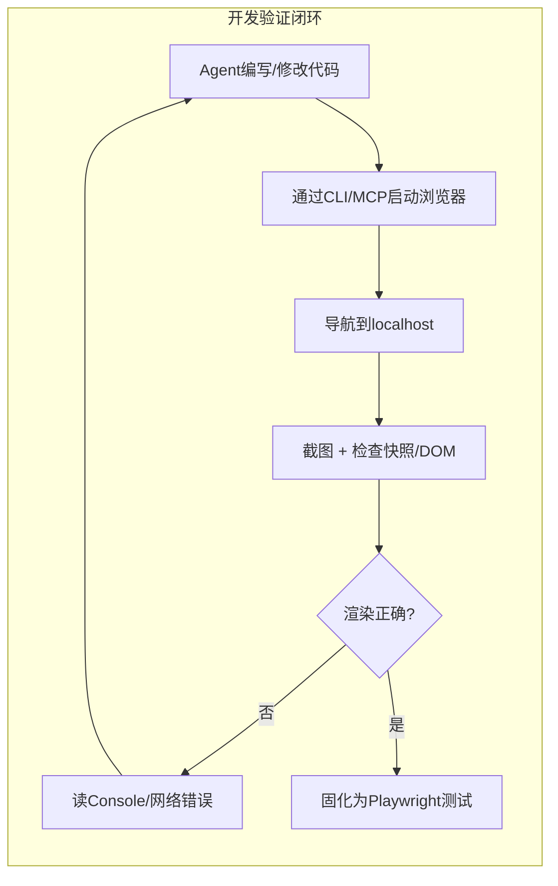

[toc]

---

## AI Coding Agent 使用浏览器的方式：全景调研报告

> **信息来源**: Google Chrome 官方文档（developer.chrome.com，含 Chrome DevTools for Agents / WebMCP）、Microsoft Playwright 官方文档（playwright.dev，含 CLI / MCP / browsers / api）、Puppeteer 官方文档（pptr.dev）、W3C WebDriver BiDi（TR，2026-09-24 Working Draft）、WebKit 博客（Safari MCP server，2026-07-01）、Browserless 官方文档（connection-urls）、OpenCode Browse 产品页与 0.1.x 实测（Flavio Copes，2026-11-17）、OpenCode Desktop 更新日志（v2.4.0，2026-11-23）、Chrome DevTools MCP 仓库（v1.13.0，2026-11-11）、GitHub 各开源项目（Browser Use、Stagehand、agent-browser、chrome-devtools-mcp、Midscene、Page Agent、UI-TARS），以及 2026 年 AI 浏览器产品公告/报道（OpenCode Browse/Desktop、Perplexity Comet、Gemini in Chrome、ChatGPT Atlas 退场）。
> **知识截止**: 2026-11-24。版本号、命令行与配额数字按上述来源核验；产品迭代很快，涉及具体版本时以官方当前文档为准；凡宣传性基准数字一律弱化处理，以自己页面的实测为准。
> **术语约定**: MCP 指 Model Context Protocol(模型上下文协议)，SSO 指 Single Sign-On(单点登录)，SaaS 指 Software as a Service(软件即服务)，2FA 指 Two-Factor Authentication(双因素认证)，IDE 指 Integrated Development Environment(集成开发环境)。

**先给结论：** 如果目标是让 coding agent 开发并验证自己的 Web 应用，优先用 **Playwright 脚本形成可重复测试**，用 **Playwright CLI 或 MCP 辅助探索页面**；排查 Chrome 网络、性能问题时加用 **Chrome DevTools MCP**。如果任务必须使用你已登录的 SaaS、需要 SSO 或依赖浏览器扩展状态，才用 **扩展/授权方式接入你的真实浏览器**（OpenCode Browse、Playwright MCP `--extension`、Chrome DevTools MCP `--autoConnect`），并把登录、2FA、支付等步骤留给人。**无头**适合 CI(持续集成)，**CDP**适合接入现有 Chromium 或深入诊断，**视觉操作**适合结构化定位困难的界面。它们属于不同层次，通常应当组合，而不是单选。

---

### 当前 AI 使用浏览器的形态

“AI 使用浏览器”不是一种产品，而是几种边界不同的形态。先分清**浏览器归谁、登录态从哪来**，再谈工具选型。

| 形态 | 浏览器归谁 | 登录态来源 | 典型代表 | 适合 | 主要代价 |
| ---- | ---------- | ---------- | -------- | ---- | -------- |
| **Agent 自建干净浏览器** | Agent 启动的独立实例 | 测试账号、`storageState` | Playwright、Puppeteer、Selenium | 回归测试、CI、可重复验证 | 与用户真实环境不同；需自备测试数据 |
| **借用用户的真实浏览器** | 你日常使用的 Chrome/Edge 等 | 现有 Cookie、SSO、扩展 | OpenCode Browse、Playwright MCP `--extension`、Chrome DevTools MCP `--autoConnect`、Claude in Chrome | 已登录 SaaS、无 API 后台、必须人工接管的步骤 | 权限面大、隔离弱、难复现；不适合 CI |
| **AI 原生浏览器** | 专用浏览器或系统浏览器内建 | 用户 profile / 托管登录 | Perplexity Comet、Gemini in Chrome auto browse、Edge Browse with Copilot、Opera Neon、BrowserOS | 消费级跨标签任务、研究、日常操作 | 产品与套餐变动快；不宜作为工程回归依赖 |
| **IDE/桌面内建浏览器** | 开发工具内嵌或专用 profile | 导入的登录/历史、持久 profile | OpenCode Desktop 内建浏览器 | 开发时人机共看、评论、调试 | 长期保存登录态；不等于隔离环境 |
| **云端浏览器** | 云端托管 | 云端会话/注入凭据 | Browserbase、Browserless、Steel、Hyperbrowser | 并发、隔离、规模化采集 | 费用、延迟、数据出境与凭据保管 |
| **网站暴露工具/页内 agent** | 网站自己的页面 | 站点会话 | WebMCP、Page Agent | 自有站点、减少模拟点击 | 实验性；需要站点改造 |
| **视觉/computer use** | 任意可见界面 | 屏幕上的现有会话 | UI-TARS、截图坐标类 agent | Canvas、无 DOM、跨应用 | 慢、贵、坐标脆弱 |

对 coding agent 来说，日常最常用的是**自建干净浏览器**（可重复验证）和**借用真实浏览器**（复用登录态）；**IDE 内建浏览器**用于开发时人机共看；AI 原生浏览器更多是产品形态参考；云端解决规模化；WebMCP 是网站侧改造；视觉是兜底。下面的分层模型说明它们如何组合，而不是互相替代。

> 消费级 AI 浏览器在 2026 年变化很快：OpenAI 已停止独立的 ChatGPT Atlas，把浏览能力并入 ChatGPT 桌面端与扩展。这提醒我们，**产品形态会合并、迁移甚至下线**；工程方案应把“浏览器能力”与“某个具体浏览器产品”解耦。

---

### 全局概览：分层组合，而不是单选

AI Coding Agent 要“使用浏览器”，本质是解决：**让 LLM 能感知(看到)和操控(交互)真实 Web 页面**，并把一次性的探索固化为可重复的验证。

不要把 CLI / MCP / CDP / 无头 / 云端并列比较。正确的心智模型是分层组合：



| 层次 | 说明 | 典型代表 |
| ---- | ---- | -------- |
| **Agent 入口** | Agent 以什么形式调用浏览器能力 | Playwright CLI + Skills、Playwright MCP、Chrome DevTools MCP/CLI、OpenCode Browse、SDK |
| **浏览器归属** | 浏览器是 Agent 新建、借用用户现有、IDE 内建，还是云端托管 | Playwright 独立实例、扩展接入、OpenCode Desktop、Browserbase |
| **观察与执行** | 靠什么定位和断言 | DOM/可访问性树、截图/视觉坐标、WebMCP(网站主动暴露工具) |
| **控制通道** | 用什么协议驱动浏览器 | Playwright 原生连接、CDP、WebDriver BiDi、扩展 relay |
| **运行方式** | 浏览器跑在哪里、是否可见 | 本地/远程(云浏览器)、有头/无头 |

几种典型组合：

- **coding agent → CLI → Playwright → 无头 Chromium**(本地开发验证、CI 回归)
- **coding agent → MCP → Chrome DevTools → CDP → 已打开的 Chrome**(接手调查线上/已登录页面)
- **coding agent → MCP → 浏览器扩展 → 用户真实浏览器**(必须复用现有登录态、SSO 或扩展；人工接管登录步骤)

Playwright 自身支持 Chromium、Firefox、WebKit；但 **Playwright 通过 CDP 接入现有浏览器（`connectOverCDP` 或 CLI 的 attach 方式）只适用于 Chromium 系**，且官方明确其保真度低于 Playwright 原生连接(`browserType.connect()`)。扩展 relay 方式底层同样落在 CDP(`chrome.debugger`)，但连接与授权模型不同，见后文。

---

### 底层控制通道：CDP、WebDriver、BiDi 与扩展 relay

这是理解一切上层差异的根基。

#### Chrome DevTools Protocol (CDP)

每个 Chromium 都内置的远程控制 API，即 F12 DevTools 背后使用的同一协议。

- **通信**：基于 WebSocket 的双向 JSON-RPC，如 `ws://localhost:9222/devtools/browser/...` 或 `http://localhost:9222`(HTTP 仅用于发现端点)。
- **能力**：按 DOM、Network、Debugger、Performance 等**域(domain)**提供命令和事件，可做 DOM/CSS 检查、网络拦截、Console 读取、性能轨迹、截图等，诊断深度最强。
- **覆盖**：仅 Chromium 系(Chrome、Edge、Brave 等)。
- **版本注意**：CDP 持续演进，不保证任意版本间兼容；直接写底层 CDP 要处理会话与协议变化。

几个容易混淆的安全变更(均已核验，见下文接管已登录浏览器)：

- **9222**一类端口是**浏览器调试端口，不是业务站点端口**。
- Chrome 自 **136 版**起，用 `--remote-debugging-port` / `--remote-debugging-pipe` 不再接受调试**默认用户数据目录**，必须配合指向非默认目录的 `--user-data-dir`([developer.chrome.com/blog/remote-debugging-port](https://developer.chrome.com/blog/remote-debugging-port))。这与后文 Chrome 144+ 的用户授权路径是两条不同路径，不要混为一谈。

#### 扩展 relay：把 CDP 放进浏览器扩展

除了直接开调试端口，还有一条越来越常见的路：**浏览器扩展通过 `chrome.debugger` API 使用 CDP，再通过本地 relay 把能力交给 Agent**。它不需要 `--remote-debugging-port`，也不占用 9222。

- **连接模型**：Agent ←MCP/CLI→ 本地 relay ←WebSocket→ 扩展 ←`chrome.debugger`→ 标签页。扩展只在你授权的浏览器里运行，通常还要配对一次。
- **能力范围**：仍然是 CDP 能力，但由扩展代为执行；可以做快照、点击、输入、截图、网络记录，也便于实现“只操作我借给你的标签页”、“需要登录时还给你”等产品化约束。
- **覆盖**：Chromium 系浏览器；Firefox/WebKit 不适用。
- **安全边界**：扩展权限通常很宽（读取和更改所有网站数据、调试器），**产品化的允许列表和只读模式是防误操作，不是数据隔离**。具体见后文 OpenCode Browse 案例。
- **典型实现**：OpenCode Browse、Playwright Extension（`--extension`）、browser-tools-mcp。

这条路径补上了“CDP 调试端口”和“用户授权 autoConnect”之间的空白：它复用你正在用的浏览器和登录态，但接入单位是**标签页**，而不是整个浏览器进程。

#### WebDriver (W3C 标准)

- **通信**：HTTP REST 请求-响应，需独立 driver(ChromeDriver、GeckoDriver)做代理。
- **能力**：标准化的操作子集(导航、元素交互、窗口管理)，相比 CDP 诊断能力窄。
- **覆盖**：最广，几乎所有主流浏览器。
- **代价**：多一层代理 + 缺少 auto-wait，Agent 跑数百步时延迟累积明显，维护负担重(版本匹配、Grid 配置)。

#### WebDriver BiDi(双向 WebDriver)

- 结合 WebDriver 跨浏览器兼容性 + CDP 双向事件流的**下一代标准化路线**，可订阅日志、网络等事件。
- **标准状态**：本文核验到的 W3C 文本为 **2026-09-24 Working Draft**([w3.org/TR/webdriver-bidi](https://www.w3.org/TR/webdriver-bidi/))，仍在演进，不宜假定所有浏览器和功能完全一致。**不要把 BiDi 描述为已经全面替换 CDP**。
- **Puppeteer 现状(已核验，[pptr.dev/webdriver-bidi](https://pptr.dev/webdriver-bidi))**：在 Chrome 上默认仍用 CDP，在 Firefox 上默认用 BiDi；部分 CDP 能力尚不能通过 BiDi 获得。Selenium 4+ 也在接入 BiDi，但覆盖仍在补齐。

| 维度 | **CDP** | **WebDriver** | **WebDriver BiDi** |
| ---- | ------- | ------------- | ------------------ |
| 通信模型 | WebSocket 双向 | HTTP 请求-响应 | WebSocket 双向 |
| 浏览器覆盖 | 仅 Chromium | 所有主流浏览器 | 逐步扩展中 |
| 调试能力 | 极强(性能追踪、网络拦截、Console) | 有限 | 中等(逐步增强) |
| 延迟 | 低 | 较高(多一层代理) | 低 |
| 标准化 | Chrome 事实标准 | W3C 标准 | W3C Working Draft(2026-09-24) |
| AI Agent 适配 | 最佳(信息密度高) | 较弱 | 前景好但尚未成熟 |

> 一个常见误解是把“连接正在使用的 Chrome”说成 Chrome 146+ 的原生设置开关；实际是 Chrome 144+ 的 `--autoConnect` 授权路径（见“接管已登录浏览器”）。

---

### 自动化引擎：Playwright vs Puppeteer vs Selenium

三者都是对上述协议的封装，但 Agent 适配度差异很大。

| 维度 | **Playwright** | **Puppeteer** | **Selenium** |
| ---- | -------------- | ------------- | ------------ |
| 底层协议 | 原生协议为主；`connectOverCDP` 仅 Chromium 且低保真 | Chrome 默认 CDP，Firefox 默认 BiDi | WebDriver(含 BiDi 演进中) |
| 浏览器支持 | Chromium、Firefox、WebKit | Chrome 为主(Firefox 经 BiDi) | 所有主流浏览器 |
| 语言绑定 | Python、JS/TS、Java、.NET | JS/TS | 最广 |
| 自动等待 | **内建**(actionability 检查) | 部分手动 | 完全手动 |
| 官方 Agent 入口 | CLI + Skills、MCP Server(`@playwright/mcp`)、Test Agents | 无官方(需自建) | 无 |
| AI 适配度 | 最高(Accessibility Tree 抽象) | 中 | 低 |
| 速度定性 | 快(单进程、异步) | Chrome 专属任务接近底层、通常更快 | 相对慢(桥接+手动等待) |
| 最佳场景 | Agent 开发验证、跨浏览器测试 | Chrome 性能分析、覆盖率、原始 CDP | 遗留套件、合规 Grid |

不同来源常见的 290ms vs 536ms、11KB vs 326KB、快 15–20%/30–50%、40–70% 维护时间、45.1% 采用率等精确数字，多来自厂商基准或调研快照，跨版本和场景波动极大；本文不采用这些数字，改为定性结论：**按自己页面的任务完成率、耗时、模型与浏览器成本、失败证据是否可定位来选型，区分一次性探索成功与多次稳定通过**。

#### 为什么 Playwright 是 Agent 首选

1. **官方双入口**：MCP Server适合统一发现和沙盒环境；CLI + Skills适合已有终端能力的coding agent(详见Agent入口)。
2. **Accessibility Tree / Snapshots**：结构化语义描述，比原始 HTML 噪音更少、信息密度更高，适合 LLM 决策；CLI 把快照落盘为 YAML，按需读取。
3. **Auto-wait**：交互前自动等待可见、稳定、可用并可接收事件，对非确定性 Agent 操作序列尤为关键。
4. **跨浏览器**：一套定位逻辑覆盖三大引擎(CDP 接入除外)。

#### Puppeteer 的定位

Chrome专属的性能(`Performance.getMetrics()`)、网络监控、原始CDP命令场景更接近底层。Agent场景不足：无开箱**Accessibility抽象**、无**auto-wait**、跨浏览器弱。

#### Selenium 的现状

需要 driver 版本匹配和 Grid 运维；WebDriver 延迟在长会话中累积。除非维护遗留套件，否则新 Agent 工作流优先 Playwright。

---

### Agent入口：CLI vs MCP vs SDK

MCP 是 2025-2026 年重要的连接范式之一：配置一次 MCP Server，多个兼容 Agent(Claude Code、Cursor、Copilot、Gemini CLI 等)都能通过 JSON-RPC 调用浏览器工具。但 **MCP 与 CLI 不宜简单按“哪个一定更省 token”排序**。



Playwright 官方当前立场([playwright.dev/docs/getting-started-cli](https://playwright.dev/docs/getting-started-cli)，已核验)：

- **`playwright-cli` 适合 coding agent**：通过简洁 CLI(命令行界面)命令 + 可安装 Skills，避免始终加载大量工具描述和冗长可访问性树；快照/截图落盘，Agent 按需读取，token 通常显著更省(官方个案约 4 倍，实际取决于快照大小、调用次数和 Agent 实现)。
- **MCP 适合希望工具被客户端统一发现和调用的场合**(无 `shell` 的沙盒 Agent、通用助手)。
- 无论入口是哪一种，值得长期保留的业务校验仍应落到**脚本和断言**上，探索过程不自动等于稳定测试。

**工具面本身也是设计变量。** MCP 的代价不只是 token，还包括工具数量、schema 大小和每步返回的页面信息；CLI + Skills 把“怎么用”放到按需加载的说明里；Code Mode 则让 Agent 写一小段代码组合多个调用。公开的 OpenCode Browse 0.1.1 实测显示，同一个浏览器后端可以按客户端提供 26 个细粒度工具（OpenCode，约 41 KB 定义）或 3 个工具（Claude Code/Codex/Cursor，`execute`/`status`/`tabs`，约 7.5 KB 定义）；这是单个版本、单个任务的观察，不应直接推广成“哪种一定更省”，但说明**入口形态会显著改变上下文占用和调用次数**。

```bash
npm install --save-dev @playwright/test
npx playwright install chromium
npm install --global @playwright/cli@latest
playwright-cli install --skills        # 可选：把命令说明装进 agent 的 skills

playwright-cli open http://127.0.0.1:3000/tickets
playwright-cli snapshot
```

说明：CLI 默认无头运行，`--headed` 可见；`--browser=chrome|firefox|webkit|msedge` 切换引擎；`--persistent` 把 profile 保存到磁盘（默认只在会话内保留）；具名/多会话用 `PLAYWRIGHT_CLI_SESSION`、`-s=<name>` 或 `playwright-cli list` 管理；`playwright-cli show` 打开可视化会话面板；`playwright-cli attach --extension` 接入现有浏览器标签页。无头会话默认闲置 1 小时后自动关闭，可用 `open --idle-timeout=<ms>` 调整，`0` 表示禁用。应让 Agent 依据**本次快照**确定元素引用(`e5` 一类短引用)，不能预先臆造或长期复用。

#### 主流 MCP/CLI 方案

| Server | 维护方 | 核心定位 | 连接方式 | 适用场景 |
| ------ | ------ | -------- | -------- | -------- |
| `@playwright/mcp` | Microsoft | 通用浏览器自动化 | 启动独立 Playwright 浏览器；`--extension` / `--cdp-endpoint` 可连现有浏览器 | Web 应用测试、Agent 日常操控(主要工具) |
| `playwright-cli` + Skills | Microsoft | token 高效的 coding agent 入口 | 终端命令 + 落盘快照 | 开发时探索、复现、生成测试初稿 |
| `chrome-devtools-mcp` | Google | 调试与性能分析 | `--autoConnect` 连已运行 Chrome(144+)；`--isolated` 临时 profile；v1.13 提供 `--slim` 精简工具面 | 调试当前标签页、网络/性能深挖 |
| `chrome-devtools` CLI + Skills | Google | 终端直调 DevTools | `chrome-devtools <tool>` | 无 MCP 时的终端调试、WebMCP 实验工具调用 |
| `browse`（OpenCode Browse） | Anomaly/OpenCode | 真实浏览器接入 | Chromium 扩展 + 本地 relay + MCP stdio | 已登录 SaaS、SSO、无 API 后台、需要人工接管 |
| `browser-tools-mcp` | AgentDesk | 实时会话观察 | Chrome 扩展 + DevTools | 复用已登录真实会话的 Console/网络/截图/Lighthouse |
| `agent-browser` | 开源社区 | CLI 优先的轻量控制 | Playwright 或 CDP，可独立或连现有 Chrome | 一行命令快速集成 |
| `safari-mcp`(`safaridriver --mcp`) | Apple/WebKit | 真实 Safari 核查 | Safari 开发者自动化 | 仅 Safari 渲染/性能问题(见观察与执行) |

Chrome DevTools for Agents 由三件套构成(已核验，[developer.chrome.com/docs/devtools/agents](https://developer.chrome.com/docs/devtools/agents/get-started))：**MCP Server + CLI + Agent Skills**(任务级工作流指令)。Playwright 侧对应为 **MCP + CLI + Skills**。OpenCode Browse 则把“扩展 + 本地 relay + MCP”做成了一条产品化的真实浏览器通道。

#### Playwright MCP vs Chrome DevTools MCP vs OpenCode Browse

| 对比点 | **Playwright MCP / CLI** | **Chrome DevTools MCP** | **OpenCode Browse** |
| ------ | ------------------------ | ----------------------- | ------------------- |
| 浏览器来源 | 自行启动独立实例；`--extension` / `--cdp-endpoint` 可连现有浏览器 | 启动新实例、`--isolated` 临时 profile，或 `--autoConnect` 连已运行 Chrome(144+) | 你正在用的 Chromium 浏览器，经扩展接入 |
| 会话状态 | 全新；用 `storageState` 显式复用登录 | 可复用登录态和 Cookie(需用户授权) | 直接复用现有登录态、SSO 和扩展 |
| 浏览器引擎 | Chromium、Firefox、WebKit | 仅 Chrome(Safari 问题用 Safari MCP) | Chrome、Edge、Brave、Arc、Helium、Vivaldi、Opera 等 Chromium 系 |
| 核心能力 | 导航、交互、截图、数据提取、测试生成、网络 Mock、Trace | DOM/CSS 检查、**性能追踪**、Console、**网络分析**、Lighthouse、实验性视觉坐标（`--experimentalVision`） | 快照、点击、输入、截图、网络记录、标签页录制、**handoff**、**借出标签页** |
| 典型场景 | 测试正在开发的 Web 应用 | 调试线上/已打开页面的布局与性能 | 已登录 SaaS、后台无 API、需要人工登录/2FA 的调查 |
| 用户体验 | Agent 在“自己的浏览器”中操作 | Agent 操作**你正在看的那个浏览器** | Agent 在你浏览器后台开标签页；需要你时把标签页交还 |
| 隔离与边界 | 独立 profile，适合 CI | 默认独立 profile；autoConnect 会接触真实会话 | 默认共享你的浏览器 profile；可另开专用 profile，但不是沙箱；允许列表/只读是护栏 |

实际使用三者互补：Playwright 做主要自动化与可重复测试，DevTools MCP 做 Chrome 深度诊断，OpenCode Browse 做必须复用登录态的日常操作。**Browse 不是测试框架**，它的强项是接入与协作，不是可重复断言；回归门禁仍应落在 Playwright 脚本上。

---

### 观察与执行：DOM vs 视觉 vs WebMCP

| 方式 | 主要优势 | 主要限制与适用场景 |
| ---- | -------- | ------------------ |
| **固定自动化脚本**：Playwright、Puppeteer、Selenium | 可审查、可复跑、适合断言和 CI；Playwright 定位器自动等待 | 首次需设计测试数据与定位规则。**适合已知流程、回归、长期维护** |
| **Playwright CLI／MCP**：边观察边操作 | CLI 便于有终端能力的 agent 调用；MCP 以结构化工具暴露操作；均可利用页面快照 | 探索不等于稳定测试；大快照和频繁调用占上下文。**适合探索、复现、生成测试初稿** |
| **CDP 与 Chrome DevTools MCP** | 可看控制台、网络、CSS、性能轨迹，定位“为何坏了” | 主要 Chromium；底层 CDP 要处理会话与协议变化。**适合 Chrome 专项调试、接管可调试实例** |
| **WebDriver BiDi**(Selenium/Puppeteer 经此用) | 跨浏览器双向事件流的标准化路线；可订阅日志、网络 | 标准仍在演进(W3C WD 2026-09-24)。**适合重视跨浏览器与标准协议的体系** |
| **扩展或授权接入现有浏览器** | 复用已登录页、SSO 和部分扩展状态；扩展 relay 还便于做标签页借出、人工接管与只读/域名约束 | **权限敏感，隔离性不如专用测试环境**；允许列表/只读不是数据边界。仅人工已复现、Agent 接手调查时用；不宜默认接管私人浏览器 |
| **视觉／计算机操作** | 依据截图操作；对画布、复杂可视化、浏览器外原生对话框有价值 | 坐标受尺寸、滚动、布局影响，需更谨慎验证。**适合 DOM 覆盖不到的步骤，宜与结构化断言结合** |
| **语义化混合框架**：Stagehand、Browser Use、Midscene | 自然语言描述操作，结合 DOM/视觉/代码；适合常变界面探索 | 模型、提示词、页面状态使结果难完全复现；**不要用“自愈”代替结果断言** |

#### 定位器建议

`getByRole()` 优先利用用户可感知的角色与名称，比长 CSS 路径更稳，适合长期维护。对画布或缺语义标注界面，再加截图验证。

#### WebMCP：网站主动暴露工具(实验方向)

WebMCP 不是“再装一个本地 MCP 浏览器服务器”，而是**由网站通过浏览器 API 向 Agent 暴露结构化操作工具**(如 `search_products`、`date_pick`、`checkout`)，减少模拟点击的脆弱性。核验结论：

- Chrome **149 起进入 origin trial**，原定窗口已延长到 **2027-03-30**（Chrome 149–162），Gemini in Chrome 为首批客户端之一([developer.chrome.com/docs/ai/webmcp](https://developer.chrome.com/docs/ai/webmcp))。
- Chrome DevTools 在 Application 面板提供**实验性** WebMCP 调试；`chrome-devtools` MCP/CLI 的 WebMCP 工具需 `--categoryExperimentalWebmcp=true`，并要求 Chrome 150+ 与 `--enable-features=WebMCP`（具体版本门槛以当前配置文档为准）。
- Playwright CLI 也已提供实验性的 `playwright-cli webmcp-list` / `webmcp-call`：页面注册的工具会出现在快照顶部，可直接调用。**工具名、描述、参数和返回值都由页面提供，应视为不可信输入**，不要因为它“是结构化工具”就跳过校验。
- **可为自有网站试验，不宜作为普通网站自动化的默认依赖**。

#### Safari MCP：只用于真实 Safari

WebKit 于 2026-07-01 公布 **Safari MCP server**([webkit.org/blog/18136](https://webkit.org/blog/18136/introducing-the-safari-mcp-server-for-web-developers/))：Safari 27 / Safari Technology Preview 247 起，任意 MCP 客户端经 `safaridriver --mcp` 连接 Safari 窗口，做 DOM、网络、截图、控制台核查。**适合核查真实 Safari 问题，不能当作 Windows/Linux 通用 CDP 替代品**。

---

### 运行方式：有头、无头、云端与浏览器归属

| 维度 | **有头(Headed)** | **无头(Headless)** |
| ---- | ------------------ | -------------------- |
| GUI | 有可视窗口 | 无 GUI，后台运行 |
| 资源 | 较高 | 较低 |
| 适用 | 本地开发调试、需人工观察 Agent、会话共享 | CI/CD、服务器批量任务、云端 Agent |
| 反爬 | 不易识别 | 部分网站可检测无头特征 |

```python
# Playwright (Python) 示例
browser = await playwright.chromium.launch(headless=True)   # 无头
browser = await playwright.chromium.launch(headless=False)  # 有头
```

三点纠偏(均已核验)：

1. **无头不是“只下载 HTML”**：仍执行 JS 并渲染，适合后台回归与 CI；调试视觉问题切可见窗口更直观。
2. **“无头”有实现差异**：Playwright 默认用轻量的 **Chromium headless shell** 跑无头，更接近普通 Chrome 的是 Chrome 112+ 的**新无头模式**(Playwright 用 `channel: 'chromium'` 启用，[playwright.dev/docs/browsers](https://playwright.dev/docs/browsers))。两者在 GPU、字体、扩展等场景可能表现不同，**不要把“有头跑通”未经验证视为“无头一定跑通”**。
3. **“远程”不必然等于“通过 CDP”**：Browserless 等同时提供 CDP 端点(`wss://...?token=`，`connectOverCDP`)和 **Playwright 原生连接**(`wss://.../chromium/playwright?token=`，另有 `firefox/playwright`、`webkit/playwright`，[docs.browserless.io](https://docs.browserless.io/overview/connection-urls))。云浏览器适合并发与统一管理，但要计入费用、延迟、会话隔离与凭证保管。

典型分工：本地开发有头(可观察)、CI 无头(省资源)、规模化用云端。

另一个维度是**浏览器归属**：Agent 自建（干净 profile，适合回归）、借用用户现有（扩展 relay / 授权接入，适合登录态）、云端托管（并发与隔离）。它与有头/无头是正交的：你可以有头地借用用户浏览器，也可以无头地跑自建实例。

IDE 内建浏览器则是另一种产品形态：OpenCode Desktop v2.4.0 起提供内建浏览器，可导入 Chrome/Edge/Firefox/Safari 的登录与历史、安装 Chromium 扩展，人和 Agent 看同一个持久 profile。它介于“自建”和“借用”之间：比扩展接入更可控，但仍是长期保存登录态的专用 profile，安全上不能当作隔离环境。

---

### 接管已登录浏览器：路径与边界

“接管已登录浏览器”有几种做法，它们的授权方式、隔离性和适用场景都不同。

- **调试端口路径**：`--remote-debugging-port=9222` + `--user-data-dir=<非默认目录>` 手动启动可调试实例，再用 `--cdp-endpoint=http://127.0.0.1:9222`（MCP）或 CLI 的 attach 选项接入。Chrome 136+ 忽略默认目录的调试开关，此为安全收紧，非 bug。9222 是浏览器调试端口，不是业务站点端口，不能公开暴露。
- **用户授权路径（Chrome 144+）**：Chrome DevTools MCP 用 `--autoConnect` 请求连接正在使用的 Chrome；用户先在 `chrome://inspect/#remote-debugging` 启用功能，每次连接时确认授权([developer.chrome.com/.../configuration](https://developer.chrome.com/docs/devtools/agents/get-started/configuration))。**这不是绕过 136 版限制去打开默认目录旧端口，而是不同的接入流程**。
- **扩展 relay 路径**：安装浏览器扩展，由扩展通过 `chrome.debugger` 执行命令；Agent 经本地 relay/MCP 接入。不需要 9222，可以只操作指定标签页，便于做“借出标签页”、“人工接管”等交互。OpenCode Browse、Playwright Extension（`playwright-cli attach --extension` / MCP `--extension`）属于这一类。
- **登录态文件路径**：Agent 仍启动自己的干净浏览器，但加载 `storageState`/`auth.json` 复用登录 Cookie。它不是“接管正在运行的浏览器”，但对回归测试通常更稳：状态可复制、可清理、可进 CI；代价是登录态会过期，需要定期刷新。

| 路径 | 是否复用现有登录 | 连接方式 | 隔离性 | 适用 |
| ---- | ---------------- | -------- | ------ | ---- |
| 调试端口 | 取决于 profile | CDP/WebSocket | 中（可指定独立 profile） | 调试 Electron/Chromium、手动接管可调试实例 |
| 用户授权 autoConnect | 是 | Chrome 144+ 授权 | 低到中 | 临时调查用户当前 Chrome |
| 扩展 relay | 是 | 扩展 + 本地 relay | 低（默认共享浏览器权限） | 已登录 SaaS、SSO、扩展依赖、人工接管 |
| 登录态文件 | 是（快照） | `storageState` | 高（干净实例） | 可重复测试、CI、跨环境复现 |

安全要求：仅在确需复用登录态时启用，优先专用浏览器 profile 与最小权限账号；扩展接入不要装进日常主 profile；`storageState`/`auth.json` 含可冒充账号的 Cookie，必须排除在版本控制之外；用完即断开或卸载。

---

### 真实浏览器接入案例：OpenCode Browse

OpenCode Browse（2026-11 发布，0.1.x）是“扩展 relay”路径的一个完整样本：它把**你正在用的 Chromium 浏览器**变成 Agent 的工作区，同时保留人工接管和标签页借出。它不是测试框架，也不是云浏览器，而是**接入层**。

#### 架构：扩展 + 本地 relay + MCP



几个关键点：

- **扩展负责执行**：扩展通过 `chrome.debugger` 使用 CDP，在标签页里点击、输入、取快照；Agent 不需要 Playwright，也不需要 Node。
- **本地 relay 负责路由**：`browse mcp` 把 MCP 调用转给 `127.0.0.1:19988` 的本地 relay，relay 再经 WebSocket 找到已配对的浏览器。relay 按需启动，空闲退出。
- **配对而不是账号**：每个浏览器与 CLI 配对一次，扩展保存密钥；`browse pair`、`browse pair --list`、`browse pair --revoke <browser>` 管理配对。
- **标签页是句柄**：`navigate` 返回 `tab` id；后续 `snapshot`、`click`、`fill`、`screenshot`、`network` 都带这个 id。OpenCode 还可以给标签页起名（如 `hacker-news`），再次请求同名标签页时复用而不重载。

#### 关键能力

| 能力 | 说明 | 对 Agent 的意义 |
| ---- | ---- | --------------- |
| **后台标签页** | 新标签页在后台打开，收进折叠的 “Agents” 分组，不打断你当前页面 | Agent 可以并行工作，你仍能继续自己的浏览 |
| **可访问性快照** | `snapshot` 返回带 `ref` 的紧凑提纲，如 `link "Hacker News" [ref=e2]` | 比整页 HTML 更适合模型决策；引用只在本次快照有效 |
| **点击/输入/截图/网络** | 常规交互、元素或整页截图、请求记录；网络记录会隐藏常见凭据 | 覆盖大多数“看页面、点按钮、查请求”的任务 |
| **标签页录制** | 可录制标签页操作，便于回看 Agent 做了什么 | 便于审计和排障，不等同于测试 Trace |
| **handoff（人工接管）** | 在页面上显示卡片，等你完成登录/2FA/支付后点 Continue；默认 10 分钟超时 | 密码不进入模型上下文；验证码/Cloudflare 也交给人工 |
| **借出标签页** | 你点工具栏按钮，把现有标签页借给 Agent；再点一次收回 | 不必让 Agent 自己重新登录；收回后下一次调用会明确失败 |
| **allowedOrigins / readOnly** | 限制标签页可访问的域名；只读标签页禁止点击/输入/导航 | 降低误操作，但不是数据隔离（见边界） |
| **设置项** | 标签页开在你的窗口还是独立窗口、分组方式、闲置关闭时间、拟人化输入、handoff 通知 | 把“打扰程度”和“像不像机器人”做成可调项 |

#### 工具面随客户端变化

同一个 Browse 后端，会根据 MCP 客户端名称提供不同工具集：

| 客户端 | 工具数 | 主要工具 | 设计取向 |
| ------ | ------ | -------- | -------- |
| OpenCode | 26 | `navigate`、`snapshot`、`click`、`fill`、`screenshot`、`network` 等细粒度工具 | 配合 Code Mode 组合调用 |
| Claude Code / Codex / Cursor | 3 | `execute`、`status`、`tabs` | 一次 `execute` 里用 Playwright 风格的 `page` 完成多步操作 |

公开的 0.1.1 实测中，工具定义分别约 41 KB 和 7.5 KB；同一个 Hacker News 任务，OpenCode 用了 2 次调用、Claude Code 用了 1 次，但两者模型不同，**耗时不能直接比较**。可以用 `OPENCODE_BROWSER_TOOLS=plain|execute|all` 覆盖默认选择。这说明“MCP 工具越多越好”并不成立：**工具数量、schema 大小、是否支持代码组合，都会影响上下文和调用次数**。

#### 人机协作：handoff 与借出标签页



几个容易误解的点：

- **`continued` 只代表你点了按钮，不代表登录成功**。Agent 必须重新读页面验证状态；其他结果是 `timeout`、`closed`、`cancelled`。
- **handoff 不是权限审批**。它适合“只有人能做的步骤”，不适合替代“这个动作要不要执行”的确认；付款、发布、删除仍应单独设人工确认。

借出标签页则是反向操作：Agent 只能用它自己打开的标签页；你点 Browse 工具栏按钮后，当前标签页会以 `lent: true` 出现在 `browse tabs` 里，收回后 Agent 会收到“标签页已被用户收回”的错误。Chrome 自身页面（包括 Web Store）不能借出。

#### 边界：护栏不是安全边界

Browse 提供 `allowedOrigins` 和 `readOnly`，README 也明确称其为 guardrails，而不是数据边界。0.1.1 的公开实测验证了这些缺口：

| 限制 | 能挡住什么 | 挡不住什么 |
| ---- | ---------- | ---------- |
| `allowedOrigins` | 阻止标签页导航到列表外的站点 | 页面内的 `fetch()` 仍可请求其他站点；`eval` 仍可执行代码 |
| `readOnly` | 阻止点击、输入、导航 | `eval` 仍可修改页面状态；截图/快照仍会读取页面内容 |
| 网络记录脱敏 | 隐藏 auth header、Cookie 值、`api_key` 一类字段和 token 形状 | 普通命名下的密钥可能漏过；`eval` 结果、Console、页面文本、截图原样返回 |
| `chrome://` / `file://` | 默认拒绝导航 | 只限制导航目标，不构成进程或网络隔离 |

因此：

- **不要把 Browse 装进日常主浏览器 profile**。至少用独立 Chrome profile，只登录 Agent 需要的那几个站点；或者只借出单个标签页。
- **不要用它测试自己正在开发的 Web 应用**。测试需要干净、可重复的浏览器；Playwright 自建实例更合适。
- **公开页面不需要浏览器**。如果只是读一篇文章、查一个公开 API，`webfetch`/HTTP 更快、更省、更安全；上述实测中，OpenCode 2 就直接用 `webfetch` 回答了 Hacker News 的公开页面。
- **卸载要彻底**：`browse uninstall` 会移除各 Agent 的 MCP 配置、停止 relay、删除文件；之后还要从浏览器移除扩展。

#### 最小上手

```bash
# 先安装浏览器扩展（Chrome Web Store），再安装 CLI
curl -fsSL https://opencode.ai/browse/install | bash
# Windows PowerShell: irm https://opencode.ai/browse/install.ps1 | iex
# 或: npm install -g @opencode/browse && browse install

browse install -a opencode claude codex   # 写入对应客户端的 MCP 配置
browse status                       # 查看 relay、扩展、浏览器与标签页状态
browse navigate https://example.com # 打开后台标签页，返回 tab id
browse snapshot --tab <tab-id>      # 获取带 ref 的快照
browse click <ref> --tab <tab-id>   # 按 ref 点击
browse handoff "登录后点 Continue" <tab-id>
browse tabs                         # 列出 Agent 标签页与借出标签页
browse tools                        # 查看全部工具
browse uninstall                    # 移除 MCP 配置、停止 relay、删除文件
```

> 以上命令与行为来自 0.1.1 的公开实测；版本升级后以 `browse --help`、`browse tools` 和官方文档为准。

---

### Codex 的浏览器入口：CLI 走 MCP + 扩展，桌面 App 走原生

先纠正一个常见误解：**Codex CLI 没有官方内置浏览器，不等于它不能驱动真实浏览器**。浏览器能力取决于接入层，而不是 Codex 自己有没有内置 Chromium。OpenCode Browse 已把 Codex 作为显式支持的客户端：`browse install -a codex` 会把 browse MCP 写入 Codex 配置，和 OpenCode 共用同一套扩展与配对；Codex 侧通常只暴露 `execute`/`status`/`tabs` 三个工具，在一次 `execute` 里用 Playwright 风格的 `page` 组合多步操作。

#### 几条可用路径

| 路径 | 接入方式 | 浏览器归属与登录态 | 适合 | 边界 |
| ---- | -------- | ------------------ | ---- | ---- |
| **桌面 App 内置浏览器** | `@Browser` | App 自带独立 profile | localhost 预览、视觉走查、页面评论 | 仅桌面 App；不共享日常登录；不能自动上传文件 |
| **桌面 App + Chrome 扩展** | `@Chrome` | 你正在用的 Chrome/Edge/Brave/Opera/Vivaldi | 已登录 SaaS、内部系统、真实 profile | 仅桌面 App；扩展权限大；受 rollout 与工作区设置影响 |
| **OpenCode Browse MCP** | `browse install -a codex` | 真实浏览器 + 扩展 relay，复用登录态 | 已登录 SaaS、SSO、需要人工接管 | 工具面按客户端裁剪；护栏不是安全边界 |
| **Playwright MCP + 扩展** | `codex mcp add playwright -- npx -y @playwright/mcp@latest --extension` | 现有浏览器标签页 | 想要 Playwright 生态、又不想新开干净实例 | 需要安装 Playwright Extension；仍受扩展权限约束 |
| **Browser MCP** | `codex mcp add browsermcp -- npx -y @browsermcp/mcp@latest` | 现有 Chrome + 扩展 | 通用 MCP 客户端、快速接管当前标签页 | 第三方扩展；首次调用需在扩展里确认配对码 |
| **Chrome DevTools MCP** | `codex mcp add chrome-devtools -- npx -y chrome-devtools-mcp@latest --autoConnect` | 已运行的 Chrome（144+），CDP 接入 | 调 Console、网络、性能 trace、DOM/样式 | 偏调试，不是通用 UI 测试 runner；需用户授权 |
| **Playwright CLI + Skills** | `npm i -g @playwright/cli@latest`；`playwright-cli install --skills=agents -g` | Agent 自建干净浏览器 | 日常 UI 测试、截图、表单、可重复验证 | 不直接复用真实登录态；默认无头，需 `--headed` 观察 |

#### 怎么选

- **已经在用 OpenCode Browse**：直接 `browse install -a codex`，最省事。它和 OpenCode 共用同一套扩展、relay 与配对，不需要再装第二套浏览器通道。
- **不想绑定 OpenCode**：用 Playwright MCP `--extension` 或 Browser MCP。前者与 Playwright 生态一致，后者更轻、专做“接管现有 Chrome 标签页”。
- **要调试而不是回归**：用 Chrome DevTools MCP `--autoConnect`，看 Console、网络和性能轨迹；不要拿它替代 Playwright 断言。
- **日常开发验证 / CI**：仍用 Playwright CLI + Skills 或 Playwright 脚本，跑干净实例；真实浏览器扩展只用于“必须复用登录态”的探索与人工接管。
- **用的是 Codex 桌面 App**：优先 `@Browser` / `@Chrome` 原生能力，不必再为浏览器装 MCP。

#### 最小接入

```bash
# 方案 A：复用 OpenCode Browse（Codex 是 browse 显式支持的 agent）
browse install -a codex
browse status
codex mcp list

# 方案 B：Playwright MCP + 现有浏览器扩展
codex mcp add playwright -- npx -y @playwright/mcp@latest --extension

# 方案 C：Browser MCP + Chrome 扩展
codex mcp add browsermcp -- npx -y @browsermcp/mcp@latest

# 方案 D：Chrome DevTools MCP，连接已运行的 Chrome
codex mcp add chrome-devtools -- npx -y chrome-devtools-mcp@latest --autoConnect

# 方案 E：干净实例 + token 更省的 CLI/Skill 路径
npm install -g @playwright/cli@latest
playwright-cli install --skills=agents -g
```

`browse install -a none` 只打印 MCP 配置，不写任何客户端；需要手工接入其他 MCP 客户端时可以用它取配置。Codex 的 MCP 配置落在 `~/.codex/config.toml`，项目级可放 `.codex/config.toml`，CLI、IDE 扩展和桌面 App 共享同一套配置。

#### 边界

- **不要混淆 surface**：桌面 App 的 `@Browser`/`@Chrome` 不是 CLI 能力；CLI 侧要么走 MCP + 扩展，要么走 Playwright CLI + Skills。
- **真实浏览器扩展不是沙箱**：它默认共享你的浏览器权限，适合专用 profile、最小权限账号和单标签页借出；不要装进日常主 profile，也不要拿它做 CI 门禁。
- **Codex Cloud 是另一条路**：云端任务有 Browser Use / Computer Use 时可直接在云浏览器里操作；可重复测试仍在云环境跑 headless Playwright。

> 核对：`browse --help`（本机，2026-11-26，明确列出 `codex`）；OpenAI Browser / Chrome extension / Codex MCP 文档；Playwright CLI 与 MCP 文档；Chrome DevTools MCP 文档。`browse` 的工具面与行为按 0.1.x 记录，升级后以 `browse tools` 与官方文档为准。

---

### 上层Agent框架：AI原生的浏览器Agent

消费级 AI 浏览器面向终端用户；扩展型真实浏览器接入和 IDE 内建浏览器才是 coding agent 的日常工具。2026 年 ChatGPT Atlas 退场，说明产品形态会变，**优先选能通过 MCP/CLI/扩展与浏览器解耦的方案**。

开发者侧的框架大致分为**浏览器基础设施**、**研究 Agent**、**浏览器自动化 Agent**、**开发者框架**(Browser Use、Stagehand、Playwright MCP)和**企业自动化平台**；下表列出其中与 coding agent 关系较近的代表。

| 框架 | 语言 | 底层引擎 | AI 集成方式 | 最佳场景 |
| ---- | ---- | -------- | ----------- | -------- |
| **Browser Use** | Python | Playwright | LangChain + 任意 LLM、分层 Planner/Navigation | 自定义 AI 浏览器 Agent |
| **Stagehand** | TypeScript | Playwright | `act` / `extract` / `observe` 极简 API | TS 开发者，脚本+AI 混合 |
| **Skyvern** | Python | 自研视觉 | 视觉 AI + 无代码 | 表单密集型业务流 |
| **agent-browser** | JS/TS | Playwright/CDP | CLI + MCP | CLI 集成、轻量快速 |
| **Midscene** | JS/TS | Playwright/Puppeteer | `aiAct` / `aiAssert` + Skills，视觉与 DOM 结合 | 中文界面、E2E 断言增强 |
| **阿里 Page Agent** | JS | 页面内 JS + 文本化 DOM | 页内内嵌助手；跨标签/外部 agent 经扩展及 Beta MCP | **自有 SaaS 页内助手**，与控制任意网站目标不同 |
| **字节 Agent TARS / UI-TARS** | 多语言 | DOM + GUI 视觉 + 混合 | 开源桌面/浏览器 Agent | 本地模型、视觉路线评估 |

> Stars 与榜单分数是快速变化的快照值，本文不把它们作为选型依据；Midscene 致谢中明确构建于 UI-TARS、Qwen、Playwright 等之上。凡选型都应在自己页面测成功率，不沿用宣传性指标。是否用 Browserbase 等云托管，取决于要的是“远程浏览器 + 会话管理 + 并发运维”，还是“自己控制推理与工具逻辑”。

| 平台 | 特色 | 连接方式 |
| ---- | ---- | -------- |
| **Browserbase** | Stagehand SDK + 会话可观察性 | Playwright API、CDP |
| **Browserless** | 开源可自部署，Docker 友好；CDP 与 Playwright 原生双端点 | WebSocket(CDP / Playwright) |
| **Steel** | 会话持久化、身份管理 | API |
| **Hyperbrowser** | 面向 Agent 的数据采集与研究流 | API |
| **Browser Use Cloud** | SDK、REST 或 CDP 托管浏览器 | SDK/REST/CDP |

---

### 一套可落地的开发流程：先探索，后固化

假设本地客服系统 `http://127.0.0.1:3000/tickets` 有标为“类型”的筛选框；固定数据含**退款工单 1042**和**咨询工单 1088**。需求：修复“选择退款后仍显示咨询工单”，并留下可重复验证。以下示例按该页面约定编写，**未在本环境实跑**。

**先选浏览器归属，再动手**：

| 场景 | 首选 | 不要 |
| ---- | ---- | ---- |
| 自己的应用、固定测试数据、要进 CI | Playwright 自建干净实例 + 测试 | 把真实浏览器当 CI 执行器 |
| 自己的应用，但必须用测试账号的 SSO/扩展 | 先用真实浏览器借标签页调查，再尽量用 `storageState` 固化为测试 | 让回归测试长期依赖你的个人 profile |
| 公开页面、只需要内容 | `webfetch`/HTTP | 为读一篇文章启动浏览器 |
| 线上已登录后台、没有 API | 扩展 relay（如 Browse）或 `--autoConnect`，配合 handoff | 在主 profile 里直接接管 |
| 需要登录、2FA、支付 | 人工完成，Agent 只验证结果 | 让 Agent 读取或输入密码 |

**先探索，后固化**：服务按实际方式启动；另开终端用 CLI 看快照：

```bash
npm install --save-dev @playwright/test
npx playwright install chromium
npm install --global @playwright/cli@latest

playwright-cli open http://127.0.0.1:3000/tickets
playwright-cli snapshot
```

给 Agent 的任务写成：

> 只检查本地 `/tickets` 页面。先获取页面快照，复现“类型＝退款”筛选；核对 1042 仍显示、1088 不显示，并检查相关控制台或网络错误。修复代码后，将该行为写成 Playwright 测试并运行；失败时保留 `trace`/截图供复查。不要连接生产环境或修改真实客户数据；如果必须登录，用 handoff 让我操作，不要读取或输入我的密码。

随后把成功的探索**固化为测试**，如 `tests/tickets.spec.ts`：

```typescript
import { test, expect } from '@playwright/test';

test('筛选退款工单时排除咨询工单', async ({ page }) => {
  await page.goto('http://127.0.0.1:3000/tickets');

  await page.getByRole('combobox', { name: '类型' })
    .selectOption({ label: '退款' });

  await expect(page.getByRole('row', { name: /工单-1042/ }))
    .toContainText('退款');
  await expect(page.getByRole('row', { name: /工单-1088/ }))
    .toHaveCount(0);
});
```

```bash
npx playwright test tests/tickets.spec.ts --trace on
```

前提：测试环境确实准备了上述两条固定数据，且筛选框、工单行有对应可访问性语义；否则先调整夹具或页面标注。若症状指向请求失败或性能，再用 **Chrome DevTools MCP** 查网络、控制台和性能轨迹；若问题只在已登录真实 Chrome 复现，再用接管已登录浏览器一节的**明确授权接入**。这种分工比开放式 Agent 反复点击、最后只报告“看起来正常”更易复查。

**Agent 自动修复测试时（例如 Playwright healer），先定边界。** 允许它改定位器、测试数据和等待方式；未经确认，不得删除断言、降低要求、添加 `test.skip()`、或自动接受新的视觉基线。疑似产品缺陷时保留失败证据并报告，而不是把测试改绿。建议把这条写进仓库的 `AGENTS.md`，并在评审时重点看断言是否仍反映业务预期。



---

### 实施边界与安全建议

- **先按浏览器归属做最小权限**：可重复验证用 Agent 自建实例（`--isolated`、独立 `--user-data-dir`）；必须复用登录态时才用扩展/授权接入，并优先专用浏览器 profile、专用测试账号和最小站点集合。不要把 Browse 一类扩展装进日常主 profile。
- **扩展权限通常很宽**：安装时可能要求“读取和更改所有网站数据”、“调试器”、“标签页分组”等权限。权限是能力前提，不是信任证明；用独立 profile、只借出必要标签页、用完收回/卸载，能显著缩小暴露面。
- **不要把便利性限制当安全边界**：Playwright MCP 的 `allowedOrigins`/`blockedOrigins`、OpenCode Browse 的 `allowedOrigins`/`readOnly` 都只防误操作，不构成隔离。Browse 0.1.x 的公开实测中，页面内 `fetch()` 与 `eval` 可以绕过域名/只读限制；网络脱敏也可能漏掉普通命名的密钥。真正的限制放在 Agent 权限、独立账号、运行环境与网络层。
- **handoff 不是验证**：用户点 Continue 只代表“人已经操作过”，不代表登录成功或动作正确。Agent 必须重新读取页面确认状态；付款、发布、删除等有实际后果的动作仍需单独确认。
- **登录态文件按凭据管理**：Playwright 的 `auth.json`/`storageState` 含可冒充账号的 Cookie，**排除在版本控制之外**；截图、`trace`、云会话、网络记录按敏感数据管理。CDP 端点、relay 端口和带 token 的远端 WebSocket 地址不公开暴露。
- **提示注入**：网页文本、快照、图片、WebMCP 工具描述和返回值都可能携带注入；页面内容永远不能当系统指令。对“看起来像任务”的网页文字保持怀疑，对高风险动作设人工确认。
- **公开页面先走 HTTP**：只需要内容时用 `webfetch`/HTTP；浏览器用于需要 JS 渲染、登录态或真实交互的场景，别把浏览器当默认抓取器。
- **按任务评估**：测“任务完成且断言正确的比例、耗时、模型与浏览器成本、失败证据是否可定位”；区分一次成功与多环境稳定通过；结构良好的表单优先结构化定位，画布/缺语义界面加截图验证。

---

### 综合方案选择指南(组合，而非单选)

| 你的需求 | 推荐组合 | 理由 |
| -------- | -------- | ---- |
| **Coding Agent 开发验证** | Playwright 测试 + CLI/MCP 探索 | 可重复验收 + 低摩擦探索；auto-wait 与快照 |
| **调试已打开的页面** | Chrome DevTools MCP（`--autoConnect` 或 `--isolated`） | 连现有会话、性能追踪、网络分析 |
| **必须复用登录态/SSO** | 扩展 relay（OpenCode Browse）或 Playwright MCP `--extension`、Chrome DevTools MCP `--autoConnect` | 复用现有 Cookie 与扩展；配合专用 profile、handoff、最小标签页 |
| **已登录后台、无 API、一次性任务** | OpenCode Browse（借标签页 + `allowedOrigins` + handoff） | 比重新登录更省事；人工接管密码/2FA |
| **需要可重复的登录态回归** | `storageState` + 干净 Playwright 实例 | 状态可复制、可清理、可进 CI，优于长期接管真实浏览器 |
| **公开页面只读** | `webfetch`/HTTP | 更快、更省、更安全；不需要 JS 时别启动浏览器 |
| **构建自定义 Agent** | Browser Use(Python)/ Stagehand(TS) | 高级 Agent 抽象与 LLM 集成 |
| **Chrome 专属深挖** | Puppeteer / DevTools CLI | 最接近 CDP |
| **遗留系统兼容** | Selenium | 最广浏览器与已有生态 |
| **规模化云端** | Browserbase / Browserless + 上层框架 | 托管、反爬、并发；注意远程分 CDP 与 Playwright 原生两种端点 |
| **CLI 快速集成** | `agent-browser` 或 `playwright-cli` | 一行命令即可操控 |
| **真实 Safari 核查** | Safari MCP(`safaridriver --mcp`) | 覆盖 WebKit 真机逻辑 |
| **自有站点结构化工具** | WebMCP（Chrome 149–162，origin trial 延至 2027-03-30） | 值得跟踪，尚不宜作通用前提 |
| **开发时人机共看页面** | OpenCode Desktop 内建浏览器 | 导入登录/历史、装扩展、人和 Agent 共享持久 profile |
| **消费级跨标签任务** | Comet / Gemini in Chrome auto browse / Claude in Chrome 等 | 面向终端用户，不作为工程回归依赖 |

**默认组合：** Playwright 干净实例 + 脚本断言承担可重复验收；Playwright CLI/MCP 承担探索；Chrome DevTools MCP 承担 Chrome 深度诊断。**按需组合：** 只有必须复用登录态/扩展时，才用扩展 relay 或授权接入，并配合专用 profile、handoff、最小标签页和及时断开。**不要混用：** 不要把真实浏览器接入当 CI 门禁，不要把允许列表当安全边界，不要把消费级 AI 浏览器的宣传当工程能力。云浏览器是规模化选择，WebMCP 是跟踪方向。

---

### 国内开发者与趋势

- **网络分三条链路处理**：下载工具/浏览器、浏览器访问目标站点、Agent 访问模型 API 是三件不同的事。下载受阻用 `HTTPS_PROXY` 或可信内部制品仓；运行时代理另配。Bash：`HTTPS_PROXY=http://127.0.0.1:7890 npx playwright install chromium`；PowerShell 先设 `$env:HTTPS_PROXY='http://127.0.0.1:7890'` 再安装。7890 仅示例，改为实际端口；不下载来源不明的二进制。`npx` registry 受阻可配镜像。
- **OpenCode Browse 的安装链路**：先装 Chrome Web Store 扩展，再装 CLI（`curl`/`irm`/`npm`/`bun` 等入口）。CLI 安装脚本会校验 SHA-256；relay 只监听 `127.0.0.1:19988`，不要把它暴露到公网。装完用 `browse status` 逐项检查 CLI、relay、扩展、浏览器等状态；某一项缺失时按提示处理，不要盲目重装。
- **国内生态定位**：Page Agent 适合自有 SaaS 页内助手；Midscene 的 Skills 支持默认无头、连已有 Chrome 及 CDP 端点；TARS/UI-TARS 覆盖 DOM/视觉/混合路线，适合中文界面与本地模型评估。
- **趋势**：
  - **MCP + CLI + Skills 成为三件套**：Chrome DevTools for Agents、Playwright 都在同时提供 MCP、CLI 和任务级 Skills；Chrome DevTools MCP v1.13 还提供 `--slim` 精简工具面。入口不再唯一，关键是让 Agent 按上下文选择。
  - **真实浏览器接入产品化**：扩展 relay 把“Agent 标签页”、“人工接管”、“借出标签页”、“域名允许列表”做成交互能力。OpenCode Browse 是一个代表；Playwright MCP `--extension`、Chrome DevTools MCP `--autoConnect` 也在覆盖同一需求。它与“Agent 自建干净浏览器”是互补，不是替代。
  - **工具面开始按客户端裁剪**：同一个 MCP 后端，对 OpenCode 暴露 26 个细粒度工具，对 Claude Code/Codex/Cursor 只暴露 3 个（`execute`/`status`/`tabs`）。这比“统一给所有客户端最大工具集”更节省上下文，也要求 Agent 能写代码组合调用。
  - **消费级 AI 浏览器在合并**：ChatGPT Atlas 停止独立浏览器；能力转向扩展、桌面端内建浏览器和系统浏览器内建 agent。工程选型应依赖 MCP/CLI/扩展等可替换接口，而不是某个浏览器品牌。
  - **Agent-as-User 兴起**：API 更快更可预测，但受限于可用性；无 API 时浏览器自动化是唯一手段。真实浏览器接入让 Agent 能碰到“只有登录后才存在”的页面，但也把提示注入、权限和审计问题放大。
  - **安全与对齐仍是主线**：“对齐的 LLM 不等于对齐的浏览器 Agent”。提示注入、护栏绕过、handoff 误判、网络脱敏遗漏都是活跃问题；不要让“能点按钮”变成“有权限做任何事”。
- **Azure Foundry**：已用 Azure 的团队可评估其浏览器自动化工具(Preview，经 MCP 连 Browser Automation toolbox)。

---

### 参考来源

- [OpenCode Browse 产品页](https://opencode.ai/product/browse)
- [OpenCode Browse 0.1.1 实测（Flavio Copes，2026-11-17）](https://flaviocopes.com/opencode-browse/)
- [OpenCode Desktop v2.4.0 更新日志](https://opencode.ai/changelog/v2.4.0)
- [Playwright CLI 文档](https://playwright.dev/docs/getting-started-cli)
- [Playwright MCP 文档](https://playwright.dev/docs/getting-started-mcp)
- [Chrome DevTools MCP 仓库](https://github.com/ChromeDevTools/chrome-devtools-mcp)
- [Chrome DevTools for Agents 配置](https://developer.chrome.com/docs/devtools/agents/get-started/configuration)
- [WebMCP 文档](https://developer.chrome.com/docs/ai/webmcp)
- [WebMCP origin trial](https://developer.chrome.com/blog/ai-webmcp-origin-trial)
- [W3C WebDriver BiDi](https://www.w3.org/TR/webdriver-bidi/)
- [Browserless 连接方式](https://docs.browserless.io/overview/connection-urls)
- [Safari MCP server](https://webkit.org/blog/18136/introducing-the-safari-mcp-server-for-web-developers/)
- [Chrome 远程调试端口变更](https://developer.chrome.com/blog/remote-debugging-port)
- [ChatGPT Atlas 停止独立浏览器（9to5Mac，2026-07-09）](https://9to5mac.com/2026/07/09/openai-is-discontinuing-chatgpt-atlas-its-standalone-desktop-browser/)

> 配套阅读：[Playwright 学习指南](<./playwright@浏览器自动化方案@opus5.5xfable5.1xgpt6.1sol.md>) 讲 Playwright 的学习路线、定位器、fixture、CI 与 Agent 约束；本文侧重“选哪种浏览器接入方式”，两篇按需交叉阅读。
