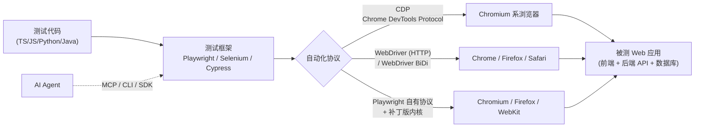
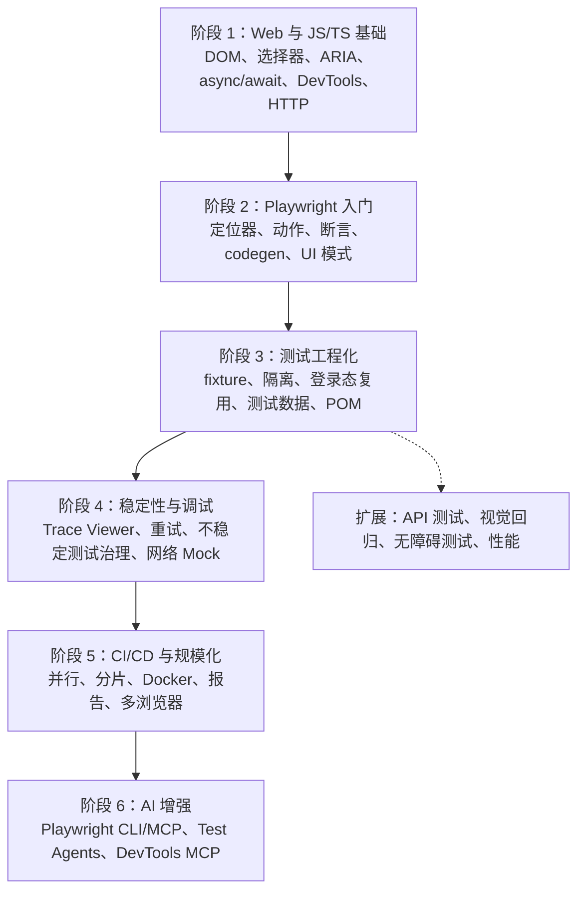
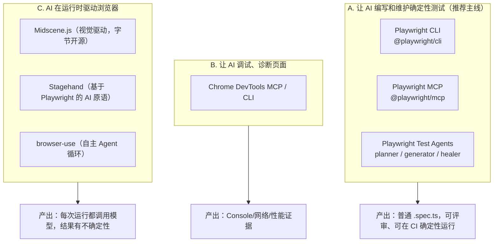
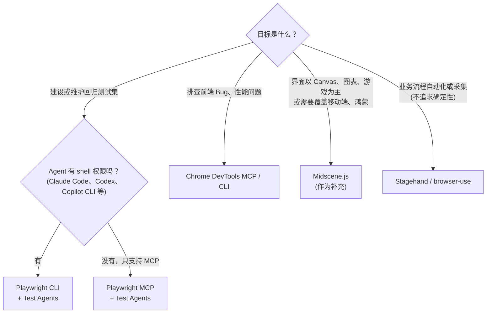
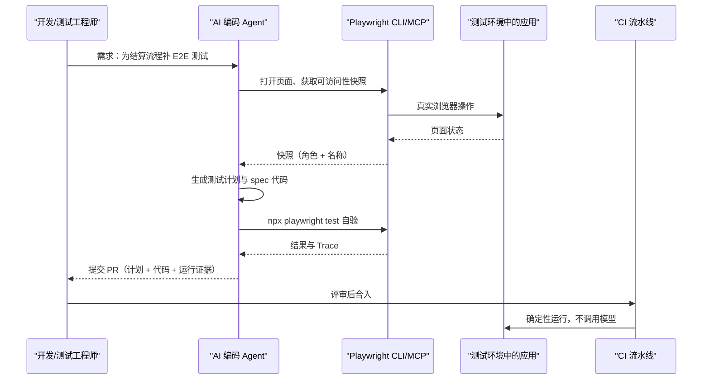

[toc]

## playwright学习指南

- **学这门技术的重点不在语法，而在于给一个不受你控制的异步系统（浏览器加被测应用）写出稳定、可信、好维护的检查。** 它要把 Web 基础、编程、测试设计和工程化几块知识组合起来用。
- **工具首选 Playwright + TypeScript。**
- **AI Agent 推荐的用法：让 AI 去探索页面、生成和修复测试代码，但每次回归和 CI 里跑的始终是普通的 Playwright 测试代码。** AI 不应该在 CI 里临场操作浏览器来判断通过还是失败。

## 自我介绍、工具与任务

- **我是谁**：Anthropic 开发的 Claude，具体版本号无法从环境里确认。
- **可用工具**：Python 沙箱（内置联网搜索）、Bash 沙箱、文本编辑器。本轮成功完成了 5 次左右的检索，之后触发了调用上限。附带的 Bash 脚本已通过 `bash -n` 语法检查；沙箱里没有 `shellcheck` 和 `shfmt`，这两项检查**没有做**，建议你本地补跑。
- **任务**：以资深测试架构师的身份，面向国内网络环境下的中文开发者，讲清楚浏览器自动化测试的前置知识、学习路线、和学编程语言的区别，以及 AI Agent 测试方案怎么选。

## 信息依据与知识截止

| 类别                                                         | 依据                                                         | 可信度                     |
| ------------------------------------------------------------ | ------------------------------------------------------------ | -------------------------- |
| Playwright Test Agents、Playwright CLI 与 MCP 对比、Chrome DevTools MCP、Midscene.js、browser-use 与 Stagehand 对比 | 本轮联网检索（Chrome 官方博客与文档、测试平台博客、社区文章），见文末来源 | 较高                       |
| Playwright 核心 API、定位器与断言的最佳实践、协议原理        | 我的训练知识，与 playwright.dev 官方文档一致，但**本轮没有逐条联网核实** | 较高，但建议以官方文档为准 |
| WebDriver BiDi 的最新进展、npmmirror 的浏览器镜像地址、`playwright-cli` 的具体子命令 | 训练知识，**未核实**，文中已标注                             | 中                         |

- **检索时间**：按搜索结果显示的页面年龄推算，大约是 **2026 年 10 月**。
- **局限**：本轮是"正常搜索一轮"，而且检索次数提前用完，所以有些分类没有单独搜到（见文末遗漏审计）。AI Agent 测试领域变化很快，选型前建议你再查一次各工具的最新版本。

## 全景：浏览器自动化测试在做什么

**浏览器自动化测试**（Browser Automation Testing，通常就是 **E2E 测试**，即端到端测试 End-to-End Testing）是用程序模拟真实用户操作浏览器（打开页面、点击、输入），再检查页面状态、网络请求或数据是否符合预期，以此验证整条业务链路是对的。



图的含义：

- **测试代码**描述"做什么、期望什么"。**测试框架**负责定位元素、自动等待、断言、并行、报告。
- **自动化协议**是框架和浏览器之间的通道：
  - **CDP**：Chrome 的调试协议，功能强，但只适用于 Chromium 系浏览器。
  - **WebDriver**：W3C 标准，Selenium 用的就是它。
  - **WebDriver BiDi**：W3C 正在推进的新一代双向标准，想兼顾跨浏览器和事件订阅。
- **AI Agent** 不直接取代这些东西。它通过 **MCP**（Model Context Protocol，模型上下文协议）、命令行工具或 SDK 去调用同一套能力，因此 **AI 方案也建立在传统自动化的基础之上**。这正是为什么想用好 AI 测试，仍然得先学传统自动化。

再看它在测试体系里的位置。**测试金字塔**（Test Pyramid）的意思是：单元测试多而快，集成测试居中，E2E 测试少而贵。

| 层级                  | 测什么                               | 速度与成本               | 典型工具                                       |
| --------------------- | ------------------------------------ | ------------------------ | ---------------------------------------------- |
| 单元测试（Unit）      | 单个函数或组件的逻辑                 | 毫秒级，便宜             | Vitest、Jest、pytest                           |
| 集成/API 测试         | 模块之间、接口契约                   | 较快                     | Supertest、Playwright `request`、REST Assured  |
| 组件测试（Component） | 单个 UI 组件在真实浏览器里的表现     | 中等                     | Playwright CT、Cypress CT、Vitest Browser Mode |
| **E2E 浏览器测试**    | **用户关键路径**（登录、下单、支付） | 秒级，最贵，最容易不稳定 | **Playwright**、Selenium、Cypress              |

**推荐**：E2E 只覆盖**关键业务路径**，能在下层测的逻辑放到下层去测。

分配测试投入时可遵循：

1. **业务计算与大量规则组合**：优先放到单元测试或 API 测试。
2. **组件交互**：视项目考虑组件测试。
3. **关键用户流程**：用浏览器端到端测试覆盖。
4. **外观与可访问性**：作为补充维度单独设计。

测试金字塔的核心不是记住某个百分比，而是认识到**高层测试覆盖的链路更长、执行更慢，投入应在不同层次之间分配**。

## 前置知识清单

按 **必须 / 应该 / 可以** 三档排列：

| 档位     | 知识领域                                                     | 要掌握到什么程度                                             | 为什么需要                                                   |
| -------- | ------------------------------------------------------------ | ------------------------------------------------------------ | ------------------------------------------------------------ |
| **必须** | **HTML 与 DOM**                                              | 元素、属性、DOM 树、表单、`iframe`、Shadow DOM 的概念        | 自动化的对象就是 DOM                                         |
| **必须** | **CSS 选择器**（XPath 了解即可）                             | 写出和看懂 `#id`、`.class`、属性选择器、层级选择器           | 定位元素的基础                                               |
| **必须** | **可访问性树与 ARIA 角色**（Accessibility Tree / ARIA Role） | 知道 button、link、textbox、checkbox 等**角色**和**可访问名称**（accessible name） | Playwright 推荐的 `getByRole` 定位依赖它；**AI 工具（Playwright MCP/CLI）给模型看的页面快照也是可访问性树** |
| **必须** | **一门编程语言**，推荐 **TypeScript/JavaScript**             | 变量、函数、模块、**`async/await` 与 Promise**               | 浏览器操作全部是异步的，不懂异步写不对测试                   |
| **必须** | **浏览器开发者工具**（DevTools）                             | Elements、Console、Network、Application（Cookie、Storage）   | 排查失败、找定位、看请求的主要手段                           |
| **必须** | **HTTP 基础**                                                | 请求方法、状态码、Header、Cookie/Session/Token、跨域（CORS）的概念 | 登录态、接口 Mock、网络断言都离不开                          |
| **应该** | **测试设计**                                                 | 等价类、边界值、场景法；**断言**（Assertion）的写法；**测试隔离**（Test Isolation）；**不稳定测试**（Flaky Test）的成因 | 决定"测什么"，比"怎么点"更重要                               |
| **应该** | **工程基础**                                                 | Node.js 与 npm、Git、命令行、环境变量                        | 搭环境、跑测试、团队协作                                     |
| **应该** | **CI/CD**                                                    | GitHub Actions 或 GitLab CI 的基本流水线                     | 自动化测试的价值主要体现在持续运行                           |
| **可以** | Docker                                                       | 用官方镜像跑测试，统一环境                                   | 消除"我本地能过"的问题，统一视觉对比的基准图                 |
| **可以** | 前端框架常识（React/Vue）                                    | 知道单页应用（SPA）的异步渲染、路由、状态                    | 理解为什么元素会"晚一点才出现"                               |
| **可以** | 被测系统的业务与架构                                         | 账号体系、测试数据、环境划分                                 | 决定测试数据怎么准备和清理                                   |

**可访问性树要特别强调一下**，因为它同时是"现代定位方式"和"AI 看页面的方式"的基础。举个例子：页面上有 `<button aria-label="提交订单">✓</button>`。用 CSS 选择器你可能会写 `.btn-primary.submit`，类名一改测试就挂。用角色定位则是 `getByRole('button', { name: '提交订单' })`，按"用户和读屏软件感知到的语义"去找元素，**更稳定，也顺便检查了无障碍属性**。Playwright MCP 和 CLI 给 AI 的页面快照同样是这种"角色 + 名称"的结构，所以**页面的可访问性越好，AI 也越容易操作**。

## 和学一门编程语言的差异

学编程语言，主要是学一套**表达工具**：语法、标准库、惯用法，编译器和运行时是确定、可控的。学浏览器自动化测试，是在**一个外部、异步、不确定的系统上做工程实践**。

| 维度         | 学一门编程语言             | 学浏览器自动化测试                                           |
| ------------ | -------------------------- | ------------------------------------------------------------ |
| 学习对象     | 单一、自洽的知识体系       | **组合型知识**：Web、编程、测试设计、工程化、业务            |
| 运行环境     | 确定：同样输入得到同样输出 | **不确定**：网络延迟、渲染时机、动画、第三方服务、数据状态都在变 |
| 核心难点     | 语法、类型系统、抽象能力   | **同步与等待**、**定位稳定性**、**测试数据与隔离**           |
| 对错标准     | 编译通过、单元测试通过     | **测试本身也要可信**：既不能误报（假失败），也不能漏报（假通过） |
| 反馈方式     | 编译错误，信息明确         | 超时、元素找不到、截图对不上，**要读 Trace 和日志去推断原因** |
| 知识的半衰期 | 语言核心多年稳定           | 框架 API 相对稳定，**但被测应用天天在变，维护成本是持续的**  |
| 成长路径     | 写更多代码，读更多源码     | 在**真实项目**里经历用例设计、不稳定测试治理和 CI 落地       |
| 业务依赖     | 低                         | **高**：不懂业务就不知道该断言什么                           |

用一个例子说明"不确定性"是最主要的差异。下面这段代码语法完全正确，但它是**典型的不稳定测试**：

```ts
// 反例：固定等待 + 只取一次值的断言
await page.click('.add-btn');
await page.waitForTimeout(3000);                 // 猜 3 秒够了：机器慢就失败，机器快就浪费时间
const text = await page.locator('.count').textContent();
expect(text).toBe('1 item left');                // 只读一次，不会重试
```

```ts
// 正例：用户可见的定位 + 会自动重试的 Web-first 断言
await page.getByRole('button', { name: '添加' }).click();
await expect(page.getByTestId('todo-count')).toHaveText(/1 item/);  // 在超时时间内反复检查，直到满足
```

这里的教训在学语言时不会遇到：**代码对，测试不一定对**。所以学习时**必须**有"时间轴思维"，也就是任何断言都要考虑"页面此刻有没有就绪"。

### 最关键的一点：你必须自己定义"正确"

测试领域把"判断结果正确与否的依据"称为**测试判定依据**（Test Oracle）。学编程语言时，"正确"由编译器或运行结果给定；学浏览器自动化测试时，**"正确"要由你依据已确认的需求、协议或业务规则来定义**。

举个例子，需求规定"购买数量为 1 到 99 的整数"：

- 输入 `1` 和 `99` 应被接受。
- 输入 `0` 和 `100` 应被拒绝。
- 非整数如何处理，需要需求明确到可判定。

这里有个必须警惕的陷阱：**Agent 只观察当前页面，然后把页面当前的表现写成"预期结果"，就等于把现有缺陷固化成测试**。例如页面此刻错误地接受了 `100`，Agent 照抄后测试永远通过，真实缺陷却被永久掩盖。所以**测试预期必须来自已确认的需求，不能只来自被测系统的当前表现**。

## 系统学习路线



各阶段的产出和检验标准：

1. **阶段 1（1～2 周）**：能用 DevTools 找到任意元素的角色和名称，能看懂 Network 面板里一次登录请求的完整过程。
2. **阶段 2（1～2 周）**：用 `npx playwright codegen` 录一段操作，再**亲手改写**成符合最佳实践的代码，至少给官方 TodoMVC 示例站写 5 条用例。
3. **阶段 3（2 周）**：会用 `storageState` 复用登录态，会写自定义 fixture；理解为什么**每条测试都要能单独、以任意顺序运行**。稳定性可以用 `npx playwright test --repeat-each=20` 连续跑 20 遍来检验——一次通过不能证明稳定，20 次全通过才算达标。
4. **阶段 4（持续）**：拿到失败的 Trace，能在 5 分钟内判断原因属于定位、时序、数据还是环境。
5. **阶段 5**：在 GitHub Actions 或 GitLab CI 中多浏览器并行运行，失败时自动上传报告和 Trace。
6. **阶段 6**：用 AI 生成测试计划和代码，你负责评审、取舍和合入。**这一步放到最后，是因为没有前面的判断力，你就审不了 AI 写的测试。**

## 工具选型

| 维度            | **Playwright**                                | Selenium 4                             | Cypress                                | Puppeteer                    |
| --------------- | --------------------------------------------- | -------------------------------------- | -------------------------------------- | ---------------------------- |
| 维护方          | 微软，开源（Apache-2.0）                      | Selenium 社区，开源                    | Cypress.io（核心开源，云服务收费）     | Google Chrome 团队，开源     |
| 语言            | TS/JS、Python、Java、.NET                     | Java、Python、C#、JS、Ruby 等          | JS/TS                                  | JS/TS                        |
| 浏览器          | Chromium、Firefox、WebKit（接近 Safari 内核） | 所有主流浏览器（各自的 Driver）        | Chromium 系、Firefox、WebKit（实验性） | Chrome 为主，Firefox 走 BiDi |
| 自动等待        | **内置**                                      | 需要手写显式等待                       | 内置（命令队列模型）                   | 部分                         |
| 多标签页/多域名 | 支持                                          | 支持                                   | 有限制                                 | 支持                         |
| 调试            | **Trace Viewer**、UI 模式、codegen            | 依赖第三方                             | 时间旅行调试，体验很好                 | 一般                         |
| AI 生态         | **官方 MCP、CLI、Test Agents**                | 社区方案                               | 社区或商业方案                         | Chrome DevTools MCP 底层用到 |
| 适合场景        | **新项目首选**                                | 存量 Java 项目、真实浏览器网格（Grid） | 偏前端团队的单页应用                   | 爬虫、脚本、Chrome 专项      |

**推荐：Playwright + TypeScript。**
- **API 最现代**：自动等待、Web-first 断言、浏览器上下文隔离。
- **跨平台**：Windows、macOS、Linux 一致。
- **开源免费**，而且是 AI 生态里官方支持最完整的。

**适用边界**：已有大规模 Selenium + Java 体系的团队不必推倒重来，新模块可以逐步引入 Playwright for Java。只是写脚本抓数据的话，Puppeteer 更轻。

补充三点常见误解：

- **Selenium 并非"每次都要手工配驱动"的旧工具**：Selenium Manager 已提供自动驱动与浏览器管理，2026 年仍在持续发版；它是存量 Java/Grid 体系的首选，只是不再是新项目的默认选择。
- **Cypress 也有查询重试与测试隔离机制**：它的定位是"运行在浏览器内部、开发体验好"，限制主要在浏览器覆盖与多标签、跨域场景。
- 需要 **Web + 移动端统一方案**时，可评估 WebdriverIO：它同时支持 WebDriver BiDi 与经典 WebDriver，并可经 Appium 覆盖移动端。

## 核心概念与最佳实践

### 定位器（Locator）

形式：`page.getByRole(role, { name, exact })`

| 占位符  | 含义                                   | 示例                                                         | 辨析                                                         |
| ------- | -------------------------------------- | ------------------------------------------------------------ | ------------------------------------------------------------ |
| `role`  | ARIA 角色，代表元素"是什么"            | `'button'`、`'link'`、`'textbox'`、`'checkbox'`、`'heading'` | 指语义角色，不是标签名：`<div role="button">` 也是 button    |
| `name`  | 可访问名称，用户或读屏软件感知到的名字 | `'提交订单'` 或正则 `/提交/`                                 | 来源可能是文本内容、`aria-label` 或关联的 `<label>`，不一定等于可见文本 |
| `exact` | 是否要求全字匹配、区分大小写           | `true` 或 `false`（默认 `false`，即包含匹配）                | 名称有前缀重叠（"保存"和"保存草稿"）时设为 `true`            |

**定位优先级**（官方推荐顺序）：

1. **`getByRole`**：首选。
2. **`getByLabel`**：表单字段。
3. **`getByPlaceholder`**、**`getByText`**。
4. **`getByTestId`**：语义不够时和开发约定 `data-testid`。
5. 实在不行再用 CSS 或 XPath。

**要避免**依赖 DOM 层级的长 XPath（如 `/html/body/div[3]/div[2]/button`）和样式类名。

**定位器是"惰性"的**：创建时不查找元素，**每次执行动作或断言时才实时解析**。因此可以先存进变量，后面反复使用，不会出现 Selenium 那种"元素过期"（StaleElement）问题。

### 自动等待与 Web-first 断言

- **自动等待**（Auto-waiting）：执行 `click()` 之前，Playwright 会自动等元素满足"可操作"条件：已挂载、可见、稳定（不在动画中）、能接收事件、可用。
- **Web-first 断言**：形式是 `await expect(locator).toHaveText(expected, { timeout })`。

| 占位符       | 含义                                                         |
| ------------ | ------------------------------------------------------------ |
| `locator`    | 要检查的定位器                                               |
| `toHaveText` | 断言方法，还有 `toBeVisible`、`toHaveCount`、`toHaveURL`、`toBeChecked` 等 |
| `expected`   | 期望值，可以是字符串、正则，或数组（多元素时）               |
| `timeout`    | 可选，自动重试的最长时间（默认 5 秒，可在配置中修改）        |

**必须加 `await`**。**要区分**：`expect(await locator.textContent()).toBe(...)` 只读一次、不会重试，是不稳定测试的常见来源。

### 测试隔离与 fixture

- **浏览器上下文**（BrowserContext）相当于一个全新的"无痕窗口"，有独立的 Cookie 和 Storage，创建成本很低。Playwright Test **默认给每条测试一个新的上下文**，测试之间互不污染。
- **fixture**（测试夹具）是声明式的依赖注入：测试函数参数里的 `{ page }` 就是内置 fixture，测试开始前自动准备，结束后自动清理。你也可以自定义，比如一个"已登录的管理员页面"。
- **登录态复用**：在一个 setup 项目里登录一次，用 `storageState` 把 Cookie 和 Storage 保存到文件，其他测试直接加载，避免每条用例都走一遍登录界面。

### 调试三件套

- **`npx playwright codegen <url>`**：录制操作并生成代码。**适合用来学定位写法，不适合直接提交录制结果。**
- **`npx playwright test --ui`**：UI 模式，可以逐步执行，按时间轴查看 DOM 快照。
- **Trace Viewer**：配置 `trace: 'on-first-retry'` 后，失败重试时会记录完整轨迹（每一步的 DOM、网络、控制台），用 `npx playwright show-trace` 打开。**排查 CI 失败主要靠它。**

### 不稳定测试的四大根因

**不稳定测试**（Flaky Test）是 E2E 的头号敌人：同一份代码时而通过、时而失败，会持续消耗团队对流水线的信任。可按四类根因定位（根因分类参考 [Trunk：Flaky Tests 指南](https://trunk.io/blog/the-ultimate-guide-to-flaky-tests)）：

| 根因 | 典型表现 | 对策 |
| ---- | -------- | ---- |
| **竞态条件**（Race Condition） | 元素还没渲染就去点击、断言早于页面更新 | 依赖自动等待与 Web-first 断言，**禁止用固定等待掩盖同步问题** |
| **外部资源** | 第三方接口偶尔超时或返回异常 | 用 Mock 隔离外部服务，必要时以契约测试保证 Mock 不过时 |
| **缺乏隔离** | 单独跑能过，一起跑就挂 | 每条用例独立准备与清理数据，不依赖执行顺序与共享状态 |
| **遗留或孤立用例** | 早已无人维护的用例时好时坏 | 定期清理，或隔离标记后集中治理 |

由此得出一条底线规则：**每个测试都必须能按任意顺序、独立运行**。

## 综合示例：从配置到用例

**场景**：给 Playwright 官方演示站 TodoMVC（`https://demo.playwright.dev/todomvc/`）写回归测试。要求：

- 覆盖"新增、完成、筛选"这条关键路径；
- 统一中文语言区域和时区；
- 失败时自动保留 Trace 和截图；
- 在 Chromium 和 Firefox 上并行运行；
- 另外演示怎样用网络 Mock 把被测前端和不稳定的后端隔离开。

**第一步：配置文件 `playwright.config.ts`**

```ts
import { defineConfig, devices } from '@playwright/test';

export default defineConfig({
  testDir: './tests',
  fullyParallel: true,                    // 同一文件内的测试也并行
  forbidOnly: !!process.env.CI,           // CI 中禁止遗留 test.only
  retries: process.env.CI ? 2 : 0,        // 只在 CI 重试，本地暴露问题
  reporter: [['html', { open: 'never' }]],
  use: {
    baseURL: 'https://demo.playwright.dev',
    trace: 'on-first-retry',              // 首次重试时记录 Trace
    screenshot: 'only-on-failure',
    locale: 'zh-CN',                      // 浏览器语言
    timezoneId: 'Asia/Shanghai',          // 时区，避免日期类断言随机器漂移
  },
  projects: [
    { name: 'chromium', use: { ...devices['Desktop Chrome'] } },
    { name: 'firefox', use: { ...devices['Desktop Firefox'] } },
  ],
});
```

| 字段                            | 作用                    | 推荐取值说明                                                 |
| ------------------------------- | ----------------------- | ------------------------------------------------------------ |
| `testDir`                       | 测试文件目录            | 和源码分开存放                                               |
| `fullyParallel`                 | 是否按测试粒度并行      | 测试彼此隔离时开启                                           |
| `forbidOnly`                    | 发现 `test.only` 时报错 | CI 中开启，防止只跑了一条测试却显示"全绿"                    |
| `retries`                       | 失败重试次数            | **重试是兜底手段，不能代替修复**，重试后才通过的测试要记录下来治理 |
| `use.baseURL`                   | 基础地址                | `page.goto('/todomvc/')` 会拼接在它后面，切换环境只改这里    |
| `use.trace` / `use.screenshot`  | 失败证据                | 只在需要时记录，节省时间和存储                               |
| `use.locale` / `use.timezoneId` | 浏览器语言、时区        | 面向中文用户的产品应显式设置                                 |
| `projects`                      | 多浏览器或多设备矩阵    | `devices[...]` 预设了视口和 UA                               |

**第二步：用例 `tests/todo.spec.ts`**

```ts
import { test, expect } from '@playwright/test';

test.describe('TodoMVC 待办清单', () => {
  test.beforeEach(async ({ page }) => {
    await page.goto('/todomvc/');
  });

  test('新增两条待办，完成一条后按状态筛选', async ({ page }) => {
    const newTodo = page.getByPlaceholder('What needs to be done?');
    for (const title of ['买牛奶', '写周报']) {
      await newTodo.fill(title);
      await newTodo.press('Enter');
    }

    const items = page.getByTestId('todo-item');
    await expect(items).toHaveCount(2);
    await expect(items).toHaveText(['买牛奶', '写周报']);

    // 在"包含 买牛奶 的那一行"里找复选框：链式定位，避免依赖下标
    await items.filter({ hasText: '买牛奶' }).getByRole('checkbox').check();
    await expect(page.getByTestId('todo-count')).toHaveText(/1 item/);

    await page.getByRole('link', { name: 'Completed' }).click();
    await expect(page).toHaveURL(/#\/completed/);
    await expect(items).toHaveText(['买牛奶']);

    await page.getByRole('link', { name: 'Active' }).click();
    await expect(items).toHaveText(['写周报']);
  });
});
```

这个用例串起了前面讲的大部分知识点：

- **`getByPlaceholder` 和 `getByRole`**：按用户能感知的语义定位。
- **`filter({ hasText })` 链式定位**：先缩小范围再找子元素，比 `nth(0)` 更能抵抗列表顺序变化。
- **`toHaveCount`、`toHaveText([...])`、`toHaveURL`**：全部是会自动重试的断言，代码里没有任何 `waitForTimeout`。
- **中文输入**：`fill` 直接填入中文，不需要模拟输入法。
- **隔离**：每条测试都从全新的上下文开始，而 TodoMVC 的数据存在 localStorage 里，所以测试之间天然互不影响。

**第二步补充：把断言下沉到存储层**

界面层的断言（元素文本、URL、可见性）只能证明页面"看起来对了"，不能证明状态真的被保存。当业务结果落在浏览器存储里时，可以用 `expect.poll` 对非定位器的值做轮询断言：

```ts
// 断言"已完成"的待办恰好 1 条（键名以实际站点为准）
await expect
  .poll(() =>
    page.evaluate(() =>
      JSON.parse(localStorage.getItem('react-todos') ?? '[]')
        .filter((t: { completed: boolean }) => t.completed).length,
    ),
  )
  .toBe(1);
```

`expect.poll` 把"轮询"交给框架：它会反复调用你给的函数，直到返回值满足期望。**要区分**：普通 `expect(value)` 只比较一次，而 `expect.poll(fn)` 与 Web-first 断言一样会在超时前重试，适合存储、接口等"最终一致"的值。

**第三步：网络 Mock（适用于你自己的应用）**

真实项目中，列表数据往往来自 `/api/todos` 这类接口。如果想**单独验证前端渲染逻辑**，不受后端数据和稳定性影响，可以拦截请求：

```ts
test('接口返回空列表时显示空状态', async ({ page }) => {
  await page.route('**/api/todos', (route) =>
    route.fulfill({ status: 200, json: [] }),
  );
  await page.goto('/');
  await expect(page.getByText('暂无待办')).toBeVisible();
});
```

| 占位符            | 含义                                                         |
| ----------------- | ------------------------------------------------------------ |
| `'**/api/todos'`  | URL 匹配模式（glob），`**` 匹配任意前缀；也可以传正则或函数  |
| `route`           | 被拦截的请求，可以调用 `fulfill`（伪造响应）、`continue`（放行或改写）、`abort`（模拟断网） |
| `status` / `json` | 伪造的状态码和 JSON 响应体                                   |

**要区分两类测试**：带 Mock 的属于**前端集成测试**，不带 Mock、连真实后端的才是**真正的 E2E**。两者都需要，但不要混在同一个文件或同一个项目里，否则失败时说不清是哪一层的问题。

**运行命令**：

- `npx playwright test`：全部运行。
- `npx playwright test --project=chromium`：只跑 Chromium。
- `npx playwright test --ui`：UI 模式。
- `npx playwright show-report`：查看 HTML 报告。

## 进阶示例：登录态复用、页面对象与 Fixture

上例是"单页面、无登录"的最简形态。真实项目通常还要解决三件事：**避免每条用例重复登录、把定位器集中管理、把依赖准备注入用例**。下面用一个电商"登录 → 搜索 → 加购 → 结算"的关键路径串起来。示例按该页面约定的语义定位编写，**未在本环境实跑**。

### 登录一次，全局复用（`storageState`）

用一个独立的 setup 项目登录一次，把 Cookie 与 Storage 存成文件，其余项目加载它，省去每条用例都走一遍登录界面，也减少登录接口的压力与失败面。

```ts
// tests/auth.setup.ts
import { test as setup, expect } from '@playwright/test';

setup('登录并保存状态', async ({ page }) => {
  await page.goto('/login');
  await page.getByLabel('用户名').fill(process.env.TEST_USER!);
  await page.getByLabel('密码').fill(process.env.TEST_PASS!);
  await page.getByRole('button', { name: '登录' }).click();
  await expect(page.getByRole('link', { name: '我的账户' })).toBeVisible();
  await page.context().storageState({ path: '.auth/user.json' });
});
```

```ts
// playwright.config.ts（节选）
projects: [
  { name: 'setup', testMatch: /auth\.setup\.ts/ },
  {
    name: 'chromium',
    use: { ...devices['Desktop Chrome'], storageState: '.auth/user.json' },
    dependencies: ['setup'],   // 先跑登录，再跑业务用例
  },
],
```

`storageState` 保存的是 Cookie 与 localStorage，**内含可冒充账号的凭证，必须排除在版本控制之外**（用 `.gitignore` 忽略 `.auth/`）。

### 页面对象（Page Object）：把"怎么操作"与"做什么"分开

页面对象把定位器与操作封装成类，UI 改版时只需改一处：

```ts
// tests/pages/ShopPage.ts
import { Page, Locator, expect } from '@playwright/test';

export class ShopPage {
  readonly searchBox: Locator;
  readonly cartBadge: Locator;

  constructor(private readonly page: Page) {
    this.searchBox = page.getByRole('searchbox', { name: '搜索商品' });
    this.cartBadge = page.getByTestId('cart-count');
  }

  async search(keyword: string) {
    await this.searchBox.fill(keyword);
    await this.searchBox.press('Enter');
    await expect(this.page).toHaveURL(/search\?q=/);
  }
}
```

### 自定义 Fixture：声明式注入依赖

fixture 是 Playwright 的依赖注入机制：测试函数参数里的 `{ page }` 就是内置 fixture，测试前自动准备、结束后自动清理。自定义 fixture 可以把页面对象或登录态注入用例：

```ts
// tests/fixtures.ts
import { test as base } from '@playwright/test';
import { ShopPage } from './pages/ShopPage';

type Fixtures = { shop: ShopPage };

export const test = base.extend<Fixtures>({
  shop: async ({ page }, use) => {
    await page.goto('/');
    await use(new ShopPage(page));
  },
});
export { expect } from '@playwright/test';
```

```ts
// tests/checkout.spec.ts
import { test, expect } from './fixtures';

test('搜索商品、加购并进入结算', async ({ page, shop }) => {
  // Mock 第三方运费接口，隔离外部依赖
  await page.route('**/api/shipping/quote', route =>
    route.fulfill({ json: { fee: 0, eta: '次日达' } }),
  );

  await shop.search('机械键盘');
  await page.getByRole('button', { name: '加入购物车' }).first().click();
  await expect(shop.cartBadge).toHaveText('1');

  await page.getByRole('button', { name: '去结算' }).click();
  await expect(page.getByRole('heading', { name: '确认订单' })).toBeVisible();
  await expect(page.getByText('次日达')).toBeVisible();  // 验证 Mock 数据被页面消费
});
```

要点：**登录态复用**免除重复登录，**页面对象**集中定位器，**Mock** 隔离第三方不稳定因素，全程无固定等待，`data-testid` 只用于没有语义角色的购物车角标。

## 环境搭建：跨平台与国内网络

下面的脚本**已通过 `bash -n` 语法检查**；沙箱里没有 shellcheck，建议你本地再跑一次 `shellcheck setup-e2e.sh`。

**Linux 与 macOS：`setup-e2e.sh`**

```bash
#!/usr/bin/env bash
# setup-e2e.sh —— 一键初始化 Playwright(TypeScript) 端到端测试工程（Linux/macOS）
# 用法: ./setup-e2e.sh [-d 目录] [-b "chromium firefox"] [-m] [-p http://127.0.0.1:7890] [--with-deps] [--cjk-fonts]
set -euo pipefail

usage() {
  cat <<'USAGE'
选项:
  -d, --dir DIR         工程目录（默认: e2e-demo）
  -b, --browsers LIST   要安装的浏览器，空格分隔（默认: chromium）
  -m, --mirror          使用国内 npm 镜像与浏览器下载镜像
  -p, --proxy URL       使用 HTTP 代理（如本地 mihomo: http://127.0.0.1:7890）
      --with-deps       （仅 Linux）安装浏览器系统依赖，需要 sudo
      --cjk-fonts       （仅 Debian/Ubuntu）安装中文字体，避免截图中文变方块
  -h, --help            显示帮助
USAGE
}

PROJECT_DIR="e2e-demo"
BROWSERS="chromium"
USE_MIRROR=0
PROXY=""
WITH_DEPS=0
CJK_FONTS=0

while [ $# -gt 0 ]; do
  case "$1" in
    -d | --dir) PROJECT_DIR="$2"; shift 2 ;;
    -b | --browsers) BROWSERS="$2"; shift 2 ;;
    -m | --mirror) USE_MIRROR=1; shift ;;
    -p | --proxy) PROXY="$2"; shift 2 ;;
    --with-deps) WITH_DEPS=1; shift ;;
    --cjk-fonts) CJK_FONTS=1; shift ;;
    -h | --help) usage; exit 0 ;;
    *) echo "未知参数: $1" >&2; usage; exit 1 ;;
  esac
done

command -v node >/dev/null 2>&1 || { echo "未找到 Node.js，请先安装 LTS 版本（建议 20+）" >&2; exit 1; }

if [ -n "$PROXY" ]; then
  export HTTP_PROXY="$PROXY" HTTPS_PROXY="$PROXY"
fi

NPM_ARGS=()
if [ "$USE_MIRROR" -eq 1 ]; then
  NPM_ARGS+=(--registry=https://registry.npmmirror.com)
  # 浏览器二进制镜像：使用前请自行确认镜像仍在维护
  export PLAYWRIGHT_DOWNLOAD_HOST="${PLAYWRIGHT_DOWNLOAD_HOST:-https://npmmirror.com/mirrors/playwright}"
fi

mkdir -p "$PROJECT_DIR"
cd "$PROJECT_DIR"
[ -f package.json ] || npm init -y >/dev/null
npm install -D ${NPM_ARGS[@]+"${NPM_ARGS[@]}"} @playwright/test typescript

read -r -a BROWSER_LIST <<<"$BROWSERS"
if [ "$WITH_DEPS" -eq 1 ] && [ "$(uname -s)" = "Linux" ]; then
  npx playwright install --with-deps "${BROWSER_LIST[@]}"
else
  npx playwright install "${BROWSER_LIST[@]}"
fi

if [ "$CJK_FONTS" -eq 1 ] && command -v apt-get >/dev/null 2>&1; then
  sudo apt-get update && sudo apt-get install -y fonts-noto-cjk
fi

mkdir -p tests
echo "完成：cd $PROJECT_DIR && npx playwright test"
```

**Windows（PowerShell）：`setup-e2e.ps1`**

```powershell
# 用法: powershell -ExecutionPolicy Bypass -File .\setup-e2e.ps1 -Mirror -Proxy http://127.0.0.1:7890
param(
  [string]$Dir = "e2e-demo",                 # 工程目录
  [string[]]$Browsers = @("chromium"),       # 浏览器列表，如 -Browsers chromium,firefox
  [switch]$Mirror,                           # 使用国内镜像
  [string]$Proxy = ""                        # HTTP 代理地址
)
$ErrorActionPreference = "Stop"
if (-not (Get-Command node -ErrorAction SilentlyContinue)) { throw "未找到 Node.js，请先安装 LTS 版本（建议 20+）" }
if ($Proxy) { $env:HTTP_PROXY = $Proxy; $env:HTTPS_PROXY = $Proxy }
$npmArgs = @()
if ($Mirror) {
  $npmArgs += "--registry=https://registry.npmmirror.com"
  if (-not $env:PLAYWRIGHT_DOWNLOAD_HOST) { $env:PLAYWRIGHT_DOWNLOAD_HOST = "https://npmmirror.com/mirrors/playwright" }
}
New-Item -ItemType Directory -Force -Path $Dir | Out-Null
Set-Location $Dir
if (-not (Test-Path package.json)) { npm init -y | Out-Null }
npm install -D @npmArgs @playwright/test typescript
npx playwright install @Browsers
New-Item -ItemType Directory -Force -Path tests | Out-Null
Write-Host "完成：cd $Dir; npx playwright test"
```

**跨平台与网络注意事项：**

- **代理变量的写法不同**：Linux/macOS 用 `export HTTPS_PROXY=http://127.0.0.1:7890`，PowerShell 用 `$env:HTTPS_PROXY="http://127.0.0.1:7890"`，CMD 用 `set HTTPS_PROXY=http://127.0.0.1:7890`。npm 也可以持久化配置：`npm config set proxy ...`。
- **浏览器下载镜像**：`PLAYWRIGHT_DOWNLOAD_HOST` 是 Playwright 支持的环境变量，但 **npmmirror 上的具体路径本轮没有核实**。如果镜像失效，改用代理或官方 Docker 镜像。
- **换行符**：仓库里放一个 `.gitattributes`，写入 `*.sh text eol=lf`，避免 Windows 上检出后变成 CRLF，导致在 Linux CI 里执行失败。
- **视觉对比的基准图因平台而异**：`toHaveScreenshot` 生成的基准图按操作系统区分（不同系统字体渲染不同）。**推荐统一在 Docker 镜像里生成和比对。**
- **中文字体**：精简版 Linux 和容器里如果缺少中文字体，截图中的中文会显示成方块，用 `--cjk-fonts` 或在 Dockerfile 里安装 `fonts-noto-cjk` 解决。
- **生产环境在国外服务器**：CI 运行器也在国外时，可以直接走官方源，不需要镜像变量，所以脚本里把镜像做成了可选参数。

排查安装问题时，建议**分开检查四条链路**：npm 包下载、浏览器二进制下载、目标网站访问、模型 API 访问。它们是四项不同配置，**仅修改 npm 镜像并不能解决浏览器二进制下载**（后者默认走微软 CDN）。MCP 侧另有 `--proxy-server` 与代理绕过选项，与安装阶段的代理不是同一项配置。

至于 npmmirror 上的浏览器镜像地址，来源之间存在不一致（`https://npmmirror.com/mirrors/playwright` 与 `https://cdn.npmmirror.com/binaries/playwright` 两种写法），**具体路径以镜像站当前说明为准**。

### 国内生态

- **Midscene.js**：字节跳动 Web Infra 团队开源，自然语言加视觉模型驱动，可与 Playwright、Puppeteer 结合，对国产视觉模型支持较好。
- **DrissionPage**：国产 Python 浏览器控制库，更多用于数据采集。
- **Airtest / Poco**：网易开源，偏游戏与移动端自动化。
- **Page Agent（阿里）、Agent TARS 与 UI-TARS（字节）**：分别面向自有站点页内助手、本地模型与视觉路线评估。

上述国内项目的状态来自候选文档，**本轮未逐一核实最新版本**，接入前请以各自官方仓库为准。

## AI Agent 做 Web 应用测试：方案与推荐

### 方案全景



这三类的区别在于**AI 处在什么位置**：A 类里 AI 是"写测试的人"，B 类里 AI 是"排查问题的人"，C 类里 AI 是"每次执行时的操作员"。**做回归测试应该以 A 类为主**，因为回归测试要求可重复、低成本、结果可解释。

C 类内部还可按 AI 介入的粒度再分两档：**脚本内嵌式**（在普通脚本里写自然语言步骤，运行时调模型定位）与**全自主式**（只给一个目标，由模型自行规划每一步）。把三类放在一起比较，取舍就很清楚：

| 维度 | **生成期 AI**（A 类） | **运行时 AI：脚本内嵌** | **运行时 AI：全自主** |
| ---- | --------------------- | ----------------------- | --------------------- |
| 代表 | Playwright CLI/MCP + Test Agents | Midscene.js、Stagehand | browser-use |
| 运行时是否依赖模型 | **否**（产物是普通 Playwright 脚本） | 是 | 是 |
| 确定性 | 高 | 中（视觉/语义定位有容错，也有随机性） | 低 |
| 每次运行成本 | 零模型费用 | 每步都调模型 | 高 |
| 对 UI 变更的鲁棒性 | 低（靠 healer 修复） | 高 | 高 |
| 适用场景 | **回归测试主力** | 变化频繁的 UI、Canvas、跨端界面 | 探索性测试、冒烟、生成测试思路 |
| 能否作为 CI 门禁 | **适合** | 谨慎（需控制随机性与成本） | **不适合**作为门禁 |

### 各方案要点（基于本轮检索）

| 方案                       | 是什么                                                       | 优势                                                         | 局限与适用边界                                               |
| -------------------------- | ------------------------------------------------------------ | ------------------------------------------------------------ | ------------------------------------------------------------ |
| **Playwright CLI**         | 微软推出的、专为 AI 编码 Agent 设计的命令行工具（[TestCollab](https://testcollab.com/blog/playwright-cli)） | 每个动作是一条 shell 命令，产物（快照、截图）写到磁盘，**token 用量明显低于 MCP**；据 Shipyard 的文章，**微软目前推荐编码 Agent 优先用 CLI 而不是 MCP** | 需要 Agent 有 shell 权限；省多少 token 各文章测法不同，结论差异较大（例如 Better Stack 测得差距很小） |
| **Playwright MCP**         | MCP 服务器，在模型上下文里维持一个活的浏览器和**完整的可访问性树快照**（[bug0](https://bug0.com/blog/playwright-cli-vs-playwright-mcp-ai-browser-testing-2026)） | 适合没有 shell 的客户端和长时间自主探索；主流 AI IDE 都支持  | **消耗 token 多**（要在上下文里保持状态）                    |
| **Playwright Test Agents** | Playwright **v1.56+ 内置**的三个 Agent：planner 探索应用并输出 Markdown 测试计划，generator 把计划转成测试文件，healer 修复失败的测试（[TestDino](https://testdino.com/blog/playwright-test-agents)） | **官方出品，产物就是普通的 Playwright 测试**；可以通过 `npx playwright init-agents --loop=vscode` 等命令初始化 | healer 自动修复定位器时，**可能把真实的 Bug "修"成测试通过**，必须人工评审 |
| **Chrome DevTools MCP**    | Google 官方维护，2025-09-23 发布公开预览（[Chrome 官方博客](https://developer.chrome.com/blog/chrome-devtools-mcp)） | 让 AI 拿到截图、Console、网络请求、**性能跟踪**、Lighthouse 审计等调试能力；官方现在还提供 CLI 和 Agent Skills（[官方入门](https://developer.chrome.com/docs/devtools/agents/get-started)） | 只支持 Chrome；定位是**调试和诊断**，不是测试框架            |
| **Midscene.js**            | 字节跳动开源，基于多模态（视觉）大模型，用自然语言操作和断言；覆盖 Web、Android、iOS、鸿蒙、桌面（CSDN 社区文章） | **能处理 Canvas 等 DOM 难以定位的界面**；国内社区活跃，可以接入国内视觉模型；自带可视化回放报告 | 每一步都调用模型，**速度慢、有成本、结果不完全确定**         |
| **Stagehand**              | 在 Playwright 上提供 `act`、`extract`、`observe` 等 AI 原语（[NxCode](https://www.nxcode.io/resources/news/stagehand-vs-browser-use-vs-playwright-ai-browser-automation-2026)） | **代码和 AI 混合**：稳定的步骤写代码，易变的步骤交给 AI      | 更偏流程自动化和数据提取，与 Browserbase 云服务结合较深      |
| **browser-use**            | Python 写的自主 Agent 循环，由模型决定每一步做什么（[Skyvern](https://www.skyvern.com/blog/browser-use-vs-stagehand-which-is-better/)） | 上手快，适合描述目标、让 AI 自己完成                         | **用于回归测试时确定性最差**；更适合 RPA（机器人流程自动化）和信息采集 |

### 选型决策



### 推荐方案（主线）

**组合：编码 Agent + Playwright CLI（或 MCP） + Playwright Test Agents + Chrome DevTools MCP（按需）**

1. **探索与计划**：Agent 通过 Playwright CLI 或 MCP 打开测试环境，或者直接用 planner Agent 生成 Markdown 测试计划。**由人评审计划**，确认覆盖范围和断言点。
2. **生成**：generator 或编码 Agent 按计划写 `.spec.ts`，并且**遵守你在 `AGENTS.md` 里规定的约束**（见下文）。
3. **验证**：Agent 自己运行 `npx playwright test`，失败时读取 Trace 和错误信息迭代修改。
4. **评审合入**：人工 Code Review，**重点看断言是否真的反映业务预期**。
5. **CI 运行**：CI 只跑确定性测试代码，**不调用模型**，速度快、零 token 成本、结果可重复。
6. **维护**：UI 改版导致测试失败时，用 healer 或编码 Agent 提出修复建议，**由人判断是测试该改，还是产品出了 Bug**。



### 接入配置示例

**Playwright MCP**（通用 MCP 客户端配置，比如 Cursor、Claude Desktop 等的 `mcpServers` 段）：

```json
{
  "mcpServers": {
    "playwright": { "command": "npx", "args": ["@playwright/mcp@latest"] },
    "chrome-devtools": { "command": "npx", "args": ["chrome-devtools-mcp@latest"] }
  }
}
```

- `command` 和 `args`：客户端启动 MCP 服务器进程的命令。`@latest` 表示每次拉取最新版本；**团队里推荐锁定具体版本号**，保证可复现。
- Claude Code 用户也可以用命令添加：`claude mcp add playwright npx @playwright/mcp@latest`。

**Playwright CLI**：通过 `npm install -g @playwright/cli@latest` 安装，**先运行 `playwright-cli --help` 查看子命令**。它的典型交互方式是：打开 URL、获取快照（快照里元素带引用编号）、按引用编号点击或输入。具体子命令本轮没有逐条核实，以 `--help` 输出为准。

**Playwright Test Agents**：在已有的 Playwright 工程里运行 `npx playwright init-agents --loop=vscode`（Claude Code 等其他客户端对应的 `--loop` 取值见官方文档），生成 Agent 定义文件和种子测试（seed）。

### 视觉驱动方案接入示例：Midscene.js

**Midscene.js** 用自然语言加视觉模型驱动界面，可作为 Playwright 套件的补充，覆盖 Canvas、图表等 DOM 难以定位的界面。API 以官方文档为准：

```ts
import { test as base } from '@playwright/test';
import { PlaywrightAiFixture } from '@midscene/web/playwright';

export const test = base.extend(PlaywrightAiFixture());

test('用自然语言验证搜索结果', async ({ page, aiAct, aiAssert, aiQuery }) => {
  await page.goto('https://your-app.example');
  await aiAct('在搜索框输入"机械键盘"并回车');
  await aiAssert('搜索结果中至少有一个商品标题包含"键盘"');
  const prices = await aiQuery<number[]>('所有商品的价格，数字数组');
  expect(prices.every(p => p > 0)).toBeTruthy();
});
```

国内可经 `MIDSCENE_MODEL_NAME`、`OPENAI_BASE_URL`、`OPENAI_API_KEY` 等环境变量指向兼容 OpenAI 协议的国产视觉模型服务（如 Qwen-VL、豆包、UI-TARS），**具体变量名与推荐模型以官方文档的模型配置章节为准**。注意它每步都调用模型，速度、成本与确定性都受影响，适合作为补充而非回归主力。

### 用 `AGENTS.md` 约束 AI 写测试

**推荐**在仓库根目录放一份 `AGENTS.md`，把前面的最佳实践写成 AI 必须遵守的规则：

```markdown
## E2E 测试规范（AI 与人类共同遵守）

- 框架：Playwright Test + TypeScript，测试放在 `tests/e2e/`，命名 `*.spec.ts`
- 定位优先级：getByRole > getByLabel > getByPlaceholder/getByText > getByTestId；禁止使用依赖 DOM 层级的 XPath 和样式类名
- 断言必须使用 Web-first 断言：`await expect(locator).toXxx()`；禁止 `waitForTimeout`
- 每条测试必须可独立运行：数据在测试内创建，结束后清理；登录态通过 storageState 复用
- 断言必须验证业务结果（金额、状态、提示文案），不能只断言"页面可见"
- 修复失败测试时：先判断是产品 Bug 还是测试过时；疑似产品 Bug 时停止修改并报告，不得放宽断言
- 提交前运行：`npx playwright test --project=chromium`，在 PR 描述中附上结果
```

其中"疑似产品 Bug 时停止修改并报告"这一条最关键，它直接针对 AI 自动修复最大的风险：**为了让测试变绿而改掉断言**。

针对自动修复（healer）这类最容易被误用的能力，**建议设三条边界**：

- 允许提出定位器、测试数据与同步方式的修改。
- **未经确认，不得删除断言、降低要求、添加 `test.skip()`、或自动接受新的视觉基线**。
- 对疑似产品缺陷保留失败证据，走代码审查，而不是把测试改绿了事。

### 给 Agent 的任务应该怎样描述

不要只说"帮我测试一下网站"。把任务拆成目标、环境、验收依据、约束与交付，并明确要求它**先列计划、等确认**：

```markdown
**目标**：验证待办可以新增、完成，并在刷新后保留状态。
**环境**：仅使用指定测试站点和隔离会话，不接触生产环境。
**验收依据**：先列出每个场景的前置条件、操作和预期结果，等我确认后再写代码。
**实现约束**：优先语义定位与可重试断言，不使用固定等待掩盖同步问题。
**失败处理**：保存失败证据，区分产品、脚本与环境问题；不得自行删除断言或跳过测试。
**交付**：测试计划、测试代码、执行命令、通过/失败/跳过统计与报告位置。
```

对于自建 Agent 系统，**推荐暴露"执行指定测试集"这类受限工具（返回退出码、结果摘要与产物路径），而不是默认给任意 shell 执行权限**。

### AI 测试的风险与防护

- **必须**：Agent 只能操作**测试环境和测试账号**，不能碰生产环境和真实用户数据。
- **必须**：浏览器使用独立的用户配置目录（profile），不要复用你日常登录各种账号的浏览器。
- **应该**：警惕**提示注入**（Prompt Injection）。页面上的文字可能被恶意构造成"指令"，诱导 Agent 执行危险操作。
- **应该**：把 token 成本算进去。长时间探索时，MCP 的快照会大量占用上下文，有 shell 的场景优先用 CLI。
- **避免**：让运行时 AI（C 类方案）承担主力回归测试。一次通过不代表下次也能通过，失败时也很难判断是模型的问题还是产品的问题。

## 落地边界：测试质量、安全与 CI

工具选对、脚本写完，并不代表这套测试可以交付。上线前后还需守住以下边界。

### 测试质量

| 必须注意 | 推荐做法 |
| -------- | -------- |
| **用例独立** | 不依赖上一条用例创建的数据，单独运行与批量运行都应成立 |
| **断言有效** | 做受控的故障注入（故意改坏被测功能），确认相关缺陷确实会让测试失败 |
| **失败可解释** | 保留版本、环境、测试数据标识与失败产物，而不只是截图 |
| **重试不掩盖问题** | 区分首次通过、重试后通过（`flaky`）与持续失败，持续处理偶发失败 |
| **Mock 边界清楚** | 用 Mock 隔离依赖时，明确它验证的是哪一部分，并另留必要的真实链路测试 |

其中**断言重试与用例重试不是一回事**：断言重试是在超时内等待结果达到预期，用例重试是整条测试重新执行。Playwright 会把"首次失败、重试后通过"的用例单独标为 `flaky`，不应把它与首次通过等同看待。

### 安全与隐私

除前文 AI 部分已述要点外，还需注意：

- **不要把 MCP 配置当安全沙箱**：Playwright MCP 官方明确它不构成安全边界，来源允许列表等选项也不能提供完整隔离，真正的限制要放在客户端权限、账号与运行环境层面。
- **确认远程模型实际收到了哪些文本、截图与日志**：浏览器工具跑在本地，不代表数据都留在本地。
- 认证状态文件不要提交到 Git；支付、发信、删除等有实际后果的动作走沙箱或明确批准流程。

### CI 与跨平台

- **TypeScript 测试跑通，不代表类型检查通过**：Playwright 会转换并执行 TS，官方建议另外运行 TypeScript 编译器做类型检查。
- **视觉回归要固定环境**：截图基线按操作系统区分，不同环境的截图不应混用基线，推荐统一在 Docker 镜像里生成与比对。
- **WebKit 测试与移动端模拟有参考价值，但不等于真实 Safari 与真实移动设备验证**。
- **语义定位不等于完成了可访问性测试**：自动扫描不能替代人工与真实用户评估。

## 速查：必须、推荐、避免

- **必须**：
  - 掌握 DOM、ARIA 角色、`async/await` 和 DevTools；
  - 使用 Web-first 断言；
  - 保证每条测试独立；
  - CI 中保留失败证据（Trace、截图）。
- **推荐**：
  - Playwright + TypeScript；
  - 优先用 `getByRole`；
  - 用 `storageState` 复用登录态；
  - 用 Docker 统一环境；
  - AI 负责生成测试，CI 只做确定性执行；
  - 用 `AGENTS.md` 约束 AI。
- **可以**：
  - 用 Midscene.js 补充覆盖 Canvas 或移动端；
  - 用 Chrome DevTools MCP 做性能诊断；
  - 用 Stagehand 处理变化频繁的个别步骤。
- **避免**：
  - `waitForTimeout` 固定等待；
  - 长 XPath；
  - 测试之间互相依赖；
  - 直接提交录制脚本；
  - 不经评审就合入 healer 的修复；
  - 让 AI 接触生产数据。

